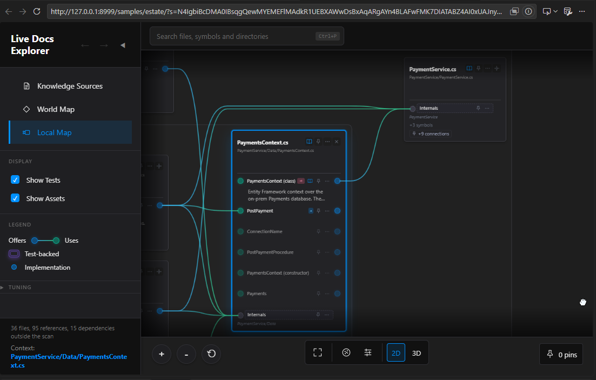
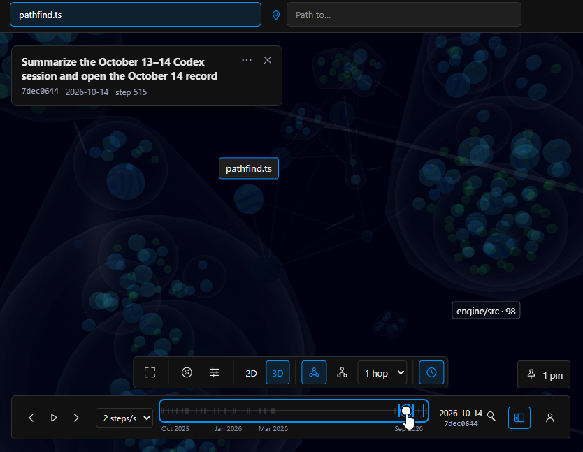
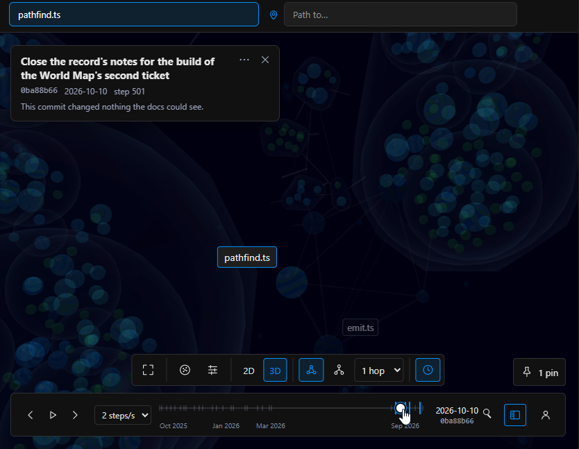
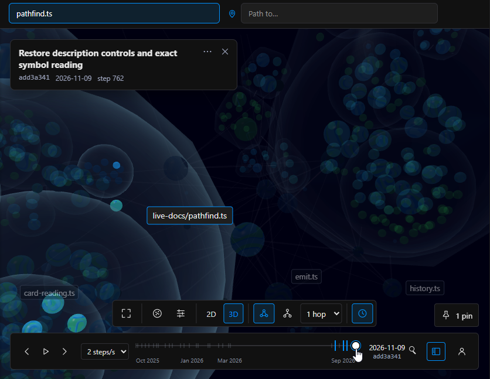
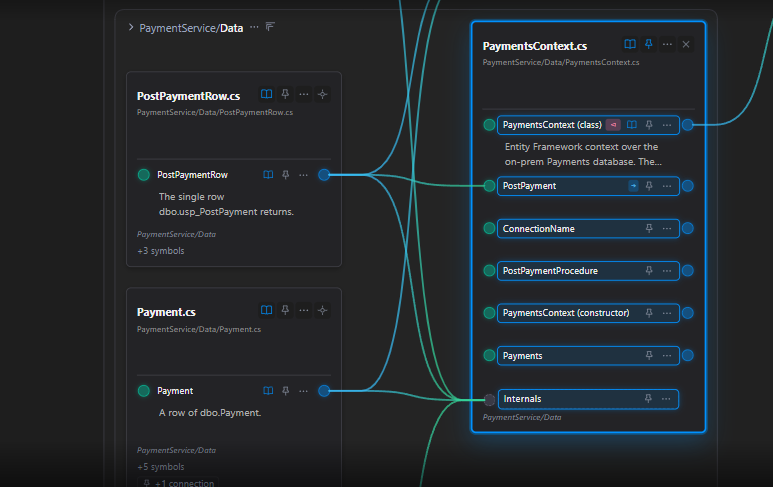

# November 18, 2026 — the working copy on the Linux side

## Coverage

Agent-maintained record by Claude Code in the VS Code extension, model Fable 5.2 (`claude-fable-5-2`) as stated by the harness, recorded November 18, 2026. This is the root conversation, not a harness export. Verbatim visible messages are fenced; work notes are authored interpretation. Tool payloads, private reasoning and delegated conversations are excluded. Final replies are captured only once delivered, normally at the following turn.

**Where this chat began, and what that means for its log.** The owner opened it in VS Code attached to their new WSL distribution (Ubuntu 26.04), on the moved working copy at `/home/user/src/Live-Documentation`, and not in the dev container. The harness keeps this chat's log in the distribution's home, under `~/.claude/projects/-home-user-src-Live-Documentation/`. The container keeps its chats on the `live-documentation-claude` volume, under `projects/-workspaces-Live-Documentation/`, where the November 17 session's log stands. So reopening the folder in the container leaves this chat behind unless its log is copied onto that volume first. Whichever happens, a root that starts in the container continues this same record under the next turn number (the owner's rule of 2026-10-13 for a restarted day), and a reply of this chat not yet copied here is then recoverable only from the distribution's home or the owner's export.

**Startup coverage.** Read in full before the closing reply to Turn 1, each to its last line: `AGENTS.md`; `ChatHistory/README.md`; `Memory/owner.md` (314 lines, in two ranges); `Memory/ideas.md` (177 lines, in two ranges); `Memory/direction.md` (584 lines, in seven ranges); `Memory/narrative.md` (617 lines, in seven ranges); the five latest summaries, oldest to newest (November 10, 12, 13, 15 and 16); and the November 17 record whole (1,740 lines, in five ranges), its Resumption first. The file tool again gave a large file only in ranges, and each read went on until its file ended. The reading was interleaved with a first look at the machine. Not read: the workspace's `README.md` beyond its headings, and the owner's export of the November 17 chat beyond the lines `git diff` shows as added.

**Continued by a second root from Turn 2.** The owner reopened the folder in the dev container, "Live Documentation Dev (WSL2 graphics card)", and began a new chat there at 14:53 UTC. The first chat's log was not carried: the chats volume's folder for this project holds the November 17 session's second log and this chat's, and no other. The second root is Claude Code in the VS Code extension, Fable 5.2 (`claude-fable-5-2`) as stated by the harness, and keeps this record under the next turn numbers (the owner's rule of 2026-10-13 for a restarted day). Its notes name the working copy as the container sees it, `/workspaces/Live-Documentation`.

**The second root's startup coverage, complete at about 15:10 UTC.** Read in full, each to its last line: `AGENTS.md`; `ChatHistory/README.md`; the workspace's `README.md`; this record; `Memory/owner.md` (316 lines, in two ranges); `Memory/ideas.md` (178 lines, in two ranges); `Memory/direction.md` (586 lines, in ten ranges); `Memory/narrative.md` (631 lines, in eight ranges); the five latest summaries, oldest to newest (November 12, 13, 15, 16 and 17), each in one read; and [the vision](../../../../../.mdmd/layer-1/vision.mdmd.md). Of the November 17 record, only the work notes of its Turn 14, which hold the session-history convention. The file tool gave a large file in ranges and each read went on until its file ended. **The order it was done in:** the failed set-up came first, since the owner was waiting on it, with `owner.md`, `ideas.md` and the current sections of `direction.md` read beside it; the rest was read after the closing reply to Turns 2 to 5, while the gate ran. So the mend of the build, the answer on a rebuild and the first answer on who keeps this record were given before the narrative and the summaries had been read; [the work notes after that reading](#work-notes-after-the-startup-read) say what it added.

## Resumption

Written at 12:55 UTC on November 19 by the second root, in the dev container. **The archive moved at 16:25 UTC:** this record now stands at `AI-Agent-Workspace/AgentSessionHistory/2026/11/2026-11-18/2026-11-18.1.record.md`. After a compaction, read this section first.

- **THE STATE AT 01:12 UTC ON NOVEMBER 19. Read this bullet first; every bullet under it is older and is kept for its links.**
  - **The owner's last two turns.** [Turn 21](#turn-21): the Memory documents are improved "If they appear that they are in need of improvement", not as a routine; "Today's pass should be sufficient for setting a good standard." [Turn 22](#turn-22), answered in [root's reply of 01:01:57](#roots-reply-to-turns-21-and-22-and-its-short-messages-round-it-as-delivered): arrival may show the card and then pull back; the World Map as they picture it; screenshots of the cycle's stub, sent, with a question back to them (is this what they meant on November 13?); a model tester's wish for words is a bias, and words wait for a long hover.
  - **[Turn 23](#turn-23), the owner on the cycle's picture:** the node-level pins read as a row's; a row's hover no longer lights its wires, "undoubtedly a regression"; the 3D button's orange should be on "the specific wires which are violating the left/right arrangement rule"; and "\"French Corset\". How did this phrase never come up?" A sixth builder is out for it ([notes](#work-notes-turn-23)): worktree `agent-a3e97c71dbf05676d`, branch `returning-connections`. Owed to the owner after its facts: alternatives for telling a whole-file pin from a gathered line's.
  - **[Turn 24](#turn-24), the owner on the marble trial and the history** (02:32 UTC): the trial's changes were "marginal enough as to be not noticeable"; "What we should prefer is to have even a small change in a file produce a _perceptible_ difference."; the text's own shape as a texture, at the marble and at the Internals row's pin; the pinned file dims with the rest while scrubbing, and the controls should move between the steps that touched it. Two builders went out for it ([notes](#work-notes-turn-24)): a new one, branch `history-pinned` (port 8798), and the marble's again, branch `text-shape-probe` (a probe, no product code). The camera's builder has root's question on one doubled picture. All five were asked to hand back by about 04:00 UTC; the one full gate follows.
  - **[Turn 25](#turn-25) and [Turn 26](#turn-26)** (02:43 and 02:45 UTC): the owner invites the plain verdict on the marble and the texture ("we gotta back both of them out") and names a test of the product, an agent restating the narrative from the software alone; on learning what the track's marks are, the microscope's coarse and fine knobs; and the track zoomed by wheel or pinch "as one does for horizontal zoom in/out in FL Studio". Root's answers and what went out are in [the notes](#work-notes-turns-25-and-26): the history round's second item is now two pairs of buttons (fine unchanged, coarse new), its second milestone the zoom; the probe carries a blind reading decided beforehand; the instrument's builder (branch `narrative-playtest`) prepares the narrative task.
  - **[Turn 27](#turn-27)** (02:51 UTC): the owner asks for "a button in Live Documentation Explorer to reset my stylings to the defaults", "so that the links you send me are perceived by both of us in the same way". A seventh builder is out for it ([notes](#work-notes-turn-27)): branch `tuning-reset`, port 8799, handback asked by about 04:00 UTC.
  - **The probe's verdict** (03:02 UTC, [notes](#work-notes-the-narrative-task-landed-unrun-and-the-probes-verdict-on-the-texture)): the grain that turns at every edit fails a blind reading and adds noise; the page alone tells a file's kind, length and alignment near up and nothing of a commit's change. Put to the owner with the sheets; nothing more is being built on the texture. The narrative task is on `main` unrun (`e96c3b33`); its commands are in the instrument's README, and the history wants building past 2026-11-13 first. Owed by the instrument's builder: the list of the narrative's disagreements with git, as a file.
  - **[Turn 28](#turn-28)** (03:09 UTC): on the texture, "don't overliteralize" (filed with the idea); "Fair." to building nothing more on it; undecided on a change mark that says how much; and of the From Its Doc lever, "Your preference." Root's is removal: the marble's builder is out for it (branch `marble-pattern-removed`). Put to the owner: whether their sentence reaches the marbles themselves, their default since November 18. The narrative is corrected against git in seven places (`5e00916c`).
  - **[Turn 29](#turn-29)** (03:36 UTC), decided: "for immediate understandability of the system, Marbes Off is superior." Marbles become off by default, the lever kept; the marble's builder does it as a second commit on `marble-pattern-removed`. A hazard found: the browser suite reuses any server on its port, whoever's build it serves ([notes](#work-notes-turn-29)); to be mended at its cause.
  - **The history's first milestone is on `main`** (03:52 UTC, [notes](#work-notes-the-historys-first-milestone-landed)); its builder is on the second (the track's zoom), off the lane until told the gate is done, to stop at 05:10 with what it has if the lane is not free. **Queued, found tonight:** the stall where the reading look gives way to the connections look on a large picture; a browser run refusing a server that is not its own build's.
  - **[Turn 30](#turn-30)** (a question: the history scan reads only the local clone; answered from the code) **and [Turn 31](#turn-31)** (03:51 UTC): "I'd really like to have a \"Unpin others\" interaction." A builder is out ([notes](#work-notes-turns-30-and-31)): branch `unpin-others`, port 8824.
  - **[Turn 32](#turn-32)** (03:55 UTC): the owner on an editor's "open" against "pinned" and on re-wrapping a bubble in 3D, "I wonder if two design holes could be plugged semantically together by a common unifying user interaction." Root's answer and recommendation are in [the notes](#work-notes-turn-32); nothing is built on it beyond Unpin others, whose builder reports what Clear all pins leaves open.
  - **[Turn 33](#turn-33)** (04:01 UTC): the two strengths approved, "Oh man that sounds absolutely awesome."; the `unpin-others` builder now builds Fold others away and Unpin others, and "Wrap this group again" in a sphere's menu ([notes](#work-notes-turn-33)). On letting go by age the owner would "let it haunt me": filed as an idea. The history's zoom is written on `history-zoom` (`366e66e5`), unit-verified only.
  - **The marble pattern's removal and marbles off by default are on `main`** (04:10 UTC, `b532d6ed`, `bb57a1ac`; [notes](#work-notes-the-marble-pattern-removed-and-marbles-off-by-default-landed)).
  - **[Turn 34](#turn-34)** (04:13 UTC), two design questions: history in the 2D Local Map through "the same shared control whose state is continuous in 2D and 3D", and "how we eventually ditch the Detail Panel for good ... and possibly even the Left Sidbar"; later ideas, a date pinned in the World Map and a gamepad. Root's design is in its reply (recorded with the next turn); nothing is built on it yet.
  - **[Turn 35](#turn-35)** (04:20 UTC), decided: all three rungs of 2D history are the aim; the cheap rule for scrubbing stands for now; the page without its sidebar is to be built behind a lever. Out for it ([notes](#work-notes-turn-35)): branch `bare-frame` (a trial, port 8825), a read-only measure of what rungs 2 and 3 would add to the history, and groundwork on branch `history-2d`. Each stops at 05:10 with what it has.
  - **[Turn 36](#turn-36)** (04:25 UTC), the owner's rule for the night: builders may hop into the browser briefly and need not pass the browser suite tonight; "then we can clean up after". Root's reading and what was sent are in [the notes](#work-notes-turn-36): no gate holds the lane until the builders are done; no case deleted or loosened. **Owed after the builders:** the whole gate with its browser stage over every landing of the night, and the mending of what it shows. Landed since: the camera's round (`cb766ad6` to `e8ff39cf`). Still out: returning connections, the rested pointer, Tuning's reset, Unpin others, the bare frame, and the history's builder (the zoom's browser look, then rung 1 of history in 2D on `history-2d`).
  - **[Turn 37](#turn-37)** (04:44 UTC): no limit of time or allowance stands; "hill-climbing duty", a fleet of builders, no corner cut for a date (a presentation at their work in early December if possible). Decided: rungs 2 and 3 of history are built. Wished: a camera that frames what is pinned and follows it until the person takes the camera. Handed back and to be landed: Tuning's reset (`tuning-reset`, four commits, with the mends its builder lists for the marble's removal) and the returning connections (`returning-connections`, eleven commits; unfinished: `layout-lab.spec.ts:135`, the lit route crossing both file names, a fork on the Flow price's nominal hub).
  - **After Turn 37** ([notes](#work-notes-after-turn-37-five-builders-sent-out-and-four-rounds-landed)): landed, Tuning's reset, the pointer's rest, the row hover's mend, the history track's zoom. Out, each to hand back to root: `history-symbols-and-words` (three increments, the first ends in the one full rebuild), `camera-follows-pins` (a trial, 8826), `look-change-freeze` (8827), `returning-connections-finish` (8828), `history-2d-second` (8829), and from before, `unpin-others` (8824) and `bare-frame` (8825). **Since landed:** the returning connections (merge `924bec80`; [notes](#work-notes-the-four-landings-checked-the-returning-connections-merged-the-cameras-first-increment)). **Not to land as handed back:** `history-2d` at `840a4618` (a false "No public symbols" at a past moment; its second pass is out) **The camera's trial is merged** (`36083775`; Framing stays By Hand; [notes](#work-notes-the-cameras-trial-merged-the-historys-first-increment-reported)): for the owner's eye, Follows Pins against Out To Files, and the cell's press that still leaves the subject out. **Merged since** ([notes](#work-notes-two-more-merges-and-two-faults-in-roots-own-checking)): the Bare frame's trial (`d6f59f0f`; Frame stays Sidebar) and Fold others away with Unpin others (`7f603b12`). **Root's runner for checks after a landing** is `root/after-landing.sh` in the scratchpad (the gate without the browser, all four bundles, then short visits); never wait on a script by searching the process list for its name from a command that holds that name. **On `main` since** ([notes](#work-notes-the-visits-on-main-three-more-merges-and-the-browsers-lane)): history in the 2D map at file level, the freeze's mend and the heading's mend (`54dd2061`), and the browser's lane (`46477948`). **The browser is now taken only through `node scripts/browser-lane.mjs --label <who> -- <command>`**, after `npm run e2e:bundles`; brief every new builder so. **The whole browser suite ran on `main` at `a93ac108`: 597 passed, 3 failed** ([notes](#work-notes-the-whole-browser-suite-on-main-three-red)): `force-graph-discovery.spec.ts:70`, `force-graph-structure-cells.spec.ts:75`, `history-scrubber.spec.ts:399`. Run down and merged (`c29e2a4a`; [notes](#work-notes-the-three-red-run-down-two-were-the-cases-one-is-the-3d-pictures-long-settle)): two were the cases' and are corrected. **One stays red on `main`, known:** `force-graph-discovery.spec.ts:70`, the 3D picture taking about 5,500 frames to rest after a group grows; its bound is not to be touched. The settle's round is merged (`567cd887` the speed-up, `426f95b2` the measure in substeps and the trial; [notes](#work-notes-the-settles-measure-in-substeps-and-settle-hold-merged-the-historys-last-pass-under-a-fourth-review)): the case counts the motion's substeps and is red at about 5,250 of 2,700 until the owner has judged Settle Hold (Tuning → 3D → Forces, 0 by default; 627 substeps at 0.02) or another mend shortens the tail. Owed on a quiet machine: `history-scrubber.spec.ts:399` within its own 30 s, and the whole suite again (`node scripts/browser-lane.mjs --label gate --max-seconds 5400 -- node scripts/e2e-passes.mjs`, after `npm run build && npm run e2e:bundles`). **The history's data is not merged:** branch `history-data-mended` (tip `05c0b350` when reviewed) answered [the first review](Probes/history-data-review/README.md) and failed [a second](Probes/history-data-review/second-review.md) on a tree writer that can write outside its scratch folder, a crash on its error path and false entries from the wrapper rule; then failed [a third](Probes/history-data-review/third-review.md) on a task too long for a command line and a writer that trusts a folding rule over the disk; the same builder is on a narrower last pass and rebuilds by itself afterwards ([notes](#work-notes-the-3d-speed-up-landed-a-third-review-and-the-historys-round-narrowed)). **Owed as rounds of their own, each with an independent review:** entry detection through wrapper commands; the generator's names that do not read back (a fuzzing test). **When it hands back: a third review of only the new mends, then merge, then move its worktree's `.mdmd/history/<lens>/` and `pool.json` into `main`'s `.mdmd/history/` and run `npm run live-docs:history`.** The caches in the builders' worktrees (`agent-a8c707ce233ec995f`, `agent-a1d5a68d5bf667933`) are to be deleted by nobody. For engine work that every past moment depends on, an independent review is part of landing. **Owed:** the whole gate with its browser stage over the night's landings, once the builders now out have handed back. **Asked of the owner, unanswered:** whether root removes the eight superseded history caches in `.mdmd/history` (about 800 MB).
  - **On `main` since midnight UTC, nothing pushed by root:** the playtest instrument and its first records (`626a4821`, `326666e7`); the cells' cost mended (`6239b7c6`, `09823d2c`); the review's mends (`74ab71e4` to `dd06db84`); the narrative retold (`30a6bd94`); two quotations corrected in Memory (`57130ee1`); the guide's pointer to the design system. **The gate's non-browser stages pass over it** since the mend of one new test's type-check (`3133fb40`; [the failure](#work-notes-the-gates-first-stages-fail-on-the-nights-landings), [the mend](#work-notes-the-type-check-mended-and-the-gates-first-stages-green)); **the browser stage has not run over any of it.**
  - **Builders out, each in its worktree under `.claude/worktrees/`, each told to hand back a landing branch made from `main`:** the marble trial is whole on `main` (`8e42651b`, `8127eaea`, `e7e5de43`; its worktree `agent-a56f13063bbac6a0c` may be removed), and its fork is to be put to the owner with the pictures ([notes](#work-notes-the-marbles-third-milestone-landed-a-commit-now-shows)); **landed and done:** the page's frame (`befa3233` to `5400b2d6`) and the World Map's keyboard (`f2e1e7a1` to `11416679`), whose worktrees `agent-a17014174406222d1` and `agent-aa7dbd7f336f21a29` may be removed; **still out** (and `agent-aa7dbd7f336f21a29` again, on a new round, branch `rested-pointer`: words wait for a pointer at rest in the 3D map and the World Map, [notes](#work-notes-a-round-for-the-pointer-at-rest-and-the-months-pictures-listed)): `agent-af784aba5d0357850`, the camera, branch `camera-intent` (new work, the longest). On each handback: read the diff, look at its pictures, cherry-pick onto `main` in the order they arrive (the tuning levers' files, `template.html` and `index.ts` are touched by three of them; a conflict in a generated Live Doc is settled by regenerating), check with `git cherry`.
  - **Then one gate for the whole wave,** when no builder holds the browser: `flock -x /tmp/live-docs-browser.lock` round `LIVE_DOCS_E2E_PORT=8777 npm run safe:commit -- --e2e`, detached. Then three workers measured.
  - **The playtest ladder's second half** (31 runs) waits for root's word to its builder (`agent-a1cac76cc62021478`; the command is in [the instrument's README](../../../../scripts/playtest/README.md)). After the camera lands: the Arrival lever's three values run by the testers on two tasks, what uses this file and what a symbol does in its author's words.
  - **Queued and not briefed** (the owner's words for each are in Memory under its subject): what is dimmed is still to be read (Turn 20); the cycle's returning connection, a design round once the owner has answered; the time limits of the browser suite sorted into alarms and plain waits, then three and four workers; the design system's pass that needs a browser; the scenario table's first conversions; the toggles' names in `card-factory.ts` and `forceGraphView.ts`; the 3D building and the World Map's walkthrough said through `client/announce.ts`; closed directories' observers, the same thrashing the cells had; a description on a card showing a raw `{@link` (seen in the frame round's card picture); the lane's lock as a script that lets an exclusive waiter in ahead of new shared ones; a wait placed right after a click that may pass on a stale "false" (the review's note).
  - **With the owner, none of it blocking:** the design system's fifteen forks ([the list](Probes/design-system/README.md#the-owners-forks)), answered by exception; the cycle's pictures; the marble's fork, to be put with its pictures when the second milestone lands.
  - **What the owner must have goes in the message that ends a turn.** Twice tonight words written before a tool call were not shown ([notes](#work-notes-turn-21)).
  - **At the close, when asked:** the narrative's last chapter (November 18 and 19); direction's Next brought level; the month's picture inventory for this day's new folders (`cells-cost`, `cycle-stub`, `marble-patterns`, `world-map-keyboard`, `shell-accessibility`, `camera-intent`); the worktrees and branches of builders whose work has landed removed (the review's, the playtest builder's after its ladder, the three design-system authors'); the scratchpad's working papers; the summary.
- **The task, in the owner's words.** [Turn 1](#turn-1): "Let us now begin a new dev day chat", with three questions on the moved working copy, answered in [root's reply](#roots-reply-to-turn-1-as-the-owners-export-shows-it). [Turn 2](#turn-2): the log of the container's creation, pasted without a word, its set-up stopped at the build. [Turn 3](#turn-3): "I'm totally onboard with your proposal for both of these", the session-history convention and the plan for the blind playtests. [Turn 4](#turn-4): "Should I expect to need to rebuild the devcontainer again or are we in a state where this chat is likely to be the stable one for the day?" [Turn 5](#turn-5): who should keep this record, root or a scribe; decided in [Turn 6](#turn-6), "our current setup is optimal for simplicity and efficacy", with "Is there anything else immediate which needs my attention?" [Turn 8](#turn-8): "Any reason not to raise it? Raising it sounds fine", of the container's npm. [Turn 7](#turn-7): their surprise at the rows their window marks "· summary", which root had described wrongly and has corrected. [Turn 9](#turn-9): of the rings, "If 'Document' file types are hidden, why do we make the assertion that there are other files connected to the one that is ringed?", a misreading that root's word "hidden" caused; their hope, "different structures depending on which permutation of file types I have active", is how the maps work ([notes](#work-notes-turn-9)). [Turn 11](#turn-11): a standing grant for idle time, to compress `AGENTS.md`, the Memory documents and the root `README.md` by rearranging them, "the same understanding or better, but wildly more efficiently"; [Turn 12](#turn-12): before touching each, to know why the file exists, who it is for, and what should and should not go into it. [Turn 13](#turn-13): `AGENTS.md` carries "that which is unlikely to change for the foreseeable future and useful anywhere in the workspace"; "Otherwise, I think your plan is solid." [Turns 14 and 15](#turn-14): "a builder or two" to write a design bible, "professional design standardization materials", since defending a system on paper finds what is indefensible; [Turn 16](#turn-16): each standard with its "why", and "If a reason can't be found, is it a standard we should have or keep?" [Turns 17 and 18](#turn-17): about six hours of "more or less unlimited" usage, many builders if root finds it wise, and "If you've got wishlist items you want to hit, feel free to hit 'em." [Turn 10](#turn-10): the lone file drawn as itself agreed with, and a wider thought held open, that what lies beyond the hops might be left out altogether, "membranes kind of form and break and re-form as new hops were taken"; root answers with the alternative as one rule and has a trial built behind a lever ([notes](#work-notes-turn-10)). [Turn 21](#turn-21) narrows Turns 11 to 13: the documents are improved "If they appear that they are in need of improvement", not as a routine; "Today's pass should be sufficient for setting a good standard." [Turn 22](#turn-22), on the playtests' four findings: arrival may "start at the zoom required to center the card, and then auto-zooming out to \"fit\"", since "It would be a travesty for the entire reader experience to need to be a discoverable feature"; the World Map is "home for the least defined concepts in the whole app"; the cycle needs "specific screenshots"; and "Models live on text ... This is a bias we must account for", with words "only warranted on a modestly long hover" ([notes](#work-notes-turn-22)). Behind them stands the order of [direction.md](../../../../Memory/direction.md#next): the gate's time first.
- **Where it stands** ([work notes](#work-notes-turns-2-to-4)). The dev container exists, made by the owner from the moved copy. Its set-up failed at the build because the move had carried the compiler's build records without the `dist` folders they describe; mended at the cause as `f571f9d9`. Root then ran the whole set-up script to its end (exit 0), so the container is as a successful creation leaves it and **needs no rebuild**; this chat's log is on the chats volume. The first checks of the list below pass.
- **The first whole gate here has ended** ([notes](#work-notes-the-first-whole-gate-in-the-new-container)): exit 1 at 16:14:13 UTC, 485 of 488 browser cases passed, 73 minutes 46 seconds in all against about 107 on the Windows drive. Red: `force-graph-building.spec.ts:66` and `force-graph-defaults.spec.ts:101`, both known, and `local-map-hidden.spec.ts:95`, which passed alone three times of three in 46 to 50 s against a 45 s wait and is a wait too tight, to be looked at with the worker count. No browser run is in flight.
- **The session-history round is landed and gated** on `0be65840` ([landing](#work-notes-the-session-history-round-landed), [the run](#work-notes-the-whole-suite-at-two-workers)). Its builder's worktree and branch `worktree-agent-a2eec3bc105122a19` may now be removed.
- **The suite at two workers:** 482 of 488 in 41.9 minutes against 72 at one. Five cases fail only at two workers and pass alone at one: `history-scrubber.spec.ts:180` (a race in a reading, to be run down), `:391` and `:569`, `layout-lab.spec.ts:20` for the repository's chain, and `local-map-branches.spec.ts:276` (whole-case time limits on cases that take 27 to 48 s alone). **Built as `8380146c`** ([notes](#work-notes-the-second-pass-built)): `npm run test:e2e` runs `scripts/e2e-passes.mjs`, 484 cases at two workers and the 4 tagged `@alone` at one, no limit changed. **Not yet proven by a whole run; the next gate is its proof.** `history-scrubber.spec.ts:180` is not tagged and may go red at two workers until its race is mended.
- **The dependency round is landed on `main`** (`0e88714c` to `af313e93`; [notes](#work-notes-the-dependency-round-landed)): `npm audit` reports no findings; this container runs npm 11.21.1, pinned in `post-create.sh`. Its builder's worktree and branch `worktree-agent-a88f770661069a8b2` were removed at 18:34, after its gate.
- **The gate for it ended at 18:26:28, exit 1** ([notes](#work-notes-the-first-whole-run-of-the-two-passes)): 479 of 484 at two workers in 41.1 minutes, 4 of 4 alone, 47 minutes 26 seconds in all. Red: the two known unsteady cases, `history-scrubber.spec.ts:180` (the race, owed), and `local-map-hidden.spec.ts:51` and `:95`, which passed alone twice each and are now tagged `@alone` (six cases carry the tag). Nothing red is of the dependency round's making. No gate is running.
- **The scenario suite's first slice is on `main`** (`6ffd40f0` to `686ab1af`, and `a2869e62`, root's mend of its token test; [notes](#work-notes-the-scenario-slice-landed)): 43 cases over ten maps, 715 promises, 127 s at one worker; the compiler judgment holds a frozen list of two known gaps. Its builder's worktree and branch are removed, its measurement filed under [Probes](Probes/scenario-suite/README.md). **Not yet gated; the integration tests have not run on `main` since the landing.**
- **The rings' mend and the trial of the horizon are on `main`** (`6b2f8c49` to `29421080`; [notes](#work-notes-the-rings-and-the-horizon-landed-and-three-waits-mended)), with pictures in this day's `Screenshots/rings-mend/` and `Screenshots/beyond-the-hops/`. The mend is shown to the owner and theirs to overrule; the trial is a lever, "Beyond the Hops" in the 3D Tuning under Group Wrappers, "Everything" by default and "Next step". Its builder's worktree `.claude/worktrees/agent-a18775fdc2a739b25` and branch `worktree-agent-a18775fdc2a739b25` are removed once the gate has passed.
- **Three waits in the browser suite are mended and proven,** in the same notes: the history case's race at its cause; the hidden-page case of the search's pause, which no longer waits for the search's end and lost its tag; both search-pause cases counting every trial. Five cases carry `@alone`.
- **The evening's gate ended at 21:17:17, exit 1, on `fff1895b`** ([notes](#work-notes-the-evenings-gate-and-the-transition-cases-mend)): everything passed but `force-graph-defaults.spec.ts:101`, which root then mended in the case (the clock stopped before the press) and proved 8 of 8 beside a second worker. The gate is 47 minutes 24 seconds for 542 cases. The rings' builder's worktree and branch are removed; no builder runs and no gate.
- **[Turn 19](#turn-19), the owner's rule of thumb:** "the Root Agent should not typically be writing or debugging permanent project code. That should, in general, be the purview of the Builders." Root briefs, reviews, judges pictures and keeps Memory and the record; a builder writes and debugs the code and the tests ([notes](#work-notes-turn-19)).
- **[Turn 20](#turn-20), the owner on the new defaults in their own browser:** "The cells are delightful!", the marbles "A joy. Still quite noisy.", "Dim things are still a bit hard to read." Three wishes of it are queued ([notes](#work-notes-turn-20)): the camera to follow a cell's newly opened file; the marble's pattern made from the file's contents, "Each marble unique as a snowflake"; dimmed text easier to read.
- **Builders and the lock** ([notes](#work-notes-turn-20)): browser commands and builds run under `flock` on `/tmp/live-docs-browser.lock` (`-x` for tests, timings, builds and gates; `-s` for playtests). Root's gate takes it with `-x` too.
- **Next, in root's order:**
  1. **The defaults round is on `main` and gated** (`50ff0ceb` to `665d92a3`; [the review](#work-notes-the-defaults-rounds-handback-and-roots-review), [the landing](#work-notes-the-defaults-round-landed-and-its-gate-begun), [the gate](#work-notes-the-defaults-rounds-gate)): 40 minutes 40 seconds, 533 of 535 browser cases, two red. **`force-graph-focus.spec.ts:189` is run down** ([notes](#work-notes-turns-17-and-18-and-the-red-case-run-down-to-its-cause)): the cells under a name add about 350 ms to the 2D map's first frame on this repository's picture, by the 1,800 elements they add; the bound and the default stay, and a builder is owed for the cost at its cause. **The owner was told of the gate at 23:31:54,** with the pictures and links into the Explorer on their port 8999 ([as delivered](#roots-messages-after-turn-18-as-delivered)). **Owed:** direction brought level (its line "Two defaults" and its entry on the cells still say the round is to come; a prepared script is `direction-defaults.mjs` in the scratchpad, to be folded into the rearranged file instead if that lands first).
  1a. **The design system is on `main`** (`d659bac2` to `c04dea99`; [notes](#work-notes-direction-rearranged-and-in-place-the-design-system-landed)), with fifteen forks written for the owner in [its record](Probes/design-system/README.md#the-owners-forks), **not yet put to them**; its plain defects are with two builders (the World Map's keyboard; the page's frame). Owed after them: the pass with a browser; the guide's Explorer section shown to the owner as a small difference now that the rules have a home. What follows is the earlier note. **Two builders have handed back the design system's documentation, unreviewed** ([notes](#work-notes-the-two-design-system-builders-handed-back); worktrees `.claude/worktrees/agent-a23638ff184f33d5c` at `5eef46ff` and `.claude/worktrees/agent-ac66e3b6a0bc02a92` at `4221ce50`; each one's findings are in its handback as text, for root to write to `Probes/design-system/`). They ran ([Turns 14 to 16](#turn-14), [their dispatch](#work-notes-the-owners-export-saved-an-eighth-time-and-two-builders-dispatched)). On each handback: the document and its findings read by root against the product and the record; the findings brought to the owner, ranked; the two documents landed with an index of root's own that says why the folder exists, for whom, and what goes in it; then a second milestone with a browser where a rule needs seeing.
  1c. **A builder has the browser since 23:31** for the cells' cost at the first frame (worktree from `a91d7f89`; port 8790; the bound of `force-graph-focus.spec.ts:189` and the default both to stay; evidence to this day's `Screenshots/cells-cost/`). **Until it hands back root runs no browser and no build.** After its landing: one whole gate, which would be the first clean one; then three workers measured.
  1b. **Memory at 00:38 UTC on November 19, the latest:** `direction.md` (`7372d3a9`, corrected `df9aa90e`), `owner.md` (`b41621f9`) and `ideas.md` (`7314c7fc`) are rearranged and in place, each with its account in [Probes/memory-rearrangement](Probes/memory-rearrangement/README.md). **The narrative** is with five editors (`nar/BRIEF.md`, `nar/A.md` to `E.md` and their ledgers in the scratchpad): on their handbacks root joins the chapters into the file in place of lines 187 to 561, reads the whole, has a fresh reader check quotations and what-is-built claims, files the ledgers, commits, and at the close adds the rest of November 18. Then `AGENTS.md` (its Explorer section, as a small difference shown to the owner, now that the design system exists) and the root `README.md`, lightly. What follows are the earlier notes. **Memory at 00:16 UTC on November 19:** `direction.md` is rearranged and in place (`7372d3a9`; [notes](#work-notes-direction-rearranged-and-in-place-the-design-system-landed)). `owner.md` (`own/owner.new.md`, 161.7 KB, with `own/ledger.md`) and `ideas.md` (`ideas/ideas.new.md`, 94.4 KB, with `ideas/ledger.md`) are drafts in the scratchpad, checked by their editors and **not yet read whole by root**: read each, have a fresh reader compare the rewritten entries, move the six landed ideas' words into direction, then replace each in one commit and file its ledger under `Probes/memory-rearrangement/`. Then the narrative. What follows is the earlier note. **Memory, the state at 23:54 UTC on November 19** ([notes](#work-notes-eleven-helpers-out-and-the-two-design-documents-read)): `direction.md`: the reconciled draft `dir/direction.reconciled.md` (213 KB) is being read by five fresh readers (`dir/fresh/A.md` to `E.md`); next, the helper that reconciled it applies their sentences, root reads the result whole, folds in the defaults landing and Turns 19 and 20, puts back the December 16 quotation with its line, keeps the inbound anchors and replaces the file in one commit. `owner.md` and `ideas.md`: an editor each, drafts and ledgers to `own/` and `ideas/`; root reads each whole first. Nothing in Memory is replaced yet. What follows is the earlier note. **The rearranged `direction.md` is a draft in the scratchpad** (`dir/new/*.md`, about 230 KB against 529 KB, every section written but not yet checked): to be joined, run through `memcheck.mjs` against the present text, each quotation the check misses either restored or listed with where it lives (a helper is doing that reconciliation since 23:26 into `dir/direction.reconciled.md` with a ledger, `dir/ledger.md`; the first check counted 170 of the old text's quotations missing, 92 held in part, 89 of the draft's not word for word in the old, and 227 link targets not carried; the draft was 189 KB), its inbound anchors kept (`#next`, `#open-with-the-owner`) or re-pointed (`#answers-at-forks`), read by a fresh reader against the old text, and only then put in the file's place.
  2. `force-graph-building.spec.ts:66` is proven and mended in the case ([notes](#work-notes-the-building-case-proven-and-mended)); not yet inside a whole gate. Three workers measured, once a run is clean, which now waits only on the cells' cost.
  3. The first conversions of old cases into the scenario table; the blind playtests' instrument, by [the plan](../2026-11-17/2026-11-17.1.record.md#roots-reply-to-turn-13-as-delivered) the owner accepted. Also owed: the editor's TypeScript server; the 2D map's drawing cost; whether to unwrap six old summaries that render as one block of code; the move to a newer Node, granted on November 15; variety in the marbles; the "Internals" row over "+8 symbols".
  4. Open with the owner from today, none of it blocking: the horizon, for their eye in the app (if they prefer it, "Next step" becomes the default, root's recommendation); whether documents beyond the hops deserve a sign; the Structure hub at the frontier; the scenario table's measurement and where to convert next; the C-family maps against the compiler.
- **The compression of the guide and the Memory documents** ([Turns 11 and 12](#turn-11), [what was known before a file was touched](#work-notes-the-compression-of-the-guide-and-the-memory-documents-what-was-known-before-a-file-was-touched)): idle-time work, the owner's standing grant. No file is changed yet. Read those notes before touching one: the November 12 cut and why it was restored, the three answers per file as told to the owner, which they accepted with one correction on `AGENTS.md` ([Turn 13](#turn-13): lasting, and of use anywhere in the workspace), the two-way check and its baseline counts. First file: `direction.md`, read whole and rewritten in one stretch, its draft saved as it grows.
- **Nothing waits on the owner:** yesterday's two questions were answered in Turn 3 and the record's keeping in Turn 6. Decided there: no hook and no scribe; the record is kept as it is.
- **What the owner has been shown of this chat:** root's reply of 22:49:40 to Turns 11 and 12 (why each file exists, for whom, what goes into it) is in this record as delivered, as are its four short messages of 22:20 to 22:36; root's messages of 22:13:48 and 22:13:59 on the defaults builder's pictures, and its message of 21:24:02 on the evening's gate and the defaults round, are in this record as delivered. Root's report of 20:30:39 on the rings and the horizon is in this record as delivered, as are its replies and messages through 19:08:22 UTC are in this record as delivered, and the message of 19:13:25 on the scenario table's measurement with them. Their window also shows each builder's handback in full ([notes](#work-notes-turn-9)). The owner's export, saved again at 15:17 UTC, shows besides them rows the harness writes in root's voice and marks "· summary"; they are not root's and are not recorded as replies ([notes](#work-notes-the-owners-second-export)). The owner was told of them at 15:55 in words that the reply to Turn 7 corrects.
- **Committed:** `f571f9d9`, the mend of the build with its four Live Docs; `6385b33d`, two wrongly closed fences and a short link mended in the archive; and this record with the owner's export and Memory.
- **Git:** `main` only; nothing pushed by root, no commit amended.

## Turn 1

**Owner, 14:23:27 UTC:**

``````text
Let us now begin a new dev day chat. It is 11/18/2026. 

The single git diff in this workspace is the explanation for why the first attempt failed in the following log:
```

<pasted_content id="a618">
(base) PS C:\Users\User> wsl -l -v
  NAME              STATE           VERSION
* docker-desktop    Running         2
(base) PS C:\Users\User> wsl --install -d Ubuntu
Downloading: Ubuntu
Installing: Ubuntu
Distribution successfully installed. It can be launched via 'wsl.exe -d Ubuntu'
Launching Ubuntu...
Provisioning the new WSL instance Ubuntu
This might take a while...
Create a default Unix user account: user
New password:
Retype new password:
passwd: password updated successfully
usermod: no changes
Help improve Ubuntu!

Help us improve Ubuntu features and compatibility by sharing system reports with Canonical.
Reports are sent anonymously and do not contain any personal data.
For legal details, please visit: https://ubuntu.com/legal/systems-information-notice

We will save your answer to Windows and will only ask you once.

Would you like to opt-in to platform metrics collection (Y/n)? To see an example of the data collected, enter 'e'.
[Y/n/e]: n
user@DESKTOP-N3J4RG0:/mnt/c/Users/User$ bash /mnt/d/Projects/Live-Documentation/AI-Agent-Workspace/tmp/move-to-wsl.sh

STOPPED: the old copy has uncommitted changes; they would be left behind.
Nothing in /mnt/d/Projects/Live-Documentation was changed.
user@DESKTOP-N3J4RG0:/mnt/c/Users/User$ bash /mnt/d/Projects/Live-Documentation/AI-Agent-Workspace/tmp/move-to-wsl.sh
From: /mnt/d/Projects/Live-Documentation
To:   /home/user/src/Live-Documentation

1/4  Cloning the history and the tracked files (about 850 MB of history; a few minutes)...
2/4  Pointing origin at https://github.com/jfjordanfarr/Live-Documentation.git ...
3/4  Bringing the ignored files git does not carry (about 2 GB; a few minutes)...
4/4  Checking...

DONE in 5 min 0 s.
  Commit:  e2b29244 Record November 18: the owner's questions on the move, and the export as saved that morning
  Branch:  main, 0 commits ahead of origin/main as last known
  Origin:  https://github.com/jfjordanfarr/Live-Documentation.git
  Size:    3.9G

Next:  cd /home/user/src/Live-Documentation && code .
user@DESKTOP-N3J4RG0:/mnt/c/Users/User$ cd ~/src/Live-Documentation && code .
Installing VS Code Server for Linux x64 (8a14f0cc1b08d531eb83255ea3764ae22aa932b5)
Downloading: 100%
Unpacking: 100%
Unpacked 4575 files and folders to /home/user/.vscode-server/bin/8a14f0cc1b08d531eb83255ea3764ae22aa932b5.
Looking for compatibility check script at /home/user/.vscode-server/bin/8a14f0cc1b08d531eb83255ea3764ae22aa932b5/bin/helpers/check-requirements.sh
Running compatibility check script
Compatibility check successful (0)
user@DESKTOP-N3J4RG0:~/src/Live-Documentation$
</pasted_content id="a618">

```

I reverted the difference in the harness export, re-ran, and re-applied that difference after VS Code had launched here in the WSL itself. 

A few things I noticed:
- VSCode still notes a devcontainer and asks me if I wish to open this workspace in a container. Should I?
- How do I now **normally** open this workspace in a way which is fast? What changes about my startup to ensure that you have access to the full set of resources you need?
- How do we check the configurations in WSL to ensure you have access to all the compute resources you need on this rig?
``````

### Work notes, Turn 1

Times UTC on November 18.

**The owner's message, root's reading.** A new dev-day chat, opened in the moved working copy. The terminal log shows the whole move: `wsl --install -d Ubuntu` with a user named `user`; the copy script stopping once at its own check ("the old copy has uncommitted changes; they would be left behind") and then finishing in five minutes at `e2b29244`, zero commits ahead of `origin/main`, 3.9 GB; and VS Code's server installed in the distribution. What had been uncommitted was their export of the November 17 chat, saved once more after that chat's last reply; they put it back to its committed state on `D:\`, ran the script, and saved the newer state again here. The three questions are about what comes next on their side: the container, the ordinary way in, and the machine's resources.

**Where this chat runs.** In the distribution itself (`uname`: Linux 6.18.58.1-microsoft-standard-WSL2; Ubuntu 26.04.1), as the user `user`, in `/home/user/src/Live-Documentation`. It has git 2.53 and Docker's client and no Node: `node` is absent, and the `npm` on its path is the Windows one, reached through WSL's interop, which is not to be used. That is the design root described on November 18 ("It is a disk with our folder on it. The tools, dependencies and tests stay in the container"), so nothing of ours can be built, generated or tested from this chat as it stands. Where a script of the repository was needed for the record (`visible-messages.mjs`), it was run in a throwaway container from the devcontainer's base image with the script's folder mounted read-only.

**The move, checked from the distribution** (step 2 of [the November 17 record's list](../2026-11-17/2026-11-17.1.record.md#resumption) for a root in the moved copy):

- The working copy stands on ext4 (`/dev/sdf`, the distribution's virtual disk: 1 TB at most, 6.8 GB used; the file that holds it is on `C:`, which has 745 GB free).
- `git log -1` is `e2b29244`, the last commit made on `D:`, and `origin/main` is the same commit: the owner pushed before the move, so the script's "0 commits ahead" is right and root's "6 or more commits ahead" of 13:52 was overtaken. `origin` is GitHub. The working tree was clean but for the export.
- `git config user.name` was empty: the distribution has no `~/.gitconfig`. Root set the name and email in this clone's own configuration from the author of the last commit, as that list says, so that a commit made here or in the container carries them.
- `core.filemode` is true and `.gitattributes` holds every text file to LF, so the clone has Linux's settings, as the script's trial showed.

**The export, in its sixth state.** 200,862 bytes, SHA-256 `18ebda667fd01e03ba326fa123248750dbc4e0b413850545faa296c01ec21bb8`, 3,737 lines; the fifth state's 192,886 bytes are its exact prefix (compared byte for byte). The 180 added lines begin with the editor's notice of an opened file and the owner's two messages of [Turn 16 of the November 17 record](../2026-11-17/2026-11-17.1.record.md#turn-16), then a notice that the chat was "Compacted using a summary written while you were away", collapsed tool lines, and root's reply to Turn 16 to its last line. Its file time here is 14:18:45 UTC, when the owner saved it again in the new copy. Committed as received, with [the month's inventory](../README.md).

**The November 17 session, closed** by the handoff routine: its last reply copied from its own log into [its record](../2026-11-17/2026-11-17.1.record.md#roots-reply-to-turn-16-as-delivered) (the log stands on the `live-documentation-claude` volume and was read through Docker, user-facing messages only), [its summary](../Summarized/2026-11-17.1.SUMMARIZED.md) written, and the narrative's chapter added.

**The machine, as the distribution sees it:**

| What | Measured | Of |
| --- | --- | --- |
| Processor threads | 20 | the i9-10900K's 20 (10 cores) |
| Memory | 62 GiB, 59 free | the host's 127.9 GB; WSL's default is half |
| Swap | 16 GB | |
| Graphics card | `/dev/dxg` present; `nvidia-smi` names the RTX 3090, 24 GB, driver 596.49 | |
| Disk | ext4, 949 GB free of a 1 TB virtual disk | bounded in fact by `C:`'s 745 GB free |

No `.wslconfig` exists in the owner's Windows profile, so these are WSL's defaults (WSL 3.0.5). `docker info` from the distribution reports the same 20 processors and 62.7 GiB: Docker Desktop's containers run in the same virtual machine as the distribution, so the one ceiling holds for both together, and a container gets all of it. On the Windows side, read through WSL's interop: the power plan is Balanced, with the processor's maximum state at 100 % and its minimum at 5 %, and the clock read 3,696 MHz at that moment. Nothing here needs changing for our work: the most memory the container was seen to use on November 17 was 9.4 GB under eight workers, and the measured limit on workers is the ten cores.

**The move's one unknown, tried.** The November 17 record left one thing untried: the graphics card's two run arguments when the container is created by the distribution's Docker client. A throwaway container from the devcontainer's base image, started from the distribution with `--device /dev/dxg`, `-v /usr/lib/wsl:/usr/lib/wsl:ro` and this folder mounted at `/workspaces/Live-Documentation`: its mount table names the workspace as `ext4` on `/dev/sdf` (not `9p`), `/dev/dxg` and `/usr/lib/wsl/lib/libd3d12.so` are there, and it sees 20 processors and 62 GB. **Not tried, since only VS Code creates it:** the dev container itself, its set-up into a new `node_modules` volume (the volume is named for the container, and a container made from this folder is a new one), a browser on the card there, and the gate.

**A first measure of the new disk.** Before the commit that carries this record, the two document checks were run over the moved copy in a throwaway container (the devcontainer's base image, this folder mounted read-only, the old container's `node_modules` volume mounted read-only over it): the markdown link audit, 1,487 files and no broken link, in 2.2 s, and the documentation link check, 1,024 documents, in 0.9 s. In the rebuilt container on the Windows drive the same two took 104 s and 19 s on November 18 ([the work notes of that record's Turn 13](../2026-11-17/2026-11-17.1.record.md#work-notes-turn-13)). An empty `node_modules` folder was made in the working copy as that mount's place; it is ignored, and the dev container mounts its own volume there.

**What Docker still holds from before the move,** left as found: the old dev container `kind_goldstine`, exited, made from `D:\`; its `node_modules` volume; the two agents' volumes, which the new container mounts by their fixed names; the images.

**What the owner was shown.** Read from this chat's log at 14:36: the owner's message, and three short lines of root's (14:23:31, that the startup read and a look at the machine were beginning; 14:30:24, that this record was being written; 14:33:45, that the summary was written and the narrative, inventory and Memory came next). Two other lines root wrote between tool calls are not in it as messages: one saying yes to the container but not yet, since this chat's log would be left behind, and one saying the startup read was finished. Neither counts as told; the closing reply carries both.

**Root's decisions,** each reversible:

- **The container, as decided on November 17 and 18.** The distribution stays a disk. Installing Node, the six language toolchains and the indexers in it would make it a second environment to keep up, which is what the owner asked not to take on ("it sounds like if I do, I'm going to need to be maintaining it", [Turn 16 of the November 17 record](../2026-11-17/2026-11-17.1.record.md#turn-16)).
- **This chat is carried into the container** by copying its log onto the chats volume, one command for the owner to paste after the reply. Whether the extension then lists and resumes a chat begun under another folder's path could not be tried from here; if it does not, a new chat continues this record.
- **`AI-Agent-Workspace/tmp/move-to-wsl.sh` is removed** from this copy: ignored scratch whose work is done. The copy on `D:\` still has its own.

### Root's reply to Turn 1, as the owner's export shows it

Copied on November 18 by the root that continued this record in the container, from [the owner's export](2026-11-18.1.claude-code.export.txt), lines 296 to 426, byte for byte. The chat's own log stayed in the distribution's home and is not on the chats volume, so the export is the only source this root can reach. It is the extension's terminal rendering of the reply and not its markdown: lines are wrapped at about 80 columns, a link stands as its text followed by its target in parentheses, and tables are drawn in box characters. The export shows it as the chat's last message, which is the evidence that it was delivered.

``````text
● Yes, open it in the container, and choose "Live Documentation Dev (WSL2
  graphics card)". Do one paste first, so this chat comes with you.

  Ubuntu has no Node, on purpose: it is the disk, and the container is the
  workshop. Nothing of ours can be built or tested from this window.

  Before you click: one paste

  This chat's log lives in Ubuntu's home folder, and the container keeps its
  chats on a Docker volume. Reopening now would leave this chat behind. In this
  window's terminal:

  docker run --rm -u 1000:1000 -v live-documentation-claude:/to -v
  ~/.claude/projects/-home-user-src-Live-Documentation:/from:ro
  mcr.microsoft.com/devcontainers/typescript-node:22 cp
  /from/b4286088-8e81-4c34-abcf-7d5a8ca14c0d.jsonl
  /to/projects/-workspaces-Live-Documentation/

  It prints nothing when it works. I checked that it can read the log and write
  that folder. I could not test whether the extension then resumes a chat begun
  under another folder's path. If this chat is not in Claude Code's history
  inside the container, start a new one and say "continue 11/18"; today's record
  (AI-Agent-Workspace/ChatHistory/2026/11/2026-11-18.1.record.md) has
  everything.

  Then

  1. F1 → "Dev Containers: Reopen in Container" → Live Documentation Dev (WSL2
     graphics card). Use F1 if the pop-up does not ask which configuration.
  2. Wait for the set-up. Dependencies install into a fresh volume, as on your
     last rebuild. The log should end with "The host's graphics card is
     available to the browser tests." and "Devcontainer setup complete!".
  3. If the Claude Code panel is missing, install the extension into the
     container from the Extensions view. Your sign-in is already on the volume.
  4. Open this chat from its history and say you're in.

  1. Why the container

  Windows ── the VS Code window you see
     │
     └─ one WSL2 virtual machine: 20 threads, 62 GB, the RTX 3090
          ├─ Ubuntu: a disk. ~/src/Live-Documentation lives here.
          └─ Docker: the dev container. Node, the indexers, the browser
             tests and Claude Code. It mounts the folder above directly.

  - What I tried from here: a throwaway container with the two graphics-card
    arguments and this folder mounted. The folder shows as Linux's own disk, not
    the slow crossing to Windows, and the card's device and libraries are
    there.
  - What only your reopen can show: the dev container itself, and a browser run
    on the card inside it.
  - A first measure of the new disk: the markdown link audit took 104 s on D:\
    yesterday and 2.2 s here.

  2. Opening it normally

  - Docker Desktop running first, as before.
  - File → Open Recent → the entry for this folder marked [Dev Container: Live
    Documentation Dev (WSL2 graphics card) …]. I expect that one click to start
    Ubuntu and the container and attach; I have not seen the entry myself.
  - If it is not there: in an Ubuntu terminal, cd ~/src/Live-Documentation &&
    code ., then accept the reopen.
  - Retire the D:\ entry, and don't open that copy in a container again. Don't
    delete it yet either: it is the way back until the gate has passed here.
  - Unchanged: your preview (npx http-server dist/explorer -p 8999 -c-1 in a VS
    Code terminal) and pushing. Pushing is now the working copy's backup.

  Nothing else changes on your side. That configuration gives me everything, and
  I check the card at the start of each chat.

  3. Compute

  ┌───────────────────┬─────────────────┬────────────────────────────────┐
  │       What        │  WSL gives us   │        Of the machine's        │
  ├───────────────────┼─────────────────┼────────────────────────────────┤
  │ Processor threads │ 20              │ 20 (10 cores)                  │
  ├───────────────────┼─────────────────┼────────────────────────────────┤
  │ Memory            │ 62 GB           │ 128 GB (WSL's default is half) │
  ├───────────────────┼─────────────────┼────────────────────────────────┤
  │ Graphics card     │ RTX 3090, 24 GB │ the same card                  │
  ├───────────────────┼─────────────────┼────────────────────────────────┤
  │ Disk              │ 949 GB free     │ bounded by C:'s 745 GB free    │
  └───────────────────┴─────────────────┴────────────────────────────────┘

  - Nothing needs changing. There is no .wslconfig, so these are WSL's defaults.
    Ubuntu and Docker's containers share the one virtual machine, so a
    container gets all of it. The most memory I saw the container use was 9.4
    GB; the real limit on parallel tests is the ten cores.
  - Windows is not capping the processor: the power plan is Balanced with the
    maximum state at 100%.
  - To check yourself: nproc, free -g and /usr/lib/wsl/lib/nvidia-smi in any
    terminal here or in the container. The knob, if ever needed, is
    C:\Users\User\.wslconfig; I recommend not creating one.

  What I did this turn

  - Startup read, in full: the guide, the four Memory files, the summaries of
    November 10, 12, 13, 15 and 16, and yesterday's record.
  - Closed yesterday's session: its summary (AI-Agent-Workspace/ChatHistory/2026
    /11/Summarized/2026-11-17.1.SUMMARIZED.md), the narrative's chapter, and
    your re-saved export filed as received.
  - Set your commit name and email in this clone, from your last commit. Ubuntu
    has no git settings of its own, so commits would otherwise have had none.
  - Removed the move script from this copy; its work is done.
  - Three commits, documents only (24412675, 1d6271a7, 493c70de). Both link
    checks pass. Nothing was built or tested, and nothing is pushed.

  Waiting on you from yesterday

  1. The session-history convention: a directory per dev day, Summarized/ at the
     month, the move done by one script (my proposal (AI-Agent-Workspace/ChatHi
     story/2026/11/2026-11-17.1.record.md#roots-reply-to-turn-14-as-delivered)).
     Correct or confirm it; I'll brief the builder on it as proposed unless you
     say otherwise.
  2. How I'd build the blind playtests (the plan (AI-Agent-Workspace/ChatHistory
     /2026/11/2026-11-17.1.record.md#roots-reply-to-turn-13-as-delivered)):
     correct anything.

  Order once the container is up

  1. Check the disk and the card, then run the whole gate. It will be the first
     to finish on the committed browser settings. Expected red: two
     history-scrubber cases a few seconds over their limit, perhaps two 2D cases
     on theirs, one case with a race, and force-graph-building.spec.ts:66, a
     real fault I owe a diagnosis.
  2. Tell you what can go: the D:\ folder, the old container and its
     dependencies volume.
  3. The session-history builder.
  4. The 19 dependency findings, the scenario suite's first slice, the new
     defaults (marbles on, cells under the name), and the playtest instrument.
  5. After test speed: the rings beside the membranes, your defect, first in
     that list.
``````

## Turn 2

**Owner, 14:53:34 UTC,** in a new chat in the dev container (the harness attached a notice of the lines they had selected in their export, 24,115 characters, not copied here). The message is a pasted log and no words of their own:

``````text
```

<pasted_content id="d7f4">
Running the onCreateCommand from devcontainer.json...

[498465 ms] Start: Run in container: /bin/sh -c sudo chown node:node /home/node/.claude /home/node/.codex /workspaces/Live-Documentation/node_modules
Running the postCreateCommand from devcontainer.json...

[500087 ms] Start: Run in container: /bin/sh -c bash .devcontainer/post-create.sh
=== Live Documentation Devcontainer Setup ===

=== Configuring git safe.directory ===
  Set safe.directory = '*' (devcontainer bind-mount ownership workaround)

=== Installing project dependencies ===
npm warn deprecated whatwg-encoding@2.0.0: Use @exodus/bytes instead for a more spec-conformant and faster implementation

added 287 packages, and audited 292 packages in 2m

80 packages are looking for funding
  run `npm fund` for details

19 vulnerabilities (12 moderate, 7 high)

To address issues that do not require attention, run:
  npm audit fix

To address all issues (including breaking changes), run:
  npm audit fix --force

Run `npm audit` for details.

=== Building project ===

> live-documentation@0.0.0 build
> npm run build -w packages/engine && npm run build -w packages/explorer && npm run build -w packages/generator


> @live-documentation/engine@0.0.0 build
> tsc -p tsconfig.json


> @live-documentation/explorer@0.0.0 build
> tsc -p tsconfig.json && tsc --noEmit -p src/client/tsconfig.json

src/shared/graph.test.ts:4:59 - error TS6305: Output file '/workspaces/Live-Documentation/packages/engine/dist/live-docs/document.d.ts' has not been built from source file '/workspaces/Live-Documentation/packages/engine/src/live-docs/document.ts'.

4 import { parseLiveDoc, renderLiveDoc, type LiveDoc } from "../../../engine/src/live-docs/document";
                                                            ~~~~~~~~~~~~~~~~~~~~~~~~~~~~~~~~~~~~~~~~

src/shared/graph.test.ts:5:36 - error TS6305: Output file '/workspaces/Live-Documentation/packages/engine/dist/live-docs/graph.d.ts' has not been built from source file '/workspaces/Live-Documentation/packages/engine/src/live-docs/graph.ts'.

5 import { deriveLiveDocGraph } from "../../../engine/src/live-docs/graph";
                                     ~~~~~~~~~~~~~~~~~~~~~~~~~~~~~~~~~~~~~

src/shared/graph.test.ts:39:67 - error TS18046: 'file' is of type 'unknown'.

39     const documented = Object.values(graph.files).flatMap(file => file.edges.filter(edge => edge.to && edge.to !== file.codePath));
                                                                     ~~~~

src/shared/graph.test.ts:39:85 - error TS7006: Parameter 'edge' implicitly has an 'any' type.

39     const documented = Object.values(graph.files).flatMap(file => file.edges.filter(edge => edge.to && edge.to !== file.codePath));
                                                                                       ~~~~

src/shared/graph.test.ts:39:116 - error TS18046: 'file' is of type 'unknown'.

39     const documented = Object.values(graph.files).flatMap(file => file.edges.filter(edge => edge.to && edge.to !== file.codePath));
                                                                                                                      ~~~~

src/shared/graph.ts:11:57 - error TS6305: Output file '/workspaces/Live-Documentation/packages/engine/dist/live-docs/graph.d.ts' has not been built from source file '/workspaces/Live-Documentation/packages/engine/src/live-docs/graph.ts'.

11 import type { GraphEdge, GraphFile, LiveDocGraph } from "@live-documentation/engine/live-docs/graph";
                                                           ~~~~~~~~~~~~~~~~~~~~~~~~~~~~~~~~~~~~~~~~~~~~

src/shared/graph.ts:48:67 - error TS18046: 'file' is of type 'unknown'.

48     const names = new Map(Object.values(graph.files).map(file => [file.codePath,
                                                                     ~~~~

src/shared/graph.ts:49:17 - error TS18046: 'file' is of type 'unknown'.

49         new Map(file.symbols.map(symbol => [symbol.slug, symbol.name]))]));
                   ~~~~

src/shared/graph.ts:49:34 - error TS7006: Parameter 'symbol' implicitly has an 'any' type.

49         new Map(file.symbols.map(symbol => [symbol.slug, symbol.name]))]));
                                    ~~~~~~

src/shared/graph.ts:50:92 - error TS2322: Type '{} | undefined' is not assignable to type 'string | undefined'.
  Type '{}' is not assignable to type 'string'.

50     const nameOfAnchor = (file: string, anchor: string | undefined): string | undefined => names.get(file)?.get(anchor) ?? anchor;
                                                                                              ~~~~~~~~~~~~~~~~~~~~~~~~~~~~~~~~~~~~~~

src/shared/graph.ts:74:38 - error TS18046: 'file' is of type 'unknown'.

74         const nameOfSlug = names.get(file.codePath)!;
                                        ~~~~

src/shared/graph.ts:77:28 - error TS18046: 'file' is of type 'unknown'.

77         for (const edge of file.edges) {
                              ~~~~

src/shared/graph.ts:88:47 - error TS18046: 'file' is of type 'unknown'.

88             } else if (edge.to && edge.to !== file.codePath) {
                                                 ~~~~

src/shared/graph.ts:114:25 - error TS18046: 'file' is of type 'unknown'.

114                 addLink(file.codePath, reference.targetId, reference.kind, reference.sourceSymbol, nameOfAnchor(reference.targetId, reference.targetSymbol));
                            ~~~~

src/shared/graph.ts:119:17 - error TS18046: 'file' is of type 'unknown'.

119             id: file.codePath,
                    ~~~~

src/shared/graph.ts:120:19 - error TS18046: 'file' is of type 'unknown'.

120             name: file.codePath.slice(file.codePath.lastIndexOf("/") + 1),
                      ~~~~

src/shared/graph.ts:120:39 - error TS18046: 'file' is of type 'unknown'.

120             name: file.codePath.slice(file.codePath.lastIndexOf("/") + 1),
                                          ~~~~

src/shared/graph.ts:121:23 - error TS18046: 'file' is of type 'unknown'.

121             codePath: file.codePath,
                          ~~~~

src/shared/graph.ts:122:31 - error TS18046: 'file' is of type 'unknown'.

122             codeRelativePath: file.codePath,
                                  ~~~~

src/shared/graph.ts:123:22 - error TS18046: 'file' is of type 'unknown'.

123             docPath: file.docPath,
                         ~~~~

src/shared/graph.ts:124:30 - error TS18046: 'file' is of type 'unknown'.

124             docRelativePath: file.docPath,
                                 ~~~~

src/shared/graph.ts:125:24 - error TS18046: 'file' is of type 'unknown'.

125             archetype: file.archetype ?? "implementation",
                           ~~~~

src/shared/graph.ts:127:25 - error TS18046: 'file' is of type 'unknown'.

127             dependents: file.inbound,
                            ~~~~

src/shared/graph.ts:129:28 - error TS18046: 'file' is of type 'unknown'.

129             publicSymbols: file.symbols.map(symbol => symbol.name),
                               ~~~~

src/shared/graph.ts:129:45 - error TS7006: Parameter 'symbol' implicitly has an 'any' type.

129             publicSymbols: file.symbols.map(symbol => symbol.name),
                                                ~~~~~~

src/shared/graph.ts:131:17 - error TS18046: 'file' is of type 'unknown'.

131             ...(file.entries.length ? { entryReasons: file.entries.map(entry => entry.reason) } : {})
                    ~~~~

src/shared/graph.ts:131:55 - error TS18046: 'file' is of type 'unknown'.

131             ...(file.entries.length ? { entryReasons: file.entries.map(entry => entry.reason) } : {})
                                                          ~~~~

src/shared/graph.ts:131:72 - error TS7006: Parameter 'entry' implicitly has an 'any' type.

131             ...(file.entries.length ? { entryReasons: file.entries.map(entry => entry.reason) } : {})
                                                                           ~~~~~

src/shared/graph.ts:185:29 - error TS7006: Parameter 'symbol' implicitly has an 'any' type.

185     return file.symbols.map(symbol => {
                                ~~~~~~

src/shared/graph.ts:189:43 - error TS7006: Parameter 'parameter' implicitly has an 'any' type.

189                 ? line.parameters.flatMap(parameter => parameter.types.map(type => ({ type, role: "parameter" as const, parameterName: parameter.name })))
                                              ~~~~~~~~~

src/shared/graph.ts:189:76 - error TS7006: Parameter 'type' implicitly has an 'any' type.

189                 ? line.parameters.flatMap(parameter => parameter.types.map(type => ({ type, role: "parameter" as const, parameterName: parameter.name })))
                                                                               ~~~~

src/shared/graph.ts:190:34 - error TS7006: Parameter 'type' implicitly has an 'any' type.

190                 : line.types.map(type => ({ type, role: ROLE_OF_LINE[line.role], parameterName: undefined }));
                                     ~~~~

src/shared/graph.ts:190:57 - error TS7053: Element implicitly has an 'any' type because expression of type 'any' can't be used to index type '{ readonly Returns: "return"; readonly Extends: "extends"; readonly Implements: "implements"; readonly Constraints: "constraint"; }'.

190                 : line.types.map(type => ({ type, role: ROLE_OF_LINE[line.role], parameterName: undefined }));
                                                            ~~~~~~~~~~~~~~~~~~~~~~~

src/shared/staticBuilder.ts:22:8 - error TS6305: Output file '/workspaces/Live-Documentation/packages/engine/dist/config/liveDocumentationConfig.d.ts' has not been built from source file '/workspaces/Live-Documentation/packages/engine/src/config/liveDocumentationConfig.ts'.

22 } from "@live-documentation/engine/config/liveDocumentationConfig";
          ~~~~~~~~~~~~~~~~~~~~~~~~~~~~~~~~~~~~~~~~~~~~~~~~~~~~~~~~~~~

src/shared/staticBuilder.ts:23:28 - error TS6305: Output file '/workspaces/Live-Documentation/packages/engine/dist/live-docs/board.d.ts' has not been built from source file '/workspaces/Live-Documentation/packages/engine/src/live-docs/board.ts'.

23 import { parseBoard } from "@live-documentation/engine/live-docs/board";
                              ~~~~~~~~~~~~~~~~~~~~~~~~~~~~~~~~~~~~~~~~~~~~

src/shared/staticBuilder.ts:24:36 - error TS6305: Output file '/workspaces/Live-Documentation/packages/engine/dist/live-docs/document.d.ts' has not been built from source file '/workspaces/Live-Documentation/packages/engine/src/live-docs/document.ts'.

24 import { LiveDocSyntaxError } from "@live-documentation/engine/live-docs/document";
                                      ~~~~~~~~~~~~~~~~~~~~~~~~~~~~~~~~~~~~~~~~~~~~~~~

src/shared/staticBuilder.ts:25:32 - error TS6305: Output file '/workspaces/Live-Documentation/packages/engine/dist/live-docs/graph.d.ts' has not been built from source file '/workspaces/Live-Documentation/packages/engine/src/live-docs/graph.ts'.

25 import { resolveDocLink } from "@live-documentation/engine/live-docs/graph";
                                  ~~~~~~~~~~~~~~~~~~~~~~~~~~~~~~~~~~~~~~~~~~~~

src/shared/staticBuilder.ts:26:51 - error TS6305: Output file '/workspaces/Live-Documentation/packages/engine/dist/live-docs/graphFiles.d.ts' has not been built from source file '/workspaces/Live-Documentation/packages/engine/src/live-docs/graphFiles.ts'.

26 import { readEstateGraph, readLiveDocGraph } from "@live-documentation/engine/live-docs/graphFiles";
                                                     ~~~~~~~~~~~~~~~~~~~~~~~~~~~~~~~~~~~~~~~~~~~~~~~~~

src/shared/staticBuilder.ts:27:87 - error TS6305: Output file '/workspaces/Live-Documentation/packages/engine/dist/live-docs/history/format.d.ts' has not been built from source file '/workspaces/Live-Documentation/packages/engine/src/live-docs/history/format.ts'.

27 import { HISTORY_DIRECTORY, HISTORY_FILE, HISTORY_FORMAT, type HistorySequence } from "@live-documentation/engine/live-docs/history/format";
                                                                                         ~~~~~~~~~~~~~~~~~~~~~~~~~~~~~~~~~~~~~~~~~~~~~~~~~~~~~

src/shared/staticBuilder.ts:28:24 - error TS6305: Output file '/workspaces/Live-Documentation/packages/engine/dist/live-docs/history/sequence.d.ts' has not been built from source file '/workspaces/Live-Documentation/packages/engine/src/live-docs/history/sequence.ts'.

28 import { headOf } from "@live-documentation/engine/live-docs/history/sequence";
                          ~~~~~~~~~~~~~~~~~~~~~~~~~~~~~~~~~~~~~~~~~~~~~~~~~~~~~~~

src/shared/staticBuilder.ts:29:49 - error TS6305: Output file '/workspaces/Live-Documentation/packages/engine/dist/live-docs/history/window.d.ts' has not been built from source file '/workspaces/Live-Documentation/packages/engine/src/live-docs/history/window.ts'.

29 import { windowOf, type HistorySelection } from "@live-documentation/engine/live-docs/history/window";
                                                   ~~~~~~~~~~~~~~~~~~~~~~~~~~~~~~~~~~~~~~~~~~~~~~~~~~~~~

src/shared/staticBuilder.ts:30:31 - error TS6305: Output file '/workspaces/Live-Documentation/packages/engine/dist/live-docs/relatedDocs.d.ts' has not been built from source file '/workspaces/Live-Documentation/packages/engine/src/live-docs/relatedDocs.ts'.

30 import { relatedDocsOf } from "@live-documentation/engine/live-docs/relatedDocs";
                                 ~~~~~~~~~~~~~~~~~~~~~~~~~~~~~~~~~~~~~~~~~~~~~~~~~~

src/shared/staticBuilder.ts:124:61 - error TS18046: 'file' is of type 'unknown'.

124     const edgeCount = files.reduce((count, file) => count + file.outbound.length, 0);
                                                                ~~~~

src/shared/staticBuilder.ts:131:65 - error TS7006: Parameter 'targetPath' implicitly has an 'any' type.

131         ...relatedDocsOf(file, graph, config.bundleExclude).map(targetPath => ({ sourceId: file.codePath, targetPath, direction: "cites" as const })),
                                                                    ~~~~~~~~~~

src/shared/staticBuilder.ts:131:92 - error TS18046: 'file' is of type 'unknown'.

131         ...relatedDocsOf(file, graph, config.bundleExclude).map(targetPath => ({ sourceId: file.codePath, targetPath, direction: "cites" as const })),
                                                                                               ~~~~

src/shared/staticBuilder.ts:132:13 - error TS18046: 'file' is of type 'unknown'.

132         ...(file.citedBy ?? []).map(entry => ({ sourceId: file.codePath, targetPath: resolveDocLink(file.docPath, entry.link) ?? entry.label, direction: "cited-by" as const }))
                ~~~~

src/shared/staticBuilder.ts:132:37 - error TS7006: Parameter 'entry' implicitly has an 'any' type.

132         ...(file.citedBy ?? []).map(entry => ({ sourceId: file.codePath, targetPath: resolveDocLink(file.docPath, entry.link) ?? entry.label, direction: "cited-by" as const }))
                                        ~~~~~

src/shared/staticBuilder.ts:132:59 - error TS18046: 'file' is of type 'unknown'.

132         ...(file.citedBy ?? []).map(entry => ({ sourceId: file.codePath, targetPath: resolveDocLink(file.docPath, entry.link) ?? entry.label, direction: "cited-by" as const }))
                                                              ~~~~

src/shared/staticBuilder.ts:132:101 - error TS18046: 'file' is of type 'unknown'.

132         ...(file.citedBy ?? []).map(entry => ({ sourceId: file.codePath, targetPath: resolveDocLink(file.docPath, entry.link) ?? entry.label, direction: "cited-by" as const }))
                                                                                                        ~~~~

src/shared/staticBuilder.ts:186:13 - error TS2322: Type 'unknown' is not assignable to type 'number'.

186             edgeCount,
                ~~~~~~~~~

  src/shared/staticBuilder.ts:86:9
    86         edgeCount: number;
               ~~~~~~~~~
    The expected type comes from property 'edgeCount' which is declared here on type '{ fileCount: number; edgeCount: number; bundledMarkdownCount: number; bundleSizeBytes: number; historyCommits?: number | undefined; }'

src/shared/staticBuilder.ts:244:81 - error TS18046: 'error' is of type 'unknown'.

244         throw error instanceof LiveDocSyntaxError ? new Error(`${board.path}: ${error.message}`) : error;
                                                                                    ~~~~~

src/shared/staticBuilder.ts:247:45 - error TS7006: Parameter 'scan' implicitly has an 'any' type.

247     logger.log(`Scans: ${reading.scans.map((scan) => scan || "the workspace root").join(", ") || "none"}`);
                                                ~~~~

src/shared/staticExplorerData.ts:6:35 - error TS6305: Output file '/workspaces/Live-Documentation/packages/engine/dist/live-docs/graph.d.ts' has not been built from source file '/workspaces/Live-Documentation/packages/engine/src/live-docs/graph.ts'.

6 import type { LiveDocGraph } from "@live-documentation/engine/live-docs/graph";
                                    ~~~~~~~~~~~~~~~~~~~~~~~~~~~~~~~~~~~~~~~~~~~~

src/shared/staticExplorerData.ts:7:34 - error TS6305: Output file '/workspaces/Live-Documentation/packages/engine/dist/live-docs/history/format.d.ts' has not been built from source file '/workspaces/Live-Documentation/packages/engine/src/live-docs/history/format.ts'.

7 import type { HistoryHead } from "@live-documentation/engine/live-docs/history/format";
                                   ~~~~~~~~~~~~~~~~~~~~~~~~~~~~~~~~~~~~~~~~~~~~~~~~~~~~~


Found 54 errors in 4 files.

Errors  Files
     5  src/shared/graph.test.ts:4
    28  src/shared/graph.ts:11
    19  src/shared/staticBuilder.ts:22
     2  src/shared/staticExplorerData.ts:6
npm error Lifecycle script `build` failed with error:
npm error code 2
npm error path /workspaces/Live-Documentation/packages/explorer
npm error workspace @live-documentation/explorer@0.0.0
npm error location /workspaces/Live-Documentation/packages/explorer
npm error command failed
npm error command sh -c tsc -p tsconfig.json && tsc --noEmit -p src/client/tsconfig.json
[634480 ms] postCreateCommand from devcontainer.json failed with exit code 2. Skipping any further user-provided commands.
Done. Press any key to close the terminal.
</pasted_content id="d7f4">

```
``````

## Turn 3

**Owner, 14:55:33 UTC, while root worked on Turn 2** (with the harness's notice of a file opened in the editor, not copied here):

``````text
```
  

<pasted_content id="d7f4">
Waiting on you from yesterday

  1. The session-history convention: a directory per dev day, Summarized/ at the
     month, the move done by one script (my proposal (AI-Agent-Workspace/ChatHi
     story/2026/11/2026-11-17.1.record.md#roots-reply-to-turn-14-as-delivered)).
     Correct or confirm it; I'll brief the builder on it as proposed unless you
     say otherwise.
  2. How I'd build the blind playtests (the plan (AI-Agent-Workspace/ChatHistory
     /2026/11/2026-11-17.1.record.md#roots-reply-to-turn-13-as-delivered)):
     correct anything.
</pasted_content id="d7f4">

```

I'm totally onboard with your proposal for both of these. I think the only one I might tweak a little as we approach is the blind playtester one (we may want some variants to see how efficiently we can pull off the playtests -- that kind of thing).
``````

## Turn 4

**Owner, 14:56:22 UTC, while root worked on Turn 2:**

``````text
Should I expect to need to rebuild the devcontainer again or are we in a state where this chat is likely to be the stable one for the day?
``````

### Work notes, Turns 2 to 4

Times UTC on November 18. Paths are the container's.

**The owner's message of Turn 2, root's reading.** The terminal log of the container's creation, with no words of their own: a request to see why it failed and to put it right. The log shows `onCreateCommand` done, then `post-create.sh`: git's safe directory set, `npm install` (287 packages in two minutes, 19 audit findings), and the build. The engine's `tsc -p tsconfig.json` printed nothing; the Explorer's printed 54 errors in four files, the first `TS6305: Output file '…/packages/engine/dist/live-docs/document.d.ts' has not been built from source file '…/packages/engine/src/live-docs/document.ts'`, the rest following from the engine's types being absent; and the editor closed with "postCreateCommand from devcontainer.json failed with exit code 2. Skipping any further user-provided commands." So nothing after the build had run: no browser for the tests, no graphics libraries, no indexers.

**The cause.** A package here is a TypeScript project that remembers what it has built in a record, `tsconfig.tsbuildinfo`, and writes its output to `dist`. By the compiler's default the record stands beside `tsconfig.json`, outside `dist`. Both are ignored by git. The move's script brought the ignored files "without `node_modules`, the `dist` folders, test results, reports and the 57,000-file checkout" ([the work notes of the November 17 record's Turn 15](../2026-11-17/2026-11-17.1.record.md#work-notes-turn-15)), and so carried the three records (`packages/engine`, `explorer` and `generator`) and left behind the output they describe. `tsc -p` believes its record: found here after the failure, the engine's `dist` held 78 files where a whole build writes 565, and `document.d.ts` was not among them. The fault was root's own, in the script's list of what to leave. The same trap stood for anyone who deletes a `dist` folder by hand, which is why it is mended in the build and not only on this copy.

**The mend** (`f571f9d9`). Each of the four packages' `tsconfig.json` (`engine`, `explorer`, `generator`, and `cli`, which the root build does not include and which had the same shape) now names `"tsBuildInfoFile": "dist/tsconfig.tsbuildinfo"`: the record lives inside the output it describes, so whatever removes or omits `dist` takes the record with it and the next build is a whole one. It is said beside each package's `outDir` and not once in `tsconfig.base.json`, where it would reach every project that extends the base. The four Live Docs carry the reason in their authored Notes, and the mirror was regenerated (4 updated, 1,033 unchanged). The three stale records were removed from this copy with the partial `dist` folders.

**Checked.** A build from nothing: 25.6 s, no error, `dist` of 565, 45 and 17 files for the engine, the Explorer and the generator, each with its record inside. Then the engine's `dist` deleted alone and the build run again, the case that failed before: 565 files, no error. The documentation link check and the markdown audit pass (1,487 files, no broken link). The whole gate is the further check and was started after the set-up ended.

**The set-up, run again by root** from its first line, `bash .devcontainer/post-create.sh`, between 14:56 and 15:00: exit 0. Its log has "The host's graphics card is available to the browser tests." and "Devcontainer setup complete!", Playwright's Chromium with its system libraries, and the seven indexers by version (scip-typescript 0.4.0, scip-python 0.6.8, scip-go 0.2.9, scip-dotnet 0.2.16, scip-java 0.11.2, rust-analyzer 1.100.0, scip-clang 0.4.0). `npm install` printed the same 19 findings. So the container holds what a creation that had not failed would hold. Not known: whether the editor will run the set-up once more when this container next starts; it would now pass.

**The first checks of the resumption's list:** the workspace is `ext4` on `/dev/sdf` (the distribution's disk, not `9p`); `/dev/dxg` and `/usr/lib/wsl/lib/libd3d12.so` are there; `node_modules` is a volume; `git config user.name` answers from the clone; 20 processors. `git status` takes 0.035 s. `npx playwright test --list` finds 488 cases in 66 files in 10.3 s (17 s in the rebuilt container on the Windows drive, about a minute before `node_modules` left it).

**The gate,** `npm run safe:commit -- --e2e`, started at 15:00:27 on `f571f9d9`, detached from the chat, its log in the chat's scratch folder (the path is in the Resumption).

**Turn 3, root's reading.** Both of yesterday's questions are answered: the session-history convention stands as proposed, so the builder is briefed on [it](../2026-11-17/2026-11-17.1.record.md#work-notes-turn-14) as written; and the plan for the blind playtests stands, with one thing they may adjust "as we approach": "we may want some variants to see how efficiently we can pull off the playtests". Root's reading of that, to be put to them when the instrument is built and not before: more than one way of running a tester, compared for what each costs against what it finds. Carried into [direction.md](../../../../Memory/direction.md#next).

**Turn 4, root's answer:** no rebuild is needed, and this chat is the one for the day. The container was created; only its set-up script stopped, and root has run that script to its end. The chat's log is on the `live-documentation-claude` volume, which a rebuild does not touch.

**The first chat's log was not carried.** The chats volume has no log named for that chat (`b4286088…`), so the command root gave at the end of Turn 1 was not run or did not take; the owner began a new chat, as that reply allowed. Its last reply is [above](#roots-reply-to-turn-1-as-the-owners-export-shows-it), from their export.

**The owner's export of the first chat,** [`2026-11-18.1.claude-code.export.txt`](2026-11-18.1.claude-code.export.txt), found untracked in the working copy and filed as received under the name they gave it: 24,861 bytes, SHA-256 `087c3f2c1cc0106467eaa1d693cdc75b1172a1e55667c18b83ef50f778de16f1`, 426 lines, saved at 14:53:15. It holds the whole of that chat as the extension renders it: the owner's message, root's short lines, collapsed tool lines, three files as the extension showed them being written, and the closing reply. Read by this root as the harness attached it to Turn 2 (the owner had selected the whole file) and compared with the record at the closing reply only.

**What the owner was shown.** Read from this chat's log at 15:01: the owner's three messages, and two lines of root's as messages (14:53:44, that the diagnosis and the startup read were beginning; 14:59:37, that the set-up was on its last step and the card available). Four other lines root wrote between tool calls are not in it as messages: the cause; the acknowledgement of Turn 3; the answer to Turn 4; that the mend was in place. None counts as told; the closing reply carries each.

**Root's decisions,** each reversible:

- **The build is mended, not only this copy.** Deleting the three stale records would have let the set-up pass; the build would still have failed for the next person to lose a `dist`.
- **The set-up was run by root inside the container** in place of asking the owner for a rebuild: the same script, the same result, and the chat kept.
- **The gate was started before the startup read was finished,** since the machine does that work and the reading does not wait on it. No design was built on an unread record: the mend is to the build's plumbing, and the record was searched for `tsbuildinfo` first (nothing in Memory, the devcontainer's notes or the layer documents).

## Turn 5

**Owner, 15:03:21 UTC, while root worked on Turn 2:**

``````text
One more question from me to you:

I can see that the management of the chat record takes up a lot of your _effort_. What isn't yet clear to me is whether that effort is fully worth it. 

Here are two alternatives I'm considering, and I'd ask which you think is better:
- Continue with the chat record as-is: it is the most durable to changes (survived container rebuilds!!), and the time spent upkeeping it is time spent _honing one's ideas_. The root agent continues to be the owner of the chat record because it is worth the effort.
- A scribe subagent-like setup: A model like Opus 5.5 Medium (and perhaps even smaller) is setup with hooks of some sort to activate when a completed response has been delivered to the user _or keeps itself active via keep-warm jobs like you do_. It cannot see into the mind of the root agent, but the root agent now gets to think about the task at hand and managing the builder fleet with the finite computational budget it has available. The scribe subagent simply tries to create an efficient markdown record which better-and-better approximates _what the user actually saw_ in the chat window (I notice that you mention failed reply deliveries a lot -- things like that could feasibly become something to no longer worry about). 

What do you think?
``````

### Work notes, Turn 5

**Root's reading.** A question about how this record is kept, with two alternatives and a request for root's judgment: the record as it is, kept by root, or a scribe on a smaller model, woken by a hook or its own timer, that writes down what the owner saw so that root's budget goes to the task and the builders. It is theirs to decide, since it changes the guide's Continuity section; root's part is the consequences and a recommendation.

**What the record's upkeep was in this turn, taken apart.** (1) The owner's messages and root's delivered replies copied word for word, with their times: done here by [visible-messages.mjs](../../../../scripts/visible-messages.mjs) and a few lines of script around it, from the chat's log; no judgment in it. (2) The check of what the log shows as delivered: the same script. (3) A file's size and hash for the inventory: a command. (4) The work notes, the Resumption and Memory: what was found, decided and rejected and why, what is running and what comes next. Only the fourth is authored, and only root holds what it says.

**What the fourth did for the work in this turn.** About to write in the notes that the build record's place could not be said once in the base configuration because a project that is not incremental would refuse it, root tested the sentence first: the compiler accepts it. The notes carry the true reason and the false one was never written. That is the honing the owner names, and it came from having to state a reason for a reader.

**Root's recommendation, put to the owner in the closing reply:** neither alternative whole. The copying (1 to 3) goes to a script the harness runs at the end of a reply and at a new message, with no model in it: it is exact where a model approximates, it cannot paraphrase the owner, it admits nothing but visible messages by construction, and it has no life of its own to run away. The authored part (4) stays root's and is cut to what the delivered reply does not already say. A scribe on a model has one place worth a trial, the session's summary at its close, drafted from the committed record and reviewed by root. Not decided; nothing built.

### Root's reply to Turns 2 to 5, as delivered

Copied from the session's log, which shows it as a message. The owner's second export shows it whole as well, from its line 804. One short line of root's stood before it in the log (15:04:51 UTC: the question being recorded as Turn 5, the gate past every stage before the browser).

**Root, 15:05:51 UTC:**

``````text
**No rebuild is needed, and this chat is the stable one for the day.** The container was created correctly; only its set-up script stopped at the build. I fixed the cause, ran the whole script again from inside the container, and it finished cleanly. This chat's log is on the chats volume, so it would survive a rebuild anyway.

## What broke, and the fix

The fault was mine, in yesterday's move script.

- **Cause.** TypeScript keeps a notebook of what it has already compiled (`tsconfig.tsbuildinfo`) so the next build only redoes what changed. The notebook sat beside each package's `tsconfig.json`; the compiled output sits in `dist/`. The move script carried the notebooks and left the `dist/` folders behind.
- **Effect.** The engine's build trusted its notebook and wrote 78 of its 565 files. The Explorer compiles against the engine's output, found none of its types, and failed with the 54 errors you pasted.
- **Fix.** One line in each of the four packages' `tsconfig.json` (for example [packages/engine/tsconfig.json](packages/engine/tsconfig.json)) puts the notebook inside `dist/`. A missing `dist/` now always means a full build, including when someone deletes one by hand.
- **Checked.** A build from nothing passes, and so does a build after deleting the engine's `dist/` alone, which is the case that failed. The four Live Docs explain the line (for example [the engine's](.mdmd/layer-4/packages/engine/tsconfig.json.mdmd.md)).

## Your two confirmations

Both are recorded in direction. The session-history builder will be briefed on the convention as proposed. The playtest plan stands, with room for the variants you mentioned when we get there. Nothing from yesterday is waiting on you now.

## Who should keep the chat record

I recommend neither option whole: split the record by kind of work. This turn's upkeep had two kinds.

- **Copying.** Your messages and my delivered replies word for word, their times, the delivery check, file hashes. No judgment is involved, and I already do it with a script that reads the chat's log.
- **Authoring.** The work notes, the resumption and Memory: what was found, decided and rejected, and why.

What I'd do with each:

1. **Copying goes to a script the harness runs on a hook**, at the end of each reply and at each new message, with no model involved. It is exact where a scribe would approximate, it cannot paraphrase you, and it admits only visible messages. It also has no life of its own, which answers your earlier worry about jobs that outlive their purpose.
2. **Authoring stays with the root, cut to what the delivered reply doesn't already say.** A scribe cannot see why something was done, and by your rule it must not read reasoning, so it would either restate the transcript or guess at reasons. Your "honing" point held this turn: about to write down a reason for the fix's shape, I tested it first and it was false, so the record has the true one.
3. **One trial for a scribe model: the session summary at close**, drafted from the committed record and reviewed by me. That is the largest single block of archive work, and its input is plain text that can be checked.

A scribe would not fix missed deliveries either; it would only take over my bookkeeping about them, which the script does too. The log shows two of my six mid-work lines as messages this turn. What protects you is that everything you need is in the closing reply.

If you agree, I'd build the hook as part of the session-history round, since that round moves where records live. I would first confirm that the VS Code extension fires hooks; I have not checked that yet.

## Where things stand

- **Gate:** the whole gate started at 15:00 UTC on the fixed commit. Every stage before the browser passed. The 488 browser cases are running on one worker, drawn by the RTX 3090. I'll report when it ends; the reds I expect are the ones listed in [today's record](AI-Agent-Workspace/ChatHistory/2026/11/2026-11-18.1.record.md#resumption).
- **Startup read, not finished:** I put it behind the failed set-up. Read whole so far: the guide, the archive's README, today's record, owner.md and ideas.md. Of direction.md I have read the current sections (lines 1 to 144 of 586). Still to read: the rest of direction, the narrative, and the summaries of November 12, 13, 15, 16 and 17. That continues now while the gate runs.
- **Commits:** three, not pushed: `f571f9d9` (the fix), `ac8498c1` and `e32d3f1c` (the record, your export filed as received, direction).
- **Order after the gate:** what can be deleted (the `D:\` copy, the old container and its volume), the session-history builder, the 19 dependency findings, the scenario suite's first slice, the new defaults, the playtest instrument. After the test-speed work, your defect comes first: the rings beside the membranes.
``````

### Work notes, after the startup read

About 15:10 UTC on November 18, the gate at its browser stage.

**The closing reply to Turns 2 to 5 was delivered:** the log shows it as a message of 15:05:51 (4,820 characters), root's last of that turn. A background timer of 75 seconds then let the reading go on.

**What the reading added to the answer of Turn 5,** to be said to the owner: the archive has already had summaries written by a model that was not the session's root. On 2025-12-02 the owner had Gemini 3, in a browser, rewrite every summary from October 16 to December 1 from the chats and the git diffs, and [the narrative's account of its own sources](../../../../Memory/narrative.md#about-this-account) says what the readers of 2026-10-16 found in those and in the Copilot agents' own: turn ranges wrong by hundreds of lines, words given to the owner that no transcript holds, and above all an agent's report of success repeated as fact with the failures left out. Those were models of a year ago, and today's summary format, a source reference for every turn, exists so that such faults can be found. It does not settle the trial root proposed; it says what the trial is judged by. The same reading holds the other side: the owner's words of 2025-10-17 that "these summary documents become a source of truth quite quickly. Little imperfections can ripple through future understandings", and the cut of 2026-11-12, when a root rewrote `owner.md` "in its own words at a sixth of its size" and was made to restore the owner's.

**Nothing in the reading changes the day's order** as the Resumption has it. The owner's defect, the rings beside the membranes, stands first after the gate's time, by name.

## Turn 6

**Owner, 15:09:53 UTC, while root worked** (the gate at its browser stage, the startup read just finished), quoting the last sentence of root's answer to Turn 5:

``````text
>If you agree, I'd build the hook as part of the session-history round, since that round moves where records live. I would first confirm that the VS Code extension fires hooks; I have not checked that yet.

Nah. Thanks for the pushback, that's very helpful. It sounds to me like our current setup is optimal for simplicity and efficacy. The alternative is not superior. 

Well, then it occurs to me that you have everything you need to plausibly go through a full productive dev day! Is there anything else immediate which needs my attention?
``````

### Work notes, Turn 6

**Root's reading.** Two things. The question of Turn 5 is decided: the record is kept as it is, by root, under the convention as written. "Nah" answers the hook root had offered to build; "The alternative is not superior" answers the scribe. Nothing is to be built for either, and the trial root had proposed for a session's summary is not asked for. Entered in [owner.md](../../../../Memory/owner.md#how-they-work-with-an-agent) in their words. And a question: whether anything else needs them now, before a day they expect root to carry.

**What was checked before answering.** Each piece of the day's order was read against the record for a fork that is theirs and still open; none was found. The session-history convention and the playtest plan were confirmed in Turn 3; the audit's findings, the scenario suite's first slice and the two defaults were answered on November 18 ([Turn 13 of the November 17 record](../2026-11-17/2026-11-17.1.record.md#turn-13)); the rings' mend is the one root told them on November 17, a design shown as built under the grant of November 15. What will want their eye later is pictures, not words.

**The gate's pace,** read from its log at 15:11:48: 35 browser cases passed and none failed in 7.3 minutes, about 12.5 s a case, so about 100 minutes for the 488, ending near 16:45. On the Windows drive the same stage took 98 minutes on November 17: the new disk shortens a run's start and the stages before the browser and leaves a case's own time where it was, as that day's measurements said it would.

**The link audit does not read the archive.** `slopcop:markdown` scanned 1,487 files of 1,840: the three audit scripts carry `**/AI-Agent-Workspace/ChatHistory/**` in their own default ignore lists, beside the configuration's. So this record's links were checked by a throwaway script of root's (every link outside a fenced block, its file and its heading): 143 links in this record and the month's inventory, none broken. Two consequences for the session-history round: those ignore lists name the folder in code, and after the move they must go on leaving out the captures and records while still auditing the probes, research and pictures that will then stand beside them.

**Where the folders are named outside markdown links,** from git's index: the two ignore files and both configurations; the three audit scripts; `scripts/layout-lab/lab.ts`, which writes a day's run into `Probes/<date>/`; two scripts of the agent workspace; an engine test and an Explorer test that use such paths as data; and doc comments in about a dozen source and browser-test files, which the generator carries into the Live Docs. So the round changes source comments, and the mirror is regenerated with it.

**Root's decision: the session-history builder starts now, beside the gate.** The owner held on November 18 that this round needs no browser; the reason it waited then was the Windows mount, which is gone. The builder is told to run nothing heavy while the gate runs: its own script, git and link checks only; no build, no unit tests, no browser. It works in a worktree from the commit that carries these notes, and what it hands back is a script root can run again on `main` as it then stands.

### Work notes, the session-history builder dispatched

15:14 UTC on November 18. One builder, Opus at high effort, in a worktree of its own, reset to `2e229512`; the owner's favoured choice for this effort ("with Opus 5.5 High as the favored choice for all subagents", [Turn 14 of the November 17 record](../2026-11-17/2026-11-17.1.record.md#turn-14)).

**What the brief carries, beyond the convention as confirmed:**

- The owner's words on captures, from the one time a script touched them: "Those artifacts should be readonly" (2025-11-13) and "I make no alterations to these records whatsoever" (2025-11-15). A capture is every file under the archive that is not a record, a summary or a README; it is moved and nothing else, and its hash is checked. In records, summaries and READMEs the fenced blocks stay byte for byte.
- The proof lives in the script, since the link audit does not read the archive: every link that resolved before resolves after to the same file and anchor; a link that did not resolve is left as it was; nothing remains in the old folders.
- A file that fits no rule is listed and handed back, never guessed or skipped.
- Five things the later milestone is held to, found by root in the sweep of Turn 6: the bundle carries exactly the documents it carries today, though probes, research and pictures will then stand under the same folder as the raw captures that `bundleExclude` leaves out; the link audit reads exactly the files it reads today; the ignore file still ignores the layout lab's captures; the tools that write dated evidence write into the day's directory; and under `packages/` only comments and test data change.
- Path mentions that are not links (a backticked path, a path in a source comment) are brought back as a fork with counts, current documents against historical ones.
- Two helpers of its own tier allowed, for an independent sweep and for a review not anchored on its own reading.

**Milestones.** The first, within about forty minutes: the sweep, the script, the move run in its worktree as three commits (the script, the renames alone, the links re-pointed), and its questions. The second, after root's answer: the configuration, the code that names the folders and the prose that states the convention.

### Root's reply to Turn 6, as delivered

Copied from the session's log, which shows it as a message. The owner's second export, saved two minutes after it, ends with it. Three short lines of root's stood before it in the log (15:09:44, 15:11:55 and 15:13:27 UTC: the link audit's reach being checked, the decision being recorded, the builder being started).

**Root, 15:14:45 UTC:**

``````text
Understood: the record stays as it is, kept by the root, with no hook and no scribe. I've written that into owner.md in your words.

**Nothing needs you right now.** I checked each piece of today's order against the record for a decision that is still yours, and found none. Three things to know, none urgent:

1. **Pushing is now the working copy's only backup.** Nine commits are unpushed. Your first push from this container is the one thing I cannot test from here; if it asks you to sign in to GitHub, that is the new environment, not a fault.
2. **Leave the `D:\` copy and the old container alone for now.** I'll say when they can go, once the gate has finished here.
3. **Your preview command is unchanged** when you next want to look: `npx http-server dist/explorer -p 8999 -c-1` in a VS Code terminal in this container.

**What is running:**

- **The gate.** Every stage before the browser passed in about four minutes. The browser stage has passed 54 of 488 cases with none failed, at about 12.5 s a case, so it should end near 16:45 UTC. That is the same pace as on the Windows drive (98 minutes): the new disk speeds up a run's start and the earlier stages, not the cases themselves, which matches Tuesday's measurements.
- **The session-history builder** (Opus, high effort, in its own worktree), on the convention you confirmed. It runs nothing heavy while the gate runs and never a browser. Its first handback is a script that does the whole move by rule, with its proof that every link still resolves and no capture's bytes changed. I land it on `main` after the gate and run the gate again.

**What will want your eye later today** is pictures, not questions: the new defaults (marbles on, cells under the name) and the mend for the rings beside the membranes. When the session-history move lands, the folder you save exports into will change; I'll give you the new path then.

One correction to what I said about the startup read: it is now finished. That covers all four Memory files, the narrative, the five summaries and the vision, each to its last line.
``````

### Work notes, the owner's second export

- **Received.** At 15:16:58 UTC by the file's time, two minutes after the reply above, the owner saved their export again under the same name; the log has a harness notice eight seconds before it. The file is now 49,363 bytes, 977 lines, SHA-256 `7efae43b8808ddf4ba1c530b0d87b644a495dafa9b1a02c4f1b89fd27dece33c`. Its first 24,861 bytes are the first export byte for byte (compared with the version in `ac8498c1`); after them stands this second chat as the extension renders it, from the paste of Turn 2 to root's reply to Turn 6. Committed as received, and [the month's inventory](../README.md) gives both versions. Root read its lines 430 to 977 by their outline and lines 693 to 770 whole.
- **What it shows of the owner's screen that the log does not hold.** Between root's own messages the extension prints rows that end in "· summary": five of them in the minutes of Turns 2 to 4. They are written in root's voice and are not root's words. The log holds no such text, and `visible-messages.mjs` admits every text block a root's turn wrote, so the harness writes these rows itself from the work it has folded away. The owner therefore reads, as if from root, lines that root neither wrote nor can read back. One of the five says a thing that was not so: "I'm recording this as Turn 3 and briefing the session-history builder, then fixing the build" stood on the screen at about 14:56, and no builder was briefed until 15:14.
- **Corrected at Turn 7, 16:20 UTC** ([the notes there](#work-notes-turn-7)): the rows are the harness's summaries of root's own reasoning at that step, and several stand where root meant a short line for the owner. "Not root's words" holds; "the harness writes these rows itself from the work it has folded away" does not, and the row of 14:56 was most likely root's own plan of that minute. The two points above are left as written.
- **What follows from it.** The rule stands as written: a reply is what the log shows as a message, and a row of this kind is never recorded as one. An export is the only witness of such rows, one more reason to keep the owner's exports as received. The owner is told, since such a row can promise in root's name. Owed: a sentence on these rows in the archive's README, written after the session-history round has landed, because the builder is editing that file now. Notes of earlier days that count root's lines "shown" and "not shown" counted root's own text in the log, and are right about that; they did not know of these rows.

### Work notes, the session-history builder's first handback

15:41 UTC on November 18, twenty-seven minutes after the dispatch. The builder's thread stays out of this record; these are root's notes on what came back and what root did with it.

**What came back,** on the branch of its worktree, from `2e229512`:

- `193b13a8`: the script, `AI-Agent-Workspace/scripts/move-session-history.mjs`, 840 lines, with `plan`, `move`, `relink` and `verify`.
- `81df2c2e`: the renames alone. 4,505 files, each a rename with its content untouched (root's own reading of the commit: 4,505 entries of `R100` and nothing else).
- `1916277e`: the links re-pointed in 1,074 documents, and the table `AgentSessionHistory/old-paths.md`, 312 rows, one for each entry renamed.
- `30275688`: a correction to the script, found by its trial of a later run (a new record and new evidence folders put in the old places after the move merge into the days that exist, and the table keeps its rows).

**Its numbers.** 4,506 tracked files under the four folders: Screenshots 2,876, Probes 1,097, ChatHistory 434, Research 99. 142 day directories, four of them without a record or a capture, as the convention foresaw (2026-09-28, 2026-10-10, 2026-10-18, 2026-11-09). 312 renames on disk, no conflict. One file fits no rule: `Screenshots/README.md`, an index, to be carried into the months' inventories. Its verify: 23,942 links to repository paths in 1,708 documents; 23,924 reach the same file and anchor as before, 9,653 of them re-pointed; 18 did not resolve before and are byte for byte as they were; none broke. 227 captures keep their SHA-256. 3,187 fenced blocks and 25,799 headings are identical. No generated region was touched. It used one reviewer of its own tier, which found among other faults that `relink` would have skipped all 90 probe, research and screenshot documents once they stood under the archive; mended before the move was run.

**What root checked for itself.**

- Read the script whole.
- Ran its verify in the worktree. It passes except for one line that cannot arise on `main`: against the base named by hand it reports the script's own later correction as a changed file.
- Wrote a check that shares no code with the builder's (git's objects only; its own reading of fences, code spans and links; each anchor looked up among its target's headings and explicit ids) and ran it on the commit before the move and on the one after. **Documents other than captures: 20 broken paths and 17 broken anchors before, the same 20 and 17 after, one to one.** The move breaks nothing root can find. Links inside captures that no longer resolve rise from 405 to 556 by this reading (the builder's counts 156 new): the known price of never altering a capture, which the table of old paths repays.
- `plan` on `main` as it stands: no conflict; 53 ignored files of the layout lab travel with their folders, so the ignore file's lines must move in the same landing.

**Old defects the check found, none of them the move's; mended as `6385b33d` before the landing,** so that the script re-points what they free:

- [The October 7 record](../../10/2026-10-07/2026-10-07.1.record.md#turn-4) fenced root's reply of Turn 3 with three backticks around fences of its own. The first inner fence closed the outer one, the heading "Turn 4" was read as code, and eight links to it (from the decisions log, two Live Docs' notes, the narrative, that session's summary, a probe document and a screenshots index) landed nowhere. The outer fence now has six backticks; no word changed.
- [The January 30 summary](../../01/Summarized/2026-01-30.1.SUMMARIZED.md) is wrapped whole in a fence, with the corrections of October 16 placed after it. A fence inside the summary closed the wrapper early, and the wrapper's last line then opened a fence that held the corrections and their eight links as code. The wrapper's fences are four backticks long now, with a dated note. Six more summaries of December 2025 and January 2026 are wrapped the same way and render as one block of code; no link is caught in them, and whether to unwrap them is left open.
- [The November 16 summary](../Summarized/2026-11-16.1.SUMMARIZED.md)'s link to `direction.md` was one level short.

After the mends the same check counts 19 broken paths and 9 broken anchors, all old: 17 links in the November 7 record that were written from the repository's root or into builders' worktrees since removed; two links quoted in a summary of December 2025; seven links from Live Docs' notes to headings of 2025 summaries; one to a heading of `AGENTS.md` since renamed; one to an inventory heading. Not this round's.

**Root's decisions, sent to the builder at 15:50 UTC with the leave to begin its second milestone:**

1. **`Antigravity/` goes into its days,** by a rule, and does not stay at the month as received: `<year>/<month>/Antigravity/<mm>-<dd>/…` becomes `<year>/<month>/<year>-<mm>-<dd>/Antigravity/…`. The builder had recommended leaving it. Root's reason is the owner's sentence, "we would direct the artifacts that get created in a day to actually live in a directory named after that day": a month then holds its inventory, `Summarized/` and days, and nothing a reader must learn as an exception. Five files; their bytes are untouched.
2. **Two exports named by the harness for the day after their session began go to their dev day,** `2026-10-08-035441-…` into `2026-10-07/` and `2026-11-08-003022-…` into `2026-11-07/`, as a named list of two in the script, each with the inventory line that says whose it is. The builder had recommended filing them by their names. The convention's first sentence decides it: "A directory belongs to a dev day, named for the date you opened it. Everything that dev day makes goes there, also after midnight." The four calendar-dated directories were excepted only because folding them would have joined folders of one name; these two files collide with nothing.
3. **Path mentions that are not links** are re-pointed by a new phase of the script, `mentions`, and only where all of this holds: a current document, or source, test or configuration; outside a fence, a generated region and a quoted line; naming an entry the move renamed, never one of the four folder names alone, so that the owner's own sentence about `"ChatHistory/"` keeps its words in Memory; the form kept. It prints each change, about 92, and root reads them all before committing. Historical documents keep their words.
4. **Writers of dated evidence do not ask the clock for the day,** since the owner's dev days run past midnight UTC as a matter of course: the layout lab's default output is the open dev day, the newest day directory that holds a record.
5. **The landing is made mechanical:** the finished script committed on `main`; `move`, `relink`, `verify`, `mentions`, each read and committed; then the builder's hand-made commits (configuration, code that names the folders, comments, test data, prose, inventories) cherry-picked, which is why they may touch no Memory file, no record and no file the script writes; then the Live Docs regenerated, lint, build, unit tests, the audits and the whole gate. The builder still runs nothing heavy. Its proofs are enumerations: the bundle, the link audit and the ignore file each select after the move exactly what they select today.

**The gate meanwhile,** read at 15:52 UTC: 297 of 488 passed, two red, both on the list of the expected: `force-graph-building.spec.ts:66` and `force-graph-defaults.spec.ts:101`. The four others that list named have all passed here: `history-scrubber.spec.ts:391` and `:569`, red on November 17 at 32 to 34 s against the framework's 30; `local-map-branches.spec.ts:276`; and `layout-lab.spec.ts:20` for the repository's chain. The pace has risen to about 10 s a case, which puts the end near 16:25 UTC.

### Root's messages after the first handback, as delivered

Copied from the session's log, which shows each as a message. No turn of the owner's stood between them: the first followed the builder's first handback, the second a timer of root's own, the third the builder's second handback.

**Root, 15:55:40 UTC:**

``````text
**Nothing needs you.** The session-history builder's first handback is reviewed and accepted, its second milestone is under way, and the gate is at 303 of 488.

## One thing about your screen

Your re-saved export shows rows ending in "· summary" between my messages. **I don't write those rows and can't see them.** The harness writes them in my voice from the work it folds away, and they aren't in the session log.

One of them was wrong. At about 14:56 it said I was "briefing the session-history builder", and no builder was briefed until 15:14. Treat only my own messages as my word. I filed your export as received; it is the only witness of those rows.

## The session-history move

- **What came back:** one script that does the whole move by rule (4,505 files renamed with content untouched), links re-pointed in 1,074 documents, and a table of old paths against new.
- **My own check:** I wrote a separate link-and-anchor check that shares no code with the builder's. Documents had 20 broken paths and 17 broken anchors before the move and the same 37 after, so the move breaks nothing.
- **Old defects that check found**, mended in `6385b33d`:
  - The October 7 record had a `## Turn 4` heading trapped inside a code fence, so eight links to it landed nowhere.
  - The January 30 summary's corrections section was trapped the same way.
  - The November 16 summary had a link one folder level short.

I overrode the builder on two points, both from the convention you confirmed:

- **`Antigravity/` (November 2025) goes into its days**, rather than staying at month level as an exception. This follows your sentence about artifacts living "in a directory named after that day".
- **Two exports the harness named for the day after their session began go to their dev day** (for example `2026-10-08-035441-…` into `2026-10-07/`), because a directory belongs to the dev day, also after midnight.

Nothing touches `main` until the builder's second milestone is back and the gate has ended. Then I land it all in one go.

## The gate

It should end near 16:25 UTC. Three cases are red so far:

- `force-graph-building.spec.ts:66` and `force-graph-defaults.spec.ts:101`, the two known unsteady ones.
- `local-map-hidden.spec.ts:95`, which is new. I'll rerun it alone when the gate ends, before calling it a fault.

The four other cases I expected red have all passed, including the two history-scrubber cases that overran their 30 s yesterday.

## Next

1. Read the gate's result, then tell you what can be deleted (the `D:\` copy, the old container and its volume).
2. Land the session-history round.
3. Run the whole suite at two workers. That checks the landing and gives the two-worker measurement direction owes; any case red there gets rerun alone at one worker.

The review and my decisions are in [today's record](AI-Agent-Workspace/ChatHistory/2026/11/2026-11-18.1.record.md).
``````

**Root, 16:04:50 UTC:**

``````text
The cache timer fired with nothing new from the builder, so there is nothing to act on yet. The gate has sped up to about 6.5 s a case: 394 passed, the same three red, and it should end near 16:15 UTC. My last reply (15:55 UTC) shows in the session log as delivered.
``````

**Root, 16:07:43 UTC:**

``````text
The builder's second milestone is back and I've reviewed it. It is ready to land once the gate ends.

- **What it holds:** the script with the two rules I set (Antigravity into its days, the two late-named exports into their dev days), a new phase that re-points 105 paths named outside links, and two hand-made commits for configuration, tools and prose.
- **Its proofs:** by enumeration, the Explorer bundle leaves out the same 216 files as before, the link audit reads the same files apart from the one deleted screenshot index (carried into the month inventories), and the ignore file ignores the same 63 paths. A full rehearsal from the base commit reproduced its final tree exactly.
- **One breach it reported itself:** it ran a read-only `git ls-files` in the main checkout while the gate's browser stage was running. Nothing was written there.

The gate is at 414 of 488 with the same three red cases, now in the slow still-picture cases. When it exits I will:

1. Rerun `local-map-hidden.spec.ts:95` alone.
2. Record the gate's result.
3. Land the session-history round on `main` by its script.
4. Run the whole suite at two workers.
``````

## Turn 7

Six minutes after the last of those. The owner had their export open in the editor and had saved it again at 16:12:46 UTC. They quote two paragraphs of root's message of 15:55.

**Owner, 16:13:24 UTC:**

``````text
>Your re-saved export shows rows ending in "· summary" between my messages. I don't write those rows and can't see them. The harness writes them in my voice from the work it folds away, and they aren't in the session log.
>One of them was wrong. At about 14:56 it said I was "briefing the session-history builder", and no builder was briefed until 15:14. Treat only my own messages as my word. I filed your export as received; it is the only witness of those rows.

Whaaaaat that is so crazy!!! Wow! Yeah I seriously am just copy-pasting in bulk from what it gives me. That is seriously wild. I think what we're seeing is what's in my UI: summary messages from subagents ticking by from time to time (and only sometimes with subagents?). Sounds to me like there are some rather hilarious divergences between:
- What you say
- What gets shown to me in the UI
- What gets exported from the UI

I am uh, very happy we have our record format owned by the root agent. Whatever goofy business they're doing to make distillation hard is making recordkeeping totally silly.
``````

### Work notes, Turn 7

**Root's reading.** Not a request. The owner takes the rows for the summaries of subagents that tick by in their window, names three things that differ (what root says, what the window shows, what the window exports), and is glad the record is root's. Their guess at the vendor's reason is theirs; root has no evidence on it. What root owes them is a correction, because the evidence gathered for this turn shows that root's own account of the rows, which they quote, was wrong in its main point.

**The correction: a row marked "· summary" is the harness's summary of root's own reasoning at that step, and several of them stand where root meant a short line for the owner.** The evidence:

- **The owner's export, saved a third time** at 16:12:46 UTC by the file's time: 83,143 bytes, 1,649 lines, SHA-256 `5095ea7cb0ed9b8015e747c57dfa672c760b16e7d443cbcf2acefda3ee07d153`. Its first 24,861 bytes are still the first export; its lines to 977 are the second save but for one line of indentation and one line that had been cut at the end; after them it carries the chat to root's message of 16:07. Committed as received.
- **Four rows in the stretch root still holds whole.** Between 15:43 and 15:56 UTC root wrote seven short lines for the owner between its steps, and then a closing reply. This stretch lies after the chat's compaction, so root has its own lines as it wrote them. The export shows three of the seven and the reply word for word, and in the place of each of the other four a row marked "· summary" that says the same thing in other words. Root wrote: "Review done: the move breaks nothing by my separate check (20 broken paths and 17 broken anchors in documents before, the same 37 after, all old). Sending the builder my decisions and the go for its second milestone now." The export shows: "The review found no new breakage: the move leaves the same 37 broken paths and anchors as before, all of them old. I'm sending the builder my decisions and the go for its second milestone now. · summary".
- **The session's log for that stretch, listed by the kind and size of each entry and nothing else** (no reasoning and no tool's content was read or printed). From 15:45 on it holds a text entry at 15:52:40 and at 15:55:40, a short line and the reply that the export shows word for word, and none for the four summarised lines. At each of those four places it holds two reasoning entries in a row. So the harness filed those four lines of root's as reasoning and not as messages, and the window showed the owner its summary of that reasoning.

**What follows.**

- The rows are not from subagents: five stood in the window before the chat's first subagent was started, and the four above stand between root's own steps.
- The rows are not invented by the harness either. Their substance is root's; their words are the harness's. Root's note of 15:55 ("not root's words … the harness writes these rows itself from the work it has folded away") is right about the words and wrong about the source, and is corrected in place above.
- **The row of 14:56** ("I'm recording this as Turn 3 and briefing the session-history builder, then fixing the build") was then most likely root's own plan of that minute, re-ordered afterwards, and not a false report by the harness, as root told the owner. It cannot be checked: that minute lies before the compaction, and reading root's reasoning out of the log is what the archive's rule forbids.
- **A row of this kind is a plan at best.** It is what root was thinking of doing, in someone else's words. A message is what root said.
- What decides whether a short line is kept as a message or filed as reasoning, root does not know. Of the seven short lines in that stretch three were kept. Every closing reply of this chat was kept, which is the case the convention already rests on: the closing reply carries everything, and only what the log shows as a message is recorded as told.
- The sentence owed to the archive's README says this, and is written after the landing.

### Work notes, the first whole gate in the new container

**Result: exit 1 at 16:14:13 UTC, 485 of 488 browser cases passed, three failed; every stage before the browser passed.** Started at 15:00:27 on `f571f9d9`, so the whole gate took 73 minutes 46 seconds. The stages before the browser took about four minutes, bundle builds included (1,977 unit cases in 29 s, 138 integration cases in 41 s); the browser stage 1.2 hours by its own count.

**Against the Windows drive** (November 17, the same suite at one worker on the card): the browser stage 98 minutes and the other stages 8.5, about 107 minutes in all. So the move off `D:\` took a third off the whole gate, and a quarter off the browser stage. Root's reading at 15:11 from the first 35 cases, "the new disk … leaves a case's own time where it was", told to the owner in the reply to Turn 6, was drawn from the slowest stretch of the run and is wrong: the pace went from 12.5 s a case in the first hundred to about 6.5 s in the fourth.

**The three red cases.**

1. `force-graph-building.spec.ts:66`: the hover on a sphere was not registered within five seconds. Expected; it fails alone two times in three and is a fault to run down.
2. `force-graph-defaults.spec.ts:101`: "the measured transition has not already passed the phase being inspected". Expected when its race loses.
3. `local-map-hidden.spec.ts:95` ("the search pauses while the page is hidden and resumes when it is visible again"): a wait of 45 s for the map to settle ran out, at about 15:53. **Not on the list.** Rerun alone three times after the gate: passed three times, in 45.7, 46.0 and 50.1 s. It is a case that runs close to its limit on a quiet machine. When it failed, root was running its link check twice (each reads 1,900 documents out of git) and committing; the builder also read main's folders once during the stage, which it reported itself. Root's own commands are the likelier disturbance. By this evidence it is a wait that is too tight and not a fault of the product; it belongs with the waits that the worker count will test.

**The four others that the list named passed:** `history-scrubber.spec.ts:391` and `:569`, `local-map-branches.spec.ts:276` and `layout-lab.spec.ts:20` for the repository's chain. The first line of the run names the card: `D3D12 (NVIDIA GeForce RTX 3090)`.

**What it settles.** The new working copy and container carry the whole gate, so what Docker and the Windows drive still hold from before the move may go: the folder on `D:\`, the exited container `kind_goldstine`, and that container's `node_modules` volume. The two agents' volumes and the images stay; the new container uses them. The owner is told.

### Work notes, the session-history builder's second handback

16:05 UTC, sixteen minutes after root's answer. Root's notes on what came back; the builder's thread stays out of this record.

**What came back,** on the same branch, last commit `1de66124`:

- **The script with root's two rules and a `mentions` phase.** `Antigravity/<mm>-<dd>/` goes into `<year>-<mm>-<dd>/Antigravity/`. A named list of two holds the exports that go to their dev day, each with its inventory line. The builder checked the other twenty exports named by the harness against their months' inventories: each belongs to the session of the day in its name; the seven named `claude-code.export-<date>-<time>` name their own session.
- **`mentions` run in its worktree:** 105 paths rewritten in 61 files (52 in Live Docs' authored notes, 10 in the design documents, 3 in Memory, 21 in tests, 15 in comments and test data under `packages/`, the rest in three scripts and `eslint.config.js`). It leaves alone the four folder names by themselves and paths written from the workspace's folder without its name, so what Memory still says of the bare folders is root's to bring by hand.
- **Two commits made by hand.** `682a3d5c`: the ignore file, `bundleExclude`, the audits' configuration and their three built-in lists, the layout lab (its default output is now the open dev day, the newest day directory that holds a record), `claude-code-transcript.mjs` (the day of the session's first message), and one test's data. `1de66124`: a current section "Where things are" in the archive's README with every older heading unchanged, the workspace README, three design documents, and the screenshot index carried into the three months' inventories under "Pictures of the Explorer" and deleted, its nine inbound links re-pointed (one of them in the October 14 record).
- **Its proofs, by enumeration** with the repository's own glob libraries, mapped through the committed table and not through the script: `bundleExclude` leaves out 216 files before and 216 after; the link audit reads 1,487 files before and 1,486 after, the one fewer being the deleted index; the symbol audit 1,484 and 1,483 for the same reason; the asset audit 21 and 21; of 4,560 paths asked of the ignore file, 63 are ignored before and the same 63 after.
- **A rehearsal** of the whole landing from `2e229512` in its worktree left a tree identical to its own.
- **Its answer on 156 against 166** capture links: both right. Ten links in two captures of September 2026 point at scratch files under `AI-Agent-Workspace/tmp/` that exist only on main's disk.
- **One breach, reported by the builder itself:** the first version of its proof ran `git ls-files` in the main checkout and read its four folders while the gate's browser stage ran. It wrote nothing there, and it has guarded the call.

**What root read:** both hand-made commits' changes line by line, the carried index by its outline; the script's changes since the first handback; the proof script whole, before running it (it puts the base's ignore file in place for one question and restores it in a `finally`).

**Accepted for landing.** The real audits and the real bundle are run on `main` at the landing; the enumerations are the builder's proof and not yet root's.

### Root's reply to Turn 7, as delivered

Copied from the session's log, which shows it as a message. Three short lines of root's stood before it in the log (16:15:04, 16:18:41 and 16:20:19 UTC: the gate's end being read, the red case rerun alone, the turn being recorded).

**Root, 16:21:31 UTC:**

``````text
**I told you wrong about those rows, and your newest export is what shows it.** They don't come from subagents, and the harness doesn't make them up. A "· summary" row is the harness's summary of my own reasoning at that step, and several stand where I meant a short line for you.

## The evidence

Between 15:43 and 15:56 UTC I wrote seven short lines to you. Your export shows three word for word, and a reworded "· summary" row in place of each of the other four. One pair:

- **What I wrote:** "Review done: the move breaks nothing by my separate check (20 broken paths and 17 broken anchors in documents before, the same 37 after, all old). Sending the builder my decisions and the go for its second milestone now."
- **What you saw:** "The review found no new breakage: the move leaves the same 37 broken paths and anchors as before, all of them old. I'm sending the builder my decisions and the go for its second milestone now. · summary"

I listed the log's entries for that stretch by kind only, without reading any reasoning. At each of those four places it holds a reasoning entry and no message. So the harness filed my line as reasoning and showed you its summary of it. I don't know what decides which lines get that treatment.

Two more things follow:

- **The 14:56 row** ("briefing the session-history builder") was most likely my own plan of that minute, which I then reordered. It was not a false report by the harness, as I told you. I can't check it, because that would mean reading my reasoning out of the log, which our rules forbid.
- **How to read them:** a "· summary" row is what I was thinking of doing, in someone else's words. A message is what I said. Every closing reply today was kept as a message.

Your three-way split is right:

| | Session log | Your window | Your export |
| --- | --- | --- | --- |
| A message I write | kept whole | shown as written | shown, re-wrapped as terminal text |
| My reasoning between steps | kept, but stays out of our record | sometimes a "· summary" row | the same rows |
| Tool work | kept | one folded line | one folded line |

I have no evidence on the vendor's reasons. Your bulk copy-paste is fine: all three saves of today's export are committed as you saved them.

## The gate

**485 of 488 browser cases passed, in 74 minutes for the whole gate.** The same gate took about 107 minutes on the Windows drive. That corrects something else I told you: the new disk did shorten the browser stage, 72 minutes against 98. My earlier reading came from the slowest first cases.

Three cases are red:

- **`force-graph-building.spec.ts:66` and `force-graph-defaults.spec.ts:101`:** the two known unsteady ones.
- **`local-map-hidden.spec.ts:95`:** new, but it passed alone three times of three. It takes 46 to 50 s against a 45 s wait, so the wait is too tight. It failed while my own check scripts were running, which is the likelier cause.

## What you can delete now

The new copy carries the whole gate, so these can go:

- the folder on `D:\`;
- the exited container `kind_goldstine`;
- that container's `node_modules` volume.

Keep the two agents' volumes and the images; this container uses them. I can't see Docker from in here, so check the names in Docker Desktop.

## Next

I'm landing the session-history round on `main` now. Then the whole suite runs at two workers, which checks the landing and gives the two-worker measurement.
``````

### Work notes, the session-history round landed

16:22 to 16:31 UTC on November 18, between the gate and the next browser run, with nothing else running on the machine.

**On `main`, in order:**

| Commit | What | Made by |
| --- | --- | --- |
| `bbce1d4c` | The finished script, `AI-Agent-Workspace/scripts/move-session-history.mjs`, taken whole from the builder's last commit | the builder, reviewed |
| `796ee87c` | The renames alone: 4,505 files, every one at 100% similarity; 314 renames on disk | the script's `move` |
| `e1cb00af` | Links re-pointed in 1,075 documents, and the table `AgentSessionHistory/old-paths.md` | the script's `relink` |
| `bce8e396` | 105 paths named outside links, in 61 files; root read every one before committing | the script's `mentions` |
| `c6da091e` | The ignore file, `bundleExclude`, the audits' ignore lists, the layout lab and the transcript converter | the builder by hand, cherry-picked clean |
| `3a1d99f7` | The archive README's section "Where things are", the workspace README, three design documents, the screenshot index carried into the months' inventories and deleted | the builder by hand, cherry-picked clean |
| `0be65840` | The Live Docs regenerated (three generated regions followed a source comment's path); root's hand edits in Memory, four authored notes, and the archive README's note on summary rows | the generator and root |

**The proofs, each run on `main`:**

- **The script's verify:** all 6,736 files of the commit before the move at their places; 5,028 of 5,028 files other than markdown documents with the same mode and content; 227 of 227 captures with the same SHA-256; 23,958 links in 1,708 documents, of which 23,941 reach the same file and anchor (9,665 re-pointed) and 17 did not resolve before and are byte for byte as they were; 3,191 fenced blocks and 25,784 headings identical; no generated region touched.
- **Root's separate check** on the commit before the move and the one after: 19 broken paths and 9 broken anchors in documents before, the same 19 and 9 after. All are old and are listed in the notes on the first handback.
- **Main's tree against the tree the builder rehearsed:** they differ in six files, each one that `main` had changed itself since the builder's base (this record, the owner's export, one line of the November inventory, the three mended files).
- **The builder's enumeration, run on `main`:** the bundle's exclusions leave out 216 files before and after; the ignore file ignores the same 63 of 4,560 paths asked.
- **The real audits,** in `npm run safe:commit`: the markdown audit read 1,486 files, the asset audit 21, the symbol audit 1,483, which are the counts before the move less the one deleted index. Lint, build, 1,977 unit cases and 138 integration cases passed; the whole of it took three and a half minutes.
- **The real bundle,** rebuilt at 16:31: it carried 103 documents from the workspace before the move (45 summaries, 25 probe documents, 3 research documents, 29 screenshot documents and one Memory file) and carries the same 103 after it, mapped through the table; none lost, none gained.

**What root did by hand,** in `0be65840`. In Memory: where a survey and the Explorer's pictures go ([owner.md](../../../../Memory/owner.md)), the label of the link to the archive's README, one survey named by its file ([ideas.md](../../../../Memory/ideas.md)), and the narrative's line on where the transcripts stand. Left as they are: the labels of links in direction's dated entries, which name a day's folder as it was called, the narrative's sentence on the commissioning, and the counts of 2026-10-09 in owner.md. Authored notes of the layout lab and the three audit scripts say what changed in them and why.

**The archive's README already knew the summary rows.** Adding the sentence root owed, root found the README's paragraph "Checking what was shown": on November 15 and 16 a root wrote eight replies between tool calls and the owner was shown "a one-paragraph line of the harness's own, marked '· summary', in place of each"; "The cause was not found." Root had read that README whole at this chat's start and did not connect it at 15:55, when it described the rows to the owner as something new. What today adds is part of the cause, the reasoning entry in the log, and the README now says so. The owner is told that the finding was a rediscovery.

**For the owner.** Their export now stands at `AI-Agent-Workspace/AgentSessionHistory/2026/11/2026-11-18/2026-11-18.1.claude-code.export.txt`. An editor tab opened before the move still points at the old place, and saving from it would make a new file there; the script's `move` can be run again for such a file, or root moves it.

**Root's two rulings beyond the convention as the owner confirmed it,** theirs to correct: the Antigravity captures go into their days, and the two exports named for the day after their session began go to their dev day.

### Work notes, the suite at two workers, and the builder for the dependency findings

**The run.** Started at 16:31:12 UTC on `0be65840`, detached: the three bundle builds, then `npx playwright test --config tests/e2e/playwright.config.ts --workers=2`. Bundles built at 16:32:09; 488 cases on two workers; the first line names the card. Its log is `/tmp/claude-1000/-workspaces-Live-Documentation/6450141c-9e11-40e5-95a5-166121c231a3/scratchpad/run-2workers.log`, whose last line reads `run exit <code> at <time>`; a background command of this chat waits on it. It gates the landing, since the stages before the browser have passed on this commit, and it is the measurement [direction.md](../../../../Memory/direction.md#next) owes: "two and three workers on the whole suite in the rebuilt container". The baseline is this morning's gate: 485 of 488 in 72 minutes at one worker. A case red here is rerun alone at one worker before it is called a fault. Root runs nothing heavy while it measures.

**The builder for the 19 findings of `npm audit`,** dispatched at 16:33 UTC: Opus at high effort, a worktree of its own from `0be65840`. The owner's words in its brief: "Yes, we'll need to remediate of course." What it was told beyond that:

- No finding is closed by a setting or an ignored advisory; a finding with no fixed version comes back as a fork with the facts.
- The first milestone is light work only, while the run measures: each finding traced to its root advisory and to the version that fixes it; the changes across the major versions of `glob` and `minimatch` read against every place our code calls them; `picomatch`, for which npm shows no fixed version in its range, and `eslint-import-resolver-typescript`, for which npm proposes a step back to 3.7.0, each established and brought back with a recommendation; the package files changed and the lockfile resolved without installing.
- The second milestone waits for root's word that the machine is free: install in its worktree, lint, build, unit and integration tests, the audits, and the session-history builder's enumeration run on the upgraded libraries, which must print today's numbers, since `bundleExclude` and the audits' ignore lists now lean on extglobs, braces and character classes.
- Never a browser; root runs the gate.

**Left for after the run:** `.devcontainer/README.md` brought level with the move as measured (it may have a Live Doc of its own, so it waits for a quiet machine); the session-history builder's worktree and branch removed once the run has passed; the scratch files at the session's close.

### Work notes, the dependency builder's first handback

16:46 UTC on November 18, thirteen minutes after the dispatch. Root's notes on what came back; the builder's thread stays out of this record.

**What came back:** one commit in its worktree, `1dcecb01`, changing the root `package.json`, `packages/engine/package.json` and `package-lock.json`. Nothing was installed, built or tested, as briefed.

**Its numbers.** `npm audit` reported 19 findings before (12 moderate, 7 high) and reports 14 after, all high and all from one advisory, the one against `picomatch` (GHSA-fc5q-39xc-vjpf), for which no fixed version exists. Every other root advisory is closed by a version that fixes it:

- `minimatch` 10.2.6 to 11.0.9 and `glob` 13.0.6 to 14.0.6, each a major version of a direct dependency of the engine;
- `eslint` to 10.15.0, `typescript-eslint` to 8.73.0, `eslint-plugin-import-x` to 4.18.1, `vitest` and its coverage package to 4.1.12, `vite` to 8.3.8 through `vitest`.

**The fork it brought, and root's ruling.** GitHub withdrew the `picomatch` advisory on November 18; the builder read the withdrawal and the maintainer's refusal of the report, and root confirmed the withdrawal from the advisory's own page ("Withdrawn Nov 18, 2026", patched versions "None"). npm's audit data had not caught up. `picomatch` reaches this repository through development tooling only and sees only patterns written here. npm's own proposal, a step back to `eslint-import-resolver-typescript` 3.7.0, is no fix: that line reaches an older `picomatch` inside the same range. **Ruling: wait for npm's data; nothing is overridden or ignored.** The round lands with the fourteen reported and named for what they are, and the audit is asked again afterwards.

**What it found about the two major versions.** `minimatch` 11 matches with a new matcher that does not backtrack, in place of a regular expression; `glob` 14 changes how rooted and Windows ignore patterns are read. Neither changes an option or an export this repository uses. As early evidence it ran `minimatch` 10.2.6 beside 11.0.9 over every tracked path with every pattern of the configuration, the audits, the engine's walks and the tests, under each call site's options and under `glob`'s ignore settings: about 1.56 million comparisons, no difference. The whole proof, on the installed libraries, is its second milestone's.

**A thing to decide later: the container's npm cannot resolve this lockfile afresh.** npm 10.9.9 fails with an internal error as soon as `vite` moves past 8.3.1, on a chain of optional peer dependencies. The builder resolved the lock with npm 11 run through `npx` and then let the container's npm 10 pass over the result, which accepted it. Root's instruction for the second milestone: prove that the container's own npm does what the container does, `npm ci` and `npm install`, on the committed lock without changing it. Whether to raise the container's npm is a separate decision.

**Root's answer** goes to the builder when the two-worker run has ended and the machine is free: the ruling above; the proof with npm 10; the Live Docs of the two manifests regenerated, since they record dependency versions; the authored note on `minimatch` 11 left to root.

**The two-worker run meanwhile,** at 16:46: 130 passed and one red, `force-graph-defaults.spec.ts:101`, the known race, in the first fourteen minutes of the browser stage. One worker had passed about 75 by that minute this morning.

### Work notes, the scenario suite's builder dispatched

16:49 UTC on November 18, while the two-worker run measured. Root's reason for starting it now: the browser is the one thing every remaining round needs and only one may have it at a time, so a round's work that needs no browser is done beside the runs. This slice has a long part of that kind, the reading and classifying of 66 spec files.

**What the brief carries.** The owner's proposal of November 17 in their words ("a series of _joint assertions_ run across numerous common scenarios of data … supplied with replacement tokens"; "anything which hurts us sufficiently badly becomes another test case for the multi-assertion suite"; "that shape is Rosetta"), and the frame they accepted on November 18 ("Oh yeah! I loved that!"), which the builder reads whole in [the November 17 record](../2026-11-17/2026-11-17.1.record.md#turn-8), from Turn 8 to [root's reply to Turn 11](../2026-11-17/2026-11-17.1.record.md#roots-reply-to-turn-11-as-delivered): a scenario, a reading of the settled page captured as data, judgments as pure functions, each pushed from a baseline towards a law.

**The slice, as the owner was promised it:** the Rosetta programs built as Explorer samples; a token resolver with Rosetta's manifest as the token table; one reading instrument for the settled 2D Local Map, a screenshot beside each reading; about a dozen judgments, laws and relations first, each with a unit test that feeds it a bad reading it must reject; one scenario table with a floor for each scenario, run across the Rosetta languages; a ledger classifying every one of the 488 cases, which gives the count of still-picture promises root owes the owner; the slice timed against the cases it would replace; and for a sample of those, the product broken the way the old case guards against, to see the table go red. Nothing of today's suite is deleted or changed by it. Journeys, motion and the 3D view stay outside.

**Held to:** the existing instruments reused (`still-picture.ts`, `still-picture-geometry.ts`, `design-audit.ts`) and no second reader of the same thing; the page read from outside, and anything the product would have to expose brought back as a fork; product code under `packages/` untouched without root's agreement.

**The owner's export, saved a fourth time** at 16:36:08 UTC, at its new place: 94,819 bytes, 1,892 lines, SHA-256 `9eac2da90f4a26d13ba39059f633b414c7ec13c9e175d655773f4819d8d61be6`. It went into commit `55dd6620` with the record, unnamed in that commit's message; it is named here and in the month's inventory.

### Root's messages after the landing, as delivered

Copied from the session's log, which shows each as a message. No turn of the owner's stood between them; four short lines of root's stood before the first (16:22:44 to 16:30:45 UTC, the landing's steps as they went).

**Root, 16:34:25 UTC:**

``````text
The session-history round is landed on `main`, and the whole browser suite is now running on it at two workers.

## What landed

Seven commits, `bbce1d4c` to `0be65840`, none pushed (`main` is 20 commits ahead of `origin/main`). One script moved 4,505 files and re-pointed the links in 1,075 documents. A day now looks like this:

```text
AI-Agent-Workspace/AgentSessionHistory/2026/11/
  README.md                the month's inventory
  Summarized/              summaries, as before
  2026-11-17/
    2026-11-17.1.record.md
    2026-11-17-194707-…txt   your export, under the name it came with
    2026-11-17.1.images/
    Probes/cells-trial/
```

Every check below was run on `main` after the landing:

- **Captures:** all 227 are byte for byte what they were.
- **Links:** 23,941 reach the same file and anchor as before. My separate check counts the same 19 broken paths and 9 broken anchors before and after, all old.
- **Explorer bundle:** rebuilt, it carries the same 103 workspace documents as before the move.
- **Audits:** they read the same files as before, less one deleted screenshot index whose contents went into the month inventories.
- **Non-browser gate:** passes (1,977 unit, 138 integration).

`AgentSessionHistory/old-paths.md` maps every old path to its new one, and the layout is written up in `AgentSessionHistory/README.md` under "Where things are".

## Your export has moved

It is now at `AI-Agent-Workspace/AgentSessionHistory/2026/11/2026-11-18/2026-11-18.1.claude-code.export.txt`. The tab you have open still points at the old place, so saving from it would create a new file there. Reopen it from the new path before your next paste.

## The "summary" rows were not a new discovery

Our archive README has described them since November 16: eight replies shown to you as "· summary" lines, "the cause was not found". I read that README this morning and failed to connect it. What today adds is part of the cause (the log holds a reasoning entry where my line should be), and the README now says so.

## Two rulings for you to correct

Both go beyond the convention as you confirmed it:

- The Antigravity captures of November 2025 went into their days (`2025-11-19/Antigravity/`, `2025-11-20/Antigravity/`) rather than staying at month level.
- Two exports the harness named for the day after their session began went into the day the session began.

## Running now

- **The whole browser suite at two workers**, started 16:31 UTC. It gates the landing and gives the two-worker measurement against this morning's 72 minutes at one worker. Any case red there gets rerun alone at one worker.
- **A builder on the 19 dependency findings.** It is limited to analysis and the lockfile while the run measures. It installs and tests only after the run ends, and that round gets its own gate.
``````

**Root, 16:50:05 UTC:**

``````text
Two more things are in motion while the two-worker run measures; nothing needs you.

- **Two-worker run:** 163 of 488 after 18 minutes, one red (`force-graph-defaults.spec.ts:101`, the known race). At this pace the browser stage lands near 45 minutes against this morning's 72.
- **Dependency findings, first handback:** five of the six root advisories are closed by fixed versions, with `glob` and `minimatch` each going up a major version. Nothing is installed or tested yet; that waits for the run to end.
  - **The 14 findings that remain** all trace to one advisory against `picomatch`, which has no fixed version. GitHub withdrew that advisory today (I confirmed it on the advisory's page), and npm's data has not caught up. I'm waiting for it and not overriding or ignoring anything.
  - **A decision for later:** the container's npm 10 crashes when asked to resolve the new lockfile from scratch, so the builder resolved it with npm 11. Its next milestone has to prove that npm 10 can still install from the committed lock. Whether to raise the container's npm is a separate question I'll bring you with that result.
- **Scenario suite, first slice:** a third builder has started on your joint-assertions pattern. Its first milestone needs no browser: classify all 488 cases (which gives the count of still-picture promises I owe you), design the reading and the judgments, and write the pure code. It gets the browser only when I say so.
- **Your export:** the save you made at the new path (16:36 UTC) is committed as received.
``````

## Turn 8

Fifteen minutes after the second of those. The owner had their export open at its new place. They quote root's line on the container's npm.

**Owner, 17:04:46 UTC:**

``````text
>Whether to raise the container's npm is a separate question I'll bring you with that result.

Any reason not to raise it? Raising it sounds fine.
``````

### Work notes, Turn 8

**Root's reading.** A question and a leave in one: is there a reason against raising the container's npm, and if not, raise it.

**What was looked at before answering.**

- **Here:** Node v22.23.5 from the image `mcr.microsoft.com/devcontainers/typescript-node:22`, with the npm it ships, 10.9.9. npm's global folder belongs to the `node` user, and both container configurations run the one `.devcontainer/post-create.sh`, which already installs a global package. So one pinned line there raises npm for every container made from either configuration, and the same command run once by hand raises it in this container without a rebuild.
- **The four workflows on GitHub** (`ci.yml`, `codeql.yml`, `pages.yml`, `npm-audit.yml`) take Node 22 with its own npm 10 and run `npm ci`, which installs from the lockfile and never writes it.
- **The one real caution:** two npm versions that both write the lockfile would rewrite each other's work. The dependency builder saw npm 10 strip fields that npm 11 writes. That is avoided when only the container writes the lock and the workflows only read it, which is how they are today; what remains to prove is that npm 10's `npm ci` installs from a lock written by npm 11. That proof is added to the dependency builder's second milestone.
- **Already granted and still open:** the move from Node 22 to a newer Node, of which the owner said on November 15 "We can move up, that's fine … If it's straightforward, go ahead" ([direction.md](../../../../Memory/direction.md)). A newer Node ships npm 11, and the container and the workflows would meet again on one npm. It is a larger change with a gate of its own and is not folded into today's round.
- **A consequence the owner should know:** `npm-audit.yml` runs every Monday at 04:00 UTC and fails on a high finding. Until npm's data takes in GitHub's withdrawal of the `picomatch` advisory, it will report the fourteen findings that the round cannot close.

**Root's decision, on the owner's leave:** npm is raised to 11 in the container, pinned to an exact version in `post-create.sh` with its reason beside it, as part of the dependency round and under that round's gate; the workflows stay on Node 22's own npm for now, reading the lock.

**The two-worker run meanwhile,** at 17:05, 34 minutes into the browser stage: 346 passed and six red. One is the known race, `force-graph-defaults.spec.ts:101`. Five are cases that passed at one worker this morning: `history-scrubber.spec.ts:180`, `:391` and `:569`, `layout-lab.spec.ts:20` for the repository's chain (43.9 s) and `local-map-branches.spec.ts:276`. Four of those five are the cases the November 17 runs had found sitting on their limits.

### Root's reply to Turn 8, as delivered

Copied from the session's log, which shows it as a message.

**Root, 17:06:27 UTC:**

``````text
No reason not to, so I'm raising it to npm 11 as part of the dependency round. There is one caution about how, and it is covered.

- **The caution:** two npm versions that both write the lockfile undo each other's work; npm 10 strips fields that npm 11 writes. Only the container writes the lock. The four GitHub workflows run `npm ci`, which only reads it, so they can stay on Node 22's own npm 10 for now.
- **What still has to be proven:** that npm 10's `npm ci` installs from a lock written by npm 11. I've added that to the dependency builder's next milestone.
- **How:** one pinned line in `.devcontainer/post-create.sh`, which both container configurations run. It takes effect at your next rebuild, and I'll run the same command here so this container needs no rebuild today.
- **Related, already granted:** on November 15 you said of moving Node from 22 to 26 "If it's straightforward, go ahead". A newer Node ships npm 11, which would put the container and the workflows back on one npm. That is a bigger change with its own gate, so I'm keeping it out of today's round.

**One consequence on GitHub:** `npm-audit.yml` runs every Monday at 04:00 UTC and fails on any high finding. Until npm's data picks up the withdrawal of the `picomatch` advisory, it will go red on those 14 findings. That is npm's stale data, not something this round can close.

**Two-worker run so far:** 368 of 488 passed after 35 minutes, six red. One is the known race. The other five passed at one worker this morning:

- `history-scrubber.spec.ts:180`, `:391` and `:569`
- `layout-lab.spec.ts:20` (repository chain)
- `local-map-branches.spec.ts:276`

Four of those five are the cases that sat on their time limits yesterday. So two workers is on course to be much faster, but it does not yet pass what one worker passes. When the run ends I'll rerun each alone at one worker and then say what would have to change before the worker count can go up.
``````

### Work notes, the whole suite at two workers

**Result: 482 of 488 passed and six failed, the browser stage in 41.9 minutes** by its own count, against 72 at one worker this morning: 1.7 times as fast. The whole run, bundle builds included, took 42 minutes 57 seconds (16:31:12 to 17:14:09 UTC, on `0be65840`).

**The six red cases at two workers:**

| Case | How it failed | Alone at one worker afterwards |
| --- | --- | --- |
| `force-graph-defaults.spec.ts:101` | "the measured transition has not already passed the phase being inspected": the known race | not rerun; red this morning at one worker too |
| `history-scrubber.spec.ts:180` | a renamed file's place compared with a place the first reading did not hold (`undefined`); 9.9 s, no time limit involved | passed, 11.2 s |
| `history-scrubber.spec.ts:391` | the framework's 30 s for a whole case ran out (31.0 s) | passed |
| `history-scrubber.spec.ts:569` | the same limit (31.4 s) | passed, 27.3 s |
| `layout-lab.spec.ts:20`, the repository's chain | the same limit (43.9 s) | passed, 32.3 s |
| `local-map-branches.spec.ts:276` | its own 60 s ran out (1.1 minutes) | passed, 47.6 s |

All five that were red only at two workers passed when rerun alone at one worker (eight cases with the layout lab's three other scopes, three minutes). Two that were red this morning passed here: `force-graph-building.spec.ts:66` and `local-map-hidden.spec.ts:95`.

**What it says.**

- **The session-history landing is gated.** On `0be65840` the stages before the browser pass, 482 browser cases pass at two workers, the five others pass alone at one, and the sixth is the race that was red before the landing.
- **Two workers do not yet pass what one passes,** which is the condition the suite's configuration states for raising the count. Four of the five failures are whole-case time limits on cases whose own work takes 27 to 48 s when they have the machine to themselves; sharing it pushed them over. These are the cases November 17's runs had found sitting on their limits. The fifth, `history-scrubber.spec.ts:180`, is not a limit: a reading was taken before the picture held the file, a race in the case or in what it reads, to be found at its cause.
- **Root's plan, which changes no limit:** the few cases that need the machine to themselves are marked and run in a second pass at one worker after the rest has run at two, inside the same gate, about two minutes more than the 42. The race in `:180` is run down first; a mark must not hide it. Three workers are measured after that holds.

### Work notes, the scenario builder's first handback

17:17 UTC on November 18, twenty-eight minutes after the dispatch. Root's notes; the builder's thread stays out of this record.

**The count root owed the owner: 163 of the 488 cases are still-picture promises,** and they take 1,453 of the run's 4,159 seconds of case time. 93 are promises read from one picture (464 s) and 70 are relations between two pictures of one run (989 s). The rest: 213 journeys (1,664 s), 64 cases of motion (738 s), 46 others (290 s: the design audit's own checks, the network policy, the layout lab's agreements, pixel probes), and two where this repository's size is the point (13 s). By view, the 2D Local Map holds 93 of the 163 and 1,204 s of them, 29% of the run.

**How it was counted.** From this morning's gate report (488 cases, 69.3 minutes of case time). A helper of the builder's own tier read every test body in the 66 spec files, briefed with the categories and not with the builder's view; where a case mixes promises it took the most demanding kind. The builder itself read five spec files whole and agreed with every row for them. Three files the helper read from partway down; root has asked whether any test body lies in the skipped ranges.

**The finding that matters most: almost no case can be deleted as it stands.** Nearly every still-picture case also asserts a number written into the spec (a lane slot at 9 px, a sibling gap of 28 px, a colour) or one gesture (a hover, six pans). Converting a case means splitting it: its still half goes to the table and its gesture half stays as a shorter case. The table the slice proposes covers 15 runs that take 318 s today; what could be retired outright without loss is three cases and about 7.5 s. So the slice will show the pattern working and measure it; it will not by itself shorten the gate, and a conversion of the 2D still-picture cases has to be judged by promises carried and by what the split leaves behind.

**What it designed and wrote** (one commit in its worktree, `02969172`, not yet compiled or run): the reading's data shape; an instrument that reuses the still-picture reader, the design audit and the contrast reader and adds one read of what they do not hold; a floor and sixteen laws (among them: no error and no request to another site; no text cut or colliding; every card inside its directory; uses enter on the left and offerings leave on the right; every route reads forward; no route crosses a card it does not end at), one relation (a reload gives the same picture) and one oracle (the subject's wires equal the compiler's edges), with no baseline; a token resolver over Rosetta's manifest (`{processor}`, `{models/}`, `{types*}`); four scenarios over the nine Rosetta programs; and a script that builds the nine samples by the same step as the estate's.

**Its eight forks, and root's rulings,** sent with the leave for its second milestone at 17:19 UTC:

1. The manifest's patterns miss one Python file: the pattern is added to the manifest, and whatever already reads the manifest is shown still to pass.
2. The oracle: not settled by a list written to make the table pass. The compiler's edges two-sided with every disagreement listed, and beside it the drawn wires against the bundle's own graph, accepted and named as a relation, not an oracle. Root decides on the real gaps.
3. Zoom is not in the address: a scenario may press Zoom Out before reading. Carrying the look's zoom in the address is noted as a product idea, not done.
4. The membrane's inset is published as a data attribute beside the directory's segments, the one product line the slice may touch, so the law reads it from the page.
5. Wire kind and style join the existing reader's wire reading, additively: one reader.
6. This repository's own map gets its seat as a tenth map, its cost measured apart.
7. The ledger is filed by root in the session's records when the slice is done.
8. The new spec joins the whole suite, and the gate builds the nine samples; what that adds is to be reported. The spec must not assume one worker.

**The machine.** The scenario builder has the browser from 17:19 until root's stop, for bringing up the instrument, running the table and breaking the product to see the table go red; its timing measurement waits for a quiet window. The dependency builder began its second milestone at the same minute, with no browser.

### Work notes, the dependency builder's second milestone begun

17:19 UTC. Root's message carried the ruling on `picomatch` and the owner's leave on npm: npm 11 pinned to one exact version in `.devcontainer/post-create.sh` with its reason beside it; the lockfile written by that npm; and two proofs, that Node 22's own npm 10.9.9 installs from that lock with `npm ci` and leaves it unchanged, as the four workflows on GitHub will, and that the pinned npm 11 does the same with `npm ci` and `npm install`. If the first fails, the builder stops and brings it back, since the workflows would then need npm 11 too.

### Root's message on the two-worker run and the ledger, as delivered

Copied from the session's log, which shows it as a message. No turn of the owner's stood before it; it followed the run's end and the scenario builder's handback.

**Root, 17:21:34 UTC:**

``````text
**Two workers ran the whole suite in 42 minutes against 72, but they do not yet pass everything one worker passes.** The session-history landing is gated all the same. And I have the count I owed you on the scenario suite.

## The suite at two workers

482 of 488 passed. One red is the known race. Five are red only when the machine is shared, and all five passed when I reran them alone at one worker:

| Case | How it failed at two workers | Alone at one worker |
| --- | --- | --- |
| `history-scrubber.spec.ts:391` | ran past the framework's 30 s (31.0 s) | passed |
| `history-scrubber.spec.ts:569` | same limit (31.4 s) | passed, 27.3 s |
| `layout-lab.spec.ts:20` (repository chain) | same limit (43.9 s) | passed, 32.3 s |
| `local-map-branches.spec.ts:276` | ran past its own 60 s | passed, 47.6 s |
| `history-scrubber.spec.ts:180` | compared against a position that had not been read yet | passed, 11.2 s |

The first four are slow cases whose own work nearly fills their time limit, so sharing the machine pushes them over. The fifth is a race, which I'll run down at its cause.

**My plan changes no time limit.** I mark the few cases that need the machine to themselves and run them in a second pass at one worker, inside the same gate. That should cost a few minutes on top of the 42. Three workers get measured after that holds.

## Your scenario suite: the count

**163 of the 488 cases are still-picture promises, and they take 35% of the run's time.**

| Kind | Cases | Seconds |
| --- | --- | --- |
| Still picture (93 from one picture, 70 comparing two) | 163 | 1,453 |
| Journey | 213 | 1,664 |
| Motion | 64 | 738 |
| Other (design audit, network policy, layout lab) | 46 | 290 |
| Where this repository's size is the point | 2 | 13 |

**The finding that matters: almost no case can be deleted as it stands.** Nearly every still-picture case also checks a number written into the test (a 9 px lane slot, a 28 px gap, a colour) or one gesture such as a hover. Converting a case therefore means splitting it: the still half goes to the scenario table and the gesture half stays as a shorter case.

So the first slice will show your pattern working and measure it, but it will not shorten the gate by itself. Its table covers 15 of today's runs (318 s), of which only three cases (about 7.5 s) could be retired outright. For now the gate's time comes down through workers; conversions follow case by case once you've seen the measurement.

- **How it was counted:** a helper read every test body in all 66 spec files, and the builder checked five files in full and agreed with every row. Treat the count as a careful first pass.
- **What is designed so far** (written, not yet run): sixteen laws, one reload relation and one oracle against the compiler's edges, with no recorded baselines, over four scenarios on the nine Rosetta programs.
- **One product line I allowed:** the page will publish the membrane's inset as a data attribute, so the law reads it from the page and the test holds no pixel literal.

## Running now

- **Dependency builder:** installing and testing, with npm 11 pinned as you agreed.
- **Scenario builder:** has the browser to bring up its instrument and run the table. I'll take the browser back before the next gate.
``````

### Work notes, the second pass built

17:22 to 17:26 UTC on November 18, by root, while the two builders worked.

**The session-history builder's worktree and branch are removed** (`worktree-agent-a2eec3bc105122a19`, last commit `1de66124`): the landing reproduced its tree on `main` and is gated.

**What root found before building.** The clocks on slow cases are the owner's by their decision of November 12 ([direction.md](../../../../Memory/direction.md): "The clock stays on those cases as the alarm"), and the suite's own Live Doc says of the limits that they "are the owner's alarms on some cases and plain waits on others, and telling the two apart is the work owed before the count is raised". A second pass tells them apart without touching either: a slow case run alone keeps the clock it had at one worker. So no limit is lengthened.

**The race in `history-scrubber.spec.ts:180`, as far as read.** At two workers the case failed at its line 220: the first reading of the picture, taken at the history's beginning after the page said it was no longer busy, did not hold `src/core/util.ts`, though it held `src/core/model.ts` and the step's note said eight files. So either the page says it has settled before the scene holds every sphere, or the reader sees a batch being rebuilt. The case's own waiting helper already carries a mend of November 6 for a stale "not busy" under load. Not run down: it needs the browser and a neighbour. It is not tagged.

**Built, as `8380146c`:**

- `scripts/e2e-passes.mjs`: the suite in two passes over bundles already built, the first with `--grep-invert @alone --workers=2`, the second with `--grep @alone --workers=1`; arguments go to both; exit 1 if either failed.
- The tag on four cases, each on its declaration's own line so that no case's line number moved: `history-scrubber.spec.ts:391` and `:569`, `local-map-branches.spec.ts:276`, and the layout lab's case for the repository's chain.
- `tests/e2e/playwright.config.ts`: the second pass gets its own report and its own folder of failure artifacts, chosen by `LIVE_DOCS_E2E_PASS`; `workers` stays 1 for a direct run.
- `package.json`: `test:e2e` ends in the runner. The ignore file ignores the second pass's artifacts.
- Authored notes for the runner's new Live Doc and for the configuration's, and the tooling guide's paragraph on workers.

**Checked without a browser:** the two passes list 484 and 4 cases, 488 between them, with the four where they should be; ESLint clean on the changed files; the Live Docs' lint and the markdown audit (1,487 files, no broken link).

**A conflict to expect at the scenario slice's landing:** its builder also changes the `test:e2e` line, to build the Rosetta samples first.

### Work notes, the dependency round landed

17:31 to 17:34 UTC on November 18.

**The builder's second handback, 17:31.** Four commits in its worktree and every check passed. **`npm audit` reports no findings:** between its two milestones npm's data took in GitHub's withdrawal of the `picomatch` advisory, so the fourteen that were left are gone with nothing overridden or ignored. Root asked the audit again on `main` after installing: "found 0 vulnerabilities".

**On `main`, cherry-picked clean:**

- `0e88714c`: the two manifests and the lockfile. `glob` 13.0.6 to 14.0.6 and `minimatch` 10.2.6 to 11.0.9, a major version each and both dependencies of the engine; `eslint` 10.15.0, `typescript-eslint` 8.73.0, `eslint-plugin-import-x` 4.18.1, `vitest` and its coverage package 4.1.12, `vite` 8.3.8.
- `d2b19994`: npm 11 pinned in `.devcontainer/post-create.sh` as its first step, the lockfile written by it, and a line in the devcontainer's README.
- `a49ffd89`: imports reordered in 153 files, 274 places, import lines only. `eslint-plugin-import-x` 4.18 sorts a parent import before a sibling one where it used to sort the sibling first; the builder applied ESLint's own fixer for that rule and nothing else, and in every file the lines added equal the lines removed.
- `5c0200af`: the Live Docs of the two manifests, which record the versions.
- `af313e93`, root's: the authored notes on why the engine took the two major versions and why the container carries npm 11, and the devcontainer README's paragraph on where a working copy should live, with the gate's times before and after the move off the Windows drive. That paragraph was owed since Turn 1.

**npm 11.21.1, on the owner's leave of [Turn 8](#turn-8).** The builder chose the newest release at least two weeks old (11.21.1, of October 15; the two later ones were thirteen days and a few hours old). Root raised this container's npm with the script's own command, so no rebuild is needed today. `npm install` on `main` left the lockfile unchanged and `npm ls` is clean.

**The builder's proofs.**

- Node 22's own npm 10.9.9 runs `npm ci` from the lock written by npm 11, exits 0 and leaves the lock byte for byte: the four workflows on GitHub keep working as they are.
- The pinned npm 11 runs `npm ci` and `npm install` and leaves the lock unchanged.
- `npm run verify`: lint clean, the build, 1,977 unit cases and 138 integration cases. The three audits read 1,486, 21 and 1,483 files with nothing broken.
- `glob` 13 beside `glob` 14 on disk at 35 call sites' patterns and options, and `minimatch` 10 beside 11 over about 1.56 million comparisons: no path selected differently.

**Root's own, on `main` with the upgraded libraries:** the session-history builder's enumeration gives the same sets as before the upgrade (the bundle's exclusions 216 and 216, the ignore file 63 and 63), the audits reading what they read plus the Live Doc of today's new runner.

**Noted for later.** npm 11 warns that three packages' install scripts (`esbuild`, `tree-sitter-cli`, `unrs-resolver`) are not yet listed under `allowScripts`, and runs them; npm 12 does not run unlisted scripts, so a move to it needs that list first. **A correction to what root told the owner at 17:06:** the Monday workflow `npm-audit.yml` will not go red on the fourteen findings, since npm's data has caught up.

**The gate for it,** `npm run safe:commit -- --e2e`, started detached at 17:34:28 UTC on `af313e93`, with the suite's server on port 8777 so that a builder's server on the usual port cannot serve it. Its browser stage is the two passes of `8380146c`, and this is their first whole run. Log: `/tmp/claude-1000/-workspaces-Live-Documentation/6450141c-9e11-40e5-95a5-166121c231a3/scratchpad/gate-audit.log`, last line `gate exit <code> at <time>`; a background command waits on it. Expected red: `force-graph-defaults.spec.ts:101`, the known race; perhaps `history-scrubber.spec.ts:180`, whose race is not mended and which is not tagged; `force-graph-building.spec.ts:66` on some runs. Anything else red is rerun alone at one worker before it is called a fault. The scenario builder was told at 17:33 to stop the browser and its heavy runs until the gate has ended.

### Root's messages on the second pass and on the dependency round, as delivered

Copied from the session's log, which shows each as a message. No turn of the owner's stood between them.

**Root, 17:27:11 UTC:**

``````text
The second pass is built and committed (`8380146c`): `npm run test:e2e` now runs 484 cases at two workers and then the four slow ones alone at one worker, with no time limit changed. I confirmed by listing, without a browser, that the two passes hold all 488 cases between them. It has not yet been proven by a whole run; the next gate, for the dependency round, is that proof.

- **The race in `history-scrubber.spec.ts:180` is not mended.** At two workers the case took its first reading after the page said it had settled, and one of the eight files was not yet in the picture. I left it out of the alone pass on purpose, because marking it would hide the fault. It may go red at two workers until I run it down, which needs the browser.
- **Cleanup:** the session-history builder's worktree and branch are removed, now that its landing is gated.

Both builders are still working: the dependency round is installing and testing with npm 11, and the scenario slice has the browser.
``````

**Root, 17:35:43 UTC:**

``````text
**The dependency round is landed and `npm audit` now reports 0 findings.** Its gate is running and should end near 18:25 UTC. That gate is also the first whole run of the two-pass browser suite.

- **Why zero and not 14:** npm's data picked up GitHub's withdrawal of the `picomatch` advisory while the builder worked. Nothing was overridden or ignored. So the Monday `npm-audit.yml` workflow will not go red after all; I was wrong to warn you about that.
- **What changed:**
  - `glob` and `minimatch` each went up a major version; both are engine dependencies.
  - The linting and test tooling took minor bumps.
- **Same files selected:** before installing, both libraries were run beside their old versions over every tracked path with every pattern we use, and no path was selected differently. I repeated the bundle and audit enumeration on `main` afterwards with the same result.
- **153 files have reordered imports:** the newer import-order lint rule sorts `../x` before `./y`. The builder applied the linter's own fixer and nothing else, so only import lines moved.
- **npm 11.21.1 is pinned** in `.devcontainer/post-create.sh`. I ran the same command here, so this container is already on it and needs no rebuild.
- **GitHub workflows stay on npm 10:** the builder showed that npm 10's `npm ci` installs from the new lock and leaves it byte for byte unchanged.
- **One new warning you will see:** npm 11 says three packages' install scripts are not yet listed under `allowScripts`. It still runs them. npm 12 would not, so a later move to 12 needs that list first.

Before the browser stage, lint, the build, 1,977 unit tests, 138 integration tests and the three audits all passed in the builder's worktree. The gate is repeating them on `main` now.

I also brought the devcontainer README level with the move off `D:\`, with the gate's times before and after.

`main` is 10 commits ahead of `origin/main`, so your push went through from this container. The scenario builder is paused off the browser until the gate ends.
``````

### Work notes, the gate's first attempt, and the gap it found in root's own change

**The gate started at 17:34:28 stopped at 17:37:47, in the integration tests:** 137 of 138. `repository-entries.test.ts` walks from this repository's entry points and compares what it finds with a list kept by hand; it found `scripts/e2e-passes.mjs`, which the command `test:e2e` starts, and the list did not name it. The gap was root's: the runner's commit (`8380146c`) had been checked by ESLint, by the documents' lint and by listing the suite, and not by the integration tests. Mended as `1bbdfce5` (the entry added to the list, the case rerun alone: passed), and **the gate restarted at 17:39:02 UTC on `1bbdfce5`**, same log, same waiter's condition. Root had told the owner at 17:35 that the gate would end near 18:25; it now ends near 18:30, and the owner is told why.

### Work notes, the scenario builder's second handback, up to root's stop

17:36 UTC on November 18. Root's notes; the builder's thread stays out of this record. Its work stands in its worktree as two commits on `55dd6620`, `02969172` and `c1523a52`; not yet linted or built, its latest unit tests not yet rerun, no timing taken.

**What the table reported,** four scenarios and one more at three presses of Zoom Out, over the nine Rosetta programs and this repository's own map: of 50 cases, 41 passed, 7 were not applicable (a part with a directory of its own exists only in Java, C# and Go), and 2 failed, C and C++ with the processor in focus. **Every law held on every map,** as did the reload relation and the relation between the drawn wires and the bundle's own references.

**The two failures are the table's own expectation, not the product's fault.** The token `{processor}` chose `processor.c`, and in C the other parts include `processor.h`, so the neighbours the floor demanded were not drawn. Root's ruling: the token names, among a part's files, the one that files of other parts reference most, read from the map itself, which picks the header in C without a rule about headers; and the floor returns to what the frame asked of it (the subject drawn, another card, some wires), leaving which neighbours appear to the data relation and the oracle. A red cell must mean a broken promise of the product.

**The compiler oracle's real gaps.** TypeScript, Java, C#, Rust, Go and Python agree with the compiler exactly at the processor; Ruby has no compiler edges and is reported not applicable. C and C++ each miss eight edges, every one the compiler recording the use of a definition where the Live Docs record the include of a header. Ruling: after the gate the builder runs the existing oracle comparison on those two programs; if that comparison has a rule for a header and its implementation, the judgment uses the same rule, and if it records these as gaps, the judgment reports them one-sided as that record. No allowance is written to make the table pass.

**Breaking the product to see the table go red:** eight of ten deliberate breaks turned the matching laws red (a glow on every wire, a filled membrane, inverted edge signs, a picture 40 px off centre, cards lifted out of their directories, among them). Two did not, and both are instructive:

- Letter-spacing on names: the map measures its names and widens the cards, so nothing was cut. Correct.
- Names clipped to a sliver by a style on an inner element: mostly missed. **The design audit of today's suite has a blind spot:** it looks for clipping on the audited element's ancestors and does not see a clip on an element between it and its text. Ruling: mended in a commit of its own with a bad-case unit test, then today's cases that use the audit are run and every one that turns red is brought to root as a finding.

**Seen in its pictures by root's own eye** (three read: TypeScript in focus, the same three presses out, Java retained): real Local Maps of the small programs, uses entering on the left and offerings leaving on the right. At three presses out the name `ProcessorConfig` on a narrow card breaks inside the word, "Process / orConfig": the open defect direction already names (names broken inside words at the overview). Ruling: the judgment for it is written with its unit test and kept out of the table until the defect is mended.

**Also ruled:** four promises that the covered cases make and no judgment yet carries are added (every directory but the root draws an outline; root columns are top-aligned; a description and the Purpose are one tone; held names keep their tones three presses out). The two laws the builder corrected after looking at its screenshots are accepted (uses enter in a card's left half, where it had said "at the edge"; cut names are judged at reading size only, since farther out they are held short by design).

**Indicative numbers, from a busy machine:** the table's 50 cases took 146 s of case time, 2 minutes 40 s on the clock at one worker, each load checking a floor and sixteen laws, 18 to 20 promises at 2 to 6 s a load; the nine sample builds 7 s; this repository's map 18 s for its four scenarios. Today's 93 still-picture cases of the 2D map average 13 s for one to three promises each.

**What happens next with it:** light work only while the gate runs. When the gate has ended the builder brings its commits onto `main` as it then stands, in its own worktree, installs, and with the machine to itself runs its unit tests, lint, the build, the integration tests, the table and the timing; then the Live Docs and their authored notes; then hands back.

### Root's message on the gate's restart and the scenario table, as delivered

Copied from the session's log, which shows it as a message.

**Root, 17:39:58 UTC:**

``````text
**The dependency gate stopped at its integration stage on a gap in my own change, and I've mended it and restarted the gate.** It now ends near 18:30 UTC, not 18:25.

- **The gap:** an integration test keeps a hand-written list of every file that starts something in this repository. My new two-pass runner was not on it, because I had checked that commit by lint and by listing the suite but not by the integration tests. I added the entry (`1bbdfce5`), the test passes alone, and the gate is running again from the start.

## The scenario table has run for the first time

It ran four scenarios, plus one at three zoom-out presses, over the nine Rosetta programs and this repository's own map. Of 50 cases, 41 passed, 7 were not applicable, and 2 failed.

- **Every law held on every map**, as did the reload relation.
- **The two failures (C and C++, processor in focus) are the table's own mistake.** Its `{processor}` token picked `processor.c`, but in C the other parts include `processor.h`, so the neighbours it expected were not drawn. I ruled that the token should name whichever file of a part the other parts reference most, read from the map itself.
- **The compiler oracle** agrees exactly for TypeScript, Java, C#, Rust, Go and Python. C and C++ each differ by eight edges, all of one kind: the compiler records the use of a definition where our docs record the include of a header. Ruby has no compiler edges to compare. I'm not writing an allowance to make C and C++ pass; the builder will check them against our existing oracle comparison and use its rule.

**Breaking the product on purpose turned the table red in 8 of 10 tries.** The two misses:

- **Letter-spacing on names:** the map measures its names and widens the cards, so nothing was actually cut. The table was right to stay green.
- **Names clipped by a style on an inner element:** this exposed a blind spot in today's design audit, which only looks for clipping on an element's ancestors. I've told the builder to mend it and then report every existing case that turns red as a finding.

I looked at three of its pictures myself. They are real Local Maps of the small programs. One shows a defect already on our list: at three presses out, `ProcessorConfig` on a narrow card breaks mid-word as "Process / orConfig".

Timing is not measured yet. On a busy machine the 50 cases took about 2 minutes 40 seconds, each load checking 18 to 20 promises. The proper measurement waits for a quiet machine after the gate.
``````

### Work notes, the wait for the gate: the scenario builder's rulings coded, and the rings' builder dispatched

**The gate, read at 17:44 UTC:** every stage before the browser passed on `1bbdfce5` (1,977 unit cases, 138 integration cases, the audits reading 1,487, 21 and 1,484 files), and the first pass began with 484 cases on two workers.

**The scenario builder, 17:43:** root's six rulings are in code in its worktree, as two more commits (`2f962956`, the design audit's blind spot with its bad case; `215819ee`, the token rule read from the map's own references, the floors as the frame asked them, the four promises not yet carried, and the law that no name breaks inside a word, kept out of the table). Nothing of it has been run. It read the existing oracle comparison whole: it matches an edge's two ends exactly and has no rule that pairs a header with its implementation, so the C and C++ gaps will be reported one-sided as that comparison's own record unless its run shows otherwise. It waits for root's message after the gate.

**The rings beside the membranes: a builder dispatched at 17:45 UTC** (Opus at high effort, a worktree of its own from `4f9b3442`), the owner's defect that direction puts first by name after the gate's time. Root's reason for starting it during the gate: its first milestone needs no machine, as the scenario slice's did.

- **In the owner's words,** all in its brief: of November 16, "A ringed node is an old indicator for \"this node contains more on click\" -- but we had swapped for membranes ... A defect we should leave for the next dev day but mark as known"; of November 17, "I don't understand why we still have ringed nodes anywhere ever? Didn't we replace ringed nodes with membranes?"; and their rule of the directory's handle, "one sign for one act". Also the ring's own history, their choice of November 2 and their liking of it, so that it is narrowed with knowledge and not removed by accident.
- **The mend it builds is the one root told the owner on November 17** ([root's reply to Turn 12 of the November 16 record](../2026-11-16/2026-11-16.1.record.md#roots-reply-to-turn-12-as-delivered)), which they did not answer before putting a pin in the work; it is built and shown under their grant of design freedom of November 15. With the wrappers on, no ring anywhere and no "More connected" row in the key; a lone hidden file drawn as itself, dimmed, where its shell would stand; no sign for a hidden document; with Group Wrappers off the ring kept as that picture's only sign. Not built: shells of documents.
- **Evidence:** pictures before and after at the owner's state as nearly as it can be reproduced, in `Screenshots/rings-mend/` of this day's directory, the one place under the workspace it may write.
- **Kept apart from the scenario builder:** it stays out of `tests/e2e/scenarios/`, `still-picture.ts`, `design-audit.ts` and `package.json`. Its browser runs take a port of their own.
- **Milestones:** the first without a build, a test run or a browser (the design, the code and its unit tests written, the cases that will change named, its forks), due within about forty minutes; the second on root's message.

**The defaults round waits** for the scenario slice to land: Hidden Files leaving Count changes the 2D pictures the table reads, and the table should be on `main` first so that the change is made with it in view.

### Work notes, the rings' builder's first handback

17:54 UTC on November 18, nine minutes after the dispatch. Root's notes; the builder's thread stays out of this record. One commit in its worktree, `87f14e2c`, on `4f9b3442`; nothing built or run, as briefed, and no browser case edited yet.

**The design as written.**

- **Which spheres wear a ring is one pure function now,** `ringedSpheres` in `forceGraphWrappers.ts`: with Group Wrappers off, every sphere with something beyond the picture, as today; with any wrapper on, none. The key's "More connected" row shows only while some sphere is ringed.
- **A lone hidden file is drawn as itself:** placed one hop past the hops shown, as a released file is, dimmed by the rule that already dims the frontier, and wired by the picture's ordinary wire. A press pins it.
- **A hidden document** gets no ring and no mark. The name's tooltip keeps its count ("N more connected, not shown").
- The design document's passages and five Live Docs' authored notes are brought level, each citing the owner's Turn 12 of the November 16 record.

**What it verified of the brief, and what it found beyond it.**

- The rule and the two ways a hidden neighbour escapes the shells are as root's brief said.
- **Every ring sits on a sphere at the frontier or one hop past it,** which the frontier's dimming already marks. So no sphere loses its only sign that a press grows the picture.
- **A third source of rings the brief did not name:** in the Structure layout with wrappers on, a directory's hub at the frontier with some of its files shown wore a ring for its hidden files. The design document lists it as open. Under "no ring with the wrappers on" it goes too.
- **The Structure layout's lone file is drawn bright** and the Connections layout's will be dimmed, as the owner was told; the two now differ on that point.

**Its four forks, and root's rulings** (to be sent with the leave for its second milestone, when the browser is free):

1. **A press on a lone file pins it,** as a press on any dimmed sphere at the frontier does. Accepted: dimming keeps one meaning, a thing at the edge of what was asked that a press asks about. The alternative, a first press that only brightens it, would give dimming a second meaning.
2. **Dimmed in Connections, bright in Structure.** Accepted as built, and the reason is in what each means: in Connections the lone file stands past the hops shown, and the map's rule since October 31 is that the last hop is dimmed; in Structure the file stands in for its own directory, which is shown. The two pictures are set side by side for the owner.
3. **The Structure hub at the frontier with files still hidden** keeps no sign but the frontier's dimming. Accepted for now and named to the owner as open, with the consistent form beside it (a membrane for the hidden remainder of the directory), a picture before and after.
4. **The tooltip's count for hidden documents stays.** It is words on hover and not a mark, and it is the one place that still says a file has documents not shown.

**Root's to do at its landing:** the decisions log's entry on the ring (about line 568 of the architectural decisions), which does not yet record this narrowing.

**The gate meanwhile,** at 17:55: 111 cases of the first pass passed, two red, both known: `force-graph-building.spec.ts:66` and `force-graph-defaults.spec.ts:101`. At this pace the first pass ends near 18:33 and the second a few minutes after.

### Root's messages on the rings' builder, as delivered

Copied from the session's log, which shows each as a message. No turn of the owner's stood between them. A line of 152 characters before the first (17:46:06) is not copied.

**Root, 17:46:39 UTC:**

``````text
A builder is now on your rings defect ("I don't understand why we still have ringed nodes anywhere ever?"). It is building the mend I described to you on November 17:

- **Wrappers on:** no ring anywhere, and the key loses its "More connected" row.
- **A lone hidden file:** drawn as itself, dimmed, where its membrane would stand.
- **Hidden documents:** no sign at all; pinning a file still shows its documents.
- **Group Wrappers Off:** the ring stays, as that picture's only sign.

You put a pin in this before answering the proposal, so I'm treating it as a design to show you, with before-and-after pictures at your screenshot's state. Its first milestone is reading, design and unit tests only. It gets the browser after the gate and after the scenario builder's timing run.

The gate is in its first pass at two workers, with every earlier stage passed. The scenario builder has coded my rulings and is waiting for the gate to end. The defaults round (marbles on, cells under the name) waits until the scenario slice has landed, because changing the Hidden Files default changes the 2D pictures the scenario table reads.
``````

**Root, 17:55:29 UTC:**

``````text
The rings builder has its design written (not yet built or run), and I've ruled on its four forks. It waits for the browser with the other two.

- **One rule decides rings now:** with any wrapper on, no sphere wears one; with Group Wrappers Off, every sphere with something beyond the picture does, as today.
- **A lone hidden file** is drawn one hop past the hops shown, dimmed like the rest of the frontier, and a press pins it.
- **It found a third source of rings I had not named.** In the Structure layout with wrappers on, a directory's hub at the frontier wore a ring when some of its files were hidden. Under "no ring with wrappers on" that ring goes too, leaving only the frontier's dimming as its sign. I accepted that for now and will show you a before-and-after picture, with the consistent alternative named: a membrane for the directory's hidden remainder.
- **One difference between the two layouts:** the lone file is dimmed in Connections and bright in Structure. I kept that. In Connections it stands past the hops you asked for, and the last hop is always dimmed; in Structure it stands in for its own directory, which is shown. You'll get the two pictures side by side.
- **Hidden documents** get no mark, but the name's tooltip keeps its count ("N more connected, not shown").

The gate is at 111 cases into its first pass with two red, both known unsteady ones (`force-graph-building.spec.ts:66` and `force-graph-defaults.spec.ts:101`). At this pace it ends near 18:37 UTC.
``````

## Turn 9

**Owner, 18:18:37 UTC on November 18.** Its first line quotes root's message of 17:46:39. The editor had their own export of this chat open with its lines 2,132 to 3,449 selected, which the harness attached; the selection is theirs to have made and is not their words, and it is not copied here.

``````text
>Hidden documents: no sign at all; pinning a file still shows its documents.

If 'Document' file types are hidden, why do we make the assertion that there are other files connected to the one that is ringed? Am I misunderstanding the problem? A ring exists because a file has connections but those connections are of a file type that is not present? I personally think that's fine if it only reports the connections that are of the activated file archetypes. I would hope to see different structures depending on which permutation of file types I have active. That's almost certainly very useful.
``````

### Work notes, Turn 9

18:19 to 18:26 UTC on November 18.

- **Recorded first:** the message, and the two messages of root's it follows.
- **The owner's export, saved a fifth time at 18:11:58 UTC:** 180,040 bytes, SHA-256 `01a200ae19984a2fc0e90e2640d12d1484e847b06ef4d50e2a61a9eec3049fb6`, 3,448 lines; its first 94,819 bytes are the fourth save byte for byte. Committed as received with this turn and named in [the month's inventory](../README.md). Its lines 2,132 to 3,448 were read whole by root as the harness attached them. **It shows what the owner's window shows of the builders:** each handback in full under "Message from general-purpose", and the harness's own lines on resuming an agent. So the owner has read the rings' builder's design and the scenario builder's reports as they were written to root, not only root's account of them.
- **What the owner asked, as root reads it:** they took "hidden documents" in root's message to mean documents of a kind switched off, and asked why a ring would then speak of them. Their own position, in their words: "I personally think that's fine if it only reports the connections that are of the activated file archetypes. I would hope to see different structures depending on which permutation of file types I have active."
- **The fault was root's word.** Since November 17 root has written "hidden" for two different things: a kind of file the switches leave out, and a thing of a kind that is on which stands farther out than the hops shown. The ring was only ever about the second. **From here root writes "switched off" for the first and "beyond the hops" for the second,** and the rings' builder is asked to word the design document so.
- **Read in the code, to answer on evidence:**
  - The page has four switches: Show Tests, Show Assets, Show Related Docs, Show Citing Docs (`ExplorerFilters`); by default tests are on and the other three off.
  - The 3D map builds its graph after them: `includeNode` drops a test or an asset whose switch is off unless the file was itself asked about (a pin, the subject, a path), and the document links are filtered by the two document switches before `spatialGraphOf` makes any document a node (`forceGraphView.ts`, about lines 1323 to 1343). A link with an end that is not a node is dropped (`forceGraphData.ts`, line 48).
  - Hops, groups, the files left out, and the counts beyond are all read from that graph (`spatialScope` in `forceGraphScope.ts`; the count is its lines 143 to 148), and the shells and their own count from the same (`shellPicture` in `forceGraphShells.ts`, lines 210 to 215). So a kind that is switched off is counted by nothing.
  - The 2D map reads the same two file switches before it lays anything out (`shouldIncludeNode` in the Local Map's controller; the filter of the directories' shape in `branch-renderer.ts`).
- **Already measured,** on November 17 from the built bundle ([Turn 12's notes in the November 16 record](../2026-11-16/2026-11-16.1.record.md#work-notes-turn-12)): `archetype.ts` pinned at one hop wore 10 rings with documents shown and none with documents not shown. The owner's hope is how the map works, and that table is its evidence.
- **The mend does not change.** What it settles is which sign stands for a thing beyond the hops when its kind is on: a membrane for files, the file itself for a lone one, and for documents none. The alternatives for documents stay named to the owner (the ring kept for that one case; membranes of documents), and the pictures decide.
- **Added to what the rings' builder is asked at its second milestone:** the wording above in the design document and the Live Docs' notes; and one more pair of pictures at the owner's state, documents on and documents off, since they asked to see the structure change with the switches.
- **Kept in [direction.md](../../../../Memory/direction.md):** the owner's words as a decision in force for both maps, and a note at the rings' item.
- **The gate at 18:22:** 471 of the first pass's 484 cases run. Red besides the two known: `history-scrubber.spec.ts:180`, the race root expected; and `local-map-hidden.spec.ts:51` and `:95`, the two cases of the search's pause. `:95` is the one whose 45 s wait was too tight in the morning's gate; `:51` is new. Both are rerun alone at one worker when the gate has ended.

### Root's reply to Turn 9, as delivered

Copied from the session's log, which shows it as a message (3,683 characters). Two short lines before it (18:21:09 and 18:22:17) are not copied.

**Root, 18:24:13 UTC:**

``````text
**You have the product right. My word "hidden" was standing for two different things, and the ring is only about one of them.** A ring never counts a file kind you have switched off.

## Two reasons a thing is not drawn

- **Switched off.** The four switches (Show Tests, Show Assets, Show Related Docs, Show Citing Docs) are applied first, and the map is built from what is left. Hops, islands, membranes and every "more" count are worked out afterwards ([forceGraphView.ts:1323-1343](packages/explorer/src/client/views/forceGraphView.ts#L1323-L1343), [forceGraphScope.ts:143-148](packages/explorer/src/client/views/forceGraphScope.ts#L143-L148)). So a switched-off kind is never counted or hinted at. The one exception is a file you pinned or selected yourself, which is drawn whatever its kind.
- **Beyond the hops.** The kind is on, but the thing is farther from what you asked about than the hops shown. Only this case has ever had a sign.

My bullet "Hidden documents: no sign at all" meant the second: documents you have switched on that stand one hop past the edge of the picture.

## Your screenshot, concretely

You had documents on and `archetype.ts` pinned at one hop.

- The documents of `archetype.ts` itself are drawn.
- A neighbouring file at the edge is drawn too, but that neighbour's documents are two hops from your pin, so they are not.
- Code files in that position are gathered into a membrane. Documents never are, so each such neighbour kept a ring. That was nine of your ten rings.

## What you hope for is how it works today

I measured this on November 17 from the built graph:

| `archetype.ts` pinned, one hop | Rings |
| --- | --- |
| Documents on | 10 |
| Documents off | 0 |

The structure changes with the switches too, not only the counts. From the code: with a kind off, files that were joined only through it fall apart into separate islands, and a membrane holds only files of kinds that are on. The 2D map applies the two file switches the same way before it lays anything out ([controller.ts:1212-1223](packages/explorer/src/client/views/localView/controller.ts#L1212-L1223)).

I've written your words into direction as a rule to keep ("only reports the connections that are of the activated file archetypes"), so it is a promise and not an accident of the code.

## The mend is unchanged, in better words

With wrappers on, a thing beyond the hops is shown as:

- **Files of one directory:** a membrane, as now.
- **A lone file:** itself, dimmed (new).
- **Documents:** nothing of their own (new). The edge of the picture is already dimmed, which says a press shows more.

The last one is the real choice, and yours to overrule when you see the pictures. The alternatives are keeping the ring for that one case, or membranes of documents.

I'm adding one more pair to the builder's pictures: your state with documents on and with documents off, so you can see the structure change with the switch. The design document will say "switched off" and "beyond the hops", never "hidden" for both.

## Gate

The first pass is at 479 of 484 cases with five red:

- **Two known unsteady ones:** `force-graph-building.spec.ts:66` and `force-graph-defaults.spec.ts:101`.
- **The race I expected at two workers:** `history-scrubber.spec.ts:180`.
- **Two new:** `local-map-hidden.spec.ts:51` and `:95`, the cases where the layout search pauses while the page or the view is not showing. `:95` is the one whose wait was too tight this morning.

The gate ends in a few minutes. I'll rerun the last three alone at one worker before saying whether two workers hold.

Your fifth save of the export is committed as received (`c306f2ca`), with this turn recorded.
``````

### Work notes, the first whole run of the two passes

18:26 to 18:35 UTC on November 18, the times read from the clock (two that root first wrote from memory were a few minutes late and are corrected here).

**The gate ended at 18:26:28 with exit 1,** 47 minutes 26 seconds after its start at 17:39:02 on `1bbdfce5`, against 73 minutes 46 for the morning's gate at one worker.

- Before the browser: lint, the build, 1,977 unit cases, 138 integration cases, the audits (1,487, 21 and 1,484 files), all passed.
- **First pass, two workers:** 479 of 484 in 41.1 minutes. **Second pass, one worker:** 4 of 4 in 2.1 minutes; the four cases tagged this afternoon all passed alone inside the gate.
- **Red, five, all in the first pass:**
  - `force-graph-building.spec.ts:66` and `force-graph-defaults.spec.ts:101`: the two known unsteady cases, red at one worker this morning too.
  - `history-scrubber.spec.ts:180`: the race root expected, at the same line 220 with the same reading: the picture at the history's beginning did not hold `src/core/util.ts`. Not tagged; owed at its cause.
  - `local-map-hidden.spec.ts:51` and `:95`: each ran out of its 45 s wait for the search's end (`localMapSettled(page, 45_000)`).

**Rerun alone at one worker, twice each, 18:27 to 18:30:** six of six passed. `history-scrubber.spec.ts:180` passed both times; `local-map-hidden.spec.ts:51` in 44.4 and 47.5 s, `:95` in 45.4 and 44.3 s. The failures' traces are kept in the scratchpad (`gate-audit-failures/`) for the race's running down.

**What the two search-pause cases are.** They seed a long search on purpose (eighty starts, so that a view can be switched while it runs) and wait for its end. Their own comments measured that search at 19 to 29 s on one worker on October 19; the wait became 45 s on November 4 (`13530166`), when the trials that follow the seeds were added. Today the same search takes 40 to 44 s with the machine to itself. So the two cases sit on their wait even alone, which is why `:95` went red in the morning's gate at one worker while root ran other commands, and beside a second worker they go over. By the runner's rule (a case that fails at two workers and passes alone) **both are tagged `@alone`**, on their declarations' own lines, no wait and no limit changed. The two passes now list 482 and 6 cases, 488 between them; ESLint clean on the file. Authored notes of the spec's Live Doc and the runner's say so, with the thin margin named.

**What stays owed from it, and is not hidden by the tag:**

- **The search for these five files has about doubled since October.** Whether that is the price of what was added to it (the trials after the seeds, the cycle's other order of November 16) or a cost nobody chose is not known. It belongs with the 2D map's drawing cost, already owed. A mend to try once the browser is free: the cases' promise is the pause and the resumption, not the length of the search, so half the seeds would keep the promise and restore the margin the cases had when they were written; if that holds, the tag comes off again.
- **`history-scrubber.spec.ts:180`**, at its cause.
- **The two known unsteady cases,** which make every gate exit 1.
- **Whether two workers hold** is therefore not yet shown by a clean run: every case passed either in the gate or alone at one worker straight after it, and the next whole gate is the second proof.

**What this gate was for, the dependency round:** nothing red is of its making. Every stage before the browser passed with the raised libraries, 483 browser cases passed in the gate and the other five are accounted for above, three of them passing alone. Its builder's worktree and branch (`worktree-agent-a88f770661069a8b2`, last commit `cc8d57e5`) are removed: `main` holds each of its four commits, as `git cherry` shows.

**The builders, messaged at 18:32:**

- **The scenario builder has the machine,** from `c306f2ca`: its eight steps (its commits brought over, install, unit tests, lint, build, integration tests, the oracle comparison on C and C++, the table, the specs that use the design audit, the timing, the Live Docs), one worker, a port of its own. It was told which five cases are known to be unsteady, and that the hand-kept list of entry points needs its new command's script. Root runs no browser and nothing heavy until it hands back.
- **The rings' builder has root's four rulings** and the wording of [Turn 9](#work-notes-turn-9), to make as one commit without a build or a run, and one more pair of pictures to take at its second milestone (documents on and off). It waits for the browser after that. **It handed back at 18:33:** the wording as one commit in its worktree, `16150236`, ten files (the design document, three Live Docs' notes, comments and test names), nothing built or run; it added to the design document the owner's sentence of Turn 9, the reason of root's second ruling, and the membrane for a directory's remainder named as open. The identifiers (`scope.hidden` and the like) and the text that stood before its round keep their word.
- Both were told that the owner's window shows their handbacks word for word, and to write the first screen for a reader who is not in the code.

### Root's message on the gate's result, as delivered

Copied from the session's log, which shows it as a message (2,083 characters). No turn of the owner's stood before it. Four short lines of root's between 18:31 and 18:37 are not copied; a fifth, written at the gate's end before the rerun, does not stand in the log as a message at all.

**Root, 18:35:45 UTC:**

``````text
**The gate for the dependency round has ended: exit 1 after 47 minutes 26 seconds, against 73 minutes 46 at one worker this morning.** Nothing red is of the dependency round's making, but it is not yet a clean run at two workers.

| Stage | Result |
| --- | --- |
| Lint, build, 1,977 unit tests, 138 integration tests, three audits | passed |
| First pass, two workers | 479 of 484 in 41.1 minutes |
| Second pass, the four slow cases alone | 4 of 4 in 2.1 minutes |

The five red cases:

- **Two known unsteady ones** (`force-graph-building.spec.ts:66`, `force-graph-defaults.spec.ts:101`). They were red at one worker this morning too, and they make every gate exit 1 until they are mended.
- **The race I expected** (`history-scrubber.spec.ts:180`). It failed the same way as before: a picture was read before one of its eight files was in it. It passed alone twice. I'm reading for its cause now, while the browser is busy.
- **Two cases that wait for a long layout search** (`local-map-hidden.spec.ts:51` and `:95`). Each seeds an 80-start search on purpose, then waits 45 s for it to end. Alone they passed twice each, in 44 to 48 s, so I tagged them to run alone in the second pass (`241aead3`), with no wait or limit changed. Six cases now run alone.

One finding from those two that the tag does not hide: the same search took 19 to 29 s when the cases were written in October and takes 40 to 44 s today. I don't yet know whether that is the price of what was added to the search since (the extra trials after the seeds, the cycle's other order) or a cost nobody chose. It goes with the 2D map's drawing cost, which I already owe you.

**Builders**

- **Scenario suite:** has the machine to itself now for its tests, the table, the cases that use the mended design audit, and the timing. I run nothing heavy until it hands back.
- **Rings:** has my rulings and made your wording change in the design document ("switched off" and "beyond the hops"). It waits for the browser.
- **Dependency round:** its worktree and branch are removed; `main` holds all four of its commits.
``````

### Work notes, the race in the history's case run down by reading

18:36 to 18:40 UTC on November 18, by root, without a browser, while the scenario builder had the machine.

**The cause, read in the code.** The case's helper `settled` waits two frames and then for `aria-busy="false"` on the 3D map. The map sets that flag each frame from two things only, a motion running or bodies still being packed (`animateFocus` in `forceGraphView.ts`; the module's head says "`aria-busy` still says the settle"). It does not cover the reveal: after a change of what is shown, new spheres enter over frames (`grow`, by `nextRevealCount`, at least one a frame), and at this spec's zero energy `setPiece` writes `aria-busy="false"` while they are still entering. The map's own word for that work is another attribute, `data-building`, present from the change until the work has been quiet for 200 ms (`forceGraphBuilding.ts`), which the building round's cases already wait on.

**The evidence from the failed run's trace** (kept in the scratchpad; it holds the actions' times and no pictures of the page): Home was pressed at 8,394 ms, the busy flag read "false" at once at 8,493, and the picture was read at 8,536, 142 ms after the key. Alone, the frames between are enough for a step's few new spheres; beside a second worker a frame takes longer and the reading landed among them, holding `src/core/model.ts` and not yet `src/core/util.ts`.

**The mend, prepared and not applied:** the helper asks both at once, not busy and not building, in the lines it has, so that no case's line number moves (`mend-history-settled.mjs` in the scratchpad). It needs a browser to prove: the case alone, the file whole at one worker, and the case beside a second worker repeated. **A risk to measure with it:** the building's 200 ms of quiet is added to each of the helper's 38 waits in that file, and two of its cases already run at 27 s of their 30 alone; if they go over, the stronger wait is asked only where a picture is read.

**Not of this family:** the two known unsteady cases. `force-graph-building.spec.ts:66` failed on a hover that did not arrive within 5 s after the building ended; `force-graph-defaults.spec.ts:101` on a transition already 31% through when the case meant to inspect it before 20%. Each is owed at its own cause.

**Why the search behind the two search-pause cases takes twice what it took, as far as read** (18:41 UTC, `searchStep` in the Local Map's `branch-renderer.ts`; not measured). A trial of the continuing search was once an ordering seed and nothing else. Since November 4 a join of the standing picture's boundary runs is tried between seeds while any remain, and since November 16 a cycle's other order before either. So eighty seeds are now about twice eighty trials, each a layout and a pricing. That is what was added on purpose, and it would account for 19 to 29 s becoming 40 to 44 without any cost nobody chose. **To confirm when the browser is free:** the counts of trials by kind at the search's end on those five files, which the page already writes on its root. If it holds, the two cases are seeded with half the starts, which is the work they were written to wait for, and their tag comes off.

### Root's messages while the scenario builder worked, as delivered

Copied from the session's log, which shows each as a message. No turn of the owner's stood between them.

**Root, 18:39:36 UTC:**

``````text
While the scenario builder has the browser, I read two of the gate's open questions down to a cause. Neither is proven in a browser yet.

**The race in `history-scrubber.spec.ts:180` is a wait that asks the wrong question.** The test waits for the 3D map to say it is not busy, then reads the picture.

- That flag covers a running motion and the packing of membranes, but not spheres still entering after a history step ([forceGraphView.ts:690](packages/explorer/src/client/views/forceGraphView.ts#L690)).
- The failed run's trace shows the picture was read 142 ms after the key press. Alone that is enough frames; beside a second worker it was not, and one file had not yet entered.
- The map already says "built" separately, with `data-building`, which the building cases wait on. The mend makes this test's wait ask both.

The mend is prepared but not applied. It adds about 200 ms to each of the 38 waits in that file, and two cases there already run at 27 s of their 30 s limit. If they go over, I'll use the stronger wait only where a picture is read.

**The slower layout search is probably work we chose, not a regression.** Each search trial used to be one ordering seed. Since November 4 the search also tries a boundary join between seeds, and since November 16 a cycle's other order first ([branch-renderer.ts:1218-1237](packages/explorer/src/client/views/localView/branch-renderer.ts#L1218-L1237)). So 80 seeds are now about twice 80 trials, which would account for 19–29 s becoming 40–44 s.

I'll confirm that from the trial counts the page already writes. If it holds, the two search-pause cases get half the seeds, which is the amount of work they were written to wait for, and their run-alone tag comes off.

The scenario builder is still working with the machine to itself. The rings builder waits for the browser after it. Everything above is in the record, committed through `df8e5adb`.
``````

**Root, 18:44:22 UTC:**

``````text
The scenario builder has paused on a background run of its own (its test and browser steps) and has not reported yet, so there is nothing to review. I'm keeping the machine quiet for its timing and waiting for its handback.
``````

## Turn 10

**Owner, 19:04:18 UTC on November 18.** Its first line quotes root's reply to Turn 9. The editor had their own export of this chat open.

``````text
>Beyond the hops. The kind is on, but the thing is farther from what you asked about than the hops shown. Only this case has ever had a sign.

Ahhhhhhh okay. Great point: if it is no more visually efficient to create a membrane for one further hop away, might as well just draw that terminal leaf node, eh? Flipside of that coin: this could also be telling us that we should be more serious about _completely hiding_ things which are more than a configured set of hops away, and ensuring that the user has more ability to "scrub through" the emergent topology of the scanned directory without needing to see the remaining totality, even if encapsulated, all at once. I love being able to see everything, but I also recognize that not being able to see everything is plausibly quite important, and it would be interesting to me if we saw membranes kind of form and break and re-form as new hops were taken. I am trying to keep my mind open to the possibility that this design nit is a signal of something wider or slightly different than just ensuring the nit is resolved.
``````

### Work notes, Turn 10

19:05 to 19:10 UTC on November 18. No browser and nothing heavy run: the scenario builder still has the machine.

- **Recorded first:** the message, and root's two messages before it. **The owner's export, saved a sixth time at 19:04:10 UTC** (203,117 bytes, SHA-256 `32d2d7b53700b83455daf372ee94b3e6f70f84646904f9c787743c581d44c576`, 3,900 lines), is committed as received with this turn.
- **What the owner said, as root reads it.** Two things. First, agreement with the lone file drawn as itself: where a membrane would say no more than the file does, draw the file. Second, a wider thought, held open by them and not asked for as work: that what lies more than the configured hops away might be left out altogether, even its membranes, so that a person can "scrub through" the topology as it emerges, with membranes that "form and break and re-form as new hops were taken". "I love being able to see everything, but I also recognize that not being able to see everything is plausibly quite important."
- **What the picture holds today, read in the code** (`spatialScope` in `forceGraphScope.ts`, `shellPicture` in `forceGraphShells.ts`). With something asked about and the wrappers on, the Connections picture holds three things: the hops; **every other file of the same connected group, at whatever distance,** gathered into membranes by directory, with wires between the membranes; and the seed of every group the hops cannot reach, dimmed. So the picture called Local is the whole scan, most of it encapsulated. A membrane's size says "everything else in this directory", not "what is one step from here".
- **Searched in the record before answering** ([direction.md](../../../../Memory/direction.md) read at its entries of November 2 and 7, [owner.md](../../../../Memory/owner.md) at the shells). Nothing like the owner's thought was tried or refused. What stands near it:
  - **November 2:** the unreached groups' seeds were put beside every pinned picture because the owner had found it "so hard to find the islands/orphans"; the same day they proposed "some 'isolate' button so that only what is pinned shows up in 3D ... I can really see the use case for both", which became the Local/Whole toggle.
  - **November 5 to 7:** the membranes were given the whole remainder to hold by the agents' design, and the owner loved the look ("cells in these embryos"), most of all on the archipelago with nothing pinned. In the same message: this repository pinned at two hops was "still very noisy. I backed that down to 1 hop and found myself having an easier time getting around", with "noise to deal with in the partially-unwrapped states".
  - **An agents' call still standing:** at most 1,024 files are drawn inside membranes, spent nearest the pin. So distance from the pin already rations the picture, in one place.
- **The alternative, stated as one rule** (root's name for it in the reply: the horizon). What is exactly one step past the last hop shown gets a sign: a membrane for two or more files of a directory, the file itself when alone. What is farther gets nothing until a step brings it to the edge. Under it the lone file is the rule's smallest case; a membrane means "this much is one step away, here"; a hop taken breaks the edge's membranes into files and forms new ones at the new edge; documents come under the same rule and stop being an exception. Lost: the standing overview inside a pinned picture, which stays in the picture with nothing pinned, in Whole and on the World Map. Gained besides: far fewer bodies to pack before a pinned picture can show.
- **The principle, in the designers' terms, for the reply:** Shneiderman's "overview first, zoom and filter, then details on demand" against van Ham and Perer's "search, show context, expand on demand" (2009), which rests on Furnas's degree of interest (1986): show what is near the focus, leave out the rest, and let the reader grow the picture a step at a time. Today's pinned picture is both at once.
- **Root's decision, under the design freedom of November 15:** a trial for the owner's eye, not a change of the default. One lever in the 3D tuning for what stands beyond the hops, today's picture and the horizon, in the Connections layout only; the unreached groups' seeds are left out under the horizon while something is asked about. It is built by the rings' builder on top of the mend, as commits of their own, since it is the same module; its first milestone needs no machine. The Structure layout is left as it is: its bubbles hold a directory's subtree, another question.
- **Asked of the builder with it:** the same pinned state pictured both ways at one, two and three hops from one camera; the counts at each (files drawn, files in membranes, files not in the picture); the time of the partition and the packing both ways.

### Root's reply to Turn 10, as delivered

Copied from the session's log, which shows it as a message (4,170 characters).

**Root, 19:08:22 UTC:**

``````text
**I think the nit does point at something wider, and the two sides of your coin are one rule.** I've started a trial so you can judge it by eye; it changes no default.

## What a pinned picture holds today

With `archetype.ts` pinned at one hop and Skin on, the Connections picture holds three things:

1. The hops you asked for.
2. **Every other file of the same connected group, however far away**, gathered into membranes by directory, with wires between the membranes.
3. The seed of every group the hops cannot reach, dimmed.

So the picture we call Local is really the whole scan, most of it encapsulated. A membrane today means "everything else in this directory", not "what is one step from here".

## Your thought as one rule

Call it the horizon: **what is exactly one step past the last hop gets a sign; what is farther gets nothing until a step brings it to the edge.**

- **Two or more files of a directory, one step away:** a membrane.
- **One file alone:** the file itself, your "terminal leaf". It is the rule's smallest case, not a special case.
- **Take a hop, pin a file at the edge, or pop a membrane:** the membranes at the old edge break into files and new ones form at the new edge. That is your "form and break and re-form".

Designers have names for the two stances:

- **Shneiderman's "overview first, zoom and filter, then details on demand"** always shows everything. On our screen that is the archipelago with nothing pinned.
- **Van Ham and Perer's "search, show context, expand on demand"** starts from what you asked about and grows a step at a time. It rests on Furnas's "degree of interest": a thing's claim to be drawn falls with its distance from your focus. On our screen that is what a pin would give under the horizon.

Today's pinned picture tries to be both at once.

## What you said before that bears on it

- **November 2:** you found it "so hard to find the islands/orphans", which is why the seeds of unreached groups stand beside every pinned picture. The same day you proposed an "isolate" mode ("I can really see the use case for both"), which became Local/Whole.
- **November 7:** this repository pinned at two hops was "still very noisy. I backed that down to 1 hop and found myself having an easier time getting around". The far membranes are part of that noise, since they say nothing about your next step.
- **November 7:** you loved the embryo look most on the archipelago with nothing pinned. The horizon leaves that picture alone.

Nothing like the horizon has been tried or refused before.

## The trade

- **Lost:** the standing overview inside a pinned picture. It stays one step away: the archipelago when nothing is pinned, the Whole toggle, and the World Map.
- **Gained:** a membrane that means one thing, and a pinned picture whose size follows your question, not the repository's. There is also less to build before a pinned picture can show, because today every far membrane is packed first.
- **Risk:** fewer embryos in a pinned picture, and you may miss them. That is for your eye.

## What I've started

A trial lever in the 3D Tuning beside Hops: today's picture stays the default, and the horizon is the other value. It is Connections layout only. The rings builder is writing it (same module), in separate commits so the ring mend can land without it.

You'll get:

- The same pinned state both ways at one, two and three hops, from one camera.
- At each, the counts of files drawn, files in membranes, and files not in the picture, plus the build time.
- If practical, a clip of Hops dragged from 1 to 3 under the horizon.

Three things I left out of the trial on purpose:

- **Documents one step away.** They keep no sign, as in the mend. They could come under the horizon later.
- **The Structure layout.** Its bubbles hold a directory's whole subtree, which is the same question in another form.
- **Where the Hops control lives.** If scrubbing turns out to be the point, it deserves a place on the toolbar rather than inside Tuning.

The scenario builder still has the machine (37 minutes so far) and has not handed back. Your turn and your sixth save of the export are recorded (`45069ead`).
``````

### Work notes, the scenario builder's third handback, and root's review

19:09 to 19:15 UTC on November 18. Root's notes; the builder's thread stays out of this record. Its work stands in its worktree as seven commits on `c306f2ca` (`b97ab826` to `c9eb03ef`).

**What it reports, at one worker on a quiet machine** (its timing taken 18:40:24 to 18:42:45):

- 2,015 unit cases, 76 of them the scenario files'; 138 integration cases; the build, lint under the new import order, the Live Docs' lint and both link checks clean.
- **The table: 43 cases passed, 7 not applicable, none failed; 713 promises judged in 128.4 s of case time** (141 s on the clock). Nine Rosetta maps 113.2 s for 39 cases and 647 promises; this repository's map 15.2 s for 4 cases and 66 promises. The nine sample builds 5.7 s.
- By scenario over the ten maps: the processor in focus 41.0 s (with the oracle comparison run inside it), the same three presses out 40.2, the whole program retained 25.4, the root 17.0, a part's own directory 4.8 on the three maps that have one.
- **The cases of today's suite those promises live in:** 15 runs, 317.7 s at one worker. About 5.5 promises a second in the table against one to three promises in a 13 s case today. In time on the clock the table saves only what is deleted, and almost every old case must be split first; its builder will not name one honest total before a few splits are made and timed. Where the saving would be: the cases that walk the zoom on this repository's large map (`card-ladder-boxes`, 223 s), each made a relation between readings on the small maps.
- **The design audit's mend** (`a5af2b36`): every spec that calls the audit rerun, 15 files and 141 cases; nothing turned red by it. One case red, `history-scrubber.spec.ts:180`, the known race, passing alone.
- The four promises not carried before are laws now (an outline on every directory but the root; the root's columns at one top; a description and the Purpose in one tone; held names keeping their tones three presses out), each with a reading it must refuse; the law that no name breaks inside a word stands written and tested outside the table.

**Root's review, by reading.**

- **The product's one line** (`branch-renderer.ts`): a drawn directory publishes its inset as `data-inset` beside its segments. Read and accepted.
- **The design audit** (`tests/e2e/design-audit.ts`): for each piece of text, the clips of the elements between the audited element and the text are read before the audited element's own and its ancestors'; the walk stops at the audited element, so nothing above it is counted twice. Read whole and accepted.
- **Today's instrument** (`still-picture.ts`): three fields added to a wire's reading, nothing changed. Accepted.
- **The table and its spec:** read whole. Verdicts are soft expectations, each also written as an annotation and to JSON; a token the map cannot give makes the case not applicable, said so, never passed.
- **Refused as built, and the fault is in root's own ruling: the compiler judgment.** It excused any compiler edge that the repository's oracle comparison reports the docs as lacking, and that comparison was run live. Whatever the docs lack is by construction what the comparison reports, so a lost edge on any map would be excused and the cell stay green; the integration test of the comparison checks only that found and missing add up. As built the judgment could catch a drawn wire the compiler denies and nothing else, while its name said the wires are the compiler's edges. **Sent back at 19:12:** no live excuse; the known gaps frozen by name where the scenario is written (two entries: at the C header and the C++ header, the header's use of its implementation), each with its reason and date; the excuse reported at the frame's lowest rank, a baseline, on a line of its own; and teeth with their unit tests: an unlisted missing edge broken, a listed gap that is no longer a gap broken as stale, a denied wire broken. Root told the owner at 17:39 that no allowance would be written to make C and C++ pass; that is corrected in the next reply: a named exception is written, and why.

**Seen by root's own eye, three pictures of the quiet run:**

- **C, the processor's header in focus:** the header in the middle with its three functions, uses entering on its left and offerings leaving on its right to `processor.c`, the two tests and `main.c`; the neighbours at both sides run past the frame, which the edge signs say. **A finding for the owner:** the header's include guard, `ROSETTA_PROCESSOR_H`, is listed among its symbols, dimmed; a guard is not something a header offers. It is the C adapter's.
- **Java, the whole program retained:** `Main.java` pinned in the middle of its directory, nine pins, the wires entering on the left.
- **This repository's map, the TypeScript program's folder opened:** the folder framed whole and centred, `expected` and `src` closed with their cells, `tsconfig.json` a card.

**The machine:** the scenario builder's again for its correction; then root lands the slice, proves the history case's mend and measures the search-pause cases at half their seeds; then the rings' builder's second milestone; then one gate.

### Root's message on the scenario table's measurement, as delivered

Copied from the session's log, which shows it as a message (3,648 characters). No turn of the owner's stood before it.

**Root, 19:13:25 UTC:**

``````text
**The scenario table has run clean on a quiet machine: 43 cases over ten maps, 713 promises judged, none broken, in 128 seconds at one worker.** I've accepted most of it and sent one part back. That part was my own mistake.

## The measurement I owed you

| | Scenario table | Today's cases holding the same promises |
| --- | --- | --- |
| Cases | 43 (7 more not applicable) | 15 runs |
| Time at one worker | 128 s | 318 s |
| Promises judged | 713 | one to three per case |

- **Per promise the table is far cheaper:** about 5.5 promises a second, against one to three in a 13-second case today.
- **In gate time it saves nothing yet.** A case only stops costing time when it is deleted, and almost every old case has to be split first because it also holds a gesture or a hard-coded number.
- **Where real savings would come from:** cases that walk the zoom on this repository's large map (one file of them takes 223 s). Each could become a comparison between two readings on a small Rosetta map.
- **No honest total yet.** The builder won't name one before a few such splits are made and timed, and I agree.

The table adds its 128 s and a 6-second build of the nine Rosetta samples to the gate.

## What I checked and accepted

- **The one product line:** a directory now publishes its inset, so the test reads it from the page rather than hard-coding a pixel count.
- **The design audit's blind spot is mended.** All 141 existing cases that use the audit were rerun and none turned red, so nothing was hiding behind it.
- **Four more promises are laws now:** every directory but the root draws an outline; root columns align at the top; a description and the Purpose share one tone; held names keep their tones three presses out.
- **Three pictures, by my own eye:** the C header in focus, the Java program retained, and the TypeScript program's folder on this repository's map. All are real Local Maps with uses entering on the left and offerings leaving on the right.

## What I sent back: the compiler check

I told you at 17:39 that I would not write an allowance to make C and C++ pass, and that the builder would use our existing oracle comparison's rule instead. That ruling was wrong, and the builder implemented it faithfully.

- **The flaw:** the check excused any edge that the oracle comparison reports our docs as lacking, computed live. Whatever the docs lack is exactly what that comparison reports, so a lost edge in any language would have been excused and stayed green.
- **The correction:** a short list of known gaps, written by name and dated, shown as a recorded exception and not as agreement with the compiler. It has two entries: the C header and the C++ header each lack the edge to their own implementation file.
- **What goes red now:** any missing edge not on the list, and any listed entry that is no longer a real gap.

So I am writing an allowance after all, a narrow and visible one. Behind it is a real gap in the C-family maps: `oracle:compare` reports 15 compiler edges missing on each of the C and C++ programs, because our adapters record the include of a header where the compiler records the use of a definition. That is yours to rank.

## One finding by eye

In the C picture, the header's include guard (`ROSETTA_PROCESSOR_H`) is listed among its symbols. A guard is not something a header offers. It belongs to the C adapter, and I've noted it.

## Next on the machine

1. The scenario builder's correction.
2. I land the slice, prove the history-race mend and try the search-pause cases at half their seeds.
3. The rings builder's pictures, including the horizon trial.
4. One gate over all of it.
``````

### Work notes, the trial of the horizon as its builder wrote it

19:13 to 19:17 UTC on November 18. Root's notes; the builder's thread stays out of this record. One commit in the rings' builder's worktree on top of its two, `dd3c2cbf`; nothing built or run.

- **The lever:** "Beyond the Hops" in Tuning, 3D Layout, Discovery, under Group Wrappers, with "Everything" (today's picture, the default) and "Next step". Saved and carried in a link only at "Next step", as the 2D trials' choices are.
- **The rule,** `nextStepFiles` in `forceGraphShells.ts`: from the files shown, their neighbours among the files left out; what a pop releases then stands, and its neighbours join, until nothing new arrives. Read whole by root: a lone file drawn as itself is a sign of the next step and is not counted as standing, so nothing two steps out is brought in by it.
- **The seeds of unreached groups** are dropped by `withoutUnreachedSeeds` in `forceGraphScope.ts`, with something asked about only.
- **Unchanged under both values:** the start with nothing asked about, the Structure layout, Group Wrappers Off.
- **Its three forks, and root's rulings:**
  1. The reckoning only grows, so that it always ends; in one corner (a lone file released, then its directory made a membrane again by a later step) a file may stand two steps out beside that membrane. Accepted for a trial, and named.
  2. With Group Wrappers Off the lever changes nothing, the unreached seeds included. Accepted: the trial is of the membranes.
  3. The budget of files drawn inside membranes keeps its weights. Accepted.
- **Its second milestone waits for the machine,** which the scenario builder has for its correction.

### Work notes, the scenario slice landed

19:18 to 19:25 UTC on November 18, the times read from the clock.

**The builder's correction, handed back at 19:18** (one commit, `5205059e` in its worktree). The compiler judgment excuses nothing computed at run time. The table carries a frozen list of known gaps by name, two entries: on the C map the header's use of its implementation (`src/processor.h uses src/processor.c`), on the C++ map the same pair. An excused edge keeps the oracle's line kept and is carried there as "excused by a recorded gap, not agreed by the compiler", and has a line of its own at the rank of a baseline. With unit cases that each refuse a bad reading: a missing edge the list does not name is broken; a listed edge the picture now draws, or the compiler no longer has, is broken as stale; a drawn wire the compiler denies is broken; a map with no compiler record is not applicable. Its numbers: 2,018 unit cases; the table at one worker at 19:14, 43 passed and 7 not applicable, 715 promises judged and none broken, 127.3 s of case time (the focus scenario 40.1 s, so the comparison that ran inside it had cost about a second).

**Landed on `main` at 19:19,** eight commits cherry-picked clean, `6ffd40f0` to `686ab1af`; `git cherry` shows `main` holding each. The builder's worktree and branch (`worktree-agent-a5c4a67b4603d712f`, last commit `5205059e`) are removed.

**Root's verification on `main` found what the builder's clean worktree could not.** `npm run verify` (19:19:57 to 19:22:43): lint and the build clean; **2,015 of 2,018 unit cases, three red, all in the new `tokens.test.ts`.** The test walked each Rosetta program's folder on disk to stand for the files a map holds; this working copy's Java sample still holds compiled classes under `target/` from October 12, carried over in the move, which git ignores. The walk put them in the token table. **The product is not touched by it:** the bundle built by the afternoon's gate holds 1,038 files and none under a `target` or `obj` folder, so the generator leaves them out and no map holds them. Mended at the test as `a2869e62`: the programs' files are the ones git tracks (`git ls-files`), with the reason in the test and in its Live Doc. The file's nine cases pass, ESLint clean. **Not yet rerun on `main` after the landing: the integration tests** (138 passed in the builder's worktree with the same tree but for records); they are left to the gate, since the machine is the rings' builder's.

**Filed:** the measurement under [this day's Probes](Probes/scenario-suite/README.md): the ledger of the 488 cases, the covered cases' literals, the helper's raw classification, the two run logs, and the four pictures root judged.

**For the owner, found on the way and theirs to rank:**

- **The C-family maps lack what the compiler records as the use of a definition.** `npm run oracle:compare` reports 15 compiler edges missing on the C program and 15 on the C++ program, the header's use of its implementation and each file's use of another's definitions, where the adapters record includes. The table's two frozen entries are the part of that gap which falls at the processor's header.
- **A C header's include guard is listed among its symbols** (`ROSETTA_PROCESSOR_H`), seen in the table's picture.

**The machine since 19:20: the rings' builder's,** for its second milestone, its three commits brought onto `686ab1af` first. Its three forks on the trial were accepted in that message. Root ran the verification above beside its install and told it to take no timing before 19:26; root runs nothing heavy now.

### Root's messages on the landing and on the pictures, as delivered

Copied from the session's log, which shows each as a message. No turn of the owner's stood between them. Short lines of root's between them are not copied, and several that root wrote between 20:12 and 20:27 do not stand in the log as messages at all.

**Root, 19:25:46 UTC:**

``````text
**The scenario suite's first slice is on `main`.** One thing failed in my own verification that the builder's clean worktree could not have shown, and it is mended.

- **Landed:** eight commits, picked cleanly (`6ffd40f0` to `686ab1af`). After the correction the table judges 715 promises over ten maps in 127 s, with none broken.
- **The compiler check now has teeth.** C and C++ are green by a frozen exception of one named edge each, shown on its own line as a baseline. An unlisted missing edge goes red, and so does a listed entry that is no longer a real gap.
- **What failed on `main`:** three unit tests of the new token resolver. The test walked each Rosetta program's folder on disk, and this working copy's Java sample still holds compiled `.class` files from an October build. Git ignores those files.
- **The product is untouched by it.** The bundle built by this afternoon's gate holds 1,038 files and none of them is compiled output.
- **The mend** (`a2869e62`): the test now lists the files git tracks, which is what a map holds.
- **Not yet run on `main` since the landing:** the integration tests and the browser suite. They passed in the builder's worktree. I'm leaving them to the gate because the rings builder has the machine.
- **Filed:** the measurement is kept in [Probes/scenario-suite](AI-Agent-Workspace/AgentSessionHistory/2026/11/2026-11-18/Probes/scenario-suite/README.md), with the ledger of all 488 cases, the run logs and the four pictures I judged.

The two C-family findings (15 compiler edges missing per program, and the include guard listed as a symbol) are written into direction under open questions for you to rank.

**Now:** the rings builder has the browser for the ring mend's pictures and the horizon trial's. After it hands back I prove the history-race mend, try the search-pause cases at half their seeds, and run one gate over everything.
``````

**Root, 19:54:10 UTC:**

``````text
I've looked at the rings builder's pictures while its browser cases finish; the full report follows its handback. Two things now:

- **The horizon at one hop is a different kind of picture.** Under "Everything", `archetype.ts` and its seven connections are a small knot beside a 240-file membrane and 33 islands ([picture](.claude/worktrees/agent-a18775fdc2a739b25/AI-Agent-Workspace/AgentSessionHistory/2026/11/2026-11-18/Screenshots/beyond-the-hops/hops-1-everything.png)). Under "Next step" the same pin fills the frame with nine named membranes around it and no islands ([picture](.claude/worktrees/agent-a18775fdc2a739b25/AI-Agent-Workspace/AgentSessionHistory/2026/11/2026-11-18/Screenshots/beyond-the-hops/hops-1-next-step.png)). The counts are 9 spheres and 184 files in membranes, against 69 and 965. At two and three hops the web of wires is the noise in both pictures, and the lever mainly removes the islands and frames the web larger.
- **A correction:** I said the Hops control lives inside Tuning and might deserve a place on the toolbar. It is already on the toolbar, as the "1 hop" menu beside the layout buttons, so the scrub you described is that menu.

Those links point into the builder's worktree and will move when the work lands; I'll give you stable ones then.
``````

### Work notes, the rings and the horizon landed, and three waits mended

19:53 to 20:29 UTC on November 18, the times read from the clock. Root's notes; the builder's thread stays out of this record.

**The rings' builder's second handback, about 20:11.** Its work stood as eight commits on `686ab1af`, the mend and the trial apart, with pictures and their READMEs in this day's [Screenshots/rings-mend](Screenshots/rings-mend/README.md) and [Screenshots/beyond-the-hops](Screenshots/beyond-the-hops/README.md). Its checks: install, build and lint clean; 2,027 unit cases; every 3D spec with the key's and the tuning's at one worker, 87 passed and 2 failed, the two known unsteady cases, which it showed failing the same way alone against a build of `main`; its two new cases of the mend failing on `main`'s build, as they should; the Live Docs generated and their lint and both link checks clean.

**What the mend's pictures show, by its counts and root's own eye** (the owner's state: `archetype.ts` pinned, one hop, documents shown, marbles on, Skin):

- **Before, six rings** beside the membranes, five engine files next to the pin and the citing document; the key has its "More connected" row. Root saw the ring outlines close around the pin's name in the near picture. **After, none,** and no row; six spheres more stand in the picture, each the one file of its directory beyond the hops, dimmed and apart from the membranes; the 14 directory membranes and 33 wrapped groups are as before.
- **The count has changed since November 17** (10 rings then, 6 now): the repository grew.
- With both document switches off: no ring; 109 file spheres, 11 membranes, 3 lone files. Group Wrappers Off: the same before and after, 39 rings and the row.
- **The Structure hub at the frontier** wore an orange ring before and has none after, only the frontier's dimming: the case root ruled open.
- **The lone file in both layouts** (`.vscode/settings.json`): a small dimmed ball outside the membranes in Connections, bright beside the scan root in Structure. Root's eye: the difference shows, and both are small on screen; neither picture is striking.

**What the trial's pictures show** (the same pin, the lever at each value):

| Hops | Everything: spheres, membranes, files in them, files not in the picture | Next step: the same |
| --- | --- | --- |
| 1 | 69, 47, 965, 0 | 9, 9, 184, 841 |
| 2 | 253, 47, 781, 0 | 195, 12, 269, 570 |
| 3 | 522, 44, 512, 0 | 467, 9, 182, 385 |

- **Root's own eye, at one hop:** under Everything the pin and its seven connections are a small knot beside a membrane of 240 files and thirty-three islands; under Next step the same pin fills the frame with nine named membranes around it (`engine · 79`, `explorer/src · 51`, `e2e · 8`, `Scan root · 3` among them) and nothing else of the repository. **At two and three hops** the web of wires is the noise under both values, and the lever mainly takes away the islands and lets the web be framed larger.
- The packing and the hulls take a third to two thirds as long under Next step; the time to rest barely changes (7 s at one hop, 15 to 18 at two and three), since it is the simulation's and the reveal's.
- The run of frames of the Hops menu taken from one to three under Next step shows membranes breaking as their files become hops and others forming a step farther out (`explorer/src · 51` giving way to `explorer · 122`). A run of stills, not a clip.
- **One camera was not used,** and the README says why: the two values hold pictures of very different sizes.
- **A correction root owed the owner and made at 19:54:** the Hops control already stands on the toolbar, as the menu beside the layout buttons; root had said it lived inside Tuning.

**Root's review of the code:** the mend's rule read whole (`ringedSpheres`; the lone files given the hop one past the hops in the view; the key's row from the same set), and the trial's rule read whole earlier ([notes](#work-notes-the-trial-of-the-horizon-as-its-builder-wrote-it)). Accepted. **Landed on `main` at 20:12,** eight commits cherry-picked clean, `6b2f8c49` to `29421080`: the mend under the owner's grant of design freedom, shown and theirs to overrule; the trial as a lever whose default is today's picture. Root wrote the decisions log's entry on the ring's narrowing.

**The history case's race, proven mended** ([its cause](#work-notes-the-race-in-the-historys-case-run-down-by-reading)). Under one load, the case eight times at two workers: **before the mend 2 of 8 failed,** with the gate's own error (the picture at the beginning lacking `src/core/util.ts`); **after it 8 of 8 passed.** The file whole at one worker: 15 of 15, its two slow cases inside their limits (`:391` in 23.6 s). The unmended copy ran as a file of its own beside the spec and is removed.

**The search behind the two search-pause cases, measured, and root's reading of 18:41 corrected.** At one worker, twice each: 80 seeds 41.5 and 42.4 s; 40 seeds 35.6 and 35.3 s. The trials by kind, the same in all four runs but for the seeds: **121 boundary joins,** no cycle's order. So the joins do not grow with the seeds, as root had told the owner at 18:39 ("80 seeds are now about twice 80 trials"); they are a fixed 121 on this picture and most of the time, and half the seeds would not have restored the margin. The cost is still one that was chosen, on November 4. **Mended otherwise:**

- **The case of the hidden page** (`local-map-hidden.spec.ts:95`) asks what it promises, that trials are made again once the page is visible, and no longer waits for the search's end. It runs in about ten seconds, passed 6 of 6 beside a second worker, and its tag is taken off.
- **The case of the other view** (`:51`) keeps its wait for the end, since it judges every adoption after the return, and keeps its tag.
- **Both count every trial now,** seeds, joins and cycles' orders; they had counted seeds alone, so a pause that let a join run would have passed. With the stronger count both still pass: nothing is tried while the map is hidden.
- The two passes list 537 and 5 cases, 542 between them in 67 files.

**For the owner, the links** (their port 8999 serving `dist/explorer` as the gate builds it): the owner's state after the mend; the same under Next step at one, two and three hops. Root made them with the page's own link writer and read each back; they are in the reply.

**The fallback timer** fired at 20:16 and is not renewed: no builder runs.

### Root's report on the rings' mend and the horizon's trial, as delivered

Copied from the session's log, which shows it as a message (6,316 characters). No turn of the owner's stood before it.

**Root, 20:30:39 UTC:**

``````text
**The ring mend and the horizon trial are both on `main`, with pictures you can open now.** One gate is running over everything landed today and should end near 21:20 UTC.

## The ring mend, at your state

`archetype.ts` pinned, one hop, documents on, marbles on, Skin:

- **Before:** six spheres wear a ring beside the membranes, and the key has a "More connected" row ([near the pin](AI-Agent-Workspace/AgentSessionHistory/2026/11/2026-11-18/Screenshots/rings-mend/01-owner-state-before-near-archetype.png)).
- **After:** no ring and no row. Six more spheres are drawn, each the only file of its directory beyond the hops, dimmed and standing apart from the membranes ([near the pin](AI-Agent-Workspace/AgentSessionHistory/2026/11/2026-11-18/Screenshots/rings-mend/02-owner-state-after-near-archetype.png)).
- **Documents switched off:** no ring either, and the groups divide differently ([picture](AI-Agent-Workspace/AgentSessionHistory/2026/11/2026-11-18/Screenshots/rings-mend/03-owner-state-after-documents-off.png)).
- **Group Wrappers Off:** unchanged, 39 rings and the row.

The count at your state is six rings today, not the ten I measured on November 17, because the repository has grown.

Two things I'd like your eye on, neither blocking:

- **The lone file** is dimmed in Connections and bright in Structure. The difference shows, but both are small on screen ([Connections](AI-Agent-Workspace/AgentSessionHistory/2026/11/2026-11-18/Screenshots/rings-mend/08-lone-file-connections.png), [Structure](AI-Agent-Workspace/AgentSessionHistory/2026/11/2026-11-18/Screenshots/rings-mend/09-lone-file-structure.png)).
- **The Structure hub at the edge** lost its orange ring and keeps only its dimming ([before](AI-Agent-Workspace/AgentSessionHistory/2026/11/2026-11-18/Screenshots/rings-mend/06-structure-hub-at-the-frontier-before.png), [after](AI-Agent-Workspace/AgentSessionHistory/2026/11/2026-11-18/Screenshots/rings-mend/07-structure-hub-at-the-frontier-after.png)).

## The horizon trial ("Beyond the Hops")

The same pin with the lever at each value:

| Hops | Everything: spheres / membranes / files in them | Next step: spheres / membranes / files in them / files not drawn |
| --- | --- | --- |
| 1 | 69 / 47 / 965 | 9 / 9 / 184 / 841 |
| 2 | 253 / 47 / 781 | 195 / 12 / 269 / 570 |
| 3 | 522 / 44 / 512 | 467 / 9 / 182 / 385 |

- **At one hop it is a different kind of picture.** Under [Everything](AI-Agent-Workspace/AgentSessionHistory/2026/11/2026-11-18/Screenshots/beyond-the-hops/hops-1-everything.png) the pin and its seven connections are a small knot beside a 240-file membrane and 33 islands. Under [Next step](AI-Agent-Workspace/AgentSessionHistory/2026/11/2026-11-18/Screenshots/beyond-the-hops/hops-1-next-step.png) the pin fills the frame with nine named membranes around it and nothing else.
- **At two and three hops the web of wires is the noise either way.** The lever mainly removes the islands and frames the web larger ([two hops, Next step](AI-Agent-Workspace/AgentSessionHistory/2026/11/2026-11-18/Screenshots/beyond-the-hops/hops-2-next-step.png)).
- **Form, break and re-form:** a run of seven stills as Hops goes from 1 to 3 is in [frames/](AI-Agent-Workspace/AgentSessionHistory/2026/11/2026-11-18/Screenshots/beyond-the-hops/frames/). For example `explorer/src · 51` gives way to `explorer · 122` one step farther out. It is stills, not a clip.
- **Build cost:** packing the membranes takes a third to two thirds as long under Next step. Time to rest barely changes.
- **Cameras differ between the two values.** Each picture uses the page's own fit, because one camera would leave one of the two a speck.

My read: at one hop, Next step is the better picture of a pin, and I'd make it the default if you agree once you've used it. It stays a lever until then.

**To try it yourself**, serve the gate's build on your port (`npx http-server dist/explorer -p 8999`), ideally after the gate ends so your browser doesn't slow its timing-sensitive cases:

- [Your state after the mend, one hop](http://127.0.0.1:8999/?s=N4IgbiBcDMA0IBsqgGYHsBOBjApgcQwEMAHAC2RFLWIGcoBGeAcwzQFdiB1I44nDOpBA0A1gEsAdiAC+0+BigAXDGxzwAVkpVqQARyghoAExDxiUANqgpQ4oSwjCTHDQD0OCU0k5XNbK4QxMBwAWiM0LDdCbFIcRQBPPgA6RTp4QRAAKhkAXWkgA)
- [Next step, one hop](http://127.0.0.1:8999/?s=N4IgbiBcDMA0IBsqgGYHsBOBjApgcQwEMAHAC2RFLWIGcoBGeAcwzQFdiB1I44nDOpBA0A1gEsAdiHgAjHAE80EgCYAJaoJAScADwAuAWhp6cxEAF9z8DFD0Y2OeACtb9xyACOUENGXSQZpAA2qBSQsSEWCKETDg0APQ4EkySOPE02PEIYmA4BspoWAmE2KQ4evJ8AHR6dPCaAFQWALrmQA)
- [Next step, two hops](http://127.0.0.1:8999/?s=N4IgbiBcDMA0IBsqgGYHsBOBjApgcQwEMAHAC2RFLWIGcoAmeAcwzQFdiB1I44nDOpBA0A1gEsAdiHgAjHAE80EgCYAJaoJAScADwAuAWhp6cxEAF9z8DFD0Y2OeACtb9xyACOUENGXSQZpAA2qBSQsSEWCKETDg0APQ4EkySOPE02PEIYmA4BspoWAmE2KQ4evJ8AHR6dPCaAFQWALrmQA)
- [Next step, three hops](http://127.0.0.1:8999/?s=N4IgbiBcDMA0IBsqgGYHsBOBjApgcQwEMAHAC2RFLWIGco4QBzDNAV2IHUjjicM7IIGgGsAlgDsQ8AEY4AnmnEATABLUBIcTgAeAFwC0NXTmIgAvmfgYoujKxzwAVjbsOQARyghoSqSFOQANqgkoLEhFjChIw4NAD0OOKMEjhxNNhxCKJgOPpKaFjxhNikOLpyvAB0unTwGgBU5gC6ZkA)

From any of these, the hop menu on the toolbar is the scrub, and the lever is in Tuning → 3D Layout → Discovery → Beyond the Hops.

## Three test mends

- **The history race is mended and proven.** Under the same load, the old case failed 2 of 8 times beside a second worker with the gate's own error; the mended one passed 8 of 8, and the whole file passed at one worker.
- **I was wrong about the slow layout search.** I told you 80 seeds had become about twice 80 trials. Measured: the search runs 121 boundary joins whatever the seed count (80 seeds take 42 s, 40 seeds still take 35 s). So it is still a cost we chose on November 4, but halving the seeds would not have helped.
- **The hidden-page case now waits only for what it promises** (that the search resumes), runs in about ten seconds, and no longer needs to run alone. Both search-pause cases also count every kind of trial now; before, a pause that let a boundary join run would have passed.

Five cases now run alone in the second pass; the suite is 542 cases.

The decisions log's entry on the ring records the narrowing and what stays open ([architectural-decisions.mdmd.md](.mdmd/layer-3/architectural-decisions.mdmd.md)). Everything is committed through `fff1895b`; I'll report the gate when it ends.
``````

### Work notes, the evening's gate, and the transition case's mend

21:17 to 21:21 UTC on November 18, the times read from the clock.

**The gate ended at 21:17:17 with exit 1,** 47 minutes 24 seconds after its start at 20:29:53 on `fff1895b`.

- Before the browser: lint, the build, 2,027 unit cases, 138 integration cases (their first run on `main` since the day's landings), the audits (1,500, 21 and 1,497 files), all passed.
- **First pass, two workers:** 529 passed, 7 not applicable (the scenario table's, said so), **1 failed,** in 40.7 minutes. **Second pass, one worker:** 5 of 5 in 2.8 minutes.
- **The one red:** `force-graph-defaults.spec.ts:101`, one of the two known unsteady cases. The other, `force-graph-building.spec.ts:66`, passed this time.
- **Passed inside the whole suite for the first time:** the scenario table's 43 cases; the rings' and the trial's new cases; `history-scrubber.spec.ts:180` at two workers after its mend; the hidden-page case without its tag.

So the two passes hold everything but one case that also fails at one worker, and the gate's time stands at 47 minutes with 54 more cases than the morning's 488.

**That case, run down and mended.** It installs the page's clock, presses 3D or 2D, waits to see the transition's layer, and only then stops the clock to inspect the transition at chosen phases. Whatever real time passes between the transition's start and that pause is spent of the transition. Going to 3D the first phase inspected is at 0.55 of 1,400 ms, which leaves room; coming back it is at 0.2, 280 ms, and a loaded machine had spent it: the case's own guard refused at 0.31 in the afternoon's gate and 0.21 in the evening's. **The mend is in the case:** the clock stops before the press and is stepped a frame at a time until the layer stands, so that no real time enters. **Proven under one load,** the case eight times at two workers: **4 of 8 failed before** (the guard, at 0.20 to 0.23), **8 of 8 passed after.** ESLint clean; the spec's Live Doc says so. Not yet inside a whole run: the next gate is that proof.

**Still owed of the unsteady cases:** `force-graph-building.spec.ts:66`, a hover that did not arrive within 5 s after the building ended, in two of the day's four whole runs.

**The rings' builder's worktree and branch are removed** (`worktree-agent-a18775fdc2a739b25`, last commit `29d9931e`): `main` holds each of its eight commits. No worktree but the main one stands, and no builder runs.

### Work notes, the defaults round dispatched

21:23 UTC on November 18. A builder (Opus at high effort, a worktree of its own from `6c316c7e`) for the round direction names next: the two defaults the owner decided on November 18 ([Turn 13 of the November 17 record](../2026-11-17/2026-11-17.1.record.md#turn-13)).

- **In the owner's words, in its brief:** of the marbles, "I think they are a worthy new default."; of the cells for what a drawn directory hides, "the pictures you linked to are still fabulous. Let's make sure that the defaults reflect that." So Marbles goes On and Hidden Files leaves Count for **Cells under name**, root's choice between the two cell values and the owner's to reverse.
- **What it was told of what stands:** the cells trial's probe; the owner's words on the marbles of November 17 and that variety is not this round; their word on old links ("Don't sweat backwards compat until we have actually released") and the one rule a link follows today, to be kept true in the simplest way; the design document's passages on both choices.
- **The round's rule, direction's words:** "the cases that assume the old defaults made to say what they depend on". A case whose promise is about the old choice sets it and says so; a case whose promise does not depend on it runs on the new default; nothing weakened, and a promise that proves false under the new default is a finding for root. Each changed case comes back named with which it was.
- **Look, then protect:** pictures of the new defaults first, by its own eye, into this day's `Screenshots/defaults-round/`.
- **The scenario table** is run under the new defaults and may not be bent: a law that breaks under Cells under name is brought to root with its map and picture.
- **Not its:** the scenario suite's modules, the two-pass runner and the configuration, Memory, the records, the decisions log; the three specs mended today unless an old default sits inside one. Not this round: the horizon's lever, variety in the marbles, any redesign of the cells.
- **The machine is its own,** one worker on a port of its own; root runs the gate afterwards, which is also the first whole run with the transition case's mend.
- A fallback timer of fifty minutes is set.

**A message that did not arrive.** Root wrote the gate's result to the owner at about 21:22, between two tool calls. The log holds no message of root's after 21:17, so the owner was not shown it. It is sent again as the closing reply of this stretch of work, with the dispatch, and is copied here once the log shows it.

### Root's message on the evening's gate and the defaults round, as delivered

Copied from the session's log, which shows it as a message (2,287 characters): the second sending of the gate's result, the first having not arrived.

**Root, 21:24:02 UTC:**

``````text
**The evening's gate ended: 47 minutes 24 seconds for 542 cases, with one red, which I have since mended.** I wrote this to you about twenty minutes ago, but the session log shows that message never reached you, so here it is again with what has happened since.

| Stage | Result |
| --- | --- |
| Lint, build, 2,027 unit tests, 138 integration tests, three audits | passed |
| First pass, two workers | 529 passed, 7 not applicable, 1 failed (40.7 minutes) |
| Second pass, five cases alone | 5 of 5 (2.8 minutes) |

- **Passing inside the whole suite for the first time:** the scenario table's 43 cases, the new ring and horizon cases, and the history case at two workers after its mend.
- **The one red** was `force-graph-defaults.spec.ts:101`, one of the two long-standing unsteady cases. It pressed 3D or 2D, waited to see the transition, and only then stopped the page's clock to inspect it. On a loaded machine the first 280 ms it meant to inspect had already passed.
- **The mend** (`b1c570ba`): the clock now stops before the press. Under the same load the case failed 4 of 8 times before and 0 of 8 after. It has not yet run inside a whole gate.
- **Still owed:** the other unsteady case, `force-graph-building.spec.ts:66`. It passed tonight but failed in two of today's four whole runs.

So two workers hold. The gate is down from about 107 minutes on the Windows drive yesterday to 47, with 54 more cases than this morning.

**Running now:** a builder on the defaults round you decided this morning.

- **Marbles On** in the 3D map ("I think they are a worthy new default").
- **Cells under the name** in place of "+2 files" in the 2D map. I chose that one of the two cell variants; it is yours to reverse.
- **Tests that assumed the old defaults** will say what they depend on, and nothing gets weakened. If one of the scenario table's laws breaks under the cells, it comes to me as a finding.
- **Pictures come first**, judged by eye, before any test is changed.

The builder has the machine to itself. When it hands back I review its pictures and its list of changed cases, land it if it holds, and run the gate. That gate will also be the first whole run with tonight's last mend.

Both earlier builders' worktrees are removed. The record is committed through `f55a7f07`.
``````

### Root's two messages while the defaults builder ran, as delivered

Copied from the session's log, which shows each as a message (154 and 974 characters). No turn of the owner's stood between them or before them.

**Root, 22:13:48 UTC:**

``````text
The defaults builder has its changes and pictures committed and is still running browser cases. Looking at its pictures with my own eye while it finishes.
``````

**Root, 22:13:59 UTC:**

``````text
The fallback timer fired and I renewed it; the defaults builder is still running browser cases. Its pictures are done and I've looked at two of them.

- **2D, reading look:** beside `pathfind.ts`, the `…/live-docs/history` directory now shows its 23 undrawn files as two rows of small blue and green cells under its name, where "+23 files" stood. It reads as cells in a directory, and the path keeps its room on the line.
- **3D, pinned at one hop:** every file is a marble with its kind's glass and blue and green bands; the membranes and their names are as before.

The builder also measured each directory handle under both settings: none that said something with the count says nothing with the cells, at any zoom look, on this repository or the estate sample. One thing it flags for your eye: a single cell under a name (one undrawn file) is a small dim dot that is easy to miss, where "+1 file" used to be words.

Full review, landing and the gate follow its handback.
``````

### Work notes, the defaults round's handback and root's review

22:15 to 22:21 UTC on November 18, the times read from the clock. The chat was compacted by the owner by hand a little before the handback; root resumed from this record.

**The owner saved their export a seventh time at 22:16:20 UTC:** 264,677 bytes, SHA-256 `98d24cccae91f5a2f5d83be03698767d350e75cbba20de6101c3ca81959e83a2`, 5,087 lines. The sixth save's 203,117 bytes are its exact prefix (compared byte for byte); after them stands the chat to root's message of 22:13:59. Committed as received with these notes.

**The builder handed back by 22:17,** four commits on `6c316c7e` in its worktree: `ffd900a7` (the defaults), `7826ae83` (the browser cases), `cd516300` and `23db54ee` (twelve pictures and their notes, in this day's `Screenshots/defaults-round/`).

- **What it built.** Each default is the first value of its list (`HIDDEN_FILES_LOOKS = ["under", "cells", "count"]`, `MARBLE_CHOICES = ["on", "off"]`) and `getDefaultTuning` reads the first, so the default, a link's silence and the control's fallback are one value; the controls list their choices in that order. The contact sheet's `--marbles` takes `on` or `off`, since a flag that only turned them on had become a no-op. The design document has a passage on the marbles and its passage on Hidden Files says the new default in the owner's words.
- **What an old link opens as,** by its account and the unit case root read: the rule is unchanged, a link carries Hidden Files only when it is not the default. So a link of November 17 or 18 that carries the 2D map's settings and says nothing of Hidden Files, made with the count, now opens with the cells under the name; one that says "cells" opens as before. Marbles are the viewer's, saved in the browser, and are not carried by a link. Saved tuning holds only what differs from the defaults, so a browser that kept either old default now shows the new one.
- **Its sorting of the eleven browser cases it changed.** *Set to the old choice, with the reason in the case:* the two cases of the count's words in `local-map-directories.spec.ts` (Count); `closed-directory-looks.spec.ts:175`, the two of `force-graph-contained.spec.ts` and every case of `history-emphasis.spec.ts` (marbles off). *Run on the new default and reading what it now draws:* the marbles case of `tuning.spec.ts`, `force-graph-wires.spec.ts:338`, and `spatial-legend.spec.ts:70`, `:114` and `:231` (the key's veins row; the audit's least count of words from 6 to 8).
- **Its numbers:** 2,165 cases of `npm test`, which is the 2,027 unit cases and the 138 integration cases together, all passing; 249 browser cases in the files that read these defaults, green on the rerun of every changed file; the scenario table 43 passed and 7 not applicable, no law broken under the cells. The other half of the browser suite it did not run.
- **What it says is not protected:** the marble's own shading has no independent reference, where the plain sphere has one.

**Root's review.** The source change, the template, the unit case and each spec's change read whole; the twelve pictures looked at one by one.

- **2D, this repository, `pathfind.ts`.** At the reading look `…/live-docs/history` shows its 23 files as two rows of small blue and green cells under its name, and the path keeps its room. At the far look three cells stand beside `history`'s name. At the overview the rows run beside the names (`scripts/live-docs` eleven, `packages/engine/src/live-docs` a long row with two closed directories' small skins at its head).
- **2D, the estate.** One cell under `PaymentService` at the reading look, a small dim dot under the chevron: honest, and the weakest mark of the round, since "+1 file" was words. At the far look `SqlServer` has one cell beside its name; at the overview it has none, as Count had none there.
- **3D.** Banded marbles everywhere, pinned and not, on both samples; the key has the row Offers and Uses, each beside a small veined ball. From far away on this repository the bands read as texture and the groups as blue with green among it, the kinds still told apart.
- **Tuning** shows Hidden Files at "Cells under name".
- **Accepted:** all of it but one sorting.
- **Sent back at 22:21: `history-emphasis.spec.ts`.** Its promise is not about plain spheres (the files a step changed stand out, by glow or by the rest dimmed, with no ramp, and closing the history restores the picture); only its method was, an unchanged `util.ts` standing for `main.ts`'s base colour. With every case set to marbles off, the history picture the owner will see by default, marbles with Dim, was read by no browser case and had been looked at by no one. Asked of the builder, bounded: the spec run on the default, each file's own base colour read in place of a stand-in; a unit case that a glowing file loses its marble and the rest keep theirs, if none exists (root found none by name); two pictures of the history sample at "Retire the legacy helper" with marbles on, Dim and Glow, and what it sees in them; nothing loosened, and a case red for another reason brought to root.

**On the machine besides:** the editor's own Playwright test server (a child of the VS Code server, since 21:23), and from 22:17 the owner's own server of `dist/explorer` on port 8999. Neither is the builder's or root's. `dist/explorer` on `main` is the evening gate's build and does not yet hold the new defaults.

### Work notes, the building case read while the builder worked

22:23 UTC on November 18. By reading only; nothing was run, the machine being the builder's. A reading to be proven, not a finding.

**The case:** `force-graph-building.spec.ts:66`, red in two of the day's four whole runs, each time at its last step but one (line 98): after the map has built and the still pointer has started nothing for 600 ms, the case reads the spheres' places (`renderedNodes`), takes the largest near the picture's middle depth, moves the pointer to the place it read, and waits five seconds for `data-hovered-node` to be "true". It read "false" for the five seconds.

**What the code says of that moment** (`forceGraphView.ts`, `forceGraphBuilding.ts`):

- Building has ended, but the settle has not: the motion runs on, which `aria-busy` says and `data-building` does not, and while it runs the camera keeps following the picture's frame (`following` stays true until the flight has ended *and* the simulation has stopped). So every sphere's place on the screen changes from frame to frame.
- The hover is picked again each frame the picture changed (`pictureChanged` on each revision of the motion): it is whatever stands under the pointer now.
- So the case's place is as old as the time between its reading and its move, two calls from the test's process to the page. On a loaded machine that gap is longer and each frame's step is larger; if the sphere has left the place by more than its radius the pointer arrives on bare canvas, stays still as the case requires, and nothing hovers unless a sphere happens to drift under it.

**The other reading, to be ruled out by the same run:** a second building beginning just after the pointer's move (a late packing, a reveal that grows again, a change of membership), which would end the hover and count the pointer as still, by the rule the case itself protects. The flight cannot do it: it continues a building and never begins one.

**The proof owed, once the machine is root's and no gate runs:** the case eight times beside a second worker, reading at the pointer's arrival how far the chosen sphere now stands from the pointer against its radius, and every change of `data-building` after the first building ended. If the reds are the ones whose sphere had left, the mend is in the case and keeps its promise, that the pointer's *first* move hovers: choose a sphere whose place holds still between two readings and move at once, never move twice.

### Work notes, the defaults round landed, and its gate begun

22:28 to 22:32 UTC on November 18, the times read from the clock.

**The builder's second handback, at 22:28,** two commits on its fourth (`380fc835`, `6512f5df`): the one item root had sent back.

- **`history-emphasis.spec.ts` runs on the default, marbles on, and no case turns them off.** Each file is read against its own colour: a second visitor opens the same address with Changed Files at None, where nothing stands out, and the case compares what it draws with that. The cases also read whether a sphere or a dot carries a marble, from the draw buffers the page already exposes to the tests (the veins' fourth value), so no hook was added. Under Glow the changed file is white and has no marble, and the next step gives it back; under Dim every file keeps its marble and its own colour; both for the spheres and for the dots inside the wrappers' skins.
- **Its numbers,** the file alone at one worker: on marbles with the old stand-in, 7 of 14 red; with marbles off, as first handed back, 14 of 14; now, on marbles, 14 of 14 in 2.7 minutes. `forceGraphEmphasis.test.ts` 13 of 13, one case new: Glow and Both drop the marble of the dot they whiten and keep it on the rest; Dim and None keep every marble. No unit case had named that rule.
- **Root read the diff whole.** No comparison is loosened; the stand-in (an unchanged `util.ts` for `main.ts`'s colour) is gone from every case. Two cases' whole time limit is set at 90 s with the three or four visits each now makes besides its own; a limit raised with work added, to be watched at two workers in the gate.

**The two pictures of the history among marbles, by root's eye** (the history sample at "Retire the legacy helper", which changed `main.ts`):

- **Dim, the default:** `main.ts` is the one bright marble, blue glass with a green band; every other file is nearly gone into the dark, its bands just visible. It reads at once as "this one".
- **Glow:** `main.ts` is a flat light-grey ball among glossy banded marbles. It stands out, and reads as a thing of another make more than as a lit file: the only ball without bands, grey beside the gloss, and the key has no row for it. For the owner's eye; Dim does not have the trouble.

**Accepted and landed at 22:29:** six commits cherry-picked clean onto `main`, `50ff0ceb` to `665d92a3`; `git cherry` shows `main` holding each. Four processes the builder left watching its run's log were stopped; its worktree and branch (`worktree-agent-adfe30a1a840158c3`, last commit `6512f5df`) are removed. No worktree but the main one stands and no builder runs; the fallback timer is stopped.

**The gate began at 22:29:34 on `665d92a3`** (`LIVE_DOCS_E2E_PORT=8777 npm run safe:commit -- --e2e`, detached; its log is `gate-defaults.log` in the session's scratchpad, its last line "gate exit N at HH:MM:SS"). It is the first whole run on the new defaults, the first with the transition case's mend of `b1c570ba`, and the first to run the half of the browser suite the builder did not. **Until it ends root runs no browser.**

**The month's inventory** has its entry for `Screenshots/defaults-round/`.

### Root's messages before Turn 11, as delivered

Copied from the session's log, which shows each as a message (100, 835, 263 and 201 characters). Other lines root wrote between its steps in this stretch do not stand in the log as messages and are not recorded as told to the owner; among them, that the defaults round was landed and the gate begun at 22:29, which the closing reply after the gate must carry.

**Root, 22:20:34 UTC:**

``````text
Now the record: the handback, my review, the item sent back, the owner's seventh save of the export.
``````

**Root, 22:23:20 UTC:**

``````text
The builder is on its second pass and has the machine; I'm holding until it hands back, with the fallback timer still set.

- **Accepted so far:** the two defaults, the rest of the changed browser cases, and all twelve pictures.
- **Sent back:** the history's changed-file cases, to run with marbles on and read each file's own colour, plus two pictures of the history under marbles (Dim and Glow).
- **Recorded:** your seventh save of the export, my review, and a likely cause for `force-graph-building.spec.ts:66` found by reading the code: the test reads a sphere's screen position and then moves the pointer there, while the camera is still following the settling picture, so on a loaded machine the sphere may have left. That is unproven until I can run it, after the gate.

Next: the second handback, then landing, then the gate.
``````

**Root, 22:32:14 UTC:**

``````text
The gate is still in its pre-browser stages; a waiter will wake me when it reaches the browser, and again when it ends (around 23:17 UTC). Everything for after it is prepared: the record, direction, your links, and the probe for `force-graph-building.spec.ts:66`.
``````

**Root, 22:36:34 UTC:**

``````text
Waiting on the gate (ends about 23:17 UTC). Nothing else can run until then; the audit fix, the eight re-pointed links and the probe for `force-graph-building.spec.ts:66` are staged for right after it.
``````

## Turn 11

**Owner, 22:45:42 UTC on November 18,** while the defaults round's gate ran and root waited on it.

``````text
If you're finding yourself in a situation where you have time to kill, you, the Root Agent, are free to improve the AGENTS.md and memory documents, and even the root README.md for the software iteself. The way to improve them would involve compressing them in a way which reduces their context occupancy while losing as little information as possible (or even _gaining_ important information!). A naive approach which produces modest context size reduction with almost total losslessness is one which strips out the quick stateful-like one-liners which reaffirm statements, coupled with a date ("Confirmed xx/xx/xxxx as yz") which midsize models love to attach to documents so much. But an approach which is more holistic, more suited to an actual frontier model, is one which takes the information and rearranges it into new cleaner arrangements which result in the same understanding or better, but wildly more efficiently, and in ordering and grouping which meets the audience where it's at.
``````

## Turn 12

**Owner, 22:47:02 UTC on November 18,** sent while root was recording Turn 11; the log marks it as sent while root worked.

``````text
When you go out to touch these files, I want you to be confident that you know ahead of time:
- Why does this file exist?
- Who is it for?
- What should and should not go into this file?
``````

### Work notes, Turns 11 and 12

22:46 to 22:47 UTC on November 18. The gate still runs; nothing heavy run.

- **Recorded first:** the two messages, and root's four messages before them.
- **What the owner grants:** when root has time to kill, it may improve `AGENTS.md`, the Memory documents and the root `README.md`, by compressing them so that they take less of a reader's context "while losing as little information as possible (or even _gaining_ important information!)". Two ways named: the naive one, stripping the dated one-line reaffirmations ("Confirmed xx/xx/xxxx as yz"), "modest context size reduction with almost total losslessness"; and the one they want of a frontier model, "more holistic": the information rearranged "into new cleaner arrangements which result in the same understanding or better, but wildly more efficiently, and in ordering and grouping which meets the audience where it's at". A standing grant for idle time, not a change to the order of the day.
- **Turn 12 sets the order of the work:** before a file is touched root is to know why it exists, who it is for, and what should and should not go into it. So the first step is those three answers for each file, found in the files' own heads, the guide, the handoff routine and the turns that made them, and put to the owner before any rewriting.
- **Measured at once** (bytes): `direction.md` 529,176; `narrative.md` 344,160; `owner.md` 161,116; `ideas.md` 98,486; `AGENTS.md` 13,363; `README.md` 8,708. The four Memory documents are 1.13 MB, which a new chat's root reads in full before its first reply. Where the weight is: in direction, the dated record of September 26 to November 12 (267 KB) and "Answers at forks" (108 KB); in the narrative, the chapter on October 2026 (198 KB of 344); in owner, "How they work with an agent" (94 KB); in ideas, "Asked for or loved by the owner" (76 KB).

### Root's reply to Turns 11 and 12, as delivered

Copied from the session's log, which shows it as a message (4,201 characters), sent while the turn's work went on.

**Root, 22:49:40 UTC:**

``````text
**Before touching anything: here is why each file exists, who reads it, and what belongs in it.** Correct any of these and I'll work from your version.

**What was tried before.** On November 12 I cut `owner.md` from 136 KB to 23 KB in my own words and had `direction.md` cut from 376 KB to 29 KB. You had both restored: the cut dropped a long tail of your smaller stances that live nowhere else, and my paraphrase introduced two errors. Your words then: "So much of success is just knowing what we have and haven't already discussed." So this time nothing of yours is dropped or reworded; what goes is repetition and the telling around it.

| File | Why it exists | Who reads it |
| --- | --- | --- |
| `AGENTS.md` (13 KB) | The one guide every agent of any vendor starts from: what is always true here | The root and every builder, each time one starts |
| `owner.md` (161 KB) | Who you are and how to work with you, in your words; made September 27 after compactions kept losing it | The root at the start of a chat, and through it every builder's brief |
| `direction.md` (529 KB) | "So that nobody re-litigates a settled fork": what is decided, open and next | The root at the start, at each design fork, and when briefing |
| `ideas.md` (98 KB) | Things wanted or weighed and not chosen, kept so they are neither lost nor mistaken for commitments | The root when ranking work or meeting a fork; you when choosing what is next |
| `narrative.md` (344 KB) | Your "long-term memory" (October 17): how the project came to be what it is | The root at the start of a chat; a person who wants the story |
| `README.md` (9 KB) | The software's front door | A stranger deciding whether to try it. Not us |

**What goes in, and what does not:**

- **`AGENTS.md`:** standing rules an agent would not follow unprompted, and pointers to the rest. Not the state of the work, not where a rule came from, not anything a current model does anyway.
- **`owner.md`:** your durable preferences and taste, each once, with your decisive words and one link. Not product decisions, and not the long account of the episode behind each preference.
- **`direction.md`:** per subject, the decision in force in your words, what was tried and rejected and why, what is open with my recommendation, and the ranked next work. Not how each session went, and not the same subject told in four lists.
- **`ideas.md`:** the idea, whose it was, your words, and why it is not scheduled. Not anything decided (that is direction's) or landed (deleted, by the file's own rule).
- **`narrative.md`:** turning points, what was abandoned and why, the lessons that became rules. Not current state, and not a session-by-session account, which the summaries already hold.
- **`README.md`:** what it is, how to map your own repository, what you can ask, its limits. Nothing about this workspace's process.

**Where the weight is:**

- **`direction.md`:** 267 KB is the dated log and 108 KB is "Answers at forks". The same subject appears under Next, Open, Decisions and again by date. Regrouping by subject, each stance kept once with its words and link, is the large gain.
- **`narrative.md`:** October and November 2026 take 198 KB in two-day chapters; the eleven months before take 120 KB. Those chapters are at a summary's grain. I would retell them at the grain of the earlier months; say so if you want them left.
- **`AGENTS.md` and `README.md`** are small and already tuned, so they come last and get a light pass.

**How I will keep it lossless:**

- I read each file whole before writing; the November 12 cut was made without reading past line 84.
- A script checks both ways: every quotation in the new text is word for word in the old, and every quotation and dated stance in the old is either in the new or listed with where it now lives.
- A fresh reader compares old against new for anything a root could learn from one and not the other.
- You get, per file, the sizes before and after and the list of what moved or was dropped.

Order: direction, owner, narrative, ideas, then the two small ones, one commit each, in idle time only. The gate still runs (due about 23:17 UTC); its result and your links come as soon as it ends.
``````

### Work notes, the compression of the guide and the Memory documents: what was known before a file was touched

22:47 to 22:51 UTC on November 18. Reading and one script only; the gate still runs. **No file of the six is changed.**

**What was tried before, found first** ([Turns 1 and 2 of the November 12 record](../2026-11-12/2026-11-12.1.record.md#turn-1)). On November 12, under the owner's ask to cut steering "no longer necessary or useful at your capability level", root rewrote `owner.md` from 136 KB to 23 KB in its own words and had a builder cut `direction.md` from 376 KB to 29 KB, and made the startup read short, all on a false belief that the long read did not fit. The owner: "You have a full million. Furthermore, taking a bath in project context and _then_ compacting produces a new context window that is _massively_ empowered to succeed. So much of success is just knowing what we have and haven't already discussed."; and "there are just so many teeny tiny little nudges and details that are useful to provide the builder agents". Root restored both the same day: the cut had "dropped a long tail of the owner's smaller stances that the narrative does not repeat", and root's paraphrase had made two errors. **Measured now with the check below:** that cut of `owner.md` kept 45 of the old text's 381 quotations whole and 26 in part, carried 16 the old text does not hold word for word, and cited 20 of its 168 link targets.

**So the rule of this work:** nothing of the owner's is dropped or reworded. What may go is the telling around their words, the same subject told in several lists, and reports whose conclusion is what matters.

**Where each file came from,** beside its own head:

- The Memory folder: the owner, 2026-09-27, "after repeated compaction, requested verbatim prompts, vendor-neutral repository memories and a chronological reorientation" ([that day's summary, Turn 5](../../09/Summarized/2026-09-27.1.SUMMARIZED.md#turn-5); commit `4a4698cd`).
- The narrative: a session of 2026-10-16 (`af98a5e0`); on 2026-10-17 the owner made it startup reading: "the summaries are like medium-term memory and the narrative is like long-term memory."
- `direction.md`, by its own head: "what the owner decided at each fork, with the date, so that nobody re-litigates a settled fork or imports older certainty from the archive."
- `owner.md`: "when the owner says something that changes how to work with them, add it with the date, in their words where you can."
- `ideas.md`: "Nothing here is a commitment ... Delete an entry when it lands or when the owner rejects it."

**The three answers for each file** are in the reply above, as told to the owner, theirs to correct.

**The check, written and tried** (`memcheck.mjs` in the session's scratchpad; to be kept under `AI-Agent-Workspace/scripts/` if the work proves it): given an old and a new text it lists every quotation of the new that the old does not hold word for word, every quotation of the old that the new lacks or holds only in part, and every link target no longer cited. **Today's counts, the baseline:** `direction.md` 757 quotations and 437 link targets in 529,176 bytes; `narrative.md` 996 and 421 in 344,160; `owner.md` 425 and 180 in 161,116; `ideas.md` 163 and 102 in 98,486.

**The shape of `direction.md`,** from its entries' titles and sizes: Next 38 KB (29 items in four lists), Open with the owner 55 KB (36 entries), Decisions in force 8 KB (14), the dated record 267 KB (146 entries, newest first, each a day's telling), the September reframe 45 KB, Answers at forks 108 KB, two short sections. One subject, the 2D zoom's looks for one, stands under Next, under Open and in several dated entries.

**The order root told the owner:** direction, owner, narrative, ideas, then `AGENTS.md` and `README.md` lightly; each read whole before it is written, one commit each, in idle time only; per file the sizes before and after and the list of what moved or was dropped.

## Turn 13

**Owner, 22:51:20 UTC on November 18,** sent while root worked, after root's reply of 22:49:40. The editor had their export of this chat open; the harness's notice of that stands at the head of the message as the log holds it.

``````text
What does a file like `AGENTS.md` describe? Presumably, its purposes are much akin to those which I described back when it was a `copilot-instructions.md`: to carry _that which is unlikely to change for the foreseeable future and useful anywhere in the workspace_. 

Otherwise, I think your plan is solid.
``````

### Work notes, Turn 13

22:52 UTC on November 18. The gate still runs.

- **The owner's test for `AGENTS.md`:** it carries "_that which is unlikely to change for the foreseeable future and useful anywhere in the workspace_", as when it was `copilot-instructions.md`. Two tests, both to be met: lasting, and of use anywhere.
- **Their earlier words, found in `owner.md`** (its entries "AGENTS.md holds only what is forever true" and "The always-in-context file is precious and right-sized"): on 2025-10-16, "always in the context window. **Always**. That means copilot-instructions needs to only pertain itself with the outermost shell of concerns: things which will be forever true"; then "things that will be 'forever true' across the workspace, in any file or any action; it's an important file to keep accurate and right-sized"; "really tight, really terse, really punchy, and not contain even the slightest chance of conveying misunderstandings"; of a good edit, "Net 2 lines gained, only 3 lines touched. That's how I like to see it."; and on 2026-10-03, "the 'forever-true, always-relevant' things", when its dated Status section left for `direction.md`.
- **What it corrects in root's answer of 22:49:** root wrote "what is always true here" and gave the test as rules "an agent would not follow unprompted". The owner's test has a second half root left out: of use anywhere in the workspace, "in any file or any action". By it, guidance that serves one part of the work (the Explorer's design and verification, for one) and anything tied to this season's models or machines is to be weighed for a home nearer its use when the guide's turn comes, each move shown to the owner as a difference of few lines.
- **"Otherwise, I think your plan is solid":** the plan of the 22:49 reply stands, with this correction.

### Root's messages after Turn 13, as delivered

Copied from the session's log, which shows each as a message (167, 112 and 141 characters): three lines on the draft of `direction.md`. Root's reply to Turn 13 itself, written at 22:52, does not stand in the log as a message; its substance is in [the work notes of Turn 13](#work-notes-turn-13) and is owed to the owner in the next closing reply.

**Root, 22:56:32 UTC:**

``````text
Drafting the regrouped `direction.md` section by section (the head, Next, Open and the product section are written; the 2D map section is next). Checking the gate now.
``````

**Root, 22:58:40 UTC:**

``````text
Continuing the draft: the card and zoom sections are written; directories and layout next. Gate check alongside.
``````

**Root, 23:01:32 UTC:**

``````text
Draft is at about 100 KB of an expected 220 KB (the original is 529 KB); the 3D map section is next. The gate has about fifteen minutes left.
``````

## Turn 14

**Owner, 23:06:52 UTC on November 18,** sent while root worked. The editor had their export of this chat open; the harness's notice of that stands at the head of the message as the log holds it.

``````text
If you've got capacity, I'd also be very appreciative if you'd fire up a builder or two to create something akin to a design bible for our project (might be one doc, might be many), and its cumulative information should contain information about:
- Common visual design rules, color semantics, corner sizes, etc.
- Common UX design rules, accessibility standards, responsiveness/portability standards, etc. 

Does that seem a useful exercise to you? Because what I've found at my day job is that when it comes time to document something (as in: to defend the system as it is on paper), I find things that are indefensible and ultimately in need of change (that might be failure to adhere to design principles, or simply bad existing design).
``````

## Turn 15

**Owner, 23:07:59 UTC on November 18,** a minute later, also while root worked.

``````text
But ostensibly what I mean by that is professional design standardization materials that would be typically produced, and to the standard of, a professional who works in UI/UX design.
``````

### Work notes, Turns 14 and 15

23:08 to 23:09 UTC on November 18.

- **Recorded first:** the two messages, and root's three short messages before them.
- **What the owner asks:** "a builder or two" to make "something akin to a design bible" for the project, one document or many, holding the common visual design rules ("color semantics, corner sizes, etc.") and the common UX design rules ("accessibility standards, responsiveness/portability standards, etc."); and whether root finds it useful. Their reason, from their day job: documenting a system "to defend the system as it is on paper" finds what is "indefensible and ultimately in need of change". Turn 15 sets the bar: "professional design standardization materials that would be typically produced, and to the standard of, a professional who works in UI/UX design."
- **Root's answer, to be given in its reply:** yes. It is the guide's own rule for a file ("If a file's purpose cannot be defended, improve or delete the code") applied to the design; it gives the Explorer's rules a home nearer their use than `AGENTS.md`, which Turn 13's test asks for; and the blind playtests' findings can be read against it. What professionals call it is a design system's documentation: foundations (colour, type, shape, spacing, layering, motion, icons), components and their states, patterns, accessibility against WCAG 2.2, responsiveness, and the words on screen.
- **By Turn 12's rule, known before a file is made.** *Why it exists:* one place that states the product's standing design rules, each defensible, so that a builder applies them without re-deriving them from the record, and so that writing them shows what cannot be defended. *Who it is for:* a builder working on the Explorer, the root judging a picture, the owner learning the designer's terms, whoever reads a playtest's findings, later an outside contributor. *What goes in:* a rule in a designer's term, its reason (the owner's words where it is theirs), where the product holds it (a token, a module) and how it is checked or that it is not; tables of the tokens read from the code. *What does not:* a view described (the Explorer design), how a rule came about (the decisions log, direction), open design questions (direction), ideas. *Where:* `.mdmd/layer-2/design-system/`, the layer of what the product must meet. The findings of what is indefensible are a dated record under this day's `Probes/design-system/`, not part of the standard.
- **Two builders,** Opus at high effort, each in a worktree of its own, each owning one document and one findings file: the visual foundations; interaction, accessibility and responsiveness. A first milestone from the source, the documents and existing pictures only: no browser, no build and no test run, since root has the machine for the gate's reds. No product change in this milestone; a rule the product lacks is proposed and marked so, never invented silently. Their briefs carry the owner's words of both turns.

## Turn 16

**Owner, 23:09:31 UTC on November 18,** sent while root worked, before the builders of Turns 14 and 15 were dispatched.

``````text
And if it's not too much to ask -- not always but wherever it's important: answers to the question of "why?". 

If we have a standard, why is it that standard? If a reason can't be found, is it a standard we should have or keep? That is the level of high-dimensional consideration I'm thinking about.
``````

### Work notes, Turn 16

23:10 UTC on November 18.

- **What it adds to the design system's brief:** "wherever it's important", each standard answers "why?": "If we have a standard, why is it that standard? If a reason can't be found, is it a standard we should have or keep?" So a rule in those documents carries its reason, of one of three kinds, each with its source: the owner's stated intent; a named principle of perception or design, or the criterion of a published standard; a measurement on this product. A standard for which none is found is not written as settled: it goes to the findings as "no reason found", with keep, change or drop for the owner.
- It goes into both builders' briefs in the owner's words.

### Work notes, the defaults round's gate

23:10 to 23:13 UTC on November 18, the times read from the clock.

**The gate ended at 23:10:14 with exit 1,** 40 minutes 40 seconds after its start at 22:29:34 on `665d92a3`.

- Before the browser: lint, the build, 2,028 unit cases, 138 integration cases and the audits, all passed.
- **First pass, two workers:** 528 passed, 7 not applicable (the scenario table's), **2 failed,** in 35.2 minutes. **Second pass, one worker:** 5 of 5 in 2.4 minutes.
- **Passing inside a whole run for the first time:** `force-graph-defaults.spec.ts:101` with its mend of `b1c570ba`; `history-emphasis.spec.ts` on marbles at two workers, all 14; every case the defaults round changed.
- **Red, known:** `force-graph-building.spec.ts:66`, at the step [read earlier this evening](#work-notes-the-building-case-read-while-the-builder-worked).
- **Red, new, and the defaults round's:** `force-graph-focus.spec.ts:189`. The press from 3D to 2D held the page 535 ms of its own, the 2D map's measured render apart, against a bound of 500. In the day's four earlier whole runs the same reading was 235, 254, 235 and 225 ms. So one or both of the new defaults cost that press about 300 ms outside the 2D map's measured render. Which of the two, and where the time goes, is to be measured with the case alone under each default; the bound stays.

So the two passes hold, the gate is 40 minutes 40 seconds, and a clean run is two cases away.

### Work notes, the anchor audit made to read the archive

22:33 to 23:13 UTC on November 18. Written while the gate ran; run and committed after it.

**What happened.** The defaults round's design-document passage on the marbles linked to `#the-fourth-option-your-marble-with-the-kind-as-its-glass` in the November 16 record. That heading stands inside the verbatim block of root's reply there, where it is text and no anchor. Root's own separate check found it (11 broken anchors where there had been 10) and the link was re-pointed at the reply's own heading (`aac74a3f`). The repository's audit had passed it, in the builder's worktree and in the gate.

**Why the audit passed it.** `findSymbolReferenceAnomalies` in `scripts/slopcop/symbolReferences.ts` looked an anchor up only when its target file was itself one of the audited files, and skipped it otherwise. The configuration leaves the archive's records and summaries out of the audit as sources, since their verbatim blocks hold dead links by design. So no link from a governed document into the archive could fail. Seven of the ten old broken anchors root's check had been counting were of exactly this kind: citations in the authored notes of four Live Docs to turns of the 2025 summaries whose headings changed when those summaries were rewritten.

**The mend, at the cause** (`scripts/slopcop/symbolReferences.ts`, with a unit case):

- A markdown file the audit was not given is read for its headings when an audited file links into it, and is never reported on itself.
- A citation of a line or a range of lines (`#L12`, `#L12-L40`), the way the 2025 transcripts are cited, is no heading: it holds while its file has that many lines. The first run without this rule reported every such citation; with it, each of them holds.
- The unit case: an unaudited record with a real heading, the same heading inside a fence, a duplicate heading and a dead link of its own; a governed document linking to each, to a line of source, to a missing file, and to lines inside and past the record's end. Two findings and no more: the fenced heading and the range past the end.

**What it then found, and their mends:** eight anchors, each re-pointed after reading its target.

- In the Live Docs of `markdownLinks.ts` and `markdownShared.ts`: the October 25, 2025 summary's Turn 33 (its heading's dash is an en dash, which a slug drops), and Turn 34, now "Fixture Validation & Clarification", which begins at the same line as the turn the note had named.
- In the Live Doc of `generation.test.ts`: Turn 15 of the November 15, 2025 summary and Turn 13 of November 9, now "Removing Description Header".
- In the Live Doc of `polyglot-fixtures.test.ts`: Turn 11 of November 12, and for the Java adapter Turn 07 of November 13, "Scaffold Java Adapter & Fixtures", the turn that changed that test.
- In the September 30 Screenshots README: a link with two fragments, re-pointed at the month inventory's `#2026-09-30`.

`npm run slopcop:symbols` reports no issue after them. The two old broken anchors that remain by root's check stand in records, which are left as written. The Live Docs of the module and its test say what changed and why.

### Work notes, the owner's export saved an eighth time, and two builders dispatched

- **The owner saved their export again at 23:03:10 UTC:** 296,315 bytes, SHA-256 `1adca2ef22f480adeaadba5d499ca82192143917de7dc6e851643ddb278dcebc`, 5,658 lines. It is not byte for byte an extension of the seventh save: the two part at line 428, just after the first chat's export. It ends in a row the harness marks "· summary", its own shortening of root's reply to [Turn 13](#turn-13), which the session's log does not hold as a message of root's; so the owner was shown that reply's substance in the harness's words. Committed as received.
- **Two builders run since 23:10** for the design system's documentation ([Turns 14 to 16](#turn-14)), each in a worktree from `4856acf3`, reading and writing documents only: the visual foundations (`.mdmd/layer-2/design-system/visual-foundations.mdmd.md`) and interaction with accessibility (`.mdmd/layer-2/design-system/interaction-and-accessibility.mdmd.md`), each with a findings file under this day's `Probes/design-system/`. They run no browser, build or test, so the machine is root's for the two red cases. A fallback timer is set.

## Turn 17

**Owner, 23:18:22 UTC on November 18,** sent while root worked on the defaults round's red case. The harness's notice of the file open in their editor stands at the head of the message as the log holds it.

``````text
In any case: a full reset of subscription "usage" will happen in 6 hours and only 25% of "usage" has been taken up. You're free, if you feel it wise, to send off many many builders on tasks that you wish done. You know the compute resources, so you can manage how many get spun up and what they're allowed to do. But in terms of token availability, you've got about 6 hours of "more or less unlimited" usage.
``````

## Turn 18

**Owner, 23:18:55 UTC on November 18,** half a minute later.

``````text
If you've got wishlist items you want to hit, feel free to hit 'em.
``````

### Work notes, Turns 17 and 18, and the red case run down to its cause

23:11 to 23:23 UTC on November 18, the times read from the clock.

- **Recorded first:** the two messages. **The owner's export, saved again at 23:16:39 UTC** (300,681 bytes, SHA-256 `4e232cb01194af4cafd8b59ca3a09535390ca2c14ea2cde2bb2716192c6dbef9`, 5,754 lines), is committed as received with these notes.
- **What the owner grants:** the subscription's usage resets in six hours with a quarter of it spent, so for about six hours tokens are "more or less unlimited"; root is free, "if you feel it wise", to send off "many many builders on tasks that you wish done", managing how many run and what they may do by what the machine carries; and "If you've got wishlist items you want to hit, feel free to hit 'em." This is newer than the guide's "usually one builder at a time, three at most" and governs for these six hours; the guide's reasons still bind what can share the machine: **one browser run at a time, and no browser run beside a gate.**
- **How root means to use it:** one lane for the browser, kept busy by one builder after another (and root's own short proofs between them); beside it, as many builders as there are separate pieces of work that only read and write documents or run unit-level code; a fresh reader for each rearranged Memory document; every handback still reviewed by root before it lands. The lanes and what is in each are told to the owner in the next reply.

**`force-graph-focus.spec.ts:189`, measured, then mis-mended, then found.**

- **Measured, the case alone, three times each:** with both new defaults the press from 3D to 2D holds the page 554 to 623 ms of its own; with marbles off, 609 to 715; with Hidden Files at Count and marbles on, 206 to 254; with both as before, 206 to 276. So it is the cells and not the marbles, about 350 ms, every time, and the case's bound of 500 ms catches it honestly.
- **A wrong mend, taken back.** Root read the perspective transition, saw that it copies each directory's label whole and at once where the cards' copies are made in slices, and moved the shells' copies into the slices. The reading was a guess: the number did not move (526 to 616 ms over four runs), and the page's own marks then showed the capture of the directories at 12 to 17 ms either way. The change is not kept.
- **Where the time is, from the page's own marks.** The press's handler costs about 40 ms beyond the 2D map's measured render under either setting. The case reads the press as done at the next task after it, and before that task the browser draws the frame it owes: the first style, layout and paint of the map just built. With the cells that map holds 2,111 elements inside its directories' labels where the count's has 319 (9,901 elements against 8,702 in all), since each directory builds a mark for every file it does not draw, twice: once for the row beside its name and once for the field under it, the stylesheet showing one or the other by the look.
- **So what the case caught is real and is the owner's to know:** on this repository's picture of `graph.ts`, twenty directories, Cells under name make the 2D map's first frame about a third of a second later than Count did. By the owner's rule that a case red because the product is slow stays red, the bound stays and the default stays; the cost is to be taken down at its cause: build only the marks the look in force shows, and look at what a mark costs to style and lay out. A builder's round, with pictures before and after to the pixel.

### Work notes, the building case proven and mended

23:23 to 23:30 UTC on November 18, the times read from the clock.

**The reading of this evening** ([notes](#work-notes-the-building-case-read-while-the-builder-worked)) **is proven.** A probe took the last steps of `force-graph-building.spec.ts:66` and read, at the pointer's arrival, how far the chosen sphere had gone from the place read for it, and every change of the building's sign and the busy flag since the click.

- **As the case chose its sphere,** eight times beside a second worker, twice: 6 of 8 failed, then 8 of 8. In every run the sign went begun, shown, gone, once, about 1.4 s before the pointer moved, and the map stayed busy: **no second building**, so the product's rule is not at fault. In every failing run the sphere had left the pointer's place by 8 to 42 px within the 10 to 40 ms between the reading and the move, against a radius of 10 to 16 px, and by 35 to 124 px five seconds later: the picture, built and not at rest, was moving under the camera at some hundreds of pixels a second. The two runs that passed had a sphere just inside its own radius at the move.
- **As the mend chooses it,** the largest sphere whose place holds within a pixel between two readings, then one move: 8 of 8 hovered, after a wait of 180 to 830 ms for such a sphere, the sphere 1 to 5 px from the pointer at the move and 3 to 13 px five seconds later.

**The mend is in the case** (`steadySphere` in the spec): the pointer still moves once, which is what the case promises, that its *first* move hovers. **Proven on the case itself:** 8 of 8 beside a second worker (44 s), and the file whole at one worker, 3 of 3. ESLint clean; the spec's Live Doc says what changed and why. It has not yet run inside a whole gate.

**What the proof shows beside the test, for the owner's list on the 3D map:** for a second or more after the sign of building has gone, spheres still cross the screen faster than a pointer can settle on one. It is the glide already recorded as open ([the measurement of November 16](../2026-11-16/Screenshots/motion-rest/README.md)), seen here from a hand's side.

### Work notes, the two design-system builders handed back

- **Interaction and accessibility,** handed back at about 23:27 after fifteen minutes: the standard committed in its worktree (`5eef46ff` on `4856acf3`, 61 KB, twelve sections, a WCAG 2.2 table criterion by criterion), 31 findings ranked in its handback. It used no outside research and read no picture. **Visual foundations,** at about 23:30 after eighteen minutes: the standard committed (`4221ce50`), with an inventory by script of every stylesheet and one research helper of its own tier for the published norms. **Neither could write its findings file:** the harness refuses a subagent a report file, so each gave the findings as text and root writes the two files from them.
- **Not yet reviewed by root.** Until they are, nothing of theirs is on `main` and none of their findings is told to the owner as root's own.

### Root's messages after Turn 18, as delivered

Copied from the session's log, which shows each as a message (171 and 4,340 characters). The second is the full reply owed since Turn 13: the gate, the links, the design system, the six hours, the draft of `direction.md`.

**Root, 23:20:31 UTC:**

``````text
My first guess at the cause was wrong: the fix did not move the number, so I've measured rather than guessed again. Reading the page's own timing marks for that press now.
``````

**Root, 23:31:54 UTC:**

``````text
**The defaults are on `main` and gated; the gate is at 40 minutes and one real slowdown away from clean.** Here is where everything stands, including your last several messages, some of which I answered only in lines that may not have reached you.

## The gate

533 of 535 browser cases passed in 40 minutes 40 seconds. Both red cases are run down:

- **`force-graph-building.spec.ts:66`**, the last unsteady one, is fixed (`a91d7f89`). After the 3D map has built, its picture is still gliding, so the sphere the test aimed at had moved away before the pointer arrived. Aiming at a sphere that holds still: 14 of 16 runs failed before, 8 of 8 pass after.
- **`force-graph-focus.spec.ts:189`** is new, and real. Cells under name make the 2D map's first frame about a third of a second slower on this repository's map. The cells add about 1,800 elements, because each directory builds its marks twice, once beside its name and once under it. By your rule a case that is red because the product is slow stays red, so the bound and the default both stay. A builder has the browser now to take the cost down at its cause.

Marbles are not the cause; with them off the number is the same.

## Your links (port 8999, already serving the new build)

- [2D, `pathfind.ts`](http://127.0.0.1:8999/?view=local&node=packages/engine/src/live-docs/pathfind.ts): cells under `…/live-docs/history`, at the right.
- [3D, `pathfind.ts`](http://127.0.0.1:8999/?view=local&mode=3d&node=packages/engine/src/live-docs/pathfind.ts): marbles.
- [Estate, `PaymentsContext.cs`](http://127.0.0.1:8999/samples/estate/?view=local&node=PaymentService/Data/PaymentsContext.cs): drag down and right to see the one cell under `PaymentService`.
- [History sample at a changed step](http://127.0.0.1:8999/samples/history/?s=N4IgbiBcDMA0IEcomgExPdkDaIQF14ALZAYwFMAGcgQwE4B2ADgCMAmSgMzvOidVoAWToNKdSlBtEqC2UvixpsArAEYQAXyA): the changed file among marbles.

For your eye:

- A single undrawn file is one small dim cell where "+1 file" was words.
- Under Glow a changed file is a flat grey ball among marbles and reads as a different kind of thing. Dim, the default, reads well.
- An old link that says nothing about Hidden Files now opens with the cells.

## The design bible

Yes, it is worth doing. Two builders wrote the first halves (visual foundations; interaction and accessibility), each rule with its reason, and both have handed back; their reports are on your screen. I have not reviewed either yet, so nothing of theirs is on `main` and none of it is my finding. Between them they report 57 findings, including:

- the default palette failing the product's own colour-distance test
- text below the contrast floor in 48 places
- World Map letter shortcuts that fire from any focus, one of which resets the layout with no undo
- a shared link's settings probably leaking into the receiver's saved settings, against your word of November 16

I'll check these against the code before ranking them for you.

## The six hours

One builder at a time has the browser, since browser runs cannot share the machine; beside it, as many as there are separate pieces of document or unit-level work. Running now: the cells' cost, and a reconciliation of the `direction.md` draft. Next in the browser lane: a whole gate, three workers measured, then the first scenario-suite conversions and the playtest instrument. In the document lane: my review of the design system, then fixes for whatever in it is a plain defect.

## `direction.md`

A draft regrouped by subject is 189 KB against 529 KB. The two-way check says it is not yet lossless: 170 of your quotations are missing, 92 are held only in part, and 89 quotations in the draft do not match the old text word for word. A helper is restoring them. The file itself is untouched until the check is clean and a fresh reader has compared the two.

## Also done

- The repository's link audit now checks heading links into the archive. It had skipped them all, which is how a broken link got through today; it found eight old stale ones, now re-pointed (`6d9a8a45`).
- On `AGENTS.md`: I had only half your test. It carries what holds for the foreseeable future and is useful anywhere in the workspace. When its turn comes, each move of part-specific guidance, such as the Explorer's design rules, comes to you as a small difference.
``````

## Turn 19

**Owner, 23:34:12 UTC on November 18,** two minutes after that reply, the conversation having been compacted between them at the owner's command.

``````text
A gentle nudge from me: as a rule of thumb, the Root Agent should not typically be writing or debugging permanent project code. That should, in general, be the purview of the Builders. Opus 5.5 is more diligent and more completionist, but not as able to come up with a novel creative solution as Fable (you). Conversely, Fable has been found to be less thorough on drudgery but more capable of thinking outside the box and envisioning solutions which bypass much drugery to begin with. An interesting consequence of this is that, in general, simple application code (and often, _tests_) from Opus 5.5 High are arguably more trustworthy than the same-spec'd simple application code from Fable 5.2 High. 

My aim with this gentle nudge is to try and give you the ideas to maximize what is good about each of the agent types with this time window of near-limitless-token-availability.
``````

### Work notes, Turn 19

23:34 to 23:36 UTC on November 18.

- **Recorded first:** the message, and root's two messages before it. The full reply of 23:31:54 stands in the log as a message, so the owner has the gate's result, their links and the plan.
- **What the owner says.** "as a rule of thumb, the Root Agent should not typically be writing or debugging permanent project code. That should, in general, be the purview of the Builders." Their reason is the two models' strengths: Opus 5.5 "more diligent and more completionist, but not as able to come up with a novel creative solution"; Fable "less thorough on drudgery but more capable of thinking outside the box and envisioning solutions which bypass much drugery to begin with"; so "simple application code (and often, _tests_) from Opus 5.5 High are arguably more trustworthy than the same-spec'd simple application code from Fable 5.2 High." Their aim: "to maximize what is good about each of the agent types" in this window of ample usage.
- **What it touches of today.** Root wrote permanent code and tests with its own hands eight times today: the build's mend (`f571f9d9`), the two-pass runner (`8380146c`), the token test's mend (`a2869e62`), three waits (`db4d6f00`), the lone file's wait (`d774ce61`), the round trip's clock (`b1c570ba`), the anchor audit (`6d9a8a45`) and the building case's aim (`a91d7f89`); and it guessed wrongly once at the transition before measuring. Each was proven by a run, none was read by a second pair of eyes.
- **What root does from here.** Code and tests, and the debugging of them, go to builders. Root keeps what the guide gives it (the vision, the conversation, the forks, the judgment of pictures, the review of every handback, Memory and the record) and adds what the owner names as its strength: the idea that spares the drudgery, put into the brief. Where a cause is unknown root may still measure to find it, since a brief needs the cause; the mend is a builder's. Today's eight are given to a builder to review as a stranger to them, with leave to harden or correct.
- **Written into Memory and the guide:** the owner's words in `owner.md`; one sentence in the guide's "Roots and builders", shown to the owner as a small difference in the reply.
- **The owner saved their export a tenth time at 23:32:35 UTC:** 357,219 bytes, SHA-256 `90a9e5a22b6ad8c581616670e6a836722d08f6a116bc7ea398ff2f5d78587bfb`, 6,892 lines. Committed as received. The ninth save (300,681 bytes, SHA-256 beginning `4e232cb0`, 5,754 lines) went in with `09c6e1bd`.

### Root's messages after Turn 19, as delivered

Copied from the session's log, which shows each as a message (166, 150 and 169 characters): three lines on what root was doing with the nudge.

**Root, 23:36:09 UTC:**

``````text
Recording your nudge and re-planning around it: builders take the code and tests from here, I keep the briefs, the reviews, the pictures and the Memory rearrangement.
``````

**Root, 23:37:40 UTC:**

``````text
Your nudge is recorded and in the guide; now pulling the two design-system reports into files so a builder can verify their findings against the code.
``````

**Root, 23:39:58 UTC:**

``````text
Three builders are about to go out beside the one in the browser: a verifier for the design findings, a reviewer for the code I wrote today, and the playtest instrument.
``````

## Turn 20

**Owner, 23:41:57 UTC on November 18,** sent while root worked: their reading of the links in root's reply of 23:31:54, each of root's lines quoted with a `>` and answered, with four pictures of their own browser.

``````text
>2D, pathfind.ts: cells under …/live-docs/history, at the right.

The cells are delightful! Love that I can click them to open them too! I might wish the camera followed the newly-opened one though, as I quickly lose it.

>3D, pathfind.ts: marbles.

A joy. Still quite noisy. Still a lot to improve. But quite joyful. A wishlist item from me: some kind of semi-random (i.e. periodic like Perlin Noise) algorithm which "hashes" (scare quotes) the contents of a file or its live documentation file to produce the specific pattern shown on the marble. Minor changes to files produce subtle shifts on the surface of these little marble planets. Massive changes to files completely changes their patterns. Each marble unique as a snowflake, but capable of being noticed from commit to commit that something non-random shifted around inside a given node.

 >Estate, PaymentsContext.cs: drag down and right to see the one cell under PaymentService.

Fun. :) History plus a pinned subset is undoubtedly a great combination. Dim things are still a bit hard to read. Certainly more visual polish to go, but that will be true forever. :)
``````

**The four pictures they attached,** saved from the session's log as they were sent, in the order sent ([the folder](Screenshots/owner-turn-20/README.md)):





### Work notes, Turn 20

23:42 to 23:44 UTC on November 18.

- **Recorded first:** the message, root's three short lines before it, and the four pictures, which are the first of the owner's own pictures to be saved beside a record and shown in it (the embedding they asked for on [November 17](../2026-11-17/2026-11-17.1.record.md#turn-14), done here for one turn at the moment of recording).
- **What root sees in their pictures.** *The first:* the cells stand in two rows under the directory's name and the hovered one is ringed and named, so a cell reads as a thing to press; nothing in the picture says where its file will open. *The second:* at one hop the wrappers' translucent skins lie over one another three and four deep round the engine, and it is those skins, more than the marbles, that make the middle hard to read; the marbles themselves are told apart easily. *The third:* in the pinned card five of seven rows are dimmed, and their names are a mid grey on a dark grey, readable only with effort; the wires and the two lit rows read well. *The fourth:* the six unchanged files are a dark navy on near-black and all but vanish; the two changed files and their names carry the picture.
- **"I might wish the camera followed the newly-opened one though, as I quickly lose it."** A wish, and the guide's Orientation rule in other words ("opening evidence ... must keep recognizable subjects"). The files are the cells builder's, who has the browser; it is asked to say in its handback what a cell's press does to the camera today, and goes back in for this after its landing.
- **The marble's pattern from the file's contents:** "some kind of semi-random (i.e. periodic like Perlin Noise) algorithm which \"hashes\" (scare quotes) the contents of a file or its live documentation file to produce the specific pattern shown on the marble. Minor changes to files produce subtle shifts on the surface of these little marble planets. Massive changes to files completely changes their patterns. Each marble unique as a snowflake, but capable of being noticed from commit to commit that something non-random shifted around inside a given node." Named by them "A wishlist item from me". Today a marble's pattern is one pattern for all, turned by a number from the file's id (`marbleSeed` in `forceGraphAppearance.ts`), so it says nothing of the contents and never changes. **Root's idea for it,** to go into a builder's brief as a trial behind a lever: the opposite of a hash, a sketch that keeps nearness. Each thing a file holds (a symbol's name, a thing it uses) is given a fixed pseudo-random direction; the file's sketch is their sum, brought to unit length; the sketch's few numbers are the strengths of a few fixed smooth waves over the sphere, which bend the veins. One symbol added moves the sketch a little and the veins shift a little; a rewrite replaces most of the sum and the pattern is another. The share of blue and of green stays what it is, since that is the marble's meaning. The fork it holds is the owner's: whether the sketch is made from what the Live Doc already lists (the documented surface: no change to the format, and a change inside a function's body moves nothing) or from the whole of the file (a new line in each Live Doc, written by the generator, since everything the Explorer shows must be derivable from the Live Docs). The trial uses the first, which needs no change to the format, and shows what the second would add.
- **"Still quite noisy. Still a lot to improve."** of the 3D picture, and **"Dim things are still a bit hard to read."** of the pinned estate picture. The second meets what the design system's builders counted (text under the contrast floor in 48 places, not yet verified); it goes into the round that follows their verification, as a rule with a reason: what is dimmed is still to be read.
- **Running at 23:44:** the cells' cost (has the browser); the verifier of the design system's findings; the reviewer of root's code of today; the playtest instrument. **Handed back at 23:44, unreviewed:** the reconciliation of the rearranged `direction.md` (`dir/direction.reconciled.md`, 213 KB, with `dir/ledger.md` and a corrected check `dir/work/qc.mjs`; root's `memcheck.mjs` paired quotation marks across lines and most of its misses were stretches between quotations).
- **The machine shared by a lock, from 23:41:** every command of a builder that launches a browser or builds runs under `flock` on `/tmp/live-docs-browser.lock`, exclusively for test runs, timings, builds and gates and shared for playtests. Builders so interleave at the grain of one command and nothing overlaps a gate by construction.

### Root's messages after Turn 20, as delivered

Copied from the session's log, which shows each as a message (194, 177, 3665, 152, 174, 188, 137 characters). The long one is root's answer to Turns 19 and 20.

**Root, 23:42:51 UTC:**

``````text
Your reactions are in; I'm recording them and folding the three wishes (camera follows an opened cell, marbles patterned from a file's content, dim text easier to read) into the builders' queue.
``````

**Root, 23:44:45 UTC:**

``````text
Turn 20 and your four pictures are recorded; next I'm sending a builder to trial the content-patterned marbles, then reviewing the rearranged `direction.md` that just came back.
``````

**Root, 23:46:08 UTC:**

``````text
Your nudge is taken, and all three wishes from your pictures are in motion.

## Your nudge on who writes the code

From here builders write and debug the code and the tests. I keep the briefs, the reviews, the pictures, Memory and the record. Today I had mended eight things in code or tests with my own hands, each proven only by my own runs, so a builder is now reviewing all eight as a stranger, with leave to harden or correct them.

Your words are in `owner.md`, and the guide's "Roots and builders" gained one sentence (`e5b42a35`); strike it if it says more than you meant:

```diff
-It delegates work whose evidence is a long run of tool calls: usually one builder at a time, three at most, never for throughput.
+It delegates work whose evidence is a long run of tool calls, and as a rule the writing and debugging of permanent code and tests, where a builder's diligence is the more trustworthy; the root's part there is the idea that spares the drudgery, the brief and the review. Usually one builder at a time, three at most, never for throughput.
```

## Your three wishes

- **The camera following a newly opened cell.** Agreed; it is our own orientation rule, that opening something must not lose it. The builder working on the cells' drawing cost owns those files and goes back in for this once that lands.
- **Marbles patterned from a file's contents.** A builder has started a trial behind a new Tuning lever; the default stays as it is until you have seen both. Today every marble has the same pattern, only turned by the file's name.
  - **The idea:** the opposite of an ordinary hash, which programmers call a locality-sensitive one. Each thing a file holds (a symbol, a thing it uses) pushes the pattern in its own fixed direction, and the pattern is the sum of the pushes. One symbol added nudges the veins; a rewrite replaces most of the sum and gives another marble.
  - **What stays:** the share of blue and green, since that is what the marble means.
  - **A choice that will come to you:** the trial reads only what a Live Doc already lists, so an edit inside a function's body moves nothing. Reading the whole file would need a new line in every Live Doc. The builder will count how often that difference matters in our last twenty commits.
- **Dim things hard to read.** I see it in your pictures: the dimmed rows of the pinned card are mid grey on dark grey, and the unchanged files in the history sample are navy on near-black. This matches what the design-system builders counted (text under the contrast floor in 48 places). A builder is checking those claims against the code now; the fix follows as one round.

On "still quite noisy" in 3D: what I see in your second picture is the wrappers' translucent skins lying three and four deep around the engine. They make the middle hard to read more than the marbles do. Nothing is started on that.

## Running now

Five builders:
- the cells' drawing cost
- the marble trial
- the blind-playtest instrument
- the check of the design findings
- the review of my code

Builders now take a file lock around every browser run and build, so their runs interleave one command at a time and none can overlap a gate.

One change to the playtest plan you accepted: testers get a seventh action, moving the pointer without clicking. Hovering is how the Explorer explains itself, and it is within your "keyboard/mouse".

The rearranged `direction.md` came back from its helper at 213 KB against 529 KB, with a ledger of what was not carried over. I am reviewing it next; the file itself is still untouched.

Your four pictures are saved beside the record and shown in it at Turn 20 (`c5493364`).
``````

**Root, 23:47:36 UTC:**

``````text
Sending five careful readers to compare the old `direction.md` with the rearranged draft, part by part, for anything a future root would no longer know.
``````

**Root, 23:49:49 UTC:**

``````text
Both design documents read well to my eye; while six builders and five readers work, I'm checking what was already tried against the 3D map's noise before proposing anything.
``````

**Root, 23:51:19 UTC:**

``````text
Designing the rearrangement of `owner.md` by subject (deciding with you, explaining, conduct, builders, records, your machine, tests, taste) and handing the careful execution to a builder.
``````

**Root, 23:53:14 UTC:**

``````text
Writing the index for the design-system folder (why it exists, who it is for, what goes in it) while the checks on its two documents run.
``````

### Work notes, eleven helpers out, and the two design documents read

23:45 to 23:54 UTC on November 18 (the clock passed midnight UTC during it; the dev day goes on).

- **A trial of the marble's pattern from a file's contents** is with a builder since 23:45 (worktree from `c5493364`, port 8793): a sketch that keeps nearness, in a pure module with unit cases, feeding the strengths of a few fixed smooth waves that bend the veins; a lever in the 3D Tuning, the default unchanged; the fork between the Live Doc's listed facts and the whole file informed and left to the owner; pictures to this day's `Screenshots/marble-patterns/`.
- **The rearranged `direction.md` is being read against the old by five fresh readers,** each with one part of the old file (lines 5 to 143; 144 to 257; 258 to 359; 360 to 474; 475 to the end) and the whole of the draft, for what no check of quotations can tell: a decision, a stance reported without quotation marks, a thing tried and why it failed, a number, an open question. Each entry of the old is given one verdict: carried; carried, weaker; changed; missing; rightly left. Their lists are `dir/fresh/A.md` to `E.md` in the scratchpad. **Back so far:** the third part, 51 entries: 35 carried, 12 weaker, none missing or changed, 4 rightly left, and one number wrong against the code (the 3D gravity is 0.025; the 0.2 is Group Separation). The second part, 56 entries: 25 carried, 15 weaker, 1 changed (how the guide's sentence on the pedagogical bridge came back), 1 missing (the history's defects known and left on November 10), 15 rightly left. So the draft is sound in its decisions and thin in places on what was measured and what was tried; the readers' sentences go back to the helper that reconciled the quotations, and root reads the result.
- **The reconciliation's own account** (handed back 23:44): root's `memcheck.mjs` paired quotation marks across the whole text and most of what it listed were stretches between two quotations; a corrected check, `dir/work/qc.mjs`, pairs them within a line. By it the reconciled draft (212,937 bytes against 529,176) lacks 17 of the old text's 819 quotations, each accounted for in `dir/ledger.md` (13 not the owner's words, the rest covered by a fuller quotation), and holds one the old lacks. That one, "the Local Map of the Entry Point of your program", is the owner's of December 16, 2025 (`2025/12/2025-12-16/2025-12-16.1.md`, line 1339), which root had from the November 12 record: a gain, to go back in with its line.
- **`owner.md` and `ideas.md` are each with an editor** since 23:52 and 23:56, to root's design, writing a draft and a ledger into the scratchpad (`own/`, `ideas/`) and nothing into the repository. For `owner.md`: by subject under its three linked headings (who they are; what the tool has to serve; how they work with an agent, in seven parts; taste; what they hold about the product; the Copilot era), every quotation, date, link and reading kept. For `ideas.md`: each entry's state proven (landed, partly, rejected, still an idea), the landed taken out by the file's own rule once their words are known to live elsewhere, the rest by the subjects of the new direction. Root reads each draft whole before it replaces anything. The narrative waits for these three.
- **The two design-system documents, read whole by root** (55 KB and 61 KB, in their builders' worktrees). They are what was asked for: each rule with a designer's term defined in passing, the rule, its reason of one of three named kinds (the owner's words with their place, a named principle or a WCAG criterion, a measurement here), where the product holds it, what checks it, and whether it holds, is broken or is only proposed; tables of the values counted from the code; a WCAG 2.2 table criterion by criterion that says "not tested" where only a browser can tell. One thing root saw that the verifier is to settle: the visual document's rule that an opened directory's outline stands a step under a card's border gives 1.55 against 1.60, where its own table of grounds gives 1.65 against 1.33. Root's index for the folder is drafted (`ds/design-system.mdmd.md` in the scratchpad): why the folder exists, the parts, how a rule is written, what belongs and what does not, and what is not yet written (a page a component; the pass that needs a browser).
- **Running at 23:54:** the cells' cost; the marble trial; the playtest instrument; the verifier of the design findings; the reviewer of root's code (one commit so far on its branch, the anchor audit held to GitHub's rendering at its edges); three fresh readers; the two editors.

### Root's short messages of 23:54 to 00:01, as delivered

Copied from the session's log (170 characters).

**Root, 23:54:57 UTC:**

``````text
All five readers are back: of 333 entries in the old `direction.md`, 231 are carried whole, 72 lost a detail, 3 are wrong, 2 missing; the helper is now patching those in.
``````

### Work notes, the first handbacks of the evening's helpers

23:54 UTC on November 18 to 00:01 UTC on November 19.

- **The five readers of the rearranged `direction.md` are all back.** Of the old file's 333 entries: 231 carried, 72 carried with a part gone, 3 changed, 2 missing, 26 rightly left (by part: 74, 14, 1, 0, 1 of 90; 25, 15, 1, 1, 15 of 56; 35, 12, 0, 0, 4 of 51; 45, 8, 1, 1, 5 of 60; 52, 23, 0, 0, 1 of 76). No reader found an owner's decision lost or a question that would be put to them again. What was thin is what was measured and what was tried: the 3D motion's values and whose each is; the memory design the owner accepted on October 28; where the 2D search and the browser waits spend their time; the history's defects left on November 10; the forced-lower probe; the self-saving file's weights; the owner's way of judging a layout; that the animated re-layout is not built. The two missing: those history defects, and two observations of October 14 put to the owner and never answered. The helper that reconciled the quotations is applying all five lists to `dir/direction.patched.md`, with root's rulings on its seven judgment calls. Found on the way, outside the file: `owner.md` still gives the one-worker rule as standing (its editor is told), and the Explorer design says Hops Shown is two by default (the corrector below is told).
- **The review of root's code of today came back, and it is the owner's Turn 19 shown true.** Eight changes read by a builder as a stranger: four sound as they stood (the build records, the three waits, the lone file's wait, the round trip's clock), four mended on its branch (`.claude/worktrees/agent-adb9a3a3c03b9f2de`). *The two-pass runner:* a caller's `--grep` replaced the pass's own, since Playwright keeps the last one on its command line, so `npm run test:e2e -- --grep x` ran the matching untagged cases twice and a caller's `--grep-invert` let the `@alone` cases into the two-worker pass; the pass's filter and workers now stand in the configuration, chosen by `LIVE_DOCS_E2E_PASS`, with unit cases. *The anchor audit:* a file ending in a line break counted a line too many; `#L0` held; GitHub's column citations were reported as missing headings; `<a id>` anchors were no targets; a fence closed on a line it should not; links inside code were checked. *The token test:* it listed tracked files only, where discovery keeps every file git does not ignore. *The building case's still sphere:* two readings inside one drawn frame agree however fast the picture moves, the more often the slower the machine draws, so root's mend could pass for the wrong reason; two frames are now awaited between the readings. Sent back in with the browser under the lock: the building case eight times, the runner against the real Playwright, a narrowing that selects no case to fail, the Live Docs regenerated, and a list (no edits) of which of the 64 waits for `aria-busy` alone read the 3D picture while spheres may still be entering.
- **The blind-playtest instrument works** (`1b54b8b1` on `.claude/worktrees/agent-a1cac76cc62021478`; `AI-Agent-Workspace/scripts/playtest/`): a small MCP server over one browser page with seven tools (look, point, click, drag, scroll, type, press), and a launcher that starts the headless Claude Code command from an empty folder with no built-in tools, that server alone, no settings, skills or memory, its own three-sentence system prompt, and the shared browser lock. **Blindness is enforced by the harness and was proven:** a probe named exactly the seven tools, knew the project only from its one screenshot, and could read no file, fetch no address and run no command; a second probe told to leave the site could not. Root read the launcher and looked at a run's pictures. **Opus at medium effort did the first task** (open the estate's PaymentService folder from the World Map and say how its files connect) in 7 to 11 actions, four times of four. Where it guessed or stalled, as the builder reports and root sees in the pictures: the board's box for that folder is named "payments"; "1 connection returns in a cycle" with a stub loop at the card's edge was read three times of four as a link to itself; a wire says nothing under the pointer; a card's text is small when the picture is fitted; and there is no way to copy a link but the address bar, where a readable address turns at once into a long `?s=`. Look-only cost about a third less than a picture after every action and did no worse (two runs each). The builder is running the ladder: seven tasks on Opus medium, Opus low, Sonnet and Haiku, two runs each, in batches of four that leave the lock free between them.
- **The design system's findings are checked** (`ds/verdicts.md` and `ds/handback-verifier.md` in the scratchpad): of 57, 41 confirmed, 15 partly, 1 refuted, and 13 new ones the authors missed. Fourteen quotations given as the owner's are paraphrases, a heading of `owner.md`, another agent's words, or misdated; about forty stand word for word. Eight rules the visual document marks as holding are false in the code. The interaction document is reliable on the code. So neither lands as written. **Three builders since 23:58:** one corrects both documents, writes the dated record of the findings in three lists (plain defects, the owner's forks, no reason found) and adds root's index; one mends the World Map's keyboard and motion (letter shortcuts that fire from any focus and with Ctrl held, so that Ctrl+R reloads the page and also resets and saves the layout; a reset with no way back; the camera ignoring reduced motion; the tools as nine Tab stops); one mends the page's frame (a grey meant for disabled controls on five kinds of live words; three text tones of the default palette under 4.5 to 1; a fatal fault shown in a panel nobody can reach by keyboard; nothing announced; no landmarks; the search's clear button at 18 px; and small truths).
- **How root means to land this wave:** each handback reviewed and landed as it comes; one gate for the wave when the browser lane is quiet, since a gate holds the lock forty minutes against every builder. **The next wave, designed and not yet briefed:** *the camera and a newly opened cell:* the product already keeps a pinned row under the pointer; the same for a cell, so that the cell grows into its card under the hand (object constancy), the picture nudged only as far as shows the whole card, with a brief mark of arrival. *What is dimmed is still to be read:* dimmed text held at the contrast floor in 2D; in the 3D history a lever for how far the unchanged dim, with a default that keeps them visible, for the owner's eye in the application. *The gate's time:* every time limit in the browser suite sorted into the owner's alarms and plain waits, the alarms run in the quiet pass, then three and four workers measured on the rest. *The design system's browser pass* (an automated accessibility check, contrast and targets as drawn). *The scenario table's first conversions.* *The toggles' names* in the maps, and `local.css`'s dead rules, once the builders in those files have landed.

### Work notes, Memory at 00:03 UTC on November 19

- **`direction.md`:** the five readers' lists are applied (94 items, 8 reworded, 6 declined with reasons, in `dir/ledger.md`): `dir/direction.patched.md`, 231,849 bytes against 529,176, 0.44 of the old. By the corrected check: 15 of the old's quotations absent, each accounted for as not the owner's words or covered by a fuller one; one quotation the old lacks, the owner's of December 16, 2025, back with its line. **Root is reading it whole and has reached line 249 of 347, the end of "Colour and the key"** (the head, Next, Open with the owner, the product, the 2D map, the 3D map and colour read; the history, the World Map, the first visit, the engine, verification, the workspace and the small questions still to read). What root saw so far: it reads as one account by subject, each subject with what stands now, then the owner's words dated, then what was tried and what is open; the readers' numbers sit where a reader about to measure would look. **Still to do before it replaces the file:** the rest of the read; Next brought level with today (item 1's building case is mended; the defaults landed; the cells' cost, the marble trial, the playtests and the design system are in flight; Turn 20's three wishes); the December 16 quotation checked at its line; one commit, with the ledger kept beside the day's record.
- **`owner.md`:** its editor's first pass came back arranged by subject and lossless by construction (a script moves each old block whole and applies only listed edits; 428 quotations before, 430 after, no link lost) but 9 KB larger, 171,559 bytes, since it trimmed none of the telling. Measured: 37% of the file is the owner's quoted words and 10% link targets, which do not shrink; the other 53% is the telling, and that is where the size is. Sent back for a second pass on the telling alone, with a worked example and the same mechanism, to about 140 KB. One idea measured and dropped: shorter link forms would save nothing, since 85% of the links' targets are distinct.
- **`ideas.md`:** its editor is still at work. **The narrative** waits for these three.

### Root's messages of 23:57 to 00:16 UTC, as delivered

Copied from the session's log. The short ones (00:03:11, 128 characters; 00:05:24, 184 characters; 00:07:11, 123 characters; 00:08:43, 137 characters; 00:14:59, 166 characters) said in a line what root was doing; they are not copied here. The long ones in full:

**Root, 00:03:41 UTC:**

``````text
**Status at 00:03 UTC: nothing waits on you. Ten helpers are at work, and four results are already in.**

## Your nudge, proven the same hour

A builder reviewed the eight code and test changes I had made by hand today. Four were sound; four needed mending, and it mended them on its branch:

- **The two-pass test runner:** `npm run test:e2e -- --grep x` silently undid the two passes, because Playwright keeps only the last `--grep`.
- **The link audit:** wrong at six edges, among them an off-by-one on line citations.
- **The token test:** it listed only tracked files, where the product keeps every file git does not ignore.
- **The building case's "still sphere":** it could pass for the wrong reason, since two readings inside one drawn frame always agree.

It is now proving these in the browser.

## The blind playtests work

- **The instrument:** a tester is a headless Claude with exactly seven actions (look, point, click, drag, scroll, type, press a key). It is launched from an empty folder with no files, shell, page source or project knowledge.
- **Blindness is enforced by the harness, and was tested:** one probe could name only those seven tools and could read no file, fetch no address and run no command. A second, told to leave the site, could not.
- **First result:** Opus at medium effort opened the estate's PaymentService folder from the World Map and explained how its files connect, four runs of four, in 7 to 11 actions.
- **Where it guessed or stalled** (I checked two of the screenshots myself):
  - The World Map box for that folder is labelled "payments", so every tester had to guess it was the same thing.
  - "1 connection returns in a cycle", with its small loop at the card's edge, was read three times of four as a file linking to itself. The real cycle runs through three files.
  - A wire says nothing when you point at it.
  - Card text is small when the picture is fitted to the window.
  - There is no way to copy a link except the address bar, where a readable address turns at once into a long `?s=…`.
- **Running now:** the ladder, seven tasks on Opus medium, Opus low, Sonnet and Haiku.

## The design bible: checked before it lands

A third builder checked every finding, table and quotation in the two documents against the code and the record.

- **Findings:** of 57, 41 are confirmed, 15 partly true and 1 wrong; it found 13 more the authors missed.
- **Quotations:** fourteen "quotations" of yours were paraphrases or someone else's words. About forty are word for word.
- **Statuses:** eight rules the visual document marks as holding are false in the code.

Neither document lands as written. Builders are now on three jobs:

- **Correcting both documents**, and writing the findings up as plain defects, choices for you, and standards with no reason found.
- **The World Map's keyboard faults:** the worst is that its letter shortcuts fire from anywhere and ignore Ctrl, so Ctrl+R reloads the page and also resets and saves your layout.
- **The accessibility of the page's frame.** This includes three text greys in the default palette that are under the contrast floor, which is part of your "dim things are hard to read".

The choices for you will come in one list, each with what a visitor sees today and what the options are.

## Memory

- **`direction.md`:** the rearranged draft is 232 KB against 529 KB. Five independent readers compared it with the old file entry by entry. Of 333 entries, 231 were carried whole, 72 had lost a detail (mostly measurements and what had been tried), 3 were wrong and 2 were missing. None of your decisions was lost. All of that is patched back in. I have read three quarters of it and will finish before it replaces the file.
- **`owner.md`:** it will shrink much less. 37% of it is your own words, which I will not cut, and its first rearranged draft came back 9 KB larger. A second pass on the telling around your words should bring it to about 140 KB from 162 KB; its real gain is the grouping by subject.
- **`ideas.md`:** in progress. The narrative waits for these three.

## Still running

- the cells' drawing cost (the one thing between us and a clean gate)
- the marble trial
- the playtest ladder
- the review's browser proofs
- the three design-system builders
- the two Memory editors

I will run one gate for the whole wave once the browser is quiet.
``````

**Root, 00:09:12 UTC:**

``````text
`direction.md` is rearranged and in place (`7372d3a9`): 241 KB where it was 529 KB, with every quotation of yours carried over.

- **What it is now:** one account by subject (the product, the 2D map, the 3D map, colour, the history, the World Map, the first visit, the engine, verification, the workspace). Each subject leads with what stands today, then your words with their dates and turns, then what was tried and not taken, then what is open. `Next` and `Open with the owner` keep their headings, so the 31 links pointing at them still work.
- **How I know it is sound:** a script checked every quotation and link both ways, the five readers' corrections are applied, and I read the result whole. That last read caught one item the patching helper had missed.
- **One gain:** your December 2025 words on the default first screen, "the Local Map of the Entry Point of your program", are back with a link to their transcript line. The old file did not have them.
- **Brought level with tonight:** the defaults landing, your three wishes from the pictures, the design system and the playtests.

The method, the ledger of what was not carried over and the readers' lists are filed in the day's `Probes/memory-rearrangement/`, so the next files are done the same way. The old text is `git show c4780415:AI-Agent-Workspace/Memory/direction.md`.

The builders are still running; I'll review each as it hands back.
``````

### Work notes, direction rearranged and in place, the design system landed

00:03 to 00:16 UTC on November 19.

- **`direction.md` is replaced** (`7372d3a9`): 240,609 bytes where it was 529,176, 45%. Root read the patched draft whole first, in four sittings of the file tool, and saw that one of the readers' two missing items had not been applied though the helper's report said its list was (two observations of October 14 put to the owner and never answered); root added it. Then, by a script of exact replacements, the file was brought level with the day: Next's first item (the defaults round's gate, the building case mended, the cells' cost), the playtest instrument, the design system, the three wishes of Turn 20 each under its subject in the owner's words, the lock, the review of root's code, and the rearrangement itself under the workspace's records. By the corrected check the final file lacks 15 of the old text's 819 quotations, none the owner's own words left out by choice, and holds 17 the old lacks: one of December 16, 2025, and 16 from Turns 11 to 20, each found word for word in this record or that transcript. The repository's two link audits pass. The method, the ledger and the five readers' lists are filed as [Probes/memory-rearrangement](Probes/memory-rearrangement/README.md). One link from the November 15 record to the old heading "Answers at forks" now breaks; records are left as written.
- **The design system is on `main`** (`d659bac2` to `091a5583`, and `c04dea99`): the two documents as corrected, root's index, and the dated record of what was found ([Probes/design-system](Probes/design-system/README.md), with each author's findings, each followed by the checker's verdict, and the checker's table). The corrector's account: fourteen quotations put right from their sources or re-attributed; two more found wrong among fifteen it chose to check ("size suggests exposed interface" and "position suggests coupling" are an agent's words the owner approved; one quotation had a word added), so the checker's count was short; ten rules now marked broken that were marked as holding; root's catch settled (the directory's outline is compared with the card's actual border, `line.interactive`, and both are measured on the panel's ground: 1.55 against 1.60 is true there). **Fifteen forks are written for the owner** in that record, each as what a visitor sees today, the choices and what each costs: the default palette; the scales; how a floating panel shows it floats; the glows; two colour clashes; circle or pill; routes without a drag; a pause for the World Map's flow; the card's body; two loading signs; our words and their case; whether a link changes the receiver's settings; what a click means across the maps; white as the history's lit file; directory corners. Root then re-pointed five citations in the interaction document from the old direction's "Decisions in force" to the subjects that now hold them. The two authors' worktrees and the corrector's stay until the builders who read from them hand back.
- **`owner.md`, second pass back:** 161,711 bytes, about what it was (162,530), where the first pass was 171,559. Its editor tightened the telling by 11.6% and stopped: what is left outside the owner's words and the links is readings, instructions, facts and the leads. So this file's gain is its arrangement by subject, not its size, and root will say so. Every check is clean (447 quotations of any length, none absent; no link lost). Not yet read whole by root; not in place.
- **`ideas.md`, draft back:** 94,405 bytes where it was 98,486. Each of 104 entries given its state with evidence: 13 landed, 13 partly, 5 rejected or superseded, 60 still ideas, 13 already not chosen. Ten entries left the file; six landed ones are kept in a closing section only because the owner's words in them live nowhere else, for root to move into direction (among them "much much less use than ever imagined" and "reason over it together", of October 3). It is arranged by direction's ten subjects and its links assume the new direction, which is now in place. Not yet read whole by root; not in place.
- **Running at 00:16:** the cells' cost (since 23:31); the marble trial; the playtest ladder; the review's browser proofs; the World Map's keyboard; the page's frame.

### Work notes, the Memory drafts checked, and one error of the rearrangement caught

00:16 to 00:29 UTC on November 19.

- **An error in the new `direction.md`, found and corrected within the hour** (`df9aa90e`). The file said the animated move between two placements of the 2D map "is not built". It has been built since October 7 (`8476f928`, with Move and Hold Still in Tuning; the continuing search that slides the first picture to a cheaper one, `d97d47ed`). How it got in: a fresh reader of the old file's last part offered the sentence from lines of the decisions log written before the build; the helper applying it checked it against the old text, which did not contradict it; root's read did not catch it. Who caught it: the reader checking the draft of `ideas.md`, which looked each landed idea up in the commits. **So this record's note above, that the readers had found "that the animated re-layout is not built" missing, is wrong, and stands corrected here.** The lesson for the remaining files: a sentence offered for Memory is checked against the code and the commits where it states what is built, not only against the text it replaces.
- **Six quotations of the owner's moved into `direction.md`** in the same commit, from entries of `ideas.md` that have landed and are leaving it: on the layout lab ("**This** I would love to perform, analyze, and understand completely."), on restarts ("Slick"), two on reachability and the dead-file sweep, four on the graph over time ("The wish before the pick"), two on the README's agent framing. Each was found word for word in its transcript or record by the script that placed it.
- **`ideas.md`:** root read the draft whole (the owner's ideas by direction's ten subjects, then agents' ideas, then forms weighed and not chosen; each entry's state said in it). Its checker found every departure right, five of the thirteen rewritten entries faulty in a part, six of a sample of twenty still-ideas in need of a change (two had landed or been answered: WCAG AA, measured criterion by criterion in tonight's design system; the REA questions, which the owner called "busywork" on October 16), three quotations that are an agent's and did not say so, and all 115 links sound. Its editor is applying the list and dropping the closing section whose words now live in direction.
- **`owner.md`:** the checker of the second pass read all 121 rewritten entries before and after: 102 keep their meaning, 6 changed, 6 weaker, 7 with the speaker blurred, and across the pass the "So …" that marked root's inference had become a bare instruction that reads as the owner's. It also found the file's stated order untrue in four groups, five entries where a reader briefing a builder would not look, and three replaced stances nobody had marked. Its editor is applying all of it; root reads the result whole after.
- **The browser lane at 00:26:** six builders taking turns at the lock, the machine at a fifth of its cores. The lock serializes builds and runs that need not exclude each other; for the next wave it becomes a small script with two modes, exclusive for timings and gates and shared for everything else, in which a waiting exclusive holder keeps new shared ones out. Not changed mid-wave.

### Work notes, owner.md and ideas.md in place, and the narrative begun

00:30 to 00:38 UTC on November 19.

- **`owner.md` is replaced** (`b41621f9`): 167,214 bytes where it was 162,530. Root read the third-pass draft whole, all 388 lines, before it went in. It is the size it was and is by subject; its account, with the measurement that explains the size and the lesson of the tightening pass, is in [the method's record](Probes/memory-rearrangement/README.md), with its ledger and the fresh reader's list. Two entries were added from the night's turns, each quotation found word for word in this record by the script that placed it: the standing grant of Turns 11 to 13, and the grant of many builders of Turns 17 and 18.
- **`ideas.md` is replaced** (`7314c7fc`): 92,451 bytes where it was 98,486, 88 entries where there were 104. Root had read the draft whole and then the entries the last pass changed. Sixteen entries left by the file's own rule, their states proven against the commits; its subsections under "Agents' ideas" and "Weighed and not chosen" carry those words in their headings, since the repository's audit flags a heading repeated in one file. The still-pointer trial's commit `357ad2e9`, which no ref held in this clone, is on a local branch `trial/still-pointer` again.
- **The narrative, begun at 00:40.** Its fault is its grain: twelve months in fourteen chapters, then eight weeks (September 26 to November 18) in thirty-six chapters of a day or two each, 214 KB of 344. Five editors, each with one stretch (lines 187 to 236; 237 to 313; 314 to 409; 410 to 495; 496 to 561) and one brief (`nar/BRIEF.md` in the scratchpad), retell it as eleven chapters of about 92 KB at the early chapters' grain, into `nar/A.md` to `E.md` with a ledger each. The rules of the brief: every quotation of the owner's in the old chapters is either kept or shown by script to stand word for word in `direction.md`, `owner.md` or `ideas.md`; every quotation kept is checked at the line it cites, the narrative's own rule; every statement that something was built or is open is checked against the code or the commits, the lesson of the error of an hour before. Root joins the five, reads the whole, has a fresh reader check it, and adds the rest of November 18 itself at the close.
- **The playtest ladder is held** since 00:37, after the batch then running: six builders were queued at the browser lock behind four testers, and the ladder is the work that can best wait. Its builder judges the runs it has and hands back; it goes back in when the product builders have landed.
- **Running at 00:38:** the cells' cost (since 23:31, no commit yet); the marble trial; the World Map's keyboard; the page's frame (four commits so far); the review's browser proofs; the five narrative editors.

### Root's messages of 00:16 to 00:41 UTC on November 19, as delivered

Copied from the session's log, which shows each as a message. The second is the design system's landing with its fifteen forks; the fourth, the correction of the rearranged `direction.md`; the seventh and ninth, Memory; the last, the first half of the playtest ladder.

**Root, 00:16:45 UTC:**

``````text
Two short checks go out on the `owner.md` and `ideas.md` drafts, then I'll bring you the design system's fifteen choices with my recommendation on each.
``````

**Root, 00:17:31 UTC:**

``````text
**The design bible is on `main`**, corrected and checked: two documents and an index under `.mdmd/layer-2/design-system/`, with the findings filed in the day's `Probes/design-system/`. Writing it found fifteen things that are yours to choose.

Below is each with my recommendation. As with any numbered list from me, what you don't mention stands as recommended. Nothing visual becomes a default before you have seen it in the app.

## The ones I'd act on

1. **Default palette.** The Explorer opens in "Today", which fails the product's own colour test: an offering pin and an implementation file are the same blue, and three text greys are too faint. *Recommend:* make **Vivid kinds** the default. It is your own lean, built to pass every floor, and it fixes the faint text at once. It is in Tuning → Colour now if you want to look first.
2. **A shared link changes the receiver's saved settings.** A link carries the sender's layout and filters, and the next time the receiver touches any setting, the sender's values are saved as theirs. You said "Opening a sent link shouldn't cause your local settings to change." *Recommend:* fix it, so that a link's layout is part of what the link shows and is never saved.
3. **The 3D camera cannot be turned without a drag.** *Recommend:* arrow keys, with no new buttons on screen.
4. **The World Map's wires flow forever, with no pause.** *Recommend:* one pause control among its tools, rather than stopping the flow after a few seconds, since you love that motion.
5. **Glows.** A test-backed card and the centred card both glow from below, though you asked for glows only on pins and changed files. *Recommend:* drop those two and let the border and the chip say "has tests". I'll show it before and after.
6. **The scales.** There are 16 font sizes a pixel apart, 14 corner sizes, 16 shadows, and icons in two families at five sizes. No single one is wrong; together the product looks made at different times. *Recommend:* adopt short named scales one property at a time, corners first, each with pictures.

## Small, and I'd just do them

7. **Two loading signs at once:** keep the dots.
8. **Our words in three different cases:** sentence case everywhere.
9. **Enter on a card opens the reader while a click does nothing:** drop the Enter, since the name and the book are the route.
10. **The cue's amber sits close to a directory's orange:** move the amber.
11. **"Circles are things, pills are choices", but the zoom buttons are round:** rewrite the rule to say what the product does.
12. **Directory corners are rounder than a card's, with no reason on record:** keep them, and write the reason down as "rounder means container".

## Leave for now

13. **Floating panels are darker than the map, against the written rule.** *Recommend:* rewrite the rule to match the product, unless the dark panels bother you.
14. **A click reads a file in 2D and pins it in 3D.** Both are your decisions. *Recommend:* leave them and let the blind playtests show whether anyone slips.
15. **White as the history's lit file.** It reads as unpainted among marbles. *Recommend:* decide it with the marble trial.

The full wording of each, with what a visitor sees today and what each choice costs, is in the README of `Probes/design-system/` under "The owner's forks".

## Also since my last message

- **`direction.md`:** in place, as reported.
- **`owner.md`:** its second draft is back at the same size as the original (162 KB). Once your words and the links are kept, what remains is instructions and facts, so its gain is the grouping by subject and not the size.
- **`ideas.md`:** its draft is back at 94 KB against 98 KB. Ten ideas that have landed were taken out, and the rest are grouped by subject.

Both drafts are being checked by a fresh reader, and I will read each whole before it replaces anything.

Six builders are still running: the cells' drawing cost, the marble trial, the playtest ladder, the browser proofs for the review, the World Map's keyboard, and the page's frame.
``````

**Root, 00:26:45 UTC:**

``````text
Both Memory drafts are now with their checkers: I've read the `ideas.md` draft whole and it holds up, and the `owner.md` editor is applying 19 corrections a fresh reader found in its tightened entries. Six builders are still in the browser lane, which is busy but moving; nothing needs you.
``````

**Root, 00:29:41 UTC:**

``````text
One correction to what I told you: the new `direction.md` had one wrong sentence for about an hour. It said the animated move between two layouts of the 2D map "is not built"; it has been built since October 7. It is fixed (`df9aa90e`).

- **How it got in:** one of the five readers offered that sentence from a line of the decisions log that predates the build. The helper checked it against the old `direction.md`, which did not contradict it, and my own read did not catch it.
- **Who caught it:** the reader checking the `ideas.md` draft, which looked every "landed" idea up in the commits.
- **What changes:** for the remaining files, any sentence saying what is or is not built gets checked against the code and commits, not only against the text it replaces. The method's write-up says so.

In the same commit, six of your quotations that lived only under now-landed ideas moved into `direction.md` under their subjects. Among them are "**This** I would love to perform, analyze, and understand completely." (the layout lab) and your early wishes for the graph over time. Each was found word for word in its source before it was placed.

Both remaining drafts are with their editors, each applying a fresh reader's corrections:

- **`owner.md`:** 19 of 121 tightened entries had lost or shifted something. The recurring fault was my inference from your words reading as your instruction.
- **`ideas.md`:** five rewritten entries had a faulty part, and two "open" ideas turned out to be answered already.

I'll read each whole once those corrections are in.
``````

**Root, 00:30:20 UTC:**

``````text
The playtest ladder is still running its batches; nothing new to act on yet. I'm waiting on the builders' handbacks and will review each as it arrives.
``````

**Root, 00:31:47 UTC:**

``````text
Putting the rearranged `owner.md` in place: I've read it whole, every quotation is carried, and the link audits pass.
``````

**Root, 00:32:19 UTC:**

``````text
`owner.md` is rearranged and in place (`b41621f9`), and I read it whole before it went in.

- **Size:** 167 KB against 163 KB. It did not shrink, and I no longer think it should. Your quoted words are 37% of it and links 10%; what is left is instructions and facts.
- **What tightening cost:** the one pass that shortened the words around your quotations blurred 19 entries. Most often my "So …", which marked my inference from your words, had become a bare instruction that read as yours. Those were all put right, and that gave back most of the saving.
- **What it gained:** it is now by subject, where it was by accretion. The main parts are:
  - who you are
  - what the tool has to serve
  - how you work with an agent, in seven parts: deciding with you, explaining and teaching, conduct, roots and builders, sessions and records, your machine, git and tests
  - taste, in ten parts
  - what you hold about the product
- **Finding things:** everything on showing you pictures is now in one group, where it was in five places. Where a stance replaced an older one, the new one stands first with the old marked beneath.
- **Checked:** all 447 of your quotations are present whole and no link was lost.
- **Added from tonight:**
  - your standing grant to improve these documents in idle time, with the three questions to answer before touching a file and your correction on what `AGENTS.md` carries
  - the grant of many builders while usage is ample

The method's record in `Probes/memory-rearrangement/` now covers this file too, with its ledger and the reader's list.

**Still to come in Memory:** `ideas.md` is in its last pass. After that comes the narrative, which is the only one of the four where real size can come off, since its October and November chapters are told a day at a time.
``````

**Root, 00:35:35 UTC:**

``````text
`ideas.md` is in place too (`7314c7fc`); three of the four Memory files are done. Checking on the builders in the browser lane next.
``````

**Root, 00:38:22 UTC:**

``````text
Three of the four Memory files are now rearranged and in place, and the fourth is under way.

| File | Before | Now | What changed |
| --- | --- | --- | --- |
| `direction.md` | 529 KB | 243 KB | By subject; one wrong sentence found and corrected |
| `owner.md` | 163 KB | 167 KB | By subject; size unchanged, since it is mostly your words |
| `ideas.md` | 98 KB | 92 KB | By subject; 16 landed or superseded entries removed |
| `narrative.md` | 344 KB | in progress | Five editors retelling its last eight weeks |

**The narrative.** Its first twelve months are told in fourteen chapters. Its last eight weeks take thirty-six chapters of a day or two each, which is two thirds of the file. The editors are retelling those as eleven chapters at the earlier grain. Each of your quotations in the old chapters either stays or is shown by script to stand word for word in one of the other three files. Each statement that something was built is checked against the commits.

**The browser lane** is the evening's bottleneck: six builders were queued behind the playtesters. I've paused the playtest ladder after its current batch, since it is the work that can best wait. It resumes once the product builders land. The record is current (`444bdd90`).
``````

**Root, 00:41:56 UTC:**

``````text
**The blind playtests have their first real result.** All four rungs, down to Haiku, completed the estate tasks, and they stumbled in the same four places.

## What was run

Three visitor tasks on the estate sample, two runs each, on Opus medium, Opus low, Sonnet and Haiku: 24 runs, none failed, none gave up.

| Task | Result |
| --- | --- |
| What uses this file? | Done in all 8 runs |
| Send me a link to it | Done in all 8 runs |
| Open this folder and say how its files connect | Done whole in 4 of 10 runs (these include two earlier Opus runs); the rest missed the cycle |

Haiku costs a third of a cent a run and Opus medium twelve cents. The whole ladder so far cost $2.22.

## Where they got stuck

I looked at the cited screenshots for the first and third of these myself and see what the testers saw.

1. **The view does not frame what the visitor came for.** Arriving on a pinned file, its neighbours are cut off at both edges. All 8 "what uses this file" runs had to change the view before they could answer, half of them by detours through zoom-out and dragging. After opening a folder, 9 of 10 runs pressed Fit. Opus at medium effort detoured too, so this is the product's fault and not a weak model's. It is the same thing as your wish tonight that the camera follow a newly opened cell.
2. **A World Map box does not name the folder it opens.** "payments" opens `PaymentService/`. Every run met it: Opus trusted the box and wrote "likely", and two of the smaller-model runs went to search instead.
3. **A cycle's returning connection reads as a file linking to itself.** Half the runs read "1 connection returns in a cycle" with its small loop that way. You noted on November 13 that it "looks like a mistake when zoomed out".
4. **Wires say nothing when pointed at.** Testers inferred direction from the legend's colours and hedged their answers. Both Haiku runs found the plain answer in the reader's Dependents list, which no stronger model opened.

One thing in the testers' favour is the harness's doing, not the product's: the link task cannot fail by misreading an address, because the tester is given the address bar as text.

## What I propose to do with it

- **Item 1 presses on a decision of yours** from November 4: arrive on one card at reading size, neighbours cut, and learn by zooming out. I won't simply reverse it. I'd build the alternative behind a lever (arrive with the subject's neighbours' names in view), run the same testers on both, and bring you the numbers and both pictures in the app.
- **Items 2 and 4 I'd just build.** The folder's name goes under the box's name, and a 2D wire says "X uses Y" under the pointer, as a 3D wire already does. Both show the reader's own words, and neither changes a decision.
- **Item 3 needs a design round** with real alternatives for you to look at.

## Still to run

The three tasks on this repository's own, much larger map, and the "picture after every action" variant on the weaker rungs: 31 runs. They wait until the product builders have cleared the browser lane.

The records are not on `main` yet. They are 16 MB of screenshots for half a ladder, so the builder is first pruning them to the pictures a reader of the findings needs; a run can be had again for cents.
``````

## Turn 21

**Owner, 00:45:52 UTC on November 19,** sent while root worked, quoting with a `>` a phrase of root's message of 00:32:19 on `owner.md`:

``````text
>your standing grant to improve these documents in idle time

If they appear that they are in need of improvement. I'm not confident that will need to be something done all the time, and might quickly bloat the context of the Root Agent unnecessarily. Today's pass should be sufficient for setting a good standard. Often when a high-quality object is present as the starting context, the edits applied are frequently of similarly-high quality.
``````

### Work notes, Turn 21

00:42 to 00:48 UTC on November 19.

- **Recorded first:** the message, and root's ten messages before it.
- **What the owner says.** Root had written into `owner.md`, and told them, that Turns 11 to 13 were a "standing grant to improve these documents in idle time". They narrow it: "If they appear that they are in need of improvement. I'm not confident that will need to be something done all the time, and might quickly bloat the context of the Root Agent unnecessarily. Today's pass should be sufficient for setting a good standard." And the reason they expect it to hold: "Often when a high-quality object is present as the starting context, the edits applied are frequently of similarly-high quality."
- **What root does with it.** The pass under way is finished as begun (the narrative's retelling is with its editors; the guide and the README get the light look already planned) and is the last of its kind until a file visibly needs one. The entry in `owner.md` is rewritten in their words in the same commit as this note. The earlier notes of this record that say "standing grant" stand as written, being what root understood at the time.
- **Two replies that did not arrive.** Root acknowledged this message twice in a few words written before a tool call (at about 00:46 and 00:48), and neither is in the session's log as a message: the log's entries for those responses hold a tool call and no text. What the log does show is root's line of 00:47:13, "Sending the reviewer back in to finish its branch, then recording your message and correcting `owner.md`." The acknowledgement in full goes into the next reply that ends a turn, and is checked there. For the roots after this one: words written before a tool call are not reliably shown; what the owner must have goes in the message that ends the turn.
- **The playtest instrument is on `main`** (`626a4821` the instrument, `326666e7` the records): the builder's landing branch from `444bdd90`, fast-forwarded. Root read the new pruning step (`keep-pictures.mjs`) and checked by script that none of the 28 transcripts holds a row of reasoning (their rows are the session's header, the tester's tool calls, the results as text, and the tester's own words). Tracked: 8.3 MB, 64 pictures of 147; the rest are in the ignored `AI-Agent-Workspace/tmp/playtests/`. The ladder's second half (31 runs) waits for the browser.
- **The marble trial handed back** (`7fc9ffb4` on its worktree, from `c5493364`), unfinished in three things for want of the browser: the Live Docs, its one browser case, and the 3D picture in the trial's pattern. Root looked at its four sheets. *Forty files:* in One Pattern every marble is one swirl at another bearing; in From Its Doc each has its own lobes and bays and they still read as one family of glass, busier than before. *The made-up run on pathfind.ts:* one symbol added moves a vein slightly, five visibly, all uses replaced is another marble, which is the owner's wish in small. *The history sample's steps:* `main.ts` shifts a little at each step that touches it. **Its limit is the fork for the owner:** the sketch reads what a Live Doc lists (how many symbols, which files it uses and how often), so an edit inside a function moves nothing; the builder counted that 78% of the last 150 commits' touches of a file left those facts as they were.
- **The review's browser proofs** arrived as a message at root's asking (the reviewer's second report had been refused by the harness, one report a result). The runner is proven in Playwright: 537 + 5 cases listed, a narrowed grep 1 + 1, a misspelt path now fails ("No tests found", exit 1; `5ef1b1bf`). **The hardening of the building case (`86643c1b`) is to be undone:** the reviewer's own probe found a reading takes 93 to 150 ms and a frame about 25, so two readings already span several frames, and its form failed 4 of 8 where root's passed 8 of 8. It is finishing: the revert, the Live Docs, its temporary files. Its reading of the 65 waits on `aria-busy`: none shares the history case's race, by the code.
- **The narrative's second stretch (October 12 to 23) handed back** at about 00:47: two chapters of 20 KB where eight held 45; 36 of the owner's 83 quotations kept, 47 let go as held word for word in Memory. Its corrections for root's joining are in `nar/JOIN-NOTES.md` in the scratchpad.
- **Running at 00:48:** the cells' cost (no commit yet); the World Map's keyboard; the page's frame; the reviewer, finishing; four narrative editors.

### Root's short messages of 00:47 to 00:54 UTC, as delivered

Copied from the session's log, which shows each as a message: five lines on what root was doing.

**Root, 00:47:13 UTC:**

``````text
Sending the reviewer back in to finish its branch, then recording your message and correcting `owner.md`.
``````

**Root, 00:50:24 UTC:**

``````text
Committing the record of your message with the corrected `owner.md` entry, then sending the marble builder back in; four of the five narrative chapters' editors have handed back.
``````

**Root, 00:51:39 UTC:**

``````text
All five narrative editors are done; I'm joining their chapters into one draft and reading it whole.
``````

**Root, 00:52:53 UTC:**

``````text
I've read the joined narrative draft whole (eleven chapters where thirty-six stood); now applying three small corrections and sending it to a fresh reader for an independent check.
``````

**Root, 00:54:19 UTC:**

``````text
Checking two quotations the narrative's editors flagged in `direction.md` and `owner.md` against their records while the builders and the fresh reader work.
``````

## Turn 22

**Owner, 00:55:22 UTC on November 19,** sent while root worked: their answer to root's message of 00:41:56 on the first half of the playtest ladder, each of its four findings quoted with a `>` and answered.

``````text
>Item 1 presses on a decision of yours from November 4: arrive on one card at reading size, neighbours cut, and learn by zooming out. I won't simply reverse it. I'd build the alternative behind a lever (arrive with the subject's neighbours' names in view), run the same testers on both, and bring you the numbers and both pictures in the app.

I agree that there is a need to better infer the intent of the user: whether it be to probe the deepest specifics of one object, or be it to begin their climb along the monkey bars of connections. It might be jarring to always start at the zoom required to center the card, and then auto-zooming out to "fit", but perhaps that's a reasonable best-of-both-worlds default? The user simply will not know that the deepest level of detail exists unless we show it to them. It would be a travesty for the entire reader experience to need to be a discoverable feature. 

>A World Map box does not name the folder it opens. "payments" opens PaymentService/. Every run met it: Opus trusted the box and wrote "likely", and two of the smaller-model runs went to search instead.

I'm glad to finally be getting pushback on the World Map. It's the most aesthetically simple and pleasing, but also home for the least defined concepts in the whole app. The World Map is presumably where someone goes in a blank never-scanned-anything-before Live Documentation Explorer window, and that's probably where the first primitive would sit there begging to be pointed somewhere, filled with a recursive scan, and then customized with a 3D shape and intellisense-like assisted labels based on the contents of the scan and contents of any other recursively scanned directories brought into its playing board by the user. 

>A cycle's returning connection reads as a file linking to itself. Half the runs read "1 connection returns in a cycle" with its small loop that way. You noted on November 13 that it "looks like a mistake when zoomed out".

Will need specific screenshots just to make sure we're talking about the same thing. 

>Wires say nothing when pointed at. Testers inferred direction from the legend's colours and hedged their answers. Both Haiku runs found the plain answer in the reader's Dependents list, which no stronger model opened.

Models live on text. It's natural for them to wish for there to be more. This is a bias we must account for. I say this all the time, but I would still use MS Teams as a "baseline" standard for UI/UX with tolerable amounts of onscreen text in many different viewport sizes. It is possible to take complex stuff and make it intuitive enough that words are only warranted on a modestly long hover or something of the like. What I don't want to have is an application which is shooting random text at me every which way as I scroll my mouse across the screen (which it most certainly does in the 3D local map -- the most tangled and difficult of our views, but a truly truly worthy effort to hone and refine).
``````

### Work notes, Turn 22

00:55 to 00:59 UTC on November 19.

- **Recorded first:** the message, and root's five short lines before it.
- **On arrival** (root's item 1): "I agree that there is a need to better infer the intent of the user: whether it be to probe the deepest specifics of one object, or be it to begin their climb along the monkey bars of connections. It might be jarring to always start at the zoom required to center the card, and then auto-zooming out to \"fit\", but perhaps that's a reasonable best-of-both-worlds default? The user simply will not know that the deepest level of detail exists unless we show it to them. It would be a travesty for the entire reader experience to need to be a discoverable feature." This is the "pre-timed zoom-out" that [direction.md](../../../../Memory/direction.md#the-2d-local-map) has held since November 4 as a proposal not selected, now the owner's own suggestion for the default. **Root's design, for a builder's brief:** what the camera does follows the intent a gesture declares. *A fresh subject* (a link, a search choice, the first open) arrives by a Tuning lever of three values: Reading Size (today's, and the default until the owner has seen the others), Reading Then Neighbours (theirs: the card at reading size, a held moment, an eased pull back until its neighbours' names are in view, ended at once by any input of the person's and replaced by its last frame under reduced motion), and Neighbours (the last frame at once). *A step along a connection from inside the map* (a cell pressed, a neighbour pinned, a directory opened) keeps the camera's scale and moves it only as far as brings the new card into view, with a mark on the newcomer: their wish of [Turn 20](#turn-20). *Reading asked for* (the book) stays as it is. The testers then run two tasks on each value: what uses this file, which needs the neighbours, and what a symbol does in its author's words, which needs the reading size, so that both of the owner's worries are measured and not one.
- **On the World Map** (item 2): "I'm glad to finally be getting pushback on the World Map. It's the most aesthetically simple and pleasing, but also home for the least defined concepts in the whole app. The World Map is presumably where someone goes in a blank never-scanned-anything-before Live Documentation Explorer window, and that's probably where the first primitive would sit there begging to be pointed somewhere, filled with a recursive scan, and then customized with a 3D shape and intellisense-like assisted labels based on the contents of the scan and contents of any other recursively scanned directories brought into its playing board by the user." Written into direction's World Map section as theirs. Root's "I'd just build" for a box's folder name is withdrawn as put: the folder's name is the scan's own word, and it goes on a rested hover and in the box's accessible name, not onto the board as one more line.
- **On the cycle's returning connection** (item 3): "Will need specific screenshots just to make sure we're talking about the same thing." Two enlargements of the tester's picture, [App.config's](Screenshots/cycle-stub/01-app-config-returning-connection.png) and [PaymentService.cs's](Screenshots/cycle-stub/02-paymentservice-returning-connection.png), cut from [the picture the tester saw](Probes/blind-playtests/estate-directory-opus-medium-look-only-2/shots/006-click.png), with a link to the same state on their own port in the reply.
- **On words** (item 4): "Models live on text. It's natural for them to wish for there to be more. This is a bias we must account for." and "I say this all the time, but I would still use MS Teams as a \"baseline\" standard for UI/UX with tolerable amounts of onscreen text in many different viewport sizes. It is possible to take complex stuff and make it intuitive enough that words are only warranted on a modestly long hover or something of the like. What I don't want to have is an application which is shooting random text at me every which way as I scroll my mouse across the screen (which it most certainly does in the 3D local map -- the most tangled and difficult of our views, but a truly truly worthy effort to hone and refine)." Root's "a 2D wire says X uses Y under the pointer" is therefore held to their measure: words only after the pointer has rested, never while it moves. And it names a defect in what is built: the 3D map names what the pointer crosses at once. **Root's rule for it, to go to a builder and into the design system with their words as its reason:** what a moving pointer touches may light at once (that it can be pressed is not a word); a name or a sentence waits until the pointer has rested, and leaves when it moves on. The trial of November 10 for a pointer that rests while the picture moves (`trial/still-pointer`, `357ad2e9`) is the same ground from the other side and is read into that brief.
- **The cells' cost is mended and on `main`** (`6239b7c6` the pictures and timings, `09823d2c` the change), root having read the change. The cause was not the number of marks: each of 38 toolbars of marks had its own `ResizeObserver`, each reading its size after the one before had written, so the browser laid the page out 38 times in the press's first frame (290 of 358 ms). One observer now reads every room and then draws; the marks' drawing drops 425 titles the pointer never reached. The red case passes 8 of 8 at one worker and at two (281 to 493 ms, and 288 to 321), its bound and the default unchanged, the marks identical to the pixel at the reading and far looks. The builder found the same pattern, unmeasured, in closed directories' boxes.
- **The World Map's keyboard round handed back** (`a8399d5b` on its worktree), unreviewed: the letters only while the board has the keyboard, a reset that can be taken back, reduced motion honoured, the help button's state, the walkthrough told, the toolbar one Tab stop; one case of `inspection.spec.ts` to repair, which it names.
- **The page's frame handed back and accepted** (five commits), root having read the source and looked at the sidebar, the card and the skip link: the quiet words read and nothing moved. It is preparing its landing with the design system's documents brought level.
- **The narrative:** all five stretches handed back; root joined them (106 KB where 214 stood, eleven chapters where thirty-six), read the whole, corrected one seam, and sent it to a fresh reader. Two quotations the editors found wrong in `direction.md` and `owner.md` are corrected (`57130ee1`).
- **Running at 00:59:** the marble trial's second milestone; the reviewer, finishing; the page's frame, landing; the narrative's fresh reader.

### Root's reply to Turns 21 and 22, and its short messages round it, as delivered

Copied from the session's log, which shows each as a message. The fifth, of 01:01:57 UTC, is the reply: 5,764 characters, with the two enlargements of the cycle's stub and a link to the same state on the owner's port.

**Root, 00:56:13 UTC:**

``````text
Recording your new message first, then gathering the cycle screenshots you asked for.
``````

**Root, 00:57:28 UTC:**

``````text
Recording your message, then answering it with the cycle screenshots; three more builders have handed back and are queued for my review.
``````

**Root, 00:59:38 UTC:**

``````text
Your message is recorded and its words are in Memory; committing that, then briefing the camera work and answering you with the cycle pictures.
``````

**Root, 01:00:54 UTC:**

``````text
Briefing the World Map builder for landing, then writing your answer.
``````

**Root, 01:01:57 UTC:**

``````text
**Both of your messages are recorded and acted on.** (Two short acknowledgements I wrote earlier never reached your window, so this is the first full answer.)

## Your note on the Memory pass

Agreed, and `owner.md` now says it in your words: these documents are improved "If they appear that they are in need of improvement", not as a routine, and "Today's pass should be sufficient for setting a good standard." I finish what is under way (the narrative; a light look at the guide and README) and then stop.

## Your four answers on the playtests

**1. Arrival.** I'm building your suggestion as a trial. It is the "pre-timed zoom-out" proposed on November 4 and not selected then. My design is that the camera follows the intent a gesture declares:

- **A fresh subject** (a link, a search choice): a new Tuning lever, Arrival, with three values. *Reading Size* is today's and stays the default until you've seen the others. *Reading, Then Neighbours* is yours: the card at reading size, a held moment, then an eased pull back until its neighbours' names are in view. Any input from you stops it where it stands. *Neighbours* goes straight to that last frame.
- **A step from inside the map** (a cell pressed, a directory opened): the camera keeps its scale and moves only far enough to bring the new card into view, with a brief mark on it. This is your wish from yesterday that the camera follow a newly opened cell.
- **Why reading size first:** it is what a designer calls a *signifier*, a visible cue that something is there to use. Arriving on the full card is the only thing that tells a newcomer the reading level exists, which is your "travesty" point.

The testers will then run two tasks on each value: "what uses this file" (needs the neighbours) and "what does this symbol do, in its author's words" (needs reading size). That measures both of your worries.

**2. The World Map.** Your picture of where it goes is in `direction.md` as yours, not as an order to build. I've withdrawn "I'd just build the folder's name under the box". After your fourth answer, it belongs on a rested hover and in the box's accessible name, not as one more line on the board.

**3. The cycle: the screenshots.** These are two enlargements of what one tester was shown:

- [App.config's stub](AI-Agent-Workspace/AgentSessionHistory/2026/11/2026-11-18/Screenshots/cycle-stub/01-app-config-returning-connection.png): a short green line leaves its left port and curls back into the same port, above "1 connection returns in a cycle".
- [PaymentService.cs's stub](AI-Agent-Workspace/AgentSessionHistory/2026/11/2026-11-18/Screenshots/cycle-stub/02-paymentservice-returning-connection.png): the other end of that same connection, a short blue curl at its right port.
- [The whole picture](AI-Agent-Workspace/AgentSessionHistory/2026/11/2026-11-18/Probes/blind-playtests/estate-directory-opus-medium-look-only-2/shots/006-click.png), and [the same state on your port](http://127.0.0.1:8999/samples/estate/?s=N4IgbiBcDMA0IBsqgQewMYEMEFlMAdkR1UEBXAWwDsBxAqARgAYn4BLAFwFMK7DIATABZ4AI0xUAJnygCAHPAAWXNgHNFHAMKoAzhygBWeAHc2kjou17D8Cj1EAnCVwCiYLlSpcdO2bftOXgDKbBT4CGzonACesizwDqjGADJc7ghePn4gDlwcZA5UVvqQDAYsAL7wAGaoDuhcNE74ikQRVADWMpAAbKzEipgOqlxQffAkCBE6bKi09JBGxKhk4WxUqozwVKiSXCEAXqOQIiA60RSipEFYCMcM8KpOYDFQTAB0TAJLJGFzHhwglx8ENMBxZlQ3u8BBNBsMuAAlCQjN7wAj4RIAD1CYIhULgiHWHSCHFyGwsUKWq0kYNcXmGsVK8G4Fi4DihXwmnC4kgAQtEAApkKZbQmdADqZgpTJAOz2AC1UKgKAjvGw9BIGviTGxcorlaqZhqqFrIB8AJzbTB2ACCJQYChAilQ%2BF8Mty7mwADEnHY3eMzsopgARYHSmEgJ4rfDi5r4Nlus4ddYgCpVHJQarYHRceAAK0z2dzIFQUAA2iAywAdECSXVcdAcOrRGuwGsCzAXAFAhwvBo1gC6IHg1dr9cbzdb7c7diogLZfa4AHpg2DMIOQAP4IyzqSyI2CqN4JJyyAO125z3F8OzzPuwvIsvVxxMJuKkA).

The two stubs are one connection, from `App.config` back to `PaymentService.cs`. It would have to run right to left, against the layout, so each end is drawn as a curl on its own card. Neither curl says which file is at the other end, and half the testers read it as a file linking to itself. Is this what you meant on November 13 by "looks like a mistake when zoomed out"?

**4. Words.** Recorded in `owner.md` as a bias to weigh in every playtest finding: "Models live on text." My rule from your answer: what a moving pointer touches may light at once, but a name or sentence waits until the pointer has rested, and leaves when it moves on. That makes the 3D map's instant names a defect. A builder takes it once the current landings clear.

## Since my last report

| Work | State |
| --- | --- |
| Hidden-file cells slowing the 2D press | Mended, on `main`. Each of 38 toolbars re-measured the page after the one before had drawn, so the browser laid the page out 38 times in one frame. They are now measured once and drawn once. The failing case passes 8 of 8, and the marks are drawn exactly as before. |
| Review of the code I wrote yesterday | On `main`: the two-pass test runner, the link audit and one test, each mended at its edges. |
| Blind playtest instrument and first records | On `main`. |
| The page's frame (contrast, landmarks, skip link) | Accepted; being prepared for landing. The quiet grey words now meet contrast, and nothing moved. |
| World Map keyboard | Accepted; being prepared for landing. Reset can now be taken back by pressing it again. |
| Marble pattern from a file's contents | First pictures look right: each marble is its own, and small changes shift it slightly. But it only moves when a file's symbols or uses change, which is about one edit in five. The builder is drawing one real file's history both ways so you can see that choice. |
| Narrative | All five stretches retold, 106 KB where 214 KB stood. I've read it whole, and a fresh reader is checking it. |

One gate runs over all of it once the landings are in. Nothing is pushed.
``````

**Root, 01:09:24 UTC:**

``````text
Applying the fresh reader's twelve corrections to the narrative, then a last mechanical check of every quotation before it goes in place.
``````

**Root, 01:11:06 UTC:**

``````text
The narrative is in place and its links check out; fixing one link in the filing notes and committing.
``````

### Work notes, the review's mends and the narrative in place

01:00 to 01:12 UTC on November 19.

- **The review of root's code is on `main`** (`74ab71e4` to `dd06db84`, seven commits picked in the order its builder gave): the two-pass runner takes its pass from the configuration, so a caller's `--grep` narrows both passes without undoing them, and a narrowing that selects no case fails; the anchor audit holds at GitHub's edges; the token test lists files as discovery keeps them. The hardening of the building case went in and out again (`97a712d2`, reverted by `e1c54bbd`, which leaves the measurement as a comment): a reading takes 93 to 150 ms and a frame about 25, so two readings already span several frames. The case passed 8 of 8 in its final form.
- **The narrative is in place** (`30a6bd94`): 238,500 bytes where 344,160 stood; thirty-six chapters of September 26 to November 18 retold as eleven. The fresh reader read both stretches in full and found twelve things, all applied after root checked each against its source; two mattered, rules told without the later decisions that changed them (browser tests one at a time, lifted on November 17; the still-pointer trial, superseded on November 15). Root's own note of an hour before, in this record and in `direction.md`, had made the second mistake itself, calling that trial "never merged" without saying it was superseded; `direction.md` is corrected in the same commit. The file's keeping rule and the handoff routine's step now name the grain. The account, the five ledgers and the reader's report are in [Probes/memory-rearrangement](Probes/memory-rearrangement/README.md#narrativemd).
- **The guide:** one clause added to its Explorer section, pointing at the design system and giving its rule that a rule changes in the same commit as the product. **The root README:** read whole and left as it is, but for the one sentence on install scripts that the frame's round corrects. With that the pass over Memory that the owner asked for on November 18 is done, apart from the narrative's last chapter at the close.
- **Sent back in for landing, each on a new branch from `main`:** the page's frame (`shell-accessibility-landing`; with the design system's documents brought level, the sidebar's toggle and Ctrl+P under Caps Lock mended, three pictures owed); the World Map's keyboard (`world-map-keyboard-landing`; with the one case of `inspection.spec.ts` repaired, the intermittent panel case given a bounded look, the design system's document brought level); the marble trial's second milestone (`marble-pattern-landing`; one trial value where two stood, a Vein Bend slider, a sheet of one real file's history drawn from its Live Doc's facts and from its contents, and the count of what a fingerprint line would cost).
- **Briefed anew:** the camera (branch `camera-intent`, the builder of the cells' cost), by the design of [Turn 22's notes](#work-notes-turn-22).

## Turn 23

**Owner, 01:12:11 UTC on November 19,** sent while root worked: their answer to the question that closed root's reply of 01:01:57, with one picture of their own browser.

``````text
>Neither curl says which file is at the other end, and half the testers read it as a file linking to itself. Is this what you meant on November 13 by "looks like a mistake when zoomed out"?

Noticeable to me are a bunch of defects in that shot: 
- The node-level pins are staying the same tiny size even at distant zooms, leaving `Estate.Payments.Payme...` to appear as the inbound pin receiving the wrapped around connection. Are these node-level pins different than the ones that we engaged separately early on when describing a file which relates to a whole other file in some way? This would be useful for linking a HTML file to an image _asset_ file or something like that. The image asset has no symbols, but it is depended upon by the HTML file which describes its relative path. I know that "Flow" is the default view of the 2D Local Map, but it occurs to me that once symbols _do_ expand, we need to do some disambiguation between the node-level pins ("I eat the whole file") and the flow pins ("I am involved in some way"). 
- When I hover over a symbol row, its salient connector wires do not un-dim, leaving me no more able to find the looped-back-to target than I was before. (This is undoubtedly a regression)
- Despite the 3D indicator being orange, I cannot intuitively tell where the wires are which are causing an issue. We should probably use that alert color to call attention to the specific wires which are violating the left/right arrangement rule. 

In addition to the above: "French Corset". How did this phrase never come up? Is that what we're looking at, or a different cycle? Even I, interacting with the software, cannot figure that out.
``````

**The picture they attached,** saved from the session's log as sent ([the folder](Screenshots/owner-turn-23/README.md)):


### Root's short messages after Turn 23, as delivered

**Root, 01:13:16 UTC:**

``````text
A new message from you with a picture: recording it first, then looking at the code behind each of the four things you noticed.
``````

**Root, 01:15:26 UTC:**

``````text
Looking at the code behind your four observations is done; sending a builder to reproduce and mend them, then I'll answer you.
``````

### Work notes, Turn 23

01:12 to 01:16 UTC on November 19.

- **Recorded first:** the message and its picture.
- **What root read before answering,** in the Live Docs of `connections.ts`, `returning-connections.ts` and `wire-gathering.ts`, in `card-factory.ts` and in `direction.md`:
  - **It is the French Corset.** "\"French Corset\". How did this phrase never come up? Is that what we're looking at, or a different cycle? Even I, interacting with the software, cannot figure that out." The record has had the name for this drawing since October 5: [direction.md](../../../../Memory/direction.md#the-layout-and-its-price), "a back reference is a French Corset pair of laces with a count and its route on hover". The corset has two uses: a file's own references between its symbols, both laces on one card (the first, of December 2025), and since October 5 a cycle's returning connection, one lace on each of two cards. The picture shows the second. Root's reply of 00:41:56 and the playtests' findings called it a "stub" and a "curl" and never connected the finding to its name; the search of the record that the guide asks for before a design question is put was not made for this one.
  - **Two different marks sit at a card's edge for the file as a whole.** The older one (`*`) is where a whole-file reference ends: an asset, which has no rows, has it on both sides; on a card with rows such a reference arrives at the Internals row's dot. The newer one (`NODE_HUB`, of November 6) is where a line that stands for several links ends: the overview's gathered wires, and since Flow became the default on November 13 a pair's line at every look, a returning pair among them as laces. On a card's right side the two are one element; on its left the newer is a separate dot at a fixed height, which is why in the owner's picture the lace sits level with a symbol row. So the owner's two meanings, "I eat the whole file" and "I am involved in some way", are drawn alike today.
  - **A returning connection's whole route exists** (`back-route`), drawn only while a symbol's hover lights it. With the hover not lighting wires, nothing shows it.
- **A builder is out** (worktree from `main`, branch `returning-connections`, port 8796): the hover's regression found at its cause, by a failing case first; what the 3D button counts drawn in the button's own colour on the map, the owner's proposal; either lace or foot lighting both ends and the route; a lace named for both its files, the words on a rested hover only; the hub moved to the height of the file's name and sized by the look; and the facts of what ends at a hub at each look, written for the owner. How the two meanings are told apart is not built yet: it comes back as facts and a cost, and goes to the owner as alternatives.

### Work notes, the marble trial landed, and why it goes back once more

01:19 to 01:21 UTC on November 19.

- **The marble trial is on `main`** (`8e42651b`, `8127eaea`, picked cleanly), behind Tuning's Marble Pattern, whose default is unchanged: One Pattern, or From Its Doc with a Vein Bend slider that is the viewer's own. Root read the sketch module and the shader's change and looked at the sheets. The second value of the first round (the axis from the doc too) is gone, having looked no different across files.
- **The builder's own finding, which root's eye confirms on [its sheet](Screenshots/marble-patterns/fork-forceGraphView.png):** over the last ten commits to `forceGraphView.ts`, the marble drawn from its Live Doc's facts moves at four and the one drawn from its contents at eight of nine, and **in neither row can the eye see a move**. A sum brought to unit length dilutes an edit by the file's size: thirty lines of 2,500 are nothing. So the trial as landed does not yet do what the owner asked at its centre, "capable of being noticed from commit to commit".
- **The count the fork needed:** of 384 touches of a file in 150 commits, 250 leave its Live Doc byte for byte as it was; a generated line for the contents would rewrite those too.
- **Root's idea, sent back to the same builder** (branch `marble-pattern-turn`): the dilution comes from the normalisation alone. Without it one fact more moves the raw sum by the same amount whatever the file's size, so each component is wrapped through a sine instead (`sin(raw / TURN)`): a line is a slight shift, thirty are plain to see, hundreds turn the marble into another; a file with little in it gets a nearly plain marble, which is honest and should quieten the picture. `TURN` is to be chosen by eye from sheets. The shader does not change.

### Work notes, the World Map's keyboard and the page's frame landed

01:25 to 01:25 UTC on November 19.

- **The World Map's keyboard round is on `main`** (`f2e1e7a1` to `11416679`), root having read the controller's change whole and looked at its pictures. A person now meets: the board's letters only while the keyboard is on the board, never with Ctrl, ⌘ or Alt, never from the sidebar; a reset that a second press takes back until a piece is moved, the tool lit meanwhile; a camera that arrives at once under reduced motion; a help button that says whether it is open; a walkthrough whose steps are told; a toolbar that is one Tab stop with arrow keys. **The intermittent case was a fault of the product,** found by probing: a pinned panel that unfolds was placed again only in a task that could follow a painted frame, so one frame showed its foot 26 px below the view; a resize observer, which answers after layout and before paint, replaces the listener (`b6e4b78d`), 8 of 8.
- **The page's frame round is on `main`** (`befa3233` to `5400b2d6`, eight commits), root having read its source and looked at its pictures. A person now meets: the quiet grey words at contrast (three tones of Today lifted, the disabled grey kept for what is disabled and held there by a unit check); a `main` landmark, the views as a named navigation, a skip link that shows on focus; "Nothing found" told once through one status region for the page (`client/announce.ts`); a fault they can reach and read, headed "The Explorer stopped"; a search clear of 24 px; ⌘P shown on a Mac and Ctrl+P working under Caps Lock; Play, Authors and the sidebar's toggle each saying one thing; the README's sentence on install scripts made true.
- **Landing them:** each builder had regenerated the Live Docs from its own base, so three picks met a conflict in a generated part (line numbers, the generated date), settled by keeping main's side and running the generator at the end, which rewrote one doc (`c72388e7`); the two builders' commits that only regenerated were left out. Two rows of the interaction document had been edited by both and were joined by root so that each says what both rounds made true. The findings record's two dated lines named the builders' own commits and now name main's.
- **The design system's documents are level** with both rounds, by the builders, in the commits that landed.
- **Not yet done by either round, noted for a later one:** the Pin controls of the 2D card and the 3D actions still say their state twice; the pin tray's toggle changes its name while saying whether it is open; the 3D map's building is not told (`announce.ts` is there for it); the action button's white on blue (the owner's fork); `history-scrubber.spec.ts:569` runs at the edge of its 30 s.
- **The gate without its browser stage** began at 01:25 under the lock over everything landed (the instrument, the cells' cost, the review's mends, the marble trial, these two rounds); the whole gate waits for the three rounds still out.

### Work notes, a round for the pointer at rest, and the month's pictures listed

To 01:27 UTC on November 19.

- **Briefed, to the World Map's builder, whose landing was done** (branch `rested-pointer`, port 8794): the rule from the owner's [Turn 22](#turn-22), which a designer calls hover intent. What a moving pointer touches may show at once that it can be pressed, without a word; a name, a panel of text and the fading of the rest wait until the pointer has rested, each thing afresh, and go when it moves off; keyboard focus and a tap wait for nothing. One pure module for both views; the 3D Local Map, where the owner named the fault; the World Map's peek; and a World Map box's folder in its accessible name and its panel, the playtests' second finding, without a new line on the board. The decision of November 15, no hover or press while the 3D map builds, stands beside it.
- **The month's inventory lists the night's seven picture folders** (`30eaee09`).
- **Out at 01:27, four builders:** the camera (`camera-intent`); the returning connections (`returning-connections`); the marble's third milestone (`marble-pattern-turn`); the pointer at rest (`rested-pointer`). The gate without its browser stage is running over `main`.

### Work notes, the gate's first stages fail on the night's landings

01:31 UTC on November 19.

- **The gate without its browser stage, over `main` at `8519e538`: exit 1,** 01:25:13 to 01:30:35 under the lock. Lint and the three builds passed. The type-check of the tests failed on one line of the review's new test: `scripts/e2e-passes.test.ts(98,26): error TS2307: Cannot find module '../tests/e2e/playwright.config' or its corresponding type declarations.` The test passes under Vitest, which resolves the import as it runs; its builder had run the test and not the gate's stage. The unit and integration stages did not run, being after it, so nothing of the night's five landings has yet passed them together.
- **Sent back to the review's builder** (branch `runner-typecheck`): mend it so that the test is checked against the real configuration's type, then run the whole non-browser gate to its end and report anything else that is red, without mending what is not its own.
- **Why this stage was run now and not at the end:** five rounds from five bases met on `main` within an hour, three picks with conflicts; a fault of their meeting found at 01:30 costs a builder twenty minutes, and the same fault found by the last gate of the night costs the night.

### Work notes, the marble's third milestone landed: a commit now shows

01:36 UTC on November 19.

- **On `main`** (`e7e5de43`, picked cleanly): the sketch's components are wrapped through a sine in place of the unit length (`sin(raw / 4) × 0.5`; the 4 chosen by the builder's eye from sheets at 2, 4 and 8, which root looked at through the result). One unit test fails tenfold on the old construction and holds now: one fact more moves a file's sketch by about the same at 5, 50 and 500 facts. The shader is unchanged.
- **What root sees on the sheets.** [One real file's last ten commits](Screenshots/marble-patterns/fork-forceGraphView.png): drawn from its contents, each commit's marble differs from its neighbour's, a little after four lines and plainly after forty; drawn from what its Live Doc lists, the product's own row, the ten are all but one marble, moving at four commits of nine and slightly. [Forty files](Screenshots/marble-patterns/files-doc.png): a file with little in it is close to the plain swirl and a rich one carries lobes, so the sheet is calmer than the first round's and says how much a file holds. [The 3D map](Screenshots/marble-patterns/pathfind-3d-doc.png): bands on the pinned file and the larger ones, most small balls near plain.
- **So the fork for the owner is now one they can see,** and it has sharpened: the pattern built tonight keeps a marble's identity and moves when a file's symbols or uses change; only a pattern from the contents moves at every commit, which was the wish's centre ("capable of being noticed from commit to commit"). Its cost, for them to weigh: one generated line in each Live Doc (eight numbers, a signature of the source's text that stays near for near texts), so that every edit of a file changes its doc by that line (today 250 of 384 touches leave the doc as it was); the history's sequence carrying it for each step; and this repository's history computed again, about 85 minutes by tonight's measurement of 4.8 s a commit. Root's recommendation, to be put with the pictures: the contents, as a line that also lets the docs' own check say a doc is stale without regenerating it.
- **`main`'s Explorer and samples are being rebuilt** under the lock, so that the owner's own port shows the night's landings.

### Work notes, the type-check mended and the gate's first stages green

01:42 UTC on November 19.

- **On `main`** (`3133fb40`, picked cleanly): the browser suite's configuration exports a function of the pass's name, `configFor`, and its default export is that function called with the environment's pass, so Playwright gets what it got; the runner's test calls the function for each pass and is type-checked against the configuration's real type, with no cast. **The cause:** the tests are read as CommonJS under NodeNext (no `"type": "module"` in `package.json`), where a dynamic `import()` is Node's own and wants the file's extension; with the extension TypeScript types the default as the whole module, which is not what Vitest hands back, so the dynamic import was the wrong tool and not a missing setting.
- **The gate without its browser stage passed on that commit** (the builder's run under the lock, over `main` as of `8519e538` plus the mend): lint, the builds, the type-check of the tests, 2,053 unit cases in 182 files, 138 integration cases in 21, the documentation's links, and the three audits. The marble's third milestone landed after that base; its own builder ran the unit suites over it (2,190 cases) and both audits. **The browser stage has still not run over any of the night's landings.**

### Root's messages after 01:30 UTC, as delivered

**Root, 01:31:15 UTC:**

``````text
The first check over tonight's landings failed, on one line. It is the type-check of the tests, and the line is in the test runner's new test, added by the review of my own code from yesterday.

- **The failure:** `scripts/e2e-passes.test.ts(98,26): error TS2307: Cannot find module '../tests/e2e/playwright.config'`. The test passes when run, because the test runner resolves the import at run time. Its builder had run the test but not the gate's type-check stage.
- **What did pass:** lint and the three builds.
- **What did not run:** the unit and integration suites come after the type-check, so nothing of tonight's five landings has passed them together yet. The browser suite has not run either.
- **What is happening:** the same builder is mending it so the test is checked against the real configuration's type. It will then run those stages to the end and report anything else red.

I ran this stage early on purpose, because five rounds from five different starting points had just met on `main`.

Four builders are still out: the returning connections, the camera, the marble's third pass and the pointer at rest.
``````

**Root, 01:35:47 UTC:**

``````text
The test runner's builder has its mend in and is waiting for its turn on the lock to run the gate's non-browser stages end to end. Nothing new has landed since my last message; the same four builders are still out.
``````

**Root, 01:37:22 UTC:**

``````text
**The marble trial now does what you asked, and there is one choice for you.** It is on `main` behind Tuning → Colour → Marble Pattern, with the default unchanged.

## What changed

Dropping the fixed-length scaling worked. A changed line now shifts the pattern by the same small amount whatever the file's size. One unit test fails tenfold on the old construction and holds on the new one.

- **[One real file's last ten commits, drawn two ways](AI-Agent-Workspace/AgentSessionHistory/2026/11/2026-11-18/Screenshots/marble-patterns/fork-forceGraphView.png).** This is the picture for your choice. Bottom row, from the file's contents: each commit's marble differs from the one before, slightly after four lines and plainly after forty. Top row, from what its Live Doc lists: the ten are nearly one marble.
- **[Forty files](AI-Agent-Workspace/AgentSessionHistory/2026/11/2026-11-18/Screenshots/marble-patterns/files-doc.png).** A file with little in it is close to a plain swirl and a rich file carries lobes. The sheet is calmer than the first round's, and a marble now also says how much its file holds.
- **[The 3D map of pathfind.ts](AI-Agent-Workspace/AgentSessionHistory/2026/11/2026-11-18/Screenshots/marble-patterns/pathfind-3d-doc.png).** Bands on the pinned file and the larger ones; most small balls are near plain.

## Decision for you

What the app has tonight is the top row: the pattern is drawn from what a Live Doc lists (how many symbols, which files it uses). It gives every file its own marble, but a real commit barely moves it. That falls short of your "capable of being noticed from commit to commit."

Only the contents give that. Because the Explorer may show only what the Live Docs carry, it means growing the format:

- **One generated line in each Live Doc:** eight numbers, a signature of the source text that stays close for close texts.
- **Every edit then changes its file's doc by that line.** Today about two edits in three leave the doc untouched, so doc diffs in a pull request get noisier.
- **The history has to carry it per step,** and this repository's history must be computed again: about 85 minutes by tonight's measurement.

I recommend the contents. Your wish is about noticing change, and the same line would let the docs' own check tell that a doc is stale without regenerating it. I have not built it: nothing in the format, the graph or the history changed tonight.

## Seeing it yourself

I'm rebuilding `main`'s Explorer for your port now; it is queued behind the builders and I'll say when it is done. Then open [pathfind.ts in 3D](http://127.0.0.1:8999/?view=local&mode=3d&node=packages/engine/src/live-docs/pathfind.ts), choose From Its Doc under Tuning → Colour → Marble Pattern, and try the Vein Bend slider beside it (0.55 is the start).

## Elsewhere

Three builders are still out: the returning connections, the camera and the pointer at rest. The test runner's builder is mending the type-check failure and re-running those stages.
``````

**Root, 01:41:47 UTC:**

``````text
The lane is busy and nothing new has landed since my last message. Five jobs are queued for the one browser lane: the non-browser gate stages (re-run by the test runner's builder), my rebuild of `main` for your port, and browser runs from the three rounds still out.

The camera round already has its work committed on a branch brought up to `main`, so it should hand back first.
``````

**Root, 01:42:24 UTC:**

``````text
The type-check failure is mended and on `main`, and the gate's non-browser stages now pass.

- **Cause:** the tests are compiled as CommonJS, where a dynamic `import()` needs the file's extension, and with the extension TypeScript gives the import a type that does not match what the test runner hands back. So the dynamic import was the wrong tool, not a missing setting.
- **Mend:** the browser suite's configuration now exports a function of the pass's name, and the test calls it directly. The test is checked against the configuration's real type, with no cast and no ignore. Playwright receives exactly what it did before.
- **Result:** lint, the builds, the type-check, 2,053 unit tests, 138 integration tests, the doc-link check and the three audits all passed. That run was the builder's, on `main` as it stood just before the marble's third pass landed. The marble builder ran the unit suites (2,190 tests) and two of the audits over its own change.

The browser suite has still not run over any of tonight's landings. That waits for the three rounds still out: the returning connections, the camera and the pointer at rest. The rebuild of `main` for your port is still queued.
``````

**Root, 01:43:07 UTC:**

``````text
**Your port now shows tonight's landings.** `main`'s Explorer and its samples are rebuilt, so a reload on 8999 picks them up. Here is where to look.

| What landed | Where to look | What to do |
| --- | --- | --- |
| Marble pattern trial | [pathfind.ts in 3D](http://127.0.0.1:8999/?view=local&mode=3d&node=packages/engine/src/live-docs/pathfind.ts) | Tuning → Colour → Marble Pattern → From Its Doc, then move Vein Bend. The setting stays in your browser and is not carried by the link. |
| The same, over time | [the history sample](http://127.0.0.1:8999/samples/history/?s=N4IgbiBcDMA0IEcomgExPdkDaIQF14ALZAYwFMAGcgQwE4B2ADgCMAmSgMzvOidVoAWToNKdSlBtEqC2UvixpsArAEYQAXyA) | With From Its Doc chosen, step through the commits. The sample's files are small, so their marbles are calm and the shifts at changed steps are slight. |
| World Map keyboard | [this repository's board](http://127.0.0.1:8999/?view=world) | Drag two pieces, then press Reset layout: everything returns and the button stays lit. Press it again and your arrangement comes back. The letter keys now work only after you click the board. |
| The page's frame | Any page | The sidebar's section labels and the search placeholder are lighter. Press Tab once on a fresh load for the skip link. Type nonsense in the search to see "Nothing found". |
| Hidden-file cells | [pathfind.ts in 2D](http://127.0.0.1:8999/?view=local&node=packages/engine/src/live-docs/pathfind.ts) | Nothing should look different: the marks are drawn exactly as before. Switching 3D → 2D is about a quarter of a second quicker. |

Not on your port yet: your three defects from the cycle picture, the Arrival lever with the camera following a new cell, and words waiting for a pointer at rest. Those three rounds are still with their builders.

The gate's non-browser stages pass on `main`. The browser suite has not yet run over tonight's work.
``````

## Turn 24

**Owner, 02:32:47 UTC on November 19,** sent while root worked, with two pictures of their own browser; a third had come at 02:14:30 with their compact command and no words, of the same scrubbing.

``````text
>Marble pattern trial

I tested the marble pattern trial and found that the effect of changes was marginal enough as to be not noticeable. What we should prefer is to have even a small change in a file produce a _perceptible_ difference. Nevertheless, it's quite cool! This is a big step in the right direction!

One thing I wonder about is whether the concept of "code file = grid of text" could be somehow translated into "smoothed grid of text_ure_" with the marbles. I don't know. Just curious how to get more interesting temporally clear variation effects. 

Oh, and temporal scrubbing wouldn't highlight the pinned note (or wouldn't un-dim it), which made watching the changes as I scrubbed past points it touched difficult. The history scrubber should either limit itself to only that which is salient about the pinned set or at least help snap to those salient points of change (including, perhaps by default, jumping only between major commit markers in the playback mode and left-right controls of the history panel). Combining that with un-dimming the pinned node(s), I think will really maximize the viewer's ability to see this system at work. 

... one more interesting thought related to the capture of an intriguing texture from the contents of a scanned file (or the resultant markdown file it created, but preferably the scanned file): the "Internals" pseudo-node still could benefit from an interesting texture at its inbound connector pin (which could also be restyled to have a more rounded-corner box-like shape), perhaps also plausibly derived from some shape-like representation of the source text. If the inbound connector pin of the internals pseudo-node had a bit of that snowflake uniqueness that we have to the marbles, I wonder if that might help, if we're ever able to muster it, the ability of the user to see the imperceptible differences which don't resize a node across different positions of the timeline in the **2D local map view** (which we don't have yet -- but a consistent history control which lets us go back in time in both 2D and 3D is almost certainly where we're headed, design-wise). 

Consider whether you can use the source material of scanned files as a source of information that could be textured and, after a while of use, imperceptibly allow power-users to detect interesting things which are actually salient to the code files at hand. (An example from my day job: I took a series of 36 stored procedures, turned them into queries, and reformatted them to align semantically similar items by eye, moving all the outputs in what would ultimately be a JSON bundle of data over to the exact same column position of the sql text file so that a reader could scan these queries by eye and find _exactly_ what they're looking for. I aligned the joins and their conditions in ways which kept things lined up to the eye. It would be absolutely radical if I had some way, at the level of the marble, the level of the internals pseudo-node, or both, to get a gut-level intuition about the alignment of the formatting on the text file. Indeed, hopefully with things like image files, we're able to enjoy that mess of unreadability. Having the signal of plain text and plain text shape -- the rows and columns of meaning imbued into the files of a scanned directory -- readable at the nodes in 2D and 3D -- I think that has real value. 

>The page's frame 

Looking better!

>Nothing should look different: the marks are drawn exactly as before. Switching 3D → 2D is about a quarter of a second quicker.

Awesome!
``````

**The pictures,** saved from the session's log as sent ([the folder](Screenshots/owner-turn-24/README.md)):







### Work notes, Turn 24

02:33 to 02:39 UTC on November 19.

- **Recorded first:** the message, its two pictures and the one that had come with the compact command.
- **Before Turn 24, from 02:31:** the fifty-minute timer had ended with three builders still out and the lane full; root read the camera round ahead of its handback (the pure module, the controller's change, the lever's plumbing) and looked at its pictures. The step's mark on `codec.ts` and the estate's arrival strip read well. **One picture does not:** the last frame of this repository's arrival strip, at scale 0.335, shows every name doubled, the connections look's names over the reading look's small text, where the builder's note says "every name legible". Asked of the builder: whether that frame is inside the look's change or the picture at rest, with a still two seconds after the ease's end, and the cause if it is at rest.
- **What root read for the history's half,** in the Explorer design's History paragraph, `tick-model.ts` and `scrubber.ts`: with something pinned the track already marks the steps that touched it (the engine's `ticksFor`: tall where the shape of what is pinned changed, short where its content alone did; those are the blue marks in the owner's third picture), Page Up and Page Down already jump between the tall ones, and Tuning's History group has a granularity that keeps the marked steps alone. But Previous and Next move one step, play walks by the granularity, and under Changed Files' default, dim since November 15, everything a step did not change is dimmed, the pinned file with it. So the owner met a control that knows which steps matter to the pin and does not use it where the hand is.
- **A builder is out for it** (a new one, worktree from `main` at `4de93dfc`, branch `history-pinned`, port 8798): what a person asked about is never dimmed by a step (the pins, and the subject while it holds the picture; inside wrappers by the innermost-drawn rule); with something pinned the Previous and Next buttons and play move between the steps that touched what is pinned, major and minor both, under the automatic granularity, an explicit granularity keeping its meaning, the drag and the slider's arrow keys still passing every step, the range's ends always stops; the buttons named for what they do; the count of major and minor steps for `pathfind.ts`, so that "major commit markers" can be honoured as major alone if that was meant. Root's choice of both weights: the owner's "points it touched", and a marble drawn from a file's contents will move at the minor ones.
- **The marble, root's reading.** The owner's finding is the one root's eye had on the sheets: drawn from what the Live Doc lists, a commit seldom shows. Their preference for the source is now said: "(or the resultant markdown file it created, but preferably the scanned file)". Their new thought, "whether the concept of \"code file = grid of text\" could be somehow translated into \"smoothed grid of text_ure_\" with the marbles", and their case of 36 queries aligned by eye, ask for the text's own shape to be readable at the node. **The two halves pull apart:** a picture of a whole file's shape is learnable (the margin's staircase is nesting, a vertical gutter is text aligned by hand) and barely moves when one line of 2,500 changes; a hash moves at every edit and says nothing. Root's proposal, to be judged on sheets: two scales in one marble, the page's shape coarse and slow, and a grain belonging to each band of the page that turns sharply when that band's own lines change, so that a small edit shows, and shows where.
- **The marble's builder is out again, on a probe with no product code** (branch `text-shape-probe`, under `Probes/text-shape/` and `Screenshots/text-shape/`): three matched candidates (the page inside the marble facing the viewer; the page with a grain that turns; the bands as veins with the grain) over `forceGraphView.ts`'s last ten commits, a small file's one-line change, one query written aligned and conventionally, six kinds of file with an image's bytes among them, and a field of forty at the sizes the 3D map draws; the same shapes as the Internals row's pin drawn as a small rounded box at the three looks' sizes; how many of 384 real touches move each candidate past a stated threshold; the bytes each must carry; and, on paper, how a Live Doc would carry the shape (root's idea: a small picture in the doc itself, in Braille or block characters, which a reader sees and a diff shows band by band).
- **What this does to the fork put to the owner at 01:37** (the doc's facts or the contents): the owner chose the contents' side in words; what form the contents take in a Live Doc is now the probe's question, and the cost stands as told (a generated part in every doc that changes at every edit, carried by every history step that touches the file, the history rebuilt once).
- **Out at 02:39, five builders:** the camera, the returning connections, the pointer at rest, the history's pinned set, the text's shape. The fifty-minute timer was renewed at 02:33.

## Root's reply to Turn 24, and its short messages round it, as delivered

**Root, 02:34:26 UTC:**

``````text
Recording your message and its pictures now, then reading how the history scrubber treats a pinned file before I answer.
``````

**Root, 02:35:47 UTC:**

``````text
Saving your three pictures and writing Turn 24 into the record; then two builders go out, one for the history scrubber and one for the text-shape probe.
``````

**Root, 02:38:39 UTC:**

``````text
Both builders are out and the camera's builder has a question from me; writing the notes into the record, then my answer to you.
``````

**Root, 02:39:51 UTC:**

``````text
Both halves of your message are now with builders: one for the history scrubber, one for a probe of the text-shape idea on sheets.

## History and the pinned file

- **What the scrubber already knows:** the blue marks in [your third picture](AI-Agent-Workspace/AgentSessionHistory/2026/11/2026-11-18/Screenshots/owner-turn-24/03-history-step-762-pathfind-dim.png) are the steps that touched `pathfind.ts`. A tall mark means its symbols or connections changed, a short one that only its text changed.
- **What it doesn't do with that:** only Page Up and Page Down jump between the tall marks. The ‹ › buttons move one commit, play walks every commit, and the default dimming fades the pinned file along with everything else the step didn't change.
- **What is being built:**
  - A file you pinned or asked about is never dimmed by a step.
  - With something pinned, ‹ › and play move between the marked steps by default.
  - Dragging still passes through every commit, and choosing Every Step under Tuning → History restores the old walk.
- **One reading of your words to check:** you wrote "major commit markers"; I had it stop at both tall and short marks, since both are "points it touched". The builder will report how many of each `pathfind.ts` has, and limiting it to the tall ones is a one-line change if that is what you meant.

## The marble

Your finding matches what I saw on the sheets: drawn from what the Live Doc lists, a commit seldom shows. I've recorded your preference for the scanned file as the answer to the fork I put to you at 01:37.

Your "grid of text → texture" idea is what an editor calls a minimap: where the ink sits, row by row and column by column. Your aligned queries would show as a vertical gutter at the column where the outputs line up. Deep nesting shows as a staircase at the left margin, and an image's bytes as an even mess.

The difficulty is that this picture and your first request pull against each other. A picture of a whole file barely moves when one line of 2,500 changes, which is the same dilution that made the trial marginal. A hash moves at every edit but tells you nothing about the file.

My proposal is to put two scales in one marble:
- **The page's shape**, coarse and slow to change, which is the part you learn to read.
- **A fine grain for each band of the page**, which turns sharply when that band's own lines change. A small edit then shows, and shows roughly where in the file it happened.

The same shape, flat and upright, would be the Internals row's pin as a small rounded box, so the 2D card carries it as well.

The probe will bring back sheets for your eye, with nothing in the product yet:
- three matched versions of the marble, over one file's last ten commits;
- a real one-line change in a small file;
- one query written twice, aligned by eye and formatted conventionally;
- six kinds of file, including an image;
- a field of forty marbles at the sizes the 3D map draws, to judge whether this adds to the noise you named;
- the Internals pin at its real sizes;
- a count of how many of 384 real file edits visibly move each version.

The decision that follows is how a Live Doc carries the shape, because the Explorer may only show what the docs hold. My idea is a small picture in the doc itself, drawn in Braille or block characters, so a person reading the Markdown sees it and git's diff shows which band changed. The probe will show samples; nothing is built.

Your point that one history control across 2D and 3D is where this is headed is recorded in direction.

## Where the night stands

- **Out now:** five builders, all asked to hand back by about 04:00 UTC. They are the camera, the returning connections, words waiting for a rested pointer, and these two.
- **Camera:** I read that round ahead of its handback. The step that follows a newly opened cell looks right. One picture of the pull-back on this repository shows doubled text, and I've asked its builder whether that is a frame caught mid-change or a fault.
- **Gate:** the one full run, browser suite included, follows the landings.
- **Your pictures:** the one that came with your compact command is filed with the two from this message.
``````

**Root, 02:46:32 UTC:**

``````text
Sending the scrubber's builder your timeline-zoom question as its second milestone, then recording both of your messages and answering.
``````

## Turn 25

**Owner, 02:43:41 UTC on November 19:**

``````text
You're also most welcome to come back to me and say: "Hey, this texture idea is stupid, the marble idea is stupid, and we gotta back both of them out. This is way too complex for the eye to perceptibly deal with, we're pushing way too much noise into the viewport, and even the agents (whose massive text-friendly bias must be accounted for) struggle to perceive what the pictures are really _telling them_. Indeed, a true test of the efficacy of our product would be to hand it to an agent which watches the evolution of the software and have it functionally restate the narrative.md just by using the software. 

>One reading of your words to check: you wrote "major commit markers"; I had it stop at both tall and short marks, since both are "points it touched".

Ohh! Whoa wait those were all commits which touched that file? Or touched that file _and_ its n-hop connectors? That is very interesting! I almost feel like I need the controls I used to have at my old old day job when I was at the microscope: I had the coarse adjustment and then the fine adjustment. The demarcating lines of the commit history markers give me the same tactile impression of those microscope focus knobs.
``````

## Turn 26

**Owner, 02:45:31 UTC on November 19,** sent while root worked on Turn 25:

``````text
Could I pinch or scroll the history ticks area to expand or contract it, as one does for horizontal zoom in/out in FL Studio? Is that the smooth software equivalent?
``````

### Work notes, Turns 25 and 26

02:43 to 02:47 UTC on November 19.

- **Recorded first:** both messages; the owner's export, saved a thirteenth time at 02:43:36, is committed with them.
- **Their question of fact, answered from the engine's `ticks.ts`:** "Ohh! Whoa wait those were all commits which touched that file? Or touched that file _and_ its n-hop connectors? That is very interesting!" A tall mark is a step in which the pinned file was born, deleted, renamed, resized, re-kinded or re-marked as an entry, or a wire from or to it came, went or changed its count, or a link from its authored words to a document came or went; a short mark is a step that touched its text and did none of those. So a tall mark reaches one wire out, to the wire itself, and no further: a neighbour changing inside itself marks nothing. A pinned directory is marked by any file under it.
- **The microscope's two knobs change the history round's second item** (sent to its builder as an amendment, it having just begun): "I almost feel like I need the controls I used to have at my old old day job when I was at the microscope: I had the coarse adjustment and then the fine adjustment. The demarcating lines of the commit history markers give me the same tactile impression of those microscope focus knobs." The Previous and Next buttons keep their meaning, one commit, always: the fine knob. A second pair beside them moves to the previous and next mark on the track: the coarse knob, with the media player's skip icon; Page Up and Page Down do the same as that pair; play follows the coarse stops when something is pinned and the granularity is automatic. Root's reason for preferring this to its plan of an hour before (the one pair changing its meaning when something is pinned): a control that does one thing in every state needs no explaining.
- **Turn 26, the track zoomed by wheel or pinch:** "Could I pinch or scroll the history ticks area to expand or contract it, as one does for horizontal zoom in/out in FL Studio? Is that the smooth software equivalent?" Root's answer is yes, and that it is a new way to move a state the scrubber has had since November 1, the range. Sent to the same builder as a second milestone, to begin only after the first is handed back, in its own commits: a wheel or a pinch over the track narrows or widens the range about the step under the pointer; a horizontal wheel slides it; under the automatic granularity the marks are chosen over the steps the range shows, so that months resolve into weeks, days and commits as it narrows; the current step may leave the range, a mark at that end bringing it back; plus and minus on the focused slider. It may outlast the night's gate.
- **The owner's invitation to the plain verdict,** "You're also most welcome to come back to me and say: \"Hey, this texture idea is stupid, the marble idea is stupid, and we gotta back both of them out. This is way too complex for the eye to perceptibly deal with, we're pushing way too much noise into the viewport, and even the agents (whose massive text-friendly bias must be accounted for) struggle to perceive what the pictures are really _telling them_." **taken up as a test decided beforehand,** sent to the probe's builder: a stranger that sees well is given unlabelled pictures cut from the sheets and asked which ball changed between two commits, which of two is the query aligned by eye and why, which file is longest, which is not text, each against its chance level, for each candidate and for today's marble; no coaching, no reruns. "None of them, back it out" was named to the builder as an acceptable finding.
- **The test the owner named,** "Indeed, a true test of the efficacy of our product would be to hand it to an agent which watches the evolution of the software and have it functionally restate the narrative.md just by using the software." **is being built as a playtest task** by the instrument's builder (branch `narrative-playtest`): thirty to forty dated claims about the software's own evolution drawn from the narrative before any run, each tagged with whether the history the Explorer carries could show it; two conditions, the step panel shown and hidden, since this repository's commit subjects are literate and an agent reading them is reading words; a budget of actions; grading by another hand. It takes the lane only if a run can end before 03:55.
- **Out at 02:47, six builders:** the camera, the returning connections, the pointer at rest, the history's pinned set, the text's shape, the narrative task.

## Root's reply to Turns 25 and 26, as delivered

**Root, 02:48:05 UTC:**

``````text
**Your question about the marks.** They reach exactly one wire out, and no further.
- **A tall mark** is a commit where the pinned file itself changed shape (created, deleted, renamed, its symbol count changed) or where one of its own wires appeared, disappeared or changed its count.
- **A short mark** is a commit that touched only its text.
- **Not marked:** a neighbour changing inside itself.
- **A pinned directory** is marked by any file under it.

**The microscope changed what I'm building.** An hour ago I planned to make ‹ › mean something different when a file is pinned. Your two knobs are the better design, because a button that does one thing in every state needs no explaining:
- **Fine:** ‹ › stay as they are, one commit each.
- **Coarse:** a second pair beside them jumps to the previous or next mark on the track. A media player has the same split: frame-step beside skip-to-chapter. Page Up and Page Down will do the same as the coarse pair.
- **Play** follows the marks when something is pinned.

**The FL Studio zoom: yes, that is the smooth equivalent.** It also fits something the scrubber already has: the start and end brackets that give a chosen stretch the whole track. A wheel or pinch over the track would move those brackets continuously around the pointer. As you zoom in, the marks sharpen from months to weeks to days to single commits, which is the focus-knob feel you describe. I've given it to the same builder as a second milestone after the two pairs. It may not land before tonight's gate.

**On "this is stupid, back it out".** I can't say that yet, and I can't say the opposite either, so I set the test before seeing any result. A stranger gets unlabelled marbles cut from the probe's sheets and is asked:
- which one changed between two commits;
- which of two is your aligned query, and why;
- which file is longest;
- which is not text.

Each question is scored against chance, for every version and for today's marble. I told the builder "none of them, back it out" is an acceptable finding. A model failing is not proof your eye would fail; a model succeeding is fair evidence the signal is there.

My lean before the evidence is that the weak half is the 3D marble: it is 20 to 60 px, turned any way, and dimmed in history. The strong half is the flat, upright pin on the 2D card, which is an editor's minimap at thumbnail size. Nothing is in your default view either way, since Marble Pattern still defaults to One Pattern.

**Your test of the product is being prepared as a playtest.** A tester gets only the Explorer and is asked how this software came to be. Its account is graded against claims drawn from the narrative beforehand. The catch is the one you named: our commit subjects are full sentences, so a tester reading them is reading words. It runs twice, once with the step panel shown and once hidden. The gap between the two scores is what the picture tells without the words. It takes the browser only if a run can finish before the gate, otherwise it is ready for the next session.

Six builders are out, with handbacks due by about 04:00 UTC.
``````

## Turn 27

**Owner, 02:51:30 UTC on November 19:**

``````text
Oh! Not related to any of the above, but can you give me a button in Live Documentation Explorer to reset my stylings to the defaults? I've noticed that sometimes we diverge, and I see you changing the defaults to accommodate design choices. There should be a way for me to quickly reset my visual tuning preferences to their default values so that the links you send me are perceived by both of us in the same way. 

>Your question about the marks. They reach exactly one wire out, and no further.

Ohhhh okay that makes sense. 

>Your test of the product is being prepared as a playtest. A tester gets only the Explorer and is asked how this software came to be. Its account is graded against claims drawn from the narrative beforehand. The catch is the one you named: our commit subjects are full sentences, so a tester reading them is reading words. It runs twice, once with the step panel shown and once hidden. The gap between the two scores is what the picture tells without the words. It takes the browser only if a run can finish before the gate, otherwise it is ready for the next session.

Ohhhhh my gosh that's so slick hahahahaha! You're right, we do have a control to hide that. Oh wow, that is just so elegant I wish I had thought it up myself! What a slick experiment! Hah!
``````

**Owner, 02:51:44 UTC,** sent while root worked:

``````text
Oh I guess it was related to the above. Takes me a while to write the messages haha!
``````

### Root's short messages after Turn 27, as delivered

**Root, 02:52:43 UTC:**

``````text
A builder is out for the reset button; recording your message now, then a short answer.
``````

### Work notes, Turn 27

02:51 to 02:53 UTC on November 19.

- **Recorded first:** both messages.
- **The ask:** "can you give me a button in Live Documentation Explorer to reset my stylings to the defaults? I've noticed that sometimes we diverge, and I see you changing the defaults to accommodate design choices. There should be a way for me to quickly reset my visual tuning preferences to their default values so that the links you send me are perceived by both of us in the same way." Searched before building: the record and the designs hold no earlier decision on a reset of Tuning, and the page has none. What root found in `local-storage.ts`: the page already saves only the levers that differ from the defaults, "so that a default changed later reaches every setting they never touched"; so a divergence between the owner's picture and root's is always a lever the owner once moved, and the appearance group (the palette, the marbles, Marble Pattern) never travels in a link.
- **A builder is out** (a new one, worktree from `main` at `9fabbfe4`, branch `tuning-reset`, port 8799): Reset to Defaults as the first thing inside Tuning, through the levers' own paths, disabled when nothing differs; taken back by a second press until a lever is moved, as the World Map's reset is; a quiet count beside the folded Tuning heading when anything differs, so that "are we seeing the same thing?" is answered at a glance; a quiet mark on each lever that differs, if it can be done cleanly; told once through the page's status region. The Display filters are left alone, being checkboxes in plain sight.
- **Of the narrative test's two conditions** the owner wrote: "Oh wow, that is just so elegant I wish I had thought it up myself! What a slick experiment! Hah!"
- **Out at 02:53, seven builders:** the camera, the returning connections, the pointer at rest, the history's pinned set, the text's shape, the narrative task, the reset.

### Work notes, the narrative task landed unrun, and the probe's verdict on the texture

02:59 to 03:03 UTC on November 19.

- **The narrative task is on `main`** (`e96c3b33`, picked cleanly; instrument code and a key, no product code): two tasks for the playtest instrument (the step panel shown; the history's words about each commit hidden by a stylesheet of the harness's own), the history opened for the tester, 150 actions, a self-check before the first action, and a grader that is a fresh session without tools, not told the tester's model or condition. [The key](../../../../scripts/playtest/narrative-claims.md) was written before any run: 39 dated claims, 27 showable (23 by the picture, 4 only by commit subjects), 12 not. **No run fit the night:** the lane had eight waiters from 02:45 to 02:59 and a run takes about half an hour. Known from writing the key: the map draws no Markdown, so 271 of the 415 steps from October to November 2026 change no drawn file; the bundle's history ends at 2026-11-13; the narrative does not tell the package renames of 2026-09-27 and 28 and is a day off in several places, the list asked of the builder as a file for root to check and correct from.
- **Memory brought level** (`feb7bbd2`): the playtests' entry left the ideas list, as it said it would once they ran from `main`; direction names the instrument on `main`, the ladder's first 24 runs and the narrative task. That commit's message says the owner's words on playtesting stay in `owner.md`; they stay in `direction.md`, under How design questions reach the owner.
- **The lane's order:** root told the three newest builders (the history's pinned set, the reset, the probe) to take the lane before 03:30 only if it is free at once, so that the three rounds that began first hand back; the gate follows from about 03:50.
- **Root read two rounds ahead of their handbacks,** the pointer at rest and the returning connections, in their source: the rest is one pure module fed by both views; the hover's regression has its cause named in the code (a pair line of Flow names no symbol at its ends, so since Flow became the default on November 13 a row's hover found no line of its own and faded every wire), mended by a pair line keeping the symbols of the links it stands for. Both read soundly; the pictures and the cases wait for the handbacks.
- **The probe of the text's shape is back and on `main`** (`658c1f14`, picked cleanly; a probe under [Probes/text-shape](Probes/text-shape/README.md) and [its sheets](Screenshots/text-shape/README.md), nothing under `packages/`). The builder's verdict, which root's eye on the sheets confirms:
  - **The grain that turns at every edit, root's own proposal, does not work.** It measures as moving (171 of 375 real touches past the threshold for the page with grain, against 56 for the page alone) and tells nobody anything: a stranger shown unlabelled balls picked the changed file of six in none of five trials with the grain, and the field of forty is plainly noisier with it. On [the field sheet](Screenshots/text-shape/field.png) the two rows with the page alone are calm and the four with a grain are mottled.
  - **The page alone tells something, slowly and only near.** On [the query sheet](Screenshots/text-shape/sql.png) the query aligned by eye shows a vertical column where its aliases line up and the conventional one a ragged edge; the stranger named it for that reason. On [the kinds sheet](Screenshots/text-shape/kinds.png) a test, a stylesheet, a JSON file's staircase, prose and a stored procedure differ at 112 px. Length was ordered right twice of two. At the sizes the 3D map draws most spheres (20 to 60 px) the page is all but invisible, and as the Internals row's pin at its real 18 by 14 px every box is a smudge ([the pins](Screenshots/text-shape/pins.png)); it reads from about 36 by 28.
  - **No candidate shows that a commit changed a file:** the page of a 2,500-line file is one ball at ten commits, and one line of 58 changes nothing an eye finds. Today's From Its Doc marble did no better in the same reading (none of five).
  - **The cost had it been wanted:** up to 512 bytes of page in each Live Doc (264 to 627 as a fence of Braille, which a reader of the Markdown would see), and nearly every touch of a file rewriting its doc (the page moves at 245 of 375 touches; today 250 of 384 leave the doc as it was).
- **Root's recommendation for the owner:** stop the texture as a way to see change, and build nothing more on it; leave the landed lever (From Its Doc, off by default) until the owner says whether the look is wanted for itself; keep the page as an idea for the 2D card at a size where it reads, with its cost, in the ideas list; and for "even a small change in a file produce a _perceptible_ difference", the honest sign is the step's own mark on the file, which could say how much changed if the history carried the lines added and removed.

## Root's messages after Turn 27, the probe's verdict among them, as delivered

**Root, 02:53:22 UTC:**

``````text
**The reset button is being built.** It is a real gap: the page has no reset today.

What I found when I checked: the page already saves only the levers you have moved, so a default I change reaches every lever you never touched. A difference between your picture and mine is therefore always a lever you once moved. The Colour group (palette, marbles, Marble Pattern) never travels in a link at all.

What you will get:
- **Reset to Defaults**, the first thing inside Tuning. It is greyed out when nothing differs.
- **An undo.** A second press puts your levers back, until you move one. The World Map's reset works the same way.
- **A count beside the folded Tuning heading** whenever any lever differs from its default, so you can tell at a glance whether we are seeing the same thing without opening the section.
- **A quiet mark on each lever that differs**, if it can be done cleanly, so you can see which ones.

It leaves the Show Tests and Show Assets checkboxes alone, since those are in plain sight.

Until it lands, and after, any link I send will say which levers it assumes when one is not the default.

Seven builders are out now, with handbacks due around 04:00 UTC.
``````

**Root, 03:01:31 UTC:**

``````text
The narrative playtest is on `main`, ready but not yet run; I'm now reading the other two rounds' code ahead of their handbacks.
``````

**Root, 03:01:56 UTC:**

``````text
The narrative playtest is on `main`, ready but not yet run. The browser had eight jobs queued, and a run takes about half an hour, so none could finish before the gate.

Preparing it turned up three things before any tester looked:

- **A third of the story is not in the picture at all.** Of 39 claims drawn from the narrative, 12 are about people, decisions and failures that no history of code could show. Of the 27 that could show, 23 are visible in the picture and 4 only in commit subjects.
- **The map draws no Markdown.** From October to November 2026, 271 of 415 history steps change no drawn file, because they touched only documents. Your second picture, "This commit changed nothing the docs could see", is one of those.
- **The narrative has gaps and small errors against git.** It never mentions the package renames of September 27 and 28, which are among the most visible moves in the whole history. The builder also found a handful of dates off by a day. I've asked for the full list and will check each against its source before correcting the narrative.

One thing to do before the first run: the history your port carries ends at November 13, so it needs building forward to today.

I've read the code of two of the other rounds, returning connections and the rested pointer, ahead of their handbacks, and both read soundly so far. To get the three earliest rounds through the browser queue first, I told the newer builders to stay out of it until 03:30 UTC. The gate follows at about 03:50.
``````

**Root, 03:04:12 UTC:**

``````text
The texture probe is back with a clear verdict; I'm filing the last piece from the playtest builder and then giving you the verdict with its pictures.
``````

**Root, 03:04:26 UTC:**

``````text
**Verdict from the texture probe: stop using texture to show change.** You invited the plain version, and the evidence supports it.

## What failed

- **The grain was my own proposal, and it does not work.** It was meant to turn at every edit. Measured, it moves at 171 of 375 real file edits, yet it tells a viewer nothing.
- **A stranger could not find the changed file.** Shown six unlabelled marbles and asked which one a commit changed, a fresh model picked right in none of five trials with the grain.
- **Today's From Its Doc marble did no better:** none of five on the same question.
- **The grain adds noise.** On [the field of forty](AI-Agent-Workspace/AgentSessionHistory/2026/11/2026-11-18/Screenshots/text-shape/field.png), the top two rows are the page alone and are calm. The four rows below carry a grain and are visibly mottled.
- **No version shows a commit.** A 2,500-line file is the same ball at ten commits, and one changed line out of 58 changes nothing an eye can find.

## What survived

The page alone, your "grid of text" idea as an editor's minimap, does tell a stranger something:

- **Your aligned queries read.** On [the query sheet](AI-Agent-Workspace/AgentSessionHistory/2026/11/2026-11-18/Screenshots/text-shape/sql.png), the top row is the query aligned by eye and shows a vertical column where the aliases line up. The bottom row is the same query formatted conventionally, with a ragged edge. The stranger picked the aligned one and gave that reason.
- **Kinds of file differ.** On [the kinds sheet](AI-Agent-Workspace/AgentSessionHistory/2026/11/2026-11-18/Screenshots/text-shape/kinds.png), the first two columns show a test, a stylesheet, a JSON file's indentation staircase, prose, a stored procedure and an image, each with its own shape.
- **Length reads:** three files ordered correctly, twice out of two.

It only reads near up, at about 100 px on a sphere or about 36 × 28 px flat. Most spheres on the 3D map are 20 to 60 px, where it is invisible. At the Internals pin's real size of 18 × 14 px, [every box is a smudge](AI-Agent-Workspace/AgentSessionHistory/2026/11/2026-11-18/Screenshots/text-shape/pins.png).

A model failing is not proof your eye would fail. But I looked at every sheet myself and saw the same thing.

## What I recommend

- **Build nothing more on texture.** I've filed the page idea in the ideas list with this evidence and its cost. The cost is up to about 600 bytes in every Live Doc, and nearly every edit of a file would then rewrite its doc.
- **For "a small change should be perceptible", use the mark the history already puts on a changed file.** It could also say how much changed, by brightness or size, if the history carried lines added and removed per commit. I have not built this; it is the direction I would try next.
- **The history work now in progress serves the same wish more directly:** pinned files undimmed, the coarse and fine buttons, and the timeline zoom.

## One question for you

Do you want Marble Pattern → From Its Doc kept as a look? It is off by default and costs nothing while it sits there. It gives each file its own marble but does not show change. If you don't say, I'll leave it where it is.

## Also filed

The playtest builder checked the narrative against git and found seven disagreements: four dates off by a day, two wrong details, and the missing package renames of September 27 and 28. I'll verify each against its source before correcting the narrative.

Six builders are still out. The gate follows the first landings.
``````

**Root, 03:07:38 UTC:**

``````text
Waiting on the browser queue now: three builders are in it, and the first three rounds each still need one verification run before they hand back.

While waiting, I checked the seven narrative disagreements against their commits and corrected the narrative in place, with a dated note linking the list and its proofs. The package renames of September 27 and 28 are now told.

No round has handed back since my last message. I'll review and land each as it arrives, then start the gate.
``````

## Turn 28

**Owner, 03:09:48 UTC on November 19:**

``````text
I'm looking at the images coming in (sql.png, kinds.png, field.png, pins.png) and thinking "don't overliteralize". The text is the substrate but the function which extracts shape from it does not need to be so left-dominant or literal as the actual column/row positionings remapped as a texture. A text file with symmetries should produce a texture with symmetries. A text file which is haphazard nonsense should produce a texture which is pseudo-random. Just things I'm thinking about. (IDEs use color on different operative word types to draw the eye -- there is clearly something structural which the eye can detect and suss out). 

>Build nothing more on texture. I've filed the page idea in the ideas list with this evidence and its cost. The cost is up to about 600 bytes in every Live Doc, and nearly every edit of a file would then rewrite its doc.

Fair. 

>For "a small change should be perceptible", use the mark the history already puts on a changed file. It could also say how much changed, by brightness or size, if the history carried lines added and removed per commit. I have not built this; it is the direction I would try next.

Still not sure. I feel a little uncertain on which way to go on this as of yet. 

>The history work now in progress serves the same wish more directly: pinned files undimmed, the coarse and fine buttons, and the timeline zoom.

Awesome!

>Do you want Marble Pattern → From Its Doc kept as a look? It is off by default and costs nothing while it sits there. It gives each file its own marble but does not show change. If you don't say, I'll leave it where it is.

Your preference. I believe the "marble" case is another one of "if we do this, we have to do this all the way", and intermediate steps do _not_ read better than the alternative of flat colors (which also carry the added benefit of being semantically the same to the little cells in the 2D local map's directories).
``````

### Root's short messages after Turn 28, as delivered

**Root, 03:11:03 UTC:**

``````text
The marble's builder is taking the From Its Doc trial out; I'm recording your message, then answering.
``````

### Work notes, Turn 28

03:09 to 03:11 UTC on November 19.

- **Recorded first:** the message.
- **Before it, from 03:04:** the playtest builder's list of where the narrative disagrees with git is on `main` (`74d0e1a9`), seven places, each with the command that proves it. Root ran each against its commits and corrected the narrative in place (`5e00916c`): four commits told under the session's day that landed the day after (the rule engine, the System docs' deletion, the configuration file, the HTTP server's retirement); the holiday's Dependabot commits, on its own branches; the SQLite store's removal over three commits; and the package renames of 2026-09-27 and 28, which had not been told. The account's own notes carry a dated paragraph linking the list.
- **The lever goes.** "Your preference. I believe the \"marble\" case is another one of \"if we do this, we have to do this all the way\", and intermediate steps do _not_ read better than the alternative of flat colors (which also carry the added benefit of being semantically the same to the little cells in the 2D local map's directories)." Root's preference, asked for: remove Marble Pattern. It failed its blind reading, and a lever that tells nobody anything is clutter in Tuning. The marble's builder is out for the removal (branch `marble-pattern-removed` from `main` at `5e00916c`): the lever, Vein Bend, the sketch, the shader's define and the sheet tool taken out by hand against today's `main`; a marble under Marbles → On proven unchanged from before the trial; a browser still holding the two removed settings loading cleanly; the design's paragraph turned into a dated account of the trial and why it left.
- **What root did not decide:** whether the owner's sentence reaches the marbles themselves, on by default since November 18 at their word ("I think they are a worthy new default"). The Marbles lever is untouched; the question goes to them with the lever to flip, and root's own lean, flat, for their reason: one colour meaning across the 3D spheres and the 2D cells.
- **The thought on not being literal,** "I'm looking at the images coming in (sql.png, kinds.png, field.png, pins.png) and thinking \"don't overliteralize\". The text is the substrate but the function which extracts shape from it does not need to be so left-dominant or literal as the actual column/row positionings remapped as a texture. A text file with symmetries should produce a texture with symmetries. A text file which is haphazard nonsense should produce a texture which is pseudo-random. Just things I'm thinking about. (IDEs use color on different operative word types to draw the eye -- there is clearly something structural which the eye can detect and suss out)." **is added to the idea's entry** with what the probe bounds it by: at the sizes the 3D map draws, a sphere carries a colour and two or three coarse features and no more, whatever function makes them.
- **How much a commit changed, on its mark:** "Still not sure. I feel a little uncertain on which way to go on this as of yet." Open; nothing is built on it.

## Root's reply to Turn 28 and its status lines, as delivered

**Root, 03:12:12 UTC:**

``````text
**The From Its Doc lever is coming out.** You left it to my preference, and mine is removal: it failed its own test, and a lever that tells nobody anything is clutter in Tuning. The builder who made it is taking it out, and will prove the ordinary marble is drawn exactly as before the trial.

**One question, because your sentence may reach further than the lever.** The marbles themselves have been your default since November 18. They are the veined glass where the veins count how many files use a file and how many it uses. Do you mean those should go back to flat colour too?

- I did not touch that default, because you chose it two days ago ("I think they are a worthy new default").
- My own lean is flat, for the reason you give: one colour meaning across the 3D spheres and the 2D cells, and less fine detail in the view you called noisy.
- One correction: the 2D cells also draw marbles today when Marbles is on. At cell size the veins barely show, which is probably why they read as flat to you.
- You can compare in ten seconds: Tuning → Colour → Marbles → Off. Tell me which you prefer and I'll set the default.

**"Don't overliteralize" is filed with the idea, in your words.** As I read it, the next attempt would derive a texture's character from measured properties of the text: how regular, how symmetric, how fine-grained, perhaps the mix of word kinds an editor colours. Files with similar structure would then look alike. The probe sets one limit on any such function: at 20 to 60 px a sphere carries a colour and two or three coarse features, no more.

**The change mark that says how much changed stays open.** Nothing is built on it.

One thing I caught in the builders' work: I had given two of the newer builders ports that another builder's server already held, and the test runner silently reuses a server it finds. One had already noticed and discarded its run; I've told the other to discard its results and move. No round has handed back yet.
``````

**Root, 03:12:40 UTC:**

``````text
No handback yet: the reset's builder is waiting its turn in the browser queue. Nothing new to report; I'll review each round as it arrives.
``````

**Root, 03:23:13 UTC:**

``````text
Still waiting on the first three handbacks; each is in the browser queue for its last verification run. I've read the history round's first milestone in code meanwhile (pinned files kept undimmed, the coarse pair, play following the marks) and it reads soundly. Timer renewed.
``````

## Turn 29

**Owner, 03:36:57 UTC on November 19:**

``````text
>One correction: the 2D cells also draw marbles today when Marbles is on. At cell size the veins barely show, which is probably why they read as flat to you.

Ohhhhh that makes way more sense. Okay, yes. 

>One question, because your sentence may reach further than the lever. The marbles themselves have been your default since November 18. They are the veined glass where the veins count how many files use a file and how many it uses. Do you mean those should go back to flat colour too?
>My own lean is flat, for the reason you give: one colour meaning across the 3D spheres and the 2D cells, and less fine detail in the view you called noisy.

I went back and forth and, you're right: for immediate understandability of the system, Marbes Off is superior. It's really only when one is up very close to a node that texture might be interesting, and even then, may really not be worth it.
``````

### Work notes, Turn 29

03:36 to 03:37 UTC on November 19.

- **Recorded first:** the message.
- **Decided by the owner: Marbles are off by default.** "I went back and forth and, you're right: for immediate understandability of the system, Marbes Off is superior. It's really only when one is up very close to a node that texture might be interesting, and even then, may really not be worth it." They had made marbles the default on November 18 ("I think they are a worthy new default"); two days of the default and tonight's probe stand between the two. The lever stays, On still a choice. Sent to the marble's builder as a second commit on its removal branch: the default moved, the cases that assumed marbles either setting the lever themselves or taking the flat look's expectations as they stood before November 18, the 3D key's row for veins gone from the default, the designs brought level with the owner's words.
- **Found by a builder at 03:11 and acted on:** the ports root gave the two newest rounds, 8798 and 8799, were already held by another builder's servers, and the browser suite's configuration reuses a server it finds on its port without asking whose build it serves; so a run on a held port silently tests another build. The history's builder had seen it and thrown its run away; the reset's builder was told to discard its results and move to 8823, proving the port its own before each run. **To be mended at its cause, not yet briefed:** a browser run should refuse a server that is not its own build's.
- **Read ahead of its handback:** the history round's first milestone, in its source (`578d478e`, `edbbebb8`): what was asked about is the set the discovery already keeps; the coarse pair and Page Up and Page Down move along the marks; play follows them under the automatic or the salient granularity with something pinned. It reads soundly.
- **The lane at 03:23:** the returning connections' regression run holding it, the camera and the pointer at rest waiting; the pointer's builder is finding out why the building case fails under its change, eight runs at a time. No round has handed back. The fifty-minute timer was renewed at 03:23.

### Work notes, the history's first milestone landed

03:50 to 03:51 UTC on November 19.

- **On `main`** (`df64d4f3`, `7e8f2c8c`, `813ecd01`, `e4df3103`, picked cleanly; the builder's commit that only regenerated left out), root having read its source and looked at [its pictures](Screenshots/history-pinned/README.md). A person now meets:
  - **What they asked about is never dimmed by a step:** the pins, the subject, the inspected file and a drawn path's files keep their look under Changed Files' Dim and Both, and glow as before when a step changed them. [The owner's own moment, after](Screenshots/history-pinned/02-after-step-762-pathfind-undimmed.png): `pathfind.ts` a whole marble among the dimmed. Its wires and the opened directories still dim, written in the design as status.
  - **Two pairs of buttons:** Previous and Next, one commit, as they were; outside them Previous and Next marked commit, a chevron against a bar, to the nearest mark that way, the range's ends always reachable. Page Up and Page Down do what the outer pair does (they stopped at tall marks only).
  - **Play follows the marks** with something pinned under the automatic or the salient granularity, and says so in its tooltip; otherwise a step at a time.
  - **Two older faults of the narrow scrubber, found by the builder's eye and mended:** its track never got the row of its own that the stylesheet meant it to have (a later `flex` shorthand reset the rule), and below 850 px the control strip covered the scrubber's buttons. At the owner's 834 px with the navigation open the track is 511 px wide where it was 146.
- **Numbers:** the engine's `pathfind.ts` has 8 tall marks and no short one in the history to 2026-11-13, so for the owner's file "major" and "major and minor" are the same stops; the Explorer's own `pathfind.ts` has 13 and 4. The three new browser cases fail on `main`'s build of 01:42 for their reasons (the pinned file at 0.15 alpha; no coarse buttons). On the branch: the gate without its browser stage passed; the history specs 45 of 48 on the first run, the three traced to two mistakes in the new cases and one sample not built, then `history-panel` 16 of 16 and the four mended cases; the whole of `history-scrubber` and `history-emphasis` was not run again after the stylesheet's two mends.
- **The builder goes on to the second milestone,** the track zoomed by wheel and pinch, off the lane until the gate is done.
- **The lane cost this round about 45 minutes,** a quarter hour of it a run thrown away for the port clash. Each builder's one long hold (36 minutes for this one) kept four others waiting: the gate now begins when the three rounds of midnight have handed back, or at 04:30 over what has landed.
- **The camera's doubled picture, answered by its builder** (`0c87dbcc`): the frame was inside the ease, caught in the look's cross-fade while the page stalled; a still at rest is clean, and root's eye agrees. **Found by it, older than its round:** on this repository's picture the page draws no frame for about a quarter of a second where the reading look gives way to the connections look, under a person's wheel on `main` as under the arrival's ease; on the estate the crossing costs nothing visible. Queued as its own round.

## Root's reply to Turn 29, as delivered

**Root, 03:38:09 UTC:**

``````text
Marbles Off is recorded as your decision and the builder has it; checking where the three first rounds stand in the browser queue.
``````

**Root, 03:38:29 UTC:**

``````text
Marbles Off is now your recorded decision, and it is being built: the default moves to flat colour, the Marbles lever stays with On as a choice, and the 3D key drops its row for veins in the default view. It rides on the same branch as the From Its Doc removal.

Where the night stands at 03:38 UTC:

- **No round has handed back yet.** The browser queue is five deep, and each turn in it takes about nine minutes. The camera, returning-connections and rested-pointer rounds each need one more run before they hand back.
- **The reset button has its first commit**, with the count of changed levers, and is waiting for its browser run.
- **The camera's doubled-text picture:** its builder has replaced the frame with one taken at rest and written up a stall it found during the look change. I'll read that when the round comes in.
- **The gate will start no later than about 04:30 UTC**, over whatever has landed by then. Anything that arrives later stays on its branch, verified by its builder, for the next gate.
``````

## Turn 30

**Owner, 03:42:47 UTC on November 19:**

``````text
Super dumb question from me: I almost certainly should already know this 1000 times over: when we do a history scan, that's only against local git, correct? We don't actually reach out to github for that commit history, right?
``````

### Root's replies after Turn 30, as delivered

**Root, 03:43:02 UTC:**

``````text
Correct: the history scan reads only your local clone and never contacts GitHub.

I checked the code that does it ([git.ts](packages/engine/src/live-docs/history/git.ts)). Every command it runs is a local read: `rev-parse`, `rev-list --first-parent`, `for-each-ref` for tags, `diff --name-status`, and a temporary detached worktree to read each commit's files. There is no `fetch`, `pull` or remote anywhere in it, and its own header says "never a remote, never credentials". Git LFS pointers are left as pointers rather than downloaded.

Two consequences:

- **It sees only what your clone has.** Commits you haven't fetched aren't in it, and a shallow clone gives a cut-off history, which the scrubber shows as a hatched band before the first tick.
- **It follows the current branch's main line only.** Work that sat on other branches shows up when it was merged, not when it was written. That is why the December holiday looks empty on the scrubber even though Dependabot was committing on its own branches.

The page is the same: the Explorer reads the history as a file beside itself and loads nothing from the network.
``````

**Root, 03:44:00 UTC:**

``````text
The camera builder answered my question about the doubled-text picture, and I've looked at its corrected frame.

- **The doubled frame was a moment inside the pull-back, not the resting picture.** The still at rest is clean: every name drawn once and legible.
- **It found an older fault while checking.** On this repository's large picture, the page stalls for about a quarter of a second where the reading look gives way to the connections look. The same stall happens on `main` when you zoom out across that edge with the wheel, so it is not caused by the Arrival lever; the lever just crosses that edge on every visit. On the estate sample the crossing costs nothing visible. I'm queuing it as its own round.

The history round's builder holds the browser until about 04:05 UTC for its verification. Its three new cases fail on `main` for the right reasons, and 45 of 48 history cases pass on its branch, with the 3 failures traced to its own test mistakes and an unbuilt sample. Four rounds are queued behind it.
``````

## Turn 31

**Owner, 03:51:37 UTC on November 19,** sent while root worked:

``````text
Oh, while we've got tokens to spare, I'd really like to have a "Unpin others" interaction. I want to be able to release everything _except_ what I'm interacting with now. An ability to do that would be really great if designed well.
``````

### Root's short messages after Turn 31, as delivered

**Root, 03:52:08 UTC:**

``````text
A builder goes out for "Unpin others" now; first a quick look at how pins and the More menus are built so the brief is exact.
``````

### Work notes, Turns 30 and 31

03:42 to 03:53 UTC on November 19.

- **Recorded first:** both messages.
- **Turn 30, a question of fact:** "when we do a history scan, that's only against local git, correct? We don't actually reach out to github for that commit history, right?" Answered from `packages/engine/src/live-docs/history/git.ts`, read for it: every command is a local read (`rev-parse`, `rev-list --first-parent`, `for-each-ref` for tags, `diff --name-status`, a detached worktree added and removed), with no fetch, pull or remote, the module's own header saying "never a remote, never credentials", and Git LFS's pointers left in place. Two consequences told to the owner: it sees only what the clone holds, and it follows the head's first parents, so work on other branches appears when merged.
- **Turn 31, "Unpin others":** "I'd really like to have a \"Unpin others\" interaction. I want to be able to release everything _except_ what I'm interacting with now. An ability to do that would be really great if designed well." Searched first: the record holds no earlier decision. Root's design, a builder out for it (a new one, worktree from `main` at `17edb20c`, branch `unpin-others`, port 8824): the convention is an editor's tab menu, where Close Others lives in the menu of the one that stays. So the item, in the owner's words, stands in the More menu of a file's card, of a symbol row and of a 3D sphere, and on each pin's entry in the tray; it is offered only when another pin exists; it releases every other pin in one step and keeps the thing as it is where that keeps it in the picture (a neighbour shown only by another pin becomes the one pin); it is one entry of the page's history, so Back restores what was released; it is told once through the status region and the keyboard's focus stays on the thing kept. One pure function in `pin-state.ts`. It stops at 05:10 with what unit tests hold if the lane is not free.
- **Out at 03:53, seven builders:** the camera, the returning connections, the pointer at rest, the reset, the marble's removal with the default, the history's zoom, and this.

## Root's reply to Turn 31, as delivered

**Root, 03:53:32 UTC:**

``````text
**"Unpin others" is being built.** The record had no earlier decision on it, so the design is mine. Say if any part is not what you meant.

- **Where it lives.** Editors solve the same thing with "Close Others" in a tab's menu: the action sits in the menu of the one that stays. So "Unpin others", in your words, becomes an item in the More menu of a file's card, a symbol row and a 3D sphere, and on each pin's entry in the pin tray.
- **When it shows.** Only when at least one other pin exists. Otherwise it is absent, not greyed out.
- **What it does.** It releases every other pin in one step. The thing you used it on stays as it was: a pinned file stays pinned, a symbol row keeps only that symbol's pin, and the subject stays the subject. A file that was on screen only because another pin showed it becomes the one pin, since it would otherwise vanish with the rest.
- **Undo.** It is one step of the page's history, so the browser's Back restores everything released.
- **Focus.** Keyboard focus stays on the thing you kept, and the page announces once how many were released.

**The history round's first part is on `main`.** I read the code and looked at the pictures before landing it.

- **The pinned file stays lit.** At [your step 762](AI-Agent-Workspace/AgentSessionHistory/2026/11/2026-11-18/Screenshots/history-pinned/02-after-step-762-pathfind-undimmed.png), `pathfind.ts` is now a whole bright marble among the dimmed spheres.
- **Coarse and fine buttons.** ‹ › still move one commit. The new outer pair, a chevron against a bar, jumps to the next mark. Page Up and Page Down do the same.
- **Play** follows the marks when something is pinned.
- **Your "major markers" question is moot for this file.** The engine's `pathfind.ts` has 8 tall marks and no short ones, so both readings give the same stops.
- **Two older layout faults were fixed along the way.** At your window width with the navigation open, the scrubber's track was squeezed to 146 px; it now gets its own row at 511 px. Below 850 px the control strip no longer covers the scrubber's buttons.

It is not on your port until the gate rebuilds the Explorer, and the browser suite has not run over it yet. The builder ran the history cases on its own branch: 45 of 48 on the first run, then the mended cases passed, but it did not rerun two of the three history specs in full after its last layout fixes.

Seven builders are out. The gate starts when the three midnight rounds hand back, or at 04:30 UTC over what has landed.
``````

## Turn 32

**Owner, 03:55:44 UTC on November 19:**

``````text
>The record had no earlier decision on it, so the design is mine. Say if any part is not what you meant.

True. If it helps (hopefully doesn't lead you astray), it is notable that inside IDEs, there is a difference between a file being "open" (eventually disappears in the stack of tabs once it is sufficiently temporally distant from the user's interactions) and "pinned" (durable to wiping the slate clean of tabs). It is also notable that we currently don't have much in the way of a "re-wrap with a bubble" interaction in 3D. Whether the two have any semantic equivalence is not yet clear to me, but I wonder if two design holes could be plugged semantically together by a common unifying user interaction.
``````

### Work notes, Turn 32

03:55 to 03:57 UTC on November 19.

- **Recorded first:** the message.
- **What root read for it,** in the Explorer design's Discovery paragraph and in `forceGraphView.ts`: the product already has three strengths of holding a thing, never named as such. The 3D map's **discovery** is an editor's preview tab: one place, filled by inspecting a thing through More, emptied by the next ("Release this discovery"). An **opened directory**, in 3D a popped bubble or shell, is an open tab: it stays until closed, by the handle's chevron in 2D and in 3D by a chip on the opened bubble whose name is "Wrap … again" (`forceGraphView.ts`, since November) or by Close on the directory's own sphere. A **pin** is the pinned tab. So re-wrapping exists in 3D; the owner, who uses the map daily, did not know it, which says it cannot be found. And since the owner's request of November 2 a plain click on a 3D sphere pins it, so every step of an exploration is durable and nothing lets go by itself.
- **The builder's brief sharpened** (sent): "Unpin others" releases exactly what Clear all pins releases, less what belongs to the thing it was used on, through the same paths, so the two cannot drift apart; whatever Clear all pins leaves open that a person would count as "everything" (an opened directory that is no pin, a popped bubble, the discovery) is not widened by the builder but listed in its handback, as evidence for the larger design.
- **The larger design is the owner's fork, put to them with root's recommendation:** not built. One gesture at two strengths in the menu of the thing kept: fold away what is merely open elsewhere (opened directories closed, bubbles wrapped again, the discovery released; pins stay), and Unpin others (pins too). Against the other reading, an open thing that folds away by itself once it is old: an editor's tab strip can do that because a tab's place means nothing, and on a map a thing leaving by itself breaks the guide's rule that following, opening and returning keep recognisable subjects and context.
- **The marble's builder, interim** (03:57): the pattern's removal and the default's move are committed on its branch (`2f975dc4`, `3ab0f073`), verified without the lane (1,239 unit cases, the type-check, the shader's files byte for byte as before the trial); its one lane hold has been queued since 03:42.

## Root's reply to Turn 32 and its status line, as delivered

**Root, 03:57:04 UTC:**

``````text
Recording your message, then my answer on open versus pinned and re-wrapping.
``````

**Root, 03:57:57 UTC:**

``````text
It doesn't lead me astray; it points at something the product half has already. I checked what exists.

**The Explorer already has your three editor states, unnamed.**

| In an editor | In the Explorer today |
| --- | --- |
| Preview tab, replaced by the next file you look at | The 3D map's "discovery": one slot, filled when you inspect something through More, replaced by the next one |
| Open tab, stays until closed | An opened directory, or in 3D a popped bubble |
| Pinned tab, survives a wipe | A pin |

**Re-wrapping exists in 3D, but you couldn't find it.** An opened bubble carries a small chip named "Wrap … again", and a directory's own sphere has Close. You use the map daily and didn't know, so in practice it is missing.

**The real hole is that nothing lets go.** Since your request of November 2, a plain click on a 3D sphere pins it. Every step of an exploration is therefore durable, and the picture only grows.

**My recommendation for the unifying interaction: one gesture at two strengths, in the menu of the thing you keep.** Not built.

- **Fold others away:** everything merely open elsewhere goes back. Opened directories close, bubbles wrap again, the discovery is released. Pins stay. This is the editor's "Close Others", and in 3D the wrapping is what letting go looks like.
- **Unpin others:** the same, and the other pins go too.

I would not copy the other half of the editor's behaviour, where an open tab disappears by itself once it is old. A tab's position means nothing, so it can vanish unnoticed. On a map, a thing that leaves by itself costs you your bearings.

**What I changed in tonight's build.** "Unpin others" is now defined as exactly what Clear all pins releases, minus the thing you used it on, so the two actions cannot drift apart. The builder will also list anything Clear all pins leaves open that you would count as "everything", such as an opened directory that isn't a pin, a popped bubble, or the discovery. That list is the evidence for whether "Fold others away" needs to be its own item.

Do you want the two-strength version built once that list is in? I'd also make the "Wrap again" chip findable in the same round.
``````

**Root, 04:00:43 UTC:**

``````text
Two things while the queue drains:

- **The timeline zoom is written.** Wheel, pinch, Shift-wheel to slide, + and − on the focused slider, and a small marker that brings you back when the current commit has slid out of view. Its unit cases pass. Nothing of it has run in a browser yet; it waits for the gate to free the lane.
- **I sent one test change back in the rested-pointer round.** Its builder had made a browser case retry up to four times when a hover didn't fade the rest. That would also hide a real fault that fails only some of the time. I've asked for a retry only when the sphere actually drifted out from under the pointer, and an immediate failure otherwise.

The browser queue is six deep, so the gate will start later than 04:30, probably around 04:45 UTC, and finish after the unlimited window closes at about 05:18. It costs only machine time. I'll read its result when it reports.
``````

## Turn 33

**Owner, 04:01:14 UTC on November 19:**

``````text
>My recommendation for the unifying interaction: one gesture at two strengths, in the menu of the thing you keep. Not built.
>Fold others away: everything merely open elsewhere goes back. Opened directories close, bubbles wrap again, the discovery is released. Pins stay. This is the editor's "Close Others", and in 3D the wrapping is what letting go looks like.
>Unpin others: the same, and the other pins go too.

Oh man that sounds absolutely awesome.

>I would not copy the other half of the editor's behaviour, where an open tab disappears by itself once it is old. A tab's position means nothing, so it can vanish unnoticed. On a map, a thing that leaves by itself costs you your bearings.

I would not copy it verbatim or literally but I would let it haunt me for quite some time. There is, no doubt, a reason why such a mechanism needed to exist. Whether or not a similar mechanism will or must exist for us is not yet known, but it's not too crazy to envision a system which can collapse that-which-is-no-longer-salient to reduce cognitive load in UIs which are exceeding some maximum amount of allowable complexity.
``````

### Work notes, Turn 33

04:01 to 04:02 UTC on November 19.

- **Recorded first:** the message.
- **The two strengths are approved:** "Oh man that sounds absolutely awesome." The builder's brief is widened to build both in the menu of the thing kept: **Fold others away** (other opened directories closed, in 3D their bubbles wrapped again, the discovery released; pins stay; what the kept thing or a remaining pin needs stays open) and **Unpin others** (the same, and the other pins released); each offered only where it would do something, one where both would do the same; one pure function with the strength as its argument; each one step that Back takes back, told once, the focus kept on the thing. Also for it: "Wrap this group again" in the More menu of a sphere inside an opened group, and a picture of why the existing chip is not found.
- **On an open thing letting go by itself,** which root advised against: "I would not copy it verbatim or literally but I would let it haunt me for quite some time. There is, no doubt, a reason why such a mechanism needed to exist. Whether or not a similar mechanism will or must exist for us is not yet known, but it's not too crazy to envision a system which can collapse that-which-is-no-longer-salient to reduce cognitive load in UIs which are exceeding some maximum amount of allowable complexity." Filed in the ideas list in their words. Nothing is built on it.
- **Before the turn, from 03:58:** the history's second milestone is written and unit-verified on branch `history-zoom` (`366e66e5`: 76 unit cases; wheel, pinch, Shift with the wheel to slide, plus and minus, a mark that brings the current step back into the range; the step buttons now pass the range's ends and slide it), nothing of it yet run in a browser. **A case sent back in the pointer's round** (`a92ac96b`): the building case had been made to aim up to four times whenever a hover did not fade the rest, which would also pass a fault that loses one rest in two; root asked that an aim be void only when the sphere left the pointer before the dwell ripened, that a miss with the sphere still under the pointer fail at once, and that the case be shown to fail with the rest broken on purpose. Read ahead: the reset's first commit, which reads soundly and will meet the marble's removal on one line.
- **The lane at 04:00** held six waiters; the gate will begin after them, about 04:45, and end after the window closes.

### Work notes, the marble pattern removed and marbles off by default, landed

04:10 to 04:11 UTC on November 19.

- **On `main`** (`b532d6ed`, `bb57a1ac`, picked cleanly over the history's milestone; the builder's commit that only regenerated left out), root having read the builder's account against the change's list of files and checked that nothing of the trial's names remains in the source and that the Explorer type-checks.
  - **Gone:** the Marble Pattern lever and Vein Bend, the two saved settings, the sketch module and its test, the shader's sketch attributes, waves and define, the marble sheet tool and its page bundler. 1,243 lines out.
  - **The marble under Marbles → On is as it was before the trial,** proven by source and not by pixels: the files of its whole path are byte for byte those of `8e42651b~1`, the builder says, a pixel comparison having wanted a second build in the lane.
  - **Marbles are off by default.** The default picture compiles no marble code and its key has no row for veins. A browser that had saved Off, and one that had saved nothing, both load flat; a person who wants marbles chooses On, which is then saved. A browser still holding the two removed settings loads without them and does not write them back. Unit cases hold each.
  - **Eight test files touched,** each for a stated reason: three browser specs restored to their expectations of before November 18 (the flat key, six rows and six words in the 3D audit; no "Offers" in the key); the history's emphasis spec now turns marbles on itself, its checks unchanged; the rest comments.
- **Verified on the branch by its builder:** the gate without its browser stage, and the six browser specs that mention marbles, 44 of 44. On `main` it meets the history's milestone in `forceGraphView.ts` and `history-emphasis.spec.ts` without conflict; that meeting is the gate's to prove.
- **The gate's script is written** (regenerate the Live Docs, commit what the generator rewrote, then the whole gate with its browser stage on port 8777) and waits for the lane, which at 04:10 holds six: the returning connections twice, the reset, the camera, the pointer at rest, and the new round's first look.

## Root's messages after Turn 33, as delivered

**Root, 04:02:24 UTC:**

``````text
**Both strengths are now being built**, by the same builder already on "Unpin others":

- **Fold others away:** other opened directories close, their 3D bubbles wrap again, and the discovery is released. Pins stay.
- **Unpin others:** the same, and the other pins go too.

Each shows only when it would do something. Where both would have the same effect, only "Unpin others" shows. Each is one step that Back undoes.

Also in the round: **"Wrap this group again"** goes into the More menu of any sphere inside an opened group, so the act is under your hand. The builder will bring a picture of why the existing chip went unfound.

**Your thought on things folding away by themselves is in the ideas list, in your words.** I agree it deserves to keep nagging. Tonight's two buttons are the same letting go done by hand. The automatic form would need two things before I'd propose it:

- A measure of how complex a picture is and how salient a thing is, that you would agree with when you saw it applied.
- A way of leaving that you can see happen and can take back.

Nothing is built on it.
``````

**Root, 04:11:24 UTC:**

``````text
**From Its Doc is gone and Marbles Off is the default, both on `main`.**

- **Removed:** the Marble Pattern lever, the Vein Bend slider, and all the code behind them, about 1,200 lines.
- **Default:** spheres and cells draw in flat kind colour. Tuning → Colour → Marbles → On still gives the veined look.
- **The veined marble is unchanged from before the trial.** The builder verified this by comparing source rather than pixels: every file on the marble's drawing path is byte-for-byte what it was before the trial began.
- **Your browser:** if you had left the trial's settings saved, they are ignored and not written back.
- **Verified on the builder's branch:** the gate's non-browser stages, and all 44 browser cases that touch marbles.

It reaches your port when the gate rebuilds the Explorer.

One loose end: a generated doc on `main` still links to a deleted file's doc until the gate's first step regenerates the docs.

The browser queue is still six deep. The camera, returning-connections, rested-pointer and reset rounds each have a run waiting in it.
``````

**Root, 04:11:39 UTC:**

``````text
No change yet: six runs are waiting on the browser, and the "Unpin others" builder already has its first commit, with both menu items. I'll queue the gate at 04:40 UTC regardless of what has handed back, so it starts by about 05:00.
``````

**Root, 04:13:16 UTC:**

``````text
Timer renewed. The queue is moving, one job at a time: the returning-connections builder is checking two failing cases against `main`'s own build, with five jobs waiting behind it. Nothing has handed back since the marble round.
``````

## Turn 34

**Owner, 04:13:20 UTC on November 19:**

``````text
Once "History follows the pinned set" builder's work is done, I think we should get serious about ensuring that the 2D Local Map has the ability to explore history as well. We should be able to scrub through history in the same shared control whose state is continuous in 2D and 3D local map. (Future idea: pin a date in the World Map and then peek into the temporally-matched state of all temporally-scanned objects when looking inside them). How might you design such a thing?

In addition, I want to hear about design ideas for how we eventually ditch the Detail Panel for good (if possible; otherwise for extraordinarily rare sparing use), and possibly even the Left Sidbar? How do we ensure that we're making great use of our screen real estate and making sure that our software shuts up and the scanned materials do they talking? How do we best get out of the way so users on many different viewport sizes and dimensions can still understand complex directories of things with simple idiomatic gestures and intuitive controls? (idea for later: first-class support for generic gamepads as input to Live Documentation Explorer as a means of ensuring that our design is simple enough that it _could_ easily be navigated via a controller).
``````

### Work notes, Turn 34

04:13 to 04:15 UTC on November 19.

- **Recorded first:** the message. Two design questions put to root, with two ideas for later (a date pinned in the World Map; a gamepad as a test of simplicity).
- **What root read before answering:** the history plan's scope lines (the 2D Local Map at a past commit was put out of scope on 2026-10-16, "which would need the docs of that day"); direction's sections on reading on the map and on navigation and the sidebars, the owner's words of 2026-09-30 among them ("If the root breadcrumb is the world map, switching views does become rather easy."; "It's possible that a more parsimonious design throws away the left sidebar (at least most of the time, perhaps?) in favor of smoothly transitioning between scales.") and of 2026-11-02 ("the Detail Panel is a nuissance. I want to open it much less often than it opens, and the controls available inside it should be things that I can just... do out on the 2D Local Map."); the Explorer design's History paragraph, read earlier in the night. The answer is in root's reply, recorded with the next turn.

## Root's reply to Turn 34, the design, as delivered

**Root, 04:15:55 UTC:**

``````text
Here is how I'd design both. Nothing below is built; I read the history plan and the earlier decisions on the reader and sidebar first.

## History in the 2D map

**The obstacle.** The history file carries each file's shape at every commit (kind, symbol count, wires between files). It does not carry symbol names or symbol-to-symbol links, so a 2D card's rows cannot be drawn truthfully for a past commit. That is why the October 16 plan left 2D out.

**The moment belongs to the app, not to the 3D map.** One scrubber, in one place, for both maps. Switching 2D ↔ 3D keeps the commit you are on. Today that switch snaps back to the present and closes the control.

**Three rungs, each showing only what it knows:**

| Rung | What 2D shows at a past commit | What it needs |
| --- | --- | --- |
| 1 | Files, directories, one line per pair of files with its count, and "+N symbols" on each card. This is the Flow look zoomed out. | Nothing new. It is exactly what the history already carries. |
| 2 | Symbol rows and their wires as they were, with changed rows lit. | The history must also carry symbols and their links per commit. The file grows and is rebuilt once. |
| 3 | The descriptions as written that day. | Text per commit. I'd skip this and show today's words, marked as today's, as the reader already does. |

**Keeping your bearings while scrubbing.** While the thumb drags, cards hold their places and only light up, appear or fade. When it rests, the layout re-settles with the move animation 2D already has. 3D follows the same rule: cheap while dragging, settle at rest.

**The World Map date.** Across several repositories a commit means nothing, so the moment should be a date. Each scanned thing resolves it to its own latest commit on or before that date, and a thing without history says so.

**I'd build rung 1 next.** It needs no format change and will show whether file-level 2D history is already useful. I'd measure rung 2's file size before committing to it.

## Retiring the Detail Panel

Each thing you open it for gets a home on the map:

| You open it for | New home |
| --- | --- |
| Purpose and symbol notes | Already on the card. |
| The lists of what uses a file and what it uses | The search field: "what uses X" becomes a query and the results are the list. That leaves one list in the whole app. Tonight's two smallest playtesters found their answers in that list, so it has value; it just shouldn't need a panel. |
| Long notes and documents | The card's closest zoom. Past reading size, a card becomes its own page, full-screen on a phone. Zooming out returns you. |
| What a commit changed | The step panel, which exists. |

That leaves the panel empty. I'd keep a dialog only for overflow, which you allowed on November 3.

## Retiring the sidebar

It is 260 px wide, nearly a third of your 834 px window.

| Sidebar item | New home |
| --- | --- |
| Knowledge Sources / World Map / Local Map | A breadcrumb beside search: `World › payments › Data › PaymentsContext.cs`. Each crumb steps out one scale. You suggested this on September 30. |
| Show Tests, Show Assets | The legend's own rows. Click a kind in the key to hide it, so legend and filter become one object. |
| Legend | A chip on the bottom strip, which already has its icon. |
| Tuning | A sheet opened from the strip's sliders icon. |
| File counts, the Context line | The root crumb's hover. |

```
wide                                  phone
┌──────────────────────────────────┐  ┌───────────────┐
│ World › payments › Data   [find] │  │ ‹ Data [find] │
│                                  │  │               │
│            the map               │  │    the map    │
│                                  │  │               │
│ [fit][key][tune][2D|3D][when] 📌 │  │ [⋯][2D|3D] 📌 │
└──────────────────────────────────┘  └───────────────┘
```

## One rule, six verbs, and the gamepad

**The rule.** Words of ours appear only on a rested hover, in a menu, or in a sheet you opened. Everything always on screen is either the scan's own words or an icon.

**The verbs.** Closer / further (zoom), follow (a wire), keep / let go (pin, fold), when (the moment), find, and back. Each gets one gesture per input device.

**The gamepad as a test.** Mapping those six onto a controller is easy for five of them: triggers zoom, one button keeps, one goes back, bumpers step through time. What has no home is moving focus by direction, to the nearest thing left, right, up or down. The app has no such thing today; keyboard users Tab through everything. I'd build that first, for arrow keys. It helps keyboard users immediately and is the piece a controller would stand on.

## Two questions

1. Should 2D history rung 1 go next, once the timeline zoom is verified?
2. For the frame, shall I build the sidebar-free version behind a lever, with the sidebar still available, so you can judge it in the app rather than from these words?
``````

## Turn 35

**Owner, 04:20:15 UTC on November 19:**

``````text
>The obstacle. The history file carries each file's shape at every commit (kind, symbol count, wires between files). It does not carry symbol names or symbol-to-symbol links, so a 2D card's rows cannot be drawn truthfully for a past commit. That is why the October 16 plan left 2D out.
>Three rungs, each showing only what it knows:

Oh! Whoops, I thought that's what we already had. Yeah, all three rungs. I mean, we're going to be like "holy hell that produces a mega gigantic build that is totally unsustainable", but that is the aspiration to achieve, yes. There's no reason we shouldn't be able to eventually achive all 3 rungs exactly as you say, and we should. 

>Keeping your bearings while scrubbing. While the thumb drags, cards hold their places and only light up, appear or fade. When it rests, the layout re-settles with the move animation 2D already has. 3D follows the same rule: cheap while dragging, settle at rest.

A good cheap default for now. We might revisit later. I've had lerp-related wishlist items I've voiced in the past with respect to scrubbing throug history. 

>2. For the frame, shall I build the sidebar-free version behind a lever, with the sidebar still available, so you can judge it in the app rather than from these words?

That would be great!
``````

### Work notes, Turn 35

04:20 to 04:22 UTC on November 19.

- **Recorded first:** the message.
- **Decided by the owner:** all three rungs of history in the 2D map are the aim: "Oh! Whoops, I thought that's what we already had. Yeah, all three rungs. I mean, we're going to be like \"holy hell that produces a mega gigantic build that is totally unsustainable\", but that is the aspiration to achieve, yes. There's no reason we shouldn't be able to eventually achive all 3 rungs exactly as you say, and we should." The rule for scrubbing (cards hold their places while the thumb drags; the layout settles when it rests): "A good cheap default for now. We might revisit later. I've had lerp-related wishlist items I've voiced in the past with respect to scrubbing throug history." And the page without its sidebar, behind a lever: "That would be great!"
- **Three pieces of work went out, each with the night's end in its brief** (the unlimited window closes at about 05:18; the gate will hold the lane across it):
  - **The bare frame, a trial behind a lever** (a new builder, worktree from `main` at `53fc54a3`, branch `bare-frame`, port 8825): Tuning → Page → Frame, Sidebar by default or Bare. Under Bare the views become a breadcrumb before the search field (one pure function from the page's state), the legend's rows become the switches for the kinds they show, opened from the bottom strip, Tuning opens as a sheet from the strip, and the counts stand in the first crumb's title; the existing parts are moved, not copied. Off the lane until told the gate is done; at 05:10 it commits what is written with its unit cases green and hands back what is unseen.
  - **The fear as numbers** (a new builder, no worktree, read-only, nothing committed): how large the history becomes with rung 2 (symbols and their links per commit) and rung 3 (descriptions per commit) on this repository, read from the mirror git already holds at each commit; a keyframe's size; whether the build's derivation already has the symbol-level facts in hand.
  - **Groundwork for rung 1** (the history's builder, while its zoom waits for the lane; branch `history-2d` from `history-zoom`): where the moment lives today and what ties it to the 3D view; the moment's state and graph behind one seam either map can read, if that is an hour's careful work, else the plan file by file; one pure function from a moment's snapshot to the file-level graph the 2D map would draw; what of the 2D map assumes today's docs. Nothing a person meets may change.
- **Root's judgment on starting interface work with no browser to look in:** only what is pure or can be handed on cold was briefed; the looking waits for the lane, and if the session ends first each branch says plainly what is unseen.

## Root's reply to Turn 35, as delivered

**Root, 04:22:09 UTC:**

``````text
Three pieces of work are out on your answers; recording your message, then a short reply.
``````

**Root, 04:22:46 UTC:**

``````text
All three of your answers are now work in progress.

- **The sidebar-free frame is being built behind a lever** (Tuning → Page → Frame: Sidebar or Bare). Under Bare you get the breadcrumb beside search, the legend's rows doubling as the kind switches, and Tuning as a sheet from the bottom strip. The existing parts are moved, not copied, so each lever and filter keeps one implementation. The default page does not change.
- **Your "mega gigantic build" fear is being measured.** A builder is reading the Live Docs that git already holds at every commit and working out how much symbol rows (rung 2) and descriptions (rung 3) would add to the history file, per commit and in total. It will also say whether the history build already computes those facts and throws them away.
- **Groundwork for rung 1 has started**, by the builder who knows the history control best. It will find where "the moment" lives today and what ties it to 3D, and write the one function that turns a past moment into the file-level picture 2D would draw. Nothing visible changes.

Your lerp wish for scrubbing is on record as the thing to revisit after the cheap default.

One limit on tonight: the browser is the bottleneck, and the gate will hold it across the end of the unlimited window at about 05:18 UTC. So the frame and the 2D groundwork are being written without anyone able to look at them yet. I've told each builder to stop at 05:10, commit what it has, and say plainly what has not been seen in a browser. If you want them to carry on past the window once the gate frees the browser, say so. Otherwise those branches are picked up next session.
``````

## Turn 36

**Owner, 04:25:42 UTC on November 19:**

``````text
>One limit on tonight: the browser is the bottleneck, and the gate will hold it across the end of the unlimited window at about 05:18 UTC. So the frame and the 2D groundwork are being written without anyone able to look at them yet. I've told each builder to stop at 05:10, commit what it has, and say plainly what has not been seen in a browser. If you want them to carry on past the window once the gate frees the browser, say so. Otherwise those branches are picked up next session.

I'm okay to let the builders do a little damage tonight and allow fails on e2e tests, and maaaaybe even integration/unit tests if you think it's going to save us enough time. We just need to get the builders running, the code being written, and then we can clean up after. We shouldn't accept bad work, but we should allow the builders to quickly hop in a browser, run their testing screenshots, and get back out. We should drop all the timer-based test requirements that are flaky due to the shared computational resources and cook completely.
``````

### Work notes, Turn 36

04:25 to 04:30 UTC on November 19.

- **The owner's rule for the night:** "I'm okay to let the builders do a little damage tonight and allow fails on e2e tests, and maaaaybe even integration/unit tests if you think it's going to save us enough time. We just need to get the builders running, the code being written, and then we can clean up after. We shouldn't accept bad work, but we should allow the builders to quickly hop in a browser, run their testing screenshots, and get back out. We should drop all the timer-based test requirements that are flaky due to the shared computational resources and cook completely."
- **Root's reading, to be told to the owner in the reply:** the gate's browser stage does not hold the lane tonight and builders do not wait for it; each builder builds outside the lock and takes the lock only round the browser, five minutes at most, for its pictures and its own cases once. A browser case that fails for time under load is written down and left: not chased, loosened or deleted tonight. The type-check and the unit tests of what a builder touched still must pass, since they cost seconds and no lane. Root still reads every diff and looks at every picture before a landing. "Drop all the timer-based test requirements" is read as two things: tonight no builder is held to a case that fails only for time on the shared machine, and in new cases no wall-clock figure is asserted (state and order instead; measured times go in the pictures' README). No existing case was deleted or loosened on that reading; the pass that sorts the suite's time limits is still queued, and the whole gate with its browser stage runs once the builders are done.
- **Sent to the six builders still at work** (the note is in the scratchpad as `night-rules.md`, with the owner's words first): the rules above; "take no lane hold until told" and "stop at 05:10" withdrawn. The builder of Unpin others was holding the lock with one long script (a build, eight spec files, a run against `main`'s bundle, generate and the gate) and was told to cut it at its cases.
- **The camera's round is landed on `main`** as `cb766ad6`, `42a36e6a`, `cfe683fc`, `a18cee0a`, `e8ff39cf` (cherry-picked from branch `camera-intent-final`; root had read its source and looked at its pictures before the hand-back). Conflicts with the marble pattern's removal were root's to resolve: `main`'s side kept, Arrival added, the count of Tuning's controls 69 (68 and Arrival) in `tuning-levers.test.ts` and `tuning.spec.ts`.
  - **A step** (a cell pinning its file, a directory's skin or closed box opened, a neighbour pinned from a card) keeps the camera's scale, holds the pressed thing through the re-layout, then pans the least distance that brings the newcomer wholly into the frame; the newcomer wears a 3 px ring in the selection colour through the pan and loses it within a second. Where the newcomer and the pressed handle cannot both fit, the newcomer wins; a card taller than the view is entered at its top. On the owner's case (a cell under `live-docs/history` on `pathfind.ts`) `main` had put `codec.ts`'s card at x 1,525 to 1,849 in a frame ending at 1,440.
  - **An arrival** is a lever, Tuning → 2D Layout → Arrival: Reading Size (the default, as before), Reading, Then Neighbours (a hold of 900 ms, then an ease of 700 ms back to what Fit frames, not past the connections look's last press), Neighbours. Any input ends it where it stands. It travels in a link's `s=` snapshot.
  - **Found and left, older than the round:** on this repository's picture the page draws no frame for about a quarter of a second, twice, where the reading look gives way to the connections look; a wheel's zoom on `main` shows the same. Queued.
  - **Its builder's own account of what is not done:** no browser case covers a directory's step and none was looked at; the default stays Reading Size until the owner has seen the pull back.
  - **Checked on `main` after landing, without the browser:** the docs regenerated and the gate's other stages, begun 04:28 UTC; the result is in the next notes.
- **The cost of rungs 2 and 3, measured** ([the probe](Probes/history-cost/README.md), read-only, on 526 of the history's 817 steps, the stretch where today's parser reads the committed mirror; the first 291 extrapolated). The history file is 150 KB gzipped today. Symbol rows and symbol-level wires at every commit (rung 2) about double it, to 300 to 320 KB for the whole year, once links follow file renames as today's edges do. The words of each day (rung 3) are 1.5 to 2.7 MB gzipped if carried in the file, and about 0.7 MB as a separate store that holds each version of a text once and is fetched when a card shows words. The build derives all of it already at each commit and discards it (`summarizeGraph` keeps counts), so the derivation costs nothing more; the costs are one full rebuild of the history (about 85 minutes, which any change of the format brings anyway) and a cache that grows from 206 MB toward 1.5 to 2 GB unless summaries are compressed or texts stored once.
- **Groundwork for rung 1 handed back** (branch `history-2d`, `f1d78dc8`, on `history-zoom`'s head `11393ce0`; nothing a person meets changed): the app already holds the moment (`shownMoment` in `index.ts`); what ties it to 3D is where the scrubber's elements are parented, when it shows, two calls to `leave()`, the address's commit applied in 3D alone, and the reader's note; the 2D view takes today's graph once at creation and needs a `setMoment`. One pure function, `fileLevelPicture(shape)` in `history/moment-files.ts`, gives the file-level graph, the directories and one line per pair of files each way, with four unit cases. The builder was told to take the zoom's browser look now and send its result, then build rung 1 by its own plan: the control's home and visibility, the shell's ties, the 2D view taking a moment with the cheap rule for scrubbing, then emphasis, looking in the browser at each step.

### Work notes: the camera's round checked on `main` and built for the owner's port

04:28 to 04:36 UTC on November 19.

- **The gate without its browser stage passes on `main`** (exit 0 at 04:35:22 over `72b5566d`; the script regenerated the docs first and committed them as `7bd03414`, 18 files, which also mends the generated link the marble pattern's removal had left broken). The browser stage has not run over any landing of the night.
- **`main` built for the owner's port** at 04:36 (`npm run build`, the Explorer and the estate sample; the history carried, 818 commits). The page on port 8999 holds the Arrival control.
- **Read ahead of their hand-backs, nothing to send back:** the source of Tuning's reset (branch `tuning-reset`; its one call to the removed `applyMarblePattern` is root's to drop at landing), of Unpin others (`unpin-others`) and of the history's zoom (`history-zoom`, `366e66e5` and `11393ce0`).

## Root's replies to Turn 36, as delivered

**Root, 04:26:55 UTC:**

``````text
Passing your new rules to the builders now (short browser visits, no waiting on a gate), then landing the camera round, which has just handed back.
``````

**Root, 04:28:16 UTC:**

``````text
Landing the camera round on `main`: three merge conflicts with the marble removal are resolved, now type-checking and finishing the cherry-pick.
``````

**Root, 04:29:22 UTC:**

``````text
The cost of 2D history's rungs 2 and 3 has been measured; I'm filing that with tonight's record, then replying with the numbers.
``````

**Root, 04:31:27 UTC:**

``````text
Your rule is in force: the builders have it in your words, and the full gate with its browser stage now waits until they are done.

**How I read it, so you can correct me**
- **Browser visits are short.** Each builder now builds outside the browser lock and takes the browser only for its pictures and its own new tests, five minutes at most. The queue was long mostly because builders were doing builds and wide test runs while holding the browser; one had held it for over twenty minutes.
- **Nobody stops at 05:10.** Each builder carries on until it has looked at its own work in a browser, then hands back.
- **"Drop the timer-based test requirements"**: tonight no builder is held to a browser test that fails only because the shared machine was slow. It writes the failure down and moves on. New tests assert what happened and in what order, never a number of milliseconds. I have not deleted or loosened any existing test; that sorting is part of the clean-up after.
- **Unit tests stay required** for the code a builder touched, along with the type-check. They take seconds and need no browser, so skipping them would save nothing.
- **The bar on the work is unchanged.** I still read every diff and look at every picture before anything lands.

**Landed on `main`: the camera round.** It has not been through the browser suite on `main`; the other checks are running now.
- **Pressing a cell no longer loses the file.** In your case (a cell under `live-docs/history` while on `pathfind.ts`), the new card used to land off the right edge. Now the camera keeps its zoom and slides just far enough to bring the new card fully into view, with a brief blue ring on it.
- **A new lever, Tuning → 2D Layout → Arrival.** The default is unchanged. "Reading, Then Neighbours" holds at reading size for about a second, then eases back to show the neighbours. Whether that pull-back should become the default is for your eye.
- **One older fault found, not fixed.** On this repository, zooming out across the point where cards switch from reading to connections freezes for about a quarter of a second, twice. A plain wheel zoom does the same today. It is queued.

**Your "mega gigantic build" fear, measured: it is not gigantic.**

| | History file, gzipped |
| --- | --- |
| Today | 150 KB |
| With symbol rows at every commit (rung 2) | about 300–320 KB |
| With each day's words inside the file (rung 3) | 1.5–2.7 MB |
| With each day's words in a separate file, each version stored once, fetched only when a card shows text | about 0.7 MB extra |

- **Build time does not grow.** The history build already works out every symbol and description at each commit, then throws them away and keeps only counts.
- **The real costs** are one full rebuild of the history (about 85 minutes) and a build cache that grows from 206 MB to 1.5–2 GB unless it is compressed.
- **How far to trust it:** measured on this repository only, exactly on the most recent 64% of commits; the older third is extrapolated because the committed docs there are in formats today's parser cannot read.

**Being built now:** rung 1 of history in 2D. The groundwork came back clean: the app already holds "the moment", and only a handful of places tie the scrubber to 3D. The same builder is now moving the scrubber so it stands over both maps and keeps its moment when you switch between them.

Still out: returning connections, the rested pointer, Tuning's reset, Unpin others, the bare frame, and the history zoom's browser check. Links for the camera round follow once `main` is built for your port.
``````

**Root, 04:34:20 UTC:**

``````text
Nothing new to decide. While the builders work I read the source of three rounds ahead of their handbacks (Tuning's reset, Unpin others, the history zoom) and found nothing to send back, so each can land soon after its pictures arrive.
``````

**Root, 04:35:41 UTC:**

``````text
The checks that need no browser pass on `main` with the camera round (lint, unit and integration tests, link and symbol audits). I'm now building `main` for your port so you can try the cell press and the Arrival lever; links follow when that build finishes.
``````

**Root, 04:36:51 UTC:**

``````text
The camera round is now on your port, built from `main`. It has passed everything except the browser suite, which waits for the builders.

**1. The cell press that used to lose the file**
[pathfind.ts, 2D](http://localhost:8999/?view=local&node=packages/engine/src/live-docs/pathfind.ts)
- At the right, the `history` directory draws its hidden files as two rows of small cells. Press the first cell (`codec.ts`).
- The camera should keep its zoom and slide until the new card is fully in view, with a blue ring that fades within a second.
- The directory's name may slide off the top: when the new card and the handle cannot both fit, the card wins.
- This link carries no tuning, so it opens with your own saved settings.

**2. The pull-back on arrival (a trial; the default is unchanged)**
- [pathfind.ts, Reading, Then Neighbours](http://localhost:8999/?s=N4IgbiBcDMA0IBsqgQewMYEMEFlMAdkRMAnEgSzGyhABcALAUwDsBaZx8gc3oCNUAriQDOIAL5j4zGvkzoA1pi6NhAehZdyHVcJLpVCSo1YATDGtkMAZlpMA6WqPiFIAbVDTIIWQqUr1zJrauvqGYMZm6BaY1rYOTiCiXgBU4gC6YkA)
- [the estate's PaymentsContext.cs, Reading, Then Neighbours](http://localhost:8999/samples/estate/?s=N4IgbiBcDMA0IBsqgQewMYEMEFlMAdkRMAnEgSzGyhABcALAUwDsBaZx8gc3oCNUAriQDOIAL5j4zGgAVMATwC2LWgGVGJMOXSMA9ABFMtTLrlKVwgMKpmtRgA9aAOnSj4hSAG1Q0yCDPKtuqa2nqGxqYKgbRWNnaOLm4gon4AVOIAumJAA)

Each opens at reading size, holds about a second, then eases back until the neighbours show. Any click, scroll or key during the hold cancels it.
- **These two links set one lever for you:** Arrival becomes "Reading, Then Neighbours". To put it back, use Tuning → 2D Layout → Arrival → Reading Size. Everything else stays as you have it.
- **The estate link is the fair test.** On `pathfind.ts` the last third of the ease jumps twice. That is the older freeze where cards switch from reading to connections, not the arrival itself.

I have not opened these links on your port myself. The builder's pictures of both behaviours are what I judged, and they show what is described above.

Six builders are still at work under the new rules; the next thing you hear will be the first of their rounds landing.
``````

## Turn 37

**Owner, 04:44:47 UTC on November 19, with one picture** ([kept with its README](Screenshots/owner-turn-37/README.md)):



``````text
>Nobody stops at 05:10. Each builder carries on until it has looked at its own work in a browser, then hands back.

Very very correct. The builders don't even need to know about the time limit. That's just the amount of time that unused token availability was very very high. With a reset in under 30 minutes, you got through half the week's usage. That's impressive! But once that reset hits -- oh no! -- even _more_ token availability comes in! Oh golly oh gee what shall we ever do?! Yeah it's actually A-okay. I just want you to be on hill-climbing duty making this software the very best it can be. I'd love to use it at my work for a presentation in early December if possible. But I don't want to compromise on quality in the slightest. I don't want to hear words like "MVP" and things like deadline-hitting causing us to cut corners. We are in the age of parallel builders. You are smart enough to resolve some merge conflicts and manage a fleet of builders. You have enough good judgment to build the right thing, fully. Not in a night, but in honest common-sense increments. The patterns of how to roll the ball forward are strong now. 

>Your "mega gigantic build" fear, measured: it is not gigantic.

Phenomenal. 

>Build time does not grow. The history build already works out every symbol and description at each commit, then throws them away and keeps only counts.

Then we should really do it.

>The real costs are one full rebuild of the history (about 85 minutes) and a build cache that grows from 206 MB to 1.5–2 GB unless it is compressed.

How do we mitigate these costs and risks?

>1. The cell press that used to lose the file
pathfind.ts, 2D

That was good fun! It did shift away so it might be wise to follow the sucker for a bit if the user hasn't provided input to navigate in any direction (panning, zooming, etc.). But that was actually quite fun! Zoomed in close, it was quite the rollercoaster ride though. Wouldn't surprise me if we needed to worry about having differing default views for one pin (show everything about this one node or one symbol at closest detail) versus many pins (try to frame every pinned thing as best you can with bias towards most recent items). 

>2. The pull-back on arrival (a trial; the default is unchanged)

Hmmm, yeah the stutter of performance as the stylesheet breakpoints were hit was jarring. I think a holistic framing approach like the one I described above might be the best of both worlds, as it causes the frame to automatically adjust to try and hold the monkey bars you've been swinging along, starting small. 

>The estate link is the fair test. On pathfind.ts the last third of the ease jumps twice. That is the older freeze where cards switch from reading to connections, not the arrival itself.

Smaller freeze. That actually was fun. For a clean little toy example, it doesn't feel bad at all. But for a real codebase, I can see how we'd want to prioritize pins and temporality in framing, and maximizing the amount of pinned content that can be framed (including and especially when only one pin exists -- but you could also consider having just a pin on `PostPayment` symbol and `PostPaymentRow` symbol in the screenshot attached and having the camera really zoom in to care only about those two symbols, with everything else getting captured being a nice-to-have incidental.
``````

### Work notes, Turn 37

04:44 to 04:48 UTC on November 19.

- **Recorded first:** the message and its picture.
- **The night's limit withdrawn, and a standing instruction** (to [owner.md](../../../../Memory/owner.md) and the guide): "Very very correct. The builders don't even need to know about the time limit." The six hours were only when unused allowance was high. "I just want you to be on hill-climbing duty making this software the very best it can be. I'd love to use it at my work for a presentation in early December if possible. But I don't want to compromise on quality in the slightest. I don't want to hear words like \"MVP\" and things like deadline-hitting causing us to cut corners. We are in the age of parallel builders. You are smart enough to resolve some merge conflicts and manage a fleet of builders. You have enough good judgment to build the right thing, fully. Not in a night, but in honest common-sense increments. The patterns of how to roll the ball forward are strong now." The guide's line "Usually one builder at a time, three at most, never for throughput" is replaced by this.
- **Decided: rungs 2 and 3 of history are to be built.** On the build deriving every symbol and description already: "Then we should really do it." Asked of root: "How do we mitigate these costs and risks?" Root's answer is in its reply, from the code: the pool of processes is capped at three whatever the machine; the cache's key is a hash of all of `packages/engine` and `packages/generator`, so any edit there begins a new cache and the old ones are never removed (nine lenses, 1,005 MB, in `.mdmd/history` now; the page's history still ends at `5d520791`, November 13, under the lens of that day).
- **The camera, seen by the owner on port 8999.** The cell's press: "That was good fun! It did shift away so it might be wise to follow the sucker for a bit if the user hasn't provided input to navigate in any direction (panning, zooming, etc.). But that was actually quite fun! Zoomed in close, it was quite the rollercoaster ride though. Wouldn't surprise me if we needed to worry about having differing default views for one pin (show everything about this one node or one symbol at closest detail) versus many pins (try to frame every pinned thing as best you can with bias towards most recent items)." The pull back: "Hmmm, yeah the stutter of performance as the stylesheet breakpoints were hit was jarring. I think a holistic framing approach like the one I described above might be the best of both worlds, as it causes the frame to automatically adjust to try and hold the monkey bars you've been swinging along, starting small." The estate: "Smaller freeze. That actually was fun. For a clean little toy example, it doesn't feel bad at all. But for a real codebase, I can see how we'd want to prioritize pins and temporality in framing, and maximizing the amount of pinned content that can be framed (including and especially when only one pin exists -- but you could also consider having just a pin on `PostPayment` symbol and `PostPaymentRow` symbol in the screenshot attached and having the camera really zoom in to care only about those two symbols, with everything else getting captured being a nice-to-have incidental."
- **Root's reading, a design to be built as a trial and judged by their eye:** the camera frames what is pinned, most recent first, until the person takes the camera by hand; one pin is today's arrival at reading size; pinned symbols are framed as their rows. The freeze where the reading look gives way to the connections look is to be mended at its cause first, since such a camera crosses it more often.

### Work notes: after Turn 37, five builders sent out and four rounds landed

04:48 to 05:10 UTC on November 19. Root's replies to the turn are recorded at the next turn, as delivered.

- **Sent out, each a new builder in its own worktree, each brief with the owner's words first and tonight's rules for the browser:**
  - **The history carries symbols and words** (branch `history-symbols-and-words`, from `f3714076`; engine and generator, no browser). Root's design, from the code and [the probe](Probes/history-cost/README.md): one change of the summary's format for both rungs, so one rebuild; each text stored once by the hash of its content; summaries compressed; the pool sized to the machine, where it is capped at three; superseded caches reported and removed only by a flag (root told it to delete none); the sequence gains symbols born and gone and links added and removed, a file's rename carrying them; an end check against today's graph by an independent path; the words in a store of their own, split so a reader fetches only what it shows; the oldest third's words said "not readable", never guessed. Three increments, a message to root at each.
  - **A camera that frames the pinned set, as a trial** (branch `camera-follows-pins`, port 8826): Tuning → 2D Layout → Framing, By Hand (today's, the default) or Follows Pins. The rule root wrote for it: the targets are each whole-file pin's card, each pinned symbol's row with its card's name line, and the subject when nothing is pinned; the frame is the smallest box holding them, never above reading scale and never below a floor; when they do not fit, the oldest are left out and the newest is always in; one pin is today's arrival; it re-frames when the pinned set changes or the layout moves a target, once the picture settles; the person's own pan or zoom makes the camera theirs, after which a new pin is only revealed, and Fit gives the following back and shows pressed while it follows.
  - **The freeze where one look gives way to the next** (branch `look-change-freeze`, port 8827): the cause found from Chrome's own trace before any change, mended at the cause, what each look shows at rest identical, held by a count and not by a time. It was told of the containment tried and not taken.
  - **The returning connections finished** (branch `returning-connections-finish` from the handed-back tip `ec0b0c6c`, port 8828). Root's eye on the round's picture 13 (`13-after-hubs-connections-row.png`, in the branch's `Screenshots/returning-connections/`, which comes to `main` with the finished round): the lit route runs through "App.config" and "Payment Service.cs" as a strike-through; a line through a name reads as deletion, so the round cannot land as it is. The brief asks for matched pictures (the route beneath the cards; no route, both laces and both cards lit; anything better), the layout lab's model of a hub's height mended so `layout-lab.spec.ts:135` passes for the right reason, the Flow price's nominal hub kept and written down with two pictures for the owner, and the earlier pictures retaken.
  - **History in the 2D map, a second pass** (branch `history-2d-second` from the first pass's tip `840a4618`, port 8829). The first pass works: the scrubber stands over both maps, the moment is kept across a switch of perspective and in the address, and a past moment draws files-only cards. Root's eye on its pictures: a card at a past moment says "No public symbols", which is false (the moment carries the count, not the rows), and shows today's description as if it were that day's; so it does not land yet. The brief: the count in the quiet form and no false words; today's facts hidden at a moment; an address opening a moment far from its subject, found by the first pass; a closed box holding a change lit; the scrubber covered after a resize to 390 px; browser cases; the design system's rules.
- **Landed on `main`:**
  - **Tuning's reset** (`21866052`, `57288a5a`, `85ac50c7`, and root's `e7321333` fitting it to a page without the marble pattern, with its citations pointed at Turn 27; docs regenerated as `a206e08c`). A count beside Tuning's heading of the settings that differ from the defaults, a dot on each changed lever and its groups, and one button that resets, a second press putting the settings back. Root's eye on its pictures: the count reads with the section folded and the dots fall on the changed levers; the button is a curved arrow without a word, which may read as undo, for the owner's eye. **Checked:** the gate without its browser stage passes (exit 0 at 04:59:38 over `a206e08c`); one visit to the browser, 14 cases of `camera-intent`, `tuning-reset` and `tuning`, all passed; `main` built for the owner's port at 05:00.
  - **The pointer's rest** (`dfa93bb9` to `2fbaab50`, seven commits): one pure rule, `views/pointerRest.ts`, a rest being a pointer held within 4 px for 350 ms; on the 3D map and the World Map a moving pointer shows only that a thing can be pressed, and names, actions, lit wires and the fading of the rest wait for the rest and go at once on leaving; keyboard focus and touch are at once. Root's eye on the strips: on `main` a sweep across the estate's 3D picture flashes the action strip and fades the whole picture at each group crossed; on the round's build all eleven frames are still, and at rest the strip comes, then the fade. The building case's aim, sent back earlier, is now void only when the sphere left the pointer within 450 ms of the move, and fails at once otherwise; with the rest broken on purpose it failed four runs of four. **Left by its builder:** the 2D map still lights wires and fades at once on hover (written into the rule's status; queued); 350 ms was reasoned from frame counts, not compared by eye with 250 and 500; whether a bare sphere with only the pointing hand feels dead is for the owner's eye.
  - **The row hover's mend, ahead of the rest of the returning connections** (`59535b5f`, `3092637d`): pointing at a row of an opened directory's card keeps every line that carries one of that row's links. The cause its builder ran down by building the estate at several commits: under the Flow layout a wire between two cards of an opened directory is a pair line that names no symbol, and the hover matched edges by their symbols; broken since the Flow trial's first commit (`787673ef`, November 12) and visible since Flow became the default (`0fab0846`, November 13).
  - **The history track's zoom** (`7ade8a6c`, `efce6530`, `7c3b06c3`, `e7333448`, pictures `bdd7de4d`): the wheel or a pinch over the track narrows or widens the range about the step under the pointer, Shift or a sideways wheel slides it, plus and minus zoom about the step shown; the step may then stand outside the range, and a mark at that end of the track brings the range back to it; the step buttons pass a range's end and slide it. Root's eye on its pictures: the mark at the end is drawn as the thumb is, half past the end; whether that is told apart from a thumb at the end is for the owner's eye. **Found by its builder and left:** over a quiet stretch of the date axis the zoom goes about the last step before the gap.
  - **Their checks** (the gate without its browser stage over all four, then three short visits to the browser) were running at the time of writing; the result is in the next notes.

### Work notes: the four landings checked, the returning connections merged, the camera's first increment

05:10 to 05:45 UTC on November 19.

- **The four landings of the last notes, checked on `main`:** the gate without its browser stage, exit 0 at 05:16:35 over `9eaa83d0` (docs regenerated as `dd5dfdae`); `main` built for the owner's port at 05:17. In the browser, one short visit each: `force-graph-building`, `force-graph-focus` and `returning-connections`, 19 passed; `world-map` and `world-map-estate`, 46 passed. The history track's cases were still queued behind the builders when the next landing came, and were withdrawn to run with it.
- **The returning connections are on `main`** (merge `924bec80` of branch `returning-connections-finish`, whose own history holds a merge of `main`, so it was merged, not picked). The finishing builder made the three alternatives for the lit route as matched pictures on two states (`Screenshots/returning-connections/`, 20 to 25). Root's eye agrees with its choice: beneath the cards (20, 21) what stays visible is one amber segment from App.config's right to PaymentService.cs's left, which is how a forward wire the wrong way round would look; with no route (22, 23) the two laces at the connections look are small hooks at opposite ends of the frame and nothing joins them; **over the top** (24, 25) the route leaves the offering card's pin, runs back above every card between the two pins and comes down into the using card's pin, one closed amber loop with both laces, crossing no card and no name, where no forward wire runs. It is drawn only while lit; a tall card between the two ends lifts it. The layout lab models a hub's height from the name's lines (`hubCentre` in `scripts/layout-lab/card-model.ts`) and `layout-lab.spec.ts:135` passes unchanged.
  - **Conflicts in the merge, resolved by root:** the round's first two commits were already on `main` as picks, so the files the round went on to change were taken from the branch (`symbol-highlight.ts`, the spec, five Live Docs); in the design system's table of acts, the 2D column was taken from the round (the returning connection's hover and focus) and the 3D and World Map columns from `main` (the pointer's rest). The merged tree equals the branch in `views/localView`, the spec and the layout lab.
  - **Left for the owner, with pictures 18 and 19:** where the Flow price's nominal card keeps its hub. The finishing builder corrected the earlier account: with the nominal hub at the name the default shape of `scripts/live-docs` does not change; what changes is that Width Cost at nought no longer widens it. And whether a gathered line should end in the rows it stands for, not built.
  - **Unrun on the final build, by its builder's account:** most of the 2D specs a hub's place can disturb, and two cases tagged to run alone that ran out of time under load (`layout-lab.spec.ts:20`, `local-map-branches.spec.ts:287`). They are for the whole gate.
- **The camera that frames the pins, its first increment** (branch `camera-follows-pins`, `dd0b2a56`, `d9165d6e`, `3023a244`; not landed). Root's eye: the owner's two symbols on the estate frame as their picture asks, both rows, both names, the wire across the middle at reading scale. The cell's press at close zoom still rides: the new card lands farther below `pathfind.ts`'s name than the floor can hold in a 900 px window, so the older target is left out and the camera travels about 2,700 px of map; two of the strip's five frames are almost empty. **Root's rulings for the next increment, sent:** an older whole-file pin is held by its name line when others are framed beside it, the newest whole; a re-frame the person did not cause (the layout moving) never zooms in and never drops a target; where a change of the pinned set must still move the frame far, the path pulls back, travels and closes in (van Wijk and Nuij), in a commit of its own; a floor at the overview for whole-file pins only as a third value of the lever for a matched picture; pins outside the frame marked quietly in the pin tray; no case to land marked as expected to fail; `main` merged before the hand-back.
- **A mistake of root's:** at 04:59 root wrote its own `hold.sh` at the top of the shared scratchpad, over a builder's file of the same name. Root's script is now in a folder of its own (`root/`), the shared name is removed, and the two builders who may have used it were told to discard any run of it made after 04:59.
- **Every builder still out was told to merge `main` before handing back,** since landings now come faster than their bases.

### Work notes: the camera's trial merged, the history's first increment reported

05:45 to 05:59 UTC on November 19.

- **The returning connections' merge, checked:** the gate without its browser stage, exit 0 at 05:54:15 over `c19026a0`; `main` built for the owner's port. Three short visits to the browser were queued behind the builders (the round's own cases with the layout lab and the ladder's boxes; the history track's; the directories').
- **The camera that follows the pins is on `main` as a trial** (merge `36083775` of `camera-follows-pins`, eleven commits with its own merge of `main`; the one conflict a generated timestamp). Tuning → 2D Layout → Framing: By Hand (the default, today's behaviour), Follows Pins, and Follows Pins, Out To Files; the count of Tuning's controls is 70. Root read the controller's changes: every new path is behind the lever.
  - **Built to root's rulings:** older targets held by their name lines and the newest whole; `keepFrame` for a re-frame the person did not cause, which never zooms in and drops to the newest only when even the floor fails; `smoothZoom` (van Wijk and Nuij's path in d3's form) after a change of the pinned set whose travel exceeds a frame's diagonal; the third value's floor at the overview's last press when every target is a whole-file pin; a left-out pin's row in the tray saying "Outside the frame" in the tray's quiet italic; an opened directory a target only while it is the newest thing. A fault found and mended by its builder: under reduced motion a pin that re-laid nothing out never re-framed.
  - **The named case still leaves the subject out.** Pressing the first cell under `history` on `pathfind.ts` ends on `codec.ts` alone at reading size, `pathfind.ts` listed as left out: the new card lands about 2,700 px of map below the subject's name, more than the connections floor holds in a 900 px window, and holding the subject by its name could not change that. At 1440 by 900 the move is now one flat ease at one scale, which its builder calls calm; at 390 by 844 it takes the smooth path, and one captured frame on the way out is an empty view, cause not yet known.
  - **Root's eye on the matched pictures of five pins from one directory:** under Follows Pins the newest, `pathfind.ts`, fills the frame alone and the four others are outside it; under Out To Files all five stand in the files-only picture at scale 0.196 with every name legible, among about sixty other files and not marked out from them. This is the choice the trial exists to put to the owner's eye.
  - **Left by its builder:** for the named case, holding the newest card by its name and top rows, or the pressed handle as a short-lived target, or accepting it; a full strip of the smooth path at 390; no motion strips of the search's re-frame or of Fit; the open pin tray not pictured; the cut under reduced motion seen on the estate only. The older cases of `camera-intent.spec.ts` and `tuning.spec.ts` were not run by it after its merge; root runs them on `main`.
- **The history's data, its builder's report at the first increment** (branch `history-symbols-and-words`; `329775d3`, with the second and third increments' code as `8796c07b` and docs `08a9ed16`; not handed back): a summary keeps each file's rows (symbols in doc order with kind, flags and type references, dependency lines, entries, re-exports, cited-by, each resolved to a file and symbol) and names each prose text by its hash in a store that holds one copy; summaries are compressed; a doc with no Authored heading is marked unread. One summarizing process peaks at about 530 MB. Over the same 48 commits, one process took 19.3 minutes and two 10.1, flattening at four, which its builder lays to the worktree registry being serialized and to the other builders' load.
  - **A fork it decided, which root accepts in principle:** the lens's key is made only of the code that makes a summary, with a guard test that walks the summarizer's run-time imports; tests and modules that only read summaries no longer begin a new cache. Root had told the owner the rebuild could only be made cheaper, not rarer, and has now told them otherwise. To be checked at review: whether the closure is computed or a kept list compared with it, and that dynamic imports, files read at run time and the tool lock are in the key.
  - **Root asked** for one try at reading each commit's tree without registering a worktree before the full rebuild, if it is under an hour's work; the rebuild at no more than eight processes; no superseded cache removed on this machine. Its change to `pages.yml` (a broad restore key, no fixed pool, superseded caches removed, a step limit of 160 minutes so that a cold run still saves) is to be read at hand-back.
  - **A finding:** the lens's lenient reading of authored text reads the committed mirror back to about December 2025; only October and November 2025 are unread or absent.
- **The builder of Unpin others reported where it stands** (branch `unpin-others`, `decc0829` and work not yet committed): seen in its own browser run, the 2D card's More, the tray's new More and the 3D menu each offer the two actions, the words are said once, focus stays, Back restores; a camera jump of about 470 px found and mended, not yet seen again; the wrap from a sphere's menu unseen. It is merging `main` before its hand-back.

### Work notes: two more merges, and two faults in root's own checking

06:00 to 06:25 UTC on November 19.

- **The Bare frame is on `main` as a trial** (merge `d6f59f0f` of `bare-frame`, seven commits with its own merge of `main`). Tuning → Page → Frame: Sidebar (the default, today's page) or Bare. The choice is saved in the browser and never carried by a link.
  - **Under Bare:** before the search field, Back and Forward, then the places from the outside in (the World Map's diamond where the bundle has a board, the scan root's folder, each directory by its own name, the file), the place shown brighter and marked as the current location; a chevron after them opens the sidebar's own three view buttons as a menu; at 760 px and narrower only the innermost crumb with a way out. On the bottom strip a Key button opens the Display switches and the legend as one key, and the tuning button opens Tuning as a sheet, with the reset and its count. Everything is the sidebar's own element moved by `panels/frame.ts` and put back under Sidebar; the crumbs are a pure function, `panels/frame-crumbs.ts`. The map's area grows by 22 % at 1440 by 900, 46 % at 834 by 1112 and 14 % at 390 by 844, measured in the page by its builder.
  - **Root's eye on its pictures** (`Screenshots/bare-frame/`, 48 with a README): at 1440 the crumbs read as an address (diamond, folder, `packages / explorer / src / client / errors.ts`) and the map runs edge to edge; the key stands above the strip over the map and holds the two switches and the legend's rows; at 390 the Tuning sheet fills the window above the strip with its groups folded. Nothing collides in the pictures root opened.
  - **Decided by its builder, to be told to the owner:** the frame is not counted as a changed setting and Reset leaves it alone, since otherwise everyone under Bare would read "1 changed" and Reset would take the sheet away; the key holds the Display checkboxes rather than making each legend row a switch, because the legend lists only the kinds now drawn, so a hidden kind's row would be gone and could not be switched back; a directory's crumb does what a directory's Centre does, which makes that directory the newest pin and drops the file from the picture.
  - **Left by its builder:** with the sheet closed nothing under Bare says Tuning differs from the defaults; the strip, and so the key and Tuning, exist only on the Local Map, so from the World Map the way back to Sidebar is through the views' menu to the Local Map first; whether a crumb should keep the file in view, as zooming out would; at 390 the top bar's controls leave little room beside a name, and a long name was not tried; the wider browser specs were not run after its merge.
  - **Conflicts, resolved by root:** both trials added a lever, so the count of Tuning's controls is 71 in `tuning-levers.test.ts` and `tuning.spec.ts`; the two import lists and the Tuning panel's callbacks were joined; five Live Docs conflicted in generated regions only.
- **Fold others away and Unpin others are on `main`** (merge `7f603b12` of `unpin-others`, six commits with its own merge of `main`; one import line and a generated timestamp conflicted). In the menu of the thing kept (a 2D card's or symbol row's More, a 3D sphere's menu, an opened directory's menu, and a new More on each pin tray entry): the fold closes every other opened directory and lets the 3D discovery go, every pin staying; Unpin others does that and releases every other pin; an item shows only when it would release something; one step that Back takes back (a new `stepWithinPlace()` in `persistence/history.ts`), said once, focus kept; a sphere inside a popped group gains "Wrap this group again" with the group's name beneath. The pure function is `releaseOthers` in `views/retained-state.ts`. Root had read its source before the hand-back and looked at its pictures (`Screenshots/unpin-others/`): the two items stand between the thing's own Pin and Centre in the card's menu; the tray's entry opens the same two; the sphere's menu names the group it would wrap.
  - **Its builder's plain account of the chip:** after a pop the only standing control that wraps the group again is the directory's name drawn at 45 % opacity among the spheres it released, and nothing says it can be pressed. Not redesigned. Queued.
  - **What Clear all pins leaves open, from the code:** the 3D Connections layout's popped groups, the 2D cards' symbol expansions, open descriptions; and Back cannot restore a Clear all made with only pins and no subject, since it then rewrites the current entry. For the owner: whether Clear all should match the new actions.
- **The client type-checks and 194 unit cases of the panels, persistence and the retained state pass on the merged tree.**
- **Two faults in root's own checking, found and mended:**
  - **Waits that waited on themselves.** Root's background commands waited for a script to end by searching the process list for its name, and the search matched the waiting command's own line, so they never ended; the checks queued for the camera's trial never began. The stuck commands were stopped, and the runner is now a script of its own that waits on the port.
  - **Sample bundles left stale.** Root's check after a landing rebuilt the Explorer and the estate sample but not the history samples or the rosetta sample, which the browser suite's own command builds; the history samples on `main` were from 01:42, before the history's rounds landed. The history track's cases, run by root at 06:16 on that stale page, failed 3 of 4 for that reason and prove nothing against the product. The check now builds all four. In the same visit round, the returning connections' group was too large for one visit and was cut off by its limit after two cases, the rest failing as the server went; nothing is known from it either.
  - **So, as it stands:** the gate without its browser stage passes over `c19026a0`; in the browser, on `main`, the pointer's cases (19) and the World Map's (46) have passed; the returning connections', the zoom's, the camera's, the Bare frame's and Unpin others' cases have each passed on their builder's own build and are queued to run on `main` in short visits now.
- **Out now:** the history's data (its full rebuild), the freeze at the look change, the second pass of history in 2D.

### Work notes: the gate after four merges, two more hand-backs staged, a lane for the browser sent out

06:25 to 06:51 UTC on November 19.

- **The gate without its browser stage failed once and then passed.** At 06:36 over `5b7c4574` the linter stopped it on five faults the two merged trials had brought (two exported names of the Bare frame and one constant of the following camera without a doc comment; two import lists out of order). Root mended them (`44fc8028`) and added the linter to the builders' rules, which had asked only for the type-check and the unit cases. The gate then passed, exit 0 at 06:50:34 over `4a4e27c3`, the machine at a load of 16 with the history's rebuild running.
- **One result in the browser is not yet understood.** In a visit at 06:19 on the build of `c19026a0`, `local-map-directories.spec.ts:269` failed in both its forms (flow and grid) by running out its 30 s, twelve other cases of the file passing. Load, or the returning connections' change to where a line meets a card: to be run alone.
- **History in the 2D map, the second pass, handed back** (branch `history-2d-second`, head `68103548`, with two merges of `main`). A card at a past moment shows the count the moment carries in the quiet form of rows not drawn ("+28 symbols", with a title that the rows as they were are not kept at this moment) and says "No public symbols" only where the count is nought; no reading is attached at a moment, so no description, no Read control and no full-text button; an address naming a commit opens on its pinned card (the cause: the moment was applied before the page's first drawing and the first pass drew the 2D map a second time; `localView.setMoment` now marks a render owed before the first picture, applies only the emphasis while the thumb drags, and renders at rest); a closed directory holding a change is lit, and under Dim the others fade; the scrubber's room is measured again when its height changes; a fault of the first pass found by the new drag case and mended (a released thumb left the 2D map on today's cards); six browser cases in `tests/e2e/history-2d.spec.ts`; three rules in the design system's visual foundations. **Root's eye on its pictures** (`2nd-01`, `2nd-05`): `pathfind.ts` at step 700 is name, path, "+28 symbols" and Internals, nothing of today's; `lib` and `src` lit and `tests` faded at the sample's step 4. **Not done, by its account:** renames still make a new card (what re-keying would take is written under "Not yet" in the Explorer design); cells inside a closed box are not lit one by one; the address case was not shown failing on the old code; three cases of `history-scrubber` failed on their own waits for the 3D map to settle, cause not shown; the wider specs only partly run under the visits' cap.
- **The freeze at the look change, handed back** (branch `look-change-freeze`, head `65ef6db1`, merged with `main`). **The cause, from Chromium's traces mapped back through the bundle's source map:** on `pathfind.ts`, about 5,700 elements, a change between reading and connections restyled the whole map three times, and only one pass was the new look's own. The first was a forced flush in `morphLook`, which read the container's width to restart the fade's animations even when no fade was running, just after the change had written the look's custom properties that every element inherits. The third came at the fade's end 200 ms later: the held scales of the look just left sat on every card and row under the fade's class, and one rule under that class ended in a bare `:not()`, which makes the browser restyle the whole subtree whenever the class comes or goes (of the class's 21 rules removed one at a time, only that one's removal dropped the restyle from 2,737 elements to 508). Ruled out with numbers: wires are not rebuilt, layout is 5 to 20 ms a change, the cells' observers about 7 ms, and the new measuring of each card's hub adds no pass at this edge. **The mend:** the flush only when the fade's class was already on; the held scales keyed on an attribute nothing at rest reads; the rule written with its element (`> button:not(.local-file-more)`). **Numbers, the machine at a load of 13 to 18:** whole-map passes at reading to connections 3 to 1 (and about 990 elements at the fade's end); the change's frame 797 ms to 378 ms; the longest frame near the edge on `pathfind.ts` at an arrival's ease 783 ms to 350 ms; on the estate 150 to 250 ms against 67 to 133 ms. **What every look shows at rest is unchanged,** by screenshots and a dump of every element's box and style on two pictures in every look. **Held by** `tests/e2e/look-change-cost.spec.ts`, two cases counted from traces, no time asserted, both failing on `main`. **Left, for root's decision:** what remains is one restyle of the whole map a change, proportional to the picture; three ways to shrink it, none taken (the browser's skipping of off-frame cards, refused on 2026-11-06 for raster reasons, is a new question when the cost is style; fewer custom properties computed per card and row; the Files Only re-layout's two measurements merged). Part of the remaining stall is raster drawn on the processor in this container; the owner's machine with a graphics card should see less.
  - **Found by it, another round's fault:** `card-ladder.spec.ts:243` could no longer find Tuning's heading by its exact word, since Tuning's reset put the count inside the heading. Eighteen places in ten specs find it so. Root gave the word an element of its own in the template (`89d6f015`, on the staging branch), so the specs stand as written.
- **Staged, to reach `main` when the visits now running end** (branch `landing-0640` in the scratchpad's `landing` worktree): the merge of `history-2d-second` (`b924fe50`; three Live Docs conflicted in generated regions), the merge of `look-change-freeze` (`a77b8185`, clean), and the heading's mend.
- **Sent out: a fair, safe lane for the browser** (branch `browser-lane`, from `44fc8028`, port 8830), internal tooling, each part with the night's incident that is its reason: a browser suite that refuses a page it cannot show to be its own build's; one lane command that queues first come, first served, caps a hold and frees whatever it started; one command for every bundle the suite needs, with a refusal of stale ones; a run that says when it was cut. It is to propose, not make, the guide's sentences on browser runs.
- **Out now:** the history's data (its full rebuild running at eight processes), the browser's lane.

### Work notes: the visits on `main`, three more merges, and the browser's lane

06:51 to 07:17 UTC on November 19.

- **Root's six short visits to the browser on `main`** (the build of `9a253d8d`: everything through the Bare frame and Unpin others; every bundle fresh; the machine at a load of 16 to 17 with the history's rebuild running):
  - `others` and `bare-frame`: 14 passed.
  - The history track's cases (zoom, range, coarse pair, mark): 4 passed. On the stale page of 06:16 three of these had failed, so that failure was the stale bundle's.
  - `returning-connections` and `hidden-file-cells`: 10 passed.
  - `shell-accessibility`, `local-map-pins` and `pin-clicks`: 25 passed.
  - `camera-intent`, `tuning` and `tuning-reset`: 16 passed, 3 failed, none shown to be the product's. `camera-intent.spec.ts:154` (an input during the hold ends the arrival) found the look already at connections: the camera did not move after the input, so the arrival was ended, but the case's own wheel reached the page after the 900 ms hold had run out under load; a case that depends on the clock, for the sorting of time limits. `tuning.spec.ts:108` (marbles compile) waited 25 s for the 3D map to settle and did not see it. `tuning.spec.ts:132` was cut by the visit's cap as the server went.
  - `layout-lab`: 9 passed, 5 failed: three by their own time limits (`:20` in two forms, `:31`), two cut by the visit's cap. `:135`, which the returning connections' round mended, was among the cut and is not yet seen on `main`.
  - **So:** 78 cases passed in these visits and none failed for a reason shown to be the product's; four results are owed a quiet machine (`camera-intent:154`, `tuning:108`, the layout lab's three, and `local-map-directories:269` from 06:19).
- **Merged into `main`:** the staged landings (`54dd2061`: history in the 2D map's second pass, the freeze's mend, the heading's mend) and the browser's lane (`46477948`, of branch `browser-lane`, four commits). Both merges clean; the client type-checks.
- **The browser's lane, as handed back and read by root from its account:**
  - The suite starts its own server on a free port chosen once and handed to its workers; a port named in `LIVE_DOCS_E2E_PORT` that already answers is refused unless reuse is asked for by name; and the server must prove it serves this checkout's folder by returning a file of a random name just written there (no stamp added to the product). Seen: a held port refused at the config's load; a server of another folder refused with "asked for a file just written there, it gave status 404".
  - `scripts/browser-lane.mjs`: numbered tickets under `/tmp/live-docs-browser-lane`, a dead ticket told by its process and start time, a cap of 300 s by default that ends the command's process group, a sweep of every process that inherited the lane's token (Playwright's own server runs in another process group), the old lock taken too while builders still use it, one log line a hold, `--status`, and a last line that says when a run was cut and how many cases had finished. Driven tests for each, each seen failing with its logic broken.
  - `scripts/e2e-bundles.mjs`: the one list of bundles, used by `test:e2e` and `npm run e2e:bundles`; the suite's first set-up refuses a sample whose copy of the client script differs from the Explorer's, or an Explorer script older than the newest client source. Seen: a history sample built at 04:00 refused, with the command to run.
  - **Its own mistake, told plainly:** one run of nine cases used the browser outside the lock at about 06:50.
  - **Left for root:** whether the gate's browser stage itself takes the lane; a pass of the two-pass runner that selects no case still starts a server and a browser; the stale check does not see an engine change that alters a bundle's data and not its script.
- **Root's runner now uses both:** `root/after-landing.sh` builds with `npm run e2e:bundles` and visits through the lane.
- **Out now:** the history's data alone (its full rebuild).

### Work notes: `main` whole and checked without the browser, and the whole suite queued for a quiet machine

07:17 to 07:58 UTC on November 19.

- **The gate without its browser stage failed once more, for a true reason, and then passed.** At 07:25 over `c46e2819` the repository's entry-points test failed: the hand-read list it compares against did not hold `scripts/e2e-bundles.mjs`, which `package.json` starts from two commands since the lane's round. Root read `package.json` and added it to the list (`248044d0`). The gate then passed, exit 0 at 07:44:27 over `4f70c317`; every bundle rebuilt at 07:47, so the owner's port serves every landing of the night.
- **A gap in the product, found on the way and queued:** root first sent the suite's command through the lane (`… browser-lane.mjs --label gate -- node ./scripts/e2e-passes.mjs`), and the generator then no longer read `e2e-passes.mjs` as started by that command, so its doc lost its entry and nothing reached the file. An entry started through a wrapper command is not seen. The hand's list was not bent to it: `package.json` was put back as its builder left it, the gate's browser stage is run through the lane by hand (the guide says how), and the mend belongs in the entry detection, with other repositories' wrappers in mind (`cross-env`, `dotenv`, `concurrently`). It changes summaries, so it is to be batched with the history's next rebuild.
- **Four short visits through the lane on the build of `4f70c317`:** `history-2d` and `look-change-cost`, 8 passed; `card-ladder`, 7 passed, the heading's mend holding `:243`; `zoom-looks`, 10 passed; `history-panel` with `no-network`, cut by the cap at 21 of 25 with 20 passed and 1 failed, `history-panel.spec.ts:277` at 34 s against its 30 s limit. The lane said the cut in its own words.
- **The history's rebuild, by its builder at 07:38:** 895 of 1,120 commits summarized at eight processes, about 5 s of wall clock a commit at a load of 16 to 22, its end expected near 07:58. Reading a commit's tree without a registered worktree is adopted (`c90bb7c8`, `735d17f9`): each tree through its own index file. It is exact only when the summarizing process is given the git directory, work tree and index by environment, since the generator asks git what a tree ignores; without them tracked files that an ignore file names were left out and 47 of 48 summaries differed; with them 48 of 48 summaries and all 6,781 texts are byte-identical to the worktree run. Under the night's load the gain is 281 s against 332 s at eight processes and 378 s against 551 s at four.
- **The whole browser suite is queued behind the rebuild** (a background command of root's waits for the summarizing processes to be gone, then runs `node scripts/e2e-passes.mjs` through the lane as `gate`, the log in the scratchpad's `root/gate-browser.log`). **Nothing is to be merged into `main`'s working tree while it runs.**
- **Direction's Next was brought level** with the landings (`4f70c317`).

### Work notes: the history's data handed back, measured, and sent to an independent review

07:58 to 08:15 UTC on November 19.

- **Handed back whole** (branch `history-symbols-and-words`, twelve commits from `f3714076` with a merge of `main`, head `230ac603`; its builder's gate without the browser passed: unit 2,203, integration 143). Not merged: the whole browser suite is running on `main`'s tree, and the branch is with a reviewer.
- **What it is:** a commit's summary keeps each file's rows (symbols in doc order with kind, flags and type references, dependency lines, entries, re-exports, cited-by, each reference resolved to a file and symbol), names each prose text by its hash in a store holding one copy, and is compressed on disk. The sequence carries rows as changes with keyframes, a symbol named by path and anchor so that every step decodes by itself, links derived from the resolved references and dependency lines; the words are exported as a store in parts by directory. Queries and `inspect --at … --from … [--to …] [--words]` print what the page will show.
- **The one full rebuild:** 1,120 commits in 101.7 minutes at eight processes, the machine at a load of 16 to 22 from the night's other builders (48 more were cached); 5.4 s of wall clock a commit by the end. A summarizing process peaks at 526 to 540 MB. The default pool is the lesser of the processors less one and half the memory over the measured peak.
- **Both checks hold over all 1,172 steps:** every step replays to its summary's shape and rows; the last step's 1,087 files, 4,128 symbols and 6,797 links equal the graph read afresh from the committed Live Docs. Its builder saw the replay check fail on a broken codec, the lens's guard on a planted import, and the text store refuse a tampered text.
- **Measured against [the probe](Probes/history-cost/README.md), which root had given the owner as the expectation:**

  | | The probe | Measured |
  | --- | --- | --- |
  | `history.json`, gzipped | 300 to 320 KB | 703 KB (3.08 MB raw) |
  | The words, gzipped | 0.7 MB (0.94 MB for the whole year) | 1.22 MB as one stream, 1.38 MB in 495 parts |
  | The cache | smaller than 206 MB | 236 MB for 1,173 commits, 10.7 MB of it texts (206 MB had been for 818) |

  The sequence is larger because the history is now 1,172 steps (the shape alone is 208 KB) and because the rows carry what the probe did not count and the card reads: type and parameter names and dependency lines with their labels. Its parts, gzipped: the shape 208 KB, the names 78 KB, rows in four keyframes 192 KB, row changes 200 KB. Writing a file's dependency lines in a step as an edit took it from 764 KB to 703 KB without a rebuild.
- **The older mirror:** of all file-steps 879,968 have their day's words, none is unread, 42,602 have none. Steps 0 to 80 (to 2025-11-16) have no per-file doc where the lens reads (October 2025's mirror was hand-written concept docs at other paths); from step 626 every file has its words. So reading older formats costs nothing more: what is left belongs to no file.
- **Forks its builder decided, for review:** the lens's key is a rule (every file of the engine and generator but tests and the history folders' modules, keeping the summarizer's own three, with the lock), since a computed closure would miss files read at run time such as the grammars; a guard test walks the run-time imports and fails when a module joins the reach without joining the key. A symbol's rename is believed only on one gone and one born of the same kind and the same non-empty description in one file at one step. A commit's tree is written through a private index, which needs the summarizer to be given git's directory, work tree and index. The end check stops the run when it applies and differs.
- **`pages.yml`, as changed:** the cache restored by a broad prefix so the lens decides reuse; no fixed pool; superseded caches removed in CI; a limit of 160 minutes on the step so that a cold run still saves what it finished. A cold run there is two to four hours, so the site's history arrives on the second run.
- **To use the rebuilt cache on `main` after the merge:** move the branch's worktree's `.mdmd/history/4f927c307a56ff1f/` and `pool.json` into `main`'s `.mdmd/history/`, then `npm run live-docs:history`; the key matches once `main` holds the branch's keyed files.
- **Sent to an independent reviewer** (a new agent, read-only, given the code and not root's conclusions): the lens's key, the private index's exactness, the text store, the codec, the two checks' independence, the product apart from this workspace, the workflow.
- **The whole browser suite** was started on `main` by root's waiting command once the rebuild's processes were gone.

### Work notes: the review's findings on the history's data, and a mending round

08:15 to 08:26 UTC on November 19.

- **The whole browser suite** began at 08:02:44 over `a93ac108`, through the lane as `gate`, the machine's load fallen to about 5.
- **[The review](Probes/history-data-review/README.md) came back in ten minutes with ten findings; the round is not merged.** The branch's history tests pass (92 unit, 24 integration). What matters, in root's words:
  1. **A file exporting a symbol whose name is only punctuation (`$`) stops the whole history** (confirmed by a run): such a name gets no anchor from the generator, and the new summary throws on a symbol without one, at every run. `main` kept only counts and did not throw. This would fail on other people's repositories at once.
  2. **A commit's tree is not wholly the commit's own, and the code that reads it is not in the cache's key.** Written through a private index, the tree takes the attributes of the person's current checkout: a commit without attributes came out with CRLF line endings because today's HEAD asks for them (confirmed by a run). The environment mend of tonight, which changed 47 of 48 summaries, would have been served from cache had it landed alone, and the guard test cannot see code that runs in the parent process. Also unkeyed: the Node and git versions, where a sort by `localeCompare` depends on the Node build.
  3. **The workflow can starve the published site.** A cold fill on a hosted runner takes longer than the step's 160 minutes by the round's own figures, and since superseded caches are removed while the new one is incomplete, two pushes to the engine in a row can keep Pages from ever deploying. No partial history is published; nothing is.
  4. **A missing or tampered text fails every later run**, and the message's advice does not recover it.
  5. **The mend for tracked files an ignore file names has no test that could fail.**
  6. **The check of the last step against today's docs** runs the committed graph through the same summarizing code, applies only when the tool runs unmodified from the head it analyses (so on no other repository), and reports a reader's error as "does not apply".
  7. to 10. The pool reads the host's memory and not a container's limit; the words store is written before the sequence is replaced; trees and partial files left behind on a signal; two symbols with the same boilerplate description read as a rename.
  - **Found sound, with how:** the codec's defaults line by line; the rows' replay, exact, a renamed file carrying its rows and inbound references; keyframes and windows; atomic text writes and the hash verified on reading; the summarizer loading keyed source and not built output; no environment leak; no path of this workspace in product code.
- **Root's judgment:** the review was worth its ten minutes; a wrong key or a tree that depends on the day's checkout would have corrupted every past moment quietly, and the first finding would have met the first stranger. Root had not caught the first three from the hand-back's account.
- **A mending round is out** (a new builder, branch `history-data-mended` from `230ac603`; no browser): each finding verified first and mended at its cause with a test seen to fail; the published site always to deploy, without a history while the cache is incomplete, the cache saved every run, superseded caches removed only after a complete run; and, since these mends change keyed code and force one more rebuild, the entry detection through wrapper commands mended in the same rebuild. **The rebuild waits for root's word:** it is to be timed on a quiet machine, since the owner asked what a rebuild costs and tonight's 102 minutes were taken under six other builders.

### Work notes: the whole browser suite on `main`, three red

08:26 to 08:48 UTC on November 19.

- **The whole browser suite ran on `main` at `a93ac108`** (every landing of the night but the history's data), through the lane as `gate`, 08:02:44 to 08:47:28, the machine's load about 4: **597 passed, 3 failed, 7 skipped** of 607 (the first pass at two workers 593 passed and 2 failed in 41.8 minutes; the pass of cases that run alone 4 passed and 1 failed; the seven skipped are the scenario table's own, "a part's own directory opened, nothing chosen"). The lane's log: held 2,684 s, not capped.
- **Every case that had failed in root's short visits under load passed here:** `camera-intent.spec.ts:154`, `tuning.spec.ts:108`, `layout-lab.spec.ts:20`, `:31` and `:135`, `local-map-directories.spec.ts:269`, `history-panel.spec.ts:277`. They were the load's.
- **The three red, none of them the clock's:**
  1. `force-graph-discovery.spec.ts:70`: after a click on a seed pins it and grows its group, the 3D picture did not come to rest within 2,700 drawn frames.
  2. `force-graph-structure-cells.spec.ts:75`: at the Structure start with Skin the bubble `tests` shows none of what it holds.
  3. `history-scrubber.spec.ts:399`: after the pin tray is opened there is no button named exactly "Show lib/legacy.ts".
  All three were green in the whole run of November 18 at about 16:14, so each was broken by a landing of the night, or by two landings meeting.
- **Sent out to run them down** (a new builder, branch `suite-reds` from `834abd86`): each reproduced alone, the first bad commit found by building along `main`'s first-parent line, the cause mended in the product, or in the case where a decision of the night overtook its assumption, never a limit lengthened or a case retried. Root's guesses were given as guesses: the pointer's rest for the first, the marbles' default or the cells' own drawing for the second, the pin tray's new entries or words for the third.
- **Root's account of the night's rule, as it turned out:** landing on short visits and running the whole suite afterwards let twelve rounds land in six hours and left three cases red for two to five hours, found only by the whole run. The lane now makes a whole run cheap to queue; the next wave lands behind one.

### Work notes: the three red run down; two were the cases', one is the 3D picture's long settle

08:48 to 11:11 UTC on November 19.

- **The mending of the history's data reported twice** (branch `history-data-mended`, head `db65705e`, all ten items committed, its gate without the browser passing with 2,217 unit and 152 integration cases): every name gets an anchor (`$` becomes `symbol-~24`, a form no other name's anchor can take); a commit's tree is read from git's stored bytes (`ls-tree` and `cat-file --batch`), no attributes or filters applied, so no checkout and no version of git matters; one sort order in place of `localeCompare`; the parent's side of a summary moved into a keyed module with the Unicode version in the key, the guard walking both sides; texts verified and damaged commits summarized again; superseded caches removed only once the current lens is complete. **The rebuild began at 09:19 at twelve processes on root's word** (one other builder working beside it): 753 of 1,173 summaries after 52 minutes and 1,101 after 102, the later commits being of a much larger repository. So twelve processes were no faster than the night's eight; the cost is the work a commit takes, each regenerating the whole repository's docs. Root told the owner so and that the saving would have to come from not analysing an unchanged file again at every commit.
- **The three red, run down** (branch `suite-reds`, merged as `c29e2a4a`; [the evidence](Screenshots/suite-reds/README.md)). Its builder bisected along `main`'s first-parent line in a scratch worktree. Two were the cases', overtaken by decisions the product had already made, and were corrected with each case seen to fail when its promise is broken; the product is unchanged.
  - `force-graph-structure-cells.spec.ts:75`: first bad at `8127eaea` (four new files). Past 1,024 files drawn, the budget decided on November 7 veils the largest bubble, and `tests` became a veil; the case's own comment allowed "a veil the budget drew" but its check asked every bubble for files. The case now computes the veils and holds a veiled bubble to its one veil. **For the owner:** this repository's Structure start now shows `tests · 556` as a closed veil; the limit of 1,024 was set for the software renderer.
  - `history-scrubber.spec.ts:399`: first bad at `36083775` (the camera's trial), which made a pin tray entry's quiet words part of its accessible name, as the design system asks; the entry is named "Show lib/legacy.ts, deleted at ce0ea978" and the case now asks for that. Not yet seen to pass within its own 30 s on a quiet machine.
  - `force-graph-discovery.spec.ts:70`: **not mended, and not the case's.** First bad at `7f603b12`, but by its data and not its code: one new file joined the largest group's two hops. Frames to rest on the line: 2,114 at the last green run, 907 to 2,243 across yesterday, more than 2,700 at that merge, 5,535 now (the same at loads of 4 and of 20). The page draws one substep of the motion a frame, and the settle's tail is single spheres gliding off shallow balances one after another. Ruled out by instrument: the pointer's rest, wakes, outside writes. Two pacings were tried and neither kept: the first rested this case in 780 to 1,850 frames but changed paths and made the estate's Whole in Structure slower (243 to 1,028 frames); the second, held to one evaluation a frame while the picture still enters, kept every path and rested this case in 2,676 frames. Its builder brought root the two readings, the bound outgrown or a fault of the motion.
- **Root's ruling:** it is a fault of the motion. A picture that drifts for a minute and a half at sixty frames a second is what the bound exists to catch, and direction already holds the matter open ("How long it glides": a forces round trades a shorter settle against a resting place that moves, the owner's eye's to judge). The bound is not touched and the case stays red on `main`, known.
- **Sent out: the 3D picture rests sooner** (a new builder, branch `settle-sooner` from `c29e2a4a`), in two steps kept apart: the second pacing made landable as a pure speed-up, with proof that no sphere rests elsewhere than on `main`; then one alternative for the tail (a sphere that sleeps, or a drag that rises as the picture's energy falls) behind a lever in Tuning's 3D group, with matched evidence for the owner's eye. What the record already refused was named in the brief.
- **Seen by the run-down's builder and not its own:** `force-graph-focus.spec.ts:190` (a press answered within 500 ms) fails at loads of 12 to 16 and passes at 4; `force-graph-exploration.spec.ts:16` and `:206` run close to their limits under load. For the sorting of time limits.

### Work notes: the mended history rebuilt and reviewed a second time; not merged

11:11 to 11:35 UTC on November 19.

- **The mended round's rebuild** (twelve processes, one other builder working beside it, the load 11 to 21 for most of it): 09:19:57 to 11:15:07, 113.7 minutes for 1,187 commits, all cold under the new lens. Process time a commit: 40.2 s over the first third, 58.9 s the middle, 106.4 s the last, 68.6 s in the mean; a summarizing process peaks at 537 MB; the cache 229 MB with 11 MB of texts; `history.json` 734 KB gzipped (3.16 MB raw); the words 1.26 MB gzipped as one stream. Every one of 1,186 steps replays; the check at the head applied and the last step's 1,091 files, 4,145 symbols with their words and 6,842 links equal the committed docs. **Against the night's first lens, none of the 1,173 commits both caches hold changed its summary:** on this repository the mends changed no data.
- **What a rebuild costs, as root told the owner:** about 22 processor-hours, two hours of wall clock here, growing with the repository, since every commit regenerates the whole repository's docs; twelve processes were no faster than eight. Root's recommendation, to be brought as a costed design: analyse each distinct version of a file once and reuse it across commits.
- **The mended round as handed back** (branch `history-data-mended`, tip `05c0b350`; its gate passing with 2,217 unit and 152 integration cases): its ten answers are in its hand-back, kept in the scratchpad as `history-data-handback.md`'s successor in root's messages; the choices that reach the owner were told to them (the site always deploys; a history's failure not turning the job red, which root has since reversed; trees from stored bytes, an LFS file read as its pointer, a submodule an empty folder; `$` anchored as `symbol-~24`; wrapper commands read).
- **[A second independent review](Probes/history-data-review/second-review.md) says not to merge it as it stands.** It confirmed the ten answers (with the tree's environment removed in a copy the new test failed; the committed mirror is unchanged under the new order and anchors) and found, new:
  1. **The tree writer can be made to write outside its scratch folder** (confirmed by a run): a tree holding a link and a folder of one name, or on a case-insensitive disk an ordinary commit with a link `A` and a file `a/x`, writes through the link.
  2. **An error while blobs are still being asked for kills the parent** with an uncaught `write EPIPE`, leaving the lock, the scratch folders and the running children (confirmed by a run).
  3. **The wrapper rule, which was root's own brief, makes arguments into entries** (confirmed by a run): `node scripts/gen.mjs -- data/input.json` lists the data file as what the script runs. Entries drive what is called dead code.
  4. **The workflow:** a real failure of the history is a green run that drops the site's history; partial caches pile up while pushes to the engine outrun a cold fill.
  5. to 8. The lock's takeover races; a symbol-only name disambiguated by kind loses its new anchor, and a JSON key with a backtick or an empty key still stops the generator; the guard's blind spots, `tsconfig.base.json` and git's replace refs unkeyed; whole blobs held in memory.
- **Root's rulings, sent to the same builder for one more pass:** an entry that would escape is refused and the summary says the file was not read; the pipe's error joins the one rejection; what follows `--` is a command only when it begins as a command begins; whatever a file can contain, the generator writes a doc that reads back; the lock's takeover atomic; replace refs off and `tsconfig.base.json` keyed; a budget stop deploys green without a history and any other failure deploys and then ends red; at a run's start every lens but the current and the newest whole one is removed. It rebuilds once more by itself at twelve processes when its gate passes.
- **Root's judgment on its own process:** two reviews of ten and fifteen minutes each found what the builders' accounts and root's reading had not, the second in work written to answer the first, and one of its findings was a rule root had written into the brief. For engine work that every past moment depends on, a review by an agent given the code and no conclusions is now part of landing, each time.

### Work notes: the 3D speed-up landed; a third review, and the history's round narrowed

11:35 to 12:28 UTC on November 19.

- **The first step of the 3D settle is on `main`** (`567cd887`, picked from branch `settle-sooner`'s `2132947e`): once the picture has entered, a paced frame takes as many of a tick's substeps as fit in its 10 ms; while it enters, and at the first call after a piece or a hand, a part stays one evaluation. **Proved to move nothing:** against a build of `c29e2a4a`, three runs each, the discovery growth's 305 spheres, its archipelago's 101, the estate's seed click's 26 and the estate's Whole's 54 rest in the same place to the last digit, and the rest screenshots are byte-identical. Frames to rest on the red case 5,248 to 2,638 (88 to 92 s against 44 to 46 s at a load of 2 to 3); the estate's 999 to 997 and 240 to 237. Its builder ran each 3D spec file alone on its build, all passing, `force-graph-discovery.spec.ts:70` under its bound by 62 frames. Root read the change: one new measure, `reach`, beside `part`.
- **What its builder found of the tail,** correcting the earlier account: not a few gliders but the 204 newcomers of the grown group rearranging slowly (a median of 205 units) against their tethers to the places they were born at, for 2,450 ticks after the picture calms at tick 149. A sleep for each sphere was measured and churns (24,868 sleeps) without shortening. It is building another lever for the eye.
- **[A third review](Probes/history-data-review/third-review.md) of the history's second pass of mends says not to merge.** Found sound: the lock (raced for real by eight and twelve processes, never overlapping), the key's additions, the workflow walked case by case, the tree writer on Linux against crafted trees. Found:
  1. **New in the pass:** the summarizing process's task travels as one command-line argument, and a commit with about a thousand refused entries overflows it (`spawn E2BIG`, confirmed by a run); every run meets the same commit.
  2. **The tree writer compares lower-cased names where the disk's own rule differs** (`s` and `ſ`, composed and decomposed `é`, a long name and its short form): on such disks it still writes through a link.
  3. **The wrapper rule, narrowed as root asked, now misses real entries the old code found** (seven shown, `pnpm exec`, `cross-env`, `vite-node` among them) and still makes some false ones: a list of launchers is the wrong shape.
  4. Names with a line break, or a backtick in a script's, a `bin`'s or a folder's name, still make the generator throw, on `main` too; refused entries are recorded and shown nowhere; a name the disk cannot hold fails the commit.
- **Root's rulings, sent with the word to stop the running rebuild:** the task handed over otherwise than on the command line; the writer asks the disk about each parent and needs no folding rule; refused entries printed whole and written down as a limit of what the history can tell; a minimal named environment for the summarizing process. **Taken out of the round:** the wrapper-command work, back to `main`'s code by a reverting commit, owed as a round of its own (root's note for it: every word of a script, into quoted command lines, that resolves to an existing file the tool analyses as code, wherever it stands; no list); and the generator's names that do not read back, owed to a round with a fuzzing test. Root had added the wrapper work to this round to save a rebuild; it cost two failed reviews and is the wrong place for it.

### Work notes: the speed-up's landing checked; the red case's count must not depend on the machine

12:28 to 12:39 UTC on November 19.

- **The gate without its browser stage passes over the speed-up** (exit 0 at 12:19:17 over `ebb71a5a`); every bundle rebuilt at 12:23, so the owner's port has it.
- **`force-graph-discovery.spec.ts:70` failed again on `main`'s build, at a load of 21:** "the largest group grows from its seed: no, 2702 frames in 129.4 s at 20.88 frames a second". Root had told the owner it passed narrowly, from its builder's quiet-machine figure of 2,638, and corrected that to them. **The cause is the speed-up's own:** how many substeps fit in a frame's 10 ms depends on the machine, so the count of drawn frames to rest no longer belongs to the picture alone, which is what the case's bound in frames was written for. **Root's ruling, sent to the builder:** the bound keeps its meaning and its number; before the speed-up a frame was one substep, so the page is to say how many substeps the motion has taken and `cameToRest` is to bound that; the case is then red at about 5,250 substeps on any machine, truthfully, until the tail is shortened; it is not to be raised.
- **Two 3D exploration cases** (`force-graph-exploration.spec.ts:40` and `:84`) failed in the same loaded visit on their waits for the picture to settle and passed with the whole file, 8 of 8, at 12:36 on a quiet machine. `history-scrubber.spec.ts:399`, corrected this morning, passed alone within its own limit.
- **So `main` at `ebb71a5a` stands:** green without the browser; in the browser one case red and known, the 3D picture's long settle.

### Work notes: the settle's measure in substeps and Settle Hold merged; the history's last pass under a fourth review

12:39 to 12:55 UTC on November 19.

- **The history's builder reported its narrower pass committed** (branch `history-data-mended`, tip `923c7a95`: `7be0ebac` the writer asking the disk, the task handed by file and every file not read named; `6e12bfb7` the wrapper-command work reverted out of the branch; `d8907398` the limits written down; its gate passing with 2,234 unit and 154 integration cases). The rebuild it stopped at root's word ended cleanly at 403 of 1,196 commits, no claim and no scratch left. **The final rebuild is running** at twelve processes. **A fourth review, of those three commits alone, is out.**
- **The settle's round handed back whole and is merged** (`426f95b2`, of branch `settle-sooner`).
  - **Root's ruling carried out:** the motion counts its evaluations of the field, the 3D map writes the count on its container as `data-motion-substeps`, and `cameToRest` bounds substeps where it bounded frames, at the same numbers. **`force-graph-discovery.spec.ts:70` is red again on any machine,** stopped at 2,725 substeps, its whole settle 5,250; its bound was not touched. The other callers pass, the nearest to its bound the whole repository entering at 929 of 1,300.
  - **What the tail is,** from a replay of the motion's state that matches the page tick for tick: the picture calms 149 ticks after its last piece and the rest rule fires 2,457 ticks later; in between the spread and centre do not change and the 101 spheres that stood before the click barely move, while the 204 newcomers rearrange, a median of 205 units each on a picture 1,304 wide, in slow creeps broken by sudden snaps, each held to the place it was born by a tether the mass's repulsion nearly cancels.
  - **Tried on replays and refused by its builder, with numbers in its README:** a sleep for each sphere (24,868 sleeps, shortening only where it becomes a visible freeze); a drag rising as the picture calms (can rest later); faster time a tick; newcomers untethered (moves the rest most).
  - **Built as a trial, Tuning → 3D → Forces → Settle Hold** (a slider, 0 to 0.1, 0 by default, which is today's behaviour exactly; the count of Tuning's controls is 72): once the whole picture has entered and its spheres have nearly stopped, they slow to a stop where they then stand; it takes hold at the same calm that anchors a first picture's tether, joins the tether in one pull so nothing jumps, and a wake, a new piece or a rebuilt field releases it. Nothing sleeps.
  - **Substeps to rest at 0 and at 0.02:** the discovery growth 5,250 and 627; the estate's seed click 997 and 171; this repository's Structure with the `views` bubble opened 958 and 391. **How far a sphere rests from today's rest at 0.02** (median, ninetieth centile, farthest, against the picture's width): 130, 298, 709 of 1,304; 32, 77, 104 of 330; 9.4, 31, 74 of 948.
  - **Root's eye on the rests side by side** (`Screenshots/settle-sooner/step-2/`): the discovery's two rests are the same picture at a glance, the tangle round `local-storage.ts` with the seeds scattered about it, and differ in detail (the tests gathered at the top, the tangle more compact); the estate's are the same members in another arrangement, both readable, neither the better; 0.02 and 0.05 are nearly one picture. A person never sees the two together, so the question for the owner's eye is whether the held rest is a good picture and whether the motion's end reads as natural, which only motion on their own machine shows.
  - **Left open by its builder:** a frame never takes more than one tick; a field rebuilt after the hold took hold without a wake keeps the held anchors until it calms again; the decisions log's entry of 2026-10-28 still says one evaluation a frame, left as the record.
