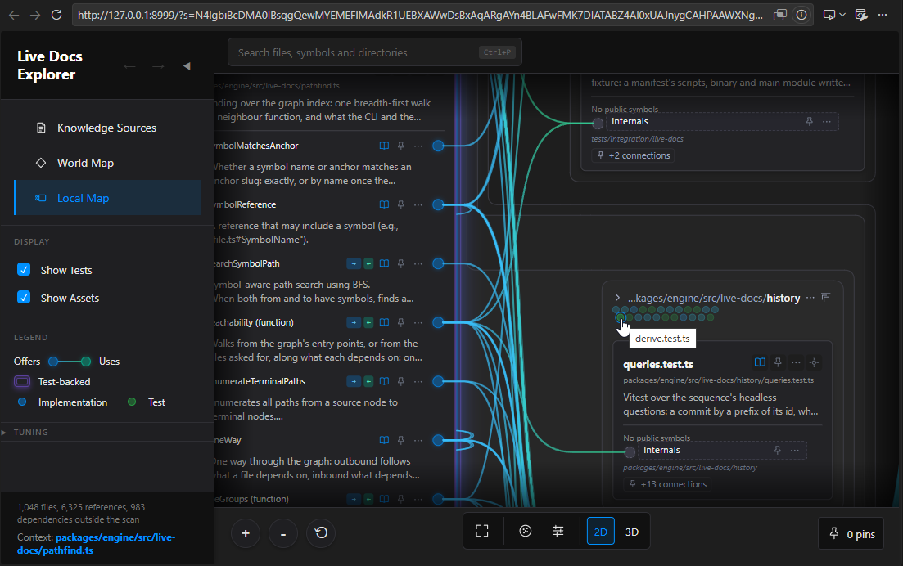
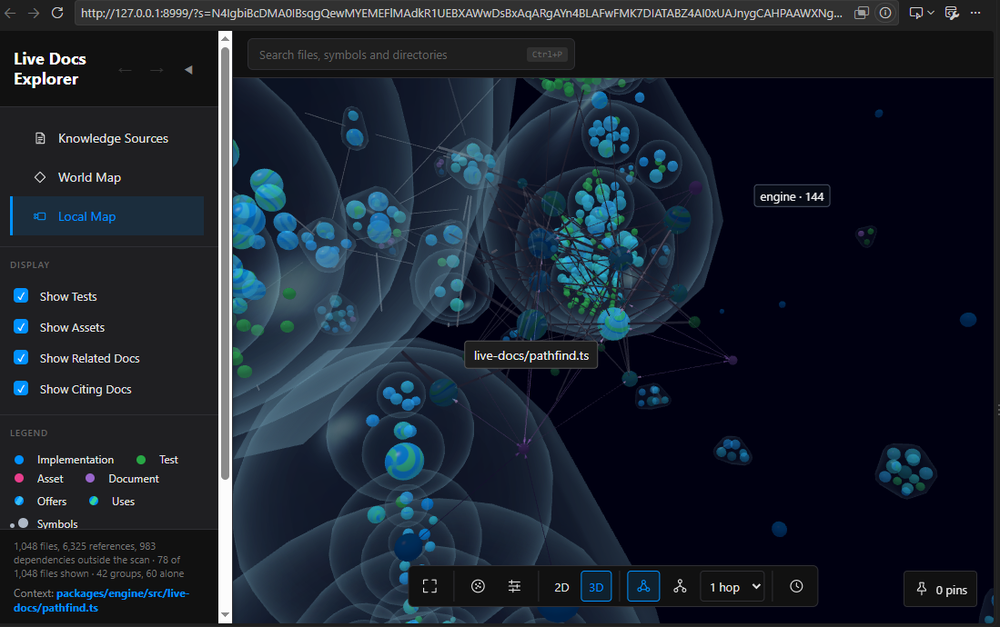
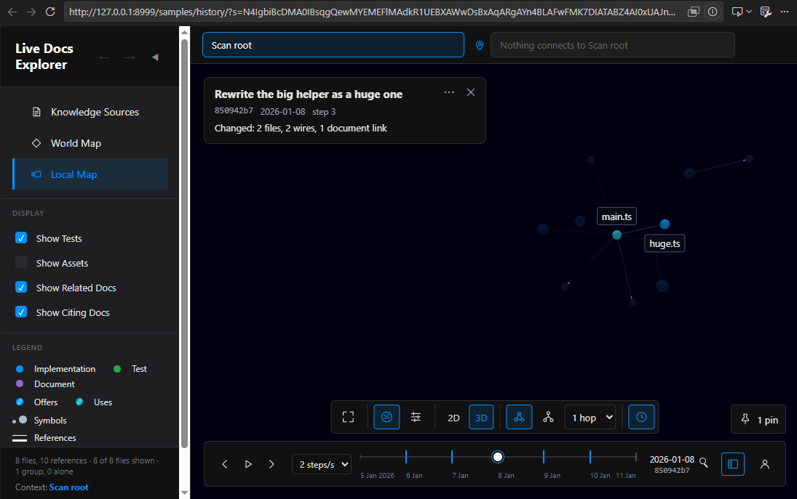

# November 18, 2026 — the working copy on the Linux side

## Coverage

Agent-maintained record by Claude Code in the VS Code extension, model Fable 5.2 (`claude-fable-5-2`) as stated by the harness, recorded November 18, 2026. This is the root conversation, not a harness export. Verbatim visible messages are fenced; work notes are authored interpretation. Tool payloads, private reasoning and delegated conversations are excluded. Final replies are captured only once delivered, normally at the following turn.

**Where this chat began, and what that means for its log.** The owner opened it in VS Code attached to their new WSL distribution (Ubuntu 26.04), on the moved working copy at `/home/user/src/Live-Documentation`, and not in the dev container. The harness keeps this chat's log in the distribution's home, under `~/.claude/projects/-home-user-src-Live-Documentation/`. The container keeps its chats on the `live-documentation-claude` volume, under `projects/-workspaces-Live-Documentation/`, where the November 17 session's log stands. So reopening the folder in the container leaves this chat behind unless its log is copied onto that volume first. Whichever happens, a root that starts in the container continues this same record under the next turn number (the owner's rule of 2026-10-13 for a restarted day), and a reply of this chat not yet copied here is then recoverable only from the distribution's home or the owner's export.

**Startup coverage.** Read in full before the closing reply to Turn 1, each to its last line: `AGENTS.md`; `ChatHistory/README.md`; `Memory/owner.md` (314 lines, in two ranges); `Memory/ideas.md` (177 lines, in two ranges); `Memory/direction.md` (584 lines, in seven ranges); `Memory/narrative.md` (617 lines, in seven ranges); the five latest summaries, oldest to newest (November 10, 12, 13, 15 and 16); and the November 17 record whole (1,740 lines, in five ranges), its Resumption first. The file tool again gave a large file only in ranges, and each read went on until its file ended. The reading was interleaved with a first look at the machine. Not read: the workspace's `README.md` beyond its headings, and the owner's export of the November 17 chat beyond the lines `git diff` shows as added.

**Continued by a second root from Turn 2.** The owner reopened the folder in the dev container, "Live Documentation Dev (WSL2 graphics card)", and began a new chat there at 14:53 UTC. The first chat's log was not carried: the chats volume's folder for this project holds the November 17 session's second log and this chat's, and no other. The second root is Claude Code in the VS Code extension, Fable 5.2 (`claude-fable-5-2`) as stated by the harness, and keeps this record under the next turn numbers (the owner's rule of 2026-10-13 for a restarted day). Its notes name the working copy as the container sees it, `/workspaces/Live-Documentation`.

**The second root's startup coverage, complete at about 15:10 UTC.** Read in full, each to its last line: `AGENTS.md`; `ChatHistory/README.md`; the workspace's `README.md`; this record; `Memory/owner.md` (316 lines, in two ranges); `Memory/ideas.md` (178 lines, in two ranges); `Memory/direction.md` (586 lines, in ten ranges); `Memory/narrative.md` (631 lines, in eight ranges); the five latest summaries, oldest to newest (November 12, 13, 15, 16 and 17), each in one read; and [the vision](../../../../../.mdmd/layer-1/vision.mdmd.md). Of the November 17 record, only the work notes of its Turn 14, which hold the session-history convention. The file tool gave a large file in ranges and each read went on until its file ended. **The order it was done in:** the failed set-up came first, since the owner was waiting on it, with `owner.md`, `ideas.md` and the current sections of `direction.md` read beside it; the rest was read after the closing reply to Turns 2 to 5, while the gate ran. So the mend of the build, the answer on a rebuild and the first answer on who keeps this record were given before the narrative and the summaries had been read; [the work notes after that reading](#work-notes-after-the-startup-read) say what it added.

## Resumption

Written at 00:03 UTC on November 19 by the second root, in the dev container. **The archive moved at 16:25 UTC:** this record now stands at `AI-Agent-Workspace/AgentSessionHistory/2026/11/2026-11-18/2026-11-18.1.record.md`. After a compaction, read this section first.

- **The task, in the owner's words.** [Turn 1](#turn-1): "Let us now begin a new dev day chat", with three questions on the moved working copy, answered in [root's reply](#roots-reply-to-turn-1-as-the-owners-export-shows-it). [Turn 2](#turn-2): the log of the container's creation, pasted without a word, its set-up stopped at the build. [Turn 3](#turn-3): "I'm totally onboard with your proposal for both of these", the session-history convention and the plan for the blind playtests. [Turn 4](#turn-4): "Should I expect to need to rebuild the devcontainer again or are we in a state where this chat is likely to be the stable one for the day?" [Turn 5](#turn-5): who should keep this record, root or a scribe; decided in [Turn 6](#turn-6), "our current setup is optimal for simplicity and efficacy", with "Is there anything else immediate which needs my attention?" [Turn 8](#turn-8): "Any reason not to raise it? Raising it sounds fine", of the container's npm. [Turn 7](#turn-7): their surprise at the rows their window marks "· summary", which root had described wrongly and has corrected. [Turn 9](#turn-9): of the rings, "If 'Document' file types are hidden, why do we make the assertion that there are other files connected to the one that is ringed?", a misreading that root's word "hidden" caused; their hope, "different structures depending on which permutation of file types I have active", is how the maps work ([notes](#work-notes-turn-9)). [Turn 11](#turn-11): a standing grant for idle time, to compress `AGENTS.md`, the Memory documents and the root `README.md` by rearranging them, "the same understanding or better, but wildly more efficiently"; [Turn 12](#turn-12): before touching each, to know why the file exists, who it is for, and what should and should not go into it. [Turn 13](#turn-13): `AGENTS.md` carries "that which is unlikely to change for the foreseeable future and useful anywhere in the workspace"; "Otherwise, I think your plan is solid." [Turns 14 and 15](#turn-14): "a builder or two" to write a design bible, "professional design standardization materials", since defending a system on paper finds what is indefensible; [Turn 16](#turn-16): each standard with its "why", and "If a reason can't be found, is it a standard we should have or keep?" [Turns 17 and 18](#turn-17): about six hours of "more or less unlimited" usage, many builders if root finds it wise, and "If you've got wishlist items you want to hit, feel free to hit 'em." [Turn 10](#turn-10): the lone file drawn as itself agreed with, and a wider thought held open, that what lies beyond the hops might be left out altogether, "membranes kind of form and break and re-form as new hops were taken"; root answers with the alternative as one rule and has a trial built behind a lever ([notes](#work-notes-turn-10)). Behind them stands the order of [direction.md](../../../../Memory/direction.md#next): the gate's time first.
- **Where it stands** ([work notes](#work-notes-turns-2-to-4)). The dev container exists, made by the owner from the moved copy. Its set-up failed at the build because the move had carried the compiler's build records without the `dist` folders they describe; mended at the cause as `f571f9d9`. Root then ran the whole set-up script to its end (exit 0), so the container is as a successful creation leaves it and **needs no rebuild**; this chat's log is on the chats volume. The first checks of the list below pass.
- **The first whole gate here has ended** ([notes](#work-notes-the-first-whole-gate-in-the-new-container)): exit 1 at 16:14:13 UTC, 485 of 488 browser cases passed, 73 minutes 46 seconds in all against about 107 on the Windows drive. Red: `force-graph-building.spec.ts:66` and `force-graph-defaults.spec.ts:101`, both known, and `local-map-hidden.spec.ts:95`, which passed alone three times of three in 46 to 50 s against a 45 s wait and is a wait too tight, to be looked at with the worker count. No browser run is in flight.
- **The session-history round is landed and gated** on `0be65840` ([landing](#work-notes-the-session-history-round-landed), [the run](#work-notes-the-whole-suite-at-two-workers)). Its builder's worktree and branch `worktree-agent-a2eec3bc105122a19` may now be removed.
- **The suite at two workers:** 482 of 488 in 41.9 minutes against 72 at one. Five cases fail only at two workers and pass alone at one: `history-scrubber.spec.ts:180` (a race in a reading, to be run down), `:391` and `:569`, `layout-lab.spec.ts:20` for the repository's chain, and `local-map-branches.spec.ts:276` (whole-case time limits on cases that take 27 to 48 s alone). **Built as `8380146c`** ([notes](#work-notes-the-second-pass-built)): `npm run test:e2e` runs `scripts/e2e-passes.mjs`, 484 cases at two workers and the 4 tagged `@alone` at one, no limit changed. **Not yet proven by a whole run; the next gate is its proof.** `history-scrubber.spec.ts:180` is not tagged and may go red at two workers until its race is mended.
- **The dependency round is landed on `main`** (`0e88714c` to `af313e93`; [notes](#work-notes-the-dependency-round-landed)): `npm audit` reports no findings; this container runs npm 11.21.1, pinned in `post-create.sh`. Its builder's worktree and branch `worktree-agent-a88f770661069a8b2` were removed at 18:34, after its gate.
- **The gate for it ended at 18:26:28, exit 1** ([notes](#work-notes-the-first-whole-run-of-the-two-passes)): 479 of 484 at two workers in 41.1 minutes, 4 of 4 alone, 47 minutes 26 seconds in all. Red: the two known unsteady cases, `history-scrubber.spec.ts:180` (the race, owed), and `local-map-hidden.spec.ts:51` and `:95`, which passed alone twice each and are now tagged `@alone` (six cases carry the tag). Nothing red is of the dependency round's making. No gate is running.
- **The scenario suite's first slice is on `main`** (`6ffd40f0` to `686ab1af`, and `a2869e62`, root's mend of its token test; [notes](#work-notes-the-scenario-slice-landed)): 43 cases over ten maps, 715 promises, 127 s at one worker; the compiler judgment holds a frozen list of two known gaps. Its builder's worktree and branch are removed, its measurement filed under [Probes](Probes/scenario-suite/README.md). **Not yet gated; the integration tests have not run on `main` since the landing.**
- **The rings' mend and the trial of the horizon are on `main`** (`6b2f8c49` to `29421080`; [notes](#work-notes-the-rings-and-the-horizon-landed-and-three-waits-mended)), with pictures in this day's `Screenshots/rings-mend/` and `Screenshots/beyond-the-hops/`. The mend is shown to the owner and theirs to overrule; the trial is a lever, "Beyond the Hops" in the 3D Tuning under Group Wrappers, "Everything" by default and "Next step". Its builder's worktree `.claude/worktrees/agent-a18775fdc2a739b25` and branch `worktree-agent-a18775fdc2a739b25` are removed once the gate has passed.
- **Three waits in the browser suite are mended and proven,** in the same notes: the history case's race at its cause; the hidden-page case of the search's pause, which no longer waits for the search's end and lost its tag; both search-pause cases counting every trial. Five cases carry `@alone`.
- **The evening's gate ended at 21:17:17, exit 1, on `fff1895b`** ([notes](#work-notes-the-evenings-gate-and-the-transition-cases-mend)): everything passed but `force-graph-defaults.spec.ts:101`, which root then mended in the case (the clock stopped before the press) and proved 8 of 8 beside a second worker. The gate is 47 minutes 24 seconds for 542 cases. The rings' builder's worktree and branch are removed; no builder runs and no gate.
- **[Turn 19](#turn-19), the owner's rule of thumb:** "the Root Agent should not typically be writing or debugging permanent project code. That should, in general, be the purview of the Builders." Root briefs, reviews, judges pictures and keeps Memory and the record; a builder writes and debugs the code and the tests ([notes](#work-notes-turn-19)).
- **[Turn 20](#turn-20), the owner on the new defaults in their own browser:** "The cells are delightful!", the marbles "A joy. Still quite noisy.", "Dim things are still a bit hard to read." Three wishes of it are queued ([notes](#work-notes-turn-20)): the camera to follow a cell's newly opened file; the marble's pattern made from the file's contents, "Each marble unique as a snowflake"; dimmed text easier to read.
- **Builders and the lock** ([notes](#work-notes-turn-20)): browser commands and builds run under `flock` on `/tmp/live-docs-browser.lock` (`-x` for tests, timings, builds and gates; `-s` for playtests). Root's gate takes it with `-x` too.
- **Next, in root's order:**
  1. **The defaults round is on `main` and gated** (`50ff0ceb` to `665d92a3`; [the review](#work-notes-the-defaults-rounds-handback-and-roots-review), [the landing](#work-notes-the-defaults-round-landed-and-its-gate-begun), [the gate](#work-notes-the-defaults-rounds-gate)): 40 minutes 40 seconds, 533 of 535 browser cases, two red. **`force-graph-focus.spec.ts:189` is run down** ([notes](#work-notes-turns-17-and-18-and-the-red-case-run-down-to-its-cause)): the cells under a name add about 350 ms to the 2D map's first frame on this repository's picture, by the 1,800 elements they add; the bound and the default stay, and a builder is owed for the cost at its cause. **The owner was told of the gate at 23:31:54,** with the pictures and links into the Explorer on their port 8999 ([as delivered](#roots-messages-after-turn-18-as-delivered)). **Owed:** direction brought level (its line "Two defaults" and its entry on the cells still say the round is to come; a prepared script is `direction-defaults.mjs` in the scratchpad, to be folded into the rearranged file instead if that lands first).
  1a. **Two builders have handed back the design system's documentation, unreviewed** ([notes](#work-notes-the-two-design-system-builders-handed-back); worktrees `.claude/worktrees/agent-a23638ff184f33d5c` at `5eef46ff` and `.claude/worktrees/agent-ac66e3b6a0bc02a92` at `4221ce50`; each one's findings are in its handback as text, for root to write to `Probes/design-system/`). They ran ([Turns 14 to 16](#turn-14), [their dispatch](#work-notes-the-owners-export-saved-an-eighth-time-and-two-builders-dispatched)). On each handback: the document and its findings read by root against the product and the record; the findings brought to the owner, ranked; the two documents landed with an index of root's own that says why the folder exists, for whom, and what goes in it; then a second milestone with a browser where a rule needs seeing.
  1c. **A builder has the browser since 23:31** for the cells' cost at the first frame (worktree from `a91d7f89`; port 8790; the bound of `force-graph-focus.spec.ts:189` and the default both to stay; evidence to this day's `Screenshots/cells-cost/`). **Until it hands back root runs no browser and no build.** After its landing: one whole gate, which would be the first clean one; then three workers measured.
  1b. **Memory, the state at 23:54 UTC on November 19** ([notes](#work-notes-eleven-helpers-out-and-the-two-design-documents-read)): `direction.md`: the reconciled draft `dir/direction.reconciled.md` (213 KB) is being read by five fresh readers (`dir/fresh/A.md` to `E.md`); next, the helper that reconciled it applies their sentences, root reads the result whole, folds in the defaults landing and Turns 19 and 20, puts back the December 16 quotation with its line, keeps the inbound anchors and replaces the file in one commit. `owner.md` and `ideas.md`: an editor each, drafts and ledgers to `own/` and `ideas/`; root reads each whole first. Nothing in Memory is replaced yet. What follows is the earlier note. **The rearranged `direction.md` is a draft in the scratchpad** (`dir/new/*.md`, about 230 KB against 529 KB, every section written but not yet checked): to be joined, run through `memcheck.mjs` against the present text, each quotation the check misses either restored or listed with where it lives (a helper is doing that reconciliation since 23:26 into `dir/direction.reconciled.md` with a ledger, `dir/ledger.md`; the first check counted 170 of the old text's quotations missing, 92 held in part, 89 of the draft's not word for word in the old, and 227 link targets not carried; the draft was 189 KB), its inbound anchors kept (`#next`, `#open-with-the-owner`) or re-pointed (`#answers-at-forks`), read by a fresh reader against the old text, and only then put in the file's place.
  2. `force-graph-building.spec.ts:66` is proven and mended in the case ([notes](#work-notes-the-building-case-proven-and-mended)); not yet inside a whole gate. Three workers measured, once a run is clean, which now waits only on the cells' cost.
  3. The first conversions of old cases into the scenario table; the blind playtests' instrument, by [the plan](../2026-11-17/2026-11-17.1.record.md#roots-reply-to-turn-13-as-delivered) the owner accepted. Also owed: the editor's TypeScript server; the 2D map's drawing cost; whether to unwrap six old summaries that render as one block of code; the move to a newer Node, granted on November 15; variety in the marbles; the "Internals" row over "+8 symbols".
  4. Open with the owner from today, none of it blocking: the horizon, for their eye in the app (if they prefer it, "Next step" becomes the default, root's recommendation); whether documents beyond the hops deserve a sign; the Structure hub at the frontier; the scenario table's measurement and where to convert next; the C-family maps against the compiler.
- **The compression of the guide and the Memory documents** ([Turns 11 and 12](#turn-11), [what was known before a file was touched](#work-notes-the-compression-of-the-guide-and-the-memory-documents-what-was-known-before-a-file-was-touched)): idle-time work, the owner's standing grant. No file is changed yet. Read those notes before touching one: the November 12 cut and why it was restored, the three answers per file as told to the owner, which they accepted with one correction on `AGENTS.md` ([Turn 13](#turn-13): lasting, and of use anywhere in the workspace), the two-way check and its baseline counts. First file: `direction.md`, read whole and rewritten in one stretch, its draft saved as it grows.
- **Nothing waits on the owner:** yesterday's two questions were answered in Turn 3 and the record's keeping in Turn 6. Decided there: no hook and no scribe; the record is kept as it is.
- **What the owner has been shown of this chat:** root's reply of 22:49:40 to Turns 11 and 12 (why each file exists, for whom, what goes into it) is in this record as delivered, as are its four short messages of 22:20 to 22:36; root's messages of 22:13:48 and 22:13:59 on the defaults builder's pictures, and its message of 21:24:02 on the evening's gate and the defaults round, are in this record as delivered. Root's report of 20:30:39 on the rings and the horizon is in this record as delivered, as are its replies and messages through 19:08:22 UTC are in this record as delivered, and the message of 19:13:25 on the scenario table's measurement with them. Their window also shows each builder's handback in full ([notes](#work-notes-turn-9)). The owner's export, saved again at 15:17 UTC, shows besides them rows the harness writes in root's voice and marks "· summary"; they are not root's and are not recorded as replies ([notes](#work-notes-the-owners-second-export)). The owner was told of them at 15:55 in words that the reply to Turn 7 corrects.
- **Committed:** `f571f9d9`, the mend of the build with its four Live Docs; `6385b33d`, two wrongly closed fences and a short link mended in the archive; and this record with the owner's export and Memory.
- **Git:** `main` only; nothing pushed by root, no commit amended.

## Turn 1

**Owner, 14:23:27 UTC:**

``````text
Let us now begin a new dev day chat. It is 11/18/2026. 

The single git diff in this workspace is the explanation for why the first attempt failed in the following log:
```

<pasted_content id="a618">
(base) PS C:\Users\User> wsl -l -v
  NAME              STATE           VERSION
* docker-desktop    Running         2
(base) PS C:\Users\User> wsl --install -d Ubuntu
Downloading: Ubuntu
Installing: Ubuntu
Distribution successfully installed. It can be launched via 'wsl.exe -d Ubuntu'
Launching Ubuntu...
Provisioning the new WSL instance Ubuntu
This might take a while...
Create a default Unix user account: user
New password:
Retype new password:
passwd: password updated successfully
usermod: no changes
Help improve Ubuntu!

Help us improve Ubuntu features and compatibility by sharing system reports with Canonical.
Reports are sent anonymously and do not contain any personal data.
For legal details, please visit: https://ubuntu.com/legal/systems-information-notice

We will save your answer to Windows and will only ask you once.

Would you like to opt-in to platform metrics collection (Y/n)? To see an example of the data collected, enter 'e'.
[Y/n/e]: n
user@DESKTOP-N3J4RG0:/mnt/c/Users/User$ bash /mnt/d/Projects/Live-Documentation/AI-Agent-Workspace/tmp/move-to-wsl.sh

STOPPED: the old copy has uncommitted changes; they would be left behind.
Nothing in /mnt/d/Projects/Live-Documentation was changed.
user@DESKTOP-N3J4RG0:/mnt/c/Users/User$ bash /mnt/d/Projects/Live-Documentation/AI-Agent-Workspace/tmp/move-to-wsl.sh
From: /mnt/d/Projects/Live-Documentation
To:   /home/user/src/Live-Documentation

1/4  Cloning the history and the tracked files (about 850 MB of history; a few minutes)...
2/4  Pointing origin at https://github.com/jfjordanfarr/Live-Documentation.git ...
3/4  Bringing the ignored files git does not carry (about 2 GB; a few minutes)...
4/4  Checking...

DONE in 5 min 0 s.
  Commit:  e2b29244 Record November 18: the owner's questions on the move, and the export as saved that morning
  Branch:  main, 0 commits ahead of origin/main as last known
  Origin:  https://github.com/jfjordanfarr/Live-Documentation.git
  Size:    3.9G

Next:  cd /home/user/src/Live-Documentation && code .
user@DESKTOP-N3J4RG0:/mnt/c/Users/User$ cd ~/src/Live-Documentation && code .
Installing VS Code Server for Linux x64 (8a14f0cc1b08d531eb83255ea3764ae22aa932b5)
Downloading: 100%
Unpacking: 100%
Unpacked 4575 files and folders to /home/user/.vscode-server/bin/8a14f0cc1b08d531eb83255ea3764ae22aa932b5.
Looking for compatibility check script at /home/user/.vscode-server/bin/8a14f0cc1b08d531eb83255ea3764ae22aa932b5/bin/helpers/check-requirements.sh
Running compatibility check script
Compatibility check successful (0)
user@DESKTOP-N3J4RG0:~/src/Live-Documentation$
</pasted_content id="a618">

```

I reverted the difference in the harness export, re-ran, and re-applied that difference after VS Code had launched here in the WSL itself. 

A few things I noticed:
- VSCode still notes a devcontainer and asks me if I wish to open this workspace in a container. Should I?
- How do I now **normally** open this workspace in a way which is fast? What changes about my startup to ensure that you have access to the full set of resources you need?
- How do we check the configurations in WSL to ensure you have access to all the compute resources you need on this rig?
``````

### Work notes, Turn 1

Times UTC on November 18.

**The owner's message, root's reading.** A new dev-day chat, opened in the moved working copy. The terminal log shows the whole move: `wsl --install -d Ubuntu` with a user named `user`; the copy script stopping once at its own check ("the old copy has uncommitted changes; they would be left behind") and then finishing in five minutes at `e2b29244`, zero commits ahead of `origin/main`, 3.9 GB; and VS Code's server installed in the distribution. What had been uncommitted was their export of the November 17 chat, saved once more after that chat's last reply; they put it back to its committed state on `D:\`, ran the script, and saved the newer state again here. The three questions are about what comes next on their side: the container, the ordinary way in, and the machine's resources.

**Where this chat runs.** In the distribution itself (`uname`: Linux 6.18.58.1-microsoft-standard-WSL2; Ubuntu 26.04.1), as the user `user`, in `/home/user/src/Live-Documentation`. It has git 2.53 and Docker's client and no Node: `node` is absent, and the `npm` on its path is the Windows one, reached through WSL's interop, which is not to be used. That is the design root described on November 18 ("It is a disk with our folder on it. The tools, dependencies and tests stay in the container"), so nothing of ours can be built, generated or tested from this chat as it stands. Where a script of the repository was needed for the record (`visible-messages.mjs`), it was run in a throwaway container from the devcontainer's base image with the script's folder mounted read-only.

**The move, checked from the distribution** (step 2 of [the November 17 record's list](../2026-11-17/2026-11-17.1.record.md#resumption) for a root in the moved copy):

- The working copy stands on ext4 (`/dev/sdf`, the distribution's virtual disk: 1 TB at most, 6.8 GB used; the file that holds it is on `C:`, which has 745 GB free).
- `git log -1` is `e2b29244`, the last commit made on `D:`, and `origin/main` is the same commit: the owner pushed before the move, so the script's "0 commits ahead" is right and root's "6 or more commits ahead" of 13:52 was overtaken. `origin` is GitHub. The working tree was clean but for the export.
- `git config user.name` was empty: the distribution has no `~/.gitconfig`. Root set the name and email in this clone's own configuration from the author of the last commit, as that list says, so that a commit made here or in the container carries them.
- `core.filemode` is true and `.gitattributes` holds every text file to LF, so the clone has Linux's settings, as the script's trial showed.

**The export, in its sixth state.** 200,862 bytes, SHA-256 `18ebda667fd01e03ba326fa123248750dbc4e0b413850545faa296c01ec21bb8`, 3,737 lines; the fifth state's 192,886 bytes are its exact prefix (compared byte for byte). The 180 added lines begin with the editor's notice of an opened file and the owner's two messages of [Turn 16 of the November 17 record](../2026-11-17/2026-11-17.1.record.md#turn-16), then a notice that the chat was "Compacted using a summary written while you were away", collapsed tool lines, and root's reply to Turn 16 to its last line. Its file time here is 14:18:45 UTC, when the owner saved it again in the new copy. Committed as received, with [the month's inventory](../README.md).

**The November 17 session, closed** by the handoff routine: its last reply copied from its own log into [its record](../2026-11-17/2026-11-17.1.record.md#roots-reply-to-turn-16-as-delivered) (the log stands on the `live-documentation-claude` volume and was read through Docker, user-facing messages only), [its summary](../Summarized/2026-11-17.1.SUMMARIZED.md) written, and the narrative's chapter added.

**The machine, as the distribution sees it:**

| What | Measured | Of |
| --- | --- | --- |
| Processor threads | 20 | the i9-10900K's 20 (10 cores) |
| Memory | 62 GiB, 59 free | the host's 127.9 GB; WSL's default is half |
| Swap | 16 GB | |
| Graphics card | `/dev/dxg` present; `nvidia-smi` names the RTX 3090, 24 GB, driver 596.49 | |
| Disk | ext4, 949 GB free of a 1 TB virtual disk | bounded in fact by `C:`'s 745 GB free |

No `.wslconfig` exists in the owner's Windows profile, so these are WSL's defaults (WSL 3.0.5). `docker info` from the distribution reports the same 20 processors and 62.7 GiB: Docker Desktop's containers run in the same virtual machine as the distribution, so the one ceiling holds for both together, and a container gets all of it. On the Windows side, read through WSL's interop: the power plan is Balanced, with the processor's maximum state at 100 % and its minimum at 5 %, and the clock read 3,696 MHz at that moment. Nothing here needs changing for our work: the most memory the container was seen to use on November 17 was 9.4 GB under eight workers, and the measured limit on workers is the ten cores.

**The move's one unknown, tried.** The November 17 record left one thing untried: the graphics card's two run arguments when the container is created by the distribution's Docker client. A throwaway container from the devcontainer's base image, started from the distribution with `--device /dev/dxg`, `-v /usr/lib/wsl:/usr/lib/wsl:ro` and this folder mounted at `/workspaces/Live-Documentation`: its mount table names the workspace as `ext4` on `/dev/sdf` (not `9p`), `/dev/dxg` and `/usr/lib/wsl/lib/libd3d12.so` are there, and it sees 20 processors and 62 GB. **Not tried, since only VS Code creates it:** the dev container itself, its set-up into a new `node_modules` volume (the volume is named for the container, and a container made from this folder is a new one), a browser on the card there, and the gate.

**A first measure of the new disk.** Before the commit that carries this record, the two document checks were run over the moved copy in a throwaway container (the devcontainer's base image, this folder mounted read-only, the old container's `node_modules` volume mounted read-only over it): the markdown link audit, 1,487 files and no broken link, in 2.2 s, and the documentation link check, 1,024 documents, in 0.9 s. In the rebuilt container on the Windows drive the same two took 104 s and 19 s on November 18 ([the work notes of that record's Turn 13](../2026-11-17/2026-11-17.1.record.md#work-notes-turn-13)). An empty `node_modules` folder was made in the working copy as that mount's place; it is ignored, and the dev container mounts its own volume there.

**What Docker still holds from before the move,** left as found: the old dev container `kind_goldstine`, exited, made from `D:\`; its `node_modules` volume; the two agents' volumes, which the new container mounts by their fixed names; the images.

**What the owner was shown.** Read from this chat's log at 14:36: the owner's message, and three short lines of root's (14:23:31, that the startup read and a look at the machine were beginning; 14:30:24, that this record was being written; 14:33:45, that the summary was written and the narrative, inventory and Memory came next). Two other lines root wrote between tool calls are not in it as messages: one saying yes to the container but not yet, since this chat's log would be left behind, and one saying the startup read was finished. Neither counts as told; the closing reply carries both.

**Root's decisions,** each reversible:

- **The container, as decided on November 17 and 18.** The distribution stays a disk. Installing Node, the six language toolchains and the indexers in it would make it a second environment to keep up, which is what the owner asked not to take on ("it sounds like if I do, I'm going to need to be maintaining it", [Turn 16 of the November 17 record](../2026-11-17/2026-11-17.1.record.md#turn-16)).
- **This chat is carried into the container** by copying its log onto the chats volume, one command for the owner to paste after the reply. Whether the extension then lists and resumes a chat begun under another folder's path could not be tried from here; if it does not, a new chat continues this record.
- **`AI-Agent-Workspace/tmp/move-to-wsl.sh` is removed** from this copy: ignored scratch whose work is done. The copy on `D:\` still has its own.

### Root's reply to Turn 1, as the owner's export shows it

Copied on November 18 by the root that continued this record in the container, from [the owner's export](2026-11-18.1.claude-code.export.txt), lines 296 to 426, byte for byte. The chat's own log stayed in the distribution's home and is not on the chats volume, so the export is the only source this root can reach. It is the extension's terminal rendering of the reply and not its markdown: lines are wrapped at about 80 columns, a link stands as its text followed by its target in parentheses, and tables are drawn in box characters. The export shows it as the chat's last message, which is the evidence that it was delivered.

``````text
● Yes, open it in the container, and choose "Live Documentation Dev (WSL2
  graphics card)". Do one paste first, so this chat comes with you.

  Ubuntu has no Node, on purpose: it is the disk, and the container is the
  workshop. Nothing of ours can be built or tested from this window.

  Before you click: one paste

  This chat's log lives in Ubuntu's home folder, and the container keeps its
  chats on a Docker volume. Reopening now would leave this chat behind. In this
  window's terminal:

  docker run --rm -u 1000:1000 -v live-documentation-claude:/to -v
  ~/.claude/projects/-home-user-src-Live-Documentation:/from:ro
  mcr.microsoft.com/devcontainers/typescript-node:22 cp
  /from/b4286088-8e81-4c34-abcf-7d5a8ca14c0d.jsonl
  /to/projects/-workspaces-Live-Documentation/

  It prints nothing when it works. I checked that it can read the log and write
  that folder. I could not test whether the extension then resumes a chat begun
  under another folder's path. If this chat is not in Claude Code's history
  inside the container, start a new one and say "continue 11/18"; today's record
  (AI-Agent-Workspace/ChatHistory/2026/11/2026-11-18.1.record.md) has
  everything.

  Then

  1. F1 → "Dev Containers: Reopen in Container" → Live Documentation Dev (WSL2
     graphics card). Use F1 if the pop-up does not ask which configuration.
  2. Wait for the set-up. Dependencies install into a fresh volume, as on your
     last rebuild. The log should end with "The host's graphics card is
     available to the browser tests." and "Devcontainer setup complete!".
  3. If the Claude Code panel is missing, install the extension into the
     container from the Extensions view. Your sign-in is already on the volume.
  4. Open this chat from its history and say you're in.

  1. Why the container

  Windows ── the VS Code window you see
     │
     └─ one WSL2 virtual machine: 20 threads, 62 GB, the RTX 3090
          ├─ Ubuntu: a disk. ~/src/Live-Documentation lives here.
          └─ Docker: the dev container. Node, the indexers, the browser
             tests and Claude Code. It mounts the folder above directly.

  - What I tried from here: a throwaway container with the two graphics-card
    arguments and this folder mounted. The folder shows as Linux's own disk, not
    the slow crossing to Windows, and the card's device and libraries are
    there.
  - What only your reopen can show: the dev container itself, and a browser run
    on the card inside it.
  - A first measure of the new disk: the markdown link audit took 104 s on D:\
    yesterday and 2.2 s here.

  2. Opening it normally

  - Docker Desktop running first, as before.
  - File → Open Recent → the entry for this folder marked [Dev Container: Live
    Documentation Dev (WSL2 graphics card) …]. I expect that one click to start
    Ubuntu and the container and attach; I have not seen the entry myself.
  - If it is not there: in an Ubuntu terminal, cd ~/src/Live-Documentation &&
    code ., then accept the reopen.
  - Retire the D:\ entry, and don't open that copy in a container again. Don't
    delete it yet either: it is the way back until the gate has passed here.
  - Unchanged: your preview (npx http-server dist/explorer -p 8999 -c-1 in a VS
    Code terminal) and pushing. Pushing is now the working copy's backup.

  Nothing else changes on your side. That configuration gives me everything, and
  I check the card at the start of each chat.

  3. Compute

  ┌───────────────────┬─────────────────┬────────────────────────────────┐
  │       What        │  WSL gives us   │        Of the machine's        │
  ├───────────────────┼─────────────────┼────────────────────────────────┤
  │ Processor threads │ 20              │ 20 (10 cores)                  │
  ├───────────────────┼─────────────────┼────────────────────────────────┤
  │ Memory            │ 62 GB           │ 128 GB (WSL's default is half) │
  ├───────────────────┼─────────────────┼────────────────────────────────┤
  │ Graphics card     │ RTX 3090, 24 GB │ the same card                  │
  ├───────────────────┼─────────────────┼────────────────────────────────┤
  │ Disk              │ 949 GB free     │ bounded by C:'s 745 GB free    │
  └───────────────────┴─────────────────┴────────────────────────────────┘

  - Nothing needs changing. There is no .wslconfig, so these are WSL's defaults.
    Ubuntu and Docker's containers share the one virtual machine, so a
    container gets all of it. The most memory I saw the container use was 9.4
    GB; the real limit on parallel tests is the ten cores.
  - Windows is not capping the processor: the power plan is Balanced with the
    maximum state at 100%.
  - To check yourself: nproc, free -g and /usr/lib/wsl/lib/nvidia-smi in any
    terminal here or in the container. The knob, if ever needed, is
    C:\Users\User\.wslconfig; I recommend not creating one.

  What I did this turn

  - Startup read, in full: the guide, the four Memory files, the summaries of
    November 10, 12, 13, 15 and 16, and yesterday's record.
  - Closed yesterday's session: its summary (AI-Agent-Workspace/ChatHistory/2026
    /11/Summarized/2026-11-17.1.SUMMARIZED.md), the narrative's chapter, and
    your re-saved export filed as received.
  - Set your commit name and email in this clone, from your last commit. Ubuntu
    has no git settings of its own, so commits would otherwise have had none.
  - Removed the move script from this copy; its work is done.
  - Three commits, documents only (24412675, 1d6271a7, 493c70de). Both link
    checks pass. Nothing was built or tested, and nothing is pushed.

  Waiting on you from yesterday

  1. The session-history convention: a directory per dev day, Summarized/ at the
     month, the move done by one script (my proposal (AI-Agent-Workspace/ChatHi
     story/2026/11/2026-11-17.1.record.md#roots-reply-to-turn-14-as-delivered)).
     Correct or confirm it; I'll brief the builder on it as proposed unless you
     say otherwise.
  2. How I'd build the blind playtests (the plan (AI-Agent-Workspace/ChatHistory
     /2026/11/2026-11-17.1.record.md#roots-reply-to-turn-13-as-delivered)):
     correct anything.

  Order once the container is up

  1. Check the disk and the card, then run the whole gate. It will be the first
     to finish on the committed browser settings. Expected red: two
     history-scrubber cases a few seconds over their limit, perhaps two 2D cases
     on theirs, one case with a race, and force-graph-building.spec.ts:66, a
     real fault I owe a diagnosis.
  2. Tell you what can go: the D:\ folder, the old container and its
     dependencies volume.
  3. The session-history builder.
  4. The 19 dependency findings, the scenario suite's first slice, the new
     defaults (marbles on, cells under the name), and the playtest instrument.
  5. After test speed: the rings beside the membranes, your defect, first in
     that list.
``````

## Turn 2

**Owner, 14:53:34 UTC,** in a new chat in the dev container (the harness attached a notice of the lines they had selected in their export, 24,115 characters, not copied here). The message is a pasted log and no words of their own:

``````text
```

<pasted_content id="d7f4">
Running the onCreateCommand from devcontainer.json...

[498465 ms] Start: Run in container: /bin/sh -c sudo chown node:node /home/node/.claude /home/node/.codex /workspaces/Live-Documentation/node_modules
Running the postCreateCommand from devcontainer.json...

[500087 ms] Start: Run in container: /bin/sh -c bash .devcontainer/post-create.sh
=== Live Documentation Devcontainer Setup ===

=== Configuring git safe.directory ===
  Set safe.directory = '*' (devcontainer bind-mount ownership workaround)

=== Installing project dependencies ===
npm warn deprecated whatwg-encoding@2.0.0: Use @exodus/bytes instead for a more spec-conformant and faster implementation

added 287 packages, and audited 292 packages in 2m

80 packages are looking for funding
  run `npm fund` for details

19 vulnerabilities (12 moderate, 7 high)

To address issues that do not require attention, run:
  npm audit fix

To address all issues (including breaking changes), run:
  npm audit fix --force

Run `npm audit` for details.

=== Building project ===

> live-documentation@0.0.0 build
> npm run build -w packages/engine && npm run build -w packages/explorer && npm run build -w packages/generator


> @live-documentation/engine@0.0.0 build
> tsc -p tsconfig.json


> @live-documentation/explorer@0.0.0 build
> tsc -p tsconfig.json && tsc --noEmit -p src/client/tsconfig.json

src/shared/graph.test.ts:4:59 - error TS6305: Output file '/workspaces/Live-Documentation/packages/engine/dist/live-docs/document.d.ts' has not been built from source file '/workspaces/Live-Documentation/packages/engine/src/live-docs/document.ts'.

4 import { parseLiveDoc, renderLiveDoc, type LiveDoc } from "../../../engine/src/live-docs/document";
                                                            ~~~~~~~~~~~~~~~~~~~~~~~~~~~~~~~~~~~~~~~~

src/shared/graph.test.ts:5:36 - error TS6305: Output file '/workspaces/Live-Documentation/packages/engine/dist/live-docs/graph.d.ts' has not been built from source file '/workspaces/Live-Documentation/packages/engine/src/live-docs/graph.ts'.

5 import { deriveLiveDocGraph } from "../../../engine/src/live-docs/graph";
                                     ~~~~~~~~~~~~~~~~~~~~~~~~~~~~~~~~~~~~~

src/shared/graph.test.ts:39:67 - error TS18046: 'file' is of type 'unknown'.

39     const documented = Object.values(graph.files).flatMap(file => file.edges.filter(edge => edge.to && edge.to !== file.codePath));
                                                                     ~~~~

src/shared/graph.test.ts:39:85 - error TS7006: Parameter 'edge' implicitly has an 'any' type.

39     const documented = Object.values(graph.files).flatMap(file => file.edges.filter(edge => edge.to && edge.to !== file.codePath));
                                                                                       ~~~~

src/shared/graph.test.ts:39:116 - error TS18046: 'file' is of type 'unknown'.

39     const documented = Object.values(graph.files).flatMap(file => file.edges.filter(edge => edge.to && edge.to !== file.codePath));
                                                                                                                      ~~~~

src/shared/graph.ts:11:57 - error TS6305: Output file '/workspaces/Live-Documentation/packages/engine/dist/live-docs/graph.d.ts' has not been built from source file '/workspaces/Live-Documentation/packages/engine/src/live-docs/graph.ts'.

11 import type { GraphEdge, GraphFile, LiveDocGraph } from "@live-documentation/engine/live-docs/graph";
                                                           ~~~~~~~~~~~~~~~~~~~~~~~~~~~~~~~~~~~~~~~~~~~~

src/shared/graph.ts:48:67 - error TS18046: 'file' is of type 'unknown'.

48     const names = new Map(Object.values(graph.files).map(file => [file.codePath,
                                                                     ~~~~

src/shared/graph.ts:49:17 - error TS18046: 'file' is of type 'unknown'.

49         new Map(file.symbols.map(symbol => [symbol.slug, symbol.name]))]));
                   ~~~~

src/shared/graph.ts:49:34 - error TS7006: Parameter 'symbol' implicitly has an 'any' type.

49         new Map(file.symbols.map(symbol => [symbol.slug, symbol.name]))]));
                                    ~~~~~~

src/shared/graph.ts:50:92 - error TS2322: Type '{} | undefined' is not assignable to type 'string | undefined'.
  Type '{}' is not assignable to type 'string'.

50     const nameOfAnchor = (file: string, anchor: string | undefined): string | undefined => names.get(file)?.get(anchor) ?? anchor;
                                                                                              ~~~~~~~~~~~~~~~~~~~~~~~~~~~~~~~~~~~~~~

src/shared/graph.ts:74:38 - error TS18046: 'file' is of type 'unknown'.

74         const nameOfSlug = names.get(file.codePath)!;
                                        ~~~~

src/shared/graph.ts:77:28 - error TS18046: 'file' is of type 'unknown'.

77         for (const edge of file.edges) {
                              ~~~~

src/shared/graph.ts:88:47 - error TS18046: 'file' is of type 'unknown'.

88             } else if (edge.to && edge.to !== file.codePath) {
                                                 ~~~~

src/shared/graph.ts:114:25 - error TS18046: 'file' is of type 'unknown'.

114                 addLink(file.codePath, reference.targetId, reference.kind, reference.sourceSymbol, nameOfAnchor(reference.targetId, reference.targetSymbol));
                            ~~~~

src/shared/graph.ts:119:17 - error TS18046: 'file' is of type 'unknown'.

119             id: file.codePath,
                    ~~~~

src/shared/graph.ts:120:19 - error TS18046: 'file' is of type 'unknown'.

120             name: file.codePath.slice(file.codePath.lastIndexOf("/") + 1),
                      ~~~~

src/shared/graph.ts:120:39 - error TS18046: 'file' is of type 'unknown'.

120             name: file.codePath.slice(file.codePath.lastIndexOf("/") + 1),
                                          ~~~~

src/shared/graph.ts:121:23 - error TS18046: 'file' is of type 'unknown'.

121             codePath: file.codePath,
                          ~~~~

src/shared/graph.ts:122:31 - error TS18046: 'file' is of type 'unknown'.

122             codeRelativePath: file.codePath,
                                  ~~~~

src/shared/graph.ts:123:22 - error TS18046: 'file' is of type 'unknown'.

123             docPath: file.docPath,
                         ~~~~

src/shared/graph.ts:124:30 - error TS18046: 'file' is of type 'unknown'.

124             docRelativePath: file.docPath,
                                 ~~~~

src/shared/graph.ts:125:24 - error TS18046: 'file' is of type 'unknown'.

125             archetype: file.archetype ?? "implementation",
                           ~~~~

src/shared/graph.ts:127:25 - error TS18046: 'file' is of type 'unknown'.

127             dependents: file.inbound,
                            ~~~~

src/shared/graph.ts:129:28 - error TS18046: 'file' is of type 'unknown'.

129             publicSymbols: file.symbols.map(symbol => symbol.name),
                               ~~~~

src/shared/graph.ts:129:45 - error TS7006: Parameter 'symbol' implicitly has an 'any' type.

129             publicSymbols: file.symbols.map(symbol => symbol.name),
                                                ~~~~~~

src/shared/graph.ts:131:17 - error TS18046: 'file' is of type 'unknown'.

131             ...(file.entries.length ? { entryReasons: file.entries.map(entry => entry.reason) } : {})
                    ~~~~

src/shared/graph.ts:131:55 - error TS18046: 'file' is of type 'unknown'.

131             ...(file.entries.length ? { entryReasons: file.entries.map(entry => entry.reason) } : {})
                                                          ~~~~

src/shared/graph.ts:131:72 - error TS7006: Parameter 'entry' implicitly has an 'any' type.

131             ...(file.entries.length ? { entryReasons: file.entries.map(entry => entry.reason) } : {})
                                                                           ~~~~~

src/shared/graph.ts:185:29 - error TS7006: Parameter 'symbol' implicitly has an 'any' type.

185     return file.symbols.map(symbol => {
                                ~~~~~~

src/shared/graph.ts:189:43 - error TS7006: Parameter 'parameter' implicitly has an 'any' type.

189                 ? line.parameters.flatMap(parameter => parameter.types.map(type => ({ type, role: "parameter" as const, parameterName: parameter.name })))
                                              ~~~~~~~~~

src/shared/graph.ts:189:76 - error TS7006: Parameter 'type' implicitly has an 'any' type.

189                 ? line.parameters.flatMap(parameter => parameter.types.map(type => ({ type, role: "parameter" as const, parameterName: parameter.name })))
                                                                               ~~~~

src/shared/graph.ts:190:34 - error TS7006: Parameter 'type' implicitly has an 'any' type.

190                 : line.types.map(type => ({ type, role: ROLE_OF_LINE[line.role], parameterName: undefined }));
                                     ~~~~

src/shared/graph.ts:190:57 - error TS7053: Element implicitly has an 'any' type because expression of type 'any' can't be used to index type '{ readonly Returns: "return"; readonly Extends: "extends"; readonly Implements: "implements"; readonly Constraints: "constraint"; }'.

190                 : line.types.map(type => ({ type, role: ROLE_OF_LINE[line.role], parameterName: undefined }));
                                                            ~~~~~~~~~~~~~~~~~~~~~~~

src/shared/staticBuilder.ts:22:8 - error TS6305: Output file '/workspaces/Live-Documentation/packages/engine/dist/config/liveDocumentationConfig.d.ts' has not been built from source file '/workspaces/Live-Documentation/packages/engine/src/config/liveDocumentationConfig.ts'.

22 } from "@live-documentation/engine/config/liveDocumentationConfig";
          ~~~~~~~~~~~~~~~~~~~~~~~~~~~~~~~~~~~~~~~~~~~~~~~~~~~~~~~~~~~

src/shared/staticBuilder.ts:23:28 - error TS6305: Output file '/workspaces/Live-Documentation/packages/engine/dist/live-docs/board.d.ts' has not been built from source file '/workspaces/Live-Documentation/packages/engine/src/live-docs/board.ts'.

23 import { parseBoard } from "@live-documentation/engine/live-docs/board";
                              ~~~~~~~~~~~~~~~~~~~~~~~~~~~~~~~~~~~~~~~~~~~~

src/shared/staticBuilder.ts:24:36 - error TS6305: Output file '/workspaces/Live-Documentation/packages/engine/dist/live-docs/document.d.ts' has not been built from source file '/workspaces/Live-Documentation/packages/engine/src/live-docs/document.ts'.

24 import { LiveDocSyntaxError } from "@live-documentation/engine/live-docs/document";
                                      ~~~~~~~~~~~~~~~~~~~~~~~~~~~~~~~~~~~~~~~~~~~~~~~

src/shared/staticBuilder.ts:25:32 - error TS6305: Output file '/workspaces/Live-Documentation/packages/engine/dist/live-docs/graph.d.ts' has not been built from source file '/workspaces/Live-Documentation/packages/engine/src/live-docs/graph.ts'.

25 import { resolveDocLink } from "@live-documentation/engine/live-docs/graph";
                                  ~~~~~~~~~~~~~~~~~~~~~~~~~~~~~~~~~~~~~~~~~~~~

src/shared/staticBuilder.ts:26:51 - error TS6305: Output file '/workspaces/Live-Documentation/packages/engine/dist/live-docs/graphFiles.d.ts' has not been built from source file '/workspaces/Live-Documentation/packages/engine/src/live-docs/graphFiles.ts'.

26 import { readEstateGraph, readLiveDocGraph } from "@live-documentation/engine/live-docs/graphFiles";
                                                     ~~~~~~~~~~~~~~~~~~~~~~~~~~~~~~~~~~~~~~~~~~~~~~~~~

src/shared/staticBuilder.ts:27:87 - error TS6305: Output file '/workspaces/Live-Documentation/packages/engine/dist/live-docs/history/format.d.ts' has not been built from source file '/workspaces/Live-Documentation/packages/engine/src/live-docs/history/format.ts'.

27 import { HISTORY_DIRECTORY, HISTORY_FILE, HISTORY_FORMAT, type HistorySequence } from "@live-documentation/engine/live-docs/history/format";
                                                                                         ~~~~~~~~~~~~~~~~~~~~~~~~~~~~~~~~~~~~~~~~~~~~~~~~~~~~~

src/shared/staticBuilder.ts:28:24 - error TS6305: Output file '/workspaces/Live-Documentation/packages/engine/dist/live-docs/history/sequence.d.ts' has not been built from source file '/workspaces/Live-Documentation/packages/engine/src/live-docs/history/sequence.ts'.

28 import { headOf } from "@live-documentation/engine/live-docs/history/sequence";
                          ~~~~~~~~~~~~~~~~~~~~~~~~~~~~~~~~~~~~~~~~~~~~~~~~~~~~~~~

src/shared/staticBuilder.ts:29:49 - error TS6305: Output file '/workspaces/Live-Documentation/packages/engine/dist/live-docs/history/window.d.ts' has not been built from source file '/workspaces/Live-Documentation/packages/engine/src/live-docs/history/window.ts'.

29 import { windowOf, type HistorySelection } from "@live-documentation/engine/live-docs/history/window";
                                                   ~~~~~~~~~~~~~~~~~~~~~~~~~~~~~~~~~~~~~~~~~~~~~~~~~~~~~

src/shared/staticBuilder.ts:30:31 - error TS6305: Output file '/workspaces/Live-Documentation/packages/engine/dist/live-docs/relatedDocs.d.ts' has not been built from source file '/workspaces/Live-Documentation/packages/engine/src/live-docs/relatedDocs.ts'.

30 import { relatedDocsOf } from "@live-documentation/engine/live-docs/relatedDocs";
                                 ~~~~~~~~~~~~~~~~~~~~~~~~~~~~~~~~~~~~~~~~~~~~~~~~~~

src/shared/staticBuilder.ts:124:61 - error TS18046: 'file' is of type 'unknown'.

124     const edgeCount = files.reduce((count, file) => count + file.outbound.length, 0);
                                                                ~~~~

src/shared/staticBuilder.ts:131:65 - error TS7006: Parameter 'targetPath' implicitly has an 'any' type.

131         ...relatedDocsOf(file, graph, config.bundleExclude).map(targetPath => ({ sourceId: file.codePath, targetPath, direction: "cites" as const })),
                                                                    ~~~~~~~~~~

src/shared/staticBuilder.ts:131:92 - error TS18046: 'file' is of type 'unknown'.

131         ...relatedDocsOf(file, graph, config.bundleExclude).map(targetPath => ({ sourceId: file.codePath, targetPath, direction: "cites" as const })),
                                                                                               ~~~~

src/shared/staticBuilder.ts:132:13 - error TS18046: 'file' is of type 'unknown'.

132         ...(file.citedBy ?? []).map(entry => ({ sourceId: file.codePath, targetPath: resolveDocLink(file.docPath, entry.link) ?? entry.label, direction: "cited-by" as const }))
                ~~~~

src/shared/staticBuilder.ts:132:37 - error TS7006: Parameter 'entry' implicitly has an 'any' type.

132         ...(file.citedBy ?? []).map(entry => ({ sourceId: file.codePath, targetPath: resolveDocLink(file.docPath, entry.link) ?? entry.label, direction: "cited-by" as const }))
                                        ~~~~~

src/shared/staticBuilder.ts:132:59 - error TS18046: 'file' is of type 'unknown'.

132         ...(file.citedBy ?? []).map(entry => ({ sourceId: file.codePath, targetPath: resolveDocLink(file.docPath, entry.link) ?? entry.label, direction: "cited-by" as const }))
                                                              ~~~~

src/shared/staticBuilder.ts:132:101 - error TS18046: 'file' is of type 'unknown'.

132         ...(file.citedBy ?? []).map(entry => ({ sourceId: file.codePath, targetPath: resolveDocLink(file.docPath, entry.link) ?? entry.label, direction: "cited-by" as const }))
                                                                                                        ~~~~

src/shared/staticBuilder.ts:186:13 - error TS2322: Type 'unknown' is not assignable to type 'number'.

186             edgeCount,
                ~~~~~~~~~

  src/shared/staticBuilder.ts:86:9
    86         edgeCount: number;
               ~~~~~~~~~
    The expected type comes from property 'edgeCount' which is declared here on type '{ fileCount: number; edgeCount: number; bundledMarkdownCount: number; bundleSizeBytes: number; historyCommits?: number | undefined; }'

src/shared/staticBuilder.ts:244:81 - error TS18046: 'error' is of type 'unknown'.

244         throw error instanceof LiveDocSyntaxError ? new Error(`${board.path}: ${error.message}`) : error;
                                                                                    ~~~~~

src/shared/staticBuilder.ts:247:45 - error TS7006: Parameter 'scan' implicitly has an 'any' type.

247     logger.log(`Scans: ${reading.scans.map((scan) => scan || "the workspace root").join(", ") || "none"}`);
                                                ~~~~

src/shared/staticExplorerData.ts:6:35 - error TS6305: Output file '/workspaces/Live-Documentation/packages/engine/dist/live-docs/graph.d.ts' has not been built from source file '/workspaces/Live-Documentation/packages/engine/src/live-docs/graph.ts'.

6 import type { LiveDocGraph } from "@live-documentation/engine/live-docs/graph";
                                    ~~~~~~~~~~~~~~~~~~~~~~~~~~~~~~~~~~~~~~~~~~~~

src/shared/staticExplorerData.ts:7:34 - error TS6305: Output file '/workspaces/Live-Documentation/packages/engine/dist/live-docs/history/format.d.ts' has not been built from source file '/workspaces/Live-Documentation/packages/engine/src/live-docs/history/format.ts'.

7 import type { HistoryHead } from "@live-documentation/engine/live-docs/history/format";
                                   ~~~~~~~~~~~~~~~~~~~~~~~~~~~~~~~~~~~~~~~~~~~~~~~~~~~~~


Found 54 errors in 4 files.

Errors  Files
     5  src/shared/graph.test.ts:4
    28  src/shared/graph.ts:11
    19  src/shared/staticBuilder.ts:22
     2  src/shared/staticExplorerData.ts:6
npm error Lifecycle script `build` failed with error:
npm error code 2
npm error path /workspaces/Live-Documentation/packages/explorer
npm error workspace @live-documentation/explorer@0.0.0
npm error location /workspaces/Live-Documentation/packages/explorer
npm error command failed
npm error command sh -c tsc -p tsconfig.json && tsc --noEmit -p src/client/tsconfig.json
[634480 ms] postCreateCommand from devcontainer.json failed with exit code 2. Skipping any further user-provided commands.
Done. Press any key to close the terminal.
</pasted_content id="d7f4">

```
``````

## Turn 3

**Owner, 14:55:33 UTC, while root worked on Turn 2** (with the harness's notice of a file opened in the editor, not copied here):

``````text
```
  

<pasted_content id="d7f4">
Waiting on you from yesterday

  1. The session-history convention: a directory per dev day, Summarized/ at the
     month, the move done by one script (my proposal (AI-Agent-Workspace/ChatHi
     story/2026/11/2026-11-17.1.record.md#roots-reply-to-turn-14-as-delivered)).
     Correct or confirm it; I'll brief the builder on it as proposed unless you
     say otherwise.
  2. How I'd build the blind playtests (the plan (AI-Agent-Workspace/ChatHistory
     /2026/11/2026-11-17.1.record.md#roots-reply-to-turn-13-as-delivered)):
     correct anything.
</pasted_content id="d7f4">

```

I'm totally onboard with your proposal for both of these. I think the only one I might tweak a little as we approach is the blind playtester one (we may want some variants to see how efficiently we can pull off the playtests -- that kind of thing).
``````

## Turn 4

**Owner, 14:56:22 UTC, while root worked on Turn 2:**

``````text
Should I expect to need to rebuild the devcontainer again or are we in a state where this chat is likely to be the stable one for the day?
``````

### Work notes, Turns 2 to 4

Times UTC on November 18. Paths are the container's.

**The owner's message of Turn 2, root's reading.** The terminal log of the container's creation, with no words of their own: a request to see why it failed and to put it right. The log shows `onCreateCommand` done, then `post-create.sh`: git's safe directory set, `npm install` (287 packages in two minutes, 19 audit findings), and the build. The engine's `tsc -p tsconfig.json` printed nothing; the Explorer's printed 54 errors in four files, the first `TS6305: Output file '…/packages/engine/dist/live-docs/document.d.ts' has not been built from source file '…/packages/engine/src/live-docs/document.ts'`, the rest following from the engine's types being absent; and the editor closed with "postCreateCommand from devcontainer.json failed with exit code 2. Skipping any further user-provided commands." So nothing after the build had run: no browser for the tests, no graphics libraries, no indexers.

**The cause.** A package here is a TypeScript project that remembers what it has built in a record, `tsconfig.tsbuildinfo`, and writes its output to `dist`. By the compiler's default the record stands beside `tsconfig.json`, outside `dist`. Both are ignored by git. The move's script brought the ignored files "without `node_modules`, the `dist` folders, test results, reports and the 57,000-file checkout" ([the work notes of the November 17 record's Turn 15](../2026-11-17/2026-11-17.1.record.md#work-notes-turn-15)), and so carried the three records (`packages/engine`, `explorer` and `generator`) and left behind the output they describe. `tsc -p` believes its record: found here after the failure, the engine's `dist` held 78 files where a whole build writes 565, and `document.d.ts` was not among them. The fault was root's own, in the script's list of what to leave. The same trap stood for anyone who deletes a `dist` folder by hand, which is why it is mended in the build and not only on this copy.

**The mend** (`f571f9d9`). Each of the four packages' `tsconfig.json` (`engine`, `explorer`, `generator`, and `cli`, which the root build does not include and which had the same shape) now names `"tsBuildInfoFile": "dist/tsconfig.tsbuildinfo"`: the record lives inside the output it describes, so whatever removes or omits `dist` takes the record with it and the next build is a whole one. It is said beside each package's `outDir` and not once in `tsconfig.base.json`, where it would reach every project that extends the base. The four Live Docs carry the reason in their authored Notes, and the mirror was regenerated (4 updated, 1,033 unchanged). The three stale records were removed from this copy with the partial `dist` folders.

**Checked.** A build from nothing: 25.6 s, no error, `dist` of 565, 45 and 17 files for the engine, the Explorer and the generator, each with its record inside. Then the engine's `dist` deleted alone and the build run again, the case that failed before: 565 files, no error. The documentation link check and the markdown audit pass (1,487 files, no broken link). The whole gate is the further check and was started after the set-up ended.

**The set-up, run again by root** from its first line, `bash .devcontainer/post-create.sh`, between 14:56 and 15:00: exit 0. Its log has "The host's graphics card is available to the browser tests." and "Devcontainer setup complete!", Playwright's Chromium with its system libraries, and the seven indexers by version (scip-typescript 0.4.0, scip-python 0.6.8, scip-go 0.2.9, scip-dotnet 0.2.16, scip-java 0.11.2, rust-analyzer 1.100.0, scip-clang 0.4.0). `npm install` printed the same 19 findings. So the container holds what a creation that had not failed would hold. Not known: whether the editor will run the set-up once more when this container next starts; it would now pass.

**The first checks of the resumption's list:** the workspace is `ext4` on `/dev/sdf` (the distribution's disk, not `9p`); `/dev/dxg` and `/usr/lib/wsl/lib/libd3d12.so` are there; `node_modules` is a volume; `git config user.name` answers from the clone; 20 processors. `git status` takes 0.035 s. `npx playwright test --list` finds 488 cases in 66 files in 10.3 s (17 s in the rebuilt container on the Windows drive, about a minute before `node_modules` left it).

**The gate,** `npm run safe:commit -- --e2e`, started at 15:00:27 on `f571f9d9`, detached from the chat, its log in the chat's scratch folder (the path is in the Resumption).

**Turn 3, root's reading.** Both of yesterday's questions are answered: the session-history convention stands as proposed, so the builder is briefed on [it](../2026-11-17/2026-11-17.1.record.md#work-notes-turn-14) as written; and the plan for the blind playtests stands, with one thing they may adjust "as we approach": "we may want some variants to see how efficiently we can pull off the playtests". Root's reading of that, to be put to them when the instrument is built and not before: more than one way of running a tester, compared for what each costs against what it finds. Carried into [direction.md](../../../../Memory/direction.md#next).

**Turn 4, root's answer:** no rebuild is needed, and this chat is the one for the day. The container was created; only its set-up script stopped, and root has run that script to its end. The chat's log is on the `live-documentation-claude` volume, which a rebuild does not touch.

**The first chat's log was not carried.** The chats volume has no log named for that chat (`b4286088…`), so the command root gave at the end of Turn 1 was not run or did not take; the owner began a new chat, as that reply allowed. Its last reply is [above](#roots-reply-to-turn-1-as-the-owners-export-shows-it), from their export.

**The owner's export of the first chat,** [`2026-11-18.1.claude-code.export.txt`](2026-11-18.1.claude-code.export.txt), found untracked in the working copy and filed as received under the name they gave it: 24,861 bytes, SHA-256 `087c3f2c1cc0106467eaa1d693cdc75b1172a1e55667c18b83ef50f778de16f1`, 426 lines, saved at 14:53:15. It holds the whole of that chat as the extension renders it: the owner's message, root's short lines, collapsed tool lines, three files as the extension showed them being written, and the closing reply. Read by this root as the harness attached it to Turn 2 (the owner had selected the whole file) and compared with the record at the closing reply only.

**What the owner was shown.** Read from this chat's log at 15:01: the owner's three messages, and two lines of root's as messages (14:53:44, that the diagnosis and the startup read were beginning; 14:59:37, that the set-up was on its last step and the card available). Four other lines root wrote between tool calls are not in it as messages: the cause; the acknowledgement of Turn 3; the answer to Turn 4; that the mend was in place. None counts as told; the closing reply carries each.

**Root's decisions,** each reversible:

- **The build is mended, not only this copy.** Deleting the three stale records would have let the set-up pass; the build would still have failed for the next person to lose a `dist`.
- **The set-up was run by root inside the container** in place of asking the owner for a rebuild: the same script, the same result, and the chat kept.
- **The gate was started before the startup read was finished,** since the machine does that work and the reading does not wait on it. No design was built on an unread record: the mend is to the build's plumbing, and the record was searched for `tsbuildinfo` first (nothing in Memory, the devcontainer's notes or the layer documents).

## Turn 5

**Owner, 15:03:21 UTC, while root worked on Turn 2:**

``````text
One more question from me to you:

I can see that the management of the chat record takes up a lot of your _effort_. What isn't yet clear to me is whether that effort is fully worth it. 

Here are two alternatives I'm considering, and I'd ask which you think is better:
- Continue with the chat record as-is: it is the most durable to changes (survived container rebuilds!!), and the time spent upkeeping it is time spent _honing one's ideas_. The root agent continues to be the owner of the chat record because it is worth the effort.
- A scribe subagent-like setup: A model like Opus 5.5 Medium (and perhaps even smaller) is setup with hooks of some sort to activate when a completed response has been delivered to the user _or keeps itself active via keep-warm jobs like you do_. It cannot see into the mind of the root agent, but the root agent now gets to think about the task at hand and managing the builder fleet with the finite computational budget it has available. The scribe subagent simply tries to create an efficient markdown record which better-and-better approximates _what the user actually saw_ in the chat window (I notice that you mention failed reply deliveries a lot -- things like that could feasibly become something to no longer worry about). 

What do you think?
``````

### Work notes, Turn 5

**Root's reading.** A question about how this record is kept, with two alternatives and a request for root's judgment: the record as it is, kept by root, or a scribe on a smaller model, woken by a hook or its own timer, that writes down what the owner saw so that root's budget goes to the task and the builders. It is theirs to decide, since it changes the guide's Continuity section; root's part is the consequences and a recommendation.

**What the record's upkeep was in this turn, taken apart.** (1) The owner's messages and root's delivered replies copied word for word, with their times: done here by [visible-messages.mjs](../../../../scripts/visible-messages.mjs) and a few lines of script around it, from the chat's log; no judgment in it. (2) The check of what the log shows as delivered: the same script. (3) A file's size and hash for the inventory: a command. (4) The work notes, the Resumption and Memory: what was found, decided and rejected and why, what is running and what comes next. Only the fourth is authored, and only root holds what it says.

**What the fourth did for the work in this turn.** About to write in the notes that the build record's place could not be said once in the base configuration because a project that is not incremental would refuse it, root tested the sentence first: the compiler accepts it. The notes carry the true reason and the false one was never written. That is the honing the owner names, and it came from having to state a reason for a reader.

**Root's recommendation, put to the owner in the closing reply:** neither alternative whole. The copying (1 to 3) goes to a script the harness runs at the end of a reply and at a new message, with no model in it: it is exact where a model approximates, it cannot paraphrase the owner, it admits nothing but visible messages by construction, and it has no life of its own to run away. The authored part (4) stays root's and is cut to what the delivered reply does not already say. A scribe on a model has one place worth a trial, the session's summary at its close, drafted from the committed record and reviewed by root. Not decided; nothing built.

### Root's reply to Turns 2 to 5, as delivered

Copied from the session's log, which shows it as a message. The owner's second export shows it whole as well, from its line 804. One short line of root's stood before it in the log (15:04:51 UTC: the question being recorded as Turn 5, the gate past every stage before the browser).

**Root, 15:05:51 UTC:**

``````text
**No rebuild is needed, and this chat is the stable one for the day.** The container was created correctly; only its set-up script stopped at the build. I fixed the cause, ran the whole script again from inside the container, and it finished cleanly. This chat's log is on the chats volume, so it would survive a rebuild anyway.

## What broke, and the fix

The fault was mine, in yesterday's move script.

- **Cause.** TypeScript keeps a notebook of what it has already compiled (`tsconfig.tsbuildinfo`) so the next build only redoes what changed. The notebook sat beside each package's `tsconfig.json`; the compiled output sits in `dist/`. The move script carried the notebooks and left the `dist/` folders behind.
- **Effect.** The engine's build trusted its notebook and wrote 78 of its 565 files. The Explorer compiles against the engine's output, found none of its types, and failed with the 54 errors you pasted.
- **Fix.** One line in each of the four packages' `tsconfig.json` (for example [packages/engine/tsconfig.json](packages/engine/tsconfig.json)) puts the notebook inside `dist/`. A missing `dist/` now always means a full build, including when someone deletes one by hand.
- **Checked.** A build from nothing passes, and so does a build after deleting the engine's `dist/` alone, which is the case that failed. The four Live Docs explain the line (for example [the engine's](.mdmd/layer-4/packages/engine/tsconfig.json.mdmd.md)).

## Your two confirmations

Both are recorded in direction. The session-history builder will be briefed on the convention as proposed. The playtest plan stands, with room for the variants you mentioned when we get there. Nothing from yesterday is waiting on you now.

## Who should keep the chat record

I recommend neither option whole: split the record by kind of work. This turn's upkeep had two kinds.

- **Copying.** Your messages and my delivered replies word for word, their times, the delivery check, file hashes. No judgment is involved, and I already do it with a script that reads the chat's log.
- **Authoring.** The work notes, the resumption and Memory: what was found, decided and rejected, and why.

What I'd do with each:

1. **Copying goes to a script the harness runs on a hook**, at the end of each reply and at each new message, with no model involved. It is exact where a scribe would approximate, it cannot paraphrase you, and it admits only visible messages. It also has no life of its own, which answers your earlier worry about jobs that outlive their purpose.
2. **Authoring stays with the root, cut to what the delivered reply doesn't already say.** A scribe cannot see why something was done, and by your rule it must not read reasoning, so it would either restate the transcript or guess at reasons. Your "honing" point held this turn: about to write down a reason for the fix's shape, I tested it first and it was false, so the record has the true one.
3. **One trial for a scribe model: the session summary at close**, drafted from the committed record and reviewed by me. That is the largest single block of archive work, and its input is plain text that can be checked.

A scribe would not fix missed deliveries either; it would only take over my bookkeeping about them, which the script does too. The log shows two of my six mid-work lines as messages this turn. What protects you is that everything you need is in the closing reply.

If you agree, I'd build the hook as part of the session-history round, since that round moves where records live. I would first confirm that the VS Code extension fires hooks; I have not checked that yet.

## Where things stand

- **Gate:** the whole gate started at 15:00 UTC on the fixed commit. Every stage before the browser passed. The 488 browser cases are running on one worker, drawn by the RTX 3090. I'll report when it ends; the reds I expect are the ones listed in [today's record](AI-Agent-Workspace/ChatHistory/2026/11/2026-11-18.1.record.md#resumption).
- **Startup read, not finished:** I put it behind the failed set-up. Read whole so far: the guide, the archive's README, today's record, owner.md and ideas.md. Of direction.md I have read the current sections (lines 1 to 144 of 586). Still to read: the rest of direction, the narrative, and the summaries of November 12, 13, 15, 16 and 17. That continues now while the gate runs.
- **Commits:** three, not pushed: `f571f9d9` (the fix), `ac8498c1` and `e32d3f1c` (the record, your export filed as received, direction).
- **Order after the gate:** what can be deleted (the `D:\` copy, the old container and its volume), the session-history builder, the 19 dependency findings, the scenario suite's first slice, the new defaults, the playtest instrument. After the test-speed work, your defect comes first: the rings beside the membranes.
``````

### Work notes, after the startup read

About 15:10 UTC on November 18, the gate at its browser stage.

**The closing reply to Turns 2 to 5 was delivered:** the log shows it as a message of 15:05:51 (4,820 characters), root's last of that turn. A background timer of 75 seconds then let the reading go on.

**What the reading added to the answer of Turn 5,** to be said to the owner: the archive has already had summaries written by a model that was not the session's root. On 2025-12-02 the owner had Gemini 3, in a browser, rewrite every summary from October 16 to December 1 from the chats and the git diffs, and [the narrative's account of its own sources](../../../../Memory/narrative.md#about-this-account) says what the readers of 2026-10-16 found in those and in the Copilot agents' own: turn ranges wrong by hundreds of lines, words given to the owner that no transcript holds, and above all an agent's report of success repeated as fact with the failures left out. Those were models of a year ago, and today's summary format, a source reference for every turn, exists so that such faults can be found. It does not settle the trial root proposed; it says what the trial is judged by. The same reading holds the other side: the owner's words of 2025-10-17 that "these summary documents become a source of truth quite quickly. Little imperfections can ripple through future understandings", and the cut of 2026-11-12, when a root rewrote `owner.md` "in its own words at a sixth of its size" and was made to restore the owner's.

**Nothing in the reading changes the day's order** as the Resumption has it. The owner's defect, the rings beside the membranes, stands first after the gate's time, by name.

## Turn 6

**Owner, 15:09:53 UTC, while root worked** (the gate at its browser stage, the startup read just finished), quoting the last sentence of root's answer to Turn 5:

``````text
>If you agree, I'd build the hook as part of the session-history round, since that round moves where records live. I would first confirm that the VS Code extension fires hooks; I have not checked that yet.

Nah. Thanks for the pushback, that's very helpful. It sounds to me like our current setup is optimal for simplicity and efficacy. The alternative is not superior. 

Well, then it occurs to me that you have everything you need to plausibly go through a full productive dev day! Is there anything else immediate which needs my attention?
``````

### Work notes, Turn 6

**Root's reading.** Two things. The question of Turn 5 is decided: the record is kept as it is, by root, under the convention as written. "Nah" answers the hook root had offered to build; "The alternative is not superior" answers the scribe. Nothing is to be built for either, and the trial root had proposed for a session's summary is not asked for. Entered in [owner.md](../../../../Memory/owner.md#how-they-work-with-an-agent) in their words. And a question: whether anything else needs them now, before a day they expect root to carry.

**What was checked before answering.** Each piece of the day's order was read against the record for a fork that is theirs and still open; none was found. The session-history convention and the playtest plan were confirmed in Turn 3; the audit's findings, the scenario suite's first slice and the two defaults were answered on November 18 ([Turn 13 of the November 17 record](../2026-11-17/2026-11-17.1.record.md#turn-13)); the rings' mend is the one root told them on November 17, a design shown as built under the grant of November 15. What will want their eye later is pictures, not words.

**The gate's pace,** read from its log at 15:11:48: 35 browser cases passed and none failed in 7.3 minutes, about 12.5 s a case, so about 100 minutes for the 488, ending near 16:45. On the Windows drive the same stage took 98 minutes on November 17: the new disk shortens a run's start and the stages before the browser and leaves a case's own time where it was, as that day's measurements said it would.

**The link audit does not read the archive.** `slopcop:markdown` scanned 1,487 files of 1,840: the three audit scripts carry `**/AI-Agent-Workspace/ChatHistory/**` in their own default ignore lists, beside the configuration's. So this record's links were checked by a throwaway script of root's (every link outside a fenced block, its file and its heading): 143 links in this record and the month's inventory, none broken. Two consequences for the session-history round: those ignore lists name the folder in code, and after the move they must go on leaving out the captures and records while still auditing the probes, research and pictures that will then stand beside them.

**Where the folders are named outside markdown links,** from git's index: the two ignore files and both configurations; the three audit scripts; `scripts/layout-lab/lab.ts`, which writes a day's run into `Probes/<date>/`; two scripts of the agent workspace; an engine test and an Explorer test that use such paths as data; and doc comments in about a dozen source and browser-test files, which the generator carries into the Live Docs. So the round changes source comments, and the mirror is regenerated with it.

**Root's decision: the session-history builder starts now, beside the gate.** The owner held on November 18 that this round needs no browser; the reason it waited then was the Windows mount, which is gone. The builder is told to run nothing heavy while the gate runs: its own script, git and link checks only; no build, no unit tests, no browser. It works in a worktree from the commit that carries these notes, and what it hands back is a script root can run again on `main` as it then stands.

### Work notes, the session-history builder dispatched

15:14 UTC on November 18. One builder, Opus at high effort, in a worktree of its own, reset to `2e229512`; the owner's favoured choice for this effort ("with Opus 5.5 High as the favored choice for all subagents", [Turn 14 of the November 17 record](../2026-11-17/2026-11-17.1.record.md#turn-14)).

**What the brief carries, beyond the convention as confirmed:**

- The owner's words on captures, from the one time a script touched them: "Those artifacts should be readonly" (2025-11-13) and "I make no alterations to these records whatsoever" (2025-11-15). A capture is every file under the archive that is not a record, a summary or a README; it is moved and nothing else, and its hash is checked. In records, summaries and READMEs the fenced blocks stay byte for byte.
- The proof lives in the script, since the link audit does not read the archive: every link that resolved before resolves after to the same file and anchor; a link that did not resolve is left as it was; nothing remains in the old folders.
- A file that fits no rule is listed and handed back, never guessed or skipped.
- Five things the later milestone is held to, found by root in the sweep of Turn 6: the bundle carries exactly the documents it carries today, though probes, research and pictures will then stand under the same folder as the raw captures that `bundleExclude` leaves out; the link audit reads exactly the files it reads today; the ignore file still ignores the layout lab's captures; the tools that write dated evidence write into the day's directory; and under `packages/` only comments and test data change.
- Path mentions that are not links (a backticked path, a path in a source comment) are brought back as a fork with counts, current documents against historical ones.
- Two helpers of its own tier allowed, for an independent sweep and for a review not anchored on its own reading.

**Milestones.** The first, within about forty minutes: the sweep, the script, the move run in its worktree as three commits (the script, the renames alone, the links re-pointed), and its questions. The second, after root's answer: the configuration, the code that names the folders and the prose that states the convention.

### Root's reply to Turn 6, as delivered

Copied from the session's log, which shows it as a message. The owner's second export, saved two minutes after it, ends with it. Three short lines of root's stood before it in the log (15:09:44, 15:11:55 and 15:13:27 UTC: the link audit's reach being checked, the decision being recorded, the builder being started).

**Root, 15:14:45 UTC:**

``````text
Understood: the record stays as it is, kept by the root, with no hook and no scribe. I've written that into owner.md in your words.

**Nothing needs you right now.** I checked each piece of today's order against the record for a decision that is still yours, and found none. Three things to know, none urgent:

1. **Pushing is now the working copy's only backup.** Nine commits are unpushed. Your first push from this container is the one thing I cannot test from here; if it asks you to sign in to GitHub, that is the new environment, not a fault.
2. **Leave the `D:\` copy and the old container alone for now.** I'll say when they can go, once the gate has finished here.
3. **Your preview command is unchanged** when you next want to look: `npx http-server dist/explorer -p 8999 -c-1` in a VS Code terminal in this container.

**What is running:**

- **The gate.** Every stage before the browser passed in about four minutes. The browser stage has passed 54 of 488 cases with none failed, at about 12.5 s a case, so it should end near 16:45 UTC. That is the same pace as on the Windows drive (98 minutes): the new disk speeds up a run's start and the earlier stages, not the cases themselves, which matches Tuesday's measurements.
- **The session-history builder** (Opus, high effort, in its own worktree), on the convention you confirmed. It runs nothing heavy while the gate runs and never a browser. Its first handback is a script that does the whole move by rule, with its proof that every link still resolves and no capture's bytes changed. I land it on `main` after the gate and run the gate again.

**What will want your eye later today** is pictures, not questions: the new defaults (marbles on, cells under the name) and the mend for the rings beside the membranes. When the session-history move lands, the folder you save exports into will change; I'll give you the new path then.

One correction to what I said about the startup read: it is now finished. That covers all four Memory files, the narrative, the five summaries and the vision, each to its last line.
``````

### Work notes, the owner's second export

- **Received.** At 15:16:58 UTC by the file's time, two minutes after the reply above, the owner saved their export again under the same name; the log has a harness notice eight seconds before it. The file is now 49,363 bytes, 977 lines, SHA-256 `7efae43b8808ddf4ba1c530b0d87b644a495dafa9b1a02c4f1b89fd27dece33c`. Its first 24,861 bytes are the first export byte for byte (compared with the version in `ac8498c1`); after them stands this second chat as the extension renders it, from the paste of Turn 2 to root's reply to Turn 6. Committed as received, and [the month's inventory](../README.md) gives both versions. Root read its lines 430 to 977 by their outline and lines 693 to 770 whole.
- **What it shows of the owner's screen that the log does not hold.** Between root's own messages the extension prints rows that end in "· summary": five of them in the minutes of Turns 2 to 4. They are written in root's voice and are not root's words. The log holds no such text, and `visible-messages.mjs` admits every text block a root's turn wrote, so the harness writes these rows itself from the work it has folded away. The owner therefore reads, as if from root, lines that root neither wrote nor can read back. One of the five says a thing that was not so: "I'm recording this as Turn 3 and briefing the session-history builder, then fixing the build" stood on the screen at about 14:56, and no builder was briefed until 15:14.
- **Corrected at Turn 7, 16:20 UTC** ([the notes there](#work-notes-turn-7)): the rows are the harness's summaries of root's own reasoning at that step, and several stand where root meant a short line for the owner. "Not root's words" holds; "the harness writes these rows itself from the work it has folded away" does not, and the row of 14:56 was most likely root's own plan of that minute. The two points above are left as written.
- **What follows from it.** The rule stands as written: a reply is what the log shows as a message, and a row of this kind is never recorded as one. An export is the only witness of such rows, one more reason to keep the owner's exports as received. The owner is told, since such a row can promise in root's name. Owed: a sentence on these rows in the archive's README, written after the session-history round has landed, because the builder is editing that file now. Notes of earlier days that count root's lines "shown" and "not shown" counted root's own text in the log, and are right about that; they did not know of these rows.

### Work notes, the session-history builder's first handback

15:41 UTC on November 18, twenty-seven minutes after the dispatch. The builder's thread stays out of this record; these are root's notes on what came back and what root did with it.

**What came back,** on the branch of its worktree, from `2e229512`:

- `193b13a8`: the script, `AI-Agent-Workspace/scripts/move-session-history.mjs`, 840 lines, with `plan`, `move`, `relink` and `verify`.
- `81df2c2e`: the renames alone. 4,505 files, each a rename with its content untouched (root's own reading of the commit: 4,505 entries of `R100` and nothing else).
- `1916277e`: the links re-pointed in 1,074 documents, and the table `AgentSessionHistory/old-paths.md`, 312 rows, one for each entry renamed.
- `30275688`: a correction to the script, found by its trial of a later run (a new record and new evidence folders put in the old places after the move merge into the days that exist, and the table keeps its rows).

**Its numbers.** 4,506 tracked files under the four folders: Screenshots 2,876, Probes 1,097, ChatHistory 434, Research 99. 142 day directories, four of them without a record or a capture, as the convention foresaw (2026-09-28, 2026-10-10, 2026-10-18, 2026-11-09). 312 renames on disk, no conflict. One file fits no rule: `Screenshots/README.md`, an index, to be carried into the months' inventories. Its verify: 23,942 links to repository paths in 1,708 documents; 23,924 reach the same file and anchor as before, 9,653 of them re-pointed; 18 did not resolve before and are byte for byte as they were; none broke. 227 captures keep their SHA-256. 3,187 fenced blocks and 25,799 headings are identical. No generated region was touched. It used one reviewer of its own tier, which found among other faults that `relink` would have skipped all 90 probe, research and screenshot documents once they stood under the archive; mended before the move was run.

**What root checked for itself.**

- Read the script whole.
- Ran its verify in the worktree. It passes except for one line that cannot arise on `main`: against the base named by hand it reports the script's own later correction as a changed file.
- Wrote a check that shares no code with the builder's (git's objects only; its own reading of fences, code spans and links; each anchor looked up among its target's headings and explicit ids) and ran it on the commit before the move and on the one after. **Documents other than captures: 20 broken paths and 17 broken anchors before, the same 20 and 17 after, one to one.** The move breaks nothing root can find. Links inside captures that no longer resolve rise from 405 to 556 by this reading (the builder's counts 156 new): the known price of never altering a capture, which the table of old paths repays.
- `plan` on `main` as it stands: no conflict; 53 ignored files of the layout lab travel with their folders, so the ignore file's lines must move in the same landing.

**Old defects the check found, none of them the move's; mended as `6385b33d` before the landing,** so that the script re-points what they free:

- [The October 7 record](../../10/2026-10-07/2026-10-07.1.record.md#turn-4) fenced root's reply of Turn 3 with three backticks around fences of its own. The first inner fence closed the outer one, the heading "Turn 4" was read as code, and eight links to it (from the decisions log, two Live Docs' notes, the narrative, that session's summary, a probe document and a screenshots index) landed nowhere. The outer fence now has six backticks; no word changed.
- [The January 30 summary](../../01/Summarized/2026-01-30.1.SUMMARIZED.md) is wrapped whole in a fence, with the corrections of October 16 placed after it. A fence inside the summary closed the wrapper early, and the wrapper's last line then opened a fence that held the corrections and their eight links as code. The wrapper's fences are four backticks long now, with a dated note. Six more summaries of December 2025 and January 2026 are wrapped the same way and render as one block of code; no link is caught in them, and whether to unwrap them is left open.
- [The November 16 summary](../Summarized/2026-11-16.1.SUMMARIZED.md)'s link to `direction.md` was one level short.

After the mends the same check counts 19 broken paths and 9 broken anchors, all old: 17 links in the November 7 record that were written from the repository's root or into builders' worktrees since removed; two links quoted in a summary of December 2025; seven links from Live Docs' notes to headings of 2025 summaries; one to a heading of `AGENTS.md` since renamed; one to an inventory heading. Not this round's.

**Root's decisions, sent to the builder at 15:50 UTC with the leave to begin its second milestone:**

1. **`Antigravity/` goes into its days,** by a rule, and does not stay at the month as received: `<year>/<month>/Antigravity/<mm>-<dd>/…` becomes `<year>/<month>/<year>-<mm>-<dd>/Antigravity/…`. The builder had recommended leaving it. Root's reason is the owner's sentence, "we would direct the artifacts that get created in a day to actually live in a directory named after that day": a month then holds its inventory, `Summarized/` and days, and nothing a reader must learn as an exception. Five files; their bytes are untouched.
2. **Two exports named by the harness for the day after their session began go to their dev day,** `2026-10-08-035441-…` into `2026-10-07/` and `2026-11-08-003022-…` into `2026-11-07/`, as a named list of two in the script, each with the inventory line that says whose it is. The builder had recommended filing them by their names. The convention's first sentence decides it: "A directory belongs to a dev day, named for the date you opened it. Everything that dev day makes goes there, also after midnight." The four calendar-dated directories were excepted only because folding them would have joined folders of one name; these two files collide with nothing.
3. **Path mentions that are not links** are re-pointed by a new phase of the script, `mentions`, and only where all of this holds: a current document, or source, test or configuration; outside a fence, a generated region and a quoted line; naming an entry the move renamed, never one of the four folder names alone, so that the owner's own sentence about `"ChatHistory/"` keeps its words in Memory; the form kept. It prints each change, about 92, and root reads them all before committing. Historical documents keep their words.
4. **Writers of dated evidence do not ask the clock for the day,** since the owner's dev days run past midnight UTC as a matter of course: the layout lab's default output is the open dev day, the newest day directory that holds a record.
5. **The landing is made mechanical:** the finished script committed on `main`; `move`, `relink`, `verify`, `mentions`, each read and committed; then the builder's hand-made commits (configuration, code that names the folders, comments, test data, prose, inventories) cherry-picked, which is why they may touch no Memory file, no record and no file the script writes; then the Live Docs regenerated, lint, build, unit tests, the audits and the whole gate. The builder still runs nothing heavy. Its proofs are enumerations: the bundle, the link audit and the ignore file each select after the move exactly what they select today.

**The gate meanwhile,** read at 15:52 UTC: 297 of 488 passed, two red, both on the list of the expected: `force-graph-building.spec.ts:66` and `force-graph-defaults.spec.ts:101`. The four others that list named have all passed here: `history-scrubber.spec.ts:391` and `:569`, red on November 17 at 32 to 34 s against the framework's 30; `local-map-branches.spec.ts:276`; and `layout-lab.spec.ts:20` for the repository's chain. The pace has risen to about 10 s a case, which puts the end near 16:25 UTC.

### Root's messages after the first handback, as delivered

Copied from the session's log, which shows each as a message. No turn of the owner's stood between them: the first followed the builder's first handback, the second a timer of root's own, the third the builder's second handback.

**Root, 15:55:40 UTC:**

``````text
**Nothing needs you.** The session-history builder's first handback is reviewed and accepted, its second milestone is under way, and the gate is at 303 of 488.

## One thing about your screen

Your re-saved export shows rows ending in "· summary" between my messages. **I don't write those rows and can't see them.** The harness writes them in my voice from the work it folds away, and they aren't in the session log.

One of them was wrong. At about 14:56 it said I was "briefing the session-history builder", and no builder was briefed until 15:14. Treat only my own messages as my word. I filed your export as received; it is the only witness of those rows.

## The session-history move

- **What came back:** one script that does the whole move by rule (4,505 files renamed with content untouched), links re-pointed in 1,074 documents, and a table of old paths against new.
- **My own check:** I wrote a separate link-and-anchor check that shares no code with the builder's. Documents had 20 broken paths and 17 broken anchors before the move and the same 37 after, so the move breaks nothing.
- **Old defects that check found**, mended in `6385b33d`:
  - The October 7 record had a `## Turn 4` heading trapped inside a code fence, so eight links to it landed nowhere.
  - The January 30 summary's corrections section was trapped the same way.
  - The November 16 summary had a link one folder level short.

I overrode the builder on two points, both from the convention you confirmed:

- **`Antigravity/` (November 2025) goes into its days**, rather than staying at month level as an exception. This follows your sentence about artifacts living "in a directory named after that day".
- **Two exports the harness named for the day after their session began go to their dev day** (for example `2026-10-08-035441-…` into `2026-10-07/`), because a directory belongs to the dev day, also after midnight.

Nothing touches `main` until the builder's second milestone is back and the gate has ended. Then I land it all in one go.

## The gate

It should end near 16:25 UTC. Three cases are red so far:

- `force-graph-building.spec.ts:66` and `force-graph-defaults.spec.ts:101`, the two known unsteady ones.
- `local-map-hidden.spec.ts:95`, which is new. I'll rerun it alone when the gate ends, before calling it a fault.

The four other cases I expected red have all passed, including the two history-scrubber cases that overran their 30 s yesterday.

## Next

1. Read the gate's result, then tell you what can be deleted (the `D:\` copy, the old container and its volume).
2. Land the session-history round.
3. Run the whole suite at two workers. That checks the landing and gives the two-worker measurement direction owes; any case red there gets rerun alone at one worker.

The review and my decisions are in [today's record](AI-Agent-Workspace/ChatHistory/2026/11/2026-11-18.1.record.md).
``````

**Root, 16:04:50 UTC:**

``````text
The cache timer fired with nothing new from the builder, so there is nothing to act on yet. The gate has sped up to about 6.5 s a case: 394 passed, the same three red, and it should end near 16:15 UTC. My last reply (15:55 UTC) shows in the session log as delivered.
``````

**Root, 16:07:43 UTC:**

``````text
The builder's second milestone is back and I've reviewed it. It is ready to land once the gate ends.

- **What it holds:** the script with the two rules I set (Antigravity into its days, the two late-named exports into their dev days), a new phase that re-points 105 paths named outside links, and two hand-made commits for configuration, tools and prose.
- **Its proofs:** by enumeration, the Explorer bundle leaves out the same 216 files as before, the link audit reads the same files apart from the one deleted screenshot index (carried into the month inventories), and the ignore file ignores the same 63 paths. A full rehearsal from the base commit reproduced its final tree exactly.
- **One breach it reported itself:** it ran a read-only `git ls-files` in the main checkout while the gate's browser stage was running. Nothing was written there.

The gate is at 414 of 488 with the same three red cases, now in the slow still-picture cases. When it exits I will:

1. Rerun `local-map-hidden.spec.ts:95` alone.
2. Record the gate's result.
3. Land the session-history round on `main` by its script.
4. Run the whole suite at two workers.
``````

## Turn 7

Six minutes after the last of those. The owner had their export open in the editor and had saved it again at 16:12:46 UTC. They quote two paragraphs of root's message of 15:55.

**Owner, 16:13:24 UTC:**

``````text
>Your re-saved export shows rows ending in "· summary" between my messages. I don't write those rows and can't see them. The harness writes them in my voice from the work it folds away, and they aren't in the session log.
>One of them was wrong. At about 14:56 it said I was "briefing the session-history builder", and no builder was briefed until 15:14. Treat only my own messages as my word. I filed your export as received; it is the only witness of those rows.

Whaaaaat that is so crazy!!! Wow! Yeah I seriously am just copy-pasting in bulk from what it gives me. That is seriously wild. I think what we're seeing is what's in my UI: summary messages from subagents ticking by from time to time (and only sometimes with subagents?). Sounds to me like there are some rather hilarious divergences between:
- What you say
- What gets shown to me in the UI
- What gets exported from the UI

I am uh, very happy we have our record format owned by the root agent. Whatever goofy business they're doing to make distillation hard is making recordkeeping totally silly.
``````

### Work notes, Turn 7

**Root's reading.** Not a request. The owner takes the rows for the summaries of subagents that tick by in their window, names three things that differ (what root says, what the window shows, what the window exports), and is glad the record is root's. Their guess at the vendor's reason is theirs; root has no evidence on it. What root owes them is a correction, because the evidence gathered for this turn shows that root's own account of the rows, which they quote, was wrong in its main point.

**The correction: a row marked "· summary" is the harness's summary of root's own reasoning at that step, and several of them stand where root meant a short line for the owner.** The evidence:

- **The owner's export, saved a third time** at 16:12:46 UTC by the file's time: 83,143 bytes, 1,649 lines, SHA-256 `5095ea7cb0ed9b8015e747c57dfa672c760b16e7d443cbcf2acefda3ee07d153`. Its first 24,861 bytes are still the first export; its lines to 977 are the second save but for one line of indentation and one line that had been cut at the end; after them it carries the chat to root's message of 16:07. Committed as received.
- **Four rows in the stretch root still holds whole.** Between 15:43 and 15:56 UTC root wrote seven short lines for the owner between its steps, and then a closing reply. This stretch lies after the chat's compaction, so root has its own lines as it wrote them. The export shows three of the seven and the reply word for word, and in the place of each of the other four a row marked "· summary" that says the same thing in other words. Root wrote: "Review done: the move breaks nothing by my separate check (20 broken paths and 17 broken anchors in documents before, the same 37 after, all old). Sending the builder my decisions and the go for its second milestone now." The export shows: "The review found no new breakage: the move leaves the same 37 broken paths and anchors as before, all of them old. I'm sending the builder my decisions and the go for its second milestone now. · summary".
- **The session's log for that stretch, listed by the kind and size of each entry and nothing else** (no reasoning and no tool's content was read or printed). From 15:45 on it holds a text entry at 15:52:40 and at 15:55:40, a short line and the reply that the export shows word for word, and none for the four summarised lines. At each of those four places it holds two reasoning entries in a row. So the harness filed those four lines of root's as reasoning and not as messages, and the window showed the owner its summary of that reasoning.

**What follows.**

- The rows are not from subagents: five stood in the window before the chat's first subagent was started, and the four above stand between root's own steps.
- The rows are not invented by the harness either. Their substance is root's; their words are the harness's. Root's note of 15:55 ("not root's words … the harness writes these rows itself from the work it has folded away") is right about the words and wrong about the source, and is corrected in place above.
- **The row of 14:56** ("I'm recording this as Turn 3 and briefing the session-history builder, then fixing the build") was then most likely root's own plan of that minute, re-ordered afterwards, and not a false report by the harness, as root told the owner. It cannot be checked: that minute lies before the compaction, and reading root's reasoning out of the log is what the archive's rule forbids.
- **A row of this kind is a plan at best.** It is what root was thinking of doing, in someone else's words. A message is what root said.
- What decides whether a short line is kept as a message or filed as reasoning, root does not know. Of the seven short lines in that stretch three were kept. Every closing reply of this chat was kept, which is the case the convention already rests on: the closing reply carries everything, and only what the log shows as a message is recorded as told.
- The sentence owed to the archive's README says this, and is written after the landing.

### Work notes, the first whole gate in the new container

**Result: exit 1 at 16:14:13 UTC, 485 of 488 browser cases passed, three failed; every stage before the browser passed.** Started at 15:00:27 on `f571f9d9`, so the whole gate took 73 minutes 46 seconds. The stages before the browser took about four minutes, bundle builds included (1,977 unit cases in 29 s, 138 integration cases in 41 s); the browser stage 1.2 hours by its own count.

**Against the Windows drive** (November 17, the same suite at one worker on the card): the browser stage 98 minutes and the other stages 8.5, about 107 minutes in all. So the move off `D:\` took a third off the whole gate, and a quarter off the browser stage. Root's reading at 15:11 from the first 35 cases, "the new disk … leaves a case's own time where it was", told to the owner in the reply to Turn 6, was drawn from the slowest stretch of the run and is wrong: the pace went from 12.5 s a case in the first hundred to about 6.5 s in the fourth.

**The three red cases.**

1. `force-graph-building.spec.ts:66`: the hover on a sphere was not registered within five seconds. Expected; it fails alone two times in three and is a fault to run down.
2. `force-graph-defaults.spec.ts:101`: "the measured transition has not already passed the phase being inspected". Expected when its race loses.
3. `local-map-hidden.spec.ts:95` ("the search pauses while the page is hidden and resumes when it is visible again"): a wait of 45 s for the map to settle ran out, at about 15:53. **Not on the list.** Rerun alone three times after the gate: passed three times, in 45.7, 46.0 and 50.1 s. It is a case that runs close to its limit on a quiet machine. When it failed, root was running its link check twice (each reads 1,900 documents out of git) and committing; the builder also read main's folders once during the stage, which it reported itself. Root's own commands are the likelier disturbance. By this evidence it is a wait that is too tight and not a fault of the product; it belongs with the waits that the worker count will test.

**The four others that the list named passed:** `history-scrubber.spec.ts:391` and `:569`, `local-map-branches.spec.ts:276` and `layout-lab.spec.ts:20` for the repository's chain. The first line of the run names the card: `D3D12 (NVIDIA GeForce RTX 3090)`.

**What it settles.** The new working copy and container carry the whole gate, so what Docker and the Windows drive still hold from before the move may go: the folder on `D:\`, the exited container `kind_goldstine`, and that container's `node_modules` volume. The two agents' volumes and the images stay; the new container uses them. The owner is told.

### Work notes, the session-history builder's second handback

16:05 UTC, sixteen minutes after root's answer. Root's notes on what came back; the builder's thread stays out of this record.

**What came back,** on the same branch, last commit `1de66124`:

- **The script with root's two rules and a `mentions` phase.** `Antigravity/<mm>-<dd>/` goes into `<year>-<mm>-<dd>/Antigravity/`. A named list of two holds the exports that go to their dev day, each with its inventory line. The builder checked the other twenty exports named by the harness against their months' inventories: each belongs to the session of the day in its name; the seven named `claude-code.export-<date>-<time>` name their own session.
- **`mentions` run in its worktree:** 105 paths rewritten in 61 files (52 in Live Docs' authored notes, 10 in the design documents, 3 in Memory, 21 in tests, 15 in comments and test data under `packages/`, the rest in three scripts and `eslint.config.js`). It leaves alone the four folder names by themselves and paths written from the workspace's folder without its name, so what Memory still says of the bare folders is root's to bring by hand.
- **Two commits made by hand.** `682a3d5c`: the ignore file, `bundleExclude`, the audits' configuration and their three built-in lists, the layout lab (its default output is now the open dev day, the newest day directory that holds a record), `claude-code-transcript.mjs` (the day of the session's first message), and one test's data. `1de66124`: a current section "Where things are" in the archive's README with every older heading unchanged, the workspace README, three design documents, and the screenshot index carried into the three months' inventories under "Pictures of the Explorer" and deleted, its nine inbound links re-pointed (one of them in the October 14 record).
- **Its proofs, by enumeration** with the repository's own glob libraries, mapped through the committed table and not through the script: `bundleExclude` leaves out 216 files before and 216 after; the link audit reads 1,487 files before and 1,486 after, the one fewer being the deleted index; the symbol audit 1,484 and 1,483 for the same reason; the asset audit 21 and 21; of 4,560 paths asked of the ignore file, 63 are ignored before and the same 63 after.
- **A rehearsal** of the whole landing from `2e229512` in its worktree left a tree identical to its own.
- **Its answer on 156 against 166** capture links: both right. Ten links in two captures of September 2026 point at scratch files under `AI-Agent-Workspace/tmp/` that exist only on main's disk.
- **One breach, reported by the builder itself:** the first version of its proof ran `git ls-files` in the main checkout and read its four folders while the gate's browser stage ran. It wrote nothing there, and it has guarded the call.

**What root read:** both hand-made commits' changes line by line, the carried index by its outline; the script's changes since the first handback; the proof script whole, before running it (it puts the base's ignore file in place for one question and restores it in a `finally`).

**Accepted for landing.** The real audits and the real bundle are run on `main` at the landing; the enumerations are the builder's proof and not yet root's.

### Root's reply to Turn 7, as delivered

Copied from the session's log, which shows it as a message. Three short lines of root's stood before it in the log (16:15:04, 16:18:41 and 16:20:19 UTC: the gate's end being read, the red case rerun alone, the turn being recorded).

**Root, 16:21:31 UTC:**

``````text
**I told you wrong about those rows, and your newest export is what shows it.** They don't come from subagents, and the harness doesn't make them up. A "· summary" row is the harness's summary of my own reasoning at that step, and several stand where I meant a short line for you.

## The evidence

Between 15:43 and 15:56 UTC I wrote seven short lines to you. Your export shows three word for word, and a reworded "· summary" row in place of each of the other four. One pair:

- **What I wrote:** "Review done: the move breaks nothing by my separate check (20 broken paths and 17 broken anchors in documents before, the same 37 after, all old). Sending the builder my decisions and the go for its second milestone now."
- **What you saw:** "The review found no new breakage: the move leaves the same 37 broken paths and anchors as before, all of them old. I'm sending the builder my decisions and the go for its second milestone now. · summary"

I listed the log's entries for that stretch by kind only, without reading any reasoning. At each of those four places it holds a reasoning entry and no message. So the harness filed my line as reasoning and showed you its summary of it. I don't know what decides which lines get that treatment.

Two more things follow:

- **The 14:56 row** ("briefing the session-history builder") was most likely my own plan of that minute, which I then reordered. It was not a false report by the harness, as I told you. I can't check it, because that would mean reading my reasoning out of the log, which our rules forbid.
- **How to read them:** a "· summary" row is what I was thinking of doing, in someone else's words. A message is what I said. Every closing reply today was kept as a message.

Your three-way split is right:

| | Session log | Your window | Your export |
| --- | --- | --- | --- |
| A message I write | kept whole | shown as written | shown, re-wrapped as terminal text |
| My reasoning between steps | kept, but stays out of our record | sometimes a "· summary" row | the same rows |
| Tool work | kept | one folded line | one folded line |

I have no evidence on the vendor's reasons. Your bulk copy-paste is fine: all three saves of today's export are committed as you saved them.

## The gate

**485 of 488 browser cases passed, in 74 minutes for the whole gate.** The same gate took about 107 minutes on the Windows drive. That corrects something else I told you: the new disk did shorten the browser stage, 72 minutes against 98. My earlier reading came from the slowest first cases.

Three cases are red:

- **`force-graph-building.spec.ts:66` and `force-graph-defaults.spec.ts:101`:** the two known unsteady ones.
- **`local-map-hidden.spec.ts:95`:** new, but it passed alone three times of three. It takes 46 to 50 s against a 45 s wait, so the wait is too tight. It failed while my own check scripts were running, which is the likelier cause.

## What you can delete now

The new copy carries the whole gate, so these can go:

- the folder on `D:\`;
- the exited container `kind_goldstine`;
- that container's `node_modules` volume.

Keep the two agents' volumes and the images; this container uses them. I can't see Docker from in here, so check the names in Docker Desktop.

## Next

I'm landing the session-history round on `main` now. Then the whole suite runs at two workers, which checks the landing and gives the two-worker measurement.
``````

### Work notes, the session-history round landed

16:22 to 16:31 UTC on November 18, between the gate and the next browser run, with nothing else running on the machine.

**On `main`, in order:**

| Commit | What | Made by |
| --- | --- | --- |
| `bbce1d4c` | The finished script, `AI-Agent-Workspace/scripts/move-session-history.mjs`, taken whole from the builder's last commit | the builder, reviewed |
| `796ee87c` | The renames alone: 4,505 files, every one at 100% similarity; 314 renames on disk | the script's `move` |
| `e1cb00af` | Links re-pointed in 1,075 documents, and the table `AgentSessionHistory/old-paths.md` | the script's `relink` |
| `bce8e396` | 105 paths named outside links, in 61 files; root read every one before committing | the script's `mentions` |
| `c6da091e` | The ignore file, `bundleExclude`, the audits' ignore lists, the layout lab and the transcript converter | the builder by hand, cherry-picked clean |
| `3a1d99f7` | The archive README's section "Where things are", the workspace README, three design documents, the screenshot index carried into the months' inventories and deleted | the builder by hand, cherry-picked clean |
| `0be65840` | The Live Docs regenerated (three generated regions followed a source comment's path); root's hand edits in Memory, four authored notes, and the archive README's note on summary rows | the generator and root |

**The proofs, each run on `main`:**

- **The script's verify:** all 6,736 files of the commit before the move at their places; 5,028 of 5,028 files other than markdown documents with the same mode and content; 227 of 227 captures with the same SHA-256; 23,958 links in 1,708 documents, of which 23,941 reach the same file and anchor (9,665 re-pointed) and 17 did not resolve before and are byte for byte as they were; 3,191 fenced blocks and 25,784 headings identical; no generated region touched.
- **Root's separate check** on the commit before the move and the one after: 19 broken paths and 9 broken anchors in documents before, the same 19 and 9 after. All are old and are listed in the notes on the first handback.
- **Main's tree against the tree the builder rehearsed:** they differ in six files, each one that `main` had changed itself since the builder's base (this record, the owner's export, one line of the November inventory, the three mended files).
- **The builder's enumeration, run on `main`:** the bundle's exclusions leave out 216 files before and after; the ignore file ignores the same 63 of 4,560 paths asked.
- **The real audits,** in `npm run safe:commit`: the markdown audit read 1,486 files, the asset audit 21, the symbol audit 1,483, which are the counts before the move less the one deleted index. Lint, build, 1,977 unit cases and 138 integration cases passed; the whole of it took three and a half minutes.
- **The real bundle,** rebuilt at 16:31: it carried 103 documents from the workspace before the move (45 summaries, 25 probe documents, 3 research documents, 29 screenshot documents and one Memory file) and carries the same 103 after it, mapped through the table; none lost, none gained.

**What root did by hand,** in `0be65840`. In Memory: where a survey and the Explorer's pictures go ([owner.md](../../../../Memory/owner.md)), the label of the link to the archive's README, one survey named by its file ([ideas.md](../../../../Memory/ideas.md)), and the narrative's line on where the transcripts stand. Left as they are: the labels of links in direction's dated entries, which name a day's folder as it was called, the narrative's sentence on the commissioning, and the counts of 2026-10-09 in owner.md. Authored notes of the layout lab and the three audit scripts say what changed in them and why.

**The archive's README already knew the summary rows.** Adding the sentence root owed, root found the README's paragraph "Checking what was shown": on November 15 and 16 a root wrote eight replies between tool calls and the owner was shown "a one-paragraph line of the harness's own, marked '· summary', in place of each"; "The cause was not found." Root had read that README whole at this chat's start and did not connect it at 15:55, when it described the rows to the owner as something new. What today adds is part of the cause, the reasoning entry in the log, and the README now says so. The owner is told that the finding was a rediscovery.

**For the owner.** Their export now stands at `AI-Agent-Workspace/AgentSessionHistory/2026/11/2026-11-18/2026-11-18.1.claude-code.export.txt`. An editor tab opened before the move still points at the old place, and saving from it would make a new file there; the script's `move` can be run again for such a file, or root moves it.

**Root's two rulings beyond the convention as the owner confirmed it,** theirs to correct: the Antigravity captures go into their days, and the two exports named for the day after their session began go to their dev day.

### Work notes, the suite at two workers, and the builder for the dependency findings

**The run.** Started at 16:31:12 UTC on `0be65840`, detached: the three bundle builds, then `npx playwright test --config tests/e2e/playwright.config.ts --workers=2`. Bundles built at 16:32:09; 488 cases on two workers; the first line names the card. Its log is `/tmp/claude-1000/-workspaces-Live-Documentation/6450141c-9e11-40e5-95a5-166121c231a3/scratchpad/run-2workers.log`, whose last line reads `run exit <code> at <time>`; a background command of this chat waits on it. It gates the landing, since the stages before the browser have passed on this commit, and it is the measurement [direction.md](../../../../Memory/direction.md#next) owes: "two and three workers on the whole suite in the rebuilt container". The baseline is this morning's gate: 485 of 488 in 72 minutes at one worker. A case red here is rerun alone at one worker before it is called a fault. Root runs nothing heavy while it measures.

**The builder for the 19 findings of `npm audit`,** dispatched at 16:33 UTC: Opus at high effort, a worktree of its own from `0be65840`. The owner's words in its brief: "Yes, we'll need to remediate of course." What it was told beyond that:

- No finding is closed by a setting or an ignored advisory; a finding with no fixed version comes back as a fork with the facts.
- The first milestone is light work only, while the run measures: each finding traced to its root advisory and to the version that fixes it; the changes across the major versions of `glob` and `minimatch` read against every place our code calls them; `picomatch`, for which npm shows no fixed version in its range, and `eslint-import-resolver-typescript`, for which npm proposes a step back to 3.7.0, each established and brought back with a recommendation; the package files changed and the lockfile resolved without installing.
- The second milestone waits for root's word that the machine is free: install in its worktree, lint, build, unit and integration tests, the audits, and the session-history builder's enumeration run on the upgraded libraries, which must print today's numbers, since `bundleExclude` and the audits' ignore lists now lean on extglobs, braces and character classes.
- Never a browser; root runs the gate.

**Left for after the run:** `.devcontainer/README.md` brought level with the move as measured (it may have a Live Doc of its own, so it waits for a quiet machine); the session-history builder's worktree and branch removed once the run has passed; the scratch files at the session's close.

### Work notes, the dependency builder's first handback

16:46 UTC on November 18, thirteen minutes after the dispatch. Root's notes on what came back; the builder's thread stays out of this record.

**What came back:** one commit in its worktree, `1dcecb01`, changing the root `package.json`, `packages/engine/package.json` and `package-lock.json`. Nothing was installed, built or tested, as briefed.

**Its numbers.** `npm audit` reported 19 findings before (12 moderate, 7 high) and reports 14 after, all high and all from one advisory, the one against `picomatch` (GHSA-fc5q-39xc-vjpf), for which no fixed version exists. Every other root advisory is closed by a version that fixes it:

- `minimatch` 10.2.6 to 11.0.9 and `glob` 13.0.6 to 14.0.6, each a major version of a direct dependency of the engine;
- `eslint` to 10.15.0, `typescript-eslint` to 8.73.0, `eslint-plugin-import-x` to 4.18.1, `vitest` and its coverage package to 4.1.12, `vite` to 8.3.8 through `vitest`.

**The fork it brought, and root's ruling.** GitHub withdrew the `picomatch` advisory on November 18; the builder read the withdrawal and the maintainer's refusal of the report, and root confirmed the withdrawal from the advisory's own page ("Withdrawn Nov 18, 2026", patched versions "None"). npm's audit data had not caught up. `picomatch` reaches this repository through development tooling only and sees only patterns written here. npm's own proposal, a step back to `eslint-import-resolver-typescript` 3.7.0, is no fix: that line reaches an older `picomatch` inside the same range. **Ruling: wait for npm's data; nothing is overridden or ignored.** The round lands with the fourteen reported and named for what they are, and the audit is asked again afterwards.

**What it found about the two major versions.** `minimatch` 11 matches with a new matcher that does not backtrack, in place of a regular expression; `glob` 14 changes how rooted and Windows ignore patterns are read. Neither changes an option or an export this repository uses. As early evidence it ran `minimatch` 10.2.6 beside 11.0.9 over every tracked path with every pattern of the configuration, the audits, the engine's walks and the tests, under each call site's options and under `glob`'s ignore settings: about 1.56 million comparisons, no difference. The whole proof, on the installed libraries, is its second milestone's.

**A thing to decide later: the container's npm cannot resolve this lockfile afresh.** npm 10.9.9 fails with an internal error as soon as `vite` moves past 8.3.1, on a chain of optional peer dependencies. The builder resolved the lock with npm 11 run through `npx` and then let the container's npm 10 pass over the result, which accepted it. Root's instruction for the second milestone: prove that the container's own npm does what the container does, `npm ci` and `npm install`, on the committed lock without changing it. Whether to raise the container's npm is a separate decision.

**Root's answer** goes to the builder when the two-worker run has ended and the machine is free: the ruling above; the proof with npm 10; the Live Docs of the two manifests regenerated, since they record dependency versions; the authored note on `minimatch` 11 left to root.

**The two-worker run meanwhile,** at 16:46: 130 passed and one red, `force-graph-defaults.spec.ts:101`, the known race, in the first fourteen minutes of the browser stage. One worker had passed about 75 by that minute this morning.

### Work notes, the scenario suite's builder dispatched

16:49 UTC on November 18, while the two-worker run measured. Root's reason for starting it now: the browser is the one thing every remaining round needs and only one may have it at a time, so a round's work that needs no browser is done beside the runs. This slice has a long part of that kind, the reading and classifying of 66 spec files.

**What the brief carries.** The owner's proposal of November 17 in their words ("a series of _joint assertions_ run across numerous common scenarios of data … supplied with replacement tokens"; "anything which hurts us sufficiently badly becomes another test case for the multi-assertion suite"; "that shape is Rosetta"), and the frame they accepted on November 18 ("Oh yeah! I loved that!"), which the builder reads whole in [the November 17 record](../2026-11-17/2026-11-17.1.record.md#turn-8), from Turn 8 to [root's reply to Turn 11](../2026-11-17/2026-11-17.1.record.md#roots-reply-to-turn-11-as-delivered): a scenario, a reading of the settled page captured as data, judgments as pure functions, each pushed from a baseline towards a law.

**The slice, as the owner was promised it:** the Rosetta programs built as Explorer samples; a token resolver with Rosetta's manifest as the token table; one reading instrument for the settled 2D Local Map, a screenshot beside each reading; about a dozen judgments, laws and relations first, each with a unit test that feeds it a bad reading it must reject; one scenario table with a floor for each scenario, run across the Rosetta languages; a ledger classifying every one of the 488 cases, which gives the count of still-picture promises root owes the owner; the slice timed against the cases it would replace; and for a sample of those, the product broken the way the old case guards against, to see the table go red. Nothing of today's suite is deleted or changed by it. Journeys, motion and the 3D view stay outside.

**Held to:** the existing instruments reused (`still-picture.ts`, `still-picture-geometry.ts`, `design-audit.ts`) and no second reader of the same thing; the page read from outside, and anything the product would have to expose brought back as a fork; product code under `packages/` untouched without root's agreement.

**The owner's export, saved a fourth time** at 16:36:08 UTC, at its new place: 94,819 bytes, 1,892 lines, SHA-256 `9eac2da90f4a26d13ba39059f633b414c7ec13c9e175d655773f4819d8d61be6`. It went into commit `55dd6620` with the record, unnamed in that commit's message; it is named here and in the month's inventory.

### Root's messages after the landing, as delivered

Copied from the session's log, which shows each as a message. No turn of the owner's stood between them; four short lines of root's stood before the first (16:22:44 to 16:30:45 UTC, the landing's steps as they went).

**Root, 16:34:25 UTC:**

``````text
The session-history round is landed on `main`, and the whole browser suite is now running on it at two workers.

## What landed

Seven commits, `bbce1d4c` to `0be65840`, none pushed (`main` is 20 commits ahead of `origin/main`). One script moved 4,505 files and re-pointed the links in 1,075 documents. A day now looks like this:

```text
AI-Agent-Workspace/AgentSessionHistory/2026/11/
  README.md                the month's inventory
  Summarized/              summaries, as before
  2026-11-17/
    2026-11-17.1.record.md
    2026-11-17-194707-…txt   your export, under the name it came with
    2026-11-17.1.images/
    Probes/cells-trial/
```

Every check below was run on `main` after the landing:

- **Captures:** all 227 are byte for byte what they were.
- **Links:** 23,941 reach the same file and anchor as before. My separate check counts the same 19 broken paths and 9 broken anchors before and after, all old.
- **Explorer bundle:** rebuilt, it carries the same 103 workspace documents as before the move.
- **Audits:** they read the same files as before, less one deleted screenshot index whose contents went into the month inventories.
- **Non-browser gate:** passes (1,977 unit, 138 integration).

`AgentSessionHistory/old-paths.md` maps every old path to its new one, and the layout is written up in `AgentSessionHistory/README.md` under "Where things are".

## Your export has moved

It is now at `AI-Agent-Workspace/AgentSessionHistory/2026/11/2026-11-18/2026-11-18.1.claude-code.export.txt`. The tab you have open still points at the old place, so saving from it would create a new file there. Reopen it from the new path before your next paste.

## The "summary" rows were not a new discovery

Our archive README has described them since November 16: eight replies shown to you as "· summary" lines, "the cause was not found". I read that README this morning and failed to connect it. What today adds is part of the cause (the log holds a reasoning entry where my line should be), and the README now says so.

## Two rulings for you to correct

Both go beyond the convention as you confirmed it:

- The Antigravity captures of November 2025 went into their days (`2025-11-19/Antigravity/`, `2025-11-20/Antigravity/`) rather than staying at month level.
- Two exports the harness named for the day after their session began went into the day the session began.

## Running now

- **The whole browser suite at two workers**, started 16:31 UTC. It gates the landing and gives the two-worker measurement against this morning's 72 minutes at one worker. Any case red there gets rerun alone at one worker.
- **A builder on the 19 dependency findings.** It is limited to analysis and the lockfile while the run measures. It installs and tests only after the run ends, and that round gets its own gate.
``````

**Root, 16:50:05 UTC:**

``````text
Two more things are in motion while the two-worker run measures; nothing needs you.

- **Two-worker run:** 163 of 488 after 18 minutes, one red (`force-graph-defaults.spec.ts:101`, the known race). At this pace the browser stage lands near 45 minutes against this morning's 72.
- **Dependency findings, first handback:** five of the six root advisories are closed by fixed versions, with `glob` and `minimatch` each going up a major version. Nothing is installed or tested yet; that waits for the run to end.
  - **The 14 findings that remain** all trace to one advisory against `picomatch`, which has no fixed version. GitHub withdrew that advisory today (I confirmed it on the advisory's page), and npm's data has not caught up. I'm waiting for it and not overriding or ignoring anything.
  - **A decision for later:** the container's npm 10 crashes when asked to resolve the new lockfile from scratch, so the builder resolved it with npm 11. Its next milestone has to prove that npm 10 can still install from the committed lock. Whether to raise the container's npm is a separate question I'll bring you with that result.
- **Scenario suite, first slice:** a third builder has started on your joint-assertions pattern. Its first milestone needs no browser: classify all 488 cases (which gives the count of still-picture promises I owe you), design the reading and the judgments, and write the pure code. It gets the browser only when I say so.
- **Your export:** the save you made at the new path (16:36 UTC) is committed as received.
``````

## Turn 8

Fifteen minutes after the second of those. The owner had their export open at its new place. They quote root's line on the container's npm.

**Owner, 17:04:46 UTC:**

``````text
>Whether to raise the container's npm is a separate question I'll bring you with that result.

Any reason not to raise it? Raising it sounds fine.
``````

### Work notes, Turn 8

**Root's reading.** A question and a leave in one: is there a reason against raising the container's npm, and if not, raise it.

**What was looked at before answering.**

- **Here:** Node v22.23.5 from the image `mcr.microsoft.com/devcontainers/typescript-node:22`, with the npm it ships, 10.9.9. npm's global folder belongs to the `node` user, and both container configurations run the one `.devcontainer/post-create.sh`, which already installs a global package. So one pinned line there raises npm for every container made from either configuration, and the same command run once by hand raises it in this container without a rebuild.
- **The four workflows on GitHub** (`ci.yml`, `codeql.yml`, `pages.yml`, `npm-audit.yml`) take Node 22 with its own npm 10 and run `npm ci`, which installs from the lockfile and never writes it.
- **The one real caution:** two npm versions that both write the lockfile would rewrite each other's work. The dependency builder saw npm 10 strip fields that npm 11 writes. That is avoided when only the container writes the lock and the workflows only read it, which is how they are today; what remains to prove is that npm 10's `npm ci` installs from a lock written by npm 11. That proof is added to the dependency builder's second milestone.
- **Already granted and still open:** the move from Node 22 to a newer Node, of which the owner said on November 15 "We can move up, that's fine … If it's straightforward, go ahead" ([direction.md](../../../../Memory/direction.md)). A newer Node ships npm 11, and the container and the workflows would meet again on one npm. It is a larger change with a gate of its own and is not folded into today's round.
- **A consequence the owner should know:** `npm-audit.yml` runs every Monday at 04:00 UTC and fails on a high finding. Until npm's data takes in GitHub's withdrawal of the `picomatch` advisory, it will report the fourteen findings that the round cannot close.

**Root's decision, on the owner's leave:** npm is raised to 11 in the container, pinned to an exact version in `post-create.sh` with its reason beside it, as part of the dependency round and under that round's gate; the workflows stay on Node 22's own npm for now, reading the lock.

**The two-worker run meanwhile,** at 17:05, 34 minutes into the browser stage: 346 passed and six red. One is the known race, `force-graph-defaults.spec.ts:101`. Five are cases that passed at one worker this morning: `history-scrubber.spec.ts:180`, `:391` and `:569`, `layout-lab.spec.ts:20` for the repository's chain (43.9 s) and `local-map-branches.spec.ts:276`. Four of those five are the cases the November 17 runs had found sitting on their limits.

### Root's reply to Turn 8, as delivered

Copied from the session's log, which shows it as a message.

**Root, 17:06:27 UTC:**

``````text
No reason not to, so I'm raising it to npm 11 as part of the dependency round. There is one caution about how, and it is covered.

- **The caution:** two npm versions that both write the lockfile undo each other's work; npm 10 strips fields that npm 11 writes. Only the container writes the lock. The four GitHub workflows run `npm ci`, which only reads it, so they can stay on Node 22's own npm 10 for now.
- **What still has to be proven:** that npm 10's `npm ci` installs from a lock written by npm 11. I've added that to the dependency builder's next milestone.
- **How:** one pinned line in `.devcontainer/post-create.sh`, which both container configurations run. It takes effect at your next rebuild, and I'll run the same command here so this container needs no rebuild today.
- **Related, already granted:** on November 15 you said of moving Node from 22 to 26 "If it's straightforward, go ahead". A newer Node ships npm 11, which would put the container and the workflows back on one npm. That is a bigger change with its own gate, so I'm keeping it out of today's round.

**One consequence on GitHub:** `npm-audit.yml` runs every Monday at 04:00 UTC and fails on any high finding. Until npm's data picks up the withdrawal of the `picomatch` advisory, it will go red on those 14 findings. That is npm's stale data, not something this round can close.

**Two-worker run so far:** 368 of 488 passed after 35 minutes, six red. One is the known race. The other five passed at one worker this morning:

- `history-scrubber.spec.ts:180`, `:391` and `:569`
- `layout-lab.spec.ts:20` (repository chain)
- `local-map-branches.spec.ts:276`

Four of those five are the cases that sat on their time limits yesterday. So two workers is on course to be much faster, but it does not yet pass what one worker passes. When the run ends I'll rerun each alone at one worker and then say what would have to change before the worker count can go up.
``````

### Work notes, the whole suite at two workers

**Result: 482 of 488 passed and six failed, the browser stage in 41.9 minutes** by its own count, against 72 at one worker this morning: 1.7 times as fast. The whole run, bundle builds included, took 42 minutes 57 seconds (16:31:12 to 17:14:09 UTC, on `0be65840`).

**The six red cases at two workers:**

| Case | How it failed | Alone at one worker afterwards |
| --- | --- | --- |
| `force-graph-defaults.spec.ts:101` | "the measured transition has not already passed the phase being inspected": the known race | not rerun; red this morning at one worker too |
| `history-scrubber.spec.ts:180` | a renamed file's place compared with a place the first reading did not hold (`undefined`); 9.9 s, no time limit involved | passed, 11.2 s |
| `history-scrubber.spec.ts:391` | the framework's 30 s for a whole case ran out (31.0 s) | passed |
| `history-scrubber.spec.ts:569` | the same limit (31.4 s) | passed, 27.3 s |
| `layout-lab.spec.ts:20`, the repository's chain | the same limit (43.9 s) | passed, 32.3 s |
| `local-map-branches.spec.ts:276` | its own 60 s ran out (1.1 minutes) | passed, 47.6 s |

All five that were red only at two workers passed when rerun alone at one worker (eight cases with the layout lab's three other scopes, three minutes). Two that were red this morning passed here: `force-graph-building.spec.ts:66` and `local-map-hidden.spec.ts:95`.

**What it says.**

- **The session-history landing is gated.** On `0be65840` the stages before the browser pass, 482 browser cases pass at two workers, the five others pass alone at one, and the sixth is the race that was red before the landing.
- **Two workers do not yet pass what one passes,** which is the condition the suite's configuration states for raising the count. Four of the five failures are whole-case time limits on cases whose own work takes 27 to 48 s when they have the machine to themselves; sharing it pushed them over. These are the cases November 17's runs had found sitting on their limits. The fifth, `history-scrubber.spec.ts:180`, is not a limit: a reading was taken before the picture held the file, a race in the case or in what it reads, to be found at its cause.
- **Root's plan, which changes no limit:** the few cases that need the machine to themselves are marked and run in a second pass at one worker after the rest has run at two, inside the same gate, about two minutes more than the 42. The race in `:180` is run down first; a mark must not hide it. Three workers are measured after that holds.

### Work notes, the scenario builder's first handback

17:17 UTC on November 18, twenty-eight minutes after the dispatch. Root's notes; the builder's thread stays out of this record.

**The count root owed the owner: 163 of the 488 cases are still-picture promises,** and they take 1,453 of the run's 4,159 seconds of case time. 93 are promises read from one picture (464 s) and 70 are relations between two pictures of one run (989 s). The rest: 213 journeys (1,664 s), 64 cases of motion (738 s), 46 others (290 s: the design audit's own checks, the network policy, the layout lab's agreements, pixel probes), and two where this repository's size is the point (13 s). By view, the 2D Local Map holds 93 of the 163 and 1,204 s of them, 29% of the run.

**How it was counted.** From this morning's gate report (488 cases, 69.3 minutes of case time). A helper of the builder's own tier read every test body in the 66 spec files, briefed with the categories and not with the builder's view; where a case mixes promises it took the most demanding kind. The builder itself read five spec files whole and agreed with every row for them. Three files the helper read from partway down; root has asked whether any test body lies in the skipped ranges.

**The finding that matters most: almost no case can be deleted as it stands.** Nearly every still-picture case also asserts a number written into the spec (a lane slot at 9 px, a sibling gap of 28 px, a colour) or one gesture (a hover, six pans). Converting a case means splitting it: its still half goes to the table and its gesture half stays as a shorter case. The table the slice proposes covers 15 runs that take 318 s today; what could be retired outright without loss is three cases and about 7.5 s. So the slice will show the pattern working and measure it; it will not by itself shorten the gate, and a conversion of the 2D still-picture cases has to be judged by promises carried and by what the split leaves behind.

**What it designed and wrote** (one commit in its worktree, `02969172`, not yet compiled or run): the reading's data shape; an instrument that reuses the still-picture reader, the design audit and the contrast reader and adds one read of what they do not hold; a floor and sixteen laws (among them: no error and no request to another site; no text cut or colliding; every card inside its directory; uses enter on the left and offerings leave on the right; every route reads forward; no route crosses a card it does not end at), one relation (a reload gives the same picture) and one oracle (the subject's wires equal the compiler's edges), with no baseline; a token resolver over Rosetta's manifest (`{processor}`, `{models/}`, `{types*}`); four scenarios over the nine Rosetta programs; and a script that builds the nine samples by the same step as the estate's.

**Its eight forks, and root's rulings,** sent with the leave for its second milestone at 17:19 UTC:

1. The manifest's patterns miss one Python file: the pattern is added to the manifest, and whatever already reads the manifest is shown still to pass.
2. The oracle: not settled by a list written to make the table pass. The compiler's edges two-sided with every disagreement listed, and beside it the drawn wires against the bundle's own graph, accepted and named as a relation, not an oracle. Root decides on the real gaps.
3. Zoom is not in the address: a scenario may press Zoom Out before reading. Carrying the look's zoom in the address is noted as a product idea, not done.
4. The membrane's inset is published as a data attribute beside the directory's segments, the one product line the slice may touch, so the law reads it from the page.
5. Wire kind and style join the existing reader's wire reading, additively: one reader.
6. This repository's own map gets its seat as a tenth map, its cost measured apart.
7. The ledger is filed by root in the session's records when the slice is done.
8. The new spec joins the whole suite, and the gate builds the nine samples; what that adds is to be reported. The spec must not assume one worker.

**The machine.** The scenario builder has the browser from 17:19 until root's stop, for bringing up the instrument, running the table and breaking the product to see the table go red; its timing measurement waits for a quiet window. The dependency builder began its second milestone at the same minute, with no browser.

### Work notes, the dependency builder's second milestone begun

17:19 UTC. Root's message carried the ruling on `picomatch` and the owner's leave on npm: npm 11 pinned to one exact version in `.devcontainer/post-create.sh` with its reason beside it; the lockfile written by that npm; and two proofs, that Node 22's own npm 10.9.9 installs from that lock with `npm ci` and leaves it unchanged, as the four workflows on GitHub will, and that the pinned npm 11 does the same with `npm ci` and `npm install`. If the first fails, the builder stops and brings it back, since the workflows would then need npm 11 too.

### Root's message on the two-worker run and the ledger, as delivered

Copied from the session's log, which shows it as a message. No turn of the owner's stood before it; it followed the run's end and the scenario builder's handback.

**Root, 17:21:34 UTC:**

``````text
**Two workers ran the whole suite in 42 minutes against 72, but they do not yet pass everything one worker passes.** The session-history landing is gated all the same. And I have the count I owed you on the scenario suite.

## The suite at two workers

482 of 488 passed. One red is the known race. Five are red only when the machine is shared, and all five passed when I reran them alone at one worker:

| Case | How it failed at two workers | Alone at one worker |
| --- | --- | --- |
| `history-scrubber.spec.ts:391` | ran past the framework's 30 s (31.0 s) | passed |
| `history-scrubber.spec.ts:569` | same limit (31.4 s) | passed, 27.3 s |
| `layout-lab.spec.ts:20` (repository chain) | same limit (43.9 s) | passed, 32.3 s |
| `local-map-branches.spec.ts:276` | ran past its own 60 s | passed, 47.6 s |
| `history-scrubber.spec.ts:180` | compared against a position that had not been read yet | passed, 11.2 s |

The first four are slow cases whose own work nearly fills their time limit, so sharing the machine pushes them over. The fifth is a race, which I'll run down at its cause.

**My plan changes no time limit.** I mark the few cases that need the machine to themselves and run them in a second pass at one worker, inside the same gate. That should cost a few minutes on top of the 42. Three workers get measured after that holds.

## Your scenario suite: the count

**163 of the 488 cases are still-picture promises, and they take 35% of the run's time.**

| Kind | Cases | Seconds |
| --- | --- | --- |
| Still picture (93 from one picture, 70 comparing two) | 163 | 1,453 |
| Journey | 213 | 1,664 |
| Motion | 64 | 738 |
| Other (design audit, network policy, layout lab) | 46 | 290 |
| Where this repository's size is the point | 2 | 13 |

**The finding that matters: almost no case can be deleted as it stands.** Nearly every still-picture case also checks a number written into the test (a 9 px lane slot, a 28 px gap, a colour) or one gesture such as a hover. Converting a case therefore means splitting it: the still half goes to the scenario table and the gesture half stays as a shorter case.

So the first slice will show your pattern working and measure it, but it will not shorten the gate by itself. Its table covers 15 of today's runs (318 s), of which only three cases (about 7.5 s) could be retired outright. For now the gate's time comes down through workers; conversions follow case by case once you've seen the measurement.

- **How it was counted:** a helper read every test body in all 66 spec files, and the builder checked five files in full and agreed with every row. Treat the count as a careful first pass.
- **What is designed so far** (written, not yet run): sixteen laws, one reload relation and one oracle against the compiler's edges, with no recorded baselines, over four scenarios on the nine Rosetta programs.
- **One product line I allowed:** the page will publish the membrane's inset as a data attribute, so the law reads it from the page and the test holds no pixel literal.

## Running now

- **Dependency builder:** installing and testing, with npm 11 pinned as you agreed.
- **Scenario builder:** has the browser to bring up its instrument and run the table. I'll take the browser back before the next gate.
``````

### Work notes, the second pass built

17:22 to 17:26 UTC on November 18, by root, while the two builders worked.

**The session-history builder's worktree and branch are removed** (`worktree-agent-a2eec3bc105122a19`, last commit `1de66124`): the landing reproduced its tree on `main` and is gated.

**What root found before building.** The clocks on slow cases are the owner's by their decision of November 12 ([direction.md](../../../../Memory/direction.md): "The clock stays on those cases as the alarm"), and the suite's own Live Doc says of the limits that they "are the owner's alarms on some cases and plain waits on others, and telling the two apart is the work owed before the count is raised". A second pass tells them apart without touching either: a slow case run alone keeps the clock it had at one worker. So no limit is lengthened.

**The race in `history-scrubber.spec.ts:180`, as far as read.** At two workers the case failed at its line 220: the first reading of the picture, taken at the history's beginning after the page said it was no longer busy, did not hold `src/core/util.ts`, though it held `src/core/model.ts` and the step's note said eight files. So either the page says it has settled before the scene holds every sphere, or the reader sees a batch being rebuilt. The case's own waiting helper already carries a mend of November 6 for a stale "not busy" under load. Not run down: it needs the browser and a neighbour. It is not tagged.

**Built, as `8380146c`:**

- `scripts/e2e-passes.mjs`: the suite in two passes over bundles already built, the first with `--grep-invert @alone --workers=2`, the second with `--grep @alone --workers=1`; arguments go to both; exit 1 if either failed.
- The tag on four cases, each on its declaration's own line so that no case's line number moved: `history-scrubber.spec.ts:391` and `:569`, `local-map-branches.spec.ts:276`, and the layout lab's case for the repository's chain.
- `tests/e2e/playwright.config.ts`: the second pass gets its own report and its own folder of failure artifacts, chosen by `LIVE_DOCS_E2E_PASS`; `workers` stays 1 for a direct run.
- `package.json`: `test:e2e` ends in the runner. The ignore file ignores the second pass's artifacts.
- Authored notes for the runner's new Live Doc and for the configuration's, and the tooling guide's paragraph on workers.

**Checked without a browser:** the two passes list 484 and 4 cases, 488 between them, with the four where they should be; ESLint clean on the changed files; the Live Docs' lint and the markdown audit (1,487 files, no broken link).

**A conflict to expect at the scenario slice's landing:** its builder also changes the `test:e2e` line, to build the Rosetta samples first.

### Work notes, the dependency round landed

17:31 to 17:34 UTC on November 18.

**The builder's second handback, 17:31.** Four commits in its worktree and every check passed. **`npm audit` reports no findings:** between its two milestones npm's data took in GitHub's withdrawal of the `picomatch` advisory, so the fourteen that were left are gone with nothing overridden or ignored. Root asked the audit again on `main` after installing: "found 0 vulnerabilities".

**On `main`, cherry-picked clean:**

- `0e88714c`: the two manifests and the lockfile. `glob` 13.0.6 to 14.0.6 and `minimatch` 10.2.6 to 11.0.9, a major version each and both dependencies of the engine; `eslint` 10.15.0, `typescript-eslint` 8.73.0, `eslint-plugin-import-x` 4.18.1, `vitest` and its coverage package 4.1.12, `vite` 8.3.8.
- `d2b19994`: npm 11 pinned in `.devcontainer/post-create.sh` as its first step, the lockfile written by it, and a line in the devcontainer's README.
- `a49ffd89`: imports reordered in 153 files, 274 places, import lines only. `eslint-plugin-import-x` 4.18 sorts a parent import before a sibling one where it used to sort the sibling first; the builder applied ESLint's own fixer for that rule and nothing else, and in every file the lines added equal the lines removed.
- `5c0200af`: the Live Docs of the two manifests, which record the versions.
- `af313e93`, root's: the authored notes on why the engine took the two major versions and why the container carries npm 11, and the devcontainer README's paragraph on where a working copy should live, with the gate's times before and after the move off the Windows drive. That paragraph was owed since Turn 1.

**npm 11.21.1, on the owner's leave of [Turn 8](#turn-8).** The builder chose the newest release at least two weeks old (11.21.1, of October 15; the two later ones were thirteen days and a few hours old). Root raised this container's npm with the script's own command, so no rebuild is needed today. `npm install` on `main` left the lockfile unchanged and `npm ls` is clean.

**The builder's proofs.**

- Node 22's own npm 10.9.9 runs `npm ci` from the lock written by npm 11, exits 0 and leaves the lock byte for byte: the four workflows on GitHub keep working as they are.
- The pinned npm 11 runs `npm ci` and `npm install` and leaves the lock unchanged.
- `npm run verify`: lint clean, the build, 1,977 unit cases and 138 integration cases. The three audits read 1,486, 21 and 1,483 files with nothing broken.
- `glob` 13 beside `glob` 14 on disk at 35 call sites' patterns and options, and `minimatch` 10 beside 11 over about 1.56 million comparisons: no path selected differently.

**Root's own, on `main` with the upgraded libraries:** the session-history builder's enumeration gives the same sets as before the upgrade (the bundle's exclusions 216 and 216, the ignore file 63 and 63), the audits reading what they read plus the Live Doc of today's new runner.

**Noted for later.** npm 11 warns that three packages' install scripts (`esbuild`, `tree-sitter-cli`, `unrs-resolver`) are not yet listed under `allowScripts`, and runs them; npm 12 does not run unlisted scripts, so a move to it needs that list first. **A correction to what root told the owner at 17:06:** the Monday workflow `npm-audit.yml` will not go red on the fourteen findings, since npm's data has caught up.

**The gate for it,** `npm run safe:commit -- --e2e`, started detached at 17:34:28 UTC on `af313e93`, with the suite's server on port 8777 so that a builder's server on the usual port cannot serve it. Its browser stage is the two passes of `8380146c`, and this is their first whole run. Log: `/tmp/claude-1000/-workspaces-Live-Documentation/6450141c-9e11-40e5-95a5-166121c231a3/scratchpad/gate-audit.log`, last line `gate exit <code> at <time>`; a background command waits on it. Expected red: `force-graph-defaults.spec.ts:101`, the known race; perhaps `history-scrubber.spec.ts:180`, whose race is not mended and which is not tagged; `force-graph-building.spec.ts:66` on some runs. Anything else red is rerun alone at one worker before it is called a fault. The scenario builder was told at 17:33 to stop the browser and its heavy runs until the gate has ended.

### Root's messages on the second pass and on the dependency round, as delivered

Copied from the session's log, which shows each as a message. No turn of the owner's stood between them.

**Root, 17:27:11 UTC:**

``````text
The second pass is built and committed (`8380146c`): `npm run test:e2e` now runs 484 cases at two workers and then the four slow ones alone at one worker, with no time limit changed. I confirmed by listing, without a browser, that the two passes hold all 488 cases between them. It has not yet been proven by a whole run; the next gate, for the dependency round, is that proof.

- **The race in `history-scrubber.spec.ts:180` is not mended.** At two workers the case took its first reading after the page said it had settled, and one of the eight files was not yet in the picture. I left it out of the alone pass on purpose, because marking it would hide the fault. It may go red at two workers until I run it down, which needs the browser.
- **Cleanup:** the session-history builder's worktree and branch are removed, now that its landing is gated.

Both builders are still working: the dependency round is installing and testing with npm 11, and the scenario slice has the browser.
``````

**Root, 17:35:43 UTC:**

``````text
**The dependency round is landed and `npm audit` now reports 0 findings.** Its gate is running and should end near 18:25 UTC. That gate is also the first whole run of the two-pass browser suite.

- **Why zero and not 14:** npm's data picked up GitHub's withdrawal of the `picomatch` advisory while the builder worked. Nothing was overridden or ignored. So the Monday `npm-audit.yml` workflow will not go red after all; I was wrong to warn you about that.
- **What changed:**
  - `glob` and `minimatch` each went up a major version; both are engine dependencies.
  - The linting and test tooling took minor bumps.
- **Same files selected:** before installing, both libraries were run beside their old versions over every tracked path with every pattern we use, and no path was selected differently. I repeated the bundle and audit enumeration on `main` afterwards with the same result.
- **153 files have reordered imports:** the newer import-order lint rule sorts `../x` before `./y`. The builder applied the linter's own fixer and nothing else, so only import lines moved.
- **npm 11.21.1 is pinned** in `.devcontainer/post-create.sh`. I ran the same command here, so this container is already on it and needs no rebuild.
- **GitHub workflows stay on npm 10:** the builder showed that npm 10's `npm ci` installs from the new lock and leaves it byte for byte unchanged.
- **One new warning you will see:** npm 11 says three packages' install scripts are not yet listed under `allowScripts`. It still runs them. npm 12 would not, so a later move to 12 needs that list first.

Before the browser stage, lint, the build, 1,977 unit tests, 138 integration tests and the three audits all passed in the builder's worktree. The gate is repeating them on `main` now.

I also brought the devcontainer README level with the move off `D:\`, with the gate's times before and after.

`main` is 10 commits ahead of `origin/main`, so your push went through from this container. The scenario builder is paused off the browser until the gate ends.
``````

### Work notes, the gate's first attempt, and the gap it found in root's own change

**The gate started at 17:34:28 stopped at 17:37:47, in the integration tests:** 137 of 138. `repository-entries.test.ts` walks from this repository's entry points and compares what it finds with a list kept by hand; it found `scripts/e2e-passes.mjs`, which the command `test:e2e` starts, and the list did not name it. The gap was root's: the runner's commit (`8380146c`) had been checked by ESLint, by the documents' lint and by listing the suite, and not by the integration tests. Mended as `1bbdfce5` (the entry added to the list, the case rerun alone: passed), and **the gate restarted at 17:39:02 UTC on `1bbdfce5`**, same log, same waiter's condition. Root had told the owner at 17:35 that the gate would end near 18:25; it now ends near 18:30, and the owner is told why.

### Work notes, the scenario builder's second handback, up to root's stop

17:36 UTC on November 18. Root's notes; the builder's thread stays out of this record. Its work stands in its worktree as two commits on `55dd6620`, `02969172` and `c1523a52`; not yet linted or built, its latest unit tests not yet rerun, no timing taken.

**What the table reported,** four scenarios and one more at three presses of Zoom Out, over the nine Rosetta programs and this repository's own map: of 50 cases, 41 passed, 7 were not applicable (a part with a directory of its own exists only in Java, C# and Go), and 2 failed, C and C++ with the processor in focus. **Every law held on every map,** as did the reload relation and the relation between the drawn wires and the bundle's own references.

**The two failures are the table's own expectation, not the product's fault.** The token `{processor}` chose `processor.c`, and in C the other parts include `processor.h`, so the neighbours the floor demanded were not drawn. Root's ruling: the token names, among a part's files, the one that files of other parts reference most, read from the map itself, which picks the header in C without a rule about headers; and the floor returns to what the frame asked of it (the subject drawn, another card, some wires), leaving which neighbours appear to the data relation and the oracle. A red cell must mean a broken promise of the product.

**The compiler oracle's real gaps.** TypeScript, Java, C#, Rust, Go and Python agree with the compiler exactly at the processor; Ruby has no compiler edges and is reported not applicable. C and C++ each miss eight edges, every one the compiler recording the use of a definition where the Live Docs record the include of a header. Ruling: after the gate the builder runs the existing oracle comparison on those two programs; if that comparison has a rule for a header and its implementation, the judgment uses the same rule, and if it records these as gaps, the judgment reports them one-sided as that record. No allowance is written to make the table pass.

**Breaking the product to see the table go red:** eight of ten deliberate breaks turned the matching laws red (a glow on every wire, a filled membrane, inverted edge signs, a picture 40 px off centre, cards lifted out of their directories, among them). Two did not, and both are instructive:

- Letter-spacing on names: the map measures its names and widens the cards, so nothing was cut. Correct.
- Names clipped to a sliver by a style on an inner element: mostly missed. **The design audit of today's suite has a blind spot:** it looks for clipping on the audited element's ancestors and does not see a clip on an element between it and its text. Ruling: mended in a commit of its own with a bad-case unit test, then today's cases that use the audit are run and every one that turns red is brought to root as a finding.

**Seen in its pictures by root's own eye** (three read: TypeScript in focus, the same three presses out, Java retained): real Local Maps of the small programs, uses entering on the left and offerings leaving on the right. At three presses out the name `ProcessorConfig` on a narrow card breaks inside the word, "Process / orConfig": the open defect direction already names (names broken inside words at the overview). Ruling: the judgment for it is written with its unit test and kept out of the table until the defect is mended.

**Also ruled:** four promises that the covered cases make and no judgment yet carries are added (every directory but the root draws an outline; root columns are top-aligned; a description and the Purpose are one tone; held names keep their tones three presses out). The two laws the builder corrected after looking at its screenshots are accepted (uses enter in a card's left half, where it had said "at the edge"; cut names are judged at reading size only, since farther out they are held short by design).

**Indicative numbers, from a busy machine:** the table's 50 cases took 146 s of case time, 2 minutes 40 s on the clock at one worker, each load checking a floor and sixteen laws, 18 to 20 promises at 2 to 6 s a load; the nine sample builds 7 s; this repository's map 18 s for its four scenarios. Today's 93 still-picture cases of the 2D map average 13 s for one to three promises each.

**What happens next with it:** light work only while the gate runs. When the gate has ended the builder brings its commits onto `main` as it then stands, in its own worktree, installs, and with the machine to itself runs its unit tests, lint, the build, the integration tests, the table and the timing; then the Live Docs and their authored notes; then hands back.

### Root's message on the gate's restart and the scenario table, as delivered

Copied from the session's log, which shows it as a message.

**Root, 17:39:58 UTC:**

``````text
**The dependency gate stopped at its integration stage on a gap in my own change, and I've mended it and restarted the gate.** It now ends near 18:30 UTC, not 18:25.

- **The gap:** an integration test keeps a hand-written list of every file that starts something in this repository. My new two-pass runner was not on it, because I had checked that commit by lint and by listing the suite but not by the integration tests. I added the entry (`1bbdfce5`), the test passes alone, and the gate is running again from the start.

## The scenario table has run for the first time

It ran four scenarios, plus one at three zoom-out presses, over the nine Rosetta programs and this repository's own map. Of 50 cases, 41 passed, 7 were not applicable, and 2 failed.

- **Every law held on every map**, as did the reload relation.
- **The two failures (C and C++, processor in focus) are the table's own mistake.** Its `{processor}` token picked `processor.c`, but in C the other parts include `processor.h`, so the neighbours it expected were not drawn. I ruled that the token should name whichever file of a part the other parts reference most, read from the map itself.
- **The compiler oracle** agrees exactly for TypeScript, Java, C#, Rust, Go and Python. C and C++ each differ by eight edges, all of one kind: the compiler records the use of a definition where our docs record the include of a header. Ruby has no compiler edges to compare. I'm not writing an allowance to make C and C++ pass; the builder will check them against our existing oracle comparison and use its rule.

**Breaking the product on purpose turned the table red in 8 of 10 tries.** The two misses:

- **Letter-spacing on names:** the map measures its names and widens the cards, so nothing was actually cut. The table was right to stay green.
- **Names clipped by a style on an inner element:** this exposed a blind spot in today's design audit, which only looks for clipping on an element's ancestors. I've told the builder to mend it and then report every existing case that turns red as a finding.

I looked at three of its pictures myself. They are real Local Maps of the small programs. One shows a defect already on our list: at three presses out, `ProcessorConfig` on a narrow card breaks mid-word as "Process / orConfig".

Timing is not measured yet. On a busy machine the 50 cases took about 2 minutes 40 seconds, each load checking 18 to 20 promises. The proper measurement waits for a quiet machine after the gate.
``````

### Work notes, the wait for the gate: the scenario builder's rulings coded, and the rings' builder dispatched

**The gate, read at 17:44 UTC:** every stage before the browser passed on `1bbdfce5` (1,977 unit cases, 138 integration cases, the audits reading 1,487, 21 and 1,484 files), and the first pass began with 484 cases on two workers.

**The scenario builder, 17:43:** root's six rulings are in code in its worktree, as two more commits (`2f962956`, the design audit's blind spot with its bad case; `215819ee`, the token rule read from the map's own references, the floors as the frame asked them, the four promises not yet carried, and the law that no name breaks inside a word, kept out of the table). Nothing of it has been run. It read the existing oracle comparison whole: it matches an edge's two ends exactly and has no rule that pairs a header with its implementation, so the C and C++ gaps will be reported one-sided as that comparison's own record unless its run shows otherwise. It waits for root's message after the gate.

**The rings beside the membranes: a builder dispatched at 17:45 UTC** (Opus at high effort, a worktree of its own from `4f9b3442`), the owner's defect that direction puts first by name after the gate's time. Root's reason for starting it during the gate: its first milestone needs no machine, as the scenario slice's did.

- **In the owner's words,** all in its brief: of November 16, "A ringed node is an old indicator for \"this node contains more on click\" -- but we had swapped for membranes ... A defect we should leave for the next dev day but mark as known"; of November 17, "I don't understand why we still have ringed nodes anywhere ever? Didn't we replace ringed nodes with membranes?"; and their rule of the directory's handle, "one sign for one act". Also the ring's own history, their choice of November 2 and their liking of it, so that it is narrowed with knowledge and not removed by accident.
- **The mend it builds is the one root told the owner on November 17** ([root's reply to Turn 12 of the November 16 record](../2026-11-16/2026-11-16.1.record.md#roots-reply-to-turn-12-as-delivered)), which they did not answer before putting a pin in the work; it is built and shown under their grant of design freedom of November 15. With the wrappers on, no ring anywhere and no "More connected" row in the key; a lone hidden file drawn as itself, dimmed, where its shell would stand; no sign for a hidden document; with Group Wrappers off the ring kept as that picture's only sign. Not built: shells of documents.
- **Evidence:** pictures before and after at the owner's state as nearly as it can be reproduced, in `Screenshots/rings-mend/` of this day's directory, the one place under the workspace it may write.
- **Kept apart from the scenario builder:** it stays out of `tests/e2e/scenarios/`, `still-picture.ts`, `design-audit.ts` and `package.json`. Its browser runs take a port of their own.
- **Milestones:** the first without a build, a test run or a browser (the design, the code and its unit tests written, the cases that will change named, its forks), due within about forty minutes; the second on root's message.

**The defaults round waits** for the scenario slice to land: Hidden Files leaving Count changes the 2D pictures the table reads, and the table should be on `main` first so that the change is made with it in view.

### Work notes, the rings' builder's first handback

17:54 UTC on November 18, nine minutes after the dispatch. Root's notes; the builder's thread stays out of this record. One commit in its worktree, `87f14e2c`, on `4f9b3442`; nothing built or run, as briefed, and no browser case edited yet.

**The design as written.**

- **Which spheres wear a ring is one pure function now,** `ringedSpheres` in `forceGraphWrappers.ts`: with Group Wrappers off, every sphere with something beyond the picture, as today; with any wrapper on, none. The key's "More connected" row shows only while some sphere is ringed.
- **A lone hidden file is drawn as itself:** placed one hop past the hops shown, as a released file is, dimmed by the rule that already dims the frontier, and wired by the picture's ordinary wire. A press pins it.
- **A hidden document** gets no ring and no mark. The name's tooltip keeps its count ("N more connected, not shown").
- The design document's passages and five Live Docs' authored notes are brought level, each citing the owner's Turn 12 of the November 16 record.

**What it verified of the brief, and what it found beyond it.**

- The rule and the two ways a hidden neighbour escapes the shells are as root's brief said.
- **Every ring sits on a sphere at the frontier or one hop past it,** which the frontier's dimming already marks. So no sphere loses its only sign that a press grows the picture.
- **A third source of rings the brief did not name:** in the Structure layout with wrappers on, a directory's hub at the frontier with some of its files shown wore a ring for its hidden files. The design document lists it as open. Under "no ring with the wrappers on" it goes too.
- **The Structure layout's lone file is drawn bright** and the Connections layout's will be dimmed, as the owner was told; the two now differ on that point.

**Its four forks, and root's rulings** (to be sent with the leave for its second milestone, when the browser is free):

1. **A press on a lone file pins it,** as a press on any dimmed sphere at the frontier does. Accepted: dimming keeps one meaning, a thing at the edge of what was asked that a press asks about. The alternative, a first press that only brightens it, would give dimming a second meaning.
2. **Dimmed in Connections, bright in Structure.** Accepted as built, and the reason is in what each means: in Connections the lone file stands past the hops shown, and the map's rule since October 31 is that the last hop is dimmed; in Structure the file stands in for its own directory, which is shown. The two pictures are set side by side for the owner.
3. **The Structure hub at the frontier with files still hidden** keeps no sign but the frontier's dimming. Accepted for now and named to the owner as open, with the consistent form beside it (a membrane for the hidden remainder of the directory), a picture before and after.
4. **The tooltip's count for hidden documents stays.** It is words on hover and not a mark, and it is the one place that still says a file has documents not shown.

**Root's to do at its landing:** the decisions log's entry on the ring (about line 568 of the architectural decisions), which does not yet record this narrowing.

**The gate meanwhile,** at 17:55: 111 cases of the first pass passed, two red, both known: `force-graph-building.spec.ts:66` and `force-graph-defaults.spec.ts:101`. At this pace the first pass ends near 18:33 and the second a few minutes after.

### Root's messages on the rings' builder, as delivered

Copied from the session's log, which shows each as a message. No turn of the owner's stood between them. A line of 152 characters before the first (17:46:06) is not copied.

**Root, 17:46:39 UTC:**

``````text
A builder is now on your rings defect ("I don't understand why we still have ringed nodes anywhere ever?"). It is building the mend I described to you on November 17:

- **Wrappers on:** no ring anywhere, and the key loses its "More connected" row.
- **A lone hidden file:** drawn as itself, dimmed, where its membrane would stand.
- **Hidden documents:** no sign at all; pinning a file still shows its documents.
- **Group Wrappers Off:** the ring stays, as that picture's only sign.

You put a pin in this before answering the proposal, so I'm treating it as a design to show you, with before-and-after pictures at your screenshot's state. Its first milestone is reading, design and unit tests only. It gets the browser after the gate and after the scenario builder's timing run.

The gate is in its first pass at two workers, with every earlier stage passed. The scenario builder has coded my rulings and is waiting for the gate to end. The defaults round (marbles on, cells under the name) waits until the scenario slice has landed, because changing the Hidden Files default changes the 2D pictures the scenario table reads.
``````

**Root, 17:55:29 UTC:**

``````text
The rings builder has its design written (not yet built or run), and I've ruled on its four forks. It waits for the browser with the other two.

- **One rule decides rings now:** with any wrapper on, no sphere wears one; with Group Wrappers Off, every sphere with something beyond the picture does, as today.
- **A lone hidden file** is drawn one hop past the hops shown, dimmed like the rest of the frontier, and a press pins it.
- **It found a third source of rings I had not named.** In the Structure layout with wrappers on, a directory's hub at the frontier wore a ring when some of its files were hidden. Under "no ring with wrappers on" that ring goes too, leaving only the frontier's dimming as its sign. I accepted that for now and will show you a before-and-after picture, with the consistent alternative named: a membrane for the directory's hidden remainder.
- **One difference between the two layouts:** the lone file is dimmed in Connections and bright in Structure. I kept that. In Connections it stands past the hops you asked for, and the last hop is always dimmed; in Structure it stands in for its own directory, which is shown. You'll get the two pictures side by side.
- **Hidden documents** get no mark, but the name's tooltip keeps its count ("N more connected, not shown").

The gate is at 111 cases into its first pass with two red, both known unsteady ones (`force-graph-building.spec.ts:66` and `force-graph-defaults.spec.ts:101`). At this pace it ends near 18:37 UTC.
``````

## Turn 9

**Owner, 18:18:37 UTC on November 18.** Its first line quotes root's message of 17:46:39. The editor had their own export of this chat open with its lines 2,132 to 3,449 selected, which the harness attached; the selection is theirs to have made and is not their words, and it is not copied here.

``````text
>Hidden documents: no sign at all; pinning a file still shows its documents.

If 'Document' file types are hidden, why do we make the assertion that there are other files connected to the one that is ringed? Am I misunderstanding the problem? A ring exists because a file has connections but those connections are of a file type that is not present? I personally think that's fine if it only reports the connections that are of the activated file archetypes. I would hope to see different structures depending on which permutation of file types I have active. That's almost certainly very useful.
``````

### Work notes, Turn 9

18:19 to 18:26 UTC on November 18.

- **Recorded first:** the message, and the two messages of root's it follows.
- **The owner's export, saved a fifth time at 18:11:58 UTC:** 180,040 bytes, SHA-256 `01a200ae19984a2fc0e90e2640d12d1484e847b06ef4d50e2a61a9eec3049fb6`, 3,448 lines; its first 94,819 bytes are the fourth save byte for byte. Committed as received with this turn and named in [the month's inventory](../README.md). Its lines 2,132 to 3,448 were read whole by root as the harness attached them. **It shows what the owner's window shows of the builders:** each handback in full under "Message from general-purpose", and the harness's own lines on resuming an agent. So the owner has read the rings' builder's design and the scenario builder's reports as they were written to root, not only root's account of them.
- **What the owner asked, as root reads it:** they took "hidden documents" in root's message to mean documents of a kind switched off, and asked why a ring would then speak of them. Their own position, in their words: "I personally think that's fine if it only reports the connections that are of the activated file archetypes. I would hope to see different structures depending on which permutation of file types I have active."
- **The fault was root's word.** Since November 17 root has written "hidden" for two different things: a kind of file the switches leave out, and a thing of a kind that is on which stands farther out than the hops shown. The ring was only ever about the second. **From here root writes "switched off" for the first and "beyond the hops" for the second,** and the rings' builder is asked to word the design document so.
- **Read in the code, to answer on evidence:**
  - The page has four switches: Show Tests, Show Assets, Show Related Docs, Show Citing Docs (`ExplorerFilters`); by default tests are on and the other three off.
  - The 3D map builds its graph after them: `includeNode` drops a test or an asset whose switch is off unless the file was itself asked about (a pin, the subject, a path), and the document links are filtered by the two document switches before `spatialGraphOf` makes any document a node (`forceGraphView.ts`, about lines 1323 to 1343). A link with an end that is not a node is dropped (`forceGraphData.ts`, line 48).
  - Hops, groups, the files left out, and the counts beyond are all read from that graph (`spatialScope` in `forceGraphScope.ts`; the count is its lines 143 to 148), and the shells and their own count from the same (`shellPicture` in `forceGraphShells.ts`, lines 210 to 215). So a kind that is switched off is counted by nothing.
  - The 2D map reads the same two file switches before it lays anything out (`shouldIncludeNode` in the Local Map's controller; the filter of the directories' shape in `branch-renderer.ts`).
- **Already measured,** on November 17 from the built bundle ([Turn 12's notes in the November 16 record](../2026-11-16/2026-11-16.1.record.md#work-notes-turn-12)): `archetype.ts` pinned at one hop wore 10 rings with documents shown and none with documents not shown. The owner's hope is how the map works, and that table is its evidence.
- **The mend does not change.** What it settles is which sign stands for a thing beyond the hops when its kind is on: a membrane for files, the file itself for a lone one, and for documents none. The alternatives for documents stay named to the owner (the ring kept for that one case; membranes of documents), and the pictures decide.
- **Added to what the rings' builder is asked at its second milestone:** the wording above in the design document and the Live Docs' notes; and one more pair of pictures at the owner's state, documents on and documents off, since they asked to see the structure change with the switches.
- **Kept in [direction.md](../../../../Memory/direction.md):** the owner's words as a decision in force for both maps, and a note at the rings' item.
- **The gate at 18:22:** 471 of the first pass's 484 cases run. Red besides the two known: `history-scrubber.spec.ts:180`, the race root expected; and `local-map-hidden.spec.ts:51` and `:95`, the two cases of the search's pause. `:95` is the one whose 45 s wait was too tight in the morning's gate; `:51` is new. Both are rerun alone at one worker when the gate has ended.

### Root's reply to Turn 9, as delivered

Copied from the session's log, which shows it as a message (3,683 characters). Two short lines before it (18:21:09 and 18:22:17) are not copied.

**Root, 18:24:13 UTC:**

``````text
**You have the product right. My word "hidden" was standing for two different things, and the ring is only about one of them.** A ring never counts a file kind you have switched off.

## Two reasons a thing is not drawn

- **Switched off.** The four switches (Show Tests, Show Assets, Show Related Docs, Show Citing Docs) are applied first, and the map is built from what is left. Hops, islands, membranes and every "more" count are worked out afterwards ([forceGraphView.ts:1323-1343](packages/explorer/src/client/views/forceGraphView.ts#L1323-L1343), [forceGraphScope.ts:143-148](packages/explorer/src/client/views/forceGraphScope.ts#L143-L148)). So a switched-off kind is never counted or hinted at. The one exception is a file you pinned or selected yourself, which is drawn whatever its kind.
- **Beyond the hops.** The kind is on, but the thing is farther from what you asked about than the hops shown. Only this case has ever had a sign.

My bullet "Hidden documents: no sign at all" meant the second: documents you have switched on that stand one hop past the edge of the picture.

## Your screenshot, concretely

You had documents on and `archetype.ts` pinned at one hop.

- The documents of `archetype.ts` itself are drawn.
- A neighbouring file at the edge is drawn too, but that neighbour's documents are two hops from your pin, so they are not.
- Code files in that position are gathered into a membrane. Documents never are, so each such neighbour kept a ring. That was nine of your ten rings.

## What you hope for is how it works today

I measured this on November 17 from the built graph:

| `archetype.ts` pinned, one hop | Rings |
| --- | --- |
| Documents on | 10 |
| Documents off | 0 |

The structure changes with the switches too, not only the counts. From the code: with a kind off, files that were joined only through it fall apart into separate islands, and a membrane holds only files of kinds that are on. The 2D map applies the two file switches the same way before it lays anything out ([controller.ts:1212-1223](packages/explorer/src/client/views/localView/controller.ts#L1212-L1223)).

I've written your words into direction as a rule to keep ("only reports the connections that are of the activated file archetypes"), so it is a promise and not an accident of the code.

## The mend is unchanged, in better words

With wrappers on, a thing beyond the hops is shown as:

- **Files of one directory:** a membrane, as now.
- **A lone file:** itself, dimmed (new).
- **Documents:** nothing of their own (new). The edge of the picture is already dimmed, which says a press shows more.

The last one is the real choice, and yours to overrule when you see the pictures. The alternatives are keeping the ring for that one case, or membranes of documents.

I'm adding one more pair to the builder's pictures: your state with documents on and with documents off, so you can see the structure change with the switch. The design document will say "switched off" and "beyond the hops", never "hidden" for both.

## Gate

The first pass is at 479 of 484 cases with five red:

- **Two known unsteady ones:** `force-graph-building.spec.ts:66` and `force-graph-defaults.spec.ts:101`.
- **The race I expected at two workers:** `history-scrubber.spec.ts:180`.
- **Two new:** `local-map-hidden.spec.ts:51` and `:95`, the cases where the layout search pauses while the page or the view is not showing. `:95` is the one whose wait was too tight this morning.

The gate ends in a few minutes. I'll rerun the last three alone at one worker before saying whether two workers hold.

Your fifth save of the export is committed as received (`c306f2ca`), with this turn recorded.
``````

### Work notes, the first whole run of the two passes

18:26 to 18:35 UTC on November 18, the times read from the clock (two that root first wrote from memory were a few minutes late and are corrected here).

**The gate ended at 18:26:28 with exit 1,** 47 minutes 26 seconds after its start at 17:39:02 on `1bbdfce5`, against 73 minutes 46 for the morning's gate at one worker.

- Before the browser: lint, the build, 1,977 unit cases, 138 integration cases, the audits (1,487, 21 and 1,484 files), all passed.
- **First pass, two workers:** 479 of 484 in 41.1 minutes. **Second pass, one worker:** 4 of 4 in 2.1 minutes; the four cases tagged this afternoon all passed alone inside the gate.
- **Red, five, all in the first pass:**
  - `force-graph-building.spec.ts:66` and `force-graph-defaults.spec.ts:101`: the two known unsteady cases, red at one worker this morning too.
  - `history-scrubber.spec.ts:180`: the race root expected, at the same line 220 with the same reading: the picture at the history's beginning did not hold `src/core/util.ts`. Not tagged; owed at its cause.
  - `local-map-hidden.spec.ts:51` and `:95`: each ran out of its 45 s wait for the search's end (`localMapSettled(page, 45_000)`).

**Rerun alone at one worker, twice each, 18:27 to 18:30:** six of six passed. `history-scrubber.spec.ts:180` passed both times; `local-map-hidden.spec.ts:51` in 44.4 and 47.5 s, `:95` in 45.4 and 44.3 s. The failures' traces are kept in the scratchpad (`gate-audit-failures/`) for the race's running down.

**What the two search-pause cases are.** They seed a long search on purpose (eighty starts, so that a view can be switched while it runs) and wait for its end. Their own comments measured that search at 19 to 29 s on one worker on October 19; the wait became 45 s on November 4 (`13530166`), when the trials that follow the seeds were added. Today the same search takes 40 to 44 s with the machine to itself. So the two cases sit on their wait even alone, which is why `:95` went red in the morning's gate at one worker while root ran other commands, and beside a second worker they go over. By the runner's rule (a case that fails at two workers and passes alone) **both are tagged `@alone`**, on their declarations' own lines, no wait and no limit changed. The two passes now list 482 and 6 cases, 488 between them; ESLint clean on the file. Authored notes of the spec's Live Doc and the runner's say so, with the thin margin named.

**What stays owed from it, and is not hidden by the tag:**

- **The search for these five files has about doubled since October.** Whether that is the price of what was added to it (the trials after the seeds, the cycle's other order of November 16) or a cost nobody chose is not known. It belongs with the 2D map's drawing cost, already owed. A mend to try once the browser is free: the cases' promise is the pause and the resumption, not the length of the search, so half the seeds would keep the promise and restore the margin the cases had when they were written; if that holds, the tag comes off again.
- **`history-scrubber.spec.ts:180`**, at its cause.
- **The two known unsteady cases,** which make every gate exit 1.
- **Whether two workers hold** is therefore not yet shown by a clean run: every case passed either in the gate or alone at one worker straight after it, and the next whole gate is the second proof.

**What this gate was for, the dependency round:** nothing red is of its making. Every stage before the browser passed with the raised libraries, 483 browser cases passed in the gate and the other five are accounted for above, three of them passing alone. Its builder's worktree and branch (`worktree-agent-a88f770661069a8b2`, last commit `cc8d57e5`) are removed: `main` holds each of its four commits, as `git cherry` shows.

**The builders, messaged at 18:32:**

- **The scenario builder has the machine,** from `c306f2ca`: its eight steps (its commits brought over, install, unit tests, lint, build, integration tests, the oracle comparison on C and C++, the table, the specs that use the design audit, the timing, the Live Docs), one worker, a port of its own. It was told which five cases are known to be unsteady, and that the hand-kept list of entry points needs its new command's script. Root runs no browser and nothing heavy until it hands back.
- **The rings' builder has root's four rulings** and the wording of [Turn 9](#work-notes-turn-9), to make as one commit without a build or a run, and one more pair of pictures to take at its second milestone (documents on and off). It waits for the browser after that. **It handed back at 18:33:** the wording as one commit in its worktree, `16150236`, ten files (the design document, three Live Docs' notes, comments and test names), nothing built or run; it added to the design document the owner's sentence of Turn 9, the reason of root's second ruling, and the membrane for a directory's remainder named as open. The identifiers (`scope.hidden` and the like) and the text that stood before its round keep their word.
- Both were told that the owner's window shows their handbacks word for word, and to write the first screen for a reader who is not in the code.

### Root's message on the gate's result, as delivered

Copied from the session's log, which shows it as a message (2,083 characters). No turn of the owner's stood before it. Four short lines of root's between 18:31 and 18:37 are not copied; a fifth, written at the gate's end before the rerun, does not stand in the log as a message at all.

**Root, 18:35:45 UTC:**

``````text
**The gate for the dependency round has ended: exit 1 after 47 minutes 26 seconds, against 73 minutes 46 at one worker this morning.** Nothing red is of the dependency round's making, but it is not yet a clean run at two workers.

| Stage | Result |
| --- | --- |
| Lint, build, 1,977 unit tests, 138 integration tests, three audits | passed |
| First pass, two workers | 479 of 484 in 41.1 minutes |
| Second pass, the four slow cases alone | 4 of 4 in 2.1 minutes |

The five red cases:

- **Two known unsteady ones** (`force-graph-building.spec.ts:66`, `force-graph-defaults.spec.ts:101`). They were red at one worker this morning too, and they make every gate exit 1 until they are mended.
- **The race I expected** (`history-scrubber.spec.ts:180`). It failed the same way as before: a picture was read before one of its eight files was in it. It passed alone twice. I'm reading for its cause now, while the browser is busy.
- **Two cases that wait for a long layout search** (`local-map-hidden.spec.ts:51` and `:95`). Each seeds an 80-start search on purpose, then waits 45 s for it to end. Alone they passed twice each, in 44 to 48 s, so I tagged them to run alone in the second pass (`241aead3`), with no wait or limit changed. Six cases now run alone.

One finding from those two that the tag does not hide: the same search took 19 to 29 s when the cases were written in October and takes 40 to 44 s today. I don't yet know whether that is the price of what was added to the search since (the extra trials after the seeds, the cycle's other order) or a cost nobody chose. It goes with the 2D map's drawing cost, which I already owe you.

**Builders**

- **Scenario suite:** has the machine to itself now for its tests, the table, the cases that use the mended design audit, and the timing. I run nothing heavy until it hands back.
- **Rings:** has my rulings and made your wording change in the design document ("switched off" and "beyond the hops"). It waits for the browser.
- **Dependency round:** its worktree and branch are removed; `main` holds all four of its commits.
``````

### Work notes, the race in the history's case run down by reading

18:36 to 18:40 UTC on November 18, by root, without a browser, while the scenario builder had the machine.

**The cause, read in the code.** The case's helper `settled` waits two frames and then for `aria-busy="false"` on the 3D map. The map sets that flag each frame from two things only, a motion running or bodies still being packed (`animateFocus` in `forceGraphView.ts`; the module's head says "`aria-busy` still says the settle"). It does not cover the reveal: after a change of what is shown, new spheres enter over frames (`grow`, by `nextRevealCount`, at least one a frame), and at this spec's zero energy `setPiece` writes `aria-busy="false"` while they are still entering. The map's own word for that work is another attribute, `data-building`, present from the change until the work has been quiet for 200 ms (`forceGraphBuilding.ts`), which the building round's cases already wait on.

**The evidence from the failed run's trace** (kept in the scratchpad; it holds the actions' times and no pictures of the page): Home was pressed at 8,394 ms, the busy flag read "false" at once at 8,493, and the picture was read at 8,536, 142 ms after the key. Alone, the frames between are enough for a step's few new spheres; beside a second worker a frame takes longer and the reading landed among them, holding `src/core/model.ts` and not yet `src/core/util.ts`.

**The mend, prepared and not applied:** the helper asks both at once, not busy and not building, in the lines it has, so that no case's line number moves (`mend-history-settled.mjs` in the scratchpad). It needs a browser to prove: the case alone, the file whole at one worker, and the case beside a second worker repeated. **A risk to measure with it:** the building's 200 ms of quiet is added to each of the helper's 38 waits in that file, and two of its cases already run at 27 s of their 30 alone; if they go over, the stronger wait is asked only where a picture is read.

**Not of this family:** the two known unsteady cases. `force-graph-building.spec.ts:66` failed on a hover that did not arrive within 5 s after the building ended; `force-graph-defaults.spec.ts:101` on a transition already 31% through when the case meant to inspect it before 20%. Each is owed at its own cause.

**Why the search behind the two search-pause cases takes twice what it took, as far as read** (18:41 UTC, `searchStep` in the Local Map's `branch-renderer.ts`; not measured). A trial of the continuing search was once an ordering seed and nothing else. Since November 4 a join of the standing picture's boundary runs is tried between seeds while any remain, and since November 16 a cycle's other order before either. So eighty seeds are now about twice eighty trials, each a layout and a pricing. That is what was added on purpose, and it would account for 19 to 29 s becoming 40 to 44 without any cost nobody chose. **To confirm when the browser is free:** the counts of trials by kind at the search's end on those five files, which the page already writes on its root. If it holds, the two cases are seeded with half the starts, which is the work they were written to wait for, and their tag comes off.

### Root's messages while the scenario builder worked, as delivered

Copied from the session's log, which shows each as a message. No turn of the owner's stood between them.

**Root, 18:39:36 UTC:**

``````text
While the scenario builder has the browser, I read two of the gate's open questions down to a cause. Neither is proven in a browser yet.

**The race in `history-scrubber.spec.ts:180` is a wait that asks the wrong question.** The test waits for the 3D map to say it is not busy, then reads the picture.

- That flag covers a running motion and the packing of membranes, but not spheres still entering after a history step ([forceGraphView.ts:690](packages/explorer/src/client/views/forceGraphView.ts#L690)).
- The failed run's trace shows the picture was read 142 ms after the key press. Alone that is enough frames; beside a second worker it was not, and one file had not yet entered.
- The map already says "built" separately, with `data-building`, which the building cases wait on. The mend makes this test's wait ask both.

The mend is prepared but not applied. It adds about 200 ms to each of the 38 waits in that file, and two cases there already run at 27 s of their 30 s limit. If they go over, I'll use the stronger wait only where a picture is read.

**The slower layout search is probably work we chose, not a regression.** Each search trial used to be one ordering seed. Since November 4 the search also tries a boundary join between seeds, and since November 16 a cycle's other order first ([branch-renderer.ts:1218-1237](packages/explorer/src/client/views/localView/branch-renderer.ts#L1218-L1237)). So 80 seeds are now about twice 80 trials, which would account for 19–29 s becoming 40–44 s.

I'll confirm that from the trial counts the page already writes. If it holds, the two search-pause cases get half the seeds, which is the amount of work they were written to wait for, and their run-alone tag comes off.

The scenario builder is still working with the machine to itself. The rings builder waits for the browser after it. Everything above is in the record, committed through `df8e5adb`.
``````

**Root, 18:44:22 UTC:**

``````text
The scenario builder has paused on a background run of its own (its test and browser steps) and has not reported yet, so there is nothing to review. I'm keeping the machine quiet for its timing and waiting for its handback.
``````

## Turn 10

**Owner, 19:04:18 UTC on November 18.** Its first line quotes root's reply to Turn 9. The editor had their own export of this chat open.

``````text
>Beyond the hops. The kind is on, but the thing is farther from what you asked about than the hops shown. Only this case has ever had a sign.

Ahhhhhhh okay. Great point: if it is no more visually efficient to create a membrane for one further hop away, might as well just draw that terminal leaf node, eh? Flipside of that coin: this could also be telling us that we should be more serious about _completely hiding_ things which are more than a configured set of hops away, and ensuring that the user has more ability to "scrub through" the emergent topology of the scanned directory without needing to see the remaining totality, even if encapsulated, all at once. I love being able to see everything, but I also recognize that not being able to see everything is plausibly quite important, and it would be interesting to me if we saw membranes kind of form and break and re-form as new hops were taken. I am trying to keep my mind open to the possibility that this design nit is a signal of something wider or slightly different than just ensuring the nit is resolved.
``````

### Work notes, Turn 10

19:05 to 19:10 UTC on November 18. No browser and nothing heavy run: the scenario builder still has the machine.

- **Recorded first:** the message, and root's two messages before it. **The owner's export, saved a sixth time at 19:04:10 UTC** (203,117 bytes, SHA-256 `32d2d7b53700b83455daf372ee94b3e6f70f84646904f9c787743c581d44c576`, 3,900 lines), is committed as received with this turn.
- **What the owner said, as root reads it.** Two things. First, agreement with the lone file drawn as itself: where a membrane would say no more than the file does, draw the file. Second, a wider thought, held open by them and not asked for as work: that what lies more than the configured hops away might be left out altogether, even its membranes, so that a person can "scrub through" the topology as it emerges, with membranes that "form and break and re-form as new hops were taken". "I love being able to see everything, but I also recognize that not being able to see everything is plausibly quite important."
- **What the picture holds today, read in the code** (`spatialScope` in `forceGraphScope.ts`, `shellPicture` in `forceGraphShells.ts`). With something asked about and the wrappers on, the Connections picture holds three things: the hops; **every other file of the same connected group, at whatever distance,** gathered into membranes by directory, with wires between the membranes; and the seed of every group the hops cannot reach, dimmed. So the picture called Local is the whole scan, most of it encapsulated. A membrane's size says "everything else in this directory", not "what is one step from here".
- **Searched in the record before answering** ([direction.md](../../../../Memory/direction.md) read at its entries of November 2 and 7, [owner.md](../../../../Memory/owner.md) at the shells). Nothing like the owner's thought was tried or refused. What stands near it:
  - **November 2:** the unreached groups' seeds were put beside every pinned picture because the owner had found it "so hard to find the islands/orphans"; the same day they proposed "some 'isolate' button so that only what is pinned shows up in 3D ... I can really see the use case for both", which became the Local/Whole toggle.
  - **November 5 to 7:** the membranes were given the whole remainder to hold by the agents' design, and the owner loved the look ("cells in these embryos"), most of all on the archipelago with nothing pinned. In the same message: this repository pinned at two hops was "still very noisy. I backed that down to 1 hop and found myself having an easier time getting around", with "noise to deal with in the partially-unwrapped states".
  - **An agents' call still standing:** at most 1,024 files are drawn inside membranes, spent nearest the pin. So distance from the pin already rations the picture, in one place.
- **The alternative, stated as one rule** (root's name for it in the reply: the horizon). What is exactly one step past the last hop shown gets a sign: a membrane for two or more files of a directory, the file itself when alone. What is farther gets nothing until a step brings it to the edge. Under it the lone file is the rule's smallest case; a membrane means "this much is one step away, here"; a hop taken breaks the edge's membranes into files and forms new ones at the new edge; documents come under the same rule and stop being an exception. Lost: the standing overview inside a pinned picture, which stays in the picture with nothing pinned, in Whole and on the World Map. Gained besides: far fewer bodies to pack before a pinned picture can show.
- **The principle, in the designers' terms, for the reply:** Shneiderman's "overview first, zoom and filter, then details on demand" against van Ham and Perer's "search, show context, expand on demand" (2009), which rests on Furnas's degree of interest (1986): show what is near the focus, leave out the rest, and let the reader grow the picture a step at a time. Today's pinned picture is both at once.
- **Root's decision, under the design freedom of November 15:** a trial for the owner's eye, not a change of the default. One lever in the 3D tuning for what stands beyond the hops, today's picture and the horizon, in the Connections layout only; the unreached groups' seeds are left out under the horizon while something is asked about. It is built by the rings' builder on top of the mend, as commits of their own, since it is the same module; its first milestone needs no machine. The Structure layout is left as it is: its bubbles hold a directory's subtree, another question.
- **Asked of the builder with it:** the same pinned state pictured both ways at one, two and three hops from one camera; the counts at each (files drawn, files in membranes, files not in the picture); the time of the partition and the packing both ways.

### Root's reply to Turn 10, as delivered

Copied from the session's log, which shows it as a message (4,170 characters).

**Root, 19:08:22 UTC:**

``````text
**I think the nit does point at something wider, and the two sides of your coin are one rule.** I've started a trial so you can judge it by eye; it changes no default.

## What a pinned picture holds today

With `archetype.ts` pinned at one hop and Skin on, the Connections picture holds three things:

1. The hops you asked for.
2. **Every other file of the same connected group, however far away**, gathered into membranes by directory, with wires between the membranes.
3. The seed of every group the hops cannot reach, dimmed.

So the picture we call Local is really the whole scan, most of it encapsulated. A membrane today means "everything else in this directory", not "what is one step from here".

## Your thought as one rule

Call it the horizon: **what is exactly one step past the last hop gets a sign; what is farther gets nothing until a step brings it to the edge.**

- **Two or more files of a directory, one step away:** a membrane.
- **One file alone:** the file itself, your "terminal leaf". It is the rule's smallest case, not a special case.
- **Take a hop, pin a file at the edge, or pop a membrane:** the membranes at the old edge break into files and new ones form at the new edge. That is your "form and break and re-form".

Designers have names for the two stances:

- **Shneiderman's "overview first, zoom and filter, then details on demand"** always shows everything. On our screen that is the archipelago with nothing pinned.
- **Van Ham and Perer's "search, show context, expand on demand"** starts from what you asked about and grows a step at a time. It rests on Furnas's "degree of interest": a thing's claim to be drawn falls with its distance from your focus. On our screen that is what a pin would give under the horizon.

Today's pinned picture tries to be both at once.

## What you said before that bears on it

- **November 2:** you found it "so hard to find the islands/orphans", which is why the seeds of unreached groups stand beside every pinned picture. The same day you proposed an "isolate" mode ("I can really see the use case for both"), which became Local/Whole.
- **November 7:** this repository pinned at two hops was "still very noisy. I backed that down to 1 hop and found myself having an easier time getting around". The far membranes are part of that noise, since they say nothing about your next step.
- **November 7:** you loved the embryo look most on the archipelago with nothing pinned. The horizon leaves that picture alone.

Nothing like the horizon has been tried or refused before.

## The trade

- **Lost:** the standing overview inside a pinned picture. It stays one step away: the archipelago when nothing is pinned, the Whole toggle, and the World Map.
- **Gained:** a membrane that means one thing, and a pinned picture whose size follows your question, not the repository's. There is also less to build before a pinned picture can show, because today every far membrane is packed first.
- **Risk:** fewer embryos in a pinned picture, and you may miss them. That is for your eye.

## What I've started

A trial lever in the 3D Tuning beside Hops: today's picture stays the default, and the horizon is the other value. It is Connections layout only. The rings builder is writing it (same module), in separate commits so the ring mend can land without it.

You'll get:

- The same pinned state both ways at one, two and three hops, from one camera.
- At each, the counts of files drawn, files in membranes, and files not in the picture, plus the build time.
- If practical, a clip of Hops dragged from 1 to 3 under the horizon.

Three things I left out of the trial on purpose:

- **Documents one step away.** They keep no sign, as in the mend. They could come under the horizon later.
- **The Structure layout.** Its bubbles hold a directory's whole subtree, which is the same question in another form.
- **Where the Hops control lives.** If scrubbing turns out to be the point, it deserves a place on the toolbar rather than inside Tuning.

The scenario builder still has the machine (37 minutes so far) and has not handed back. Your turn and your sixth save of the export are recorded (`45069ead`).
``````

### Work notes, the scenario builder's third handback, and root's review

19:09 to 19:15 UTC on November 18. Root's notes; the builder's thread stays out of this record. Its work stands in its worktree as seven commits on `c306f2ca` (`b97ab826` to `c9eb03ef`).

**What it reports, at one worker on a quiet machine** (its timing taken 18:40:24 to 18:42:45):

- 2,015 unit cases, 76 of them the scenario files'; 138 integration cases; the build, lint under the new import order, the Live Docs' lint and both link checks clean.
- **The table: 43 cases passed, 7 not applicable, none failed; 713 promises judged in 128.4 s of case time** (141 s on the clock). Nine Rosetta maps 113.2 s for 39 cases and 647 promises; this repository's map 15.2 s for 4 cases and 66 promises. The nine sample builds 5.7 s.
- By scenario over the ten maps: the processor in focus 41.0 s (with the oracle comparison run inside it), the same three presses out 40.2, the whole program retained 25.4, the root 17.0, a part's own directory 4.8 on the three maps that have one.
- **The cases of today's suite those promises live in:** 15 runs, 317.7 s at one worker. About 5.5 promises a second in the table against one to three promises in a 13 s case today. In time on the clock the table saves only what is deleted, and almost every old case must be split first; its builder will not name one honest total before a few splits are made and timed. Where the saving would be: the cases that walk the zoom on this repository's large map (`card-ladder-boxes`, 223 s), each made a relation between readings on the small maps.
- **The design audit's mend** (`a5af2b36`): every spec that calls the audit rerun, 15 files and 141 cases; nothing turned red by it. One case red, `history-scrubber.spec.ts:180`, the known race, passing alone.
- The four promises not carried before are laws now (an outline on every directory but the root; the root's columns at one top; a description and the Purpose in one tone; held names keeping their tones three presses out), each with a reading it must refuse; the law that no name breaks inside a word stands written and tested outside the table.

**Root's review, by reading.**

- **The product's one line** (`branch-renderer.ts`): a drawn directory publishes its inset as `data-inset` beside its segments. Read and accepted.
- **The design audit** (`tests/e2e/design-audit.ts`): for each piece of text, the clips of the elements between the audited element and the text are read before the audited element's own and its ancestors'; the walk stops at the audited element, so nothing above it is counted twice. Read whole and accepted.
- **Today's instrument** (`still-picture.ts`): three fields added to a wire's reading, nothing changed. Accepted.
- **The table and its spec:** read whole. Verdicts are soft expectations, each also written as an annotation and to JSON; a token the map cannot give makes the case not applicable, said so, never passed.
- **Refused as built, and the fault is in root's own ruling: the compiler judgment.** It excused any compiler edge that the repository's oracle comparison reports the docs as lacking, and that comparison was run live. Whatever the docs lack is by construction what the comparison reports, so a lost edge on any map would be excused and the cell stay green; the integration test of the comparison checks only that found and missing add up. As built the judgment could catch a drawn wire the compiler denies and nothing else, while its name said the wires are the compiler's edges. **Sent back at 19:12:** no live excuse; the known gaps frozen by name where the scenario is written (two entries: at the C header and the C++ header, the header's use of its implementation), each with its reason and date; the excuse reported at the frame's lowest rank, a baseline, on a line of its own; and teeth with their unit tests: an unlisted missing edge broken, a listed gap that is no longer a gap broken as stale, a denied wire broken. Root told the owner at 17:39 that no allowance would be written to make C and C++ pass; that is corrected in the next reply: a named exception is written, and why.

**Seen by root's own eye, three pictures of the quiet run:**

- **C, the processor's header in focus:** the header in the middle with its three functions, uses entering on its left and offerings leaving on its right to `processor.c`, the two tests and `main.c`; the neighbours at both sides run past the frame, which the edge signs say. **A finding for the owner:** the header's include guard, `ROSETTA_PROCESSOR_H`, is listed among its symbols, dimmed; a guard is not something a header offers. It is the C adapter's.
- **Java, the whole program retained:** `Main.java` pinned in the middle of its directory, nine pins, the wires entering on the left.
- **This repository's map, the TypeScript program's folder opened:** the folder framed whole and centred, `expected` and `src` closed with their cells, `tsconfig.json` a card.

**The machine:** the scenario builder's again for its correction; then root lands the slice, proves the history case's mend and measures the search-pause cases at half their seeds; then the rings' builder's second milestone; then one gate.

### Root's message on the scenario table's measurement, as delivered

Copied from the session's log, which shows it as a message (3,648 characters). No turn of the owner's stood before it.

**Root, 19:13:25 UTC:**

``````text
**The scenario table has run clean on a quiet machine: 43 cases over ten maps, 713 promises judged, none broken, in 128 seconds at one worker.** I've accepted most of it and sent one part back. That part was my own mistake.

## The measurement I owed you

| | Scenario table | Today's cases holding the same promises |
| --- | --- | --- |
| Cases | 43 (7 more not applicable) | 15 runs |
| Time at one worker | 128 s | 318 s |
| Promises judged | 713 | one to three per case |

- **Per promise the table is far cheaper:** about 5.5 promises a second, against one to three in a 13-second case today.
- **In gate time it saves nothing yet.** A case only stops costing time when it is deleted, and almost every old case has to be split first because it also holds a gesture or a hard-coded number.
- **Where real savings would come from:** cases that walk the zoom on this repository's large map (one file of them takes 223 s). Each could become a comparison between two readings on a small Rosetta map.
- **No honest total yet.** The builder won't name one before a few such splits are made and timed, and I agree.

The table adds its 128 s and a 6-second build of the nine Rosetta samples to the gate.

## What I checked and accepted

- **The one product line:** a directory now publishes its inset, so the test reads it from the page rather than hard-coding a pixel count.
- **The design audit's blind spot is mended.** All 141 existing cases that use the audit were rerun and none turned red, so nothing was hiding behind it.
- **Four more promises are laws now:** every directory but the root draws an outline; root columns align at the top; a description and the Purpose share one tone; held names keep their tones three presses out.
- **Three pictures, by my own eye:** the C header in focus, the Java program retained, and the TypeScript program's folder on this repository's map. All are real Local Maps with uses entering on the left and offerings leaving on the right.

## What I sent back: the compiler check

I told you at 17:39 that I would not write an allowance to make C and C++ pass, and that the builder would use our existing oracle comparison's rule instead. That ruling was wrong, and the builder implemented it faithfully.

- **The flaw:** the check excused any edge that the oracle comparison reports our docs as lacking, computed live. Whatever the docs lack is exactly what that comparison reports, so a lost edge in any language would have been excused and stayed green.
- **The correction:** a short list of known gaps, written by name and dated, shown as a recorded exception and not as agreement with the compiler. It has two entries: the C header and the C++ header each lack the edge to their own implementation file.
- **What goes red now:** any missing edge not on the list, and any listed entry that is no longer a real gap.

So I am writing an allowance after all, a narrow and visible one. Behind it is a real gap in the C-family maps: `oracle:compare` reports 15 compiler edges missing on each of the C and C++ programs, because our adapters record the include of a header where the compiler records the use of a definition. That is yours to rank.

## One finding by eye

In the C picture, the header's include guard (`ROSETTA_PROCESSOR_H`) is listed among its symbols. A guard is not something a header offers. It belongs to the C adapter, and I've noted it.

## Next on the machine

1. The scenario builder's correction.
2. I land the slice, prove the history-race mend and try the search-pause cases at half their seeds.
3. The rings builder's pictures, including the horizon trial.
4. One gate over all of it.
``````

### Work notes, the trial of the horizon as its builder wrote it

19:13 to 19:17 UTC on November 18. Root's notes; the builder's thread stays out of this record. One commit in the rings' builder's worktree on top of its two, `dd3c2cbf`; nothing built or run.

- **The lever:** "Beyond the Hops" in Tuning, 3D Layout, Discovery, under Group Wrappers, with "Everything" (today's picture, the default) and "Next step". Saved and carried in a link only at "Next step", as the 2D trials' choices are.
- **The rule,** `nextStepFiles` in `forceGraphShells.ts`: from the files shown, their neighbours among the files left out; what a pop releases then stands, and its neighbours join, until nothing new arrives. Read whole by root: a lone file drawn as itself is a sign of the next step and is not counted as standing, so nothing two steps out is brought in by it.
- **The seeds of unreached groups** are dropped by `withoutUnreachedSeeds` in `forceGraphScope.ts`, with something asked about only.
- **Unchanged under both values:** the start with nothing asked about, the Structure layout, Group Wrappers Off.
- **Its three forks, and root's rulings:**
  1. The reckoning only grows, so that it always ends; in one corner (a lone file released, then its directory made a membrane again by a later step) a file may stand two steps out beside that membrane. Accepted for a trial, and named.
  2. With Group Wrappers Off the lever changes nothing, the unreached seeds included. Accepted: the trial is of the membranes.
  3. The budget of files drawn inside membranes keeps its weights. Accepted.
- **Its second milestone waits for the machine,** which the scenario builder has for its correction.

### Work notes, the scenario slice landed

19:18 to 19:25 UTC on November 18, the times read from the clock.

**The builder's correction, handed back at 19:18** (one commit, `5205059e` in its worktree). The compiler judgment excuses nothing computed at run time. The table carries a frozen list of known gaps by name, two entries: on the C map the header's use of its implementation (`src/processor.h uses src/processor.c`), on the C++ map the same pair. An excused edge keeps the oracle's line kept and is carried there as "excused by a recorded gap, not agreed by the compiler", and has a line of its own at the rank of a baseline. With unit cases that each refuse a bad reading: a missing edge the list does not name is broken; a listed edge the picture now draws, or the compiler no longer has, is broken as stale; a drawn wire the compiler denies is broken; a map with no compiler record is not applicable. Its numbers: 2,018 unit cases; the table at one worker at 19:14, 43 passed and 7 not applicable, 715 promises judged and none broken, 127.3 s of case time (the focus scenario 40.1 s, so the comparison that ran inside it had cost about a second).

**Landed on `main` at 19:19,** eight commits cherry-picked clean, `6ffd40f0` to `686ab1af`; `git cherry` shows `main` holding each. The builder's worktree and branch (`worktree-agent-a5c4a67b4603d712f`, last commit `5205059e`) are removed.

**Root's verification on `main` found what the builder's clean worktree could not.** `npm run verify` (19:19:57 to 19:22:43): lint and the build clean; **2,015 of 2,018 unit cases, three red, all in the new `tokens.test.ts`.** The test walked each Rosetta program's folder on disk to stand for the files a map holds; this working copy's Java sample still holds compiled classes under `target/` from October 12, carried over in the move, which git ignores. The walk put them in the token table. **The product is not touched by it:** the bundle built by the afternoon's gate holds 1,038 files and none under a `target` or `obj` folder, so the generator leaves them out and no map holds them. Mended at the test as `a2869e62`: the programs' files are the ones git tracks (`git ls-files`), with the reason in the test and in its Live Doc. The file's nine cases pass, ESLint clean. **Not yet rerun on `main` after the landing: the integration tests** (138 passed in the builder's worktree with the same tree but for records); they are left to the gate, since the machine is the rings' builder's.

**Filed:** the measurement under [this day's Probes](Probes/scenario-suite/README.md): the ledger of the 488 cases, the covered cases' literals, the helper's raw classification, the two run logs, and the four pictures root judged.

**For the owner, found on the way and theirs to rank:**

- **The C-family maps lack what the compiler records as the use of a definition.** `npm run oracle:compare` reports 15 compiler edges missing on the C program and 15 on the C++ program, the header's use of its implementation and each file's use of another's definitions, where the adapters record includes. The table's two frozen entries are the part of that gap which falls at the processor's header.
- **A C header's include guard is listed among its symbols** (`ROSETTA_PROCESSOR_H`), seen in the table's picture.

**The machine since 19:20: the rings' builder's,** for its second milestone, its three commits brought onto `686ab1af` first. Its three forks on the trial were accepted in that message. Root ran the verification above beside its install and told it to take no timing before 19:26; root runs nothing heavy now.

### Root's messages on the landing and on the pictures, as delivered

Copied from the session's log, which shows each as a message. No turn of the owner's stood between them. Short lines of root's between them are not copied, and several that root wrote between 20:12 and 20:27 do not stand in the log as messages at all.

**Root, 19:25:46 UTC:**

``````text
**The scenario suite's first slice is on `main`.** One thing failed in my own verification that the builder's clean worktree could not have shown, and it is mended.

- **Landed:** eight commits, picked cleanly (`6ffd40f0` to `686ab1af`). After the correction the table judges 715 promises over ten maps in 127 s, with none broken.
- **The compiler check now has teeth.** C and C++ are green by a frozen exception of one named edge each, shown on its own line as a baseline. An unlisted missing edge goes red, and so does a listed entry that is no longer a real gap.
- **What failed on `main`:** three unit tests of the new token resolver. The test walked each Rosetta program's folder on disk, and this working copy's Java sample still holds compiled `.class` files from an October build. Git ignores those files.
- **The product is untouched by it.** The bundle built by this afternoon's gate holds 1,038 files and none of them is compiled output.
- **The mend** (`a2869e62`): the test now lists the files git tracks, which is what a map holds.
- **Not yet run on `main` since the landing:** the integration tests and the browser suite. They passed in the builder's worktree. I'm leaving them to the gate because the rings builder has the machine.
- **Filed:** the measurement is kept in [Probes/scenario-suite](AI-Agent-Workspace/AgentSessionHistory/2026/11/2026-11-18/Probes/scenario-suite/README.md), with the ledger of all 488 cases, the run logs and the four pictures I judged.

The two C-family findings (15 compiler edges missing per program, and the include guard listed as a symbol) are written into direction under open questions for you to rank.

**Now:** the rings builder has the browser for the ring mend's pictures and the horizon trial's. After it hands back I prove the history-race mend, try the search-pause cases at half their seeds, and run one gate over everything.
``````

**Root, 19:54:10 UTC:**

``````text
I've looked at the rings builder's pictures while its browser cases finish; the full report follows its handback. Two things now:

- **The horizon at one hop is a different kind of picture.** Under "Everything", `archetype.ts` and its seven connections are a small knot beside a 240-file membrane and 33 islands ([picture](.claude/worktrees/agent-a18775fdc2a739b25/AI-Agent-Workspace/AgentSessionHistory/2026/11/2026-11-18/Screenshots/beyond-the-hops/hops-1-everything.png)). Under "Next step" the same pin fills the frame with nine named membranes around it and no islands ([picture](.claude/worktrees/agent-a18775fdc2a739b25/AI-Agent-Workspace/AgentSessionHistory/2026/11/2026-11-18/Screenshots/beyond-the-hops/hops-1-next-step.png)). The counts are 9 spheres and 184 files in membranes, against 69 and 965. At two and three hops the web of wires is the noise in both pictures, and the lever mainly removes the islands and frames the web larger.
- **A correction:** I said the Hops control lives inside Tuning and might deserve a place on the toolbar. It is already on the toolbar, as the "1 hop" menu beside the layout buttons, so the scrub you described is that menu.

Those links point into the builder's worktree and will move when the work lands; I'll give you stable ones then.
``````

### Work notes, the rings and the horizon landed, and three waits mended

19:53 to 20:29 UTC on November 18, the times read from the clock. Root's notes; the builder's thread stays out of this record.

**The rings' builder's second handback, about 20:11.** Its work stood as eight commits on `686ab1af`, the mend and the trial apart, with pictures and their READMEs in this day's [Screenshots/rings-mend](Screenshots/rings-mend/README.md) and [Screenshots/beyond-the-hops](Screenshots/beyond-the-hops/README.md). Its checks: install, build and lint clean; 2,027 unit cases; every 3D spec with the key's and the tuning's at one worker, 87 passed and 2 failed, the two known unsteady cases, which it showed failing the same way alone against a build of `main`; its two new cases of the mend failing on `main`'s build, as they should; the Live Docs generated and their lint and both link checks clean.

**What the mend's pictures show, by its counts and root's own eye** (the owner's state: `archetype.ts` pinned, one hop, documents shown, marbles on, Skin):

- **Before, six rings** beside the membranes, five engine files next to the pin and the citing document; the key has its "More connected" row. Root saw the ring outlines close around the pin's name in the near picture. **After, none,** and no row; six spheres more stand in the picture, each the one file of its directory beyond the hops, dimmed and apart from the membranes; the 14 directory membranes and 33 wrapped groups are as before.
- **The count has changed since November 17** (10 rings then, 6 now): the repository grew.
- With both document switches off: no ring; 109 file spheres, 11 membranes, 3 lone files. Group Wrappers Off: the same before and after, 39 rings and the row.
- **The Structure hub at the frontier** wore an orange ring before and has none after, only the frontier's dimming: the case root ruled open.
- **The lone file in both layouts** (`.vscode/settings.json`): a small dimmed ball outside the membranes in Connections, bright beside the scan root in Structure. Root's eye: the difference shows, and both are small on screen; neither picture is striking.

**What the trial's pictures show** (the same pin, the lever at each value):

| Hops | Everything: spheres, membranes, files in them, files not in the picture | Next step: the same |
| --- | --- | --- |
| 1 | 69, 47, 965, 0 | 9, 9, 184, 841 |
| 2 | 253, 47, 781, 0 | 195, 12, 269, 570 |
| 3 | 522, 44, 512, 0 | 467, 9, 182, 385 |

- **Root's own eye, at one hop:** under Everything the pin and its seven connections are a small knot beside a membrane of 240 files and thirty-three islands; under Next step the same pin fills the frame with nine named membranes around it (`engine · 79`, `explorer/src · 51`, `e2e · 8`, `Scan root · 3` among them) and nothing else of the repository. **At two and three hops** the web of wires is the noise under both values, and the lever mainly takes away the islands and lets the web be framed larger.
- The packing and the hulls take a third to two thirds as long under Next step; the time to rest barely changes (7 s at one hop, 15 to 18 at two and three), since it is the simulation's and the reveal's.
- The run of frames of the Hops menu taken from one to three under Next step shows membranes breaking as their files become hops and others forming a step farther out (`explorer/src · 51` giving way to `explorer · 122`). A run of stills, not a clip.
- **One camera was not used,** and the README says why: the two values hold pictures of very different sizes.
- **A correction root owed the owner and made at 19:54:** the Hops control already stands on the toolbar, as the menu beside the layout buttons; root had said it lived inside Tuning.

**Root's review of the code:** the mend's rule read whole (`ringedSpheres`; the lone files given the hop one past the hops in the view; the key's row from the same set), and the trial's rule read whole earlier ([notes](#work-notes-the-trial-of-the-horizon-as-its-builder-wrote-it)). Accepted. **Landed on `main` at 20:12,** eight commits cherry-picked clean, `6b2f8c49` to `29421080`: the mend under the owner's grant of design freedom, shown and theirs to overrule; the trial as a lever whose default is today's picture. Root wrote the decisions log's entry on the ring's narrowing.

**The history case's race, proven mended** ([its cause](#work-notes-the-race-in-the-historys-case-run-down-by-reading)). Under one load, the case eight times at two workers: **before the mend 2 of 8 failed,** with the gate's own error (the picture at the beginning lacking `src/core/util.ts`); **after it 8 of 8 passed.** The file whole at one worker: 15 of 15, its two slow cases inside their limits (`:391` in 23.6 s). The unmended copy ran as a file of its own beside the spec and is removed.

**The search behind the two search-pause cases, measured, and root's reading of 18:41 corrected.** At one worker, twice each: 80 seeds 41.5 and 42.4 s; 40 seeds 35.6 and 35.3 s. The trials by kind, the same in all four runs but for the seeds: **121 boundary joins,** no cycle's order. So the joins do not grow with the seeds, as root had told the owner at 18:39 ("80 seeds are now about twice 80 trials"); they are a fixed 121 on this picture and most of the time, and half the seeds would not have restored the margin. The cost is still one that was chosen, on November 4. **Mended otherwise:**

- **The case of the hidden page** (`local-map-hidden.spec.ts:95`) asks what it promises, that trials are made again once the page is visible, and no longer waits for the search's end. It runs in about ten seconds, passed 6 of 6 beside a second worker, and its tag is taken off.
- **The case of the other view** (`:51`) keeps its wait for the end, since it judges every adoption after the return, and keeps its tag.
- **Both count every trial now,** seeds, joins and cycles' orders; they had counted seeds alone, so a pause that let a join run would have passed. With the stronger count both still pass: nothing is tried while the map is hidden.
- The two passes list 537 and 5 cases, 542 between them in 67 files.

**For the owner, the links** (their port 8999 serving `dist/explorer` as the gate builds it): the owner's state after the mend; the same under Next step at one, two and three hops. Root made them with the page's own link writer and read each back; they are in the reply.

**The fallback timer** fired at 20:16 and is not renewed: no builder runs.

### Root's report on the rings' mend and the horizon's trial, as delivered

Copied from the session's log, which shows it as a message (6,316 characters). No turn of the owner's stood before it.

**Root, 20:30:39 UTC:**

``````text
**The ring mend and the horizon trial are both on `main`, with pictures you can open now.** One gate is running over everything landed today and should end near 21:20 UTC.

## The ring mend, at your state

`archetype.ts` pinned, one hop, documents on, marbles on, Skin:

- **Before:** six spheres wear a ring beside the membranes, and the key has a "More connected" row ([near the pin](AI-Agent-Workspace/AgentSessionHistory/2026/11/2026-11-18/Screenshots/rings-mend/01-owner-state-before-near-archetype.png)).
- **After:** no ring and no row. Six more spheres are drawn, each the only file of its directory beyond the hops, dimmed and standing apart from the membranes ([near the pin](AI-Agent-Workspace/AgentSessionHistory/2026/11/2026-11-18/Screenshots/rings-mend/02-owner-state-after-near-archetype.png)).
- **Documents switched off:** no ring either, and the groups divide differently ([picture](AI-Agent-Workspace/AgentSessionHistory/2026/11/2026-11-18/Screenshots/rings-mend/03-owner-state-after-documents-off.png)).
- **Group Wrappers Off:** unchanged, 39 rings and the row.

The count at your state is six rings today, not the ten I measured on November 17, because the repository has grown.

Two things I'd like your eye on, neither blocking:

- **The lone file** is dimmed in Connections and bright in Structure. The difference shows, but both are small on screen ([Connections](AI-Agent-Workspace/AgentSessionHistory/2026/11/2026-11-18/Screenshots/rings-mend/08-lone-file-connections.png), [Structure](AI-Agent-Workspace/AgentSessionHistory/2026/11/2026-11-18/Screenshots/rings-mend/09-lone-file-structure.png)).
- **The Structure hub at the edge** lost its orange ring and keeps only its dimming ([before](AI-Agent-Workspace/AgentSessionHistory/2026/11/2026-11-18/Screenshots/rings-mend/06-structure-hub-at-the-frontier-before.png), [after](AI-Agent-Workspace/AgentSessionHistory/2026/11/2026-11-18/Screenshots/rings-mend/07-structure-hub-at-the-frontier-after.png)).

## The horizon trial ("Beyond the Hops")

The same pin with the lever at each value:

| Hops | Everything: spheres / membranes / files in them | Next step: spheres / membranes / files in them / files not drawn |
| --- | --- | --- |
| 1 | 69 / 47 / 965 | 9 / 9 / 184 / 841 |
| 2 | 253 / 47 / 781 | 195 / 12 / 269 / 570 |
| 3 | 522 / 44 / 512 | 467 / 9 / 182 / 385 |

- **At one hop it is a different kind of picture.** Under [Everything](AI-Agent-Workspace/AgentSessionHistory/2026/11/2026-11-18/Screenshots/beyond-the-hops/hops-1-everything.png) the pin and its seven connections are a small knot beside a 240-file membrane and 33 islands. Under [Next step](AI-Agent-Workspace/AgentSessionHistory/2026/11/2026-11-18/Screenshots/beyond-the-hops/hops-1-next-step.png) the pin fills the frame with nine named membranes around it and nothing else.
- **At two and three hops the web of wires is the noise either way.** The lever mainly removes the islands and frames the web larger ([two hops, Next step](AI-Agent-Workspace/AgentSessionHistory/2026/11/2026-11-18/Screenshots/beyond-the-hops/hops-2-next-step.png)).
- **Form, break and re-form:** a run of seven stills as Hops goes from 1 to 3 is in [frames/](AI-Agent-Workspace/AgentSessionHistory/2026/11/2026-11-18/Screenshots/beyond-the-hops/frames/). For example `explorer/src · 51` gives way to `explorer · 122` one step farther out. It is stills, not a clip.
- **Build cost:** packing the membranes takes a third to two thirds as long under Next step. Time to rest barely changes.
- **Cameras differ between the two values.** Each picture uses the page's own fit, because one camera would leave one of the two a speck.

My read: at one hop, Next step is the better picture of a pin, and I'd make it the default if you agree once you've used it. It stays a lever until then.

**To try it yourself**, serve the gate's build on your port (`npx http-server dist/explorer -p 8999`), ideally after the gate ends so your browser doesn't slow its timing-sensitive cases:

- [Your state after the mend, one hop](http://127.0.0.1:8999/?s=N4IgbiBcDMA0IBsqgGYHsBOBjApgcQwEMAHAC2RFLWIGcoBGeAcwzQFdiB1I44nDOpBA0A1gEsAdiAC+0+BigAXDGxzwAVkpVqQARyghoAExDxiUANqgpQ4oSwjCTHDQD0OCU0k5XNbK4QxMBwAWiM0LDdCbFIcRQBPPgA6RTp4QRAAKhkAXWkgA)
- [Next step, one hop](http://127.0.0.1:8999/?s=N4IgbiBcDMA0IBsqgGYHsBOBjApgcQwEMAHAC2RFLWIGcoBGeAcwzQFdiB1I44nDOpBA0A1gEsAdiHgAjHAE80EgCYAJaoJAScADwAuAWhp6cxEAF9z8DFD0Y2OeACtb9xyACOUENGXSQZpAA2qBSQsSEWCKETDg0APQ4EkySOPE02PEIYmA4BspoWAmE2KQ4evJ8AHR6dPCaAFQWALrmQA)
- [Next step, two hops](http://127.0.0.1:8999/?s=N4IgbiBcDMA0IBsqgGYHsBOBjApgcQwEMAHAC2RFLWIGcoAmeAcwzQFdiB1I44nDOpBA0A1gEsAdiHgAjHAE80EgCYAJaoJAScADwAuAWhp6cxEAF9z8DFD0Y2OeACtb9xyACOUENGXSQZpAA2qBSQsSEWCKETDg0APQ4EkySOPE02PEIYmA4BspoWAmE2KQ4evJ8AHR6dPCaAFQWALrmQA)
- [Next step, three hops](http://127.0.0.1:8999/?s=N4IgbiBcDMA0IBsqgGYHsBOBjApgcQwEMAHAC2RFLWIGco4QBzDNAV2IHUjjicM7IIGgGsAlgDsQ8AEY4AnmnEATABLUBIcTgAeAFwC0NXTmIgAvmfgYoujKxzwAVjbsOQARyghoSqSFOQANqgkoLEhFjChIw4NAD0OOKMEjhxNNhxCKJgOPpKaFjxhNikOLpyvAB0unTwGgBU5gC6ZkA)

From any of these, the hop menu on the toolbar is the scrub, and the lever is in Tuning → 3D Layout → Discovery → Beyond the Hops.

## Three test mends

- **The history race is mended and proven.** Under the same load, the old case failed 2 of 8 times beside a second worker with the gate's own error; the mended one passed 8 of 8, and the whole file passed at one worker.
- **I was wrong about the slow layout search.** I told you 80 seeds had become about twice 80 trials. Measured: the search runs 121 boundary joins whatever the seed count (80 seeds take 42 s, 40 seeds still take 35 s). So it is still a cost we chose on November 4, but halving the seeds would not have helped.
- **The hidden-page case now waits only for what it promises** (that the search resumes), runs in about ten seconds, and no longer needs to run alone. Both search-pause cases also count every kind of trial now; before, a pause that let a boundary join run would have passed.

Five cases now run alone in the second pass; the suite is 542 cases.

The decisions log's entry on the ring records the narrowing and what stays open ([architectural-decisions.mdmd.md](.mdmd/layer-3/architectural-decisions.mdmd.md)). Everything is committed through `fff1895b`; I'll report the gate when it ends.
``````

### Work notes, the evening's gate, and the transition case's mend

21:17 to 21:21 UTC on November 18, the times read from the clock.

**The gate ended at 21:17:17 with exit 1,** 47 minutes 24 seconds after its start at 20:29:53 on `fff1895b`.

- Before the browser: lint, the build, 2,027 unit cases, 138 integration cases (their first run on `main` since the day's landings), the audits (1,500, 21 and 1,497 files), all passed.
- **First pass, two workers:** 529 passed, 7 not applicable (the scenario table's, said so), **1 failed,** in 40.7 minutes. **Second pass, one worker:** 5 of 5 in 2.8 minutes.
- **The one red:** `force-graph-defaults.spec.ts:101`, one of the two known unsteady cases. The other, `force-graph-building.spec.ts:66`, passed this time.
- **Passed inside the whole suite for the first time:** the scenario table's 43 cases; the rings' and the trial's new cases; `history-scrubber.spec.ts:180` at two workers after its mend; the hidden-page case without its tag.

So the two passes hold everything but one case that also fails at one worker, and the gate's time stands at 47 minutes with 54 more cases than the morning's 488.

**That case, run down and mended.** It installs the page's clock, presses 3D or 2D, waits to see the transition's layer, and only then stops the clock to inspect the transition at chosen phases. Whatever real time passes between the transition's start and that pause is spent of the transition. Going to 3D the first phase inspected is at 0.55 of 1,400 ms, which leaves room; coming back it is at 0.2, 280 ms, and a loaded machine had spent it: the case's own guard refused at 0.31 in the afternoon's gate and 0.21 in the evening's. **The mend is in the case:** the clock stops before the press and is stepped a frame at a time until the layer stands, so that no real time enters. **Proven under one load,** the case eight times at two workers: **4 of 8 failed before** (the guard, at 0.20 to 0.23), **8 of 8 passed after.** ESLint clean; the spec's Live Doc says so. Not yet inside a whole run: the next gate is that proof.

**Still owed of the unsteady cases:** `force-graph-building.spec.ts:66`, a hover that did not arrive within 5 s after the building ended, in two of the day's four whole runs.

**The rings' builder's worktree and branch are removed** (`worktree-agent-a18775fdc2a739b25`, last commit `29d9931e`): `main` holds each of its eight commits. No worktree but the main one stands, and no builder runs.

### Work notes, the defaults round dispatched

21:23 UTC on November 18. A builder (Opus at high effort, a worktree of its own from `6c316c7e`) for the round direction names next: the two defaults the owner decided on November 18 ([Turn 13 of the November 17 record](../2026-11-17/2026-11-17.1.record.md#turn-13)).

- **In the owner's words, in its brief:** of the marbles, "I think they are a worthy new default."; of the cells for what a drawn directory hides, "the pictures you linked to are still fabulous. Let's make sure that the defaults reflect that." So Marbles goes On and Hidden Files leaves Count for **Cells under name**, root's choice between the two cell values and the owner's to reverse.
- **What it was told of what stands:** the cells trial's probe; the owner's words on the marbles of November 17 and that variety is not this round; their word on old links ("Don't sweat backwards compat until we have actually released") and the one rule a link follows today, to be kept true in the simplest way; the design document's passages on both choices.
- **The round's rule, direction's words:** "the cases that assume the old defaults made to say what they depend on". A case whose promise is about the old choice sets it and says so; a case whose promise does not depend on it runs on the new default; nothing weakened, and a promise that proves false under the new default is a finding for root. Each changed case comes back named with which it was.
- **Look, then protect:** pictures of the new defaults first, by its own eye, into this day's `Screenshots/defaults-round/`.
- **The scenario table** is run under the new defaults and may not be bent: a law that breaks under Cells under name is brought to root with its map and picture.
- **Not its:** the scenario suite's modules, the two-pass runner and the configuration, Memory, the records, the decisions log; the three specs mended today unless an old default sits inside one. Not this round: the horizon's lever, variety in the marbles, any redesign of the cells.
- **The machine is its own,** one worker on a port of its own; root runs the gate afterwards, which is also the first whole run with the transition case's mend.
- A fallback timer of fifty minutes is set.

**A message that did not arrive.** Root wrote the gate's result to the owner at about 21:22, between two tool calls. The log holds no message of root's after 21:17, so the owner was not shown it. It is sent again as the closing reply of this stretch of work, with the dispatch, and is copied here once the log shows it.

### Root's message on the evening's gate and the defaults round, as delivered

Copied from the session's log, which shows it as a message (2,287 characters): the second sending of the gate's result, the first having not arrived.

**Root, 21:24:02 UTC:**

``````text
**The evening's gate ended: 47 minutes 24 seconds for 542 cases, with one red, which I have since mended.** I wrote this to you about twenty minutes ago, but the session log shows that message never reached you, so here it is again with what has happened since.

| Stage | Result |
| --- | --- |
| Lint, build, 2,027 unit tests, 138 integration tests, three audits | passed |
| First pass, two workers | 529 passed, 7 not applicable, 1 failed (40.7 minutes) |
| Second pass, five cases alone | 5 of 5 (2.8 minutes) |

- **Passing inside the whole suite for the first time:** the scenario table's 43 cases, the new ring and horizon cases, and the history case at two workers after its mend.
- **The one red** was `force-graph-defaults.spec.ts:101`, one of the two long-standing unsteady cases. It pressed 3D or 2D, waited to see the transition, and only then stopped the page's clock to inspect it. On a loaded machine the first 280 ms it meant to inspect had already passed.
- **The mend** (`b1c570ba`): the clock now stops before the press. Under the same load the case failed 4 of 8 times before and 0 of 8 after. It has not yet run inside a whole gate.
- **Still owed:** the other unsteady case, `force-graph-building.spec.ts:66`. It passed tonight but failed in two of today's four whole runs.

So two workers hold. The gate is down from about 107 minutes on the Windows drive yesterday to 47, with 54 more cases than this morning.

**Running now:** a builder on the defaults round you decided this morning.

- **Marbles On** in the 3D map ("I think they are a worthy new default").
- **Cells under the name** in place of "+2 files" in the 2D map. I chose that one of the two cell variants; it is yours to reverse.
- **Tests that assumed the old defaults** will say what they depend on, and nothing gets weakened. If one of the scenario table's laws breaks under the cells, it comes to me as a finding.
- **Pictures come first**, judged by eye, before any test is changed.

The builder has the machine to itself. When it hands back I review its pictures and its list of changed cases, land it if it holds, and run the gate. That gate will also be the first whole run with tonight's last mend.

Both earlier builders' worktrees are removed. The record is committed through `f55a7f07`.
``````

### Root's two messages while the defaults builder ran, as delivered

Copied from the session's log, which shows each as a message (154 and 974 characters). No turn of the owner's stood between them or before them.

**Root, 22:13:48 UTC:**

``````text
The defaults builder has its changes and pictures committed and is still running browser cases. Looking at its pictures with my own eye while it finishes.
``````

**Root, 22:13:59 UTC:**

``````text
The fallback timer fired and I renewed it; the defaults builder is still running browser cases. Its pictures are done and I've looked at two of them.

- **2D, reading look:** beside `pathfind.ts`, the `…/live-docs/history` directory now shows its 23 undrawn files as two rows of small blue and green cells under its name, where "+23 files" stood. It reads as cells in a directory, and the path keeps its room on the line.
- **3D, pinned at one hop:** every file is a marble with its kind's glass and blue and green bands; the membranes and their names are as before.

The builder also measured each directory handle under both settings: none that said something with the count says nothing with the cells, at any zoom look, on this repository or the estate sample. One thing it flags for your eye: a single cell under a name (one undrawn file) is a small dim dot that is easy to miss, where "+1 file" used to be words.

Full review, landing and the gate follow its handback.
``````

### Work notes, the defaults round's handback and root's review

22:15 to 22:21 UTC on November 18, the times read from the clock. The chat was compacted by the owner by hand a little before the handback; root resumed from this record.

**The owner saved their export a seventh time at 22:16:20 UTC:** 264,677 bytes, SHA-256 `98d24cccae91f5a2f5d83be03698767d350e75cbba20de6101c3ca81959e83a2`, 5,087 lines. The sixth save's 203,117 bytes are its exact prefix (compared byte for byte); after them stands the chat to root's message of 22:13:59. Committed as received with these notes.

**The builder handed back by 22:17,** four commits on `6c316c7e` in its worktree: `ffd900a7` (the defaults), `7826ae83` (the browser cases), `cd516300` and `23db54ee` (twelve pictures and their notes, in this day's `Screenshots/defaults-round/`).

- **What it built.** Each default is the first value of its list (`HIDDEN_FILES_LOOKS = ["under", "cells", "count"]`, `MARBLE_CHOICES = ["on", "off"]`) and `getDefaultTuning` reads the first, so the default, a link's silence and the control's fallback are one value; the controls list their choices in that order. The contact sheet's `--marbles` takes `on` or `off`, since a flag that only turned them on had become a no-op. The design document has a passage on the marbles and its passage on Hidden Files says the new default in the owner's words.
- **What an old link opens as,** by its account and the unit case root read: the rule is unchanged, a link carries Hidden Files only when it is not the default. So a link of November 17 or 18 that carries the 2D map's settings and says nothing of Hidden Files, made with the count, now opens with the cells under the name; one that says "cells" opens as before. Marbles are the viewer's, saved in the browser, and are not carried by a link. Saved tuning holds only what differs from the defaults, so a browser that kept either old default now shows the new one.
- **Its sorting of the eleven browser cases it changed.** *Set to the old choice, with the reason in the case:* the two cases of the count's words in `local-map-directories.spec.ts` (Count); `closed-directory-looks.spec.ts:175`, the two of `force-graph-contained.spec.ts` and every case of `history-emphasis.spec.ts` (marbles off). *Run on the new default and reading what it now draws:* the marbles case of `tuning.spec.ts`, `force-graph-wires.spec.ts:338`, and `spatial-legend.spec.ts:70`, `:114` and `:231` (the key's veins row; the audit's least count of words from 6 to 8).
- **Its numbers:** 2,165 cases of `npm test`, which is the 2,027 unit cases and the 138 integration cases together, all passing; 249 browser cases in the files that read these defaults, green on the rerun of every changed file; the scenario table 43 passed and 7 not applicable, no law broken under the cells. The other half of the browser suite it did not run.
- **What it says is not protected:** the marble's own shading has no independent reference, where the plain sphere has one.

**Root's review.** The source change, the template, the unit case and each spec's change read whole; the twelve pictures looked at one by one.

- **2D, this repository, `pathfind.ts`.** At the reading look `…/live-docs/history` shows its 23 files as two rows of small blue and green cells under its name, and the path keeps its room. At the far look three cells stand beside `history`'s name. At the overview the rows run beside the names (`scripts/live-docs` eleven, `packages/engine/src/live-docs` a long row with two closed directories' small skins at its head).
- **2D, the estate.** One cell under `PaymentService` at the reading look, a small dim dot under the chevron: honest, and the weakest mark of the round, since "+1 file" was words. At the far look `SqlServer` has one cell beside its name; at the overview it has none, as Count had none there.
- **3D.** Banded marbles everywhere, pinned and not, on both samples; the key has the row Offers and Uses, each beside a small veined ball. From far away on this repository the bands read as texture and the groups as blue with green among it, the kinds still told apart.
- **Tuning** shows Hidden Files at "Cells under name".
- **Accepted:** all of it but one sorting.
- **Sent back at 22:21: `history-emphasis.spec.ts`.** Its promise is not about plain spheres (the files a step changed stand out, by glow or by the rest dimmed, with no ramp, and closing the history restores the picture); only its method was, an unchanged `util.ts` standing for `main.ts`'s base colour. With every case set to marbles off, the history picture the owner will see by default, marbles with Dim, was read by no browser case and had been looked at by no one. Asked of the builder, bounded: the spec run on the default, each file's own base colour read in place of a stand-in; a unit case that a glowing file loses its marble and the rest keep theirs, if none exists (root found none by name); two pictures of the history sample at "Retire the legacy helper" with marbles on, Dim and Glow, and what it sees in them; nothing loosened, and a case red for another reason brought to root.

**On the machine besides:** the editor's own Playwright test server (a child of the VS Code server, since 21:23), and from 22:17 the owner's own server of `dist/explorer` on port 8999. Neither is the builder's or root's. `dist/explorer` on `main` is the evening gate's build and does not yet hold the new defaults.

### Work notes, the building case read while the builder worked

22:23 UTC on November 18. By reading only; nothing was run, the machine being the builder's. A reading to be proven, not a finding.

**The case:** `force-graph-building.spec.ts:66`, red in two of the day's four whole runs, each time at its last step but one (line 98): after the map has built and the still pointer has started nothing for 600 ms, the case reads the spheres' places (`renderedNodes`), takes the largest near the picture's middle depth, moves the pointer to the place it read, and waits five seconds for `data-hovered-node` to be "true". It read "false" for the five seconds.

**What the code says of that moment** (`forceGraphView.ts`, `forceGraphBuilding.ts`):

- Building has ended, but the settle has not: the motion runs on, which `aria-busy` says and `data-building` does not, and while it runs the camera keeps following the picture's frame (`following` stays true until the flight has ended *and* the simulation has stopped). So every sphere's place on the screen changes from frame to frame.
- The hover is picked again each frame the picture changed (`pictureChanged` on each revision of the motion): it is whatever stands under the pointer now.
- So the case's place is as old as the time between its reading and its move, two calls from the test's process to the page. On a loaded machine that gap is longer and each frame's step is larger; if the sphere has left the place by more than its radius the pointer arrives on bare canvas, stays still as the case requires, and nothing hovers unless a sphere happens to drift under it.

**The other reading, to be ruled out by the same run:** a second building beginning just after the pointer's move (a late packing, a reveal that grows again, a change of membership), which would end the hover and count the pointer as still, by the rule the case itself protects. The flight cannot do it: it continues a building and never begins one.

**The proof owed, once the machine is root's and no gate runs:** the case eight times beside a second worker, reading at the pointer's arrival how far the chosen sphere now stands from the pointer against its radius, and every change of `data-building` after the first building ended. If the reds are the ones whose sphere had left, the mend is in the case and keeps its promise, that the pointer's *first* move hovers: choose a sphere whose place holds still between two readings and move at once, never move twice.

### Work notes, the defaults round landed, and its gate begun

22:28 to 22:32 UTC on November 18, the times read from the clock.

**The builder's second handback, at 22:28,** two commits on its fourth (`380fc835`, `6512f5df`): the one item root had sent back.

- **`history-emphasis.spec.ts` runs on the default, marbles on, and no case turns them off.** Each file is read against its own colour: a second visitor opens the same address with Changed Files at None, where nothing stands out, and the case compares what it draws with that. The cases also read whether a sphere or a dot carries a marble, from the draw buffers the page already exposes to the tests (the veins' fourth value), so no hook was added. Under Glow the changed file is white and has no marble, and the next step gives it back; under Dim every file keeps its marble and its own colour; both for the spheres and for the dots inside the wrappers' skins.
- **Its numbers,** the file alone at one worker: on marbles with the old stand-in, 7 of 14 red; with marbles off, as first handed back, 14 of 14; now, on marbles, 14 of 14 in 2.7 minutes. `forceGraphEmphasis.test.ts` 13 of 13, one case new: Glow and Both drop the marble of the dot they whiten and keep it on the rest; Dim and None keep every marble. No unit case had named that rule.
- **Root read the diff whole.** No comparison is loosened; the stand-in (an unchanged `util.ts` for `main.ts`'s colour) is gone from every case. Two cases' whole time limit is set at 90 s with the three or four visits each now makes besides its own; a limit raised with work added, to be watched at two workers in the gate.

**The two pictures of the history among marbles, by root's eye** (the history sample at "Retire the legacy helper", which changed `main.ts`):

- **Dim, the default:** `main.ts` is the one bright marble, blue glass with a green band; every other file is nearly gone into the dark, its bands just visible. It reads at once as "this one".
- **Glow:** `main.ts` is a flat light-grey ball among glossy banded marbles. It stands out, and reads as a thing of another make more than as a lit file: the only ball without bands, grey beside the gloss, and the key has no row for it. For the owner's eye; Dim does not have the trouble.

**Accepted and landed at 22:29:** six commits cherry-picked clean onto `main`, `50ff0ceb` to `665d92a3`; `git cherry` shows `main` holding each. Four processes the builder left watching its run's log were stopped; its worktree and branch (`worktree-agent-adfe30a1a840158c3`, last commit `6512f5df`) are removed. No worktree but the main one stands and no builder runs; the fallback timer is stopped.

**The gate began at 22:29:34 on `665d92a3`** (`LIVE_DOCS_E2E_PORT=8777 npm run safe:commit -- --e2e`, detached; its log is `gate-defaults.log` in the session's scratchpad, its last line "gate exit N at HH:MM:SS"). It is the first whole run on the new defaults, the first with the transition case's mend of `b1c570ba`, and the first to run the half of the browser suite the builder did not. **Until it ends root runs no browser.**

**The month's inventory** has its entry for `Screenshots/defaults-round/`.

### Root's messages before Turn 11, as delivered

Copied from the session's log, which shows each as a message (100, 835, 263 and 201 characters). Other lines root wrote between its steps in this stretch do not stand in the log as messages and are not recorded as told to the owner; among them, that the defaults round was landed and the gate begun at 22:29, which the closing reply after the gate must carry.

**Root, 22:20:34 UTC:**

``````text
Now the record: the handback, my review, the item sent back, the owner's seventh save of the export.
``````

**Root, 22:23:20 UTC:**

``````text
The builder is on its second pass and has the machine; I'm holding until it hands back, with the fallback timer still set.

- **Accepted so far:** the two defaults, the rest of the changed browser cases, and all twelve pictures.
- **Sent back:** the history's changed-file cases, to run with marbles on and read each file's own colour, plus two pictures of the history under marbles (Dim and Glow).
- **Recorded:** your seventh save of the export, my review, and a likely cause for `force-graph-building.spec.ts:66` found by reading the code: the test reads a sphere's screen position and then moves the pointer there, while the camera is still following the settling picture, so on a loaded machine the sphere may have left. That is unproven until I can run it, after the gate.

Next: the second handback, then landing, then the gate.
``````

**Root, 22:32:14 UTC:**

``````text
The gate is still in its pre-browser stages; a waiter will wake me when it reaches the browser, and again when it ends (around 23:17 UTC). Everything for after it is prepared: the record, direction, your links, and the probe for `force-graph-building.spec.ts:66`.
``````

**Root, 22:36:34 UTC:**

``````text
Waiting on the gate (ends about 23:17 UTC). Nothing else can run until then; the audit fix, the eight re-pointed links and the probe for `force-graph-building.spec.ts:66` are staged for right after it.
``````

## Turn 11

**Owner, 22:45:42 UTC on November 18,** while the defaults round's gate ran and root waited on it.

``````text
If you're finding yourself in a situation where you have time to kill, you, the Root Agent, are free to improve the AGENTS.md and memory documents, and even the root README.md for the software iteself. The way to improve them would involve compressing them in a way which reduces their context occupancy while losing as little information as possible (or even _gaining_ important information!). A naive approach which produces modest context size reduction with almost total losslessness is one which strips out the quick stateful-like one-liners which reaffirm statements, coupled with a date ("Confirmed xx/xx/xxxx as yz") which midsize models love to attach to documents so much. But an approach which is more holistic, more suited to an actual frontier model, is one which takes the information and rearranges it into new cleaner arrangements which result in the same understanding or better, but wildly more efficiently, and in ordering and grouping which meets the audience where it's at.
``````

## Turn 12

**Owner, 22:47:02 UTC on November 18,** sent while root was recording Turn 11; the log marks it as sent while root worked.

``````text
When you go out to touch these files, I want you to be confident that you know ahead of time:
- Why does this file exist?
- Who is it for?
- What should and should not go into this file?
``````

### Work notes, Turns 11 and 12

22:46 to 22:47 UTC on November 18. The gate still runs; nothing heavy run.

- **Recorded first:** the two messages, and root's four messages before them.
- **What the owner grants:** when root has time to kill, it may improve `AGENTS.md`, the Memory documents and the root `README.md`, by compressing them so that they take less of a reader's context "while losing as little information as possible (or even _gaining_ important information!)". Two ways named: the naive one, stripping the dated one-line reaffirmations ("Confirmed xx/xx/xxxx as yz"), "modest context size reduction with almost total losslessness"; and the one they want of a frontier model, "more holistic": the information rearranged "into new cleaner arrangements which result in the same understanding or better, but wildly more efficiently, and in ordering and grouping which meets the audience where it's at". A standing grant for idle time, not a change to the order of the day.
- **Turn 12 sets the order of the work:** before a file is touched root is to know why it exists, who it is for, and what should and should not go into it. So the first step is those three answers for each file, found in the files' own heads, the guide, the handoff routine and the turns that made them, and put to the owner before any rewriting.
- **Measured at once** (bytes): `direction.md` 529,176; `narrative.md` 344,160; `owner.md` 161,116; `ideas.md` 98,486; `AGENTS.md` 13,363; `README.md` 8,708. The four Memory documents are 1.13 MB, which a new chat's root reads in full before its first reply. Where the weight is: in direction, the dated record of September 26 to November 12 (267 KB) and "Answers at forks" (108 KB); in the narrative, the chapter on October 2026 (198 KB of 344); in owner, "How they work with an agent" (94 KB); in ideas, "Asked for or loved by the owner" (76 KB).

### Root's reply to Turns 11 and 12, as delivered

Copied from the session's log, which shows it as a message (4,201 characters), sent while the turn's work went on.

**Root, 22:49:40 UTC:**

``````text
**Before touching anything: here is why each file exists, who reads it, and what belongs in it.** Correct any of these and I'll work from your version.

**What was tried before.** On November 12 I cut `owner.md` from 136 KB to 23 KB in my own words and had `direction.md` cut from 376 KB to 29 KB. You had both restored: the cut dropped a long tail of your smaller stances that live nowhere else, and my paraphrase introduced two errors. Your words then: "So much of success is just knowing what we have and haven't already discussed." So this time nothing of yours is dropped or reworded; what goes is repetition and the telling around it.

| File | Why it exists | Who reads it |
| --- | --- | --- |
| `AGENTS.md` (13 KB) | The one guide every agent of any vendor starts from: what is always true here | The root and every builder, each time one starts |
| `owner.md` (161 KB) | Who you are and how to work with you, in your words; made September 27 after compactions kept losing it | The root at the start of a chat, and through it every builder's brief |
| `direction.md` (529 KB) | "So that nobody re-litigates a settled fork": what is decided, open and next | The root at the start, at each design fork, and when briefing |
| `ideas.md` (98 KB) | Things wanted or weighed and not chosen, kept so they are neither lost nor mistaken for commitments | The root when ranking work or meeting a fork; you when choosing what is next |
| `narrative.md` (344 KB) | Your "long-term memory" (October 17): how the project came to be what it is | The root at the start of a chat; a person who wants the story |
| `README.md` (9 KB) | The software's front door | A stranger deciding whether to try it. Not us |

**What goes in, and what does not:**

- **`AGENTS.md`:** standing rules an agent would not follow unprompted, and pointers to the rest. Not the state of the work, not where a rule came from, not anything a current model does anyway.
- **`owner.md`:** your durable preferences and taste, each once, with your decisive words and one link. Not product decisions, and not the long account of the episode behind each preference.
- **`direction.md`:** per subject, the decision in force in your words, what was tried and rejected and why, what is open with my recommendation, and the ranked next work. Not how each session went, and not the same subject told in four lists.
- **`ideas.md`:** the idea, whose it was, your words, and why it is not scheduled. Not anything decided (that is direction's) or landed (deleted, by the file's own rule).
- **`narrative.md`:** turning points, what was abandoned and why, the lessons that became rules. Not current state, and not a session-by-session account, which the summaries already hold.
- **`README.md`:** what it is, how to map your own repository, what you can ask, its limits. Nothing about this workspace's process.

**Where the weight is:**

- **`direction.md`:** 267 KB is the dated log and 108 KB is "Answers at forks". The same subject appears under Next, Open, Decisions and again by date. Regrouping by subject, each stance kept once with its words and link, is the large gain.
- **`narrative.md`:** October and November 2026 take 198 KB in two-day chapters; the eleven months before take 120 KB. Those chapters are at a summary's grain. I would retell them at the grain of the earlier months; say so if you want them left.
- **`AGENTS.md` and `README.md`** are small and already tuned, so they come last and get a light pass.

**How I will keep it lossless:**

- I read each file whole before writing; the November 12 cut was made without reading past line 84.
- A script checks both ways: every quotation in the new text is word for word in the old, and every quotation and dated stance in the old is either in the new or listed with where it now lives.
- A fresh reader compares old against new for anything a root could learn from one and not the other.
- You get, per file, the sizes before and after and the list of what moved or was dropped.

Order: direction, owner, narrative, ideas, then the two small ones, one commit each, in idle time only. The gate still runs (due about 23:17 UTC); its result and your links come as soon as it ends.
``````

### Work notes, the compression of the guide and the Memory documents: what was known before a file was touched

22:47 to 22:51 UTC on November 18. Reading and one script only; the gate still runs. **No file of the six is changed.**

**What was tried before, found first** ([Turns 1 and 2 of the November 12 record](../2026-11-12/2026-11-12.1.record.md#turn-1)). On November 12, under the owner's ask to cut steering "no longer necessary or useful at your capability level", root rewrote `owner.md` from 136 KB to 23 KB in its own words and had a builder cut `direction.md` from 376 KB to 29 KB, and made the startup read short, all on a false belief that the long read did not fit. The owner: "You have a full million. Furthermore, taking a bath in project context and _then_ compacting produces a new context window that is _massively_ empowered to succeed. So much of success is just knowing what we have and haven't already discussed."; and "there are just so many teeny tiny little nudges and details that are useful to provide the builder agents". Root restored both the same day: the cut had "dropped a long tail of the owner's smaller stances that the narrative does not repeat", and root's paraphrase had made two errors. **Measured now with the check below:** that cut of `owner.md` kept 45 of the old text's 381 quotations whole and 26 in part, carried 16 the old text does not hold word for word, and cited 20 of its 168 link targets.

**So the rule of this work:** nothing of the owner's is dropped or reworded. What may go is the telling around their words, the same subject told in several lists, and reports whose conclusion is what matters.

**Where each file came from,** beside its own head:

- The Memory folder: the owner, 2026-09-27, "after repeated compaction, requested verbatim prompts, vendor-neutral repository memories and a chronological reorientation" ([that day's summary, Turn 5](../../09/Summarized/2026-09-27.1.SUMMARIZED.md#turn-5); commit `4a4698cd`).
- The narrative: a session of 2026-10-16 (`af98a5e0`); on 2026-10-17 the owner made it startup reading: "the summaries are like medium-term memory and the narrative is like long-term memory."
- `direction.md`, by its own head: "what the owner decided at each fork, with the date, so that nobody re-litigates a settled fork or imports older certainty from the archive."
- `owner.md`: "when the owner says something that changes how to work with them, add it with the date, in their words where you can."
- `ideas.md`: "Nothing here is a commitment ... Delete an entry when it lands or when the owner rejects it."

**The three answers for each file** are in the reply above, as told to the owner, theirs to correct.

**The check, written and tried** (`memcheck.mjs` in the session's scratchpad; to be kept under `AI-Agent-Workspace/scripts/` if the work proves it): given an old and a new text it lists every quotation of the new that the old does not hold word for word, every quotation of the old that the new lacks or holds only in part, and every link target no longer cited. **Today's counts, the baseline:** `direction.md` 757 quotations and 437 link targets in 529,176 bytes; `narrative.md` 996 and 421 in 344,160; `owner.md` 425 and 180 in 161,116; `ideas.md` 163 and 102 in 98,486.

**The shape of `direction.md`,** from its entries' titles and sizes: Next 38 KB (29 items in four lists), Open with the owner 55 KB (36 entries), Decisions in force 8 KB (14), the dated record 267 KB (146 entries, newest first, each a day's telling), the September reframe 45 KB, Answers at forks 108 KB, two short sections. One subject, the 2D zoom's looks for one, stands under Next, under Open and in several dated entries.

**The order root told the owner:** direction, owner, narrative, ideas, then `AGENTS.md` and `README.md` lightly; each read whole before it is written, one commit each, in idle time only; per file the sizes before and after and the list of what moved or was dropped.

## Turn 13

**Owner, 22:51:20 UTC on November 18,** sent while root worked, after root's reply of 22:49:40. The editor had their export of this chat open; the harness's notice of that stands at the head of the message as the log holds it.

``````text
What does a file like `AGENTS.md` describe? Presumably, its purposes are much akin to those which I described back when it was a `copilot-instructions.md`: to carry _that which is unlikely to change for the foreseeable future and useful anywhere in the workspace_. 

Otherwise, I think your plan is solid.
``````

### Work notes, Turn 13

22:52 UTC on November 18. The gate still runs.

- **The owner's test for `AGENTS.md`:** it carries "_that which is unlikely to change for the foreseeable future and useful anywhere in the workspace_", as when it was `copilot-instructions.md`. Two tests, both to be met: lasting, and of use anywhere.
- **Their earlier words, found in `owner.md`** (its entries "AGENTS.md holds only what is forever true" and "The always-in-context file is precious and right-sized"): on 2025-10-16, "always in the context window. **Always**. That means copilot-instructions needs to only pertain itself with the outermost shell of concerns: things which will be forever true"; then "things that will be 'forever true' across the workspace, in any file or any action; it's an important file to keep accurate and right-sized"; "really tight, really terse, really punchy, and not contain even the slightest chance of conveying misunderstandings"; of a good edit, "Net 2 lines gained, only 3 lines touched. That's how I like to see it."; and on 2026-10-03, "the 'forever-true, always-relevant' things", when its dated Status section left for `direction.md`.
- **What it corrects in root's answer of 22:49:** root wrote "what is always true here" and gave the test as rules "an agent would not follow unprompted". The owner's test has a second half root left out: of use anywhere in the workspace, "in any file or any action". By it, guidance that serves one part of the work (the Explorer's design and verification, for one) and anything tied to this season's models or machines is to be weighed for a home nearer its use when the guide's turn comes, each move shown to the owner as a difference of few lines.
- **"Otherwise, I think your plan is solid":** the plan of the 22:49 reply stands, with this correction.

### Root's messages after Turn 13, as delivered

Copied from the session's log, which shows each as a message (167, 112 and 141 characters): three lines on the draft of `direction.md`. Root's reply to Turn 13 itself, written at 22:52, does not stand in the log as a message; its substance is in [the work notes of Turn 13](#work-notes-turn-13) and is owed to the owner in the next closing reply.

**Root, 22:56:32 UTC:**

``````text
Drafting the regrouped `direction.md` section by section (the head, Next, Open and the product section are written; the 2D map section is next). Checking the gate now.
``````

**Root, 22:58:40 UTC:**

``````text
Continuing the draft: the card and zoom sections are written; directories and layout next. Gate check alongside.
``````

**Root, 23:01:32 UTC:**

``````text
Draft is at about 100 KB of an expected 220 KB (the original is 529 KB); the 3D map section is next. The gate has about fifteen minutes left.
``````

## Turn 14

**Owner, 23:06:52 UTC on November 18,** sent while root worked. The editor had their export of this chat open; the harness's notice of that stands at the head of the message as the log holds it.

``````text
If you've got capacity, I'd also be very appreciative if you'd fire up a builder or two to create something akin to a design bible for our project (might be one doc, might be many), and its cumulative information should contain information about:
- Common visual design rules, color semantics, corner sizes, etc.
- Common UX design rules, accessibility standards, responsiveness/portability standards, etc. 

Does that seem a useful exercise to you? Because what I've found at my day job is that when it comes time to document something (as in: to defend the system as it is on paper), I find things that are indefensible and ultimately in need of change (that might be failure to adhere to design principles, or simply bad existing design).
``````

## Turn 15

**Owner, 23:07:59 UTC on November 18,** a minute later, also while root worked.

``````text
But ostensibly what I mean by that is professional design standardization materials that would be typically produced, and to the standard of, a professional who works in UI/UX design.
``````

### Work notes, Turns 14 and 15

23:08 to 23:09 UTC on November 18.

- **Recorded first:** the two messages, and root's three short messages before them.
- **What the owner asks:** "a builder or two" to make "something akin to a design bible" for the project, one document or many, holding the common visual design rules ("color semantics, corner sizes, etc.") and the common UX design rules ("accessibility standards, responsiveness/portability standards, etc."); and whether root finds it useful. Their reason, from their day job: documenting a system "to defend the system as it is on paper" finds what is "indefensible and ultimately in need of change". Turn 15 sets the bar: "professional design standardization materials that would be typically produced, and to the standard of, a professional who works in UI/UX design."
- **Root's answer, to be given in its reply:** yes. It is the guide's own rule for a file ("If a file's purpose cannot be defended, improve or delete the code") applied to the design; it gives the Explorer's rules a home nearer their use than `AGENTS.md`, which Turn 13's test asks for; and the blind playtests' findings can be read against it. What professionals call it is a design system's documentation: foundations (colour, type, shape, spacing, layering, motion, icons), components and their states, patterns, accessibility against WCAG 2.2, responsiveness, and the words on screen.
- **By Turn 12's rule, known before a file is made.** *Why it exists:* one place that states the product's standing design rules, each defensible, so that a builder applies them without re-deriving them from the record, and so that writing them shows what cannot be defended. *Who it is for:* a builder working on the Explorer, the root judging a picture, the owner learning the designer's terms, whoever reads a playtest's findings, later an outside contributor. *What goes in:* a rule in a designer's term, its reason (the owner's words where it is theirs), where the product holds it (a token, a module) and how it is checked or that it is not; tables of the tokens read from the code. *What does not:* a view described (the Explorer design), how a rule came about (the decisions log, direction), open design questions (direction), ideas. *Where:* `.mdmd/layer-2/design-system/`, the layer of what the product must meet. The findings of what is indefensible are a dated record under this day's `Probes/design-system/`, not part of the standard.
- **Two builders,** Opus at high effort, each in a worktree of its own, each owning one document and one findings file: the visual foundations; interaction, accessibility and responsiveness. A first milestone from the source, the documents and existing pictures only: no browser, no build and no test run, since root has the machine for the gate's reds. No product change in this milestone; a rule the product lacks is proposed and marked so, never invented silently. Their briefs carry the owner's words of both turns.

## Turn 16

**Owner, 23:09:31 UTC on November 18,** sent while root worked, before the builders of Turns 14 and 15 were dispatched.

``````text
And if it's not too much to ask -- not always but wherever it's important: answers to the question of "why?". 

If we have a standard, why is it that standard? If a reason can't be found, is it a standard we should have or keep? That is the level of high-dimensional consideration I'm thinking about.
``````

### Work notes, Turn 16

23:10 UTC on November 18.

- **What it adds to the design system's brief:** "wherever it's important", each standard answers "why?": "If we have a standard, why is it that standard? If a reason can't be found, is it a standard we should have or keep?" So a rule in those documents carries its reason, of one of three kinds, each with its source: the owner's stated intent; a named principle of perception or design, or the criterion of a published standard; a measurement on this product. A standard for which none is found is not written as settled: it goes to the findings as "no reason found", with keep, change or drop for the owner.
- It goes into both builders' briefs in the owner's words.

### Work notes, the defaults round's gate

23:10 to 23:13 UTC on November 18, the times read from the clock.

**The gate ended at 23:10:14 with exit 1,** 40 minutes 40 seconds after its start at 22:29:34 on `665d92a3`.

- Before the browser: lint, the build, 2,028 unit cases, 138 integration cases and the audits, all passed.
- **First pass, two workers:** 528 passed, 7 not applicable (the scenario table's), **2 failed,** in 35.2 minutes. **Second pass, one worker:** 5 of 5 in 2.4 minutes.
- **Passing inside a whole run for the first time:** `force-graph-defaults.spec.ts:101` with its mend of `b1c570ba`; `history-emphasis.spec.ts` on marbles at two workers, all 14; every case the defaults round changed.
- **Red, known:** `force-graph-building.spec.ts:66`, at the step [read earlier this evening](#work-notes-the-building-case-read-while-the-builder-worked).
- **Red, new, and the defaults round's:** `force-graph-focus.spec.ts:189`. The press from 3D to 2D held the page 535 ms of its own, the 2D map's measured render apart, against a bound of 500. In the day's four earlier whole runs the same reading was 235, 254, 235 and 225 ms. So one or both of the new defaults cost that press about 300 ms outside the 2D map's measured render. Which of the two, and where the time goes, is to be measured with the case alone under each default; the bound stays.

So the two passes hold, the gate is 40 minutes 40 seconds, and a clean run is two cases away.

### Work notes, the anchor audit made to read the archive

22:33 to 23:13 UTC on November 18. Written while the gate ran; run and committed after it.

**What happened.** The defaults round's design-document passage on the marbles linked to `#the-fourth-option-your-marble-with-the-kind-as-its-glass` in the November 16 record. That heading stands inside the verbatim block of root's reply there, where it is text and no anchor. Root's own separate check found it (11 broken anchors where there had been 10) and the link was re-pointed at the reply's own heading (`aac74a3f`). The repository's audit had passed it, in the builder's worktree and in the gate.

**Why the audit passed it.** `findSymbolReferenceAnomalies` in `scripts/slopcop/symbolReferences.ts` looked an anchor up only when its target file was itself one of the audited files, and skipped it otherwise. The configuration leaves the archive's records and summaries out of the audit as sources, since their verbatim blocks hold dead links by design. So no link from a governed document into the archive could fail. Seven of the ten old broken anchors root's check had been counting were of exactly this kind: citations in the authored notes of four Live Docs to turns of the 2025 summaries whose headings changed when those summaries were rewritten.

**The mend, at the cause** (`scripts/slopcop/symbolReferences.ts`, with a unit case):

- A markdown file the audit was not given is read for its headings when an audited file links into it, and is never reported on itself.
- A citation of a line or a range of lines (`#L12`, `#L12-L40`), the way the 2025 transcripts are cited, is no heading: it holds while its file has that many lines. The first run without this rule reported every such citation; with it, each of them holds.
- The unit case: an unaudited record with a real heading, the same heading inside a fence, a duplicate heading and a dead link of its own; a governed document linking to each, to a line of source, to a missing file, and to lines inside and past the record's end. Two findings and no more: the fenced heading and the range past the end.

**What it then found, and their mends:** eight anchors, each re-pointed after reading its target.

- In the Live Docs of `markdownLinks.ts` and `markdownShared.ts`: the October 25, 2025 summary's Turn 33 (its heading's dash is an en dash, which a slug drops), and Turn 34, now "Fixture Validation & Clarification", which begins at the same line as the turn the note had named.
- In the Live Doc of `generation.test.ts`: Turn 15 of the November 15, 2025 summary and Turn 13 of November 9, now "Removing Description Header".
- In the Live Doc of `polyglot-fixtures.test.ts`: Turn 11 of November 12, and for the Java adapter Turn 07 of November 13, "Scaffold Java Adapter & Fixtures", the turn that changed that test.
- In the September 30 Screenshots README: a link with two fragments, re-pointed at the month inventory's `#2026-09-30`.

`npm run slopcop:symbols` reports no issue after them. The two old broken anchors that remain by root's check stand in records, which are left as written. The Live Docs of the module and its test say what changed and why.

### Work notes, the owner's export saved an eighth time, and two builders dispatched

- **The owner saved their export again at 23:03:10 UTC:** 296,315 bytes, SHA-256 `1adca2ef22f480adeaadba5d499ca82192143917de7dc6e851643ddb278dcebc`, 5,658 lines. It is not byte for byte an extension of the seventh save: the two part at line 428, just after the first chat's export. It ends in a row the harness marks "· summary", its own shortening of root's reply to [Turn 13](#turn-13), which the session's log does not hold as a message of root's; so the owner was shown that reply's substance in the harness's words. Committed as received.
- **Two builders run since 23:10** for the design system's documentation ([Turns 14 to 16](#turn-14)), each in a worktree from `4856acf3`, reading and writing documents only: the visual foundations (`.mdmd/layer-2/design-system/visual-foundations.mdmd.md`) and interaction with accessibility (`.mdmd/layer-2/design-system/interaction-and-accessibility.mdmd.md`), each with a findings file under this day's `Probes/design-system/`. They run no browser, build or test, so the machine is root's for the two red cases. A fallback timer is set.

## Turn 17

**Owner, 23:18:22 UTC on November 18,** sent while root worked on the defaults round's red case. The harness's notice of the file open in their editor stands at the head of the message as the log holds it.

``````text
In any case: a full reset of subscription "usage" will happen in 6 hours and only 25% of "usage" has been taken up. You're free, if you feel it wise, to send off many many builders on tasks that you wish done. You know the compute resources, so you can manage how many get spun up and what they're allowed to do. But in terms of token availability, you've got about 6 hours of "more or less unlimited" usage.
``````

## Turn 18

**Owner, 23:18:55 UTC on November 18,** half a minute later.

``````text
If you've got wishlist items you want to hit, feel free to hit 'em.
``````

### Work notes, Turns 17 and 18, and the red case run down to its cause

23:11 to 23:23 UTC on November 18, the times read from the clock.

- **Recorded first:** the two messages. **The owner's export, saved again at 23:16:39 UTC** (300,681 bytes, SHA-256 `4e232cb01194af4cafd8b59ca3a09535390ca2c14ea2cde2bb2716192c6dbef9`, 5,754 lines), is committed as received with these notes.
- **What the owner grants:** the subscription's usage resets in six hours with a quarter of it spent, so for about six hours tokens are "more or less unlimited"; root is free, "if you feel it wise", to send off "many many builders on tasks that you wish done", managing how many run and what they may do by what the machine carries; and "If you've got wishlist items you want to hit, feel free to hit 'em." This is newer than the guide's "usually one builder at a time, three at most" and governs for these six hours; the guide's reasons still bind what can share the machine: **one browser run at a time, and no browser run beside a gate.**
- **How root means to use it:** one lane for the browser, kept busy by one builder after another (and root's own short proofs between them); beside it, as many builders as there are separate pieces of work that only read and write documents or run unit-level code; a fresh reader for each rearranged Memory document; every handback still reviewed by root before it lands. The lanes and what is in each are told to the owner in the next reply.

**`force-graph-focus.spec.ts:189`, measured, then mis-mended, then found.**

- **Measured, the case alone, three times each:** with both new defaults the press from 3D to 2D holds the page 554 to 623 ms of its own; with marbles off, 609 to 715; with Hidden Files at Count and marbles on, 206 to 254; with both as before, 206 to 276. So it is the cells and not the marbles, about 350 ms, every time, and the case's bound of 500 ms catches it honestly.
- **A wrong mend, taken back.** Root read the perspective transition, saw that it copies each directory's label whole and at once where the cards' copies are made in slices, and moved the shells' copies into the slices. The reading was a guess: the number did not move (526 to 616 ms over four runs), and the page's own marks then showed the capture of the directories at 12 to 17 ms either way. The change is not kept.
- **Where the time is, from the page's own marks.** The press's handler costs about 40 ms beyond the 2D map's measured render under either setting. The case reads the press as done at the next task after it, and before that task the browser draws the frame it owes: the first style, layout and paint of the map just built. With the cells that map holds 2,111 elements inside its directories' labels where the count's has 319 (9,901 elements against 8,702 in all), since each directory builds a mark for every file it does not draw, twice: once for the row beside its name and once for the field under it, the stylesheet showing one or the other by the look.
- **So what the case caught is real and is the owner's to know:** on this repository's picture of `graph.ts`, twenty directories, Cells under name make the 2D map's first frame about a third of a second later than Count did. By the owner's rule that a case red because the product is slow stays red, the bound stays and the default stays; the cost is to be taken down at its cause: build only the marks the look in force shows, and look at what a mark costs to style and lay out. A builder's round, with pictures before and after to the pixel.

### Work notes, the building case proven and mended

23:23 to 23:30 UTC on November 18, the times read from the clock.

**The reading of this evening** ([notes](#work-notes-the-building-case-read-while-the-builder-worked)) **is proven.** A probe took the last steps of `force-graph-building.spec.ts:66` and read, at the pointer's arrival, how far the chosen sphere had gone from the place read for it, and every change of the building's sign and the busy flag since the click.

- **As the case chose its sphere,** eight times beside a second worker, twice: 6 of 8 failed, then 8 of 8. In every run the sign went begun, shown, gone, once, about 1.4 s before the pointer moved, and the map stayed busy: **no second building**, so the product's rule is not at fault. In every failing run the sphere had left the pointer's place by 8 to 42 px within the 10 to 40 ms between the reading and the move, against a radius of 10 to 16 px, and by 35 to 124 px five seconds later: the picture, built and not at rest, was moving under the camera at some hundreds of pixels a second. The two runs that passed had a sphere just inside its own radius at the move.
- **As the mend chooses it,** the largest sphere whose place holds within a pixel between two readings, then one move: 8 of 8 hovered, after a wait of 180 to 830 ms for such a sphere, the sphere 1 to 5 px from the pointer at the move and 3 to 13 px five seconds later.

**The mend is in the case** (`steadySphere` in the spec): the pointer still moves once, which is what the case promises, that its *first* move hovers. **Proven on the case itself:** 8 of 8 beside a second worker (44 s), and the file whole at one worker, 3 of 3. ESLint clean; the spec's Live Doc says what changed and why. It has not yet run inside a whole gate.

**What the proof shows beside the test, for the owner's list on the 3D map:** for a second or more after the sign of building has gone, spheres still cross the screen faster than a pointer can settle on one. It is the glide already recorded as open ([the measurement of November 16](../2026-11-16/Screenshots/motion-rest/README.md)), seen here from a hand's side.

### Work notes, the two design-system builders handed back

- **Interaction and accessibility,** handed back at about 23:27 after fifteen minutes: the standard committed in its worktree (`5eef46ff` on `4856acf3`, 61 KB, twelve sections, a WCAG 2.2 table criterion by criterion), 31 findings ranked in its handback. It used no outside research and read no picture. **Visual foundations,** at about 23:30 after eighteen minutes: the standard committed (`4221ce50`), with an inventory by script of every stylesheet and one research helper of its own tier for the published norms. **Neither could write its findings file:** the harness refuses a subagent a report file, so each gave the findings as text and root writes the two files from them.
- **Not yet reviewed by root.** Until they are, nothing of theirs is on `main` and none of their findings is told to the owner as root's own.

### Root's messages after Turn 18, as delivered

Copied from the session's log, which shows each as a message (171 and 4,340 characters). The second is the full reply owed since Turn 13: the gate, the links, the design system, the six hours, the draft of `direction.md`.

**Root, 23:20:31 UTC:**

``````text
My first guess at the cause was wrong: the fix did not move the number, so I've measured rather than guessed again. Reading the page's own timing marks for that press now.
``````

**Root, 23:31:54 UTC:**

``````text
**The defaults are on `main` and gated; the gate is at 40 minutes and one real slowdown away from clean.** Here is where everything stands, including your last several messages, some of which I answered only in lines that may not have reached you.

## The gate

533 of 535 browser cases passed in 40 minutes 40 seconds. Both red cases are run down:

- **`force-graph-building.spec.ts:66`**, the last unsteady one, is fixed (`a91d7f89`). After the 3D map has built, its picture is still gliding, so the sphere the test aimed at had moved away before the pointer arrived. Aiming at a sphere that holds still: 14 of 16 runs failed before, 8 of 8 pass after.
- **`force-graph-focus.spec.ts:189`** is new, and real. Cells under name make the 2D map's first frame about a third of a second slower on this repository's map. The cells add about 1,800 elements, because each directory builds its marks twice, once beside its name and once under it. By your rule a case that is red because the product is slow stays red, so the bound and the default both stay. A builder has the browser now to take the cost down at its cause.

Marbles are not the cause; with them off the number is the same.

## Your links (port 8999, already serving the new build)

- [2D, `pathfind.ts`](http://127.0.0.1:8999/?view=local&node=packages/engine/src/live-docs/pathfind.ts): cells under `…/live-docs/history`, at the right.
- [3D, `pathfind.ts`](http://127.0.0.1:8999/?view=local&mode=3d&node=packages/engine/src/live-docs/pathfind.ts): marbles.
- [Estate, `PaymentsContext.cs`](http://127.0.0.1:8999/samples/estate/?view=local&node=PaymentService/Data/PaymentsContext.cs): drag down and right to see the one cell under `PaymentService`.
- [History sample at a changed step](http://127.0.0.1:8999/samples/history/?s=N4IgbiBcDMA0IEcomgExPdkDaIQF14ALZAYwFMAGcgQwE4B2ADgCMAmSgMzvOidVoAWToNKdSlBtEqC2UvixpsArAEYQAXyA): the changed file among marbles.

For your eye:

- A single undrawn file is one small dim cell where "+1 file" was words.
- Under Glow a changed file is a flat grey ball among marbles and reads as a different kind of thing. Dim, the default, reads well.
- An old link that says nothing about Hidden Files now opens with the cells.

## The design bible

Yes, it is worth doing. Two builders wrote the first halves (visual foundations; interaction and accessibility), each rule with its reason, and both have handed back; their reports are on your screen. I have not reviewed either yet, so nothing of theirs is on `main` and none of it is my finding. Between them they report 57 findings, including:

- the default palette failing the product's own colour-distance test
- text below the contrast floor in 48 places
- World Map letter shortcuts that fire from any focus, one of which resets the layout with no undo
- a shared link's settings probably leaking into the receiver's saved settings, against your word of November 16

I'll check these against the code before ranking them for you.

## The six hours

One builder at a time has the browser, since browser runs cannot share the machine; beside it, as many as there are separate pieces of document or unit-level work. Running now: the cells' cost, and a reconciliation of the `direction.md` draft. Next in the browser lane: a whole gate, three workers measured, then the first scenario-suite conversions and the playtest instrument. In the document lane: my review of the design system, then fixes for whatever in it is a plain defect.

## `direction.md`

A draft regrouped by subject is 189 KB against 529 KB. The two-way check says it is not yet lossless: 170 of your quotations are missing, 92 are held only in part, and 89 quotations in the draft do not match the old text word for word. A helper is restoring them. The file itself is untouched until the check is clean and a fresh reader has compared the two.

## Also done

- The repository's link audit now checks heading links into the archive. It had skipped them all, which is how a broken link got through today; it found eight old stale ones, now re-pointed (`6d9a8a45`).
- On `AGENTS.md`: I had only half your test. It carries what holds for the foreseeable future and is useful anywhere in the workspace. When its turn comes, each move of part-specific guidance, such as the Explorer's design rules, comes to you as a small difference.
``````

## Turn 19

**Owner, 23:34:12 UTC on November 18,** two minutes after that reply, the conversation having been compacted between them at the owner's command.

``````text
A gentle nudge from me: as a rule of thumb, the Root Agent should not typically be writing or debugging permanent project code. That should, in general, be the purview of the Builders. Opus 5.5 is more diligent and more completionist, but not as able to come up with a novel creative solution as Fable (you). Conversely, Fable has been found to be less thorough on drudgery but more capable of thinking outside the box and envisioning solutions which bypass much drugery to begin with. An interesting consequence of this is that, in general, simple application code (and often, _tests_) from Opus 5.5 High are arguably more trustworthy than the same-spec'd simple application code from Fable 5.2 High. 

My aim with this gentle nudge is to try and give you the ideas to maximize what is good about each of the agent types with this time window of near-limitless-token-availability.
``````

### Work notes, Turn 19

23:34 to 23:36 UTC on November 18.

- **Recorded first:** the message, and root's two messages before it. The full reply of 23:31:54 stands in the log as a message, so the owner has the gate's result, their links and the plan.
- **What the owner says.** "as a rule of thumb, the Root Agent should not typically be writing or debugging permanent project code. That should, in general, be the purview of the Builders." Their reason is the two models' strengths: Opus 5.5 "more diligent and more completionist, but not as able to come up with a novel creative solution"; Fable "less thorough on drudgery but more capable of thinking outside the box and envisioning solutions which bypass much drugery to begin with"; so "simple application code (and often, _tests_) from Opus 5.5 High are arguably more trustworthy than the same-spec'd simple application code from Fable 5.2 High." Their aim: "to maximize what is good about each of the agent types" in this window of ample usage.
- **What it touches of today.** Root wrote permanent code and tests with its own hands eight times today: the build's mend (`f571f9d9`), the two-pass runner (`8380146c`), the token test's mend (`a2869e62`), three waits (`db4d6f00`), the lone file's wait (`d774ce61`), the round trip's clock (`b1c570ba`), the anchor audit (`6d9a8a45`) and the building case's aim (`a91d7f89`); and it guessed wrongly once at the transition before measuring. Each was proven by a run, none was read by a second pair of eyes.
- **What root does from here.** Code and tests, and the debugging of them, go to builders. Root keeps what the guide gives it (the vision, the conversation, the forks, the judgment of pictures, the review of every handback, Memory and the record) and adds what the owner names as its strength: the idea that spares the drudgery, put into the brief. Where a cause is unknown root may still measure to find it, since a brief needs the cause; the mend is a builder's. Today's eight are given to a builder to review as a stranger to them, with leave to harden or correct.
- **Written into Memory and the guide:** the owner's words in `owner.md`; one sentence in the guide's "Roots and builders", shown to the owner as a small difference in the reply.
- **The owner saved their export a tenth time at 23:32:35 UTC:** 357,219 bytes, SHA-256 `90a9e5a22b6ad8c581616670e6a836722d08f6a116bc7ea398ff2f5d78587bfb`, 6,892 lines. Committed as received. The ninth save (300,681 bytes, SHA-256 beginning `4e232cb0`, 5,754 lines) went in with `09c6e1bd`.

### Root's messages after Turn 19, as delivered

Copied from the session's log, which shows each as a message (166, 150 and 169 characters): three lines on what root was doing with the nudge.

**Root, 23:36:09 UTC:**

``````text
Recording your nudge and re-planning around it: builders take the code and tests from here, I keep the briefs, the reviews, the pictures and the Memory rearrangement.
``````

**Root, 23:37:40 UTC:**

``````text
Your nudge is recorded and in the guide; now pulling the two design-system reports into files so a builder can verify their findings against the code.
``````

**Root, 23:39:58 UTC:**

``````text
Three builders are about to go out beside the one in the browser: a verifier for the design findings, a reviewer for the code I wrote today, and the playtest instrument.
``````

## Turn 20

**Owner, 23:41:57 UTC on November 18,** sent while root worked: their reading of the links in root's reply of 23:31:54, each of root's lines quoted with a `>` and answered, with four pictures of their own browser.

``````text
>2D, pathfind.ts: cells under …/live-docs/history, at the right.

The cells are delightful! Love that I can click them to open them too! I might wish the camera followed the newly-opened one though, as I quickly lose it.

>3D, pathfind.ts: marbles.

A joy. Still quite noisy. Still a lot to improve. But quite joyful. A wishlist item from me: some kind of semi-random (i.e. periodic like Perlin Noise) algorithm which "hashes" (scare quotes) the contents of a file or its live documentation file to produce the specific pattern shown on the marble. Minor changes to files produce subtle shifts on the surface of these little marble planets. Massive changes to files completely changes their patterns. Each marble unique as a snowflake, but capable of being noticed from commit to commit that something non-random shifted around inside a given node.

 >Estate, PaymentsContext.cs: drag down and right to see the one cell under PaymentService.

Fun. :) History plus a pinned subset is undoubtedly a great combination. Dim things are still a bit hard to read. Certainly more visual polish to go, but that will be true forever. :)
``````

**The four pictures they attached,** saved from the session's log as they were sent, in the order sent ([the folder](Screenshots/owner-turn-20/README.md)):








### Work notes, Turn 20

23:42 to 23:44 UTC on November 18.

- **Recorded first:** the message, root's three short lines before it, and the four pictures, which are the first of the owner's own pictures to be saved beside a record and shown in it (the embedding they asked for on [November 17](../2026-11-17/2026-11-17.1.record.md#turn-14), done here for one turn at the moment of recording).
- **What root sees in their pictures.** *The first:* the cells stand in two rows under the directory's name and the hovered one is ringed and named, so a cell reads as a thing to press; nothing in the picture says where its file will open. *The second:* at one hop the wrappers' translucent skins lie over one another three and four deep round the engine, and it is those skins, more than the marbles, that make the middle hard to read; the marbles themselves are told apart easily. *The third:* in the pinned card five of seven rows are dimmed, and their names are a mid grey on a dark grey, readable only with effort; the wires and the two lit rows read well. *The fourth:* the six unchanged files are a dark navy on near-black and all but vanish; the two changed files and their names carry the picture.
- **"I might wish the camera followed the newly-opened one though, as I quickly lose it."** A wish, and the guide's Orientation rule in other words ("opening evidence ... must keep recognizable subjects"). The files are the cells builder's, who has the browser; it is asked to say in its handback what a cell's press does to the camera today, and goes back in for this after its landing.
- **The marble's pattern from the file's contents:** "some kind of semi-random (i.e. periodic like Perlin Noise) algorithm which \"hashes\" (scare quotes) the contents of a file or its live documentation file to produce the specific pattern shown on the marble. Minor changes to files produce subtle shifts on the surface of these little marble planets. Massive changes to files completely changes their patterns. Each marble unique as a snowflake, but capable of being noticed from commit to commit that something non-random shifted around inside a given node." Named by them "A wishlist item from me". Today a marble's pattern is one pattern for all, turned by a number from the file's id (`marbleSeed` in `forceGraphAppearance.ts`), so it says nothing of the contents and never changes. **Root's idea for it,** to go into a builder's brief as a trial behind a lever: the opposite of a hash, a sketch that keeps nearness. Each thing a file holds (a symbol's name, a thing it uses) is given a fixed pseudo-random direction; the file's sketch is their sum, brought to unit length; the sketch's few numbers are the strengths of a few fixed smooth waves over the sphere, which bend the veins. One symbol added moves the sketch a little and the veins shift a little; a rewrite replaces most of the sum and the pattern is another. The share of blue and of green stays what it is, since that is the marble's meaning. The fork it holds is the owner's: whether the sketch is made from what the Live Doc already lists (the documented surface: no change to the format, and a change inside a function's body moves nothing) or from the whole of the file (a new line in each Live Doc, written by the generator, since everything the Explorer shows must be derivable from the Live Docs). The trial uses the first, which needs no change to the format, and shows what the second would add.
- **"Still quite noisy. Still a lot to improve."** of the 3D picture, and **"Dim things are still a bit hard to read."** of the pinned estate picture. The second meets what the design system's builders counted (text under the contrast floor in 48 places, not yet verified); it goes into the round that follows their verification, as a rule with a reason: what is dimmed is still to be read.
- **Running at 23:44:** the cells' cost (has the browser); the verifier of the design system's findings; the reviewer of root's code of today; the playtest instrument. **Handed back at 23:44, unreviewed:** the reconciliation of the rearranged `direction.md` (`dir/direction.reconciled.md`, 213 KB, with `dir/ledger.md` and a corrected check `dir/work/qc.mjs`; root's `memcheck.mjs` paired quotation marks across lines and most of its misses were stretches between quotations).
- **The machine shared by a lock, from 23:41:** every command of a builder that launches a browser or builds runs under `flock` on `/tmp/live-docs-browser.lock`, exclusively for test runs, timings, builds and gates and shared for playtests. Builders so interleave at the grain of one command and nothing overlaps a gate by construction.

### Root's messages after Turn 20, as delivered

Copied from the session's log, which shows each as a message (194, 177, 3665, 152, 174, 188, 137 characters). The long one is root's answer to Turns 19 and 20.

**Root, 23:42:51 UTC:**

``````text
Your reactions are in; I'm recording them and folding the three wishes (camera follows an opened cell, marbles patterned from a file's content, dim text easier to read) into the builders' queue.
``````

**Root, 23:44:45 UTC:**

``````text
Turn 20 and your four pictures are recorded; next I'm sending a builder to trial the content-patterned marbles, then reviewing the rearranged `direction.md` that just came back.
``````

**Root, 23:46:08 UTC:**

``````text
Your nudge is taken, and all three wishes from your pictures are in motion.

## Your nudge on who writes the code

From here builders write and debug the code and the tests. I keep the briefs, the reviews, the pictures, Memory and the record. Today I had mended eight things in code or tests with my own hands, each proven only by my own runs, so a builder is now reviewing all eight as a stranger, with leave to harden or correct them.

Your words are in `owner.md`, and the guide's "Roots and builders" gained one sentence (`e5b42a35`); strike it if it says more than you meant:

```diff
-It delegates work whose evidence is a long run of tool calls: usually one builder at a time, three at most, never for throughput.
+It delegates work whose evidence is a long run of tool calls, and as a rule the writing and debugging of permanent code and tests, where a builder's diligence is the more trustworthy; the root's part there is the idea that spares the drudgery, the brief and the review. Usually one builder at a time, three at most, never for throughput.
```

## Your three wishes

- **The camera following a newly opened cell.** Agreed; it is our own orientation rule, that opening something must not lose it. The builder working on the cells' drawing cost owns those files and goes back in for this once that lands.
- **Marbles patterned from a file's contents.** A builder has started a trial behind a new Tuning lever; the default stays as it is until you have seen both. Today every marble has the same pattern, only turned by the file's name.
  - **The idea:** the opposite of an ordinary hash, which programmers call a locality-sensitive one. Each thing a file holds (a symbol, a thing it uses) pushes the pattern in its own fixed direction, and the pattern is the sum of the pushes. One symbol added nudges the veins; a rewrite replaces most of the sum and gives another marble.
  - **What stays:** the share of blue and green, since that is what the marble means.
  - **A choice that will come to you:** the trial reads only what a Live Doc already lists, so an edit inside a function's body moves nothing. Reading the whole file would need a new line in every Live Doc. The builder will count how often that difference matters in our last twenty commits.
- **Dim things hard to read.** I see it in your pictures: the dimmed rows of the pinned card are mid grey on dark grey, and the unchanged files in the history sample are navy on near-black. This matches what the design-system builders counted (text under the contrast floor in 48 places). A builder is checking those claims against the code now; the fix follows as one round.

On "still quite noisy" in 3D: what I see in your second picture is the wrappers' translucent skins lying three and four deep around the engine. They make the middle hard to read more than the marbles do. Nothing is started on that.

## Running now

Five builders:
- the cells' drawing cost
- the marble trial
- the blind-playtest instrument
- the check of the design findings
- the review of my code

Builders now take a file lock around every browser run and build, so their runs interleave one command at a time and none can overlap a gate.

One change to the playtest plan you accepted: testers get a seventh action, moving the pointer without clicking. Hovering is how the Explorer explains itself, and it is within your "keyboard/mouse".

The rearranged `direction.md` came back from its helper at 213 KB against 529 KB, with a ledger of what was not carried over. I am reviewing it next; the file itself is still untouched.

Your four pictures are saved beside the record and shown in it at Turn 20 (`c5493364`).
``````

**Root, 23:47:36 UTC:**

``````text
Sending five careful readers to compare the old `direction.md` with the rearranged draft, part by part, for anything a future root would no longer know.
``````

**Root, 23:49:49 UTC:**

``````text
Both design documents read well to my eye; while six builders and five readers work, I'm checking what was already tried against the 3D map's noise before proposing anything.
``````

**Root, 23:51:19 UTC:**

``````text
Designing the rearrangement of `owner.md` by subject (deciding with you, explaining, conduct, builders, records, your machine, tests, taste) and handing the careful execution to a builder.
``````

**Root, 23:53:14 UTC:**

``````text
Writing the index for the design-system folder (why it exists, who it is for, what goes in it) while the checks on its two documents run.
``````

### Work notes, eleven helpers out, and the two design documents read

23:45 to 23:54 UTC on November 18 (the clock passed midnight UTC during it; the dev day goes on).

- **A trial of the marble's pattern from a file's contents** is with a builder since 23:45 (worktree from `c5493364`, port 8793): a sketch that keeps nearness, in a pure module with unit cases, feeding the strengths of a few fixed smooth waves that bend the veins; a lever in the 3D Tuning, the default unchanged; the fork between the Live Doc's listed facts and the whole file informed and left to the owner; pictures to this day's `Screenshots/marble-patterns/`.
- **The rearranged `direction.md` is being read against the old by five fresh readers,** each with one part of the old file (lines 5 to 143; 144 to 257; 258 to 359; 360 to 474; 475 to the end) and the whole of the draft, for what no check of quotations can tell: a decision, a stance reported without quotation marks, a thing tried and why it failed, a number, an open question. Each entry of the old is given one verdict: carried; carried, weaker; changed; missing; rightly left. Their lists are `dir/fresh/A.md` to `E.md` in the scratchpad. **Back so far:** the third part, 51 entries: 35 carried, 12 weaker, none missing or changed, 4 rightly left, and one number wrong against the code (the 3D gravity is 0.025; the 0.2 is Group Separation). The second part, 56 entries: 25 carried, 15 weaker, 1 changed (how the guide's sentence on the pedagogical bridge came back), 1 missing (the history's defects known and left on November 10), 15 rightly left. So the draft is sound in its decisions and thin in places on what was measured and what was tried; the readers' sentences go back to the helper that reconciled the quotations, and root reads the result.
- **The reconciliation's own account** (handed back 23:44): root's `memcheck.mjs` paired quotation marks across the whole text and most of what it listed were stretches between two quotations; a corrected check, `dir/work/qc.mjs`, pairs them within a line. By it the reconciled draft (212,937 bytes against 529,176) lacks 17 of the old text's 819 quotations, each accounted for in `dir/ledger.md` (13 not the owner's words, the rest covered by a fuller quotation), and holds one the old lacks. That one, "the Local Map of the Entry Point of your program", is the owner's of December 16, 2025 (`2025/12/2025-12-16/2025-12-16.1.md`, line 1339), which root had from the November 12 record: a gain, to go back in with its line.
- **`owner.md` and `ideas.md` are each with an editor** since 23:52 and 23:56, to root's design, writing a draft and a ledger into the scratchpad (`own/`, `ideas/`) and nothing into the repository. For `owner.md`: by subject under its three linked headings (who they are; what the tool has to serve; how they work with an agent, in seven parts; taste; what they hold about the product; the Copilot era), every quotation, date, link and reading kept. For `ideas.md`: each entry's state proven (landed, partly, rejected, still an idea), the landed taken out by the file's own rule once their words are known to live elsewhere, the rest by the subjects of the new direction. Root reads each draft whole before it replaces anything. The narrative waits for these three.
- **The two design-system documents, read whole by root** (55 KB and 61 KB, in their builders' worktrees). They are what was asked for: each rule with a designer's term defined in passing, the rule, its reason of one of three named kinds (the owner's words with their place, a named principle or a WCAG criterion, a measurement here), where the product holds it, what checks it, and whether it holds, is broken or is only proposed; tables of the values counted from the code; a WCAG 2.2 table criterion by criterion that says "not tested" where only a browser can tell. One thing root saw that the verifier is to settle: the visual document's rule that an opened directory's outline stands a step under a card's border gives 1.55 against 1.60, where its own table of grounds gives 1.65 against 1.33. Root's index for the folder is drafted (`ds/design-system.mdmd.md` in the scratchpad): why the folder exists, the parts, how a rule is written, what belongs and what does not, and what is not yet written (a page a component; the pass that needs a browser).
- **Running at 23:54:** the cells' cost; the marble trial; the playtest instrument; the verifier of the design findings; the reviewer of root's code (one commit so far on its branch, the anchor audit held to GitHub's rendering at its edges); three fresh readers; the two editors.

### Root's short messages of 23:54 to 00:01, as delivered

Copied from the session's log (170 characters).

**Root, 23:54:57 UTC:**

``````text
All five readers are back: of 333 entries in the old `direction.md`, 231 are carried whole, 72 lost a detail, 3 are wrong, 2 missing; the helper is now patching those in.
``````

### Work notes, the first handbacks of the evening's helpers

23:54 UTC on November 18 to 00:01 UTC on November 19.

- **The five readers of the rearranged `direction.md` are all back.** Of the old file's 333 entries: 231 carried, 72 carried with a part gone, 3 changed, 2 missing, 26 rightly left (by part: 74, 14, 1, 0, 1 of 90; 25, 15, 1, 1, 15 of 56; 35, 12, 0, 0, 4 of 51; 45, 8, 1, 1, 5 of 60; 52, 23, 0, 0, 1 of 76). No reader found an owner's decision lost or a question that would be put to them again. What was thin is what was measured and what was tried: the 3D motion's values and whose each is; the memory design the owner accepted on October 28; where the 2D search and the browser waits spend their time; the history's defects left on November 10; the forced-lower probe; the self-saving file's weights; the owner's way of judging a layout; that the animated re-layout is not built. The two missing: those history defects, and two observations of October 14 put to the owner and never answered. The helper that reconciled the quotations is applying all five lists to `dir/direction.patched.md`, with root's rulings on its seven judgment calls. Found on the way, outside the file: `owner.md` still gives the one-worker rule as standing (its editor is told), and the Explorer design says Hops Shown is two by default (the corrector below is told).
- **The review of root's code of today came back, and it is the owner's Turn 19 shown true.** Eight changes read by a builder as a stranger: four sound as they stood (the build records, the three waits, the lone file's wait, the round trip's clock), four mended on its branch (`.claude/worktrees/agent-adb9a3a3c03b9f2de`). *The two-pass runner:* a caller's `--grep` replaced the pass's own, since Playwright keeps the last one on its command line, so `npm run test:e2e -- --grep x` ran the matching untagged cases twice and a caller's `--grep-invert` let the `@alone` cases into the two-worker pass; the pass's filter and workers now stand in the configuration, chosen by `LIVE_DOCS_E2E_PASS`, with unit cases. *The anchor audit:* a file ending in a line break counted a line too many; `#L0` held; GitHub's column citations were reported as missing headings; `<a id>` anchors were no targets; a fence closed on a line it should not; links inside code were checked. *The token test:* it listed tracked files only, where discovery keeps every file git does not ignore. *The building case's still sphere:* two readings inside one drawn frame agree however fast the picture moves, the more often the slower the machine draws, so root's mend could pass for the wrong reason; two frames are now awaited between the readings. Sent back in with the browser under the lock: the building case eight times, the runner against the real Playwright, a narrowing that selects no case to fail, the Live Docs regenerated, and a list (no edits) of which of the 64 waits for `aria-busy` alone read the 3D picture while spheres may still be entering.
- **The blind-playtest instrument works** (`1b54b8b1` on `.claude/worktrees/agent-a1cac76cc62021478`; `AI-Agent-Workspace/scripts/playtest/`): a small MCP server over one browser page with seven tools (look, point, click, drag, scroll, type, press), and a launcher that starts the headless Claude Code command from an empty folder with no built-in tools, that server alone, no settings, skills or memory, its own three-sentence system prompt, and the shared browser lock. **Blindness is enforced by the harness and was proven:** a probe named exactly the seven tools, knew the project only from its one screenshot, and could read no file, fetch no address and run no command; a second probe told to leave the site could not. Root read the launcher and looked at a run's pictures. **Opus at medium effort did the first task** (open the estate's PaymentService folder from the World Map and say how its files connect) in 7 to 11 actions, four times of four. Where it guessed or stalled, as the builder reports and root sees in the pictures: the board's box for that folder is named "payments"; "1 connection returns in a cycle" with a stub loop at the card's edge was read three times of four as a link to itself; a wire says nothing under the pointer; a card's text is small when the picture is fitted; and there is no way to copy a link but the address bar, where a readable address turns at once into a long `?s=`. Look-only cost about a third less than a picture after every action and did no worse (two runs each). The builder is running the ladder: seven tasks on Opus medium, Opus low, Sonnet and Haiku, two runs each, in batches of four that leave the lock free between them.
- **The design system's findings are checked** (`ds/verdicts.md` and `ds/handback-verifier.md` in the scratchpad): of 57, 41 confirmed, 15 partly, 1 refuted, and 13 new ones the authors missed. Fourteen quotations given as the owner's are paraphrases, a heading of `owner.md`, another agent's words, or misdated; about forty stand word for word. Eight rules the visual document marks as holding are false in the code. The interaction document is reliable on the code. So neither lands as written. **Three builders since 23:58:** one corrects both documents, writes the dated record of the findings in three lists (plain defects, the owner's forks, no reason found) and adds root's index; one mends the World Map's keyboard and motion (letter shortcuts that fire from any focus and with Ctrl held, so that Ctrl+R reloads the page and also resets and saves the layout; a reset with no way back; the camera ignoring reduced motion; the tools as nine Tab stops); one mends the page's frame (a grey meant for disabled controls on five kinds of live words; three text tones of the default palette under 4.5 to 1; a fatal fault shown in a panel nobody can reach by keyboard; nothing announced; no landmarks; the search's clear button at 18 px; and small truths).
- **How root means to land this wave:** each handback reviewed and landed as it comes; one gate for the wave when the browser lane is quiet, since a gate holds the lock forty minutes against every builder. **The next wave, designed and not yet briefed:** *the camera and a newly opened cell:* the product already keeps a pinned row under the pointer; the same for a cell, so that the cell grows into its card under the hand (object constancy), the picture nudged only as far as shows the whole card, with a brief mark of arrival. *What is dimmed is still to be read:* dimmed text held at the contrast floor in 2D; in the 3D history a lever for how far the unchanged dim, with a default that keeps them visible, for the owner's eye in the application. *The gate's time:* every time limit in the browser suite sorted into the owner's alarms and plain waits, the alarms run in the quiet pass, then three and four workers measured on the rest. *The design system's browser pass* (an automated accessibility check, contrast and targets as drawn). *The scenario table's first conversions.* *The toggles' names* in the maps, and `local.css`'s dead rules, once the builders in those files have landed.

### Work notes, Memory at 00:03 UTC on November 19

- **`direction.md`:** the five readers' lists are applied (94 items, 8 reworded, 6 declined with reasons, in `dir/ledger.md`): `dir/direction.patched.md`, 231,849 bytes against 529,176, 0.44 of the old. By the corrected check: 15 of the old's quotations absent, each accounted for as not the owner's words or covered by a fuller one; one quotation the old lacks, the owner's of December 16, 2025, back with its line. **Root is reading it whole and has reached line 249 of 347, the end of "Colour and the key"** (the head, Next, Open with the owner, the product, the 2D map, the 3D map and colour read; the history, the World Map, the first visit, the engine, verification, the workspace and the small questions still to read). What root saw so far: it reads as one account by subject, each subject with what stands now, then the owner's words dated, then what was tried and what is open; the readers' numbers sit where a reader about to measure would look. **Still to do before it replaces the file:** the rest of the read; Next brought level with today (item 1's building case is mended; the defaults landed; the cells' cost, the marble trial, the playtests and the design system are in flight; Turn 20's three wishes); the December 16 quotation checked at its line; one commit, with the ledger kept beside the day's record.
- **`owner.md`:** its editor's first pass came back arranged by subject and lossless by construction (a script moves each old block whole and applies only listed edits; 428 quotations before, 430 after, no link lost) but 9 KB larger, 171,559 bytes, since it trimmed none of the telling. Measured: 37% of the file is the owner's quoted words and 10% link targets, which do not shrink; the other 53% is the telling, and that is where the size is. Sent back for a second pass on the telling alone, with a worked example and the same mechanism, to about 140 KB. One idea measured and dropped: shorter link forms would save nothing, since 85% of the links' targets are distinct.
- **`ideas.md`:** its editor is still at work. **The narrative** waits for these three.
