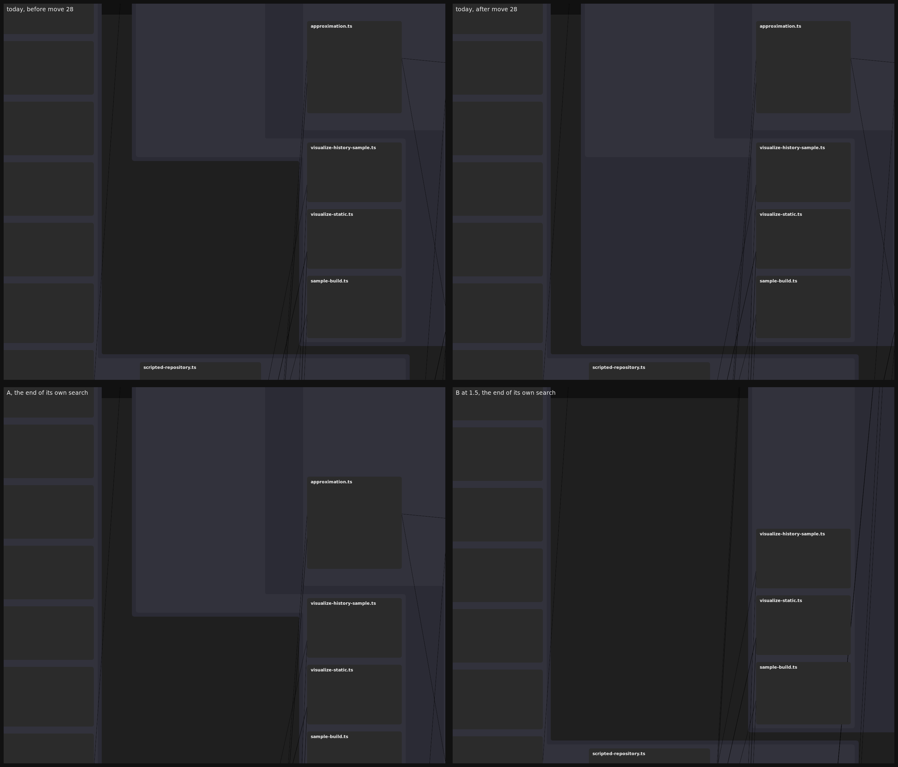
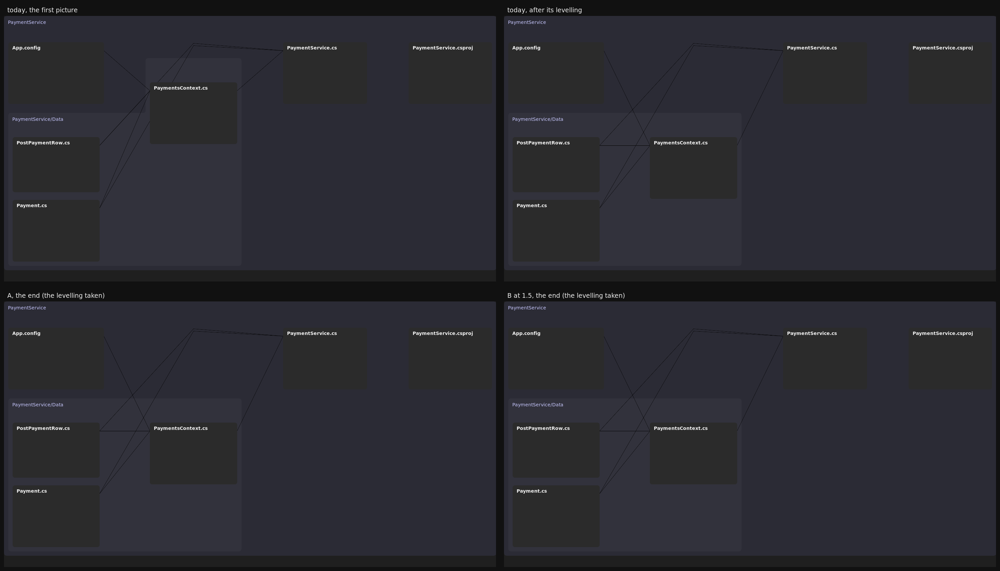

# What the 2D map's price gets wrong: a shuttling card, levellings round empty ground, and the first order

_Historical evidence, taken 2026-11-19 between 20:50 and 21:40 UTC by the builder of the round `layout-price`, on `f0ddaef8` with `3feb97fa` (the solver's recorded systems moved to `__fixtures__`) picked onto it, in the builder's own worktree. Everything here is headless arithmetic on the page's own modules over the layout lab's capture of this repository's five pinned files (98 cards, taken once through the browser lane at 20:54; the lab's model reproduced the page to the pixel), by the scripts in this folder. The machine's load was 12 to 45 throughout, so counts and prices are given, and milliseconds only with their load._

The three faults are the ones [the search-stop packet](../../Screenshots/owner-packet/search-stop/README.md#seen-on-the-way) found by eye.

## The headless search is the page's search

[`search-moves.ts`](search-moves.ts) walks the continuing search as the page does (the same judges, the same order of trials, the same price), laying each trial out on the capture's card model by [`lean.ts`](lean.ts), which is the lab's `evaluate` without the lab's routes and cycle search, neither of which the page's search does. At the visitor's defaults it ends exactly where the packet's page did: 11 orders, 196 levellings, 13 moves, a price of 3,426,608, and every move at the packet's price, with the packet's count of cards moved (29, 1, 91, 29, 1, 86, 2, 1, 2, 6, 1, 2, 1). `compose.test.ts` moves at moves 1, 2, 3, 4, 5, 7, 10, 11 and 13 by 30, −30, 30, −66, 66, −72, 72, −72 and 72 px, the packet's nine (a positive number is down). One run takes about a minute at a load of 20.

## 1. The card that shuttles

### The cause: a tie the solver breaks by where it began

`compose.test.ts` has one pin, Internals, with wires to pins in the column to its left that stand above it and below it in equal weight. Every place between the two middle pins costs the same wire, so the placement's price is flat there, and the exact solver stops on one end of that flat stretch or the other. Nothing in the price chooses which. The network simplex begins from a first placement in which every node stands as near the top as the constraints into it allow, and moves only while a move lowers the cost, so among places of equal cost it stops at the first it reaches. A levelling joins two runs of an outline into one node; with that, the first placement of what stands below the joined edge can change, though the levelling concerns nothing of `compose.test.ts`, and the card stops at the other end. `graph.test.ts` does the same, 368 px up at move 7 and back at move 12.

That it is a tie and nothing else is shown by the mend below: with the shown picture choosing among placements of equal cost, the search tries the same trials at the same prices and makes the same thirteen moves, and the card no longer moves at a levelling but once, 7 px with 86 other cards.

### The smallest system that shows it

- [`smallest-system.ts`](smallest-system.ts), at the solver: two pins `p` and `q` held 72 px apart and a node `x` wired to both, five nodes. Under all 120 numberings of its nodes `x` stands on `p`: the numbering is not the cause. Add one constraint that never binds, `x` at least 100 px below a node `r` that nothing else holds, and `x` stands on `q`, 72 px lower, at the same cost (72,072).
- [`smallest-tie.ts`](smallest-tie.ts), at the placement: card `x`'s pin wired to the pins of four cards in the column to its left, two above and two below. Its top stands level with `b`'s. Put a card `y` with no wire above `x` in its column: `y` may stand anywhere above `x`, so it changes no cost, and `x` stands 70 px lower, level with `c`. Given the first picture's tops, `x` stays level with `b`.

### The mend

The principle the root named: a card a trial does not concern stays where it stands, so among placements of equal price the one nearest the picture already shown is taken.

- **The solver** (`network-simplex.ts`) takes a second objective: a constraint may carry a `tie` weight. Every node balance, subtree sum and cut value becomes a pair, and a tree edge leaves the tree when its cut value's first part is negative, or zero with its second part negative. That is the network simplex minimizing the pair in dictionary order: no amount of the second is worth any of the first, with no large multiplier that could lose integers. Without `tie` weights every second part is zero and the solver pivots exactly as before.
- **The placement** (`branch-placement.ts`) takes `anchor`, the shown picture's tops, and wires each card to one origin by the second objective alone, as a wire is made (Gansner et al., section 4.2). The nearness joins no constraint component, so disconnected components still align at their own origins. `layoutScene` passes it through.
- **The page does not use it yet.** The search's trials are laid out in `branch-renderer.ts`, which another round owns; the change it needs is below, with the layout lab's matching change in [`lab-seam.diff`](lab-seam.diff), kept out of the lab until the page makes it, since the lab's browser case holds the lab's pictures to the page's.

### The tests, red before

- `branch-placement.test.ts`, "leaves a card whose place costs nothing where the shown picture had it, when a change elsewhere would move it": the picture of `smallest-tie.ts`, asserting that `y` moves `x` from `b`'s level to `c`'s at the same cost, and that with the first picture's tops `x` stays at `b`'s level, the other cards with it, the cost the same. With the solver and placement set back to `f0ddaef8`'s it fails (`anchor` is not read), as does
- `network-simplex.test.ts`, "chooses among positions of equal cost by the second objective, and never pays for it in the first": `smallest-system.ts`'s five nodes, `x` drawn to 0, 30 and 72 px below `p`, standing there each time, the cost the same.
- `branch-placement.test.ts`'s random picture: given the stacked start's tops, the placement is well formed and its wire cost and the sum of its outlines' heights are the placement's without them.

### No price of the solver changed

`network-simplex.equivalence.test.ts`, "costs what it costs without a second objective on every system, when one chooses among equal costs": every node of every system of the harness (the 40 seeded systems from 8 to 303 nodes, and the three real systems of 98, 1,470 and 1,561 nodes the page solved on the five files) drawn toward a seeded place in the second objective; on every one the cost, the optimality and the feasibility are those of the solver without it, which the two cases beside it hold to the oracle position for position. The harness's two existing cases pass unchanged, so the solver without ties is still the oracle's to the position.

### Cards moved per move on the five files, today and anchored

At the visitor's defaults (2 starts before paint, 32 orders, patience 8), today against each levelling laid out nearest the shown picture (the orders as today; why, in the next section). Both searches try the same 207 trials, and every trial's price is the same in both, to the pixel of wire.

| Move | What was tried | Price after | Cards moved today (farthest, px) | Levellings anchored (farthest, px) |
| --- | --- | --- | --- | --- |
| 1 | a levelling | 3,444,078 | 29 (30) | 28 (1) |
| 2 | a levelling | 3,443,878 | 1 (30) | 0 |
| 3 | order 5 | 3,429,330 | 91 (994) | 91 (994) |
| 4 | a levelling | 3,428,397 | 29 (66) | 28 (1) |
| 5 | a levelling | 3,428,197 | 1 (66) | 0 |
| 6 | a levelling | 3,428,095 | 86 (7) | 87 (7) |
| 7 | a levelling | 3,427,895 | 2 (368) | 0 |
| 8 | a levelling | 3,427,606 | 1 (27) | 1 (27) |
| 9 | a levelling | 3,427,546 | 2 (35) | 2 (35) |
| 10 | a levelling | 3,427,192 | 6 (72) | 5 (46) |
| 11 | a levelling | 3,426,992 | 1 (72) | 0 |
| 12 | a levelling | 3,426,808 | 2 (368) | 1 (4) |
| 13 | a levelling | 3,426,608 | 1 (72) | 0 |
| All | | | 252 | 243 |

`compose.test.ts` moves twice: 30 px down with order 5, which deals its column anew, and 7 px up at move 6, with the 86 other cards that move. `graph.test.ts` no longer goes 368 px up and back. The 28 cards of moves 1 and 4 move by one pixel, where today 29 move by up to 66. (With every trial anchored, orders too, the counts are the same and `compose.test.ts` moves 36 px up at order 5 and 6 at move 6.)

### At the suite's eighty orders, and why the levellings alone

The browser suite's setting (no start before paint, 80 orders, patience 80) replayed headless ends exactly where the page did: a first picture priced 3,448,893, 80 orders, 231 levellings, 29 moves, order 77 at move 16, 3,197,457 at the end. Three ways:

| | Trials whose price differs from today's | Moves, at the same prices | Cards moved in all | Moves that move `compose.test.ts` | Seconds, at a load of 22 to 32, run side by side |
| --- | --- | --- | --- | --- | --- |
| Today | | 29 | 506 | 12 | 141 |
| Every trial's ties nearest the shown picture | 15 of 311 | 29 | 485 | 4 | 160 |
| The levellings' ties alone | 0 of 311 | 29 | 493 | 4 | 154 |

At the defaults the two ways agree with today on all 207 trials' prices (91, 98 and 101 s side by side). With every trial anchored, fifteen of the eighty orders' trials cost 200 more, all of them pictures priced 3,445,009 or 3,443,476 and refused either way: one outline step more. The placement's cost is the same in both, but the price adds two things the placement does not weigh, the count of an outline's steps and the picture's height, so a different one of the placements of equal cost can carry a different count of steps (the same blindness as fault 2, below). An order deals every column anew, so nearness to the shown picture means little there; a levelling keeps every card's column and order, which is where the shuttle is. So the mend to land is the levellings' alone: no price of any trial changes, on either setting, and the four moves left to `compose.test.ts` at eighty orders are three orders (seed 1, 109 px; seed 5, 72; order 77, 2,027) and move 9, where 87 cards move 7 px with an outline.

What nearness costs: the solver without ties against the solver with every node of the harness's real systems drawn elsewhere ([`anchored-time.ts`](anchored-time.ts)) takes 4 to 11 times as long (system 1, 182 ms against 821 and 1,824; load 15), but the placement draws only its cards, 98 of about 1,500 nodes, and the whole search took 8 to 9 % longer with the levellings anchored and 11 to 13 % with every trial (the seconds above, at the defaults and at eighty orders; five other replays ran beside each).

### What the page needs

In `branch-renderer.ts`, which another round owns, the shown picture's tops as `layoutScene`'s sixth argument where a levelling is laid out (at `f0ddaef8`):

- `searchStep`, line 1264: `layoutScene(plan, branches, answersMeasurer(search, plan, branches), search.sceneTuning, alignments, kind === "alignment" ? controller.previousTops ?? undefined : undefined)`;
- `tryAdoptPicture`, line 1385, which measures a trial on the page before it is shown: `layoutScene(plan, branches, measurer, search.sceneTuning, alignments, kind === "alignment" ? controller.previousTops ?? undefined : undefined)`.

`controller.previousTops` is the shown picture's `scene.tops` (set at a render and at every adoption). The lab's matching change, in the same commit, so that the lab's refinement stays the page's and `local-map-simplicity.spec.ts` keeps comparing like with like: [`lab-seam.diff`](lab-seam.diff), `evaluateAlignment` placing nearest its previous picture's tops. No browser case pins the eighty-order search's end (`local-map-hidden.spec.ts` asserts the search's pausing, not its counts), so none needs a new truth; the end and its price stay as they are.

## 2. Levellings that lower the price and make the picture worse

Measured; the price is not changed. The moves are the packet's, in the eighty-order search, numbered as there (the headless replay makes the same 29 moves at the same prices).

### Which terms moved

In each of the five, one term of the price moved: the count of the outline's steps, by one, at Membrane Simplicity's 200. The wires' vertical length, the crossings, the picture's height and width, the outline steps' pixels (Membrane Evenness), the rows' levelness and the ranking's terms are all the same before and after. No card moved.

| Move | Price after | Steps | Every other term | Outline height added, px | Outlines that changed | Seen in the packet |
| --- | --- | --- | --- | --- | --- | --- |
| 23 | 3,198,378 | −1 (−200) | unchanged | 180 | `scripts/live-docs` and `scripts/live-docs/inspect`, up to 60 px | a name lifted away from its first card, an empty band under it |
| 24 | 3,198,178 | −1 (−200) | unchanged | 300 | `packages` and `packages/engine/src`, 60 px | the same, a level up |
| 25 | 3,197,978 | −1 (−200) | unchanged | 72 | `packages/explorer/src/shared`, 72 px | an outline grown under a card round nothing |
| 28 | 3,197,657 | −1 (−200) | unchanged | 608 | `scripts`, 608 px | one column's foot drawn 608 px lower round nothing |
| 29 | 3,197,457 | −1 (−200) | unchanged | 608 | `scripts/live-docs`, 608 px | the same, the outline inside it |

Since no card moved, every pixel the outlines grew encloses nothing: the outline height added is the empty ground each move bought. (Move 22, the 7 px jog removed, is the same kind at 7 px.)

### Why evenness charges nothing for them

Membrane Evenness prices the pixels of every step of an outline: |a − b| + |b − c| for three columns at heights a, b and c. Where the outline runs one way, down and down again, that sum is |a − c| however many steps it takes. So levelling one stair of a staircase that runs one way costs evenness nothing; the stair's pixels move to the next stair. Membrane Simplicity then pays 200 for the step removed. And nothing in the price weighs the ground an outline encloses: the placement weighs an outline's height at one unit against a wire pixel's million, to keep outlines tight, and the picture's price not at all. So any one-way staircase is worth levelling at any cost in empty ground, by 200, and the search takes it.

### The candidate mends

Measured on the five moves here; for the estate's levelling and for `pathfind.ts` they are not measured (neither is a scope the lab can capture headless today: the estate's picture has two directories opened, and the lab captures pinned files only), so those columns say what follows from the packet's own description.

| Candidate | 23 | 24 | 25 | 28 | 29 | The estate's levelling (an L made a rectangle, a card 186 px down) | Elsewhere |
| --- | --- | --- | --- | --- | --- | --- | --- |
| A. Count an outline's steps only between columns that both hold the directory's own cards | kept | refused | kept | refused | refused | kept if both columns of the L hold cards (not measured) | changes the price of every picture with steps beside an empty column, the first picture's choice among its starts included |
| B. A price per pixel of every outline's height in the picture's price (the placement weighs it at a millionth of a wire's pixel, the price not at all) | refused above 1.11 px of wire a pixel | above 0.67 | above 2.78 | above 0.33 | above 0.33 | not measured | Membrane Evenness (2 a pixel of step) squares an outline by stretching it round empty ground, the October 7 design: at 2 or more this price refuses every such stretch; at 0.34 to 0.66 it refuses 28 and 29 only |
| C. A levelling that moves no card and no line is not a trial | refused | refused | refused | refused | refused | kept (it moves a card) | also refuses move 22 (7 px), and, with the shuttle mended, moves 2, 5, 7, 11 and 13 at the defaults, which then move no card: the defaults would make 8 moves, not 13. A rule of the search's judge, owned by the other round, and a rule over the price: it says the price's outline terms never buy a move alone |
| D. A price on a directory's name standing apart from its first card | refused (if priced above 200 for 45 to 60 px) | refused | kept | kept | kept | not measured | covers the name only |

What I would weigh: B is the one that names what is wrong in the pictures (an outline enclosing nothing), but it fights Membrane Evenness, which deliberately encloses ground to square outlines, and at a weight that refuses 23 and 25 it overrides that design. A refuses three of five and keeps the two where both columns hold cards. C refuses all five and keeps the estate's move, but it is a rule beside the price, not a price, and it changes how many moves a visitor sees most. A more exact fix of the cause would make Membrane Simplicity count a step only where it is not part of a one-way staircase that evenness already prices, or price the ground enclosed only where evenness gains nothing for it; neither was measured.

## 3. The first picture's order against the eighty the search can try

Measured only; nothing built. [`first-order.ts`](first-order.ts) prices the first picture as the page draws it (the ranking's order and seeds 1 and 2, the cheapest kept: here seed 2's, 3,445,009) against each of seeds 1 to 82 laid out alone, and the first picture's starts swept 8, 16 and 32 times where the page sweeps 4. [`order-columns.ts`](order-columns.ts) sets the first order and order 77 side by side column by column.

### What order 77 changes

Order 77 alone is priced 3,200,099, 7.11 % under the first picture (the packet's 6.6 % was against the price the search had reached by then). Against the first picture, term by term at the page's costs:

| Term | First picture to order 77 | At its cost, px of wire |
| --- | --- | --- |
| Vertical wire | −245,107 px | −245,107 |
| Crossings | −300 | −24,000 |
| Height | −1,075 px (9,418 to 8,343) | −5,375 |
| Outline steps' pixels | +10,871 | +21,742 |
| Outline steps | −5 | −1,000 |
| Rows' levelness | +4,415 | +8,830 |
| Width, returns | 0 | 0 |
| All | | −244,910 |

So the whole of the gain is wire: order 77's lines run a quarter of a million pixels shorter, and its outlines are more jagged for it. Of nine columns, columns 0 and 1 keep their order, column 2 keeps 6 of 9 cards in their places, column 3 3 of 16, and columns 4 to 8 none of their 13, 27, 13, 9 and 2. What it does to the picture: in the first order the right half hangs low. Columns 4 to 7 begin 666, 1,321, 2,954 and 2,876 px from the top; in order 77 they begin at 241, 86, 197 and 1,558. Column 5, 27 cards, then ends at 8,187 where it ended at 9,392: that column is the packet's long tail.

### How rare it is

Of the 82 orders, 17 are cheaper than the first picture. One is order 77. The other sixteen are two pictures within a percent of each other: orders 5, 6, 15, 16, 28, 41, 51, 74 and 76 all give 3,429,330 (−0.46 %), and orders 10, 11, 46, 60, 61 and 68 give 3,429,419 (−0.45 %); order 37 gives 3,443,476. The sweeps from any start fall into a few pictures, and one start in 82 falls into order 77's. More sweeps do not find it: the first picture's starts swept 8, 16 or 32 times give the first picture again, to the pixel of wire. A seed laid out alone took 411 to 1,130 ms, median 549 ms, at a load of 16 to 22 (the page's own solver; the first picture's three starts 2.5 s).

### The sample (second leg)

[`sample-maps.ts`](sample-maps.ts), seed 20261119, drew thirty maps: of this repository's source (under `packages/` and `scripts/`, no tests), eight single files as a link opens them, eight files with their own directory opened, eight sets of two to four files pinned whole; of the estate, two of each. [`capture-addresses.ts`](capture-addresses.ts) captured them through the lane in two holds of fifteen. The first hold ran; **the second waited behind nine other holders past this leg's end and was stopped**, so the sets of pins and the estate are not in the table. [`run-sample.sh`](run-sample.sh) prices every map's first picture against seeds 1 to 80 alone; [`sample-summary.ts`](sample-summary.ts) tabulates them and holds each lab first picture to the page's.

| Map | Cards | Lab's first picture is the page's | Best of 80 against the first | Orders better / by more than 1 % | Median rule's first against today's |
| --- | --- | --- | --- | --- | --- |
| `client/errors.ts` | 3 | yes | 0 | 0 / 0 | 0 |
| `slopcop/assetPaths.ts` | 3 | yes | 0 | 0 / 0 | 0 |
| `client/graph-helpers.ts` | 12 | yes | 0 | 0 / 0 | −0.29 % |
| `layout-lab/restarts.ts` | 12 | yes | 0 | 0 / 0 | +2.31 % |
| `slopcop/symbolReferences.ts` | 5 | yes | 0 | 0 / 0 | 0 |
| `localView/branch-routing.ts` | 6 | yes | 0 | 0 / 0 | +1.29 % |
| `layout-lab/spatial.ts` | 12 | yes | 0 | 0 / 0 | 0 |
| `views/forceGraphWrappers.ts` | 11 | yes | −0.36 % | 1 / 0 | +1.18 % |
| `languages/rust.ts`, its directory opened | 12 | yes | −0.55 % | 7 / 0 | 0 |
| `localView/branch-search.ts`, its directory opened | 82 | no (placement 946,457 against 1,384,623) | −0.33 % | 1 / 0 | +1.60 % |
| `history/lens.ts`, its directory opened | 33 | nearly (placement 312,949 against 313,429) | **−5.50 %** | 58 / 58 | −3.64 % |
| `slopcop/markdownShared.ts`, its directory opened | 14 | yes | 0 | 0 / 0 | 0 |
| `history/directories.ts`, its directory opened | 32 | nearly (163,512 against 165,672) | 0 | 0 / 0 | +13.44 % |
| `adapters/cargo.ts`, its directory opened | 61 | no (216,349 against 225,767; 3,295 against 3,745 wide) | **−5.51 %** | 14 / 9 | −0.39 % |
| `config/liveDocumentationConfig.ts`, its directory opened | 56 | yes | −0.08 % | 9 / 0 | +2.50 % |

What it says, with the caveat that the lab's card model is off the page on four of the seven opened directories (an opened directory stands in flow order, and the model is a few to some hundreds of pixels short there, as on the estate):

- **Single files:** the first picture is the best of 80 on seven of eight, and the eighth is 0.36 % from it. No gain to find.
- **Directories opened:** two of seven have a gain of 5.5 %. On `history/lens.ts`'s, 58 of the 80 orders beat the first by more than 1 %: the first order there is unusually bad, not one lucky order good. On `adapters/cargo.ts`'s, 14 orders beat it, 9 by more than 1 %. The other five are within 0.6 %.
- **The five files** are the third map with a large gain, and the only one where it is a single order in 82.

### A fixed rule for the first order: the median

Measured in a scratch copy of the sources with the order step's barycenter replaced by the median of the neighbours' places (the textbook alternative, Gansner et al.'s), nothing else changed and nothing in this worktree. On the five files the median's first picture is 3,458,214, 0.38 % dearer than today's; sweeping it 8, 16 or 32 times changes nothing. Its own order 77 is 3,188,345, 7.45 % under today's first, so order 77's basin belongs to that start's shuffle, not to the sweep's rule. On the fifteen maps it is no better a rule: equal on five, better on three (−0.29 %, −0.39 %, and −3.64 % on `history/lens.ts`'s), dearer on seven (up to +13.44 %). A pass that swaps neighbours while crossings fall was not tried.

So no fixed rule tried reaches order 77's kind of gain: on the five files the gain is one start in 82 under either rule, and where a first order is broadly bad (`history/lens.ts`'s) the median recovers two thirds of it but costs elsewhere.

## Second leg: candidates A and B searched and drawn

_Taken 2026-11-19 between 21:30 and 22:15 UTC on `6d96e11f`, at a load of 13 to 33. Built in this probe only, nothing in the product's price: [`candidates.ts`](candidates.ts) says what each candidate adds to the page's price, and [`search-moves.ts`](search-moves.ts) judges the first picture's starts and every trial by it. Every search here lays its levellings out with the shuttle's mend as it will land (each levelling's ties nearest the shown picture's cards and slots)._

### The two candidates

- **A.** An outline's steps are counted only between neighbouring columns that both hold the directory's own cards. Today counts every nonzero step at Membrane Simplicity's 200.
- **B at 1.5.** Every drawn outline's height costs 1.5 px of wire a pixel. Between the bounds you set (1.11 refuses 23, 2.78 still keeps 25) I took 1.5 for one reason: it stays below Membrane Evenness's 2 a pixel of step, so the October 7 stretching, an outline squared by stretching a segment d px to take away a step of d px, still pays in the price (it saves 2d of evenness and costs 1.5d), while a levelling of a one-way staircase, which saves no evenness, costs 1.5 a pixel against the 200 its step saves. The placement still stretches as today: B only judges.

### What the pictures needed

[`capture-addresses.ts`](capture-addresses.ts) captures the page at any address with the lab's own `captureFromPage`, through the lane, one browser for several addresses; [`lean.ts`](lean.ts) builds the exploration from the address's state (the subject, the pins, the directories opened, an opened directory standing in flow order from the top, as the page does). No lab file changed. Held to the page by [`check-capture.ts`](check-capture.ts):

- `pathfind.ts` as a link opens it: the lab's first picture is the page's (16 cards, placement 97,117, 2,920 × 3,342), and today's search makes the packet's three levellings at its prices (337,834, 337,634, 337,434).
- The estate with `PaymentService` and `PaymentService/Data` opened: the same 6 cards and width, but 765 px tall where the page is 786, and a placement measure of 1,761 against 1,866. The card model is about 21 px short somewhere in this flow picture, which I did not run down. The search makes the packet's one levelling all the same: `PaymentsContext.cs` 165 px down (the page's 186), the L made a rectangle, the price 6.0 % lower (the page's 6.5 %).
- The five files: the lab's own capture, which reproduces the page to the pixel.

### Which levellings each takes

| | Today | A | B at 1.5 |
| --- | --- | --- | --- |
| Five files, move 22 (a 7 px jog) | taken | refused | taken |
| Move 23 (`scripts/live-docs`, a name lifted 60 px, +180 px of outline) | taken | **taken** | refused |
| Move 24 (`packages`, +300) | taken | refused | refused |
| Move 25 (`explorer/src/shared`, +72 under a card) | taken | taken | taken |
| Moves 28 and 29 (`scripts`, `scripts/live-docs`, +608 each) | taken | refused | refused |
| Moves 26 and 27 (`approximation.ts` and the cards under it up 87 and 150 px, outlines −368 and −750) | taken | **not reached** | taken |
| The estate's levelling (an L made a rectangle, a card level with its neighbours) | taken | taken | taken |
| `pathfind.ts`'s three (+300, +492, +120 px of outline; with the shuttle's mend none moves a card) | taken | refused | refused |
| Five files, whole search (80 orders) | 29 moves | 20 moves | 28 moves |

Two things the table does not say by itself:

- **A also changes earlier moves.** With fewer steps to count, its search takes order 2 as well (orders 1, 2, 5 and 77), and after order 77 it makes six levellings where today makes thirteen: it never reaches today's 26 and 27, which lift `approximation.ts` and the cards under it and shrink two outlines by 368 and 750 px. The packet's builder saw those two as harmless; they are the kind of levelling that tidies.
- **B goes further than refusing.** After order 77 its search takes, besides today's 26 and 27, six levellings that today's price never reached, each pulling an outline in round its cards by moving cards: outlines 654, 418, 696, 2,535, 688 and 4,424 px shorter, cards moved by up to 1,165 px, the wires 27,432 px longer in all (12,876 px in its last move). At 1.5 a pixel of outline against 1 a pixel of wire, B trades wire for snug outlines, which today's price was built never to do (a box's height costs a millionth of a wire's pixel in the placement for that reason).

### The pictures

Each at reading size, the lab's geometry drawn plain by [`draw.ts`](draw.ts) (outlines by the page's own `membranePath`, cards as boxes with their file's name, wires straight from pin to pin; not the page's look), four panels: today before the move, today after it, the end of A's own search, the end of B's own search. [`draw-places.sh`](draw-places.sh) draws them from [`run-candidates.sh`](run-candidates.sh)'s runs.

- Move 23: [five-move-23.png](pictures/five-move-23.png). Today's after and A's end are the same picture: `scripts/live-docs/inspect` made level across its two columns, its name standing over empty ground in the column where it has no card. B's end has `emit.ts` about 150 px lower with both outlines drawn snug round it, under a taller band of the outline above them.
- Move 24: [five-move-24.png](pictures/five-move-24.png). Today's after lifts the tops of `packages` and `packages/engine/src` 60 px in the first column, which holds no card here, so both names stand over a wider empty band; A and B keep the step.
- Move 25: [five-move-25.png](pictures/five-move-25.png). The outline's foot under the large card on the left comes down 72 px to the level of its neighbour, enclosing that much ground under the card. Taken by all three, so A's and B's ends look like today's after.
- Moves 28 and 29: [five-move-28.png](pictures/five-move-28.png), [five-move-29.png](pictures/five-move-29.png). Today's after draws `scripts` 608 px down round an empty column. A's end has today's before's outlines, with `approximation.ts` and the cards under it 237 px lower, where today's moves 26 and 27 lifted them and A's search never got. B's end leaves the cards of the right-hand column where they were, has taken `approximation.ts` out of this view, and leaves the column on the left bare from top to bottom, outside any outline.
- `pathfind.ts`: [pathfind-levellings.png](pictures/pathfind-levellings.png). Today's three levellings make `packages` and `packages/engine/src` level along their tops, both names standing over empty bands 60 to 224 px tall above columns that hold no card at that height; A and B keep the first picture.
- The estate: [estate-levelling.png](pictures/estate-levelling.png). All three take it: the L of `PaymentService/Data` becomes a rectangle and `PaymentsContext.cs` comes level with `PostPaymentRow.cs`.

### My recommendation

A, of the two. It refuses three of the five (24, 28, 29), all three of `pathfind.ts`'s and the 7 px jog, keeps the estate's and 25, and changes nothing else about how a picture is made: it counts the term that moved, the steps, only where a step separates cards. It keeps 23, whose step does separate cards (`inspect`'s two columns both hold its files), so the name lifted over an empty column stays; and it stops short of 26 and 27, which I would rather keep. B at 1.5 refuses 23 too, but it is a new trade of wire for outline height that redraws the late picture in ways today's price never asked for (six levellings today's price never reached, 27,432 px of wire), and the pictures show its snug outlines bought with cards far from their partners. B at a rate low enough not to do that (under about 0.33, where it would refuse only 28 and 29) was not run. Neither should land before the owner sees these pictures.

## Seen on the way

- **Lane slots move in levellings too.** The bends of the lines through a directory's lanes are items of the placement like cards, with the same ties. Today the eighty-order search's six late levellings that move no card (22 to 25, 28, 29) move 6 to 17 lane slots each, 1,354 slot moves in the whole search; the packet counted no line drawn differently at moves 22 to 25 and 1 and 5 at 28 and 29, so most of those do not show on the page, and why was not run down. Drawing the levellings' slots to the shown picture as well as their cards (the placement's whole `top` as `anchor`, mode `joins-slots` of `search-moves.ts`): again 0 of 311 trials' prices differ and the same 29 moves are made, the six late levellings move no slot at all, and the search moves 1,177 slots. On the page that is `search.incumbent.scene.placement.top` in place of `controller.previousTops` in the two lines above. That run took 210 s beside other work, against 154 for the cards alone; it was not timed side by side.
- **The lab's `evaluate` routes every picture.** Its routes and signals cost several seconds a trial at today's load, so a search replayed through the lab's `refine` took over fifteen minutes where [`lean.ts`](lean.ts) takes one. The page's search never routes a trial.
- **The suite's eighty-order setting has no start before paint** (`orderStarts: 0` in `local-map-hidden.spec.ts`), which is why its first picture is priced 3,448,893 where a visitor's is 3,445,009, as the packet saw.

## How it was taken

- The capture: `npm run layout:lab -- capture repository/five` through the browser lane, on `npm run build`, `npm run live-docs:visualize -- --history none` and `npm run live-docs:visualize:estate` in this worktree.
- The searches: [`run-searches.sh`](run-searches.sh) `<capture> <out dir>`, six replays side by side (today, every trial anchored, the levellings alone; at the defaults and at eighty orders), each writing every move's terms, cards moved and every trial's price.
- The first order: [`first-order.ts`](first-order.ts) and [`order-columns.ts`](order-columns.ts). The solver's time with and without nearness: [`anchored-time.ts`](anchored-time.ts). The smallest systems: [`smallest-system.ts`](smallest-system.ts), [`smallest-tie.ts`](smallest-tie.ts).
- Each script names its arguments at its top. The capture and the runs' JSON were scratch and are not kept.
