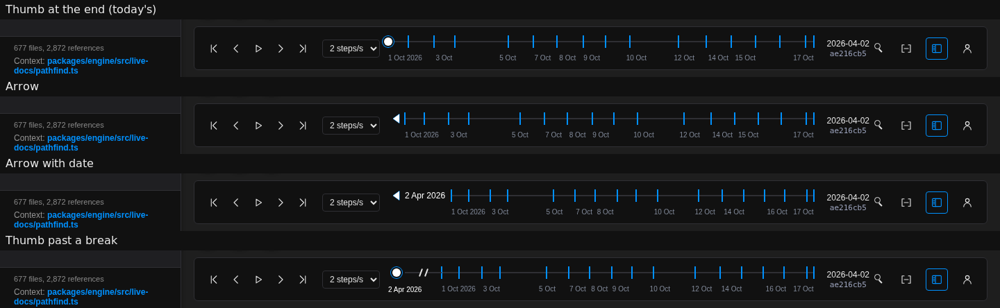
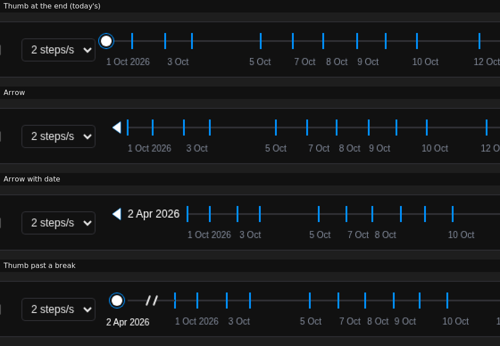
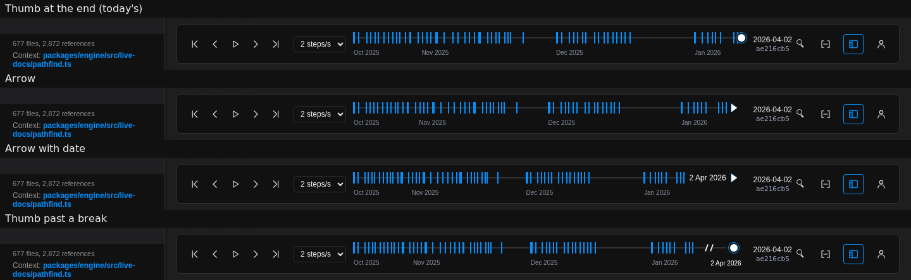
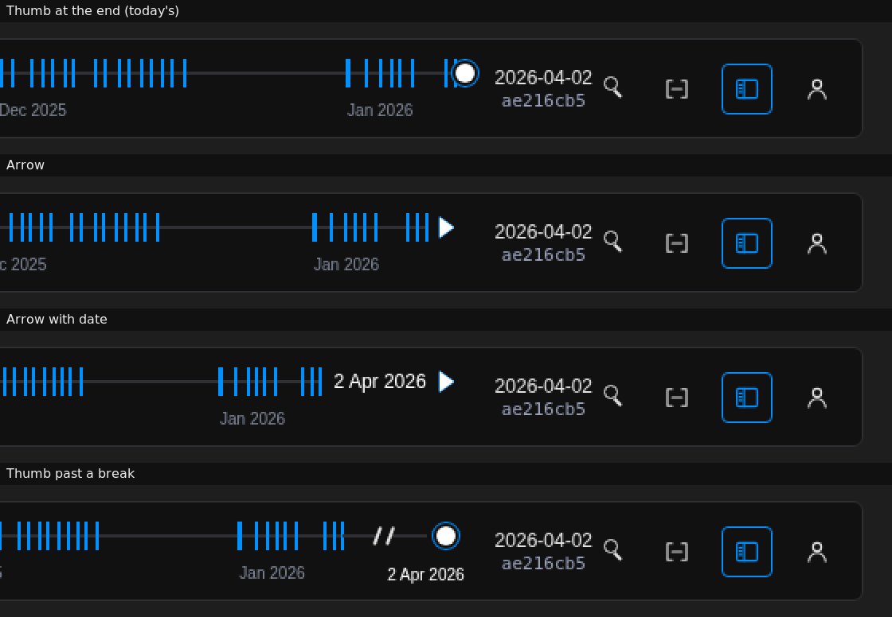

# Alternatives for your eye: the mark for a step off the history's bar, and the cells of a directory's undrawn files

_Historical evidence, taken 2026-11-19 by a builder for the root, on a build of the branch `worktree-agent-a44cc0ec97fd43b94` made that evening. Everything here is a trial behind a lever: today's behaviour is the default in every picture's build, and nothing is decided by it._

This follows [the packet of six questions](../2d/README.md) of the same day. For two of them root's recommendation was "not as drawn", with alternatives to be brought as matched pictures: [the history's zoomed bar](../2d/README.md#4-the-historys-zoomed-bar-where-am-i) and [one hidden file as a cell](../2d/README.md#6-one-hidden-file-as-a-cell). The first is here whole. The fault the packet met on the way is run down and mended, with candidates for what is still yours to choose there. The second question is not built yet, and its section says so.

**How these were taken.** Chromium at 1440 by 900, launched as the browser suite launches it, a fresh visitor, Tuning at its defaults except the one lever a picture is about. For each of the bar's three states one page was opened and the bar zoomed and slid by the wheel under today's mark; the lever was then changed in place, in the Tuning panel itself, for each alternative. So within a state the window, the map behind the bar and the dates the bar runs over are one and the same page, and only the mark differs. Nothing was drawn into the page; the close-ups are cut from the whole-window pictures and enlarged twice, and say so.

**The strangers** were the packet's: a model told nothing of the project, given one sentence and a browser window of 1280 by 800, mouse and keyboard only, at most 25 actions: one `claude-sonnet-5-5`, one `claude-haiku-5-5`. The lever was remembered in their browser before the page opened, and the bar was zoomed and slid for them by the same wheel turns the packet's run used.

## The mark for a step off the zoomed bar

The packet's example: the 2D map at step 267, 2 April 2026, with the history's bar zoomed by three turns of the wheel and slid until 2 April is no longer among its dates. Today a white disc like the thumb then stands on the bar's end, exactly over the first date, and three readers took it to say "you are at 1 October". The question is what should stand there instead.

Tuning → History → **Off The Bar** now has four values:

- **Thumb at the end**: today's, and the default.
- **Arrow**: a small white arrowhead outside the bar's end, pointing away from the bar.
- **Arrow with date**: the same, with the step's date between the arrowhead and the bar.
- **Thumb past a break**: the thumb's own disc outside the bar's end, the line between it and the bar cut by two slanted strokes, and the step's date under the disc where the bar writes its dates. This third is mine; the reason is under My eye.

In all three alternatives the bar gives up a little of its length at that end while the step lies past it (24, 91 and 77 pixels of its 613 in these pictures), so that the mark stands outside the first or last date and never over one. With the step back on the bar, the bar is its whole length again.

**Pictures.** The step off the left end, the four marks, cut from the whole-window pictures:

The left ends of the same four, enlarged twice:

The step off the right end, where the date and commit in words stand just beyond the mark:

Each mark in the packet's three states, as the packet's own cut showed today's:

| Mark | The bar three ways | Inside | Off the left end | Off the right end |
| --- | --- | --- | --- | --- |
| Thumb at the end | [cut](a-today-the-bar-three-ways.png) | [window](a-today-1-step-inside-the-range.png) | [window](a-today-2-step-off-the-left-end.png) | [window](a-today-3-step-off-the-right-end.png) |
| Arrow | [cut](a-arrow-the-bar-three-ways.png) | [window](a-arrow-1-step-inside-the-range.png) | [window](a-arrow-2-step-off-the-left-end.png) | [window](a-arrow-3-step-off-the-right-end.png) |
| Arrow with date | [cut](a-arrow-date-the-bar-three-ways.png) | [window](a-arrow-date-1-step-inside-the-range.png) | [window](a-arrow-date-2-step-off-the-left-end.png) | [window](a-arrow-date-3-step-off-the-right-end.png) |
| Thumb past a break | [cut](a-break-the-bar-three-ways.png) | [window](a-break-1-step-inside-the-range.png) | [window](a-break-2-step-off-the-left-end.png) | [window](a-break-3-step-off-the-right-end.png) |

With the step inside the range the four are the same picture, as they should be: the lever changes nothing while the thumb can stand on the bar. Off the left end the bar runs over 1 to 17 October 2026 in all four, the packet's own range.

**To try it.** These need this branch's build; your server on port 8999 has the lever only once the branch is merged and built there. <http://localhost:8999/?s=N4IgbiBcDMA0IDsogA4EMDGBrNBzApgM4D0+CuAlgvsYQE4bEA2FY+AtACYD2GJ6AFwAWAMyqcAdAMIh4Q5GnwAmAIwA2DACMArCu0AGAOwro+pds1rOIw5zRq0Izvj2cVAFn3uAHAE410CAAvkA>

1. The link opens the 2D map at 2 April 2026 with the history's bar open.
2. Put the pointer on the white thumb and turn the wheel away from you three notches; then hold Shift and turn the wheel, or swipe sideways, until the thumb leaves the bar.
3. Open Tuning in the sidebar and, inside it, the group History (it is folded while the map is in 2D). Set Off The Bar to each value in turn; the bar redraws in place.
4. Press the mark: the bar slides back to hold the step.

Opened on the builder's port and done exactly so for steps 1 to 3, the wheel turned by script as the packet's was. For step 4 the mark was reached by the keyboard's focus and pressed with Enter under Thumb past a break: the bar slid to begin at step 267 and the thumb stood on it. A pointer's press on the mark I did not try, nor the press under the two arrows. A screen reader is told "Show the current commit, 2026-04-02" under today's mark and the arrow, and "Show the current commit, 2 Apr 2026" under the two marks that write that date on screen, so that what is seen is in what is heard.

**The strangers.** The packet's task, word for word: "This page is showing the project as it was at some past date. Which date, and where is that on the bar at the bottom?" Each was given the step off the left end, the bar running from 8 October to 10 November 2026: [the arrow](a-stranger-what-they-saw-arrow.png), [the arrow with date](a-stranger-what-they-saw-arrow-date.png), [the thumb past a break](a-stranger-what-they-saw-break.png). All six read the date rightly, 2 April 2026. Of where it is on the bar:

- **Arrow, Sonnet** (1 action, a look): "the playhead is the small white triangle at the far left end of the timeline, just before the first tick marks"; then "the playhead is parked at its left edge, earlier than any labelled date. The bar doesn't show a label for April, so I can't point to an exact tick for that date."
- **Arrow, Haiku** (3 actions): "the marker is the blue playhead at the far left end, just before the first tick label"; it pointed at it, "and it didn't reveal anything new"; and concluded "the bar's labels may not match the position, or the bar may be showing a different span than the one the marker points to."
- **Arrow with date, Sonnet** (1 action): "the date appears twice. It is at the left end as '2 Apr 2026', beside the small white triangle that marks the current position"; and still "The axis labels seem inconsistent with that. They start at '8 Oct 2026' and run through '8 Nov', all later than April. I can't tell why."
- **Arrow with date, Haiku** (1 action): "the playhead sits at the far left end of the track, next to the '2 Apr 2026' label"; it found nothing amiss and did not say the date lies before the bar's.
- **Thumb past a break, Sonnet** (1 action): "the position marker is the circle at the far left, labelled '2 Apr 2026'. A break mark ('//') follows it. That break skips the empty stretch of time between April and the next commits"; and "So the page is at the earliest point on the timeline, well before the rest of the history."
- **Thumb past a break, Haiku** (1 action): "the current position is the circle marker at the far left, labeled '2 Apr 2026.'"; and "the bar spans roughly April to November 2026, and this marker sits at its earliest end."

So none of the three is read wholly rightly. Under the arrow one stranger placed the step "earlier than any labelled date" and the other still found a contradiction. Under the arrow with date one still found a contradiction and the other noticed nothing. Under the break neither found a contradiction and both put the step at 2 April, to the left of October; one named the break for what it is. But both then took the disc for the earliest point there is: one called the skipped stretch "empty", which it is not, and the other took the bar to run unbroken from April. Neither asked for words.

**My eye.** The arrow alone is the weakest. It is small, it stands beside a row of small triangles and chevrons that play and step, and it says only "that way": I would take it for one more transport button. It cures the old misreading and puts nothing in its place.

The arrow with its date says where and when, and at the left end it reads well enough: "2 Apr 2026", then the bar begins at "1 Oct 2026". But the date sits on the line's own level while every other date sits under the line, so the eye does not read the two as one run of dates. At the right end it stands a finger's width from the date in words, "2 Apr 2026" beside "2026-04-02", the same thing twice in two forms.

The thumb past a break is the one I would choose, and it goes against the rule root set, that the mark must not have the thumb's shape; so here is the reason. The fault in today's mark is not that it is a disc, it is where the disc stands: on the bar's first date. Outside the bar, with its own date under it in the row where the bar writes its dates, the disc is telling the truth: you are here, at 2 April. The dates then read in order along one line, "2 Apr 2026", the break, "1 Oct 2026", "3 Oct". A designer would call the two strokes a scale break: what a chart draws across an axis where it leaves a stretch out. It keeps one sign for "you are here" where the arrows make a second.

What is still wrong with it: the strokes are small, and one stranger did not see them at all; and nothing says that the history goes on beyond the disc, so both took it for the earliest point. I would try a short stub of the line fading out beyond the disc wherever there are steps past it. That is not built. Also not judged: motion. At the moment the thumb leaves the bar, the bar shortens by the mark's room and every tick shifts a little; I have looked at stills only.

**Root's recommendation:** the thumb past a break, and I was wrong to rule the thumb's shape out.

- **What I see.** In today's picture the disc stands on "1 Oct 2026" and says you are there. The bare arrow reads as one more transport button beside the play and step triangles. The arrow with its date reads, but at the right end the date stands twice within a finger's width, "2 Apr 2026" beside "2026-04-02". The thumb past a break is the only one where the dates run in order along the bar: "2 Apr 2026", the break, "1 Oct 2026".
- **Where my rule went wrong.** I said the sign for "off this end" must not have the shape of the sign for "you are here". The fault was where the disc stood, on the bar's first date, not that it was a disc. Standing outside the bar with its own date under it, it is still "you are here", and that is true.
- **What is still wrong, from the strangers.** One read the break as "the empty stretch of time", and it is not empty: half a year of commits lies in it. One missed the break. Nothing says the history goes on before the disc. Next to be tried: a short fading stub of line beyond the disc, and a sign in the gap that steps were skipped there.
- **One more thing these pictures show.** The bar writes a date two ways, "2 Apr 2026" under the line and "2026-04-02" beside it. One form.
- **So:** the break becomes the default once those are tried, with today's mark and the two arrows kept on the lever for you to compare.

## A past step by two roads

The packet's example: pressing the history's bar on today's map of `pathfind.ts` to reach 2 April 2026, before that file existed, left the map empty; the link to the same step showed the scan root's map, faded.

**What I found.** The two roads draw the same picture and differ only in where the camera stands. Read from the page on both roads at step 267: eleven cards and seven closed directories, the scan root's own level, each time. By the link, eight of the eleven cards are in the window. By the press, none is: the camera is still about where `pathfind.ts` stood today (the map's offset went from 871 left and 1,026 up to 871 left and 1,794 up, against 12 right and 69 down by the link), and the root's map lies outside the window. [By the press](two-roads-1-pressed.png); [by the link](two-roads-2-link.png).

The cause, as far as the code shows it: when the subject stops standing at the moment shown, the map asks for a fit of the whole picture, as it does on first opening. On first opening the cards are already in their places. After a press on the bar they are still travelling from today's arrangement to the past one, the fit measures the picture mid-journey, and nothing fits again when the journey ends. A card's own arrival already waits for the journey's end; the fit of the whole picture does not.

**Mended.** When the subject leaves the picture while the cards are travelling, the fit of the whole picture now waits for the journey's end. A browser case on the scripted history sample holds it: `lib/huge.ts` opened today, the bar taken in one move to the first step, before that file was born, and the camera compared with where the same address opens it. Seen red on the build before the mend, the same one card drawn by both roads and the picture standing 124 pixels to the right of and 105 above where the address puts it; green after. The two pictures above are from before the mend; I did not retake the press on this repository's own map after it.

**What the map should show at a date before the file existed** is yours to choose; the mend only makes the two roads agree on today's answer. Three candidates, and what each costs in keeping your place:

1. **The scan root's map, faded.** Today's answer: [picture](two-roads-2-link.png). It costs the most: nothing of what you were looking at is carried over, the top of the repository stands where your file's neighbourhood was, and no word says the file was not there yet.
2. **The file's place held.** Its card drawn where it will stand, empty and outlined, with a sign that it did not yet exist, among whatever of its directory did. It keeps the subject under your eye, by name and by place. It costs a new sign, for "not yet", that must not be taken for a file; and it draws something the history does not hold at that date. Not built, so no picture.
3. **The nearest thing that did exist.** The file's own directory as it stood that day, opened: [picture](two-roads-candidate-nearest-directory.png), taken from today's product by an address that names the directory and the commit. On 2 April 2026 that directory was `packages/shared/src/live-docs`; the history follows it through its renaming to `packages/engine/src/live-docs`, and the files that were `pathfind.ts`'s neighbours-to-be are drawn. It keeps the neighbourhood. It costs a name that changes under you where a directory was renamed, and where the directory did not exist either it climbs to a parent, at the last to the root, which is candidate 1. In this picture the step panel stands over the directory's name, and nothing yet says that `pathfind.ts` is absent.

My recommendation is the third, with one thing from the second: the name of the file asked about kept in sight with the word that it was not yet created, as the pin tray already says of a pinned file. That is a design choice and none of it is built.

**Root's recommendation:** the mend stands; and for a date before the file existed, the third candidate with the second inside it.

- **The mend.** Two roads to one state now frame the same picture. The camera's own browser cases have still to be run against it.
- **What the map should show before your file existed.** Today, by either road, it shows the top of the repository with every card faded, and nothing says why. I would show the directory the file was later born into, as it stood that day, with the file's place held in it as an outlined card that says "not yet created" in the pin tray's own words. You keep the neighbourhood and you keep your subject in sight, and the outline is honest about being a place and not a file.
- **It is yours to decide,** because it draws something the history does not hold. I am having it built as a trial so that there is a picture.

## Cells that follow the directory's name

Root's rule, to be built as a further value of Tuning → 2D Layout → Hidden Files: the cells for a directory's undrawn files stand after the name on the name's own line and flow to the next line only when they do not fit, so that one cell looks the same at every zoom.

**Not built yet.** The round's time went to the bar. One thing found while reading for it: the handle's cells are made in `card-factory.ts` and placed by `local.css`, but which of them a handle gets is decided in the function that fills a directory's handle, and that function lives in `branch-renderer.ts`, a file another builder holds this evening. The new value may need two or three lines there. No picture, no stranger and no audit has been run for this question.

**Root's recommendation:** build the simpler form: every cell on the name's line when they fit, and all of them beneath it when they do not. A first few on the name's line with the rest wrapped beneath would be a ragged block that begins half way along a line.

## The second leg

[The second leg](second-leg/README.md) makes the break the default mark, holds a not yet created file's place in its directory, and stands cells after a directory's name; each of its sections closes with the root's recommendation. _Linked by the root on 2026-11-19._
