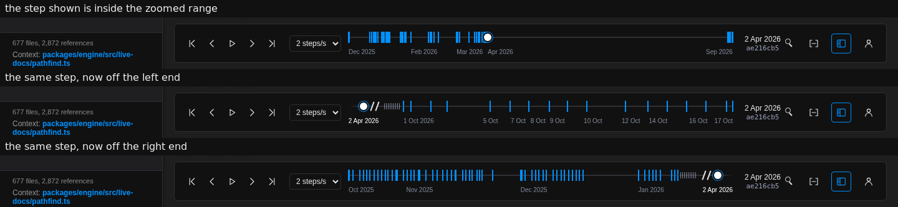
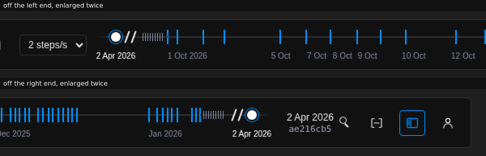
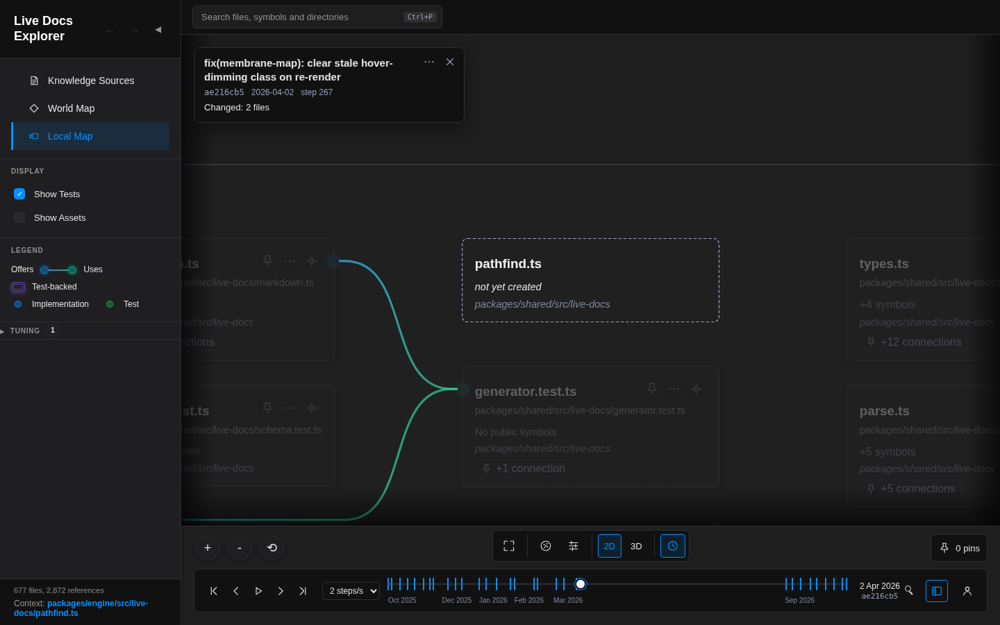
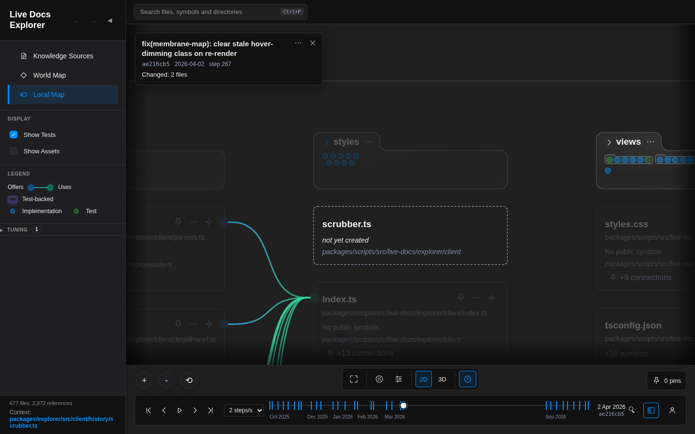
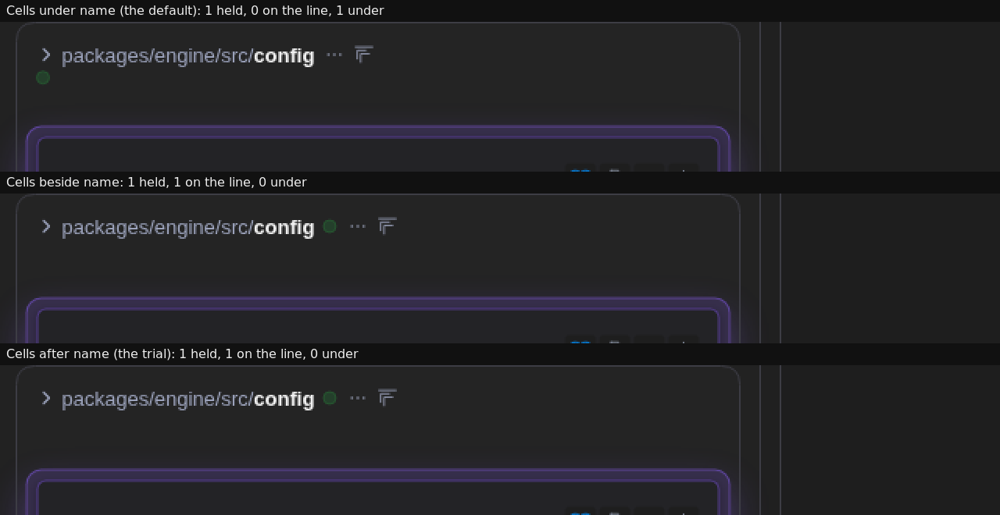
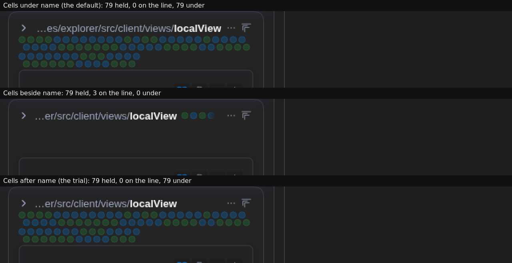

# The second leg: the break made the default, a file's place held before it existed, and cells after the name

_Historical evidence, begun 2026-11-19 at 21:42 UTC by the same builder, on the branch `worktree-agent-a44cc0ec97fd43b94` after `8005466f`. It follows [the first leg's record](../README.md), on which root wrote its recommendations; this file is new so that neither overwrites the other._

**What was asked.** Root chose the thumb past a break as the mark for a step off the history's zoomed bar, and asked for four things in order: the break made the default after three mends the strangers and the pictures pointed to, with one form for a date in the whole bar; root's choice for the map at a date before the asked-about file existed, built as a trial for a picture; the camera's own browser cases against the first leg's mend, and the five red 3D cases settled against the baseline; and the cells that follow a directory's name.

**The lane this evening.** One machine's browser was shared by a dozen builders, and the queue for it stood at eight to ten for the whole leg: a hold asked for at 21:49 began at 22:05. Each section says plainly what was seen in the browser and what was only built and unit-tested.

## The break as the default

Tuning → History → Off The Bar now offers "Thumb past a break" first, and it is what a fresh visitor gets. "Thumb at the end" (the mark before), "Arrow" and "Arrow with date" stay for you to compare.

Three things were added to the break for what the first leg's strangers said of it:

- **A stub of the line beyond the disc**, fading out, wherever the history goes on past the step shown. Both strangers had taken the disc for "the earliest point on the timeline".
- **The steps skipped, drawn.** Between the break's strokes and the bar's first tick stands a short run of faint ticks, three pixels apart, closer than the bar ever draws its own: one for each step left out when there are few, nine for any larger number. One stranger had read the gap as "the empty stretch of time"; half a year of commits lay in it. The mark's hover text says the number ("110 commits between it and the bar").
- **Stronger strokes.** The two slanted strokes are taller (16 pixels for 12) and in the thumb's white. One stranger had not seen them.

**One form for a date in the whole bar: the ruler's.** The bar's ruler needs to shorten a date by what its neighbours already say: "1 Oct 2026", then "3 Oct", "5 Oct"; "Dec 2025" when the bar runs over months; "2026" over years. A date written in figures cannot do that and stay readable ("10-03", "2025-12"), and a month written as a word cannot be taken for a day, which "03/10" can. So the ruler's form is the bar's: the readout beside the bar now writes "2 Apr 2026" where it wrote "2026-04-02", the mark's date and its name for a screen reader are in the same form, and so is the slider's spoken value. The step's panel above the map and the finder's list of commits still write "2026-04-02"; they are not the bar, and the finder is searched by typing a date in that form.

**Pictures.** The packet's own state again: the 2D map at step 267, 2 April 2026, the bar zoomed three turns and slid. Chromium at 1440 by 900, a fresh visitor, nothing set: the break is what the page draws.

The two ends, cut from the same pictures and enlarged twice:

Whole windows: [inside](break-1-step-inside-the-range.png), [off the left end](break-2-step-off-the-left-end.png), [off the right end](break-3-step-off-the-right-end.png). The four marks on one page, the lever changed in place in the Tuning panel, so that you can see the old mark and the arrows are as they were: [off the left end](off-the-left-end-the-four-marks.png), [off the right end](off-the-right-end-the-four-marks.png). With the pointer on the mark the disc turns blue ([enlarged](break-pointer-on-it-enlarged.png)); the hover text is the browser's own and is in no picture.

Read from the page off the left end: the bar gives up 88 of its 616 pixels; the mark is named "Show the current commit, 2 Apr 2026" and its hover text adds "111 commits between it and the bar"; nine ticks are drawn for them. A pointer's press on the disc slid the bar to begin at step 267, the thumb back on it and the bar its whole length.

**To try it.** This needs this branch's build. <http://localhost:8999/?s=N4IgbiBcDMA0IDsogA4EMDGBrNBzApgM4D0+CuAlgvsYQE4bEA2FY+AtACYD2GJ6AFwAWAMyqcAdAMIh4Q5GnwAmAIwA2DACMArCu0AGAOwro+pds1rOIw5zRq0Izvj2cVAFn3uAHAE410CAAvkA>

1. The link opens the 2D map at 2 April 2026 with the history's bar open. Start from Tuning's reset.
2. Put the pointer on the white thumb and turn the wheel away from you three notches; then hold Shift and turn the wheel until the thumb leaves the bar.
3. Rest the pointer on the disc outside the bar's end for its words. Press it: the bar slides back.
4. Tuning → History (folded while the map is in 2D) → Off The Bar has the other three.

Steps 1 and 2 were done on the builder's port by the wheel, the press of step 3 by the pointer, and step 4 in the Tuning panel itself. I did not wait for the hover text to appear.

**The strangers.** The packet's task, word for word, the step off the left end, the same two kinds of stranger, nothing remembered in their browser.

- **Sonnet** (1 action): "The playhead (white handle) sits on the first tick, labeled '2 Apr 2026'. A break mark ('//') follows it. After the break the ticks pick up around 8 Oct 2026 and continue through 8 Nov. So the current point is the earliest one on the timeline, and a gap of about six months separates it from the later commits."
- **Haiku** (1 action): "the handle sits at the far left, under the '2 Apr 2026' label"; and "The timeline runs from there to about 8 Nov 2026, so this is the earliest point shown."

Both again read the date and placed the step rightly, at 2 April before the bar's October, and neither found a contradiction. Neither reading moved for the three mends: both still took the disc for the earliest point there is, the second still did not see the break, and neither spoke of the crowd of ticks or the stub.

**My eye.** The strokes are now plain to see, and at both ends the dates read in order across them. The crowd of ticks before the bar is visible and reads to me as a stretch squeezed, not empty; a stranger did not remark it. Two things are wrong and are mine to mend next. The stub beyond the disc cannot be seen: eighteen pixels of the line's own grey fading into the ground is nothing to the eye, and it is the one sign against "the earliest point", which both strangers still said. I would draw it longer and give it the same faint ticks the gap has, thinning out, so that it says "more steps this way" in the bar's own marks. And the strokes now stand hard against the disc, where they should stand midway between the disc and the crowd. At the right end the date is written twice a finger apart, under the disc and in the readout; it is at least the same words now.

**Root's recommendation:** the break stays the default mark. The dates now read in order at both ends, and one stranger of two reads the gap for what it is where none did before. Two mends before it lands, both the builder's own: the two strokes belong midway between the disc and the bar's end, not hard against the disc, and the stub beyond the disc cannot be seen at 18 pixels of the line's grey. One thing more: the step's panel and the finder still write the date as `2026-04-02` beside a bar that writes `2 Apr 2026`; the panel is to take the bar's form, and the finder to find by either. _The root looked at the three-way sheet, both ends enlarged, the pointer on the mark, the four marks at each end and the stranger's window; the three whole windows are the ones those were cut from._

## A file not yet created: its place held

Root's choice, built behind Tuning → History → **Not Yet Created** with today's picture ("Scan root") the default: at a date before the asked-about file was created, the 2D map draws the directory that file was later born into, as it stood that day and opened, with the file's place held in it as an outlined card that says "not yet created", the pin tray's own words. Where the file's own directory did not stand yet either, the place is held in the nearest directory above it under which a file stood that day, at the last the root: the nearest thing that existed, so that the reader is as near their place as that day allows. The held card draws something the history does not hold at that date, which is why this is a lever and yours to decide.

**Pictures.** `pathfind.ts` asked about, at 2 April 2026, the lever set in the Tuning panel before the page was opened.

Opened by the address of that moment:

Reached by pressing the history's bar on today's map of the file: [picture](place-1-by-the-bar.png). The two roads give one picture: the same card in the same place of the window (its box read from the page is the same to the pixel, and the camera's position the same), which is the first leg's mend at work on this trial too.

A file whose own directory did not stand yet, `packages/explorer/src/client/history/scrubber.ts` at the same date:

There was no `history` directory on 2 April, so the place is held in the directory above it, which that day was named `packages/scripts/src/live-docs/explorer/client`: the nearest thing that existed, among the files that would become its neighbours' neighbours. I show that and not the root because the reader asked about one file, and the nearest standing directory is the most of their place that the day holds; the card's third line says which directory it is drawn in.

**What the pictures show that was not asked.** The directory's name is not in either window. The directory, opened, is some four thousand pixels wide at the reading size, the camera arrives on the held card as it does on any file asked about, and the handle with the directory's name stands far off the left edge. So the step's panel covers no name, because no name is there to cover; the mend I built for that (slide the name out from under the panel once the camera rests) had nothing to do here and is untested by these pictures. What says the directory is the card's own third line, in small italics. That is the trial's weak point: the reader sees neighbours and no heading.

**To try it.** This needs this branch's build.

1. Tuning → History (folded while the map is in 2D) → Not Yet Created → "Its directory, its place held".
2. Open <http://localhost:8999/?s=N4IgbiBcDMA0IDsogA4EMDGBrNBzApgM4D0+CuAlgvsYQE4bEA2FY+AtACYD2GJ6AFwAWAMyqcAdAMIh4Q5GnwAmAIwA2DACMArCu0AGAOwro+pds1rOIw5zRq0Izvj2cVAFn3uAHAE410CAAvkA>, the first leg's link to 2 April 2026.
3. Or open today's map of `pathfind.ts`, press History in the bottom strip, and press the bar about two thirds of the way along.

Done on the builder's port exactly so, the address in step 2 made afresh for the same file and commit.

**The strangers.** None was sent: the lane had room for one hold in this leg, and it went to the bar's.

**My eye.** The dashed outline with nothing in it but a name and "not yet created" reads at once as a place kept and not a file: it is the only card with no buttons, no rows and no fill, and it keeps its full strength while its neighbours fade. Its neighbours are right to be there; they are what a person who knows `pathfind.ts` would recognise. But without the directory's name the picture does not say where this is, and the path under each neighbour's name is the only help. If you keep this, the arrival should frame the directory's name with the held card, or the name should stay in sight as a heading does when a page scrolls.

**Root's recommendation:** this one, for the owner's eye: the file's directory as it stood that day, with the file's place held as a dashed card that says `not yet created`. It keeps the reader where they were looking and says plainly that the file is not there, where the scan root says neither. When the directory did not exist either, the nearest one that did is the right place. The weak point is real: nothing in the window names that directory but the card's third line; the directory's handle is to be brought into view with the card. _Looked at: the first road's window and the directory-not-yet-there window; the second road's is the first's to the pixel by the builder's count._

## Cells after the name

Tuning → 2D Layout → Hidden Files has a fourth value, "Cells after name", today's default unchanged: every cell stands after the directory's name on the name's own line where the line holds them all, and all of them stand beneath it where it does not. So one cell stands in one place at every zoom.

**Pictures, at one camera.** This repository's map of `pathfind.ts`, a fresh visitor for each value with the lever remembered in the browser (and the map's continuing search off, as the browser suite has it, so that the arrangement is the same each time). For each directory the map was dragged by script until the directory's handle stood at one fixed point of the window, 430 across and 210 down, the same point under every value; then pictured, and pictured again after three presses of the zoom's minus. The cuts are from those whole windows, enlarged twice, the same rectangle of the window in every row.

One undrawn file, `packages/engine/src/config`, at the reading size:

The same, three presses out: [cut](cells-1-three-presses-out-enlarged.png). Under the trial the one cell stands after the name in both; under the default it moves from under the name to beside it.

So many that they go beneath, `packages/explorer/src/client/views/localView` with 79:

Three presses out: [cut](cells-3-three-presses-out-enlarged.png). Two undrawn, the directory `packages`: [at the reading size](cells-2-at-the-reading-size-enlarged.png), [three presses out](cells-2-three-presses-out-enlarged.png). Whole windows under the trial: [config](cells-1-after-name-at-the-reading-size.png) and [out](cells-1-after-name-three-presses-out.png); [packages](cells-2-after-name-at-the-reading-size.png) and [out](cells-2-after-name-three-presses-out.png); [localView](cells-3-after-name-at-the-reading-size.png) and [out](cells-3-after-name-three-presses-out.png).

Read from the page under the trial, the whole map: the line holds all its cells for `scripts/live-docs` (11), `packages` (2), `packages/engine/src` (2) and `config` (1); they stand beneath for the six directories with 18 to 79. The script's choice of a directory "with several" fell on `packages` with two; `scripts/live-docs`, eleven on the line, would have shown that case better and is not pictured.

**The design audit**, its words-over-words and cut-off checks over the map under the trial: no fault at the reading size on this repository's map, at each of the three cameras, nor on the estate's map of `PaymentsContext.cs`. Three presses out it reports symbol names cut off inside cards on both (five on the estate, by 22 to 144 pixels; twelve on this repository, by 4 to 36 pixels, the same twelve at each of the three cameras). None is a directory's name or a mark, and the cells move no card; but I did not run the same check under the default at that zoom, so I cannot say from this run that the default has the same list.

**To try it.** This needs this branch's build. <http://localhost:8999/?view=local&node=packages/engine/src/live-docs/pathfind.ts>

1. Tuning → 2D Layout → Hidden Files → "Cells after name".
2. Drag the map down and to the right until `packages/engine/src/config` comes in from the top left; look after its name. Press the minus three times and look again.
3. Find `packages/explorer/src/client/views/localView`, lower on the map: its cells stand under its name.

The pictures were taken with the lever remembered before the page opened and the drag made by script; I did not set the lever by pressing it in the panel for this one.

**The strangers.** Task: "On this map there is a folder whose name ends in engine/src/config, near the top left. What are the small marks beside or under its name, and how many files in that folder is the picture not showing?" The map had been dragged for them so that the handle stood in view, under the trial: [what they saw](cells-stranger-what-they-saw.png). Neither went to the search field.

- **Sonnet** (5 actions): "There are three small marks to the right of the folder name: Green dot: by the map's legend, green means 'Test'. I take it to mean the folder has test files, but the page didn't explain the dot when I hovered over it." It opened the three dots, chose Inspect directory, read "2 files", and answered that 1 is not drawn.
- **Haiku** (6 actions): "The green dot most likely matches the map's legend, where green means 'Test', but hovering gave no tooltip, so I couldn't confirm it." It reached the same answer by the same panel.

Both answered rightly, one file, and neither got it from the cell. Both saw the cell at once and read its colour by the legend, which is right as far as it goes: the undrawn file is a test. Neither took the dot to be a file the picture leaves out. A stranger's window shows no hover text, so what the cell says of itself on hover never reached them.

**My eye.** For one cell the trial does what was wanted: the dot stands after the name, where the eye already is, at the reading size and three presses out alike, and under the default it jumps between two places. With 79 the trial's picture is the default's but for one thing that is wrong in it: the path before the name is cut shorter ("…er/src/client/views/localView" for "…es/explorer/src/client/views/localView"), because the line still keeps room for cells it no longer shows. That is my shortcut and should be mended before this is judged. And the strangers say something the placing cannot mend: a lone green dot reads as "tests here", not as "one file not shown".

**Root's recommendation:** the trial becomes the default once its shortcut is mended (with the cells beneath, the path is cut shorter than it need be, because the line the cells did not take still keeps its room). One cell after the name reads as part of the handle where beneath it reads as a stray dot; seventy-nine go beneath whole, where "beside" showed three and hid the rest. What placing does not mend, and the strangers found: a lone green dot is read as the legend's Test, not as a file held back. That is the cell's own meaning and is a separate question, to be brought with pictures. _Looked at: the three places at the reading size and two of them three presses out, enlarged, and the stranger's window; the six whole windows are the ones those were cut from._

## The camera's cases, and the red 3D cases

The first leg's mend in the 2D camera was run against the camera's own browser cases on the first leg's build, at a load of 24 to 30: all 7 of `local-map-framing` passed and 10 of the 12 of `camera-intent`. The two that failed are `camera-intent.spec.ts:154`, which must send a wheel's turn inside the arrival's one-second hold, and `:317`, which waits twenty seconds for a five-pin map of this repository to draw.

Those two and the first leg's five red 3D cases were then run on the baseline, `b64aed64` built apart, at a load of about 14:

| Case | First leg's build, load 24 to 31 | Baseline, load about 14 |
| --- | --- | --- |
| `camera-intent.spec.ts:154` | red | green |
| `camera-intent.spec.ts:317` | red | red |
| `history-scrubber.spec.ts:333` | red, twice | green |
| `history-scrubber.spec.ts:399` | red, twice | red |
| `history-scrubber.spec.ts:686` | red, twice | red |
| `history-scrubber.spec.ts:726` | red, twice | red |
| `history-scrubber.spec.ts:785` | red, twice | red |

So five of the seven are red on the baseline too and are not this branch's doing. Two, `:154` and `:333`, were red on this branch under the heavier load and green on the baseline under the lighter, which settles nothing: the same two must be run on this branch at the lighter load, and that run had not reached the front of the lane when this was written. Neither goes near what the branch changed (`:154` holds a subject in the picture, where the mend acts only when the subject has left it; `:333` is the 3D camera), but that is an argument and not a run.

**The mark's own browser cases** are written in `tests/e2e/history-scrubber.spec.ts`: the zoom case follows the new default, and a new case holds the break at both ends, its date among the bar's and on none of them, a pointer's press, the one form of date, and the three marks kept. They had not been run when this was written, for the same reason.

**Root's recommendation:** nothing of this leg lands before its own cases have run and the two unsettled reds (`camera-intent.spec.ts:154`, `history-scrubber.spec.ts:333`) have been run on this branch on a quiet machine: red under a load of 24 to 31 and green on the baseline at 14 does not say whose they are.
