# Six questions for your eye: the 2D map, the page's frame and the history's bar

_Historical evidence, taken 2026-11-19 by a builder for the root, on the build of `main` that stood in `dist/explorer/` that afternoon (written 15:37 UTC). Nothing in the product was changed to take it._

**How these were taken.** Chromium at 1440 by 900 unless a picture's name says otherwise, launched as the browser suite launches it, a fresh visitor each time: Tuning at its defaults except the one lever a picture is about, which was set by pressing it in the Tuning panel itself. The defaults include the map's continuing search, which the browser suite turns off, so a picture "at rest" was taken when the map had stopped rearranging. Nothing was drawn into the page; the few close-ups are cut from the whole-window pictures beside them and enlarged, and say so. This container has no Segoe UI, so names here are drawn in a wider face than yours; none of the six questions turns on whether a name fits, so no picture emulates Segoe UI.

**How to try one.** Every link is to your own server on port 8999. Tuning's levers are remembered by your browser, and the links here carry none of them, so each section says which lever to set. Start each from Tuning's reset (Tuning, then the curved arrow at its top right) so that we see the same thing, and set a lever **before** opening the link in the section, as the pictures were taken.

**The strangers.** Each was a model told nothing of the project, given one sentence and a browser window of 1280 by 800, mouse and keyboard only, at most 25 actions: one `claude-sonnet-5-5`, one `claude-haiku-5-5`. Where a lever had to be set for them, it was remembered in their browser before the page opened. A model lives on text and will wish for more of it; where one did, it is reported as a wish.

## 1. Framing: should the camera follow what is pinned?

Pin a symbol in one file and a symbol in another. Today the camera stays where you left it: you see the last thing you opened and must zoom and drag to see both. Tuning → 2D Layout → Framing offers two other behaviours. Under "Follows Pins" the camera moves by itself to hold what is pinned, the newest first; under "Follows Pins, Out To Files" it will also zoom out as far as the picture of bare file names to hold them all. "By Hand" is today's.

### Your example: `PostPayment` and `PostPaymentRow` on the estate

| By Hand | Follows Pins | Follows Pins, Out To Files |
| --- | --- | --- |
| 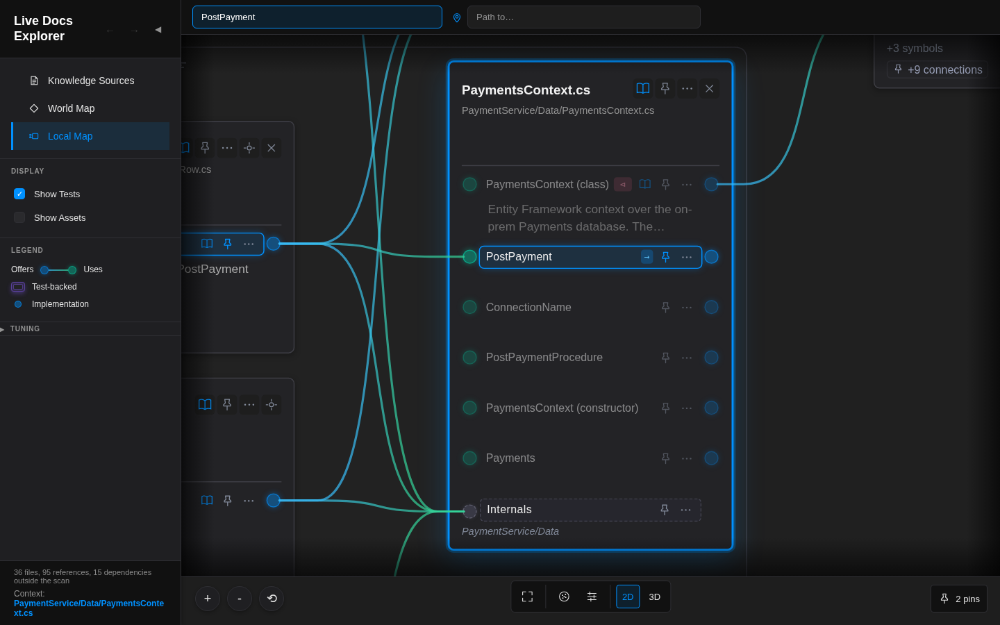 |  | 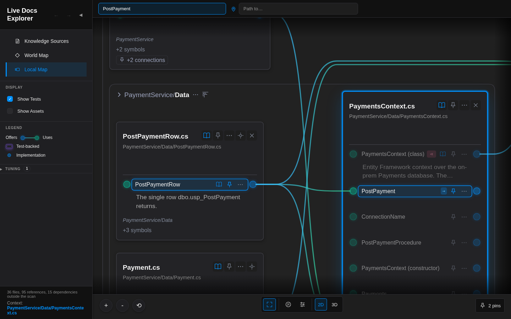 |

By Hand shows `PaymentsContext.cs` and its row `PostPayment`; of `PostPaymentRow.cs` only the right edge is in the window. Under Follows Pins both cards' names and both pinned rows are in the window with the line between them, at the same size of text. The third picture is the same as the second to the eye: the two fit without going out to files.

### Five whole files pinned in one directory of this repository

`graph.ts`, `document.ts`, `graphFiles.ts`, `discovery.ts`, then `pathfind.ts`, all in `packages/engine/src/live-docs`.

| By Hand | Follows Pins | Follows Pins, Out To Files |
| --- | --- | --- |
| 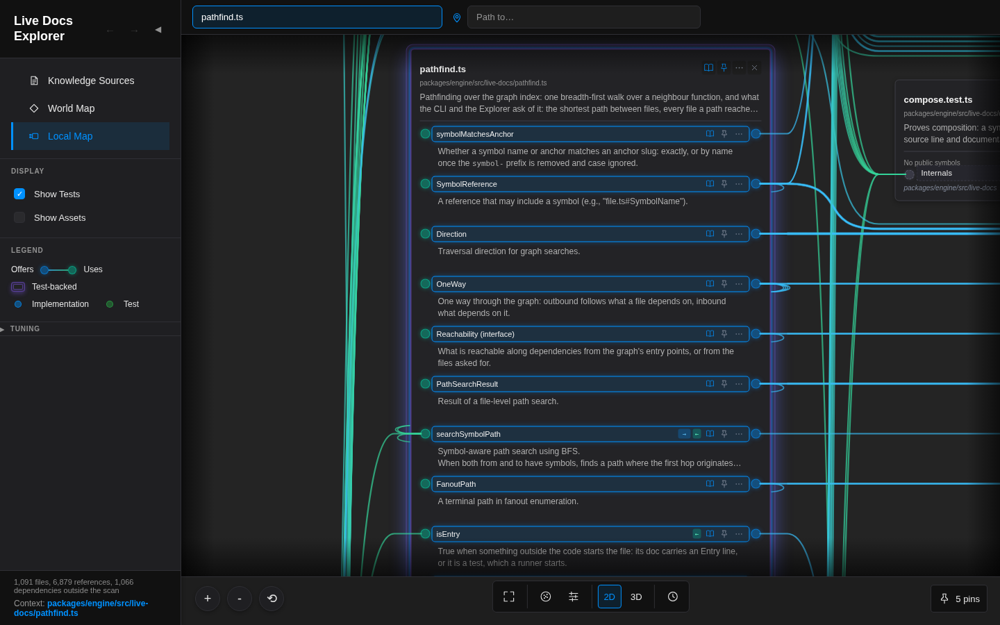 | 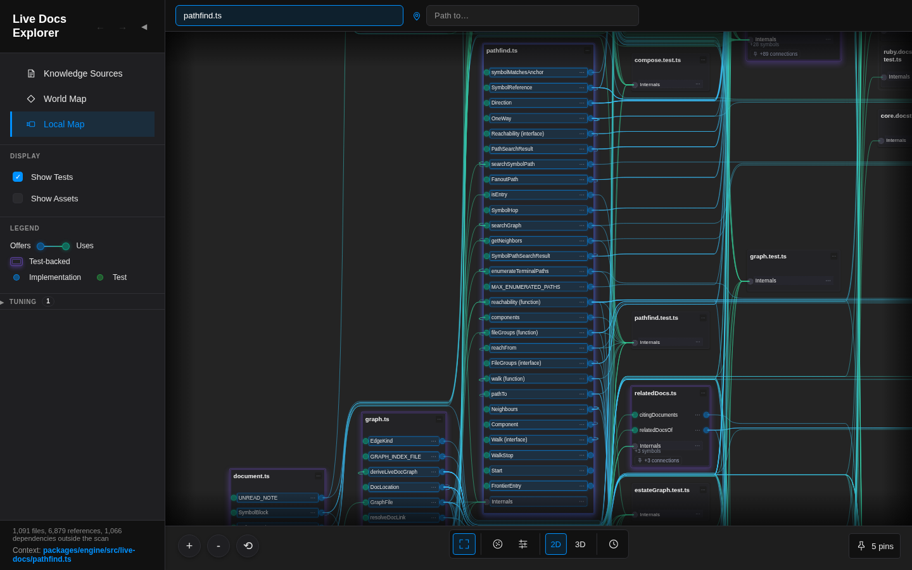 | 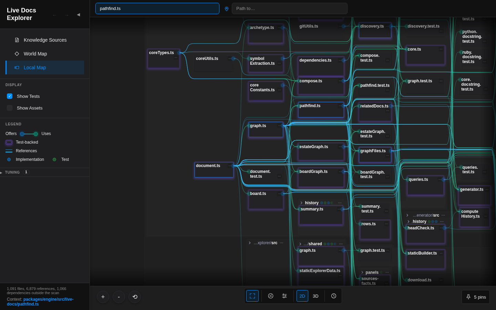 |

By Hand: `pathfind.ts`, the newest, at reading size; the other four out of the window. Follows Pins: `pathfind.ts` whole from top to bottom at about a third of reading size, with the tops of `graph.ts` and `document.ts` at the bottom edge; the page counts the four older pins as outside the frame. Out To Files: a quarter of reading size, only file names, all five in the window among some forty other files. Each picture was taken when the map came to rest, about half a minute after opening; the third was still rearranging itself after seventy seconds and may not be its final arrangement.

### The known weak case: a cell pressed near `pathfind.ts`

`pathfind.ts` opened alone; then the first small cell of the directory `history` pressed, which brings in the file `codec.ts`. Each strip is the browser's own record of what the screen showed, with the time since the press over each frame.

- **By Hand**: 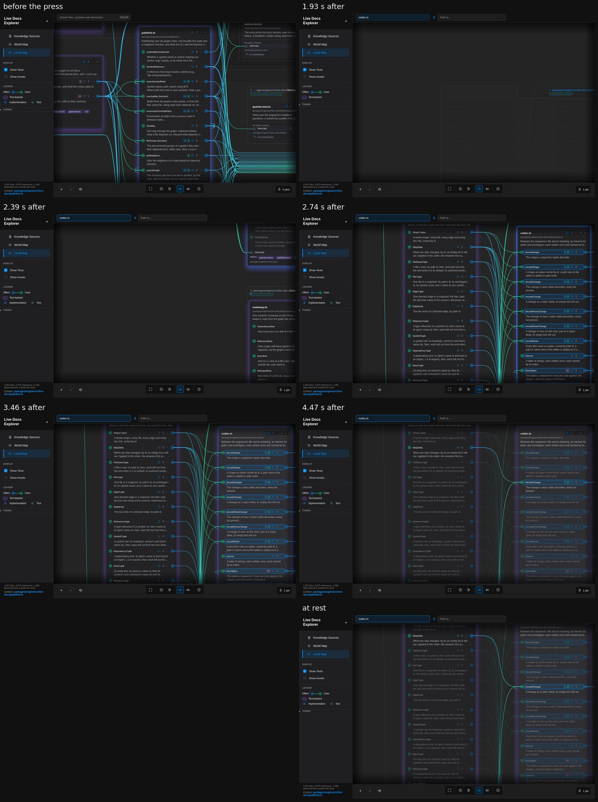 At rest: [whole window](q1-cell-hand-2-after.png).
- **Follows Pins**: 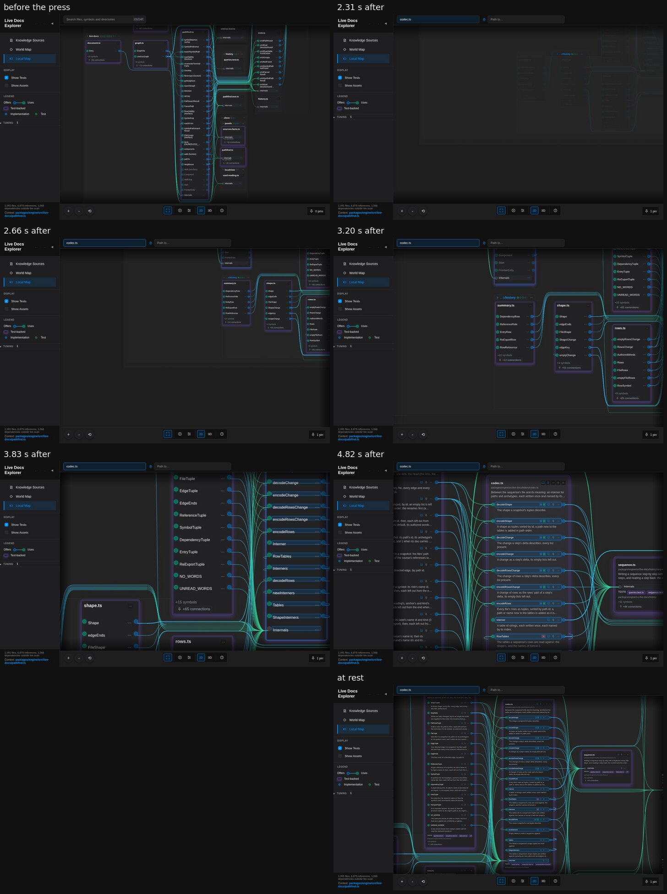 At rest: [whole window](q1-cell-follows-2-after.png).
- **Follows Pins, Out To Files**: 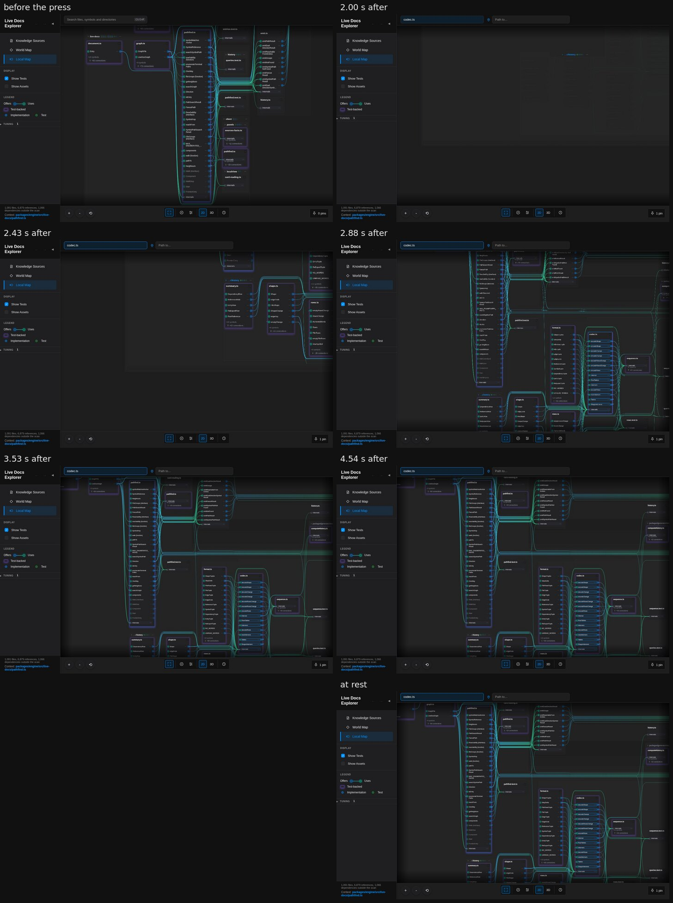 At rest: [whole window](q1-cell-follows-files-2-after.png).

Note first that the three do not start alike: opening `pathfind.ts` By Hand arrives at reading size on the top of the card, and under either following value it arrives with the whole tall card in the window at a third of that size.

By Hand ends at reading size with `codec.ts` at the right edge, its name above the window, and `pathfind.ts` gone. Follows Pins ends on `codec.ts` whole in the middle at about six tenths of reading size, `pathfind.ts` out of the window: the weak case, still as described. Out To Files ends farther out with both `pathfind.ts` and `codec.ts` in the window, both small.

In all three the screen did nothing for about two seconds after the press, then showed one nearly empty dark frame, then moved. Under Follows Pins the frames at 3.2 and 3.8 seconds show the camera closer than where it ends: it goes in past `codec.ts` and comes back out.

### The undecided half: you drag the camera away, then pin one more thing

Under Follows Pins: `pathfind.ts` opened (frame 1), the map dragged aside by hand (frame 2), then the same cell pressed.

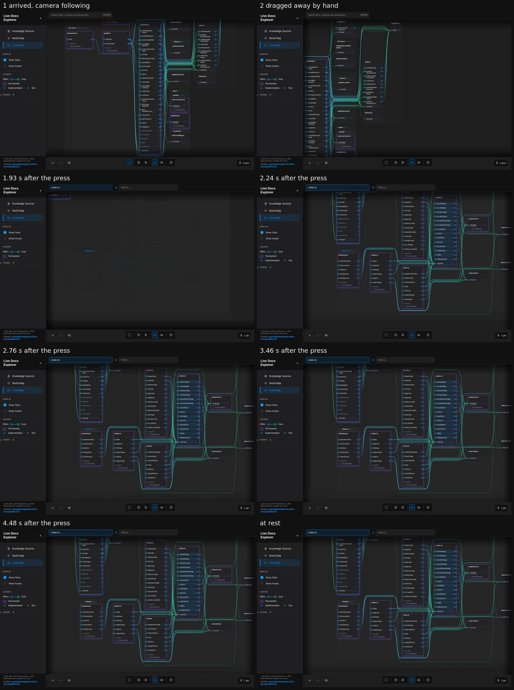

At rest: [whole window](q1-drag-3-after-pin.png). Today the camera does not return to following. It keeps the size your drag left it with and slides just far enough to bring `codec.ts` into the window; the Fit button (the corner brackets, left in the bottom strip), which is drawn pressed while the camera follows, stays unpressed. (Its builder's record says that pressing Fit gives the following back; I did not press it.) The point for you to decide is whether a new pin should do that by itself.

**To try it.** Set the lever first, then open a link; the links carry no setting.

1. Tuning at its defaults, then Tuning → 2D Layout → Framing → "Follows Pins" (or the third value, or leave "By Hand").
2. Your example: <http://localhost:8999/samples/estate/?s=N4IgbiBcDMA0IDsogAoEMCeBbApggLgMo4BOYAlgMY4D0AImvmjetnvgM4DCA9gTgA98AOkocQ8AA5QA2qCSRUmXAWJkqtBkxY8O+VivwAlHgHdR4+OMUpd+5exOmQAX1jzkB9morV6jZi8Cbj58QRExCRBrVDsg-FcAXRcgA>
3. Five files: <http://localhost:8999/?s=N4IgbiBcDMA0IDsogA4EMDGBrNBzApgM4D0+CuAlgvsYQE4bEA2FY+AtACYD2GJ6AFwAWAMyqcAdAMIh4KKAG1QSSKkw4CJMpWq0GzVhx59iuOmhRCpM+DNUAqEAF9Yy5Omx4ipclRr1GFjYuXhJjAFcAWzIBa1kQOxBHFzdVDw1vbT89QMMQkzMLIQAxCiYiONtkZNdEd3UvLV9dAINg4zCKQgxuNjoAT0qE6udalTVPTR8df30go1DiQVFxIcTkgF0nIA> and wait until the map stops rearranging.
4. The cell: <http://localhost:8999/?view=local&node=packages%2Fengine%2Fsrc%2Flive-docs%2Fpathfind.ts>, then find the directory named `history` to the right of `pathfind.ts` and press the first of the small round cells by its name (By Hand they stand under the name, at the right edge of the window).
5. The drag: the same link under Follows Pins; drag the empty ground of the map aside, see Fit release, then press the same cell.

Opened and pressed on the builder's port exactly so, for each of the three values; the page showed what the pictures show.

**The strangers.** Task: "Open pathfind.ts, then show me the two files it leans on most, and keep all three visible." Each began on the empty Local Map. All four found `pathfind.ts` by the search field, chose `graph.ts` and `document.ts`, and ended with 3 pins in 16 or 17 actions. None ended with all three files readable in the window.

- **By Hand, Sonnet**: after pinning it turned the wheel, dragged twice and pressed the minus, and [ended](q1-stranger-by-hand-sonnet-end.png) with the whole map a few centimetres wide and nothing legible, the pin tray open to list the three. It said so: "the map itself is zoomed far out".
- **By Hand, Haiku**: [ended](q1-stranger-by-hand-haiku-end.png) at reading size on `document.ts`, the last file it pinned, with a corner of `graph.ts` and no `pathfind.ts`. It reported success on the strength of the count "3 pins" and did not remark that two were out of sight.
- **Follows Pins, Sonnet**: [ended](q1-stranger-follows-pins-sonnet-end.png) with `graph.ts` whole in the middle, `document.ts`'s rows at the left and the foot of `pathfind.ts` at the top right. Its last action was the minus, which took the camera out of following. It said it had not confirmed that all three fit.
- **Follows Pins, Haiku**: pressed Fit last and [ended](q1-stranger-follows-pins-haiku-end.png) with `document.ts` and `graph.ts` whole and the lower two thirds of `pathfind.ts`, its name above the window. It said `pathfind.ts` was "partly cut off".

So following brought two of the three into one readable window where By Hand brought one or none, and in neither did a stranger get the three names together. No tester asked for more words.

**My eye.** On your example the following picture is the one you described: the two rows and the line between them. On five files, Follows Pins holds the newest whole and so spends the window on one very tall card; Out To Files shows all five but as five names among forty with nothing but the pins' own look to pick them out. In motion the cell press under Follows Pins is the least calm of the three: a two-second stillness, a blank frame, then in past the target and back. After a hand drag the pan at a fixed size is calm, and the unpressed Fit is the only sign that following has stopped.

**Root's recommendation:** make "Follows Pins" the default after two mends, leave "Out To Files" out, and keep what is built for the drag.

- **Why follow at all.** Your example is the case for it: the two rows and the line between them are in the window, where By Hand shows one. No stranger working By Hand ended with more than one of three files readable.
- **Mend one: a pinned file is framed by its head.** In the five-files picture the camera holds all of `pathfind.ts`, forty rows tall, so the text falls to a third of reading size and the other four pins are pushed out. A pinned symbol should be framed as its row, as now; a pinned whole file as its name and first rows. A designer would say the frame holds the subject, and a tall card's subject is its heading, not its length. Several pinned files could then share a window at a size one can read.
- **Mend two: no going in and coming back.** In the Follows Pins strip the frames at 3.2 and 3.8 seconds are closer than where the camera ends. You called this a rollercoaster yesterday, and it is one. A camera move should reach its end from one side.
- **Not "Out To Files".** Five names among forty, told apart by a thin outline, do not answer "show me my pins".
- **After a hand drag, keep today's behaviour.** The new pin slides into the window at the size your hand chose, and the camera does not take itself back; Fit gives the following back. Your hand's last word stands until you return it, and the newest pin is still never off the screen.
- **Not a question, a fault.** Every strip shows two seconds of nothing and then a blank frame after a cell's press, whatever the lever says. That is what is left of yesterday's freeze, and I am treating it as a fault to mend.

## 2. The page without its sidebar

Today the left quarter of the window is the sidebar: the three views, Show Tests and Show Assets, the Legend, Tuning. Tuning → Page → Frame has a second value, Bare, that draws no sidebar. The path to the file you are on stands as a row of names before the search field (`packages / explorer / src / client / errors.ts`), each a button; and the bottom strip gains two buttons, a Key (the filters and the legend) and Tuning.

**Pictures.** The same file, `packages/explorer/src/client/errors.ts`, opened fresh each time.

| | Sidebar | Bare |
| --- | --- | --- |
| 2D map, 1440 by 900 | 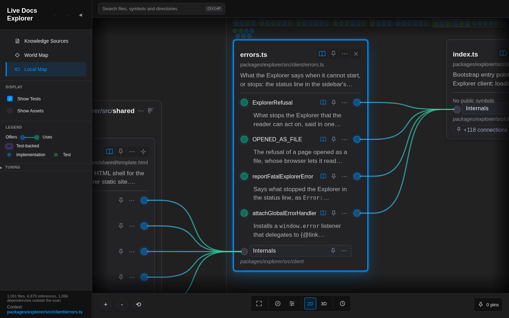 | 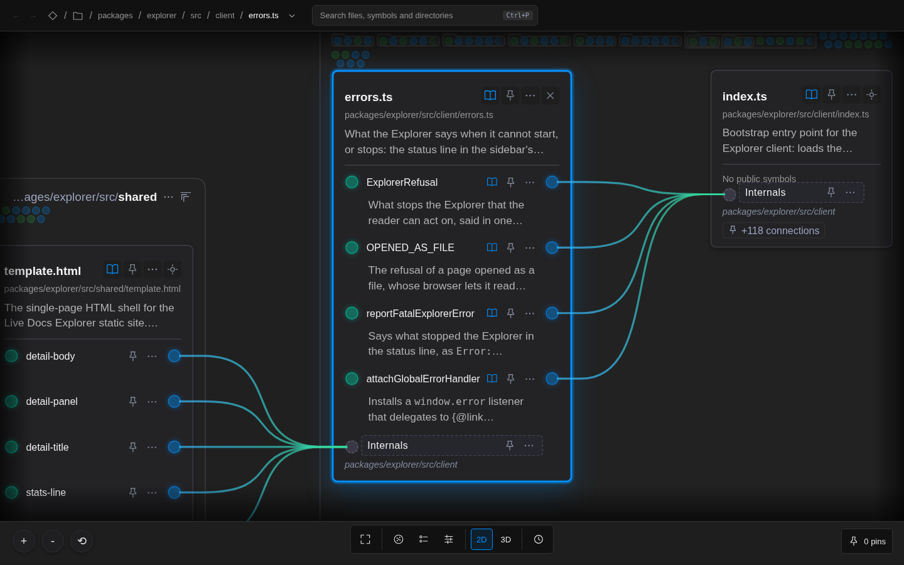 |
| 3D map, 1440 by 900 | 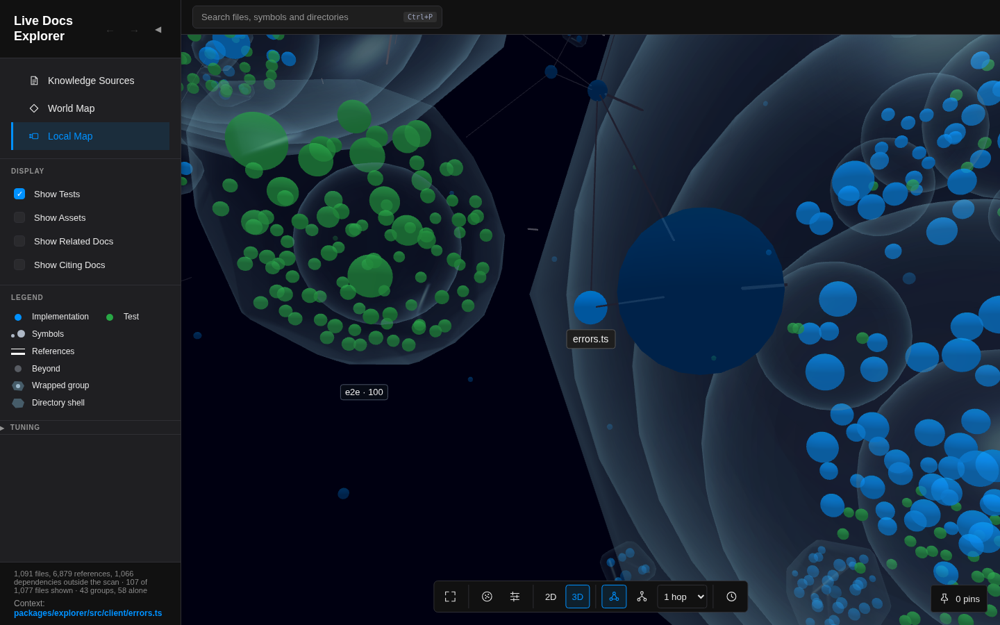 | 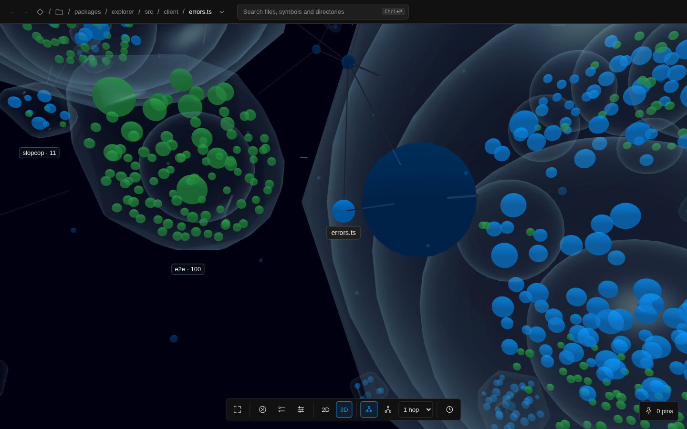 |
| 2D map, 834 by 900 | 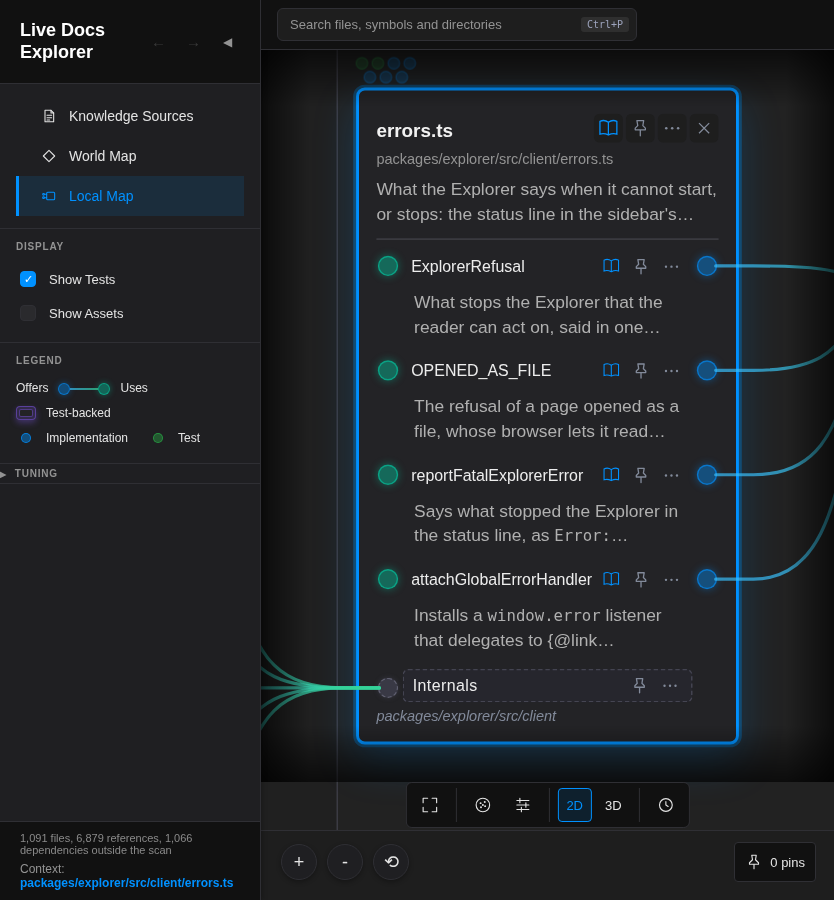 | 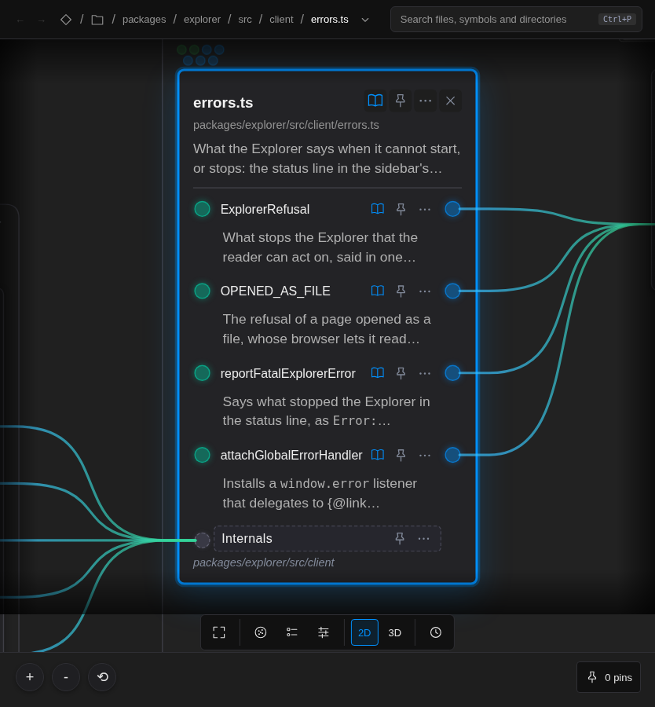 |
| 3D map, 834 by 900 | 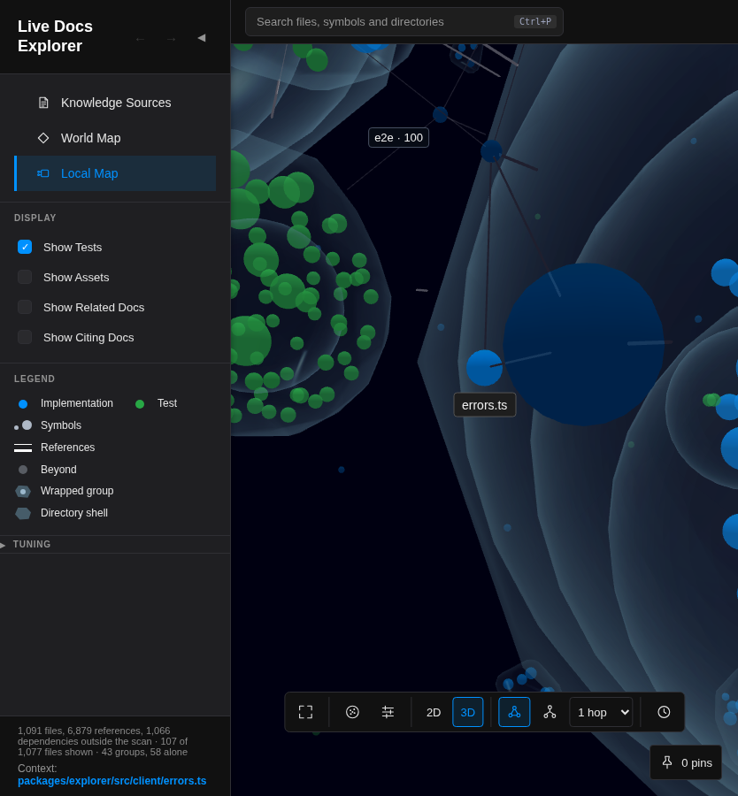 | 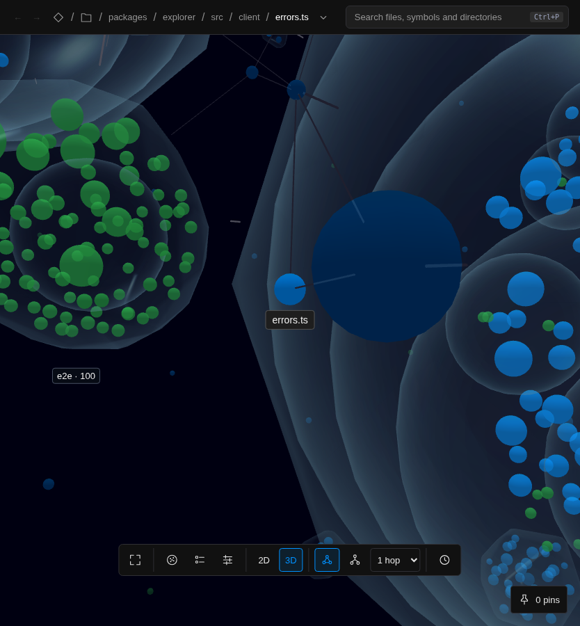 |

Names here are drawn in a wider face than your Segoe UI, so if every name in the row fits in these pictures it fits on your screen.

**Its builder's three choices, each for a yes or a no.**

**(a) Switching Frame is not counted among the changed settings.** Under Bare with nothing else changed, Tuning's sheet shows the arrow faint and no count, though Frame differs from its default: [picture](q2-a-1-bare-tuning-open-frame-only.png). With one more lever moved (Marbles to On) a 1 stands before the arrow, not a 2: [picture](q2-a-2-bare-tuning-open-one-more-changed.png). So nothing counts Bare as a change. (Its builder's record says that a reset leaves Bare standing; I did not press the arrow under Bare.) (Frame itself is the last lever of the sheet, under Page, below what these pictures show.)

**(b) The key's filters.** You were told that the key has checkboxes where the sidebar has switches. On today's build I cannot see that difference: Show Tests and Show Assets are drawn as the same small ticked squares in the sidebar ([picture](q2-1440x900-sidebar-2d.png), under DISPLAY) and in the key ([picture](q2-b-bare-key-open.png)), and the page has them as the same checkboxes in both. If a switch was meant in either place, it is not what is built.

**(c) Pressing a directory's name in the row of names does what that directory's Centre does.** Before: [the file](q2-c-1-bare-before.png). After pressing `src` in the row: [picture](q2-c-2-bare-after-src-crumb.png). The map now shows the directory `packages/explorer/src` opened, with `client` and `shared` closed inside it, small and alone in the middle; the search field reads "src", a second field "Path to…" has appeared, the pin tray says 1 pin, and `errors.ts` is no longer drawn.

The same directory two ways, for the comparison: pressing `client` in the row of names gives [this](q2-c-3-bare-after-client-crumb.png); pressing the three dots on the `client` directory's own handle on the map and choosing "Centre on directory" gives [this](q2-c-5-bare-after-client-centre.png). The two are the same to my eye, and the page said the same of both: 1 pin, the search field reading "client", the row of names ending at `client`. (To reach that handle I first dragged the map down; on arrival it stands under the top bar.)

**To try it.** <http://localhost:8999/?view=local&node=packages/explorer/src/client/errors.ts>

1. Tuning → Page → Frame → Bare (Page is the last group; scroll the sidebar's Tuning to its end). The sidebar goes.
2. For (a): in the bottom strip press the sliders button (the three sliders, named "Layout tuning"); look at the top right of the sheet. Then Colour → Marbles → On and look again; set it back to Off.
3. For (b): press the button left of the sliders, the Key.
4. For (c): press `src` in the row of names at the top left.
5. 3D: press 3D in the bottom strip. (The 3D pictures were opened by the same link with `&mode=3d` added, not by this press.)
6. To get the sidebar back: the sliders button → scroll to Page → Frame → Sidebar. (This one step I did not press myself; the frame's own browser case does.)

Steps 1 to 5 were opened and pressed on the builder's port exactly so; the page showed what the pictures show.

**The strangers.** Both tasks under Bare. For "Show the test files as well." the page was opened by a link that has the tests hidden; for "Take me to the folder that holds this file." by the link above.

- **"Show the test files as well."** Sonnet did it in two presses: the Key in the bottom strip, then Show Tests. It added that the key stood over the map, so it could not see whether test files had appeared. Haiku never opened the Key. From [its first picture](q2-stranger-tests-start.png) it went to the search field and typed "test", then ".test.ts", then "explorer test", pinned four things without meaning to, spent all 25 actions, and answered with the names of two test files it had found by searching. Nothing in that first picture says where the filters are; the Key is the second small drawing in the bottom strip.
- **"Take me to the folder that holds this file."** Both pressed `client` in the row of names as their first action and were done. Both then noticed the search field, which after the press reads "client" with a bright ring round it, took it for a box left open, and pressed Escape at it to no effect: [picture](q2-stranger-folder-end.png).

Neither asked for words.

**My eye.** Under Bare the map gains the sidebar's 261 pixels: at 1440 the card at the left (`template.html`) shows its name and its rows' names where the sidebar frame shows only its right edge; at 834 the gain is larger in proportion, the subject's card stands with room either side. The row of names reads at once as a path, the file brighter than its directories. In 3D the count of files shown, which the sidebar's foot says in words, is nowhere on the Bare page. At 834 in both frames the bottom controls stand in two rows, the 2D/3D strip above the zoom buttons.

**Root's recommendation:** make Bare the default once two signs have a home. Yes to (a) and (c); (b) was my mistake.

- **The gain is plain at both widths.** At 1440, `template.html` and `index.ts` are whole where the sidebar's frame cuts both. At 834 the subject's card stops touching the window's edge. The row of names reads as a path at once, and both strangers used it as their first action.
- **Before it is the default, two signs must not be lost with the sidebar.** In 3D the count "107 of 1,077 files shown" is nowhere on the Bare page; that is our honest sign of hidden content. And nothing on the Bare page says that a filter is hiding files: one of the two strangers never found the Key. I would give the Key's button the same small count Tuning's heading has, whenever a filter hides something.
- **(a) Yes.** Frame is where the controls live, not a setting of the picture, and a reset that moved the sidebar would move the reset's own button from under the pointer.
- **(b) Nothing to decide.** I told you the key had checkboxes where the sidebar has switches. Both are the same checkboxes. My sentence was wrong.
- **(c) Yes.** A name in the row does what that directory's Centre does; the two pictures are the same, and both strangers pressed it untold.
- **Seen beside it.** The search field holding the subject's name inside a bright ring read to both strangers as a box left open. That is so under the sidebar too.

## 3. Tuning's reset: one arrow that puts every setting back, and the same arrow to undo that

Say you have moved three levers in Tuning and want the page as it came. Tuning's heading now carries a count of the levers that differ from the defaults, each changed lever and its group carry a small dot, and a curved arrow at the top right of Tuning puts them all back. The arrow then stands pressed (blue), and pressing it again returns your three settings.

**Pictures.** The sidebar's Tuning, cut from the four whole-window pictures listed under it and enlarged one and a half times:

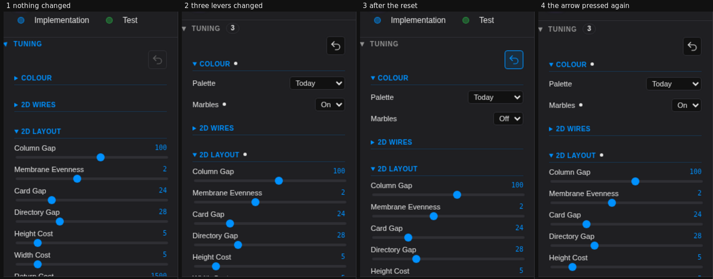

1. [Nothing changed](q3-1-nothing-changed.png): no count, the arrow faint.
2. [Three levers changed](q3-2-three-changed.png) (Marbles to On, Hidden Files to Count, Arrival to Neighbours): a 3 in a ring beside TUNING, a dot after COLOUR, Marbles and 2D LAYOUT (and after Hidden Files and Arrival, lower in the panel). With Tuning folded the 3 still shows: [folded](q3-2b-three-changed-folded.png).
3. [After the arrow is pressed](q3-3-after-reset.png): no count, no dots, Marbles back to Off, the arrow blue.
4. [After it is pressed again](q3-4-after-second-press.png): the 3 and the dots are back, the arrow white.

**The known gap, as two strips.** Your rule since today is that every interaction can be taken back. The reset can be taken back only until you touch something else.

Moving a lever after a reset: the three settings you had cannot be recovered. In frame 2 one lever (Marbles) is moved after the reset and the arrow is no longer blue; in frames 3 and 4 the arrow now resets and restores that one lever only. Hidden Files and Arrival stay at their defaults whatever is pressed.

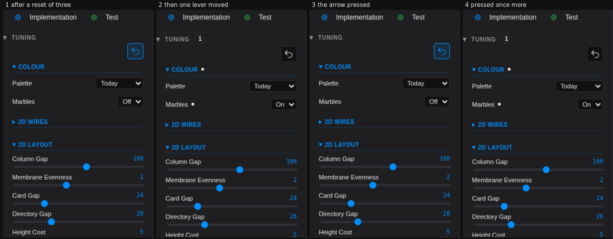

Leaving the page after a reset: on reloading it, the arrow is faint and there is nothing to press.

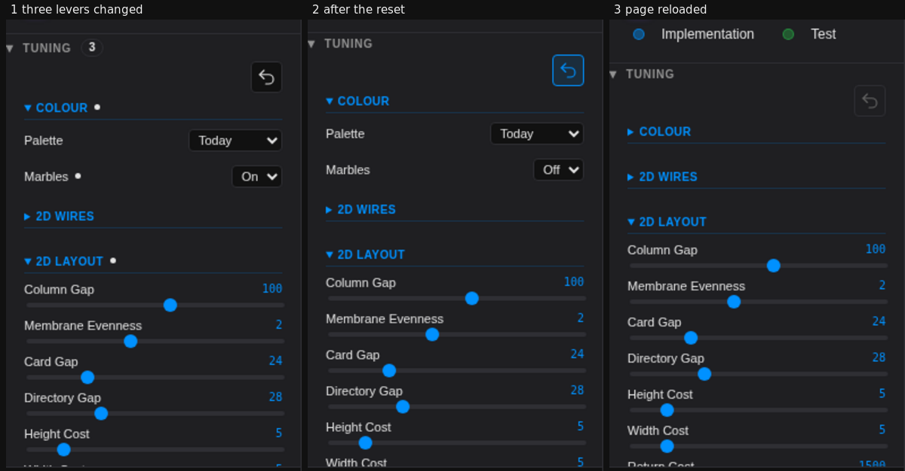

**To try it.** <http://localhost:8999/?view=local&node=packages/generator/src/generator.ts>

1. Open Tuning (the word TUNING in the sidebar). Press the curved arrow if it is not faint, so that you start from the defaults.
2. Tuning → Colour → Marbles → On. Tuning → 2D Layout → Hidden Files → Count. Tuning → 2D Layout → Arrival → Neighbours. The heading now says 3.
3. Press the curved arrow at Tuning's top right. Press it again.
4. For the gap: press the arrow (reset), then set Marbles to On, then press the arrow twice more and look at Hidden Files and Arrival. Or: press the arrow (reset) and reload the page.

Opened and pressed on the builder's port exactly so; the page showed what the pictures show.

**The strangers.** Task: "Some display settings on this page were changed. Put them all back the way they were." The page was opened for them with the same three levers already changed and Tuning folded.

- **Sonnet**: two presses, the word TUNING and then the arrow. It named the 3 and the dots as what told it something had been changed.
- **Haiku**: first tried to open the link afresh by typing in the address bar, which its window does not allow, then the same two presses.

Neither stumbled. Both added, unasked, that they could not tell whether Show Tests and Show Assets had been changed too, since those carry no sign either way.

**My eye.** The 3 beside TUNING is small and quiet; I found it at once only because I knew to look there. The dots are plain once Tuning is open. Pressed, the arrow turns blue, and that blue is the only sign that a second press would undo: nothing else on the page changes between "you can still go back" (frame 3 above) and "you cannot" (frame 2 of the first strip, where it is white again). The arrow also moves about 23 pixels under the pointer between the first press and the second, noted at the end under Seen on the way.

**Root's recommendation:** keep the arrow and the count as drawn; close the gap with one undo for the whole page, not a longer memory for this button; and stop the arrow moving.

- **It works without a word.** Both strangers put the settings back in two presses, and both named the 3 and the dots as what told them something had changed.
- **The gap is real.** After a reset, touching one lever loses the other two for good. I would not teach this one button to remember more. Your rule is about every interaction, so the answer belongs to the page: the back arrow at the page's top left should take back a reset as it takes back a step of navigation, and "Clear all pins" in the same way. That is the survey of what cannot be taken back, which I owe you; this is its first case.
- **A fault whatever you decide.** The arrow moves 23 pixels between the press and its undo, because the Legend above it changes height. A control pressed twice must stay under the pointer. Under Bare, where Tuning is a sheet of its own, it would not move.

## 4. The history's zoomed bar: where am I?

With the history open, the bar at the bottom runs from the first commit to today, and a round white thumb stands at the step the map is showing. Turning the wheel over the bar zooms it into a shorter run of dates. If the step being shown is not within that run, the thumb cannot stand on the bar; a mark drawn like the thumb stands at the bar's end on the side where the step lies.

**Pictures.** The 2D map at one past step (step 267, 2 April 2026), the bar zoomed by three turns of the wheel and then slid. Only the bar differs between them, so here are the three bars, cut from the whole-window pictures linked under them:

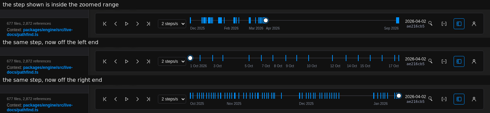

1. [The step inside the range](q4-1-step-inside-the-range.png): the thumb between "Mar 2026" and "Apr 2026".
2. [The same step, the range slid later](q4-2-step-outside-on-the-left.png): the bar now runs over 1 to 17 October 2026, and the mark stands at its left end, on "1 Oct 2026".
3. [The same step, the range slid earlier](q4-3-step-outside-on-the-right.png): the bar runs from October 2025 to January 2026, and the mark stands at its right end.

In all three the date of the step, 2026-04-02, stands in words to the right of the bar.

**To try it.** <http://localhost:8999/?s=N4IgbiBcDMA0IDsogA4EMDGBrNBzApgM4D0+CuAlgvsYQE4bEA2FY+AtACYD2GJ6AFwAWAMyqcAdAMIh4Q5GnwAmAIwA2DACMArCu0AGAOwro+pds1rOIw5zRq0Izvj2cVAFn3uAHAE410CAAvkA>

1. The link opens the 2D map at 2 April 2026 with the history's bar open.
2. Put the pointer on the white thumb and turn the wheel away from you two or three notches: the bar zooms in round the thumb (picture 1).
3. Hold Shift and turn the wheel, or swipe sideways on a trackpad, until the thumb leaves the bar: a mark takes its place at one end (pictures 2 and 3). Pressing the mark slides the bar back to the step.

The link was opened on the builder's port and stood at 2 April 2026 with the bar open. Steps 2 and 3 were done with the wheel: away from me to zoom, and a sideways turn to slide; that Shift with the wheel slides too is from the round's own record, and I did not try it, nor the press on the mark. The pictures were reached by another road, pressing the bar on today's page, and the map behind the bar differs between the two roads: see Seen on the way.

**The strangers.** Task: "This page is showing the project as it was at some past date. Which date, and where is that on the bar at the bottom?" Each was given the state of picture 2: the step off the left end. This is [what they saw](q4-stranger-what-they-saw.png).

- **Sonnet** (1 action, a look) read the date rightly from the words at the right, 2026-04-02. Of the bar it said "the white handle sits at the far left end, just before the '8 Oct 2026' label. So the page is showing the earliest point on the bar", and then that "one thing doesn't add up": April is earlier than every date on the bar, and it could not tell why.
- **Haiku** (3 actions) read the same date, placed the step "at the far-left end, just before the first tick", pointed at the mark, and concluded that "either the tick labels or the readout are off".

Neither took the mark to mean "off this end". Both took it for the thumb standing on the bar's first date, and both noticed the contradiction with the date in words without being able to resolve it. Neither asked for words.

**My eye.** I cannot tell the mark from the thumb: the same white disc with the same ring, sitting on the line. In picture 2 it sits exactly over the first label, "1 Oct 2026", and reads as "you are at 1 October". The one thing that tells the truth is the date at the right, which is small and away from where the eye is looking.

**Root's recommendation:** not as drawn. The mark must not look like the thumb.

- **Three readers, one misreading.** Both strangers and I read the mark as "you are at 1 October". A sign for "what you are looking at lies off this end" cannot have the shape of the sign for "you are here".
- **What I would build for you to compare:** a small arrowhead at the bar's end, pointing outward and standing outside the first or last label; and the same with the step's date beside it. Pressing it still slides the bar back to the step. I will bring those as matched pictures, read by the same two strangers.
- **A fault found on the way.** Reaching a date before the file existed leaves the map empty, with nothing to say why (the map behind the three bars above). An empty map needs its reason said.

## 5. Where a gathered line ends

On the estate sample, open the directories `PaymentService` and `PaymentService/Data`. `PaymentsContext.cs` uses one thing that `App.config` offers, its row `PaymentsDb`. The map draws that as a line between the two files. The question is where on the card that line should touch.

**Pictures, today's build.**

The two directories opened, as they arrive: every line begins and ends at a dot level with a file's name, at the card's top corners.

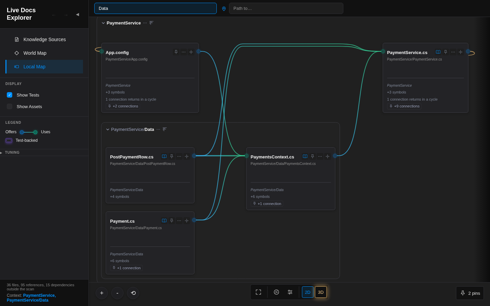

After pressing "+3 symbols" on `App.config`, so that its rows show:

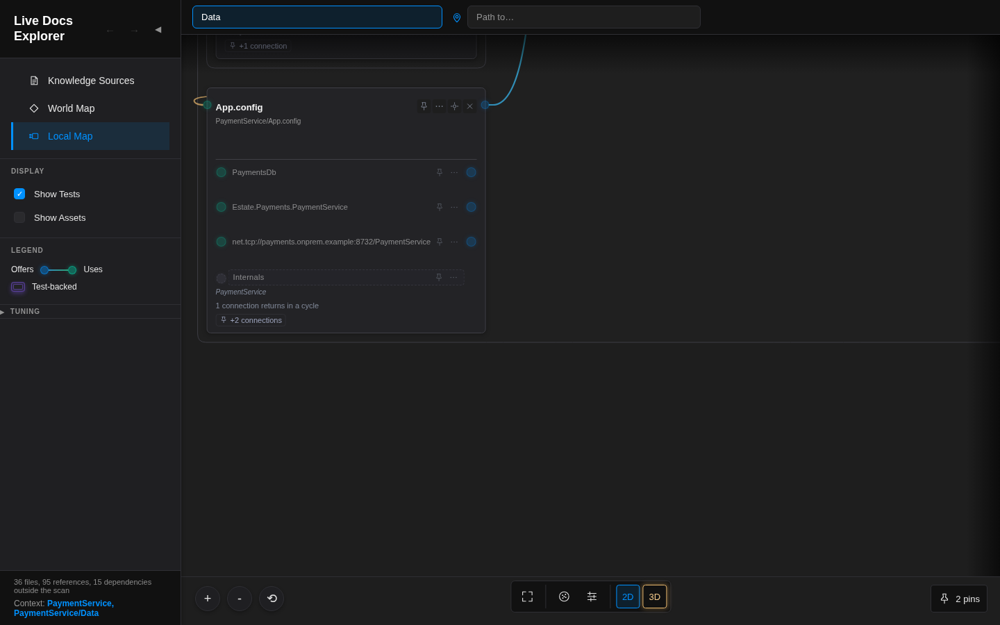

The top of that card, cut from the picture above and enlarged two and a half times:

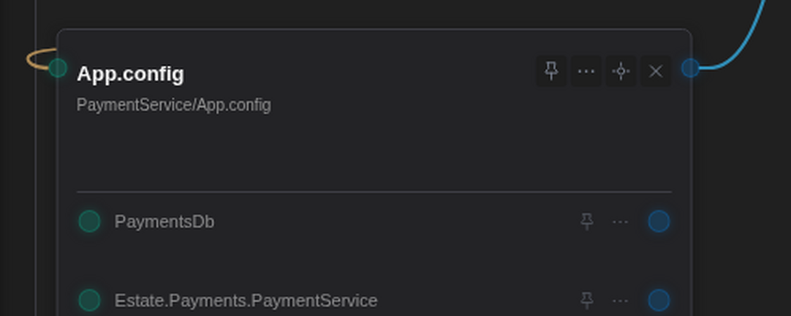

**What a visitor sees.** The blue line leaves `App.config` from the dot at the top right, beside the name. The row that the line is about, `PaymentsDb`, is drawn below with a blue dot of its own, and nothing is attached to that dot. Nothing in the picture says which of the three rows the line stands for, and pointing at the row does not move the line to it.

**The alternative** is that a line which stands for the connections of particular rows ends at those rows when they are shown: here, the line would leave the blue dot of `PaymentsDb`. It is not built, so there is no picture of it and I have not sketched one. Two things would follow from it that you should know of: a line standing for several rows would have to fan to each of them or pick one; and a file's dot beside its name would then mean only "the whole file", where today it means both "the whole file" and "some rows of this file".

**The second thing left for you, which has no picture of today's that differs.** When a directory is opened, the map chooses its shape (how many rows of cards) by a price, and that price still reckons each line as ending half way down a card, where the page now ends it at the name. A trial that moved the reckoning to the name left the default shape the same but made Tuning's Width Cost stop widening `scripts/live-docs`. Those pictures were taken on that trial build and are committed: [as it is](../../../../2026-11-18/Screenshots/returning-connections/18-price-nominal-hub-half-way.png) and [with Width Cost at nought](../../../../2026-11-18/Screenshots/returning-connections/18-price-nominal-hub-half-way-width-cost-0.png); [the trial](../../../../2026-11-18/Screenshots/returning-connections/19-price-nominal-hub-at-name.png) and [with Width Cost at nought](../../../../2026-11-18/Screenshots/returning-connections/19-price-nominal-hub-at-name-width-cost-0.png). I did not retake them: the trial is not in today's build, and I did not check the two "as it is" pictures against today's page.

**To try it.** <http://localhost:8999/samples/estate/?s=N4IgbiBcDMA0ICcoDMCGAbAzgU3gKxQx3gHsoBtEcgHRABMBLBbAYwBcSEBPW2WgBVRcAttgB2bAMrYEYBi2y0AuiHg16TVh268BQ0ROmz52APQARVG1TKQS+FyghMbBAFd2b5qvoUQgkXEpGTkFHwCDYOMFCytUOwBfIA>

1. Tuning at its defaults. The link opens the two directories.
2. On the card `App.config` press "+3 symbols". Look at its top right corner, then at the row `PaymentsDb`.
3. Point at the row `PaymentsDb`.

Opened and pressed on the builder's port exactly so. Pointing at `PaymentsDb` brightens the row and its dots; the line stays where it is, at the name: [picture](q5-3-pointer-on-the-row.png).

**The strangers.** None was sent: there is one picture and no second to compare, and a stranger's reading of where a line "should" end would be a guess.

**My eye.** With the rows hidden, a line ending beside the name reads rightly as "this file". With the rows shown, the same line passes over a row that has its own unused dot, and my eye took the row's dot for a loose end. The amber curl at the card's left, the connection that returns in a cycle, also sits at the name.

**Root's recommendation:** build the alternative for your eye: when a card's rows are shown, a line that is about a row ends at that row.

- **Why.** With the rows hidden, a line at the name is right. With them shown, the line passes over `PaymentsDb`, whose own blue dot hangs loose. The map already ends lines at rows for pinned symbols (your `PostPayment` picture in section 1), so the card is saying two different things about the same kind of line.
- **The rule I would apply** is the one the history's glow already follows: a mark goes to the innermost thing drawn. A line that stands for several rows fans to each of them inside the card's edge.
- **The second half, the layout's price.** The price should measure the picture the page draws, so I would move its reckoning to the name in the same round and tune Width Cost again there, since the trial showed that lever goes dead otherwise. There is nothing for you to choose until those pictures exist on one build.

## 6. One hidden file as a cell

A directory drawn on the map does not always draw all its files. Tuning → 2D Layout → Hidden Files says how the undrawn ones are shown: as small dim cells under the directory's name (the default), as cells beside the name, or as a count in words. The case asked about is a directory with exactly one file undrawn, where the default now shows one small dim cell and the words "+1 file" used to stand.

**Pictures.** On this repository's map of `pathfind.ts`, the directory `packages/engine/src/config` draws `liveDocumentationConfig.ts` and leaves its test file undrawn; it was the only directory of the eleven on that map with exactly one. It stands above the window on arrival, so each picture was dragged by hand to bring it in, and the three drags did not end in the same place: compare the handles, not their positions.

The directory's handle at the reading size, cut from the whole-window pictures and enlarged twice:

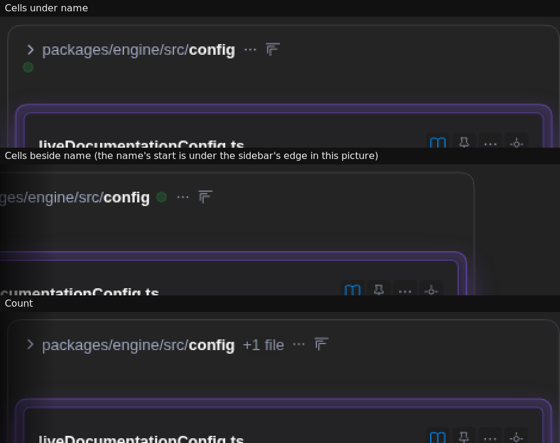

The same after three presses of the zoom's minus:

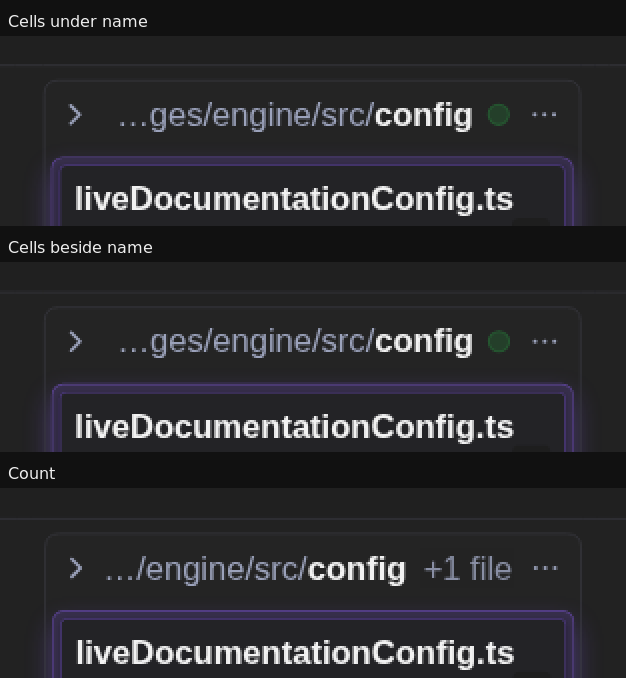

Whole windows: Cells under name [at reading size](q6-under-1-reading-size.png), [three presses out](q6-under-2-three-presses-out.png); Cells beside name [at reading size](q6-cells-1-reading-size.png), [three presses out](q6-cells-2-three-presses-out.png); Count [at reading size](q6-count-1-reading-size.png), [three presses out](q6-count-2-three-presses-out.png).

**To try it.** <http://localhost:8999/?view=local&node=packages/engine/src/live-docs/pathfind.ts>

1. Tuning at its defaults (Hidden Files reads "Cells under name").
2. Drag the map down and to the right until the directory `packages/engine/src/config` comes in from the top left, above `graph.ts`.
3. Look under its name. Press the minus at the bottom left three times and look again.
4. Tuning → 2D Layout → Hidden Files → "Cells beside name", then "Count"; the map redraws in place.

Opened on the builder's port, with the lever set before the page was opened for each picture; step 4's change in place I did not try.

**The strangers.** Task: "Find the folder named config on this map. How many files in that folder is the picture not showing?" This run tells us nothing about the cell, and the fault is the task's. Both strangers typed "config" into the search field and chose the directory, which opens it and draws both its files; both then opened its Inspect panel, read "2 files in this directory", and answered 0, which was true of the page they had made. Neither ever had the lone cell in front of them. A fair run needs a start with the directory already in view and a question that does not send them to the search field; I did not have a link that carries the camera.

**My eye.** At the reading size the one cell under the name is a dim green dot about 12 pixels across at the far left of an otherwise empty line. I see it because I know it is there; alone, it does not say "a file". Beside the name it sits on the name's own line and reads as part of the handle. "+1 file" is the only one of the three that I read without knowing the convention. Three presses out the first two values are drawn identically, the dot beside the name, and it is easier to see there than under the name at the reading size.

**Root's recommendation:** cells that follow the name on its own line, and go beneath only when there are too many to fit.

- **What I see.** One dim dot alone on an empty line under the name is the weakest of the three at the reading size; I found it because I knew it was there. Beside the name it reads as part of the handle, and that is already what the far zoom draws under either value.
- **Not back to "+1 file".** A cell can be pressed to bring that file in, and is green or blue by its kind; a count can do neither, and it is words where a drawing serves.
- **So one rule, not a third value of the lever:** cells stand after the name and flow to the next line when they do not fit. One cell then looks the same at every zoom.
- **These pictures are not yet fair.** The three were dragged to different places, and the strangers never had the cell before them. I will have both retaken with one fixed camera when that rule is built.

## Seen on the way

Not asked about, not fixed.

- **The reset arrow moves under the pointer.** When Marbles is among the changed levers, the Legend above Tuning is one row shorter (it drops "Implementation · Test"), so pressing the arrow moves it about 23 pixels down, and pressing again moves it back up: frames 2 and 3 of [the four states](q3-heading-four-states.png). A second press at the same spot lands on the arrow's edge or beside it.
- **Two seconds of nothing after a cell's press, then an empty frame.** On this repository's map at the defaults, each press of a cell in section 1 showed no new frame for about two seconds (nearer five in an earlier run, with three other builders working on this machine), then one nearly empty dark frame, then the move: the second frame of every [strip](q1-cell-follows-strip.jpg). I cannot say how long it is on your machine.
- **The cell press under Follows Pins goes in past its target and comes back**: [strip](q1-cell-follows-strip.jpg), frames at 3.2 and 3.8 seconds against the rest.
- **The address the page writes does carry Framing.** A fresh browser given the address that the page itself wrote under Follows Pins came up with Framing at Follows Pins and Tuning's count at 1, with nothing saved in that browser. So a link copied from the address bar brings that lever with it; the short links in this packet do not. Read from the page, no picture.
- **A past step, two roads, two maps.** Pressing the history's bar on today's `pathfind.ts` to reach 2 April 2026, before that file existed, left the map empty with nothing to say why: [picture](q4-2-step-outside-on-the-left.png). The link to that same step shows the scan root's map, faded: [picture](q4-stranger-what-they-saw.png).
- **Controls over a card.** At 1280 wide with the Detail Panel open, the zoom buttons and the pin tray stand over the foot of a card, covering its "+15 symbols": [picture](seen-controls-over-a-card-with-the-panel-open.png), from a stranger's run.
- **Five pins under Out To Files had not come to rest after seventy seconds**, the continuing search still running; By Hand and Follows Pins rested in about thirty.
