# Two trials for your eye: the pointer's rule, and how many files the 3D map draws

_Historical evidence, taken 2026-11-19 by the builder of the two trials, from the trials' own build (the branch `worktree-agent-afabd6e49523ee996`, begun at `b64aed64`). Every picture is the built Explorer in a 1440 by 900 window, drawn on the graphics card unless a table says software, with every Tuning setting at its default except the one lever each section names. Nothing was added to the page to make a picture. Where a picture shows a pointer, the arrow was drawn onto the finished picture afterwards, at the place the pointer was._

These follow the second and third questions of [the packet on the 3D map](../3d/README.md), where the root's recommendation was a trial built as a lever. Both levers are built with today's behaviour as their default, so nothing changes until a lever is moved. **This page is not finished:** the first trial is whole; of the second, the lever and its numbers are here, and the pictures of a quieter closed ball are not yet made (see [what is still owed](#what-is-still-owed)).

The links are for your own server at `http://localhost:8999/`, once it serves this build. I opened each on a private copy of the build (port 8473).

---

## 1. One rule for the pointer in both maps

**In an example.** Move the pointer across the 3D map without stopping. Today nothing answers until it has rested for a third of a second: calm, and a little dead, since even squarely on the pinned sphere nothing shows. Do the same on the 2D map and the reverse happens: every row the pointer crosses dims the whole map and lights its own lines, at once.

The trial is one rule for both, which designers call *hover intent*: **what is under the pointer answers at once with a small sign of its own; the rest of the picture changes only when the pointer rests.** It is a lever, **Tuning → Page → Pointer**, with two values:

- **Today** (the default): each map as it is now.
- **Touch, then rest**:
  - 3D map: the sphere under the pointer wears a thin pale ring at once, and a bubble under the pointer a thin pale line along its edge. The name, the three small buttons and the fading of everything else wait for the rest, as now.
  - 2D map: the card under the pointer lights its ground at once, as it does today, and the row under the pointer turns its name blue. The dimming of everything else, and the lines kept across the map, wait for the rest.
  - The keyboard's focus is as today in both: it answers at once, in full.

**Pictures.**

Each strip is six frames of one continuous movement, three while the pointer moves and three after it has stopped, as in the packet. Each pair is the same path under the two values.

- The 3D map, `archetype.ts` pinned, today: [pointer-3d-today.png](pointer-3d-today.png)

  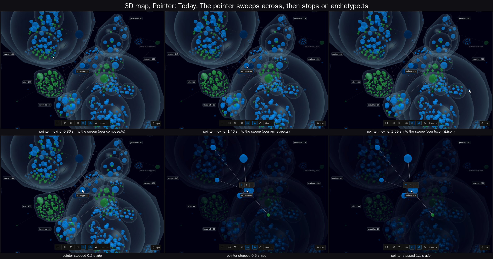

- The same sweep under Touch, then rest: [pointer-3d-touch.png](pointer-3d-touch.png)

  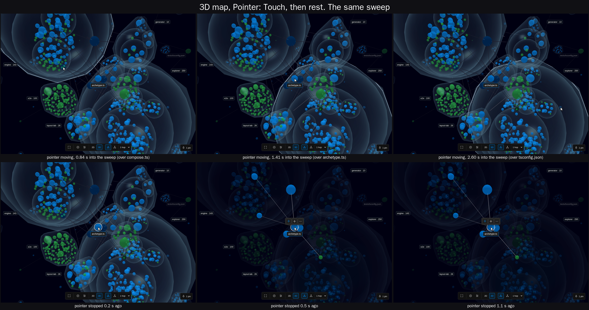

- The two signs, enlarged three times (a small sphere inside a bubble, the pinned sphere) and a bubble's edge at its own size: [pointer-3d-signs.png](pointer-3d-signs.png)

  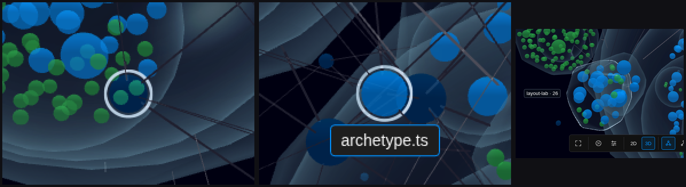

- The 2D map, the same file pinned, across three cards, today: [pointer-2d-today.png](pointer-2d-today.png)

  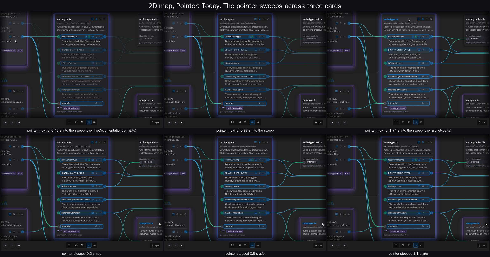

- The same sweep under Touch, then rest: [pointer-2d-touch.png](pointer-2d-touch.png)

  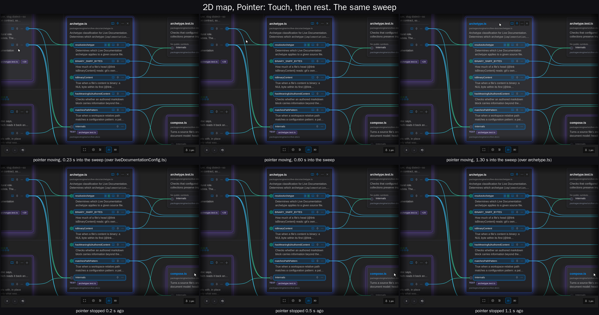

- A second journey on the 2D map, which the packet did not have: down the six rows of the `archetype.ts` card and back up to stop on `BINARY_SNIFF_BYTES`. Today: [pointer-2d-rows-today.png](pointer-2d-rows-today.png)

  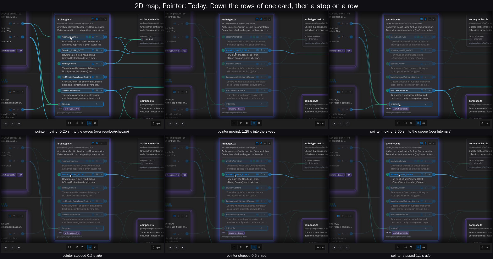

- The same under Touch, then rest: [pointer-2d-rows-touch.png](pointer-2d-rows-touch.png)

  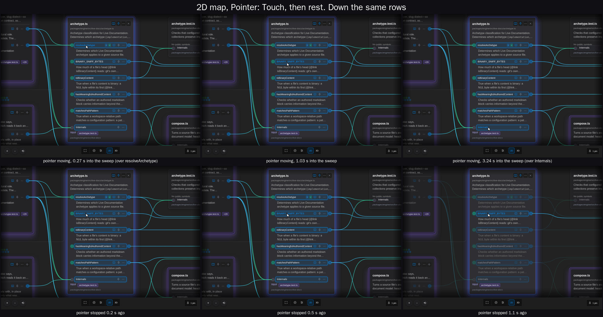

**Numbers.** The picture is 1,179 by 850 pixels, a little over a million. A pixel counts as changed when it differs by more than a fiftieth of full brightness from the frame before. The two values of each pair were taken one after the other in the same half minute, with the machine's load average between 12 and 15 (other agents were working on it).

| | 3D, Today | 3D, Touch, then rest |
| --- | --- | --- |
| How long the sweep lasted | 4.2 seconds | 4.2 seconds |
| Times the picture changed during the sweep | 12 | 14 |
| Pixels each of those changes touched | 0 to 4 | 919 to 6,216; half of them under 4,900 |
| What those changes were | nothing an eye can see | a ring round one sphere (about 920 pixels) or a line along one bubble's edge (1,700 to 6,200) |
| First change after the pointer stopped | 0.38 seconds: the buttons (6,594 pixels), and the fading of the rest one frame later (670,832) | the ring was there on arrival; then the same at 0.38 seconds (6,612, then 670,816) |

| | 2D across three cards, Today | 2D across three cards, Touch, then rest |
| --- | --- | --- |
| How long the sweep lasted | 3.8 seconds | 3.0 seconds |
| Times the picture changed during the sweep | 31 | 14 |
| Pixels each of those changes touched | 0 to 298,526; half of them over 15,700 | 222 to 267,764; half of them under 4,100 |
| Changes that reached across the map (more than 980 of its 1,179 pixels of width) | 21 of the 31 | none; the widest lay inside the card under the pointer and its glow (517 pixels) |
| First change after the pointer stopped | none: the card had lit on arrival | none: the card had lit on arrival, and in this picture a card's rest keeps no lines, under either value |

| | 2D down one card's rows, Today | 2D down one card's rows, Touch, then rest |
| --- | --- | --- |
| How long the journey lasted | 6.5 seconds | 5.2 seconds |
| Times the picture changed during it | 82 | 17 |
| Pixels each of those changes touched | 0 to 267,401; half of them over 7,200 | the first 267,400, the card's own ground lighting as the pointer entered it; the other sixteen 326 to 2,024, each one row's name |
| First change after the pointer stopped | none: the map had dimmed for the row on arrival | 0.61 seconds (16,320 pixels), and the dimming of the rest one frame later (106,756) |

Two things in these numbers are not the rule's doing and I say them plainly:

- The largest changes under the trial on the 2D map (267,000 pixels) are the card under the pointer lighting its own ground, a faint change of shade over the whole card. That is today's behaviour and it is what the rule asks for; nothing outside that card changes.
- On the 2D map the rested look came 0.61 seconds after the stop, not 0.35. The wait itself is 0.35; I did not separate the other quarter second, which I take to be the page's own work of marking the rows and lines on a loaded machine (the same work that today is done at every row crossed, and that made today's journey 1.3 seconds longer over the same path). In the 3D map it came at 0.38.

**To try it.**

1. Press **Reset to defaults** in Tuning.
2. Open one of the packet's two links:
   - 3D: <http://localhost:8999/?s=N4IgbiBcDMA0IEcomgExPAdsgDgQwGMBrPAcwFMBnAenM1IEtNzrKAnA6gGwbHIFpUAewI08HABbkALgE8c5AHTTKGEDigBtUNkjrCJCjTqNmrDt14Dho6uIJS5C5aviq9AKhABfALregA>
   - 2D: <http://localhost:8999/?s=N4IgbiBcDMA0IDsogA4EMDGBrNBzApgM4D0+CuAlgvsYQE4bEA2FY+AtACYD2GJaDABb4ALgE8U+AHQjCIeCigBtUEkipMOAiTKVqtBs1YcefYgIzDxkmXPhz1AKhABfALougA>
3. Sweep the pointer across the picture a few times without stopping, then stop on one thing and hold still. In 2D, also run the pointer down the rows of the middle card.
4. Open **Tuning → Page → Pointer**, choose **Touch, then rest**, and do the same again. A "1" appears beside TUNING. The choice is kept in your browser and is not carried by a link, so set it back to **Today**, or press Reset to defaults, when you have finished.

**My eye.**

- **3D, today.** The three moving frames are one picture. Nothing tells me the pointer is on anything.
- **3D, the trial.** In the first moving frame a thin pale line runs along the lower edge of the `engine` bubble, and in the second and third along the edge of `explorer`; in the frame after the stop a pale ring stands round `archetype.ts`, a hair's width clear of the sphere. Each is the only thing that differs from the frame before. The map now answers, and the answer stays where the pointer is. It reads as alive and not restless: the large picture does not move or dim until the buttons come at 0.38 seconds, exactly as today.
- **What is still wrong in 3D.** The line along a bubble's edge follows the bubble's mesh, so on a large bubble it is a run of straight segments with corners, most plainly on `explorer` in the third frame. That is the same faceted mesh the packet saw on the closed `tests` ball; the mend for it is written and not yet pictured (below). Enlarged three times, the ring has two hair-width nicks where a wire meets the sphere; at the page's own size I cannot see them. And a bubble as large as `explorer` covers half the picture, so its edge lights whenever the pointer is anywhere inside it, including on bare ground between its files; that is honest (a click there acts on the bubble) but it is the loudest of the signs.
- **2D, today.** No two moving frames are alike. In the rows journey the second frame has the whole map greyed for `BINARY_SNIFF_BYTES` and the third for `Internals`, with different lines kept each time.
- **2D, the trial.** The three moving frames differ only in which name is blue. The map holds still, and I can read a neighbouring card while the pointer travels. After the stop, the frame at half a second is still the full map with one blue name; at 1.1 seconds the map has dimmed to `BINARY_SNIFF_BYTES` and its line.
- **What is still wrong in 2D.** The sign a row gives at once is small: one name changing colour, in 11-pixel text. It is enough for me to find where the pointer is; whether it is enough to feel answered is yours to say on the moving page. And six tenths of a second before the dim is longer than the 3D map's four tenths; I would want it brought down to the wait itself. One consequence of the rule as built: a pointer that has rested on one row and moves to the next row sees the map come back at once and dim again after the wait, since every thing waits afresh, as in the 3D map.
- **The World Map is as it was under both values.** Its pieces are drawn by other code, and the brief asked for it only if the same code served it. It already shows the pointing hand at once and waits for the rest before its panel; it has no sign on the piece itself.

**Root's recommendation:** "Touch, then rest" is the right rule for both maps; two of its signs need another pass before you compare.

- **The 2D map is where it shows most.** Under today's rule no two frames of a sweep are alike: the whole map dims and relights as the pointer crosses cards, 21 of 31 changes spanning the map. Under the trial the map holds still and only the name under the pointer turns blue; the dimming comes when you stop. I would make that the default.
- **The 3D map is alive and not restless.** The ring round a sphere is clean and quiet.
- **Two signs to redo.** A bubble that fills half the picture lights its whole edge whenever the pointer is anywhere inside it, and the line follows the mesh's straight facets: the loudest sign for the least news. I would light the bubble's name instead. And a row's sign in 2D, its name turning blue in small text, is slight; the row's own outline should answer too.
- **Not yet known:** in 2D the dimming came 0.61 seconds after the stop where the wait is 0.35. The rest may be the machine's load tonight; it is measured again on a quiet machine.

---

## 2. How many files the 3D picture may draw

**In an example.** Open the 3D map in the Structure layout with nothing pinned. `packages` and `scripts` show their files; `tests · 556` is a closed ball, because a picture draws at most 1,024 files inside bubbles and the folders here hold 1,070 (four files more than when the packet was taken, two of them this trial's own). That number was set by the test browser's software drawing.

The trial is a lever, **Tuning → 3D Layout → Discovery → Drawn Files**, with three values: **1,024** (the default, today's picture), **2,048** and **All**. On this repository 2,048 and All are the same picture, since 1,070 is under both: every folder opens.

**Pictures.**

- 1,024, as the link opens it: [drawn-files-1024-as-opened.png](drawn-files-1024-as-opened.png)

  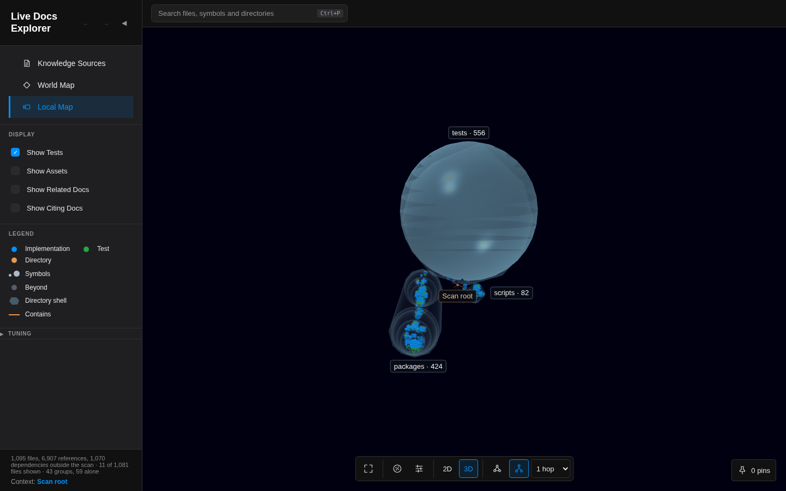

- All, as the link opens it: [drawn-files-all-as-opened.png](drawn-files-all-as-opened.png)

  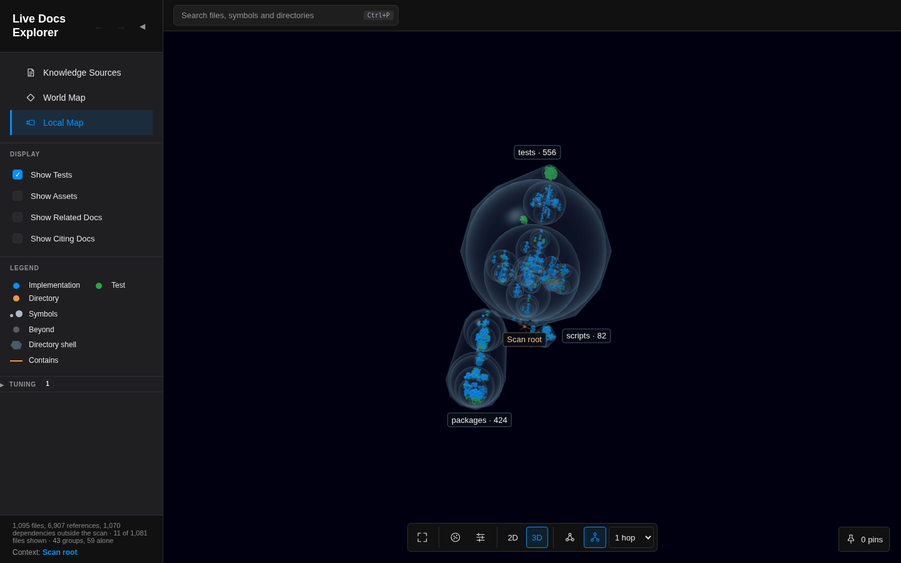

- 1,024, four notches of the wheel nearer: [drawn-files-1024-nearer.png](drawn-files-1024-nearer.png)

  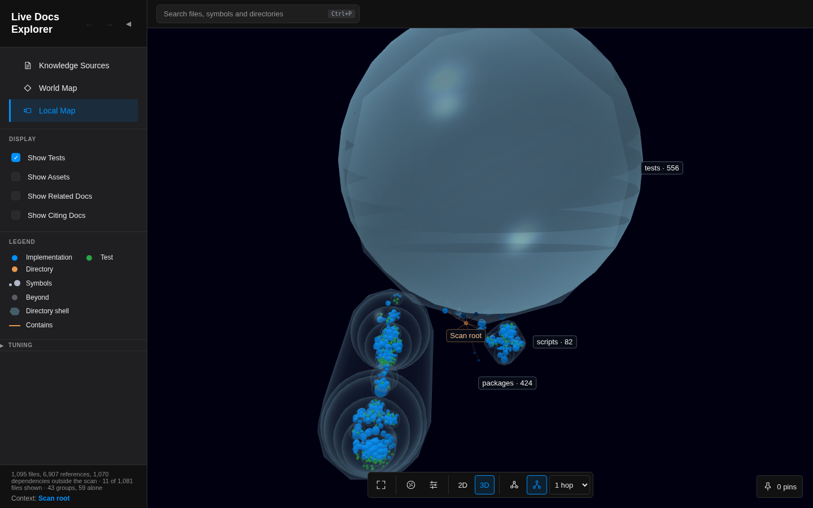

- All, four notches nearer: [drawn-files-all-nearer.png](drawn-files-all-nearer.png)

  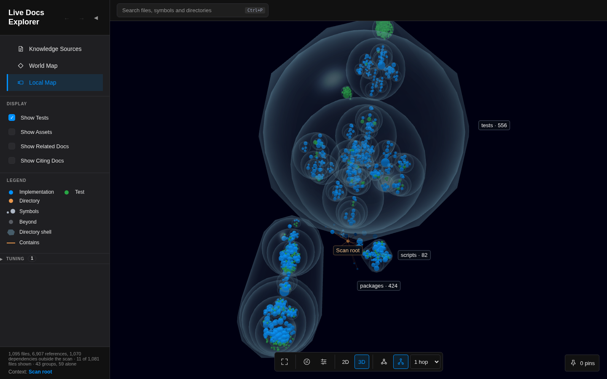

The pictures at 2,048 are not kept: they differ from All's in 27 pixels as opened and 1,477 nearer.

**Numbers.** Each row is a browser of its own, opened on the link, on the Structure layout with nothing pinned. "To rest" is from asking for the page until the page says its picture is at rest. The frame rate is the frames the map drew while a slow drag turned the camera for four seconds, measured twice. The load average beside each is what other agents and this run itself put on the machine; a frame rate under a higher load is worth less.

| Drawn on | Drawn Files | Files drawn inside bubbles | Bubbles drawn | To rest | Frames a second, turning | Load average | JavaScript heap, at rest and after turning | Browser's processes, resident |
| --- | --- | --- | --- | --- | --- | --- | --- | --- |
| The graphics card | 1,024 | 514 | 36 | 3.9 s | 46.8, then 51.3 | 11.4 | 28, then 36 MB | 620, then 645 MB |
| The graphics card | 2,048 | 1,070 | 199 | 3.4 s | 58.1, then 53.1 | 10.6 to 11.2 | 45, then 53 MB | 639, then 716 MB |
| The graphics card | All | 1,070 | 199 | 3.8 s | 50.2, then 57.6 | 12.4 | 35, then 34 MB | 621, then 681 MB |
| Software | 1,024 | 514 | 36 | 11.5 s | 8.4, then 7.0 | 10 to 13 | 26, then 37 MB | 540, then 537 MB |
| Software | 2,048 | 1,070 | 199 | 47.4 s | 2.8, then 2.8 | 28 to 34 | 47, then 69 MB | 562, then 562 MB |
| Software | All | 1,070 | 199 | 48.3 s | 3.1, then 2.8 | 14 to 29 | 24, then 30 MB | 508, then 504 MB |

- **On the card the lever costs nothing I can measure.** The frame rates run from 47 to 58 a second at all three values and move with the machine's load, not with the lever; the packet measured 59.7 on a quieter moment. Memory moves by tens of megabytes between runs in both directions, which is the browser's own housekeeping.
- **In software drawing it stops being usable when `tests` opens.** At 1,024 the picture comes to rest in 11.5 seconds and turns at 7 to 8 frames a second: slow, and a person can still look round it. With every folder open it takes 48 seconds to come to rest and turns at 3 frames a second, which is a picture that does not follow the hand. (The higher loads beside those rows are largely the software drawing itself, which takes most of the machine's threads.)
- **What the software rows are, and are not.** They are a browser with no graphics card at all, drawing on the processor of a 20-thread machine that eleven other agents were using. A work laptop without a good card usually still has a small one built in, which is neither of the two things measured here. I have no such machine to measure.
- **What costs, as far as these numbers show.** The files doubled (514 to 1,070) and the bubbles went from 36 to 199. Each bubble is a see-through skin drawn over whatever is behind it, and `tests` open is a large area of the screen under several skins at once. I did not separate the two costs; I name it because the limit counts files and the cost may lie in skins.

**To try it.**

- 1,024, today's picture (nothing to set): <http://localhost:8999/?s=N4IgbiBcDMA0IEcomgExPAnsgzgFwCcBXAYzyIIFMQBfIA>
- All (the link sets the lever; a "1" appears beside TUNING): <http://localhost:8999/?s=N4IgbiBcDMA0IBsqgGYHsBOBjApgcQwEMAHAC2RABMiB3AOwDEBLBHAZyhEISQF9f4AR07RKIeAE9ObAC4YArlhnyMOELyA>
- 2,048: <http://localhost:8999/?s=N4IgbiBcDMA0IBsqgGYHsBOBjApgcQwEMAHAC2RABMiB3AOwDEBLBHAZyhACYAGAFgAcIAL7D4AR07RKIeAE9ObAC4YArliWqMOEUA>
- Or by hand, from the first link: **Tuning → 3D Layout → Discovery → Drawn Files**. The picture is drawn again at once.

Roll the wheel up over the picture to come nearer, and drag the empty background to turn it. Press Reset to defaults when you have finished: the lever is kept in your browser.

### Candidates for the default

Nothing here is changed; the default is 1,024.

| Candidate | What it gives | What it costs or risks |
| --- | --- | --- |
| **Keep 1,024** | Today's picture on every machine. Software drawing stays at 7 to 8 frames a second. | `tests` stays closed on your machine for no reason your machine has. |
| **2,048** | On this repository every folder opens. On your card, no cost measured. A repository of more than 2,048 files still closes its farthest, largest folders. | With no graphics card at all, 3 frames a second and 48 seconds to rest on this repository. Not measured on a small built-in card, which is the likely December machine. |
| **All** | The same picture as 2,048 here. No folder ever closes for the limit. | The same as 2,048 here, and no ceiling at all on a repository of ten thousand files, where even a good card may fall behind. I would not ship a default with no ceiling. |
| **The page chooses by its drawing's name** | The browser can say what draws its 3D pictures. Where that is the processor (the names are few and known), 1,024; otherwise 2,048. The same machine always gets the same picture. | The picture differs between machines: a link you send opens with `tests` open for you and closed for someone on a machine without a card. Some browsers hide the name; they would be treated as having a card. It tells a card from no card and nothing finer. |
| **The page chooses by measuring** | It times its own first frames and closes folders only where drawing is slow, so a weak built-in card is caught too. | All of the above, and worse: my own measurements of one picture on one card ran from 47 to 58 frames a second with other work on the machine, so a busy moment would close folders that a quiet moment opens, and the same link would open differently for the same person on two visits. It needs a measure, a rule with slack so the picture does not flip, a place on the page that says which limit is in force and why, the same fact given through the commands, and browser cases that pin the limit. The limit in force would be a fact that comes from the machine and not from the Live Docs. |

**My recommendation.** Keep 1,024 as the shipped default until the December machine, or any machine with only a built-in card, has been measured; with the lever that takes two minutes (open the two links, turn the picture, look at whether it follows the hand). On your own machine, set 2,048: the lever is kept in your browser. If the page is to choose by itself, let it choose by the drawing's name and not by measuring, because a picture that depends on the machine can be explained and a picture that depends on the moment cannot.

**My eye.**

- **1,024.** As the packet said: the closed ball is the largest thing and shows nothing.
- **All.** `tests` opens into a jar like the others: nested bubbles of blue beads with two small green clusters, a little larger than `packages` and `scripts` together. Its count stays on its name. The picture now reads as three folders of one kind, and the eye is no longer drawn to a blank.
- **What is still wrong.** Nearer, the outer skin of the opened `tests` shows the same straight facets as the closed ball did, along its upper left and right edges. Inside it the bubbles overlap so much that the middle is a haze of pale rings, where `packages` beside it stays clear.

**Root's recommendation:** keep 1,024 until one measurement only you can make, and the lever stays.

- **On your graphics card the limit hides `tests` for nothing:** opened, it costs no frames, and it reads as a jar of files like the other two.
- **Without a card it is unusable:** 3 frames a second and 48 seconds to come to rest with everything open, against 7 to 8 and 11 seconds at 1,024, which is already poor.
- **Your work machine is the case nobody has measured:** a built-in card. With the lever on your build it is a two-minute look: set Drawn Files to 2,048 and turn the picture.
- **If the page is ever to choose by itself,** by the renderer's name and never by timing itself: the same link must open the same way twice.
- **The closed ball** is still the largest and brightest thing in the picture and says the least. Its alternatives are not built yet.

---

## What is still owed

- **The closed ball's quieter drawing.** No alternative pictures are made yet. What I found by reading the drawing's code: the closed ball is two surfaces, an outer skin wrapped round the folders hidden inside it, and inside that one milky sphere filled at nearly half strength with a highlight of its own. That is why it shows two highlights and is the brightest large thing in the picture. The alternatives I mean to bring, at the packet's two cameras: the same ball frosted and dim with no highlight; that with a fine stipple that says it is full; and an outline with a faint fill.
- **The facets.** They are a plain defect of the mesh: each large bubble inside a skin is stood in for by a solid of 42 corners, whose edges are more than a quarter of the bubble's width long and bow from a true circle by a twentieth of its radius, 11 pixels on a bubble 250 pixels in radius. The mend is written and unit-tested (a large bubble is stood in for by 162 or 642 corners on the same sphere, so the skin reaches no farther and nothing moves), and is **not yet built into a page or looked at**. It is not in any picture above.
- **The faint level bands across the closed ball** I have a guess for (the milky sphere is drawn from both sides in the order of its rows) and have not tested it.
- **The browser suite** has not been run on this build.

## How the pictures were taken

- **Build and window.** The branch's own `dist/explorer`, served read-only on `http://127.0.0.1:8473/`; a headless Chromium launched as the browser suite launches its own (`tests/e2e/browser-launch.ts`), drawing on the graphics card (an NVIDIA RTX 3090, reached from the container), or, for the software rows, with that file's own switch for drawing on the processor (SwiftShader); 1440 by 900 at one device pixel to a page pixel.
- **Settings.** Every page started in a browser profile with nothing saved. The Pointer lever was moved through the page's own control; Drawn Files was carried by the link. Nothing was written into the page's saved settings from outside, and no style or script was added to change what the page draws.
- **Strips and counts.** The frames are the browser's own screencast, which sends a frame when the picture has changed; each tile is the last frame drawn before the stated moment, with the pointer's arrow drawn on afterwards. The counts compare each frame of a sweep with the frame before it, inside the picture's 1,179 by 850 pixels, and the box of a change is the smallest rectangle that holds it. The sweeps are the packet's own script, with its path chosen the same way; in the 3D map the small sphere to the left came out as `compose.ts` where the packet had `compiler-edges.json`, because four files more stand in the picture.
- **Frame rates and memory.** As the packet measured them: a slow drag on the empty background for four seconds, counting the frames the map drew. The heap is the browser's own figure for the page; the processes' resident memory is read from the system for the browser, the page's process, the graphics process and the network process together.
- **Scratch.** The scripts and every unkept frame were under `AI-Agent-Workspace/tmp/3d-alt/`, which git ignores.
