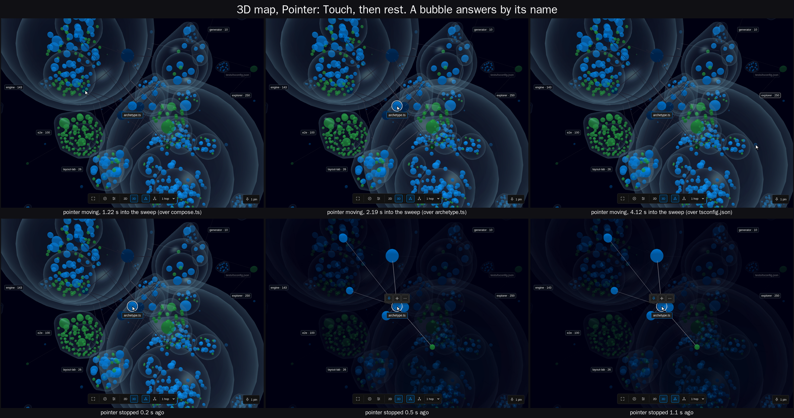
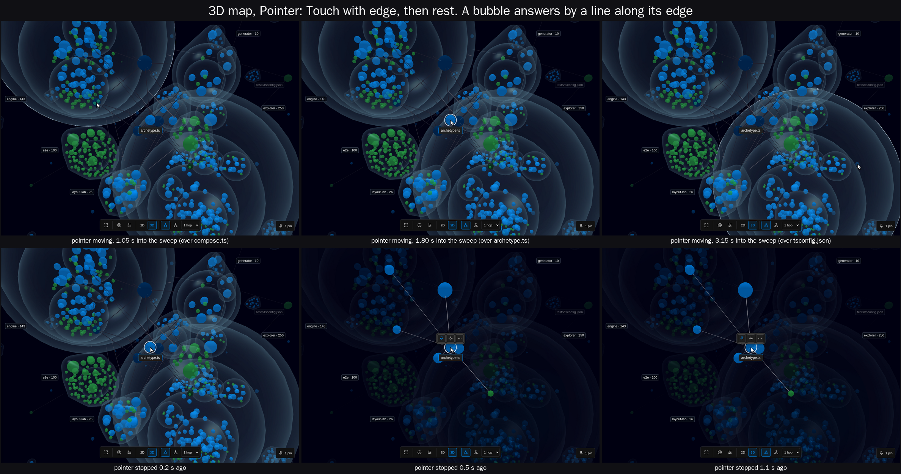
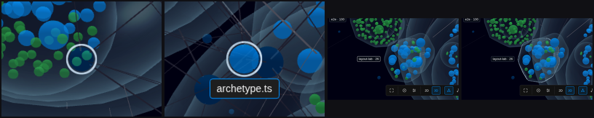
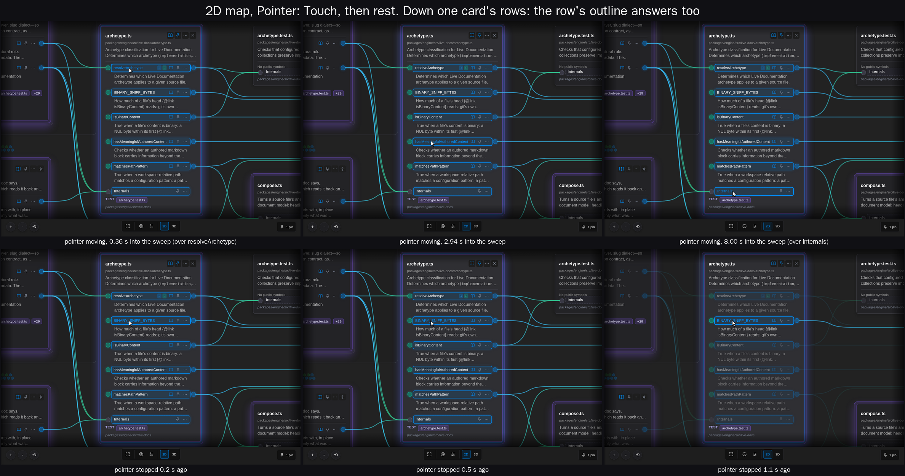
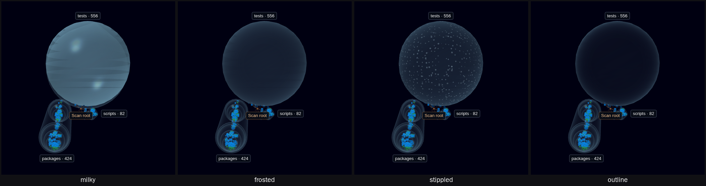
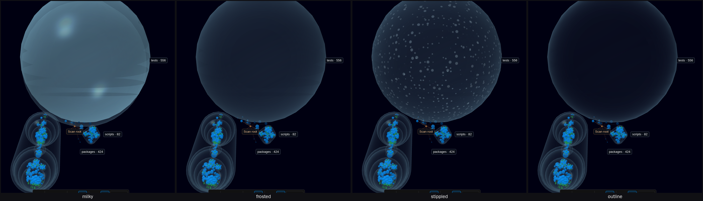
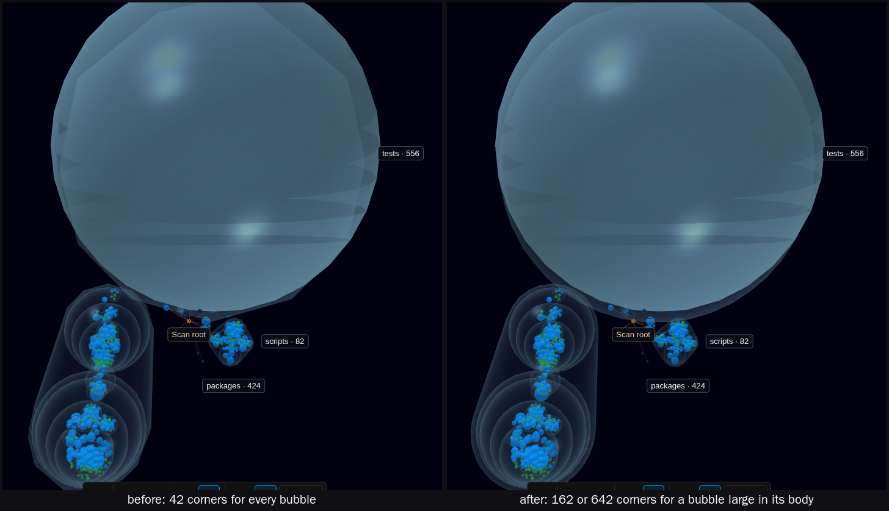

# The two trials, second leg: the signs redone, the closed ball's drawings, the mended mesh

_Historical evidence, taken 2026-11-19 by the builder of the two trials, on the same branch (`worktree-agent-afabd6e49523ee996`), in the same window and by the same method as [the first leg](README.md), whose last section says how the pictures are taken. It answers the root's review of that leg. Every lever named here has today's behaviour as its default._

---

## 1. A bubble answers by its name, a row by its outline

**In an example.** Under **Tuning → Page → Pointer → Touch, then rest**, the first leg gave a bubble under the pointer a thin line along its whole edge. On a bubble that fills half the picture that line was, in the root's words, "the loudest sign for the least news", and it ran along the mesh's straight facets. Now:

- **A bubble answers by its name.** The outline of its name takes the colour of the name's own text at once, and a name dimmed at the edge of the picture stands whole. Nothing is drawn on the skin. A bubble that has no name on screen (a small one, or one whose name found no room) still wears the thin line along its edge, which at that size is a small thing.
- **A row of a 2D card answers by its own outline** as well as by its name turning blue: the ground a name's own hover gives, with a line round it in the same blue; a pinned row, which wears that line already, wears it doubled.
- **The ring round a sphere is drawn over the wires**, so the hair-width nicks where a wire met the sphere are gone.
- A third value of the lever, **Touch with edge, then rest**, keeps the edge line on every bubble. It exists for the comparison below and can go once one is chosen.

**Pictures.**

- The 3D sweep of the first leg, a bubble answering by its name: [pointer-3d-touch-name.png](pointer-3d-touch-name.png)

  

- The same sweep with the edge line on every bubble, on the mended mesh: [pointer-3d-touch-edge.png](pointer-3d-touch-edge.png)

  

- The signs near: the ring round a small sphere and round the pinned sphere, enlarged three times, then one bubble under the pointer answering by its name, and the same bubble by its edge: [pointer-3d-signs-second.png](pointer-3d-signs-second.png)

  

- The 2D map, down one card's rows, with the row's outline answering: [pointer-2d-rows-touch-outline.png](pointer-2d-rows-touch-outline.png)

  

**Numbers.** The same sweep across the 3D map as in the first leg, each value taken once, one after the other, with the machine's load average between 19 and 33. A pixel counts as changed as in the first leg.

| | Touch, then rest (the name) | Touch with edge, then rest |
| --- | --- | --- |
| How long the sweep lasted | 5.9 seconds | 4.9 seconds |
| Times the picture changed during the sweep | 22 | 14 |
| Pixels each of those changes touched | 0 to 2,532; half of them under 480 | 1,051 to 4,335; half of them over 2,500 |
| Pixels changed over the whole sweep | 18,259 | 34,677 |
| The widest thing that changed | for the two large bubbles, their names (boxes of 87 by 24 and 95 by 24 pixels, 412 to 475 pixels changed); for the smaller bubbles on the path with no name on screen (three or four of them), the line along their edge, the largest in a box of 295 by 255 | the edges of `engine` and `explorer`, in boxes of 859 by 419 and 741 by 586 pixels |
| First change after the pointer stopped | 0.38 seconds | 0.39 seconds |

- **The 2D journey has no numbers this time, and I say why.** It was taken while the machine's load was 33, and it lasted 14.7 seconds where the first leg's lasted 5.2: the script that moves the pointer stalled for more than a third of a second several times, and a pointer that stands still that long has rested, so the map dimmed in mid-journey (eleven changes of about 107,000 pixels). That is the rule working on a stalled script, not a sweep. The three moving tiles of the strip are frames between stalls and show the outline truly; the journey is to be taken again on a quiet machine, with the 0.61 seconds of the first leg.
- The sweep across three cards, which did not stall (3.6 seconds, 14 changes), changed as in the first leg, each change inside the card under the pointer.

**To try it.** As in the first leg: **Tuning → Page → Pointer**, now with three values. Sweep across the large bubbles of the 3D link under **Touch, then rest**, then under **Touch with edge, then rest**.

**My eye.**

- **The name is the right news and, as built, too slight a sign.** With the pointer anywhere in `explorer`, nothing on its skin changes and the chip `explorer · 250` gains a pale outline one pixel wide. It says which bubble the pointer is in, which the edge never said. But the chip can stand three hundred pixels from the pointer, where the eye is not, and a one-pixel line round a small chip is easy to miss there: in the first moving frame I have to look for `engine · 143` at the left edge to see that it has changed. It is the fault the root found in the 2D row's name, again. I would keep the name as the answer and make the chip answer more plainly, its ground lifting as well as its outline; that is one rule of the stylesheet and I have not built it.
- **The edge line is plainer and still says less.** On the mended mesh it is a finer line than in the first leg, but it still follows the straight bridges between the bubbles inside a skin (a skin is stretched over them, so those are true edges, not a defect), and on `explorer` it still runs across half the picture for one fact.
- **Between the two I choose the name**, with the stronger chip. A bubble with no name on screen keeps the edge line; in this sweep those were bubbles up to 295 pixels across, which is larger than I expected a nameless bubble to be, and it means the line is still seen on middling bubbles.
- **The ring is whole now.** Enlarged three times it is an unbroken circle on both spheres.
- **The row's outline answers plainly.** In the moving tiles the row under the pointer wears a doubled blue line and a blue name, and I find it at once without looking for it. These rows are all pinned, since the file is pinned whole; on a row that is not pinned the outline is a single line where there was none, which I have not pictured.

---

## 2. The closed ball in four drawings

**In an example.** With Drawn Files at its default, `tests · 556` is a closed ball: today the largest and brightest thing in the picture, and the one that says least. A lever, **Tuning → 3D Layout → Discovery → Closed Bubble**, draws a bubble that shows nothing inside in one of four ways:

- **Milky** (the default): today's. Two surfaces, an outer skin wrapped round the folders hidden inside and a sphere filled at nearly half strength, each with a highlight.
- **Frosted**: one surface, the ball itself, dim, with no highlight.
- **Stippled**: the frosted ball with a fine stipple of pale dots fixed on it, which turn with it.
- **Outline**: the ball's edge and a faint fill.

Under the last three the outer skin is not drawn, so the ball is a true sphere; it is still the outer skin that the pointer picks, so a click acts where it did.

**Pictures.** One camera for each sheet, the page's own; only the lever differs.

- As the link opens it: [closed-ball-far.png](closed-ball-far.png)

  

- Four notches of the wheel nearer: [closed-ball-near.png](closed-ball-near.png)

  

**To try it.** Each link sets the lever, so a "1" appears beside TUNING; or move it by hand under **Tuning → 3D Layout → Discovery → Closed Bubble**.

- Milky, today's (nothing to set): <http://localhost:8999/?s=N4IgbiBcDMA0IEcomgExPAnsgzgFwCcBXAYzyIIFMQBfIA>
- Frosted: <http://localhost:8999/?s=N4IgbiBcDMA0IBsqgGYHsBOBjApgcQwEMAHAC2RCwTQGccATAIQFcAjVhHKEFDWgFwYgAvsPgBHbtHoh4AT241+GZln7MMXYUA>
- Stippled: <http://localhost:8999/?s=N4IgbiBcDMA0IBsqgGYHsBOBjApgcQwEMAHAC2RCwTQGccATAIQFcAjVhHKEGgFwEtixTvRABfMfACO3aKPgBPbnwzMsvZhi5igA>
- Outline: <http://localhost:8999/?s=N4IgbiBcDMA0IBsqgGYHsBOBjApgcQwEMAHAC2RCwTQGccATAIQFcAjVhHKENZgFwQBLAHZcAvmPgBHbtHoh4AT240+GZlj7MM4oA>

**My eye.**

- **Milky.** The brightest thing in the picture, with two highlights and level bands across it. It asks to be looked at first and has nothing to show.
- **Frosted.** A dim slate ball with no highlight. It sits behind the open folders, which now carry the colour, and it still reads as a thing of its size with something in it. It is the only one of the three I would call quiet and present at once.
- **Stippled.** The same ball with pale dots. It is livelier and it does say "full", but the dots read as things, and they are not the files: there are a few hundred of them whatever the ball holds, the same on every closed ball. A sign that looks like a count and is not one is the kind of thing this picture should not draw. If the ball is to say how full it is, the dots would have to be made from the true count, which is a larger piece of work than this trial.
- **Outline.** Nearly the colour of the ground. Far, the largest folder of the repository is a faint disc that the eye passes over; it reads as a hole, or as empty.
- **I choose Frosted.**
- **What is still wrong with all three.** Near, the ball's edge shows short straight runs at its left and right. Under these drawings the ball's own sphere is the edge, and that sphere is drawn with 24 sides round; it needs a finer one, which I have not made, because the same sphere draws every open bubble and its cost in software drawing would have to be measured first.

---

## 3. The mended mesh, before and after

**In an example.** A skin is stretched over solids that stand in for the bubbles inside it. Each solid had 42 corners, and on a bubble that is large in its body the edges between them showed as straight facets. A bubble whose reach is more than a fifth of its body's is now stood in for by 162 corners, more than half by 642, on the same sphere, so nothing moves and no skin reaches farther.

**Picture.** The closed `tests` ball in today's drawing at the nearer camera, before and after: [facets-before-after.png](facets-before-after.png)

**My eye.** Before, the outer edge of the ball is a run of straight lines with corners at its left, its lower right and under `packages`. After, it is one curve all the way round, and the rounded ends of the `packages` skin are true arcs. The straight sides that remain, as down the left of `packages`, are the skin stretched from one bubble to the next, which is what a skin does. The level bands across the milky ball and the notches where they meet its left edge are untouched: they belong to the sphere inside, not to the skin.

---

## 4. A test that held Node's last bit

`packages/explorer/src/client/views/forceGraphShells.test.ts`, "a ball of spheres packed apart", three cases: each packed a ball and expected its extent and one sphere's place to equal recorded numbers in every digit. Under Node 26 they failed, because the packing raises numbers to powers and `Math.pow` differs between the two Nodes in its last bit (`7 ** 1.5` is 18.520259177452132 under Node 22.23.5 and 18.520259177452136 under 26.13.1, both run here). The page runs on the browser's arithmetic, so the last digit never held for the product.

The three cases now hold the extent, and the sphere's distance from its recorded place, to a relative error of a trillionth of the ball's extent (`SAME_PLACE = 1e-12`). Measured here:

| Case | Under Node 22.23.5 | Under Node 26.13.1 |
| --- | --- | --- |
| 40 spheres, 2 large | exact | the sphere 3.0e-16 of the extent from its place; the extent exact |
| 48 spheres, 3 large | exact | the sphere 2.8e-16; the extent exact |
| 30 spheres about a named centre | exact | the sphere 1.3e-16; the extent off by 1.6e-16 |

So the tolerance is three to eight thousand times what the two Nodes differ by, and a sphere that stood one of the smallest radii (4 units, on balls 45 to 85 units in extent) from its recorded place would miss it by a twentieth to a tenth of the ball, ten orders of magnitude over the tolerance. What each case still proves is what it was written for: that the faster placing of up to 48 spheres, made in the third round of November 7, moved no sphere of the second round's packing (the first with two large spheres, the second at the largest count the faster placing serves, the third with one sphere named the centre). All 46 cases of the file pass under both Nodes.

---

## 5. What was run

- **Build and audits.** `npm run build`, `npm run slopcop:symbols` and `npm run slopcop:markdown` pass on the leg's final sources.
- **The whole unit suite, once**, under Node 22.23.5 with the machine's load average at 38 (this leg's own bundles were building beside it): 2,249 of 2,252 cases passed. Three failed, each on a case's five-second limit, in files this work does not touch: `packages/engine/src/live-docs/history/sequence.test.ts` ("writes a keyframe every 256 steps…", 6.1 seconds), `packages/generator/src/history/generatorIdentity.test.ts` ("is made of every file the summarizing process runs…") and `packages/explorer/src/client/views/forceGraphOctree.test.ts` ("holds every sphere once…"). Run by themselves at a load of 19, all three files pass. No limit was changed.
- **The browser cases of the 3D map**, through the lane after `npm run e2e:bundles`, on the graphics card, load average 8 to 22: `force-graph-focus`, `force-graph-discovery`, `force-graph-structure-cells`, `force-graph-shells`, `force-graph-wrappers` and `force-graph-defaults`, 42 cases in 14.1 minutes. **39 passed, 3 failed, all three on time:**
  - `force-graph-discovery.spec.ts:70`, the largest group growing from its seed: still moving after 2,713 substeps against a bound of 2,700 (50.4 seconds). This is the case the packet records as red on `main` for the slow settle.
  - `force-graph-focus.spec.ts:226`, the 2D and 3D presses: the 2D press's own time was 615 ms against a bound of 500 (it returned in 3,288 ms, of which the 2D map's render was 2,673). The same run read the 3D transition's first frame at 427 ms against 400. I have not separated the load from this leg's own work here: the mended skins have more corners, and this transition copies skins.
  - `force-graph-defaults.spec.ts:75`, saved Off and two hops on the estate sample: the picture was still moving when the case's 25-second wait for rest ran out (196 substeps taken), and the case passed its 30-second limit.
  - The case that holds today's pointer rule, `force-graph-focus.spec.ts:517` ("a pointer crossing spheres shows only that they can be pressed…"), passed, as did every case of the shells, the structure's bubbles and the wrappers.
- **Not run:** the browser cases of the 2D map and of Tuning (`tuning.spec`, `tuning-reset`, `local-map-motion`, `returning-connections`, `overview-files`, `local-map-directories`). Their hold stood behind six others when this leg's time ran out, and I took it out of the lane. `tests/e2e/tuning.spec.ts` now expects 75 controls and has never been run with that number; the unit test that counts the same controls in the template passes.
