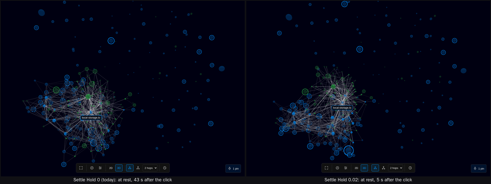

# Five questions for your eye: the 3D map

_Historical evidence, taken 2026-11-19 by the builder of this packet from the build of `main` at `892833fc`, as `dist/explorer` holds it. Every picture is the built Explorer in a 1440 by 900 window, drawn on the graphics card, with every Tuning setting at its default except the one each section names. Nothing was added to the page to make a picture. Where a picture shows a pointer, the arrow was drawn onto the finished picture afterwards, at the place the pointer was: a headless browser's picture has no pointer in it._

**Before you open any link below:** open Tuning in the sidebar and press **Reset to defaults** (the curved arrow at its top right), so that your saved settings and mine are the same. Some links below set one or two Tuning levers themselves; when they do, a small number appears beside the word TUNING, and the section says which levers those are.

The links are for your own server at `http://localhost:8999/`. I opened each one on a private copy of the same build (port 8431), made the presses written here, and saw the page show what the picture shows.

---

## 1. When a group of files appears, should the picture come to a stop sooner?

**In an example.** Open the 3D map with nothing chosen and you see about a hundred faint spheres, one for each group of files. Click one and its group grows out of it as a tangle of spheres and lines. Today that tangle goes on shifting for a long while after it looks finished: on this machine today, 43 seconds. A trial lever, **Settle Hold**, changes that. At 0 (the default) the motion is today's exactly. Above 0, once the whole picture has nearly stopped, each sphere is slowed to a stop where it then stands. At 0.02 the same click came to rest in 5 seconds.

The price is that the picture stops somewhere else than it would have. Both pictures below hold the same 305 spheres; a sphere under the hold rests a median of 130 units from where it rests today, on a picture 1,304 units wide (on this screen: 66 pixels median, 295 at the farthest).

### Pictures

Both rows start from the same click on the same sphere (`local-storage.ts`, the largest group, 600 files), and each column is the same number of seconds after the click. The top row is Settle Hold 0, the bottom row 0.02.

- The first five seconds: [q1-settle-hold-strip-1-to-5s.png](q1-settle-hold-strip-1-to-5s.png)

  

- From ten to forty-five seconds: [q1-settle-hold-strip-10-to-45s.png](q1-settle-hold-strip-10-to-45s.png)

  

- The two pictures at rest, side by side: [q1-settle-hold-rests-side-by-side.png](q1-settle-hold-rests-side-by-side.png)

  

| | Settle Hold 0 (today) | Settle Hold 0.02 |
| --- | --- | --- |
| Seconds from the click until the page says the picture is at rest | 43.3 | 5.3 |
| Steps of the motion | 5,297 | 716 (about a seventh) |
| Spheres still moving more than 5 pixels between one frame of the strip and the next | 204 to 227 of 305, at every frame from 10 s to 45 s | 17 between 3 s and 5 s; none after |

### Try it

SETTLE_TRY

### My eye

SETTLE_EYE

**Root's recommendation:**

---
