# Five questions for your eye: the 3D map

_Historical evidence, taken 2026-11-19 by the builder of this packet from the build of `main` at `892833fc`, as `dist/explorer` holds it. Every picture is the built Explorer in a 1440 by 900 window, drawn on the graphics card, with every Tuning setting at its default except the one each section names. Nothing was added to the page to make a picture. Where a picture shows a pointer, the arrow was drawn onto the finished picture afterwards, at the place the pointer was: a headless browser's picture has no pointer in it._

**Before you open any link below:** open Tuning in the sidebar and press **Reset to defaults** (the curved arrow at its top right), so that your saved settings and mine are the same. Some links below set one or two Tuning levers themselves; when they do, a small number appears beside the word TUNING, and the section says which levers those are.

The links are for your own server at `http://localhost:8999/`. I opened each one on a private copy of the same build (port 8431), made the presses written here, and saw the page show what the picture shows.

---

## 1. When a group of files appears, should the picture come to a stop sooner?

**In an example.** Open the 3D map with nothing chosen and you see about a hundred faint spheres, one for each group of files. Click one and its group grows out of it as a tangle of spheres and lines. Today that tangle goes on shifting for a long while after it looks finished: on this machine today, 43 seconds. A trial lever, **Settle Hold**, changes that. At 0 (the default) the motion is today's exactly. Above 0, once the whole picture has nearly stopped, each sphere is slowed to a stop where it then stands. At 0.02 the same click came to rest in 5 seconds.

The price is that the picture stops somewhere else than it would have. Both pictures below hold the same 305 spheres; a sphere under the hold rests a median of 130 units from where it rests today, on a picture 1,304 units wide (on this screen: 66 pixels median, 295 at the farthest).

### Pictures

Both rows start from the same click on the same sphere (`local-storage.ts`, the largest group, 600 files), and each column is the same number of seconds after the click. Both were taken with two other levers off their defaults, as the measurements of this trial were: Hops Shown at 2 and Group Wrappers Off, so that the group appears as bare spheres and lines. The top row is Settle Hold 0, the bottom row 0.02.

- The first five seconds: [q1-settle-hold-strip-1-to-5s.png](q1-settle-hold-strip-1-to-5s.png)

  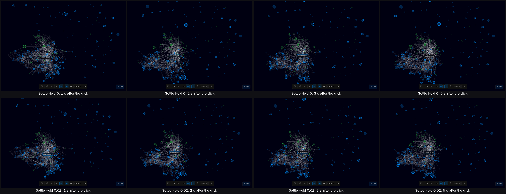

- From ten to forty-five seconds: [q1-settle-hold-strip-10-to-45s.png](q1-settle-hold-strip-10-to-45s.png)

  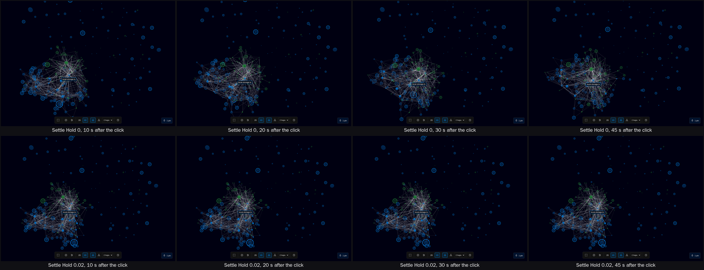

- The two pictures at rest, side by side: [q1-settle-hold-rests-side-by-side.png](q1-settle-hold-rests-side-by-side.png)

  

| | Settle Hold 0 (today) | Settle Hold 0.02 |
| --- | --- | --- |
| Seconds from the click until the page says the picture is at rest | 43.3 | 5.3 |
| Steps of the motion | 5,297 | 716 (about a seventh) |
| Spheres that moved more than 5 pixels between one frame of the strip and the next | 192 to 227 of the 305, at every frame from 3 s to 45 s | 17 between 3 s and 5 s; none after |

### Try it

1. Press **Reset to defaults** in Tuning, as at the top of this page.
2. Open one of the two links. Each opens the 3D map with nothing chosen and sets the levers the measurements were made with, so a number appears beside TUNING:
   - Today's motion (TUNING shows 2: Hops Shown 2 and Group Wrappers Off, both under Tuning → 3D Layout → Discovery): <http://localhost:8999/?s=N4IgbiBcDMA0IBsqgGYHsBOBjApgcQwEMAHAC2RFLWIGcoAmeAcwzQFdiB1I44nDOpBBoUKEAF9x8AI5QQ0ACYSgA>
   - With the hold (TUNING shows 3: the same two, and Settle Hold 0.02 under Tuning → 3D Layout → Forces): <http://localhost:8999/?s=N4IgbiBcDMA0IBsqgGYHsBOBjApgcQwEMAHAC2RAGccAXGhHACTQQBMoAGAOg4CZ5SaYpSj8QAcwxoArsQDqRYsRwYRkEGhQoQAXx3wAjlBDR2OoA>
3. Make the group appear. The easy way: click in the search bar at the top, type `local-storage.ts` and press Enter. The other way, which is what the pictures above were taken with: rest the pointer on the ringed sphere this picture shows, low and left of the middle, until its name appears, and click the name: [q1-where-to-click.png](q1-where-to-click.png)
4. Take the pointer off the picture and watch until nothing moves.

To try another strength, move the lever yourself before step 3: **Tuning → 3D Layout → Forces → Settle Hold**. It changes how the next movement ends, not the picture already on screen. I set it to 0.02 by hand in this way on the first link and the group came to rest in 569 steps, against 5,148 with the lever left at 0.

### My eye

In the top row the tangle never looks the same twice between 10 and 45 seconds: the ringed blue spheres on its left climb from the lower left to the upper left, the green hub of test files sinks from the top of the group toward its middle, the large ringed sphere under the group moves up into the tangle, and the group's outline opens from a compact block into a diamond pointing left. Each of those frames looks like a finished picture, which is the trouble: nothing in a frame says it is not done. In the bottom row every frame from 5 seconds on is the same picture. Side by side at rest, the two are the same kind of picture at the same size, a tangle low and left with dim spheres scattered round it, but not the same arrangement: under the hold the group stands more upright, the green files sit at its top, and one large ringed sphere stands clear at its bottom edge, where today's rest has it inside the tangle.

Whether the stop reads as a freeze is not something stills can show, so I measured it instead. Under the hold, the typical sphere moved 15 pixels in a third of a second at 3 seconds after the click, then 9, 5, 5, 3, and under 1 by 5 seconds, then crept less than a tenth of a pixel for two more seconds before the page called it at rest. That is a slowing over about two seconds, not a cut. Today's motion ends differently: for its last several seconds the typical sphere moves about a third of a pixel in a third of a second, too slowly to see, until the page calls it at rest. Your eye on the moving page decides how either feels.

**Root's recommendation:** make 0.02 the default.

- **The two rests are the same kind of picture, and I cannot call either the better one.** What differs is the forty seconds between them. Today's picture goes on rearranging from 10 to 45 seconds, and every frame of it looks finished; a person starts to read it and it moves under them. A designer would call that losing the mental map: once someone has begun to read a layout, it should stay where it is.
- **The price is real and small.** The same click ends in a different arrangement than today's, a median sphere 66 pixels from where it would have been. Nobody has today's arrangement by heart, since it differs from one click to the next already.
- **What only your eye can say** is whether the stop reads as a freeze. It was measured as a slowing over about two seconds, not a cut.
- **One consequence.** The browser case that is red because this motion is slow (`force-graph-discovery.spec.ts:70`) would then pass for the right reason: the product got faster, and no bound was raised.

---

## 2. Now that names wait for the pointer to rest, do the spheres feel dead while it moves? And should the 2D map wait in the same way?

**In an example.** Move the pointer across the 3D map without stopping. Until yesterday every sphere it crossed flashed its name and its three small buttons, and the rest of the picture dimmed and came back, again and again. Since yesterday none of that happens until the pointer has stayed still on one thing for about a third of a second (350 milliseconds, within 4 pixels). The World Map waits in the same way. The 2D map does not: the moment the pointer is on a card, that card's lines light and the rest dims.

So there are two things to judge: whether a sphere that shows nothing while the pointer passes over it feels dead, and whether the 2D map's lighting-at-once now feels restless beside it.

### Pictures

Each strip is six frames from one continuous movement: three while the pointer is moving (taken at moments when it is right on top of something), then three after it has stopped. The white arrow is where the pointer was; I drew it on afterwards.

- The 3D map, `archetype.ts` pinned. The pointer crosses a small sphere on the left, then `archetype.ts` itself, then a small sphere on the right, and comes back to stop on `archetype.ts`: [q2-pointer-sweep-3d.png](q2-pointer-sweep-3d.png)

  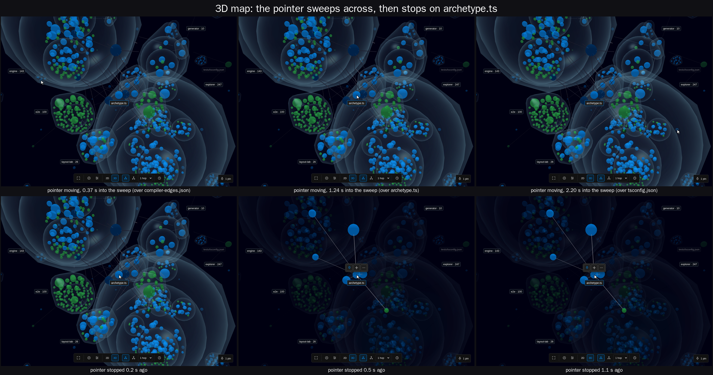

- The 2D map, the same file pinned. The pointer crosses the card on the left, then the name of `archetype.ts`, and stops on the name of `compose.ts`: [q2-pointer-sweep-2d.png](q2-pointer-sweep-2d.png)

  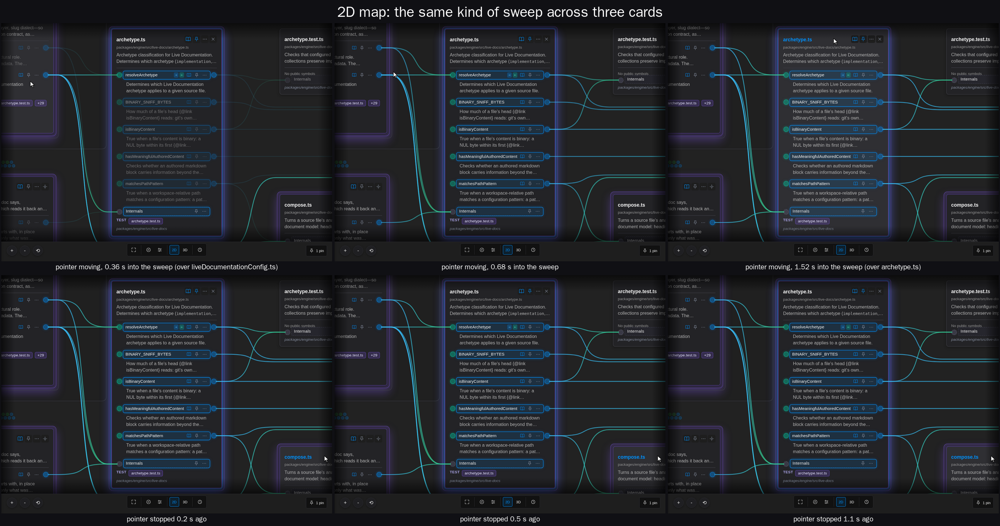

| | 3D map | 2D map |
| --- | --- | --- |
| How long the sweep lasted | 3.6 seconds | 3.4 seconds |
| Times the picture changed during the sweep | 10 | 38 |
| First change after the pointer stopped | 0.35 seconds after | none: the card had lit on arrival |

The 3D map's ten changes during the sweep are not the kind a person sees: each touched between 300 and 1,500 of the picture's million pixels, as faint specks scattered along the edges of spheres. I compared the frames by eye at full size and could not see a difference, and I cannot say from the frames what the specks are. After the stop, the three buttons came at 0.35 seconds and the rest of the picture faded one frame later, at 0.39.

### Try it

- 3D: <http://localhost:8999/?s=N4IgbiBcDMA0IEcomgExPAdsgDgQwGMBrPAcwFMBnAenM1IEtNzrKAnA6gGwbHIFpUAewI08HABbkALgE8c5AHTTKGEDigBtUNkjrCJCjTqNmrDt14Dho6uIJS5C5aviq9AKhABfALregA>

  Nothing to set. Sweep the pointer from one side of the picture to the other without stopping, a few times, across the spheres and the bubbles. Then stop on the sphere in the middle that carries the name `archetype.ts` and hold still.

- 2D: <http://localhost:8999/?s=N4IgbiBcDMA0IDsogA4EMDGBrNBzApgM4D0+CuAlgvsYQE4bEA2FY+AtACYD2GJaDABb4ALgE8U+AHQjCIeCigBtUEkipMOAiTKVqtBs1YcefYgIzDxkmXPhz1AKhABfALougA>

  Nothing to set. Sweep the pointer across the cards in the same way.

### A stranger's reading

Two testers who were told nothing about the project were given this message and the 3D link above, in a 1280 by 800 window: *"What is the file in the middle of this picture, and what is it connected to?"* Each had at most 25 actions.

- **The larger model (Sonnet), 14 actions.** Its first act was to click the sphere in the middle. On a pinned file a click takes the pin off, so the whole picture was replaced by the map's start, with no `archetype.ts` in it: [q2-stranger-after-first-click.png](q2-stranger-after-first-click.png). It pressed Back, then left the 3D map at once: "I'm switching to the 2D view so I can read the file's connections." It named five of the six connected files from the 2D cards and missed `core.ts`, which was off the right edge. It never rested the pointer on a sphere.

  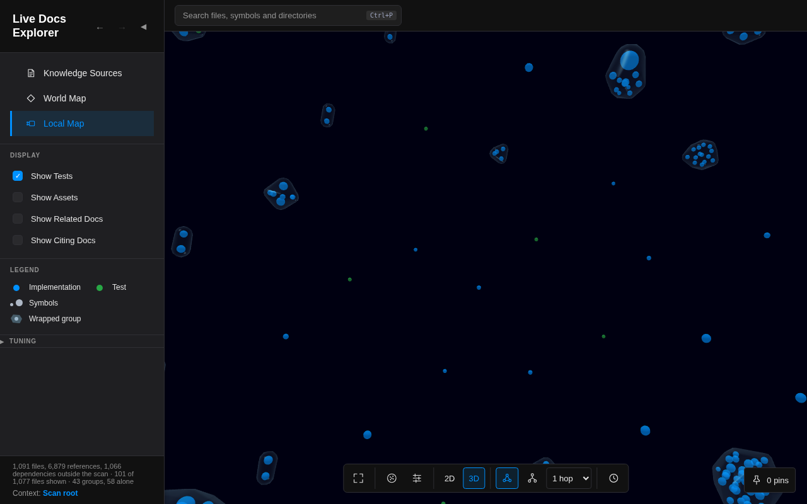

- **The smaller model (Haiku), 1 action.** It looked once and answered from that one picture: the file is `archetype.ts` (its name is drawn), and it is "connected to" the bubbles whose names are drawn, `engine · 143`, `explorer · 247`, `e2e · 100` and others. It did not touch the map and said so: "I didn't click or hover over individual lines".

So neither stranger tells us whether a sphere feels dead under a moving pointer: neither moved a pointer across the spheres at all. What the runs do show is that the first thing a stranger tried on a sphere was a click, not a rest, and that the click cost them the picture. One of question 4's testers did rest on spheres; see there.

### My eye

In the 3D frames taken while the pointer moves, I can find no difference between one frame and the next, even in the frame where the arrow sits squarely on the pinned sphere: no name, no outline, no change of brightness. A fifth of a second after it stops, still nothing. At half a second the three buttons stand above `archetype.ts`, the four files it connects to are lit with their lines, and everything else has sunk to near black; the change is large and comes all at once. In the 2D frames the picture is different in every moving frame: with the pointer on the left card most rows of the `archetype.ts` card are greyed out, a moment later they are all lit again, and a name turns blue under the pointer as it passes.

One thing the strip cannot show: a screencast does not draw the pointer, so whether it turns into a pointing hand over a sphere is not in these frames. Yesterday's measurement found that it does, at once ([the pointer's rest, 18 November](../../../../2026-11-18/Screenshots/rested-pointer/README.md)).

**Root's recommendation:** one rule for both maps: what is under the pointer answers at once, and the rest of the picture changes only when the pointer rests.

- **The 3D map today is calm and a little dead.** Nothing changes while the pointer moves, even squarely on the pinned sphere; only the pointer's own shape says a sphere can be pressed. I would give the sphere under the pointer a small sign at once, a ring, and leave the name, the three buttons and the fading of the rest to wait for the rest, as now.
- **The 2D map today is the reverse.** The whole map dims and relights as the pointer crosses cards: 38 changes in 3.4 seconds, and in the first frame most rows of the `archetype.ts` card are greyed only because the pointer is crossing its neighbour. I would keep the card under the pointer lighting at once and make the dimming of everything else wait for the rest.
- **Designers call that wait "hover intent".** It is to be built as a lever, so that you compare the two on the moving page and not in my sentences.
- **A finding that matters more than either.** Five of six strangers began by clicking the pinned sphere, which took the pin off and replaced the whole picture. The first thing a person tries should not cost them the picture. I would make a click on a pinned sphere do what a rest does, show its name and buttons, and leave unpinning to the pin button among them. That changes what a click means, so it is yours to decide.

---

## 3. Should the `tests` folder open up in the 3D map on your machine?

**In an example.** Open the 3D map in the Structure layout with nothing pinned. Three folders stand around the root. Two of them, `packages · 420` and `scripts · 82`, show their files as small spheres inside nested bubbles. The third, `tests · 556`, is one closed, milky ball that shows only its count.

It is closed because a picture draws at most 1,024 files inside bubbles, and the folders of this picture hold 1,066 between them (the three above and two small ones, `.devcontainer · 3` and `.github · 5`). When a picture is over the limit, the page closes the bubble farthest from what you asked about, and among equals the largest; here that is `tests`. The other four hold 510 files, which fit.

### Pictures

- Today's picture, as the link opens it: [q3-structure-today.png](q3-structure-today.png)

  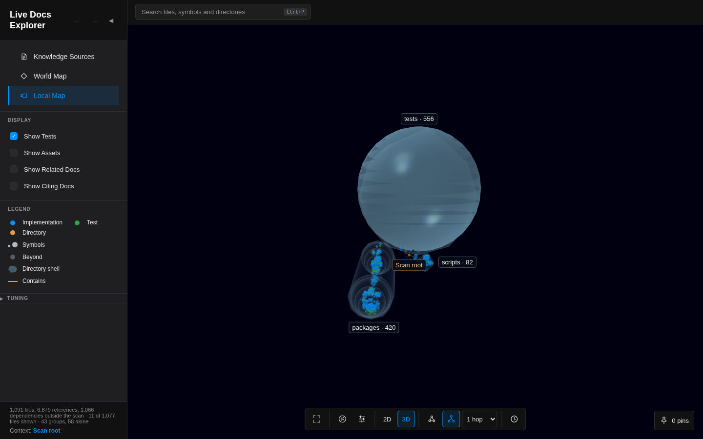

- The same page four notches of the wheel nearer: [q3-tests-nearer.png](q3-tests-nearer.png)

  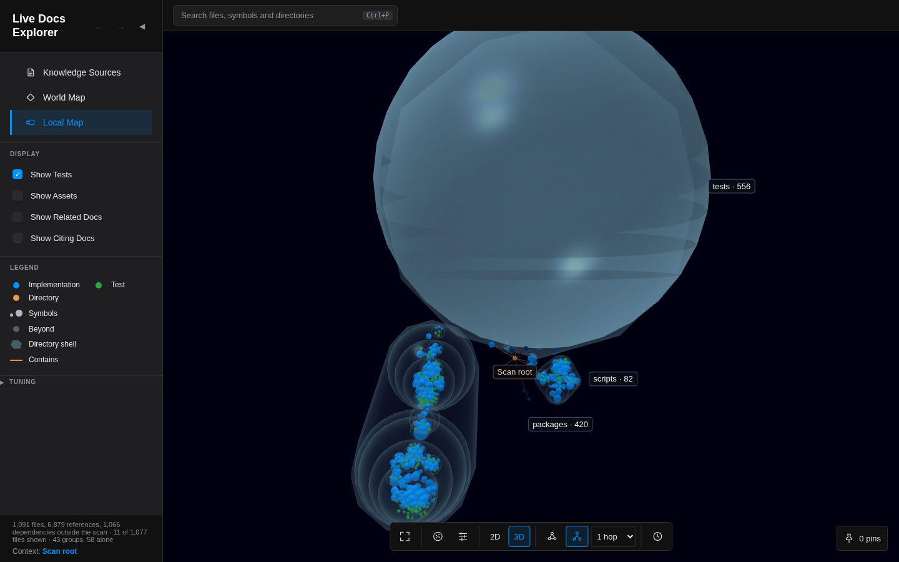

### Is the limit a lever?

No. It is a fixed number in the code, not a setting in Tuning:

- `export const DRAWN_FILES = 1024;` at `packages/explorer/src/client/views/forceGraphShells.ts`, line 550.
- It is applied by `pictureVeils` in the same file (line 624), which `forceGraphView.ts` calls at line 1600 without naming any other number. Nothing else in the Explorer reads it.
- The comment above it says why it is 1,024: "Set by the cost of drawing spheres in the software renderer this repository's pictures are taken in". That is the tests' browser as it was then, not a browser with a graphics card.

I changed nothing. Seeing `tests` open needs a trial build with a larger number, or a lever; that is the root's to decide.

### How fast today's picture draws on a graphics card

Measured on this picture as I took it, drawn by this machine's card (an NVIDIA RTX 3090, reached from the container):

| | |
| --- | --- |
| From opening the page to the picture at rest | 2.2 seconds, 68 drawn frames |
| While the camera turned for four seconds (a slow drag on the empty background) | 241 frames drawn in 4.04 s: **59.7 frames a second** |

Sixty a second is the most this browser draws, so today's picture, with `tests` closed, does not tax the card at all. It does not tell us what the picture would cost with `tests` open; only a trial can.

### Try it

<http://localhost:8999/?s=N4IgbiBcDMA0IEcomgExPAnsgzgFwCcBXAYzyIIFMQBfIA>

Nothing to press. Roll the wheel up over the picture to come nearer, and drag the empty background to turn it.

### A stranger's reading

None was run for this question: the brief asked for strangers on questions 2 and 4.

### My eye

The `tests` ball is the largest thing in the picture, wider than `packages` and `scripts` together, and it is the only one that shows nothing inside: a smooth pale blue-grey surface with two soft highlights and faint level bands across it. Beside it the other two folders read like jars of blue and green beads. In the nearer picture the ball's edge shows short straight facets at its upper left.

**Root's recommendation:** build a trial that opens it, and measure, before choosing a number.

- **The limit is probably hiding more than your machine needs.** It was set for the test browser's software drawing, and your card draws today's picture at the browser's ceiling of sixty frames a second.
- **But the number should not simply go up.** The same page has to open on an 8 GB work machine in December.
- **The trial:** a lever, Tuning → 3D Layout → Discovery → Drawn Files, at 1,024, 2,048 and all, with the frame rate measured on the card and in software drawing. Then you choose a default, or we decide that the page should close folders by itself where drawing is slow.
- **Whatever the number,** the closed ball is the largest and heaviest thing in the picture and says the least, and its edge is faceted. A closed folder should sit quieter than the open ones beside it. That is a fault of the drawing, apart from the limit.

---

## 4. Beyond the files you asked about: draw everything, or only the next step?

**In an example.** Pin `archetype.ts` in the 3D map and ask for one hop: you get that file and the six files it is directly connected to (the two it uses, `liveDocumentationConfig.ts` and `document.ts`, and the four that use it, `archetype.test.ts`, `compose.ts`, `core.ts` and `discovery.ts`). The question is what to draw of the other thousand files in the repository. **Tuning → 3D Layout → Discovery → Beyond the Hops** has two answers:

- **Everything** (the default): all of them are in the picture. Beyond the hops they stand as dimmed spheres or are held inside bubbles, one bubble for a folder and one for each group of files that connects to nothing shown.
- **Next step**: only what is one step past the picture is drawn, held in bubbles. Groups that connect to nothing in the picture (islands) are left out.

### Pictures

Each pair is the same file pinned in the same window, with only the lever changed. The camera is the page's own in each: the two values hold pictures of different sizes and the page frames each to fit.

- One hop: [q4-beyond-the-hops-1-hop.png](q4-beyond-the-hops-1-hop.png)

  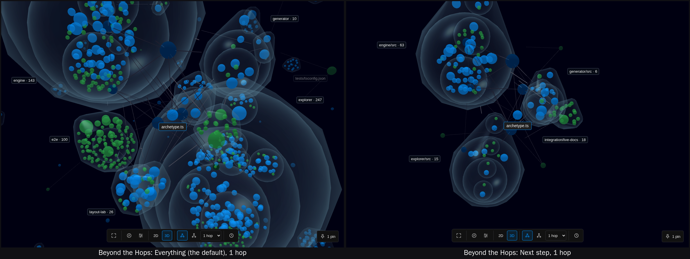

- Two hops: [q4-beyond-the-hops-2-hops.png](q4-beyond-the-hops-2-hops.png)

  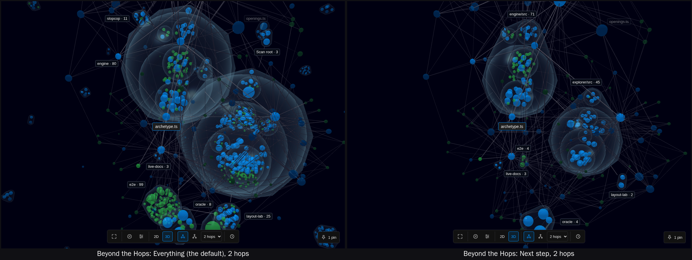

What each picture holds, counted from the page (the sidebar's own line says the first number, "111 of 1,077 files shown"):

| | Files drawn as spheres of their own | of them bright | of them dimmed | Folder bubbles |
| --- | --- | --- | --- | --- |
| One hop, Everything | 111 | 1 | 110 | 11 |
| One hop, Next step | 10 | 1 | 9 | 5 |
| Two hops, Everything | 228 | 7 | 221 | 11 |
| Two hops, Next step | 125 | 7 | 118 | 10 |

The bright one at one hop is `archetype.ts` itself; the last hop shown is always drawn dimmed, so at one hop its six neighbours are dimmed and at two hops they are bright.

### Three smaller things

Each is a part of the 1440 by 900 window drawn at twice the pixel density, so the small thing can be seen; nothing was moved.

1. **A file that is alone in its folder, beyond the hops, is dimmed in Connections and bright in Structure.** The file is `.vscode/settings.json`.
   - Connections, `archetype.ts` pinned: it is the small dark blue ball in the middle of the picture, just under the name `layout-lab · 26`: [q4-lone-file-connections.png](q4-lone-file-connections.png)
   - Structure, nothing pinned (with `archetype.ts` pinned the Structure layout does not draw this file at all): it is the small bright blue dot at the end of a short orange line, up and to the right of the name `Scan root`: [q4-lone-file-structure.png](q4-lone-file-structure.png)

   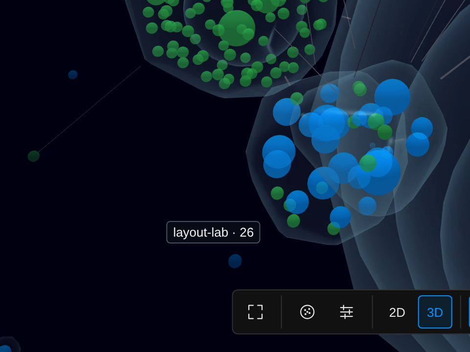
   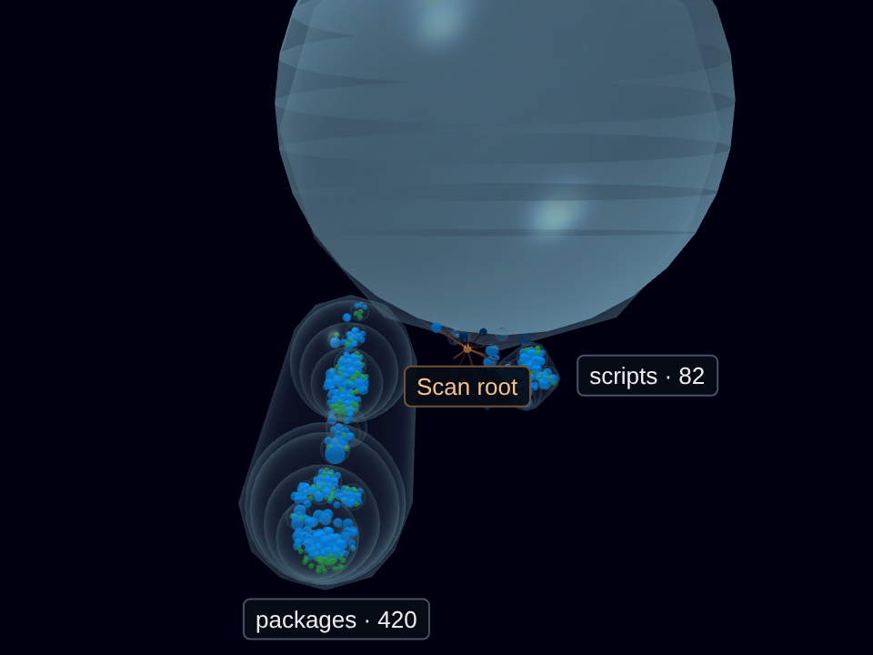

2. **A folder's hub at the edge of the picture carries no sign that it holds more.** Structure layout, `archetype.ts` pinned, one hop: the picture is two things, the pinned file and the hub of its folder `packages/engine/src/live-docs`, which holds 127 files. The hub is the dim brown ball; its name is dimmed with it; nothing else marks it: [q4-structure-hub-at-the-frontier.png](q4-structure-hub-at-the-frontier.png)

   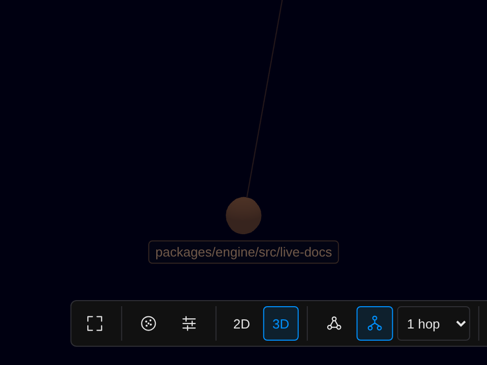

3. **Documents beyond the hops get no sign.** Connections, `archetype.ts` pinned, with **Show Related Docs** and **Show Citing Docs** ticked. The dark blue balls round the name are the files `archetype.ts` connects to; several of them have documents that the picture does not show, and nothing on them says so: [q4-documents-beyond-the-hops.png](q4-documents-beyond-the-hops.png)

   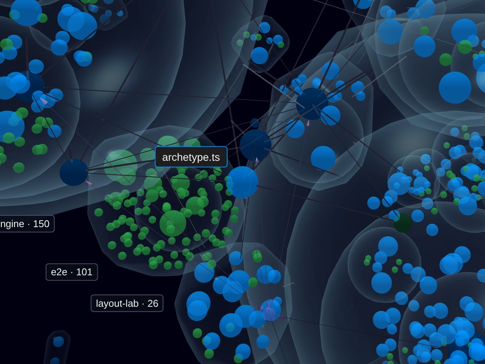

### Try it

- One hop, Everything (nothing to set): <http://localhost:8999/?s=N4IgbiBcDMA0IEcomgExPAdsgDgQwGMBrPAcwFMBnAenM1IEtNzrKAnA6gGwbHIFpUAewI08HABbkALgE8c5AHTTKGEDigBtUNkjrCJCjTqNmrDt14Dho6uIJS5C5aviq9AKhABfALregA>

  From there, by hand: open **Tuning → 3D Layout → Discovery → Beyond the Hops** and choose **Next step**. For two hops, choose **2 hops** in the bar under the picture. The picture rearranges and the camera reframes each time.

- Or by link, each of which sets the lever itself (TUNING then shows 1 or 2; a link only sets the levers it names, which is why Reset to defaults comes first):
  - One hop, Next step: <http://localhost:8999/?s=N4IgbiBcDMA0IBsqgGYHsBOBjApgcQwEMAHAC2RACMcBPNAOwBMAJNYgZyhHpwA8AXALTt+OYiAC+E+AEcu0RiHj0uxQlgDWhAOY52Aehz1tASx7722fQhNgcgxmiwHC2Ujn41iOAHT9O8OKQANqgKpAgapo6eobGZjgWVjZ2Dk4ubh5evv5KIJwRAFSSALoSQA>
  - Two hops, Everything: <http://localhost:8999/?s=N4IgbiBcDMA0IBsqgGYHsBOBjApgcQwEMAHAC2RFLWIGcoAmAX0fgEcoRoATEeAOw7FCWANaEA5jhoB6HH3EBLPjmk1s0hArA4AtFzRYZhbKRwAXAJ7EcAOjN14xKAG1QAyCCGiJU2fKUqalgaWrr6htLGWKaW1nYOIHQeAFQgjAC6jEA>
  - Two hops, Next step: <http://localhost:8999/?s=N4IgbiBcDMA0IBsqgGYHsBOBjApgcQwEMAHAC2RFLWIGcoAmeAIxwE80A7AEwAlq7IIDjgAeAFwC0NMTmIgAvvPgBHKCGhcQ8DmuKEsAa0IBzHDQD0ODsYCWw8zWzmENsDglc0WC4WykcYqzEOAB0YnTwcpAA2qA6gnqGJmaW1nY4Dk4ubh5ePn4BQaHhWiACIABUCgC68kA>

  I opened each and read the same count in the sidebar as the by-hand way gives: 10, 228 and 125 of 1,077 files shown.

- The folder hub: <http://localhost:8999/?s=N4IgbiBcDMA0IEcomgExPAnsgzgFwCcBXAYzyIIFMMQA7ZABwEMSBrJgc0pwHpLaOAS1qUeOAiR4AbQWEoBaVAHsSvJhIAWlPJgaUAdHhw0GUANqh6kEMzadufAcNHjJMuYpVrN23QaM0xtYAVCAAvgC6YUA> (nothing to set).
- The lone file in Structure: <http://localhost:8999/?s=N4IgbiBcDMA0IEcomgExPAnsgzgFwCcBXAYzyIIFMQBfIA> (nothing to set; it is very small, beside `Scan root`).
- Documents: the first link above, then tick **Show Related Docs** and **Show Citing Docs** in the sidebar under Display.

### A stranger's reading

Four testers who were told nothing about the project were given this message and the 3D map with `archetype.ts` pinned at one hop, two under Everything and two under Next step: *"Which files does archetype.ts use, and which files use it?"* The right answer: it uses `liveDocumentationConfig.ts` and `document.ts`; `archetype.test.ts`, `compose.ts`, `core.ts` and `discovery.ts` use it. Each had at most 25 actions.

| | Everything | Next step |
| --- | --- | --- |
| Larger model (Sonnet) | Right, all six with their direction, read from the **2D** map. 22 actions. | Named all six from the **3D** map by resting the pointer on spheres; could not tell which way each connection runs. Ran out of actions at 25. |
| Smaller model (Haiku) | Right, all six with their direction, from the details panel reached through the **2D** map. 14 actions. | Right, all six with their direction, read from the **2D** map. 12 actions. |

- **All four began the same way, and stumbled the same way.** Each clicked the sphere in the middle first; the click took the pin off and the picture was replaced by the map's start. In the smaller model's words: "My click cleared the selection and reset the map to 'Scan root.'" Three pressed Back and one searched for the file again. The picture they landed on is the one shown under question 2.
- **Three of the four then left the 3D map for the 2D one** and answered from there. Their words for the 3D picture: "The graph is too dense to read" (Sonnet, under both values) and "The 3D graph is hard to read" (Haiku, under Next step).
- **The one that stayed in 3D was under Next step.** It rested the pointer on five spheres in turn and read each name as it appeared: [q4-stranger-resting-on-a-sphere.png](q4-stranger-resting-on-a-sphere.png). It ended sure of the six files and unsure of the direction: "The map doesn't label link direction". It also wrote that one name "appeared only on hover, so that match is less certain". That last is a wish for more words on the picture, and I report it as a wish.

  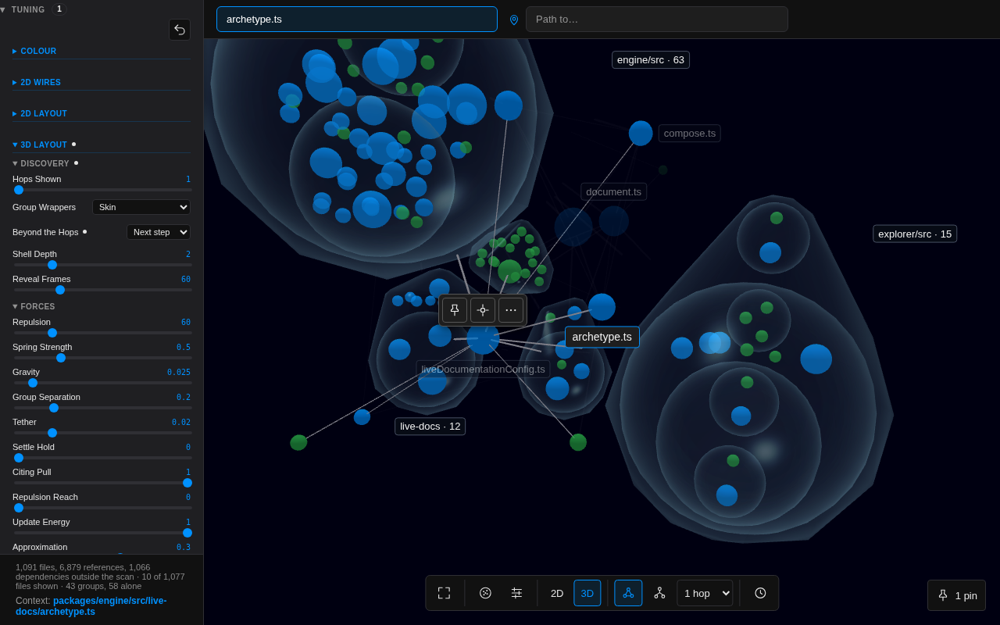

One tester on each value is too few to say that Next step keeps a stranger in the 3D map and Everything does not. It is what happened once.

### My eye

At one hop under Everything the frame is filled edge to edge with large overlapping bubbles full of bright blue and green balls, and I have to hunt for the subject: `archetype.ts` is one mid-sized ball near the middle, and the files it connects to are the darkest balls in the picture, navy against a near-black ground, while files it has nothing to do with shine inside their bubbles. Under Next step the frame holds four labelled bubbles round the pinned file with dark ground between them, and the lines from `archetype.ts` to its neighbours can be followed. At two hops both pictures are a web of thin lines; under Everything two very large bubbles sit across the middle of the web and small bubbles are scattered to the corners, and under Next step the web has two bubbles in it and the left half of the frame is empty.

In the small pictures: the lone file in Connections is easy to miss, a dark ball of the same navy as the ground's blue; in Structure the same file is a bright dot only a few pixels wide. The folder hub reads as a faded thing, not as a thing with 127 files behind it.

**Root's recommendation:** "Next step" as the default, and the files you asked for drawn bright.

- **At one hop under Everything I have to hunt for the subject.** Under Next step it is four named bubbles round the pinned file, and the lines can be followed.
- **A fault under both values.** The six neighbours, which are the answer to the question, are the darkest spheres in the picture, because the last hop shown is always dimmed, while files that have nothing to do with it shine in their bubbles. Our own rule is to fade what is irrelevant. I would draw every hop that was asked for at full brightness and dim only what lies beyond.
- **The three smaller things are one thing: honest signs of hidden content.** A lone file beyond the hops should be dimmed in Structure as it is in Connections. A folder's hub at the edge should carry its count, as a bubble does (`live-docs · 127`). A file with documents the picture does not show should carry a sign of them.
- **What this lever does not mend.** Three of four strangers left the 3D map for the 2D one to answer "which uses which", and the one who stayed could not tell which way a connection runs. The 3D map does not say direction. That is a larger question, and I will bring it by itself.
- **A fault of framing.** At two hops the page's own camera leaves part of the picture above the window, with the pinned file left of the middle.

---

## 5. Which colours should the Explorer wear when it first opens?

**In an example.** In the colours the Explorer wears today, an ordinary code file is a blue sphere and a test file is a green one. **Tuning → Colour → Palette** offers two other sets:

- **Today** (the default): ordinary files blue, tests green. This is the set known to fail its own check: the pin that marks what a file offers is the same blue as an ordinary file, and a test file and a directory look alike to someone who cannot tell red from green.
- **Proposed**: ordinary files a pale grey, tests violet. Blue and green are kept for "offers" and "uses" and nothing else wears them.
- **Vivid kinds**: ordinary files blue and tests green, close to today's, with everything else as in Proposed. It was made to your lean toward kinds told by strong colour, and it passes every check.

### Pictures

Each picture below is one page, with only the Palette lever moved between its three parts: Today on the left, Proposed in the middle, Vivid kinds on the right. In the 3D pictures no sphere moved between the three (I measured: 0.00 pixels), so what differs is colour and nothing else.

- The 3D map, Connections layout, around `archetype.ts`: [q5-palettes-3d-connections.png](q5-palettes-3d-connections.png)

  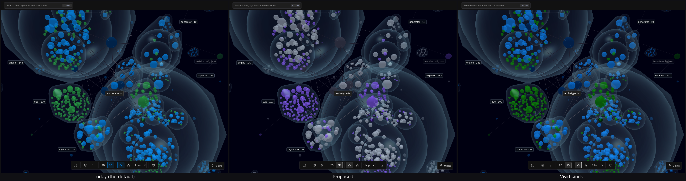

- The 3D map, Connections layout, `archetype.ts` pinned at two hops, where more files stand as spheres of their own: [q5-palettes-3d-connections-2-hops.png](q5-palettes-3d-connections-2-hops.png)

  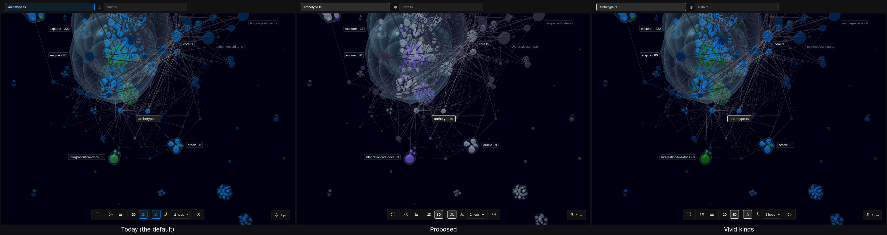

- The 3D map, Structure layout, at its start: [q5-palettes-3d-structure.png](q5-palettes-3d-structure.png)

  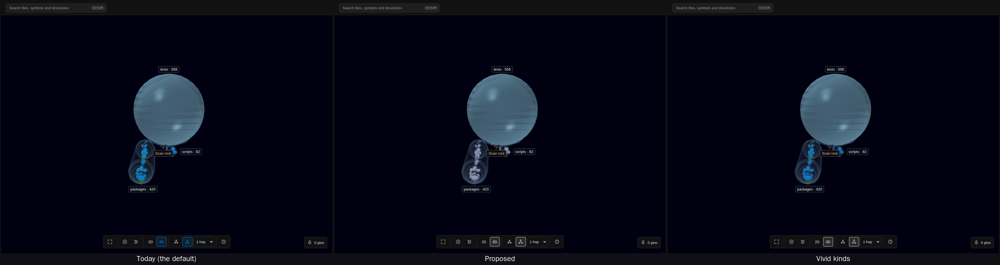

- The 2D map with the `scripts` directory opened and six closed directories inside it: [q5-palettes-2d-scripts-open.png](q5-palettes-2d-scripts-open.png)

  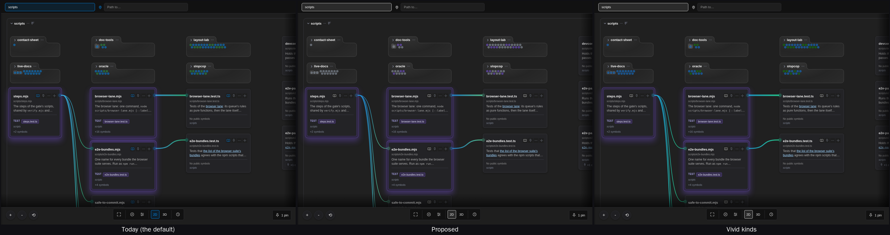

- The World Map: [q5-palettes-world-map.png](q5-palettes-world-map.png)

  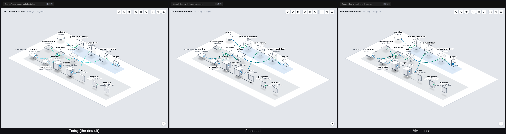

### Try it

Open a link, then open **Tuning → Colour → Palette** and choose Proposed or Vivid kinds. The page recolours at once and nothing moves. A "1" appears beside TUNING while the palette is not Today. The choice is kept in your browser for every later page, so press **Reset to defaults** when you have finished.

| View | Link |
| --- | --- |
| 3D, Connections, around `archetype.ts` | <http://localhost:8999/?s=N4IgbiBcDMA0IEcomgExPAdsgDgQwGMBrPAcwFMBnAenM1IEtNzrKAnA6gGwbHIFpUAewI08HABbkALgE8c5AHTTKIAL5A> |
| 3D, Connections, `archetype.ts` pinned, two hops (the link sets Hops Shown to 2) | <http://localhost:8999/?s=N4IgbiBcDMA0IBsqgGYHsBOBjApgcQwEMAHAC2RFLWIGcoAmAX0fgEcoRoATEeAOw7FCWANaEA5jhoB6HH3EBLPjmk1s0hArA4AtFzRYZhbKRwAXAJ7EcAOjN14xKAG1QAyCCGiJU2fKUqalgaWrr6htLGWKaW1nYOIHQeAFQgjAC6jEA> |
| 3D, Structure, at its start | <http://localhost:8999/?s=N4IgbiBcDMA0IEcomgExPAnsgzgFwCcBXAYzyIIFMQBfIA> |
| 2D, `scripts` open | <http://localhost:8999/?s=N4IgbiBcDMA0IBMoG0QGcDGAnAlgBwBc0QBdAXyA> |
| World Map | <http://localhost:8999/?view=world> |

### A stranger's reading

None, as the brief said: a stranger cannot tell us which colours you find right.

### My eye

- **3D, Connections.** Today: bright blue spheres with mid-green ones among them; the two colours are about equally loud. Proposed: the blue is gone; the picture is a cloud of pale grey balls in which the violet test files are the only colour, so the tests are what I see first. Vivid kinds: blue as today, and a green that is deeper and darker than today's, so the test files sit back against the dark ground more than they do today.
- **3D, Connections, two hops.** The same three characters with fewer bubbles in the way: blue and green dots on a web of pale lines; grey and violet dots, where the grey dots and the pale lines are close in tone; blue and a darker green.
- **3D, Structure, at its start.** Little colour to judge: the picture is mostly the closed `tests` ball, which is the same pale blue-grey in all three. The small files in `packages` and `scripts` are blue and green, grey and violet, blue and green.
- **2D.** The cards themselves barely change. What changes is the rows of small dots inside the closed directories (blue and green; grey and violet; blue and green), and the pressed buttons: under Today the pressed 2D button, the search box and the Local Map entry are blue, and under both other palettes they are white or grey. The violet glow round a card that has tests is the same in all three.
- **World Map.** Under Today the dashed lines between the pieces are a pale sky blue and a pale mint, thin against the pale board. Under Proposed and Vivid kinds they are a darker blue and green and stand out more. Proposed and Vivid kinds are nearly the same picture here: 591 pixels differ, all inside the pieces.

**Root's recommendation:** "Vivid kinds" as the default.

- **It is the picture you know, with today's faults mended.** Files blue, tests green, and it passes every check that Today fails.
- **"Proposed" is the tidier system and the weaker picture.** In 3D it turns the map into a cloud of grey balls in which the violet tests are the only colour, so the eye goes to the tests first, and they are seldom the subject.
- **The World Map gains under either new set.** Its dashed lines are thin and pale today and stand out under both.
- **One reservation.** The deeper green lets test files sink into the dark ground in 3D, more than today's green does. I would lift it a step if the checks still pass.
- **In 2D under either new set a pressed button is white, not blue.** That is right: blue then means "offers" and nothing else.

---

## Seen on the way

Nothing here was fixed; each is only what I saw while taking the pictures above.

- **At two hops the page's own camera leaves part of the picture off the top of the frame.** In [q4-beyond-the-hops-2-hops.png](q4-beyond-the-hops-2-hops.png) (both halves) and in [q5-palettes-3d-connections-2-hops.png](q5-palettes-3d-connections-2-hops.png), bubbles and lines run off the top edge and `archetype.ts`, the pinned file, sits left of the middle. At one hop under Everything ([q4-beyond-the-hops-1-hop.png](q4-beyond-the-hops-1-hop.png), left half) the bubbles likewise run off every edge. I do not know whether that framing is intended.
- **The closed `tests` ball has a faceted edge.** In [q3-tests-nearer.png](q3-tests-nearer.png) its outline at the upper left is a run of short straight segments, where the open bubbles beside it have smooth outlines.
- **A click on a pinned sphere takes the pin off and replaces the whole picture.** Five of the six strangers did this as their first act and lost the picture they had been sent ([q2-stranger-after-first-click.png](q2-stranger-after-first-click.png)). The page did what it is built to do; I list it because every one of them was surprised by it.
- **A link sets only the levers it names; every other lever stays as your browser last saved it.** I met this by mistake: after one page had set Beyond the Hops to Next step, the link for "two hops, Everything" opened under Next step, because that link names only the hops. This is why every section starts from Reset to defaults. There is no picture; the sidebar's counts were 125 where 228 was expected.
- **In the Structure layout with `archetype.ts` pinned at one hop, the whole picture is two balls**: the file and its folder's hub ([q4-structure-hub-at-the-frontier.png](q4-structure-hub-at-the-frontier.png) shows the hub and the line up to the file). The sidebar says "1 of 1,077 files shown".
- **In question 1's frames the "1 pin" button at the lower right looks lit.** That is my pointer, parked on it to be off the picture; it is the same in both rows.

## How the pictures were taken

- **Build and window.** `dist/explorer` as built from `main` at `892833fc`, served read-only on `http://127.0.0.1:8431/`; a headless Chromium launched as the browser suite launches its own (`tests/e2e/browser-launch.ts`), which draws WebGL on the graphics card; 1440 by 900 at one device pixel to a page pixel, except the small pictures of question 4, which are parts of the same window drawn at twice the pixel density so that a small sphere can be seen.
- **Settings.** Every page started in a browser profile of its own with nothing saved, which is what Reset to defaults gives you. Levers were moved through the page's own controls or carried by the link; nothing was written into the page's saved settings from outside, and no style or script was added to change what the page draws.
- **Reading the page.** Where a sphere had to be found on the screen (to click it, or to cut a small picture round it), its place was read from the scene with the browser suite's own observer (`tests/e2e/force-graph-observation.ts`), which reads and does not draw.
- **Strips.** Question 1's frames are screenshots at the stated seconds after the click. Question 2's are frames of the browser's own screencast, each the last frame drawn before the stated moment, with the pointer's arrow drawn on afterwards.
- **Camera.** Each picture is at the camera the page itself chose. In question 4 the two values of the lever hold pictures of different sizes, and the page frames each to fit; I did not force one camera on both, because the product does not.
- **Strangers.** The blind-playtest instrument (`AI-Agent-Workspace/scripts/playtest/`), from a scratch copy changed in two ways: its browser draws on the graphics card like every other picture here, so that a slow software-drawn map would not be mistaken for an unresponsive one, and it ran inside the shared browser lane. A tester has a 1280 by 800 window, seven controls (look, point, click, drag, scroll, type, press) and nothing else. Six runs, 76 seconds, 42 cents in all.
- **Scratch.** The scripts and every unkept frame are under `AI-Agent-Workspace/tmp/packet-3d/`, which git ignores.
