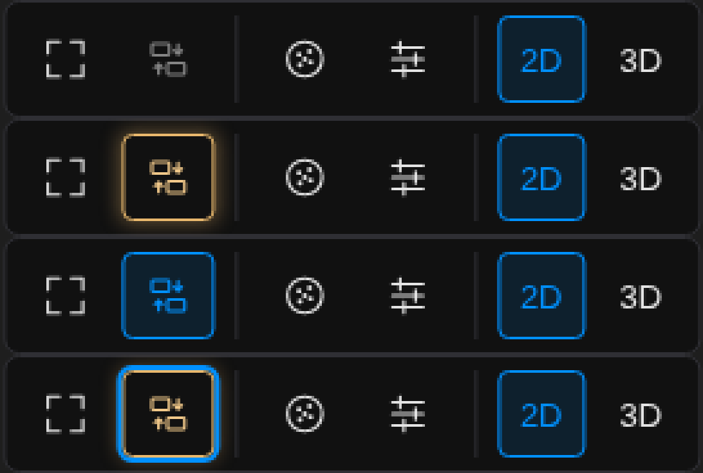
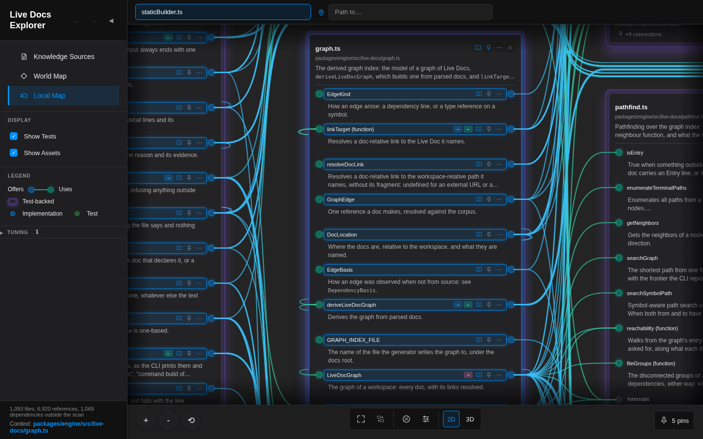
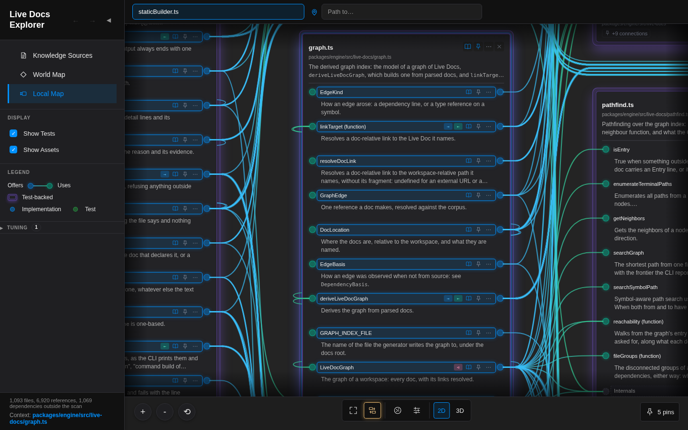
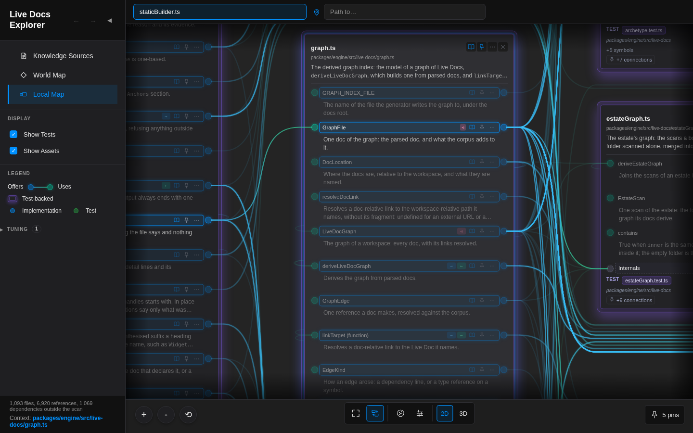
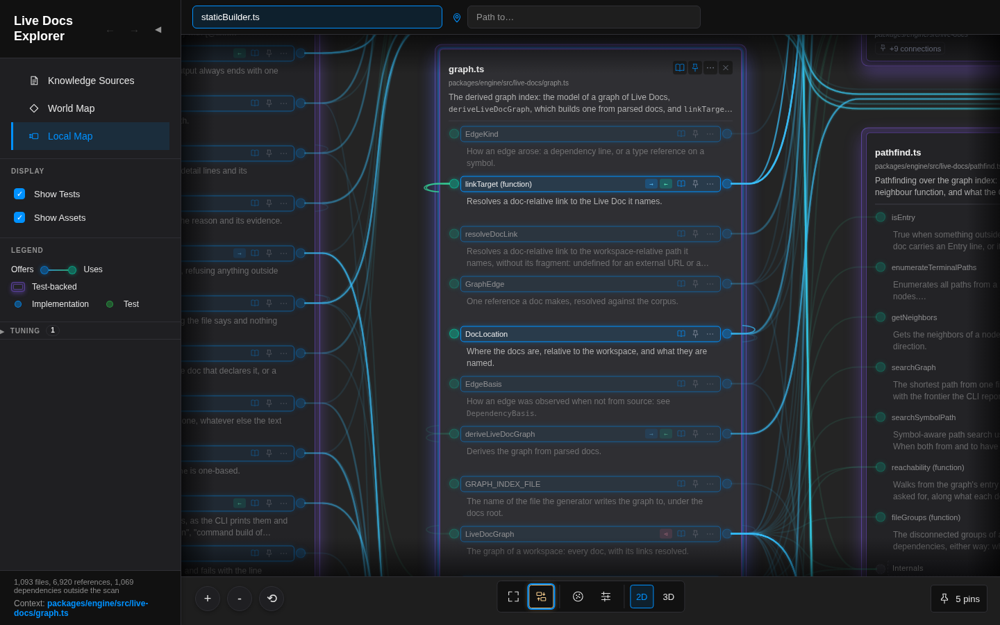

# One question for your eye: what should the 2D map do with a better arrangement it finds late?

_Historical evidence, taken 2026-11-19 between 21:00 and 22:20 UTC by a builder for the root, on builds made in the builder's own worktree (branch `worktree-agent-a3ede7b7e878b89ba`). It follows [the evening's first packet on this question](../search-stop/README.md), whose words (an order, a levelling, a move, the price) are used here as there. The machine was at a load of 17 to 44 on twenty threads throughout, a dozen builders working: every time below is provisional and carries its load; the counts (trials, moves, prices, cards moved) do not depend on the load. This page is unfinished: what is missing is listed under [Not yet here](#not-yet-here)._

## The question in one example

Open five files of this repository and begin to read the card for `graph.ts`. Seven seconds in (on a quiet machine), two of its rows change places under your eye and the card to its right jumps up 114 pixels, for a picture 0.4 % cheaper by the layout's own price. Three things the map could do with an arrangement it finds after you have begun to read:

- **Applied.** Move the picture to it, as today.
- **Dropped.** After a short while (2.5 seconds to begin with) the search stops and nothing more moves.
- **Offered.** After that while the search goes on without moving anything, and only while your hand is still. When it holds an arrangement clearly cheaper than the one shown, a control in the strip at the bottom lights. Press it and the picture moves there; press it again and the picture is put back as it was.

## What is built, and behind which levers

Three levers in Tuning, under 2D Layout, after Search Patience. None of this is in the build on your port 8999 yet.

| Lever | Values | Default |
| --- | --- | --- |
| Levelling | While orders are tried; Then until ten change nothing; Every one the picture allows | While orders are tried (new tonight; the third is how it was) |
| Late Moves | Applied; Dropped; Offered | Applied (how it was) |
| Late After | 0.5 to 10 seconds | 2.5 |

**Levelling, "While orders are tried", exactly:**

1. One levelling is tried before each order, on the picture then shown; a search of N orders tries at most N levellings.
2. When no order is left to try, levelling ends at once. What is left of the list is not tried.
3. Within one picture each step of an outline (the outline, its top or bottom, the column the step stands before) is tried once.
4. After a levelling is taken the list is made anew from the picture that results, without the steps already tried: it goes on and is not begun again. It must be made anew because each trial is "every run now level, and one more"; a list made before the move would undo the levelling just taken.
5. An order taken is another picture and gets a whole list, since an order is laid out with nothing levelled.
6. A resize begins everything again; a fold of a row keeps what was tried.

**Late Moves, Offered, exactly.** The search turns quiet when Late After's while is over, or sooner if the visitor's search has nothing left to try. Quiet, it has no patience and tries 128 orders in all (the visitor's gives up after 11 on these five files, and the one order that changes the picture at a glance is the 77th); it prices every trial without the cost of moving cards, since none move; and it makes its moves on an arrangement it holds, never on the page. It takes its next trial only when the pointer, the wheel and the keys have been still for 400 milliseconds, and begins none while a button is held. The control lights when the held arrangement is cheaper than the picture shown by 2 % of its price or more. Why 2: of the 46 moves pictured in the first packet, 44 lowered the price by 0.45 % or less and none of them changed the picture at a glance; two lowered it by 6.5 % and 6.6 % and were plain to see. Nothing stood between, so any bar from a half to six in a hundred parts them alike; two is near the middle of that gap by ratio, on the side of leaving a reader alone.

## The control: unlit, lit, pressed, pressed again

One run on the five files with Late Moves at Offered and nothing else changed, at a load of 19 to 23. The strip at the bottom of the map, enlarged four times; the control is the second from the left, beside Fit. From the top: with nothing to offer; lit; after a press; after a second press, made with the Enter key, so it also wears the keyboard's ring.

The glyph in these pictures is a first form and too small beside its neighbours; it was drawn larger after they were taken and has not been pictured again.

| | The window | What the control says of itself |
| --- | --- | --- |
| The first picture |  | name "Tidier arrangement", not pressed, disabled; "Looking for a tidier arrangement; this lights when one is found" |
| Lit, 48 seconds in |  | not pressed, enabled; "A tidier arrangement is ready: 7.1 % lower by the layout's measure of line length, crossings and size. Press to move the picture to it; press again to put it back." A screen reader is told "A tidier arrangement of the map is ready" when it lights. |
| After the press |  | pressed; "Showing the tidier arrangement. Press to put the picture back as it was." |
| After the second press |  | not pressed, enabled, lit again |

What the run did, by the page's own counts:

- **Before the while was over** one move was made on the page: the first levelling, which moves 28 cards by one pixel. At this load nothing else was ready in 2.5 seconds.
- **From then until the control lit** the map did not move: the first picture and the lit one differ in 2,399 of 1,296,000 pixels, the control's glow and that one-pixel levelling. Meanwhile the search tried 75 orders and 75 levellings and made 13 moves on the arrangement it held. It lit at the 75th order it tried, which is the first packet's order 77, with the held arrangement 7.1 % cheaper.
- **The press** moved the picture to that arrangement with `graph.ts` held where it stood: its rows are dealt anew and its neighbour on the right is `estateGraph.ts`, as the first packet showed for order 77. Here it happened because it was asked for.
- **The second press** put the picture back: the same order (the page names it `seed 2` before the press and after) at the same price, 3,444,078. The last still looks dimmer than the lit one only because the probe had left the pointer on a row of `graph.ts`, which dims the rest; it is not a pixel-for-pixel proof, and the cards' places were not compared in this run.
- **The search went on to its end** at 128 orders and 128 levellings, 111 seconds after the first picture, holding an arrangement priced 3,197,457: to the digit the price the suite's eighty-order search ends on after 29 moves on the page. Here 26 of its 27 moves were made out of sight.
- **The longest single trial** while the search was quiet and nothing touched the page: 434 ms, of 160 trials in 43 seconds (median 264 ms, 95th 365 ms), at a load of 19 to 23. So a hand that moves again waits at most about that long for the trial in flight, and then has the page to itself until it has rested 400 ms. With no hand on the page the search fills the thread (97 % of that time), which is what it is asked to do.
- **Not explained:** one task of 9.7 seconds in this run, at about the time of the press. The press measures 98 cards on the page and lays the arrangement out once more; at this load the browser's own screenshots took two seconds each around it. To be looked at in the quiet window.

The strip of the browser's own frames across each press is not here: the probe's screenshots came two seconds apart at this load, slower than the move itself.

## Cards that moved for no reason: before and after the placement's mend

A second builder found why one card, `compose.test.ts`, went down and up by the same distance in nine of thirteen moves: its place costs the same anywhere between two pins, and the solver stopped at whichever end it met first (its record is `Probes/layout-price/README.md` of this day, on `main`; not linked here because this branch was cut before it landed). Its mend lets a levelling's trial keep every card whose place costs nothing where the shown picture had it. The page now asks for that. Counted on the page, five files, a fresh visitor with Levelling set back to "Every one the picture allows" so that all thirteen moves are made; each card's place read in the picture's own pixels after every move:

| | Moves | Prices after each move | Cards moved in all | Moves at which `compose.test.ts` moved |
| --- | --- | --- | --- | --- |
| Before the mend (load 31 to 44) | 13 | 3,444,078 … 3,426,608, the first packet's to the digit | 252 | 9 (moves 1, 2, 3, 4, 5, 7, 10, 11, 13) |
| After the mend (load 35 to 23) | 13 | the same thirteen prices | 243 | 2 (move 3, 30 px down with order 5; move 6, 7 px up with 86 others) |

Move by move, cards moved (farthest, px), before and after: 29 (30) and 28 (1); 1 (30) and 0; 91 (994) and 91 (994); 29 (66) and 28 (1); 1 (66) and 0; 86 (7) and 87 (7); 2 (368) and 0; 1 (27) and 1 (27); 2 (35) and 2 (35); 6 (72) and 5 (46); 1 (72) and 0; 2 (368) and 1 (4); 1 (72) and 0. That is the second builder's arithmetic, line for line. `graph.test.ts` no longer goes 368 pixels up and back. Five of the thirteen moves now move no card at all: they change an outline only.

## Where the search ends now, in counts

Five files, each search left alone to its end. The counts do not depend on the machine's load; the seconds do, and are provisional.

| | Orders | Levellings tried | Moves | Price at the end | Cards moved in all | Seconds (load) |
| --- | --- | --- | --- | --- | --- | --- |
| A visitor, before tonight (every levelling the picture allows) | 11 | 196 | 13 | 3,426,608 | 252 | 127 (31 to 44) |
| The same with the placement's mend | 11 | 196 | 13 | 3,426,608 | 243 | 107 (35 to 23) |
| A visitor now (levelling while orders are tried) | 11 | 11 | 9 | 3,427,546 | not yet counted; 237 if its nine moves are the first nine above, as their prices are | not timed alone |
| The suite's eighty orders, before tonight | 80 | 231 | 29 | 3,197,457 | 506 by the second builder's replay | 87 (8 to 18), from the first packet |
| The suite's eighty orders now | 80 | 80 | 19 | 3,199,550 | 452 | 93 (22 to 19) |

Under the new rule the eighty-order search makes one move more than the first packet foresaw for "A" (19, where it counted 18): because a levelling taken no longer begins the list again, the levellings between orders reach one step further down the list before order 77 arrives. It ends on the same price.

## To try it

Your build on port 8999 does not have any of this yet; these steps are for a build of this branch. Your browser remembers Tuning's levers, so start from Tuning's reset.

1. Open the five files: <http://localhost:8999/?s=N4IgbiBcCMA0IHcogLYEMAOJ4DtkbQGMBrNAcwFMBnAegpzIEscKaqAnQmgG0bAoC0AEwD2hWmXaYAFgDoALlWwgskANqg8kFUVKVa9JizacefQaPE1JMhUvhLtAKhABfWJvy7y1Og2asHFy8-MJitJYArij08nbKjiAu7p7aBCQ+Bv7GQWahlhJSGNIAYozc1PEOyMkeIFo6Gfp0AB4Y3CLsFOwmXFTSaF1CbPJo8oyEAKJtHV3sACJjaFUgibWpjXq+FDOd3b1sA0MjYxMAQpHlQt0ra24Auq5AA>. Read `graph.ts` from the top. With everything at its defaults, two of its rows still change places some seconds in: that is Applied.
2. Open Tuning (the sliders icon in the strip), 2D Layout, and set **Late Moves** to **Dropped**. The picture is drawn again. Read `graph.ts` again: after two and a half seconds nothing moves.
3. Set **Late Moves** to **Offered**. A new control appears in the strip, second from the left, beside Fit: two small cards with arrows. It is dim at first. Read, and leave the pointer still now and then; the search works only while you are still. When the control turns amber, press it: the picture moves to the arrangement the search found, with `graph.ts` held where it was. Press it again: the picture goes back.
4. **Late After** sets how long the map may still move by itself after a picture is drawn. Try 0.5 and 5.
5. **Levelling**: set it to "Every one the picture allows" with Late Moves at Applied to see the long search as it was before tonight.

## Whether the page answers while it searches (provisional)

Measured at loads of 17 to 38, and not to be trusted: the same inputs were answered seconds late with the search switched off. The root has asked for these to be taken once, in a quiet window; until then they say only that a search left to run on the page's own thread makes a bad state worse.

| | Search off | Default, searching (two runs) |
| --- | --- | --- |
| Load | 35 to 21 | 17 to 21; 22 to 28 |
| Share of the time in long tasks | 60 % | 84 %; 90 % |
| Long task, median / 95th / longest, ms | 128 / 1,599 / 3,063 | 225 / 1,528 / 2,481; 290 / 1,824 / 3,714 |
| A wheel turn answered, median, ms | 549 (16 turns) | 2,718 (4); 3,523 (4) |
| A drag, frames a second | 28.7 and 13.3 | 13.5; 5.6 |

## What moving the search off the page's thread would take

A trial is arithmetic. Ordering the columns, planning the scene, placing it with the exact solver and pricing it are pure modules with no page in them (`branches.ts`, `branch-scene.ts`, `branch-placement.ts`, `network-simplex.ts`, `branch-restarts.ts`, `branch-alignments.ts`, `branch-search.ts`), and the search already prices trials from measurements taken once (each card's width, height and rows), which are plain data that can be posted to a worker. What it would take: a second script in the bundle, built by the same step that builds `static/index.js` and served from the page's own site, since a worker made from text in memory would need the content security policy loosened; the policy as it stands (`default-src 'none'; script-src 'self'`, no `worker-src`) should let a worker start from a file of the page's own site, because a worker's source falls back to `script-src` where `worker-src` is not named, but I have not tried it in a browser; an explicit `worker-src 'self'` would say so plainly and loosen nothing else. The page would post the ranked picture, the measurements and the settings; the worker would run the trials and post back each one worth taking as an order's number and a list of levellings, which the page lays out again itself, so no picture crosses between them. What stays on the page: measuring the cards, measuring an arrangement before it is shown, a cycle's trial (it measures a card's foot on the page), the move, and the decision to move. A picture drawn anew must be able to tell the worker to stop, and an answer for a picture no longer shown must be dropped. The lab's `refine` is nearly this loop already, so the worker's loop and the lab's could be one function. Until then the quiet search yields to the hand instead, and one trial may be in flight when you move.

## My eye

From one run's stills; I have not yet seen the moves themselves frame by frame.

- **The three states read apart at a glance:** dim, amber, the strip's pressed blue. Amber on this control and amber on the 3D button are the same cue, as asked. I could not see the two lit together on these five files, where the 3D button does not light, so whether they are confused when both glow is not judged.
- **The glyph does not yet say what it does.** Two small cards with arrows: at the strip's size the arrows are specks and the whole is smaller than Fit's corners beside it. I enlarged it after these pictures; whether "two cards changing places" is the right picture for "a tidier arrangement" is for your eye.
- **Dimmed, it looks disabled, which is right, but it also looks like something that will never do anything.** For 48 seconds on this map a visitor sees a dead control and no sign that anything is being looked for, except in its tooltip.
- **While it waits, the page is still.** Between 2.5 seconds and the press the map did not move. That is the thing asked for, and it held.
- **The press is a large move, and it is the right one to ask for:** the whole picture is dealt anew around the card held still. The first packet's fear, that order 77 would re-deal ten of twelve rows under a reader, is now a reader's own choice. I have not judged how it feels on the moving page.
- **What is still wrong:** the second press is not yet proved to the pixel; the glyph; nothing says the search is at work or how far along; a press took seconds to answer at this load, with one task of 9.7 seconds unexplained; and with Late After at 2.5 seconds the five files get almost none of today's early moves (the first levelling arrives at 3 to 7 seconds depending on the machine), so "one quick rearrangement on arrival" happens on the estate and not here. Late After counts seconds; counting the search's first few trials instead would not depend on the machine. That is a fork for the root.

## Words proposed for the design system and the decisions log

For the root to place with the landing.

- **Design system.** "A directory's outline is levelled while orders are still being tried, and not after: once the search has no order left, no levelling moves the picture. The levellings that came later changed nothing an eye could find, and some drew an outline round empty ground (packet of 2026-11-19)."
- **Decisions log.** The entry on the continuing search describes levelling as going on after the orders until none is left. It wants a dated line: since 2026-11-19 levelling stops with the orders by default, with "until ten change nothing" and "every one the picture allows" one choice away in Tuning; and, as a trial, Late Moves (Applied, Dropped, Offered) with Late After.

## Not yet here

- The four maps and the strips of the browser's own frames under the new default and under each value of Late Moves. Only the five files have been run; `pathfind.ts` and the estate have not been opened under any of this.
- The strip of the transition at each press, the enlarged glyph pictured, and the second press proved by the cards' places.
- A run with Late Moves at Dropped: none has been made. The browser was held by other builders for the last quarter of an hour of this leg.
- The two strangers' reading.
- The responsiveness table in a quiet window: search off, the default, Dropped, Offered with yielding, and key presses alone.
- A cycle's order is never tried once the search is quiet. To hold one, the arrangement held must carry its own ranking and the cards' feet as that ranking words them, and the press must dress the cards for it and the second press dress them back; not built.
- No browser case yet holds the control, the yielding, or the fold's mend; the scheduler's part of each is under unit tests. A case for the three values of Late Moves on the estate sample is written (`tests/e2e/local-map-offer.spec.ts`) and has not been run.

## How the counts were taken

Chromium at 1,440 by 900, launched as the browser suite launches it, through the browser lane, a fresh visitor each time with only the lever named set (the suite's eighty orders are its own setting: no start before paint, 80 orders, patience 80, moves that jump). The page writes what its search has done on the map's root; a watcher in the page reads every card's place in the picture's own pixels each time a move has ended, so the camera's holding of a card is not counted as a move. For the counts the probe made no input.

The control's stills are the browser's own screenshots of one run: the probe waited without input until the page said an offer was ready, moved the pointer onto the control and clicked it, then gave it the keyboard's focus and pressed Enter. The strip crops are enlarged four times without smoothing. The pictures were taken on builds of the branch served on the builder's own ports; nothing was built in the main checkout.

**Root's recommendation:** levelling stops with the orders, the new default on this branch. For an arrangement found late, **Offered**, because a picture that changes by itself under a reader takes the reader's place from them, and one that changes at their own press does not; but not before four things are mended: a press that answers at once (the one task of 9.7 seconds explained), a control that does not look dead for most of a minute while a search is at work, the second press proved to put every card back, and a cycle's order held. Whether the control should be in the strip at all before it has something to offer is a question for the eye, and alternatives are to be drawn. Late After stays in seconds: what it protects is a reader's attention, which runs in time and not in trials; the browser cases set the lever and do not lean on the machine's speed. Until the owner has tried the three on their own port, the default stays Applied. _Written by the root on 2026-11-19 after looking at the five pictures; the two colours on one strip (amber for an offer here and on the 3D button) read to root as one meaning, a better picture on offer behind this control._
