# One question for your eye: when should the 2D map stop rearranging itself?

_Historical evidence, taken 2026-11-19 between 19:50 and 20:40 UTC by a builder for the root, on a build of `7ff963ae` made in the builder's own worktree, which has today's faster layout solver. Nothing in the product was changed to take it. Your own page on port 8999 was built at 15:37 UTC, before that solver: it shows the same pictures in the same order, more slowly, until it is rebuilt. By today's measurements of the old solver against the new that is roughly twice as slowly; your page itself was not timed._

## The question in one example

Open the estate sample with `PaymentService` and `PaymentService/Data` opened. The map appears at once. Four tenths of a second later one card, `PaymentsContext.cs`, slides 186 pixels down and the outline of `PaymentService/Data` changes from an L into a plain rectangle. Then nothing more moves.

| The first picture | 0.4 seconds later, and from then on |
| --- | --- |
| 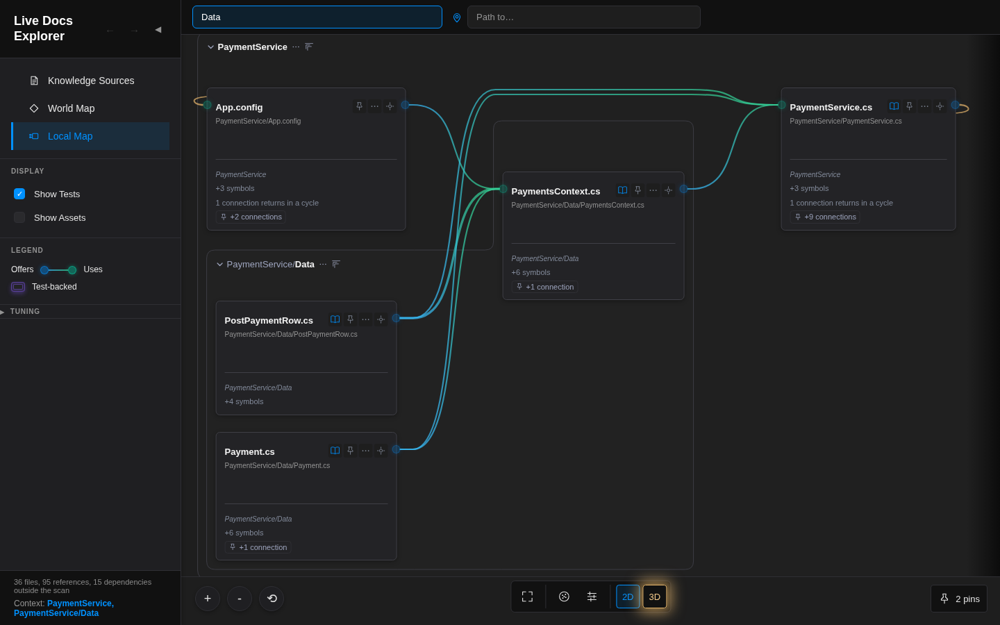 | 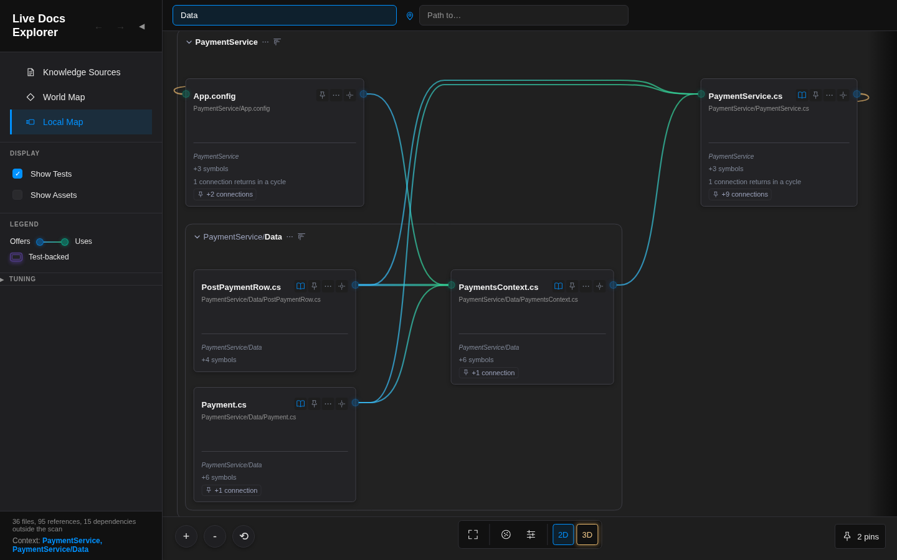 |

That is the map's **continuing search**: it shows a first picture, goes on trying other arrangements in the background, and moves the picture whenever a trial is cheaper by its own price. It is on for every visitor. On this small map it makes one move and is done in a second. On a large one it goes on for most of a minute, and the question is when it should stop.

## Words used here

- **Price.** The map's own number for a picture: how far its lines run up and down, how often they cross, how tall and wide the picture is, and how jagged the directories' outlines are, added up. Lower is better to the map. Whether lower is better to a person is what this page is about.
- **Another order.** One kind of trial: the files of each column are stacked in another order, and the rows inside each card too, by a numbered recipe (order 1, order 2 and so on; the code calls these seeds). When one is taken, cards change places and rows inside cards change places.
- **An outline levelled.** The other kind of trial. A directory is drawn as an outline round its files, and where that outline has a jog between two columns the map tries making the edge level, moving cards if it must (the code calls this a join). The estate's move above is one.
- **A move.** A trial the map takes because its price is lower (the code calls it an adoption). Every move changes the picture on screen; most trials are not taken and change nothing.

## What a person meets is not the search the numbers came from

The numbers you were given (80 orders, 231 levellings, 29 moves, 74 seconds) are from the browser suite's own setting, which lets the search try 80 orders. A visitor's setting is Tuning's default: at most 32 orders, and stop trying orders after 8 in a row that better nothing. On the five files that gives up after 11 orders.

| Five files of this repository | Orders tried | Levellings tried | Moves | Seconds | Price at the end |
| --- | --- | --- | --- | --- | --- |
| As a visitor meets it (defaults) | 11 | 196 | 13 | 38.9 at a load of 8; 55.6 at a load of 20 | 3,426,608, which is 0.5 % under its first picture |
| The suite's setting (80 orders) | 80 | 231 | 29 | 86.6 at a load of 8 rising to 18 | 3,197,457, which is 7.3 % under its first picture |

The large gain in the second row is one trial, order 77, worth 6.6 %. The visitor's search never reaches it: after order 5, seventy-one orders in a row better nothing. Tuning's own lever for this patience stops at 32, so even by hand the search gives up at order 37. Sections 1 and 2 show both searches.

**The three places it could stop**, as they are called below:

- **A: when the orders are used up.** No levelling after that.
- **B: ten quiet levellings.** After the orders are used up, go on levelling until ten in a row change nothing.
- **C: today.** Every levelling the picture allows, and the whole list again after each move.

| Seconds from the first picture (moves made by then) | A | B | C, today |
| --- | --- | --- | --- |
| Five files, defaults (load 8) | 18.7 (9) | 20.8 (10) | 38.9 (13) |
| Five files, 80 orders (load 8 to 18) | 38.9 (18) | 63.1 (27) | 86.6 (29) |
| `pathfind.ts` (load 9) | 3.6 (3) | 3.8 (3) | 3.8 (3) |
| The estate (load 8) | 1.1 (1) | 1.1 (1) | 1.1 (1) |

On the two small maps the three rules end on the same picture at the same time. Only the five files tell them apart.

## 1. Five files of this repository, as a visitor meets them

`graph.ts`, `document.ts`, `graphFiles.ts`, `staticExplorerData.ts` and `staticBuilder.ts`, pinned whole. The picture has 98 cards and 536 lines and is 5,000 by 9,400 pixels at reading size. The window you arrive in shows about a fiftieth of it, on `graph.ts`. The first picture came 8 seconds after the address was opened.

**Pictures: the window at the four moments.** The page keeps the card you arrived on where it is: when a move shifts `graph.ts` in the picture, the page moves its camera by the same amount (64 pixels at move 3, 7 back at move 6). So there are two sets.

| | The first picture | A: orders used up (18.7 s) | B: ten quiet levellings (20.8 s) | C: the end (38.9 s) |
| --- | --- | --- | --- | --- |
| As the page shows it | 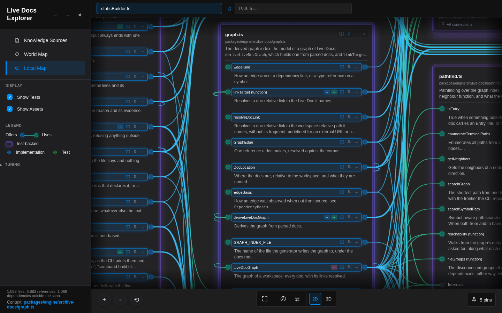 | 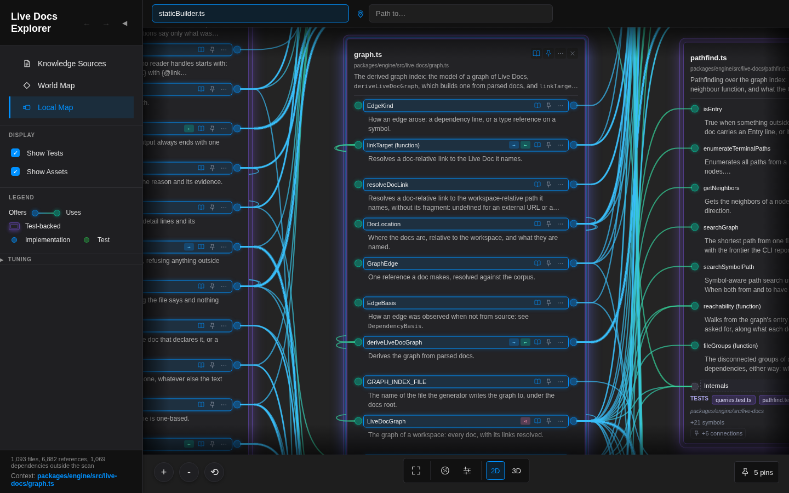 | the same picture as A, to the pixel | the same picture as A, to the pixel |
| At the first picture's camera | [the same file](five-window-1-first.png) | 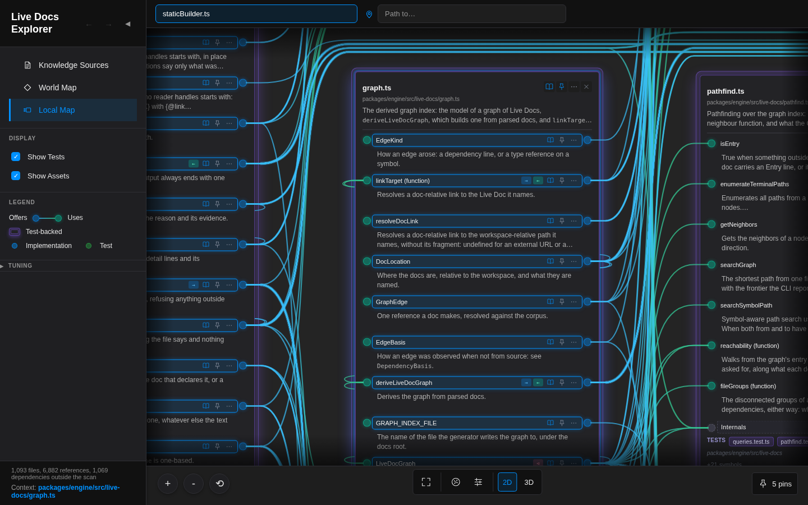 | the same as A, to the pixel | the same as A, to the pixel |

Between the first picture and A, in the window: inside `graph.ts` the rows `DocLocation` and `GraphEdge` have changed places; `pathfind.ts` on the right stands 114 pixels higher; the rows of the card on the left have shifted. All of that happened in one move, 7.3 seconds in. A, B and C are one picture in this window.

**Pictures: the whole map at the four moments,** the camera pulled back by the probe to 28 % of reading size so that all of it shows: [five-whole-four-moments.jpg](five-whole-four-moments.jpg)

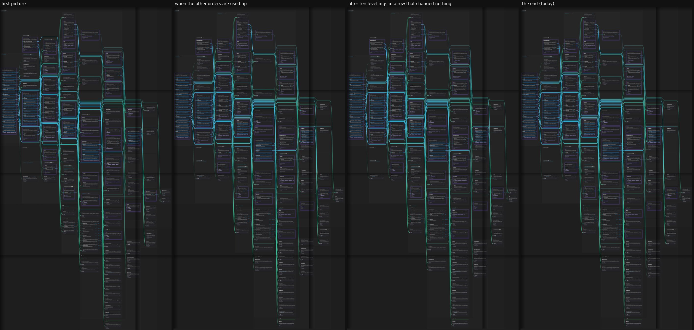

And where each differs from the one before, in red on the dimmed picture (the red is thickened so that small changes show): [five-whole-what-differs.jpg](five-whole-what-differs.jpg)

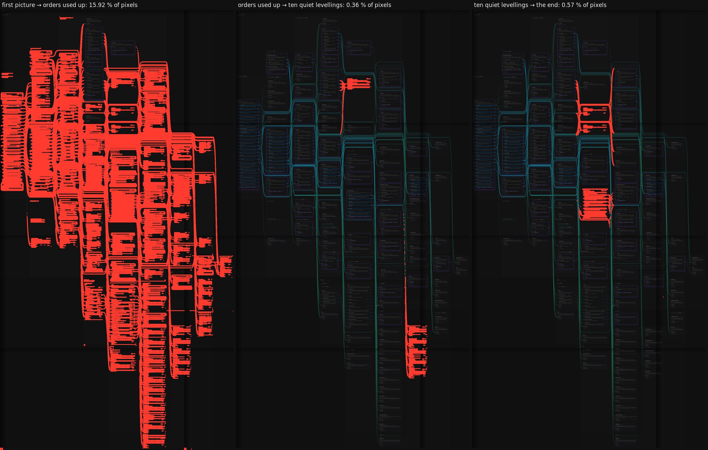

From the first picture to A nearly everything has shifted. From A to B one small patch. From B to the end two more.

**What each move changed.** Seconds are since the first picture, at a load of 8. "In the arrival window" counts the pixels of the map's area that changed on screen.

| Move | Seconds | What was tried | Price after | Cards moved | Farthest, px | Cards whose rows changed order | Lines drawn differently | Outlines changed (farthest edge, px) | In the arrival window | Pair |
| --- | --- | --- | --- | --- | --- | --- | --- | --- | --- | --- |
| 1 | 3.1 | an outline levelled | 3,444,078 (−0.027 %) | 29 of 98 | 30 | 0 | 108 of 536 | 17 (1) | 28 pixels: one line, by a pixel |  |
| 2 | 5.1 | an outline levelled | 3,443,878 (−0.006 %) | 1 | 30 | 0 | 6 | 1 (7) | nothing |  |
| 3 | 7.3 | another order (order 5) | 3,429,330 (−0.422 %) | 91 | 994 | 3 | 531 | 52 (794) | 24 % of it: 4 cards, the farthest 121 px; the page moved its camera 64 px | the whole-map pictures above |
| 4 | 9.3 | an outline levelled | 3,428,397 (−0.027 %) | 29 | 66 | 0 | 108 | 17 (1) | nothing |  |
| 5 | 11.0 | an outline levelled | 3,428,197 (−0.006 %) | 1 | 66 | 0 | 6 | 1 (7) | nothing |  |
| 6 | 12.7 | an outline levelled | 3,428,095 (−0.003 %) | 86 | 7 | 0 | 526 | 50 (7) | nothing; the page moved its camera 7 px |  |
| 7 | 14.4 | an outline levelled | 3,427,895 (−0.006 %) | 2 | 368 | 0 | 51 | 1 (16) | nothing |  |
| 8 | 16.2 | an outline levelled | 3,427,606 (−0.008 %) | 1 | 27 | 0 | 5 | 5 (27) | nothing |  |
| 9, the last under A | 17.9 | an outline levelled | 3,427,546 (−0.002 %) | 2 | 35 | 0 | 20 | 10 (35) | nothing |  |
| 10, the last under B | 19.4 | an outline levelled | 3,427,192 (−0.010 %) | 6 | 72 | 0 | 13 | 3 (46) | nothing | [pair](five-move-10-join-at-19s4.png) |
| 11 | 22.8 | an outline levelled | 3,426,992 (−0.006 %) | 1 | 72 | 0 | 6 | 1 (181) | nothing | [pair](five-move-11-join-at-22s8.png) |
| 12 | 25.8 | an outline levelled | 3,426,808 (−0.005 %) | 2 | 368 | 0 | 52 | 5 (202) | nothing | [pair](five-move-12-join-at-25s8.png) |
| 13 | 32.6 | an outline levelled | 3,426,608 (−0.006 %) | 1 | 72 | 0 | 6 | 1 (507) | nothing | [pair](five-move-13-join-at-32s6.png) |

After move 13 the search tries 69 more levellings over six seconds and takes none.

**The four moves after the orders are used up,** each at reading size at the place it happened, with the pixels that differ beside it. The camera was put there by the probe, as dragging would.

Move 10, at 19.4 s. `compose.test.ts`, alone in an open space, slides 72 pixels down:

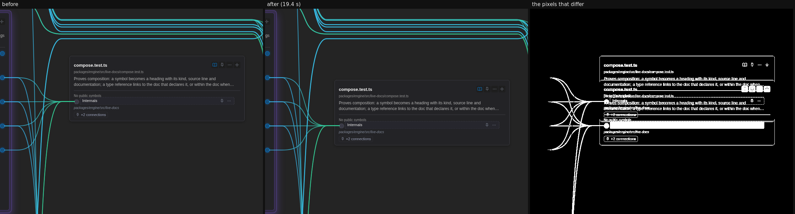

Move 11, at 22.8 s. The same card slides 72 pixels back up: [five-move-11-join-at-22s8.png](five-move-11-join-at-22s8.png). Move 13, at 32.6 s. It slides 72 pixels down again: [five-move-13-join-at-32s6.png](five-move-13-join-at-32s6.png).

Move 12, at 25.8 s. `graph.test.ts` slides 368 pixels up inside another open space:

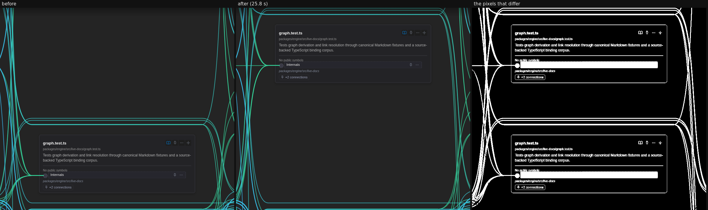

That one card, `compose.test.ts`, moves in nine of the thirteen moves: down 30, up 30, down 30, up 66, down 66, up 72, down 72, up 72, down 72. It ends 30 pixels below where it began.

**The strip:** the browser's own frame once each move was over, with the seconds since the first picture over each. A red heading marks a move that changed anything in the window: [five-strip.jpg](five-strip.jpg)

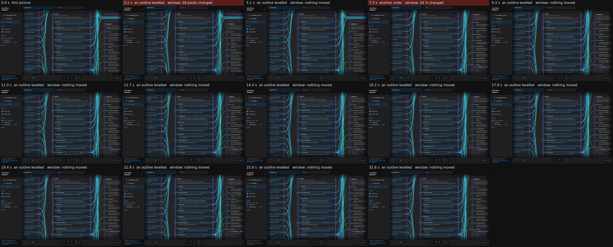

## 2. The same five files with the suite's eighty orders

This is the search your numbers came from. It is here because it holds the one late move that is large. A visitor does not get it today.

**Pictures: the window at the four moments.** The page moved its own camera by 937 pixels in all, nearly all of it at move 16, to keep `graph.ts` in place.

| | The first picture | A: orders used up (38.9 s) | B: ten quiet levellings (63.1 s) | C: the end (86.6 s) |
| --- | --- | --- | --- | --- |
| As the page shows it | 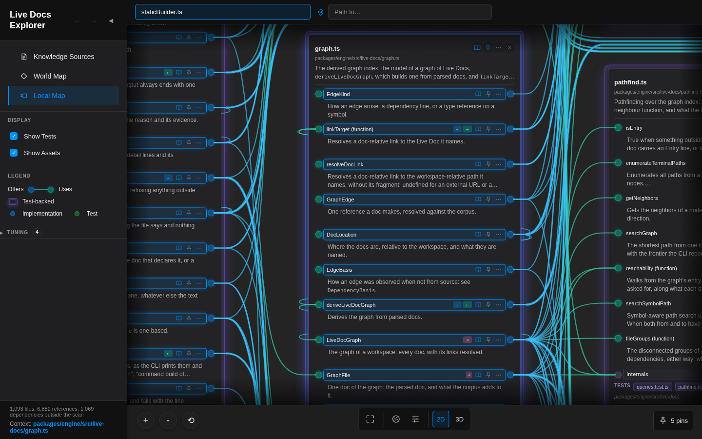 |  | 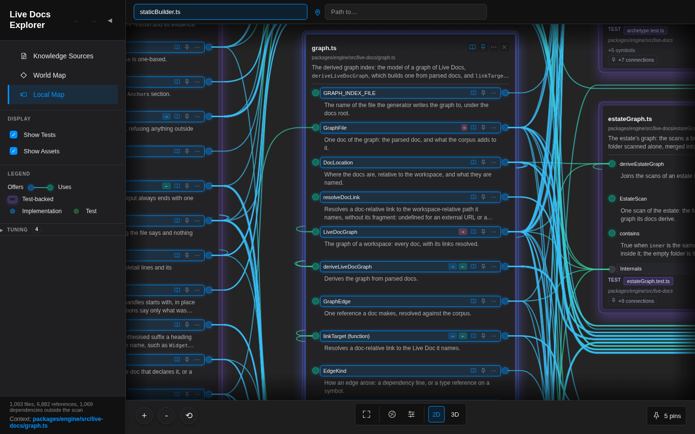 | the same picture as B, to the pixel |
| At the first picture's camera | [the same file](five80-window-1-first.png) | 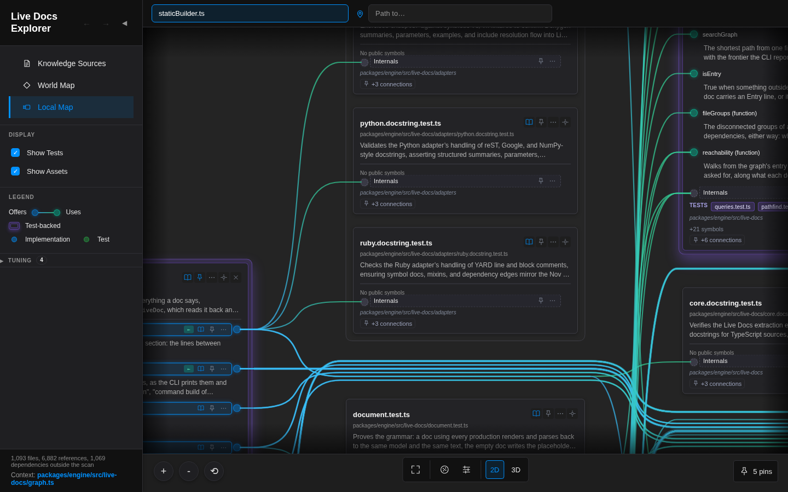 | the same as A, to the pixel | the same as A, to the pixel |

From the first picture to A, `graph.ts` stays where it is and almost everything about it changes: ten of its twelve rows are in other places, and the card to its right is now `estateGraph.ts` where it was `pathfind.ts`. From A to B, 3,872 pixels of 898,398 differ: four lines to the right of `graph.ts` run a little differently. I can find them only with the two pictures laid over each other. At the first picture's camera the second picture shows other files altogether, since the picture moved 937 pixels under it.

**The whole map at the four moments:** [five80-whole-four-moments.jpg](five80-whole-four-moments.jpg)

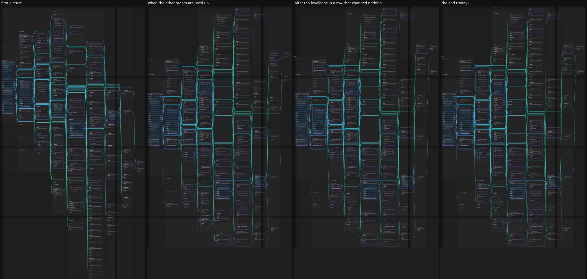

What differs: [five80-whole-what-differs.jpg](five80-whole-what-differs.jpg)

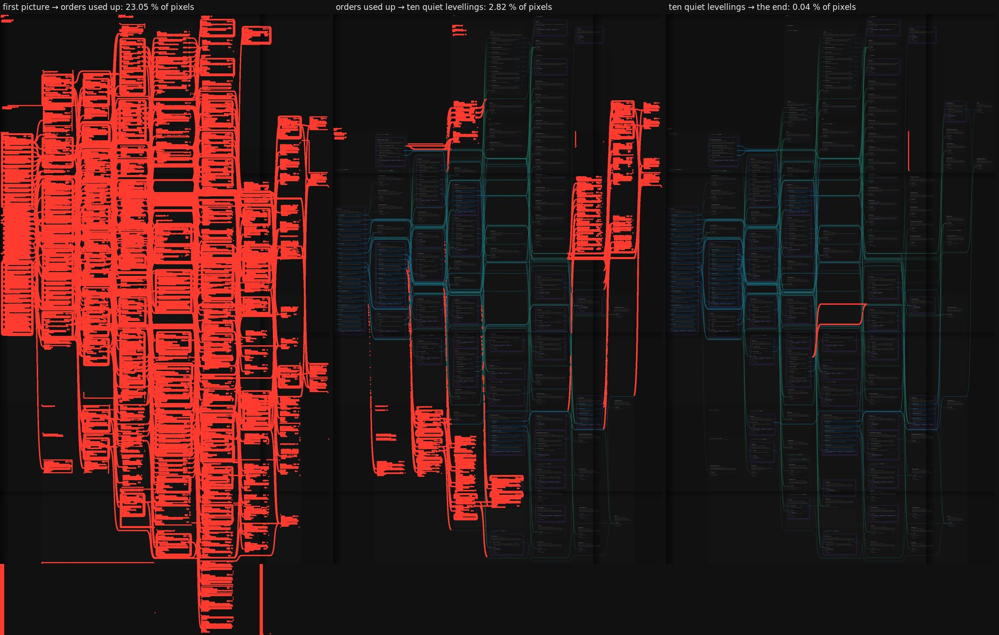

The first picture is tall and thin with a long tail of cards hanging in one column. At A the tail is gone and the picture is a tenth shorter (8,350 pixels against 9,418). That is order 77. A, B and C look alike at this size.

**What each move changed** (load 8 rising to 18):

| Move | Seconds | What was tried | Price after | Cards moved | Farthest, px | Cards whose rows changed order | Lines drawn differently | Outlines changed (farthest edge, px) | In the arrival window | Pair |
| --- | --- | --- | --- | --- | --- | --- | --- | --- | --- | --- |
| 1 | 2.5 | an outline levelled | 3,447,962 (−0.027 %) | 29 of 98 | 37 | 0 | 108 of 536 | 17 (1) | nothing |  |
| 2 | 4.2 | another order (order 1) | 3,445,948 (−0.058 %) | 45 | 815 | 2 | 479 | 25 (7) | 3 % of it: rows change places in one card; camera 7 px |  |
| 3 | 5.5 | an outline levelled | 3,445,017 (−0.027 %) | 28 | 1 | 0 | 102 | 17 (1) | nothing |  |
| 4 | 6.8 | an outline levelled | 3,444,817 (−0.006 %) | 0 | 0 | 0 | 0 | 1 (7) | nothing |  |
| 5 | 8.2 | an outline levelled | 3,444,643 (−0.005 %) | 2 | 26 | 0 | 31 | 2 (26) | nothing |  |
| 6 | 9.2 | another order (order 5) | 3,429,330 (−0.445 %) | 90 | 994 | 4 | 531 | 52 (794) | 24 % of it: 3 cards, 86 px; camera 20 px |  |
| 7 | 10.2 | an outline levelled | 3,428,397 (−0.027 %) | 29 | 66 | 0 | 108 | 17 (1) | nothing |  |
| 8 | 11.1 | an outline levelled | 3,428,197 (−0.006 %) | 1 | 66 | 0 | 6 | 1 (7) | nothing |  |
| 9 | 12.1 | an outline levelled | 3,428,095 (−0.003 %) | 86 | 7 | 0 | 526 | 50 (7) | nothing; camera 7 px |  |
| 10 | 13.2 | an outline levelled | 3,427,895 (−0.006 %) | 2 | 368 | 0 | 51 | 1 (16) | nothing |  |
| 11 | 14.3 | an outline levelled | 3,427,606 (−0.008 %) | 1 | 27 | 0 | 5 | 5 (27) | nothing |  |
| 12 | 15.4 | an outline levelled | 3,427,546 (−0.002 %) | 2 | 35 | 0 | 20 | 10 (35) | nothing |  |
| 13 | 16.6 | an outline levelled | 3,427,192 (−0.010 %) | 6 | 72 | 0 | 13 | 3 (46) | nothing |  |
| 14 | 23.6 | an outline levelled | 3,426,992 (−0.006 %) | 1 | 72 | 0 | 6 | 1 (181) | nothing |  |
| 15 | 31.6 | an outline levelled | 3,426,808 (−0.005 %) | 2 | 368 | 0 | 52 | 5 (202) | nothing |  |
| 16 | 36.1 | another order (order 77) | 3,200,099 (−6.616 %) | 98 | 7,251 | 12 | 536 | 53 (7,259) | 26 % of it: 5 cards, 1,289 px; camera 943 px | the whole-map pictures above |
| 17 | 37.1 | an outline levelled | 3,199,950 (−0.005 %) | 0 | 0 | 0 | 13 | 5 (8) | nothing |  |
| 18, the last under A | 38.3 | an outline levelled | 3,199,550 (−0.013 %) | 39 | 12 | 0 | 465 | 30 (12) | nothing; camera 12 px |  |
| 19 | 39.8 | an outline levelled | 3,199,385 (−0.005 %) | 12 | 53 | 0 | 99 | 17 (53) | 3,713 pixels, all lines | [pair](five80-move-19-join-at-39s8.png) |
| 20 | 40.9 | an outline levelled | 3,198,848 (−0.017 %) | 12 | 12 | 0 | 99 | 15 (7) | 346 pixels, lines | [pair](five80-move-20-join-at-40s9.png) |
| 21 | 42.6 | an outline levelled | 3,198,778 (−0.002 %) | 2 | 7 | 0 | 30 | 6 (51) | nothing | [pair](five80-move-21-join-at-42s6.png) |
| 22 | 44.3 | an outline levelled | 3,198,578 (−0.006 %) | 0 | 0 | 0 | 0 | 1 (7) | nothing | [pair](five80-move-22-join-at-44s3.png) |
| 23 | 46.4 | an outline levelled | 3,198,378 (−0.006 %) | 0 | 0 | 0 | 0 | 4 (60) | nothing | [pair](five80-move-23-join-at-46s4.png) |
| 24 | 48.6 | an outline levelled | 3,198,178 (−0.006 %) | 0 | 0 | 0 | 0 | 5 (60) | nothing | [pair](five80-move-24-join-at-48s6.png) |
| 25 | 51.7 | an outline levelled | 3,197,978 (−0.006 %) | 0 | 0 | 0 | 0 | 1 (72) | nothing | [pair](five80-move-25-join-at-51s7.png) |
| 26 | 54.9 | an outline levelled | 3,197,957 (−0.001 %) | 13 | 87 | 0 | 40 | 10 (87) | nothing | [pair](five80-move-26-join-at-54s9.png) |
| 27, the last under B | 60.1 | an outline levelled | 3,197,857 (−0.003 %) | 6 | 150 | 0 | 23 | 6 (150) | nothing | [pair](five80-move-27-join-at-60s1.png) |
| 28 | 70.4 | an outline levelled | 3,197,657 (−0.006 %) | 0 | 0 | 0 | 1 | 1 (608) | nothing | [pair](five80-move-28-join-at-70s4.png) |
| 29 | 76.8 | an outline levelled | 3,197,457 (−0.006 %) | 0 | 0 | 0 | 5 | 1 (608) | nothing | [pair](five80-move-29-join-at-76s8.png) |

After move 29 the search tries 58 more levellings over ten seconds and takes none.

**The eleven moves after the orders are used up,** in the pairs linked from the table. What I see in each:

- 19: twelve cards about `explorer/src/shared/graph.ts` shift down, the farthest 53 pixels. 20: twelve cards, `graph.test.ts` and `compose.test.ts` among them, shift up to 12 pixels. 21: `resolve.ts` and one other shift up to 7 pixels.
- 22: a jog seven pixels deep in one faint outline goes. No card and no line moves. I could not find it without the third panel:

  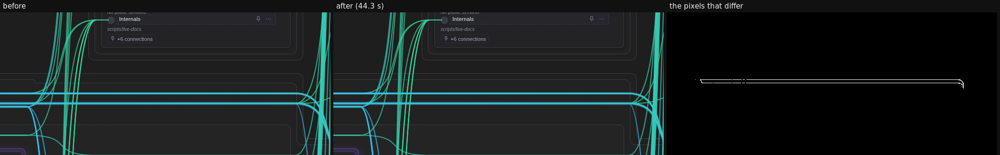

- 23 and 24: a directory's name (`scripts/live-docs`, then `packages`) moves up 45 to 60 pixels, away from its first card, and an empty band opens under the name. 25: a faint outline under a card grows 72 pixels to take in empty ground.
- 26 and 27: `approximation.ts` and the cards under it move up 87 pixels and, five seconds later, 150 more.
- 28 and 29: one column of a faint outline is drawn 608 pixels farther down, round empty ground, so that its foot is level with its neighbour's:

  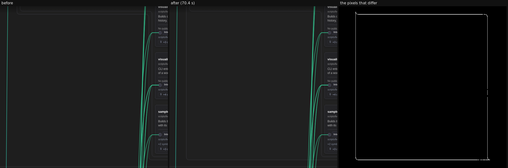

**The strip:** [five80-strip.jpg](five80-strip.jpg)

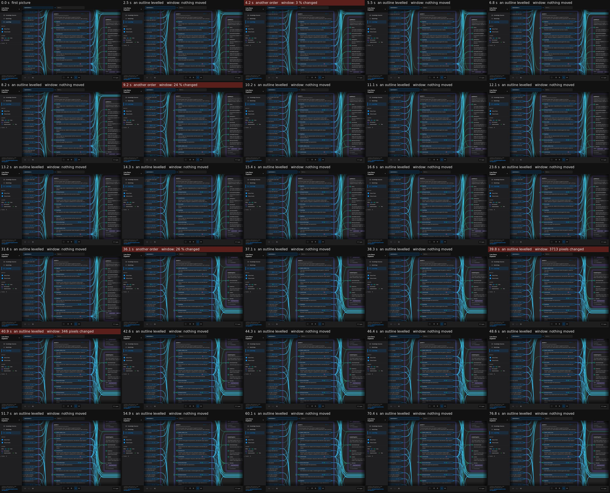

## 3. One file as a person arrives on it

`packages/engine/src/live-docs/pathfind.ts`, opened alone: 16 cards, 119 lines, 2,920 by 3,342 pixels. The first picture came 3 seconds after the address was opened. The search is over 3.8 seconds later, at a load of 9 (8.9 seconds at a load of 24).

**Pictures.** The window is the same picture, to the pixel, at all four moments: [pathfind-window-1-first.png](pathfind-window-1-first.png). The page did not move its camera.

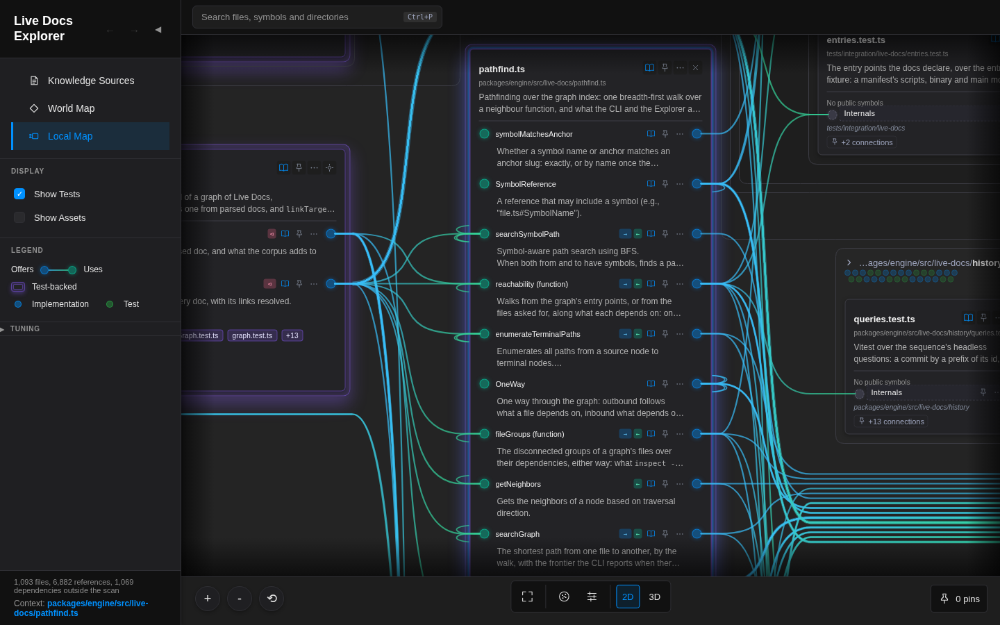

The whole map at 48 % of reading size, [pathfind-whole-four-moments.jpg](pathfind-whole-four-moments.jpg), and what differs, [pathfind-whole-what-differs.jpg](pathfind-whole-what-differs.jpg): all of it is at the top of the picture, above the window. The strip: [pathfind-strip.jpg](pathfind-strip.jpg).

| Move | Seconds | What was tried | Price after | Cards moved | Farthest, px | Lines drawn differently | Outlines changed (farthest edge, px) | In the arrival window |
| --- | --- | --- | --- | --- | --- | --- | --- | --- |
| 1 | 1.0 | an outline levelled | 337,834 (−0.059 %) | 1 of 16 (`inspect.ts`) | 28 | 20 of 119 | 5 (60) | nothing |
| 2 | 1.8 | an outline levelled | 337,634 (−0.059 %) | 0 | 0 | 0 | 3 (164) | nothing |
| 3 | 2.5 | an outline levelled | 337,434 (−0.059 %) | 0 | 0 | 0 | 3 (60) | nothing |

No order was taken: eight were tried and none bettered the first picture. All three moves come before the orders are used up, so A, B and C leave the same picture.

## 4. The estate sample

`PaymentService` and `PaymentService/Data` opened: 6 cards, 7 lines, 1,481 by 786 pixels, nearly all of it in the window. The two pictures are at the top of this page. The whole map: [estate-whole-four-moments.jpg](estate-whole-four-moments.jpg); what differs: [estate-whole-what-differs.jpg](estate-whole-what-differs.jpg); the strip: [estate-strip.jpg](estate-strip.jpg).

| Move | Seconds | What was tried | Price after | Cards moved | Farthest, px | Lines drawn differently | Outlines changed (farthest edge, px) | In the arrival window |
| --- | --- | --- | --- | --- | --- | --- | --- | --- |
| 1 | 0.4 | an outline levelled | 16,283 (−6.489 %) | 1 of 6 (`PaymentsContext.cs`) | 186 | 7 of 7 | 2 (186) | 2 % of it, and plain to see |

Eight orders were then tried and none taken. The search ended at 1.1 seconds.

## To try it on your own page

Your browser remembers Tuning's levers, so start from Tuning's reset. Your page is the afternoon's build: expect each time here about doubled. Your cards are also a little narrower than mine (this container has no Segoe UI), and the price depends on the cards' sizes, so your search may take a different move here or there. Nothing on the page says that the search is running or that it has ended.

1. The estate: <http://localhost:8999/samples/estate/?s=N4IgbiBcDMA0ICcoDMCGAbAzgU3gKxQx3gHsoBtEcgHRABMBLBbAYwBcSEBPW2WgBVRcAttgB2bAMrYEYBi2y0AuiHg16TVh268BQ0ROmz52APQARVG1TKQS+FyghMbBAFd2b5qvoUQgkXEpGTkFHwCDYOMFCytUOwBfIA>. Watch `PaymentsContext.cs` in the middle as the page appears: it drops within the first second.
2. `pathfind.ts`: <http://localhost:8999/?view=local&node=packages%2Fengine%2Fsrc%2Flive-docs%2Fpathfind.ts>. Watch anything you like for ten seconds: nothing in the window should move. To see what did, drag the map down until the top of the picture shows, reload, and watch the faint outlines there.
3. The five files: <http://localhost:8999/?s=N4IgbiBcCMA0IHcogLYEMAOJ4DtkbQGMBrNAcwFMBnAegpzIEscKaqAnQmgG0bAoC0AEwD2hWmXaYAFgDoALlWwgskANqg8kFUVKVa9JizacefQaPE1JMhUvhLtAKhABfWJvy7y1Og2asHFy8-MJitJYArij08nbKjiAu7p7aBCQ+Bv7GQWahlhJSGNIAYozc1PEOyMkeIFo6Gfp0AB4Y3CLsFOwmXFTSaF1CbPJo8oyEAKJtHV3sACJjaFUgibWpjXq+FDOd3b1sA0MjYxMAQpHlQt0ra24Auq5AA>. Read the rows of `graph.ts` from the top as soon as it appears. Some seconds in (seven on my build), `DocLocation` and `GraphEdge` change places and `pathfind.ts` on the right jumps up. After that the window stays as it is while the search runs on for half a minute or more.
4. The eighty orders cannot be set from Tuning, whose Search Patience stops at 32. If you want to see order 77 arrive, open the five files, then in the browser's console paste `localStorage.setItem("live-docs-explorer:ui:v2", JSON.stringify({version:2,tuning:{localMap:{orderStarts:0,searchStarts:80,searchPatience:80}}}))` and reload. This replaces whatever levers your browser had remembered; Tuning's reset puts the defaults back. Keep reading `graph.ts`: after half a minute or more its rows are dealt again and its neighbour is another file.

Each of the first three was opened on the builder's port exactly so, as a fresh visitor, and showed what the pictures show. The fourth was taken with the same setting placed in the browser's storage before the page opened; I did not type it into a console.

## The strangers

Four runs: `claude-sonnet-5-5` and `claude-haiku-5-5`, each once on the five files at the defaults and once with the eighty orders. Each was told nothing of the project and given a window of 1,280 by 800 and this message: "This page is a map of some source files. Read the card for graph.ts in the middle and tell me, in your own words, what that file offers and which of the files around it use it. Take your time and look more than once before you answer. Then tell me anything about the page that surprised or confused you." Nothing in it speaks of movement.

Every one of the four was shown `graph.ts` with its rows in two different orders in the course of its run. For the two at the defaults it was their first two looks, seven seconds apart, at the same camera:

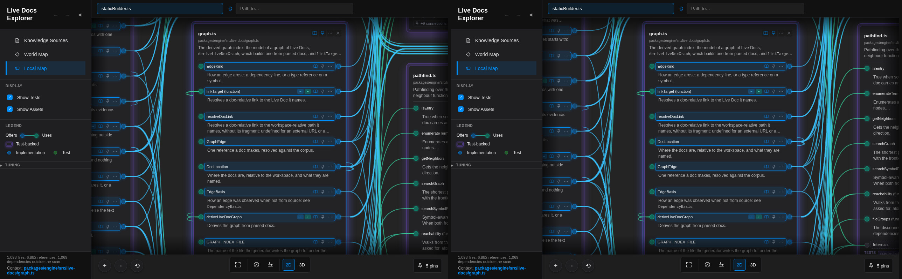

- **One of the four said so.** Sonnet, on the eighty orders: "The map kept shifting while I looked. [...] Once the order of the symbols inside the graph.ts card changed between views." It made nothing more of it and listed it among what confused it.
- **Three did not remark on any change in the picture.** Haiku twice listed the rows in the order of its first look, though its later pictures had them otherwise.
- **Order 77 arrived under one of them and drew no more comment.** With several browsers on a machine at a load of 30 it came at about 135 seconds, between the last two pictures of Sonnet's run on the eighty orders. Sonnet was then reading a list in the side panel with the map small beside it; in those two pictures the rows of `graph.ts` are dealt anew. Its one sentence above may be about this move or the earlier one. Haiku's run had ended at 67 seconds.
- **All four repeated that the page "was still moving".** That is the instrument's own note, not their eye: it tells a tester the page was still moving when it cannot get two equal pictures a fifth of a second apart within a second and a half (four seconds after an action), and it said so at 23 of 30 looks, including a look whose picture was the same to the pixel as the look before. I did not find out whether pictures really differed at those moments or the page was too busy to answer in time.
- Unasked, all four found it odd that the search field reads `staticBuilder.ts` while the map is on `graph.ts`. No tester asked for more words about the motion.

## The far look, after a trial is measured and refused

A builder suspected that when a trial is laid out on the page to be measured and is then refused, the cards get their widths back but their names stay cut or wrapped for the refused widths, which would show at the far look (zoomed out until cards show names only).

I could not make the condition arise. In every run of this packet a trial that was measured on the page was then taken: 110 measured, 110 taken, none refused. That includes four runs zoomed out by the wheel to the far look before the search began (the five files, `pathfind.ts`, the estate, and `adapters/manifest.ts`, which has a cycle and so a third kind of trial): 18 measured, 18 taken. A probe compared every card as written after each trial with the card as written when the shown picture was taken; with no refusal it had nothing to compare.

By eye, on the five files at the far look, before the search and after it: [far-look-before-and-after-the-search.jpg](far-look-before-and-after-the-search.jpg)

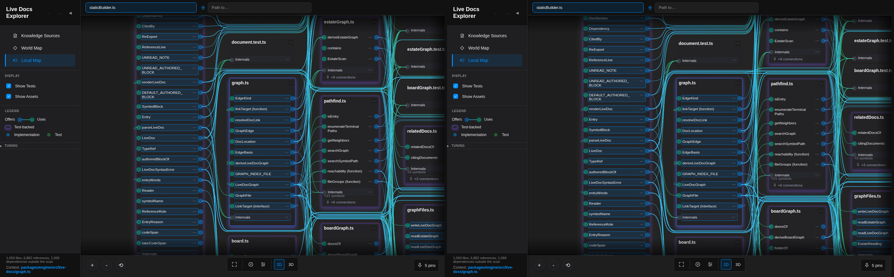

I read the names that stand in both halves, about sixty in ten cards. Every one is cut or wrapped the same way in both (`UNREAD_AUTHORED_BLOCK`, `DEFAULT_AUTHORED_BLOCK` and `enumerateTerminalPaths` on two lines in each). So: not found, and not excluded, since it needs a refusal and none came.

## My eye

**Is the end better than the picture when the orders are used up?** Only to the price. On the whole-map pictures of both searches I cannot tell A from B from C. At reading size the late moves are a lone card sliding in open space, a jog of seven pixels going from a faint outline, a directory's name drifting away from its first card. None of them makes anything easier to read. Two I would call worse: moves 28 and 29 of the long search draw an outline 608 pixels longer round empty ground, which makes a directory look as if it held something there.

**Which late moves would I notice while reading a card?** In the window I arrived in, none. Twelve of the thirteen moves on the five files, and all three on `pathfind.ts`, change at most a pixel of one line there, because the page holds the card I arrived on in place and the levellings happen elsewhere. The move I would notice, and did, is the other kind: order 5 changes the places of two rows in the card I was reading and lifts its neighbour by a third of a card. With eighty orders, order 77 does far more of the same thirty-six seconds in. So the moves that disturb a reader are the orders, and the three rules on the table all keep those. They differ only in levellings.

**Is there a moment after which nothing a person would care about changes?** Yes: the last order taken. On the five files at the defaults that is 7.3 seconds; on `pathfind.ts` no order is taken at all. The one levelling I would not want to lose is the estate's, which turns an L into a rectangle, and it comes in the first half second, before the orders are used up, so every rule keeps it.

**What I would weigh against that.** The root's reading was that many moves over a minute are the same fault as a picture that never settles. In the arrival window I do not see that fault: the picture there is still after the last order. Away from it the fault is real in a smaller form: `compose.test.ts` is moved nine times, down and up by the same distances, and anyone who had panned to it would watch it hop. And the search has a cost that stills cannot show and that I did not measure: for its 39 to 87 seconds the page is working through four or five trials a second.

**The larger thing these pictures raised.** The one move in this packet that changes the picture for the better at a glance is order 77, and a visitor never gets it, because the search gives up on orders after eight that better nothing. Getting it today would mean a jump of the whole picture half a minute after a person began to read. Whether to look for such an order sooner, or before the first picture, or not at all, is a different question from where the levellings stop, and the pictures here bear on both.

## Seen on the way

- **The default search stops short of the large gain.** At the defaults 11 orders are tried; the 6.6 % order is the 77th. Tuning's Search Patience lever cannot be set high enough to reach it.
- **Every measured trial was taken.** The search prices a trial by arithmetic and then lays it out on the page to measure it before taking it. In 110 cases the measurement never overturned the arithmetic.
- **One card shuttles.** `compose.test.ts` goes down and up by the same distance nine times at the defaults and twelve with eighty orders, while the price falls each time for a reason elsewhere in the picture.
- **Levelling can enclose empty ground** (moves 23 to 25, 28 and 29 of the long search).
- **At the far look, "Internals" is drawn over "+21 symbols"** on `pathfind.ts` and over "+3 symbols" on `relatedDocs.ts`, from the first picture on. It is in both halves of the far-look picture above.
- **The search field reads `staticBuilder.ts`** on the five-file link while the map and the sidebar's Context are on `graph.ts`.
- **The stranger instrument's "still moving" note** fires at nearly every look while a search runs, whatever the pictures show.
- **The price of the first picture depends on the setting.** With the suite's setting the first picture is priced 3,448,893; the 3,444,817 in the trace you were given is the price after move 4.

## How the pictures were taken

- **The build.** `npm ci`, `npm run build`, `npm run live-docs:visualize -- --history none` and `npm run live-docs:visualize:estate` in the builder's worktree at `7ff963ae`, served on 127.0.0.1:8853. Nothing was built in the main checkout.
- **The browser.** Chromium at 1,440 by 900, launched as the browser suite launches it, through the browser lane, a fresh visitor each time with Tuning at its defaults (section 2 alone has the suite's setting of `local-map-hidden.spec.ts`).
- **By event, not by the clock.** The page reports what its search has done after every trial. Each map was loaded once and left alone, for the seconds and the browser's frames (the strips); and once more with the search held still after each move, for the pictures and for every card's place and every line's path. It was held by telling the page it was hidden, which is how the page itself pauses the search. The held run made the same moves at the same prices as the run left alone, on all four.
- **Cameras.** Pictures named `window` are at the page's own camera. Pictures named `one-camera`, the whole-map pictures and the pairs are at a camera the probe set and then put back: at reading size for the first two kinds, pulled back for the whole map, which is several windows put together (the faint dark bands in them are the seams, where the page shades the map's edges). The whole-map pictures keep the reading look, so their text is tiny, where the page's own zoom would have changed the cards' look.
- **Nothing was drawn into the page.** Captions, the red of the "what differs" pictures and the white "pixels that differ" panels were added outside it.
- **Seconds** are since the first picture and are given with the machine's load, which was 8 to 18 for the timed runs and up to 30 while the strangers ran. They are of this build.
- **The strangers** ran from a scratch copy of the playtest instrument, with the shared lock taken out so that it runs under the lane and the path to the model's program corrected; the tracked instrument was not touched.

**Root's recommendation:** stop levelling when the orders are used up (A), and treat the real fault as a different one: a picture that re-deals itself under a person who is reading it.

- **I looked at every picture here.** I cannot tell A from B from C in any whole-map picture or in any window. The late levellings slide a lone card through open space, remove a jog seven pixels deep, pull a directory's name away from its first card (moves 23 and 24 of the long search) or stretch an outline round 608 pixels of empty ground (moves 28 and 29). None helps a reader, and those four make the picture worse.
- **So A.** On the five files it ends the search at 19 seconds where today takes 39, and gives up a hundredth of a percent of price that no eye can find. The one levelling worth having, the estate's, comes at 0.4 seconds, and every rule keeps it.
- **The move that disturbs a reader is the other kind, and all three rules keep it.** Seven seconds after `graph.ts` appears, two of its rows change places while you are reading them, for a gain of 0.4 %. On November 16 you accepted "the quick initial rearrangement"; seven seconds in, inside the card being read, is not that. Designers call the fault layout shift: content that moves after a person has begun to read it.
- **What I would build for you to compare,** as one lever with today's behaviour kept as its first value: after the first two or three seconds a better arrangement is no longer applied under you. In the simplest form it is dropped and the search stops. In the other form the search goes on quietly, and a control lights when it has found something clearly better: you press it to watch the picture move there, and press again to put it back.
- **Why the second form is worth a trial.** The one move in these pictures that makes the whole map plainly better is order 77: the long tail of cards is gone and the picture is a tenth shorter. A visitor never gets it today, and getting it unasked at 36 seconds would re-deal ten of the twelve rows under them. Offered, it costs nobody their place. Whether the page stays responsive while it searches was not measured here, and that decides between the two forms.
- **Three faults in the price itself,** to be run down at their cause whatever you choose. One card, `compose.test.ts`, goes down and up by the same distance nine times. A levelling can lower the price by enclosing empty ground or by pulling a directory's name from its cards. And the first picture's own order is 6.6 % worse than one the search can find, which asks whether the first order can be chosen better.
