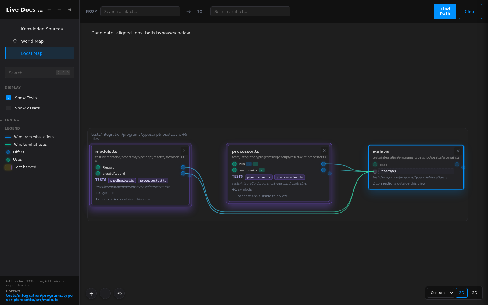

# Local Map owner-review findings

_Historical investigation, October 13, 2026. Follows [the owner's screenshots and interaction reports](../../../ChatHistory/2026/10/2026-10-13.1.record.md#turn-7--owner-review-of-alignment-and-motion) and [clarification of Relaxed](../../../ChatHistory/2026/10/2026-10-13.1.record.md#turn-8--relaxed-should-spend-wire-length-on-composition). The preceding implementation is commit `5fc95351`; this report records the follow-up investigation, not a universal layout optimum._

## Alignment and the two bypasses

The three-card scene focuses [main.ts](../../../../tests/integration/programs/typescript/rosetta/src/main.ts). Its middle card is [processor.ts](../../../../tests/integration/programs/typescript/rosetta/src/processor.ts); the right-hand destination is the focused file's Internals row. Tests are shown and assets hidden. The headless capture matched the page with zero geometry drift and zero text-model warnings before comparing alternatives. A discarded first capture showed assets and therefore had five files; those numbers are not used here.

| Relaxed candidate | Summed card-top misalignment | Drawn wire length | Picture height | Measured crossings |
| --- | ---: | ---: | ---: | ---: |
| Initial alignment weight 0.25 | 5 | 1,810 | 298 | 0 |
| Alignment weight 2, original routes | 0 | 1,812 | 298 | 0 |
| Alignment weight 5, both bypasses below | 0 | 1,863 | 304 | 0 |

All dimensions are unscaled layout pixels. The last candidate was constructed by combining the two passing-wire lanes underneath the middle card and solving with the same constraints. Both bundle orders were tried. This is an explicit candidate illustration; the shipping ordering algorithm has not been modified to choose it. The [complete alignment sweep](alignment-candidates.json) and [lane alternatives](lane-alternatives.json) retain their geometry and measurements.

The existing seeded ordering search shuffles real cards, then places virtual passing-wire nodes from their endpoints. One real card per column therefore leaves those seeds unable to explore another lane arrangement. Stronger alignment alone has a small cost in this scene; changing route composition is a separate search/score question. The outer competition also prices picture height, while the inner placement gives containing-box height only a tiny tie-breaking price. It is therefore incorrect to claim that every currently drawn arrangement is globally optimal for the complete competition score.

## Broader comparison

Fourteen browser pictures compared Relaxed row-levelness 0.25 and 2 over main, generator, warehouse, repository five files/chain and estate five files/chain. All were inspected. Six scene heights remain equal; repository chain grows 4,000→4,124. Eight further pictures compared Compact 0 and 0.25 on main, generator, repository five files and estate five files. Main grows 282→289 and repository five files 3,480→3,581; generator and estate heights are unchanged. Compact remains smaller than Relaxed in those comparisons. The retained defaults are 0.25 for Compact and 2 for Relaxed; the other profile values and 3D physics are unchanged.

[The screenshot inventory](../../../Screenshots/2026-10-13/feedback/README.md) names every picture. [Relaxed browser measurements](alignment-views.json) and [Compact browser measurements](compact-alignment-views.json) preserve the page's dimensions, positions and search data. Scores under different weights are not directly comparable. Some candidate controls display Custom because a lower-level value differs from that bundle's stock profile; the estate bundle still carried the preceding profile labels during this exploratory comparison.

## Motion and spatial interactions

The ordinary and zoomed initial pinning journeys did not reproduce endpoint separation: the scaled run's maximum was 0.0007092 screen pixels. This does not refute the owner's report. The visible redraw problem had a separate cause: the live SVG was cleared and its opacity state toggled during every frame. Matching references now retain their path elements, and entering wires fade with their endpoint cards. The after-fix scaled run measured at most 0.01486 pixels of separation. The [before](motion-scaled-before.json) and [after](motion-scaled-after.json) files retain each frame's worst endpoint and the number measured; redundant other-endpoint samples from the scratch dumps are omitted. The browser regression also interrupts the move with another pin gesture, checks both endpoints, retained element identity, layer opacity and entering-wire presence.

3D hover previously supplied a tooltip without updating attention. It now temporarily reveals the hovered file and its incident connections, then restores the current retained scope. Directly leaving the viewport is handled in both representations, including after DOM changes. Clearing file pins restores every node's normal intensity when no directory or path remains retained. Whether the clear control should also count and release directories is an unanswered owner question at this report's initial writing.

The initial suspected focus/selection mismatch was corrected in the conversation: normal sphere clicks update both. A separate wheel defect was reproduced after native middle-button zoom moved inside the wheel's 65-unit distance limit. An inward gesture used to snap outward to that limit. Zoom now respects the gesture direction even when another camera operation has crossed a bound. The browser regression observes actual meshes and camera arguments through Three's development-tool event and uses real pointer/wheel input; the Explorer exposes no new inspection API for the test.

Directory ancestry is compressed by the existing grouping of single-child chains. Opening a membrane reveals its contents. An upward-navigation or explicit-ancestor change remains a design question; no new interaction has been selected implicitly.

## Verification state

The two focused pure-test files passed 12 tests. Four new browser regressions cover the revised preset, interrupted wire motion, spatial attention and wheel input. The first complete gate passed 990 unit and 52 integration tests, with 106/107 browser tests: the stronger alignment default flattened an older test's counterexample sooner than expected. Making that test's original alignment value explicit preserved all assertions, and a separate test covers the new default. The next complete run passed all 108 browser tests and all other checks.

Final captures then exposed hover re-entry: after exiting, the library could retain its hovered-object cache and emit no event when the same sphere was entered again. Viewport entry now uses the same direct raycast as clicking. The expanded regression and repeated visual exercise pass, including re-entry and exit. The [final native observations](final-spatial-observations.json) record opacity 0.15→0.75→0.15, all 580 filtered nodes at normal opacity after clear without directories, correct wheel direction at the close limit, and zero browser errors. Since that correction changed product source, a further complete verification run is required before closeout; its result belongs below.

The third complete `safe:commit -- --e2e` passed on the final source: 101 unit files /990 tests, 10 integration files /52 tests, all 108 browser tests (12.2 minutes), lint, builds, test type-checking and all documentation/asset/symbol audits. All 643 mirrors regenerated unchanged. The capture source is unchanged from that pass. No check, assertion or timeout was weakened. Directory/ancestor behavior remains at the explicit design questions above.
