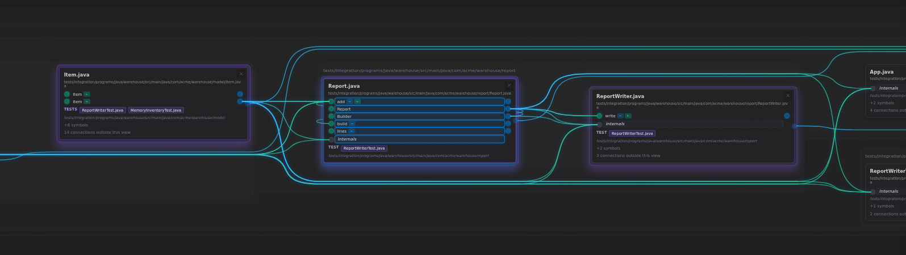
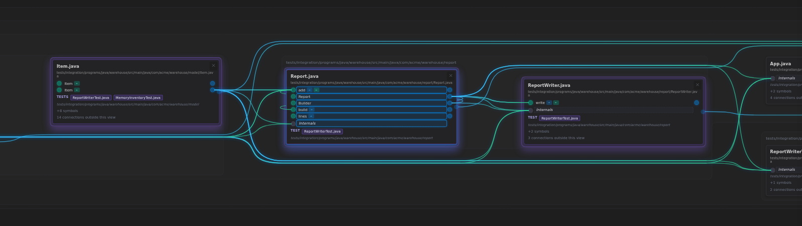
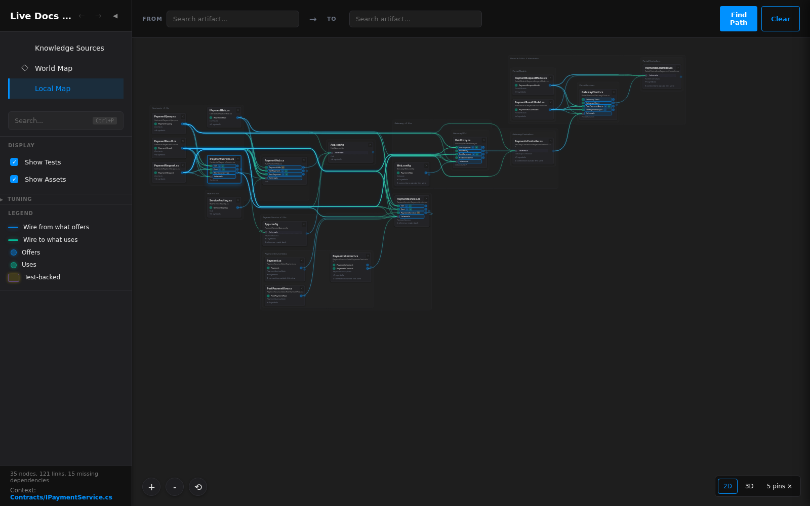

# A small membrane step that the current price cannot distinguish

_Historical visual probe, October 13, 2026. A proposed rule, not a product change or an owner-approved default. Source: [the opening request](../../ChatHistory/2026/10/2026-10-13.1.record.md#turn-1)._

The owner defines the desired aesthetics as less work for the eye and brain while presenting identical information. Their example is the small step along the engine directory's top in a generator-focused Local Map. This probe asks whether unused space can remove such a step while keeping the content fixed.

## What was examined

The current Explorer at commit `1e36b33e`, rebuilt from 624 Live Docs. Fresh browser context, 1600×1000 viewport, default filters, direct URL `?view=local&mode=2d&node=packages/generator/src/generator.ts`. Continuing search is disabled for repeatable captures. The owner's exact retained URL was requested; this is a comparable fresh neighborhood, not a claim of matching their screenshot state exactly.

The existing placement rule in [branch-placement.ts](../../../packages/explorer/src/client/views/localView/branch-placement.ts) prices the sum of absolute differences between adjacent membrane tops and bottoms. Membrane Evenness multiplies that distance. A much smaller cost pulls each segment tight around its contents. Labels need room only in the leftmost segment.

At the default evenness of 1, the engine's top is at 96 in column 0 and 68 in column 1: a 28-pixel step. Its parent, packages, starts at 55 in both columns. Lifting the engine's left top to 68 requires lifting the parent's first two segments to 27 so both labels retain their room. The parent's already-existing step toward column 2 grows by the same 28 pixels that the inner step loses. All coordinates are unscaled layout pixels.

The result has fewer turns while keeping exactly the same total priced step distance. The tight-box preference therefore favors the original. Increasing the existing weight cannot distinguish these two equal-distance outlines.

## Pictures

Both crops come from the actual rendered page at the same camera position. The second is an illustration: two membrane paths are redrawn by the shipped [membranePath](../../../packages/explorer/src/client/views/localView/membrane-outline.ts) function with the proposed segment tops, and their labels move with them. No product source was changed. It is not an implemented general layout pass.

| Current outline | Illustrated alternative |
| --- | --- |
|  |  |

## Checks and limits

- All 18 card geometries and all 71 rendered connection-path records were exactly equal before and after the final illustration. This is a rendering check; path count is not asserted to equal the number of semantic references.
- Total top/bottom step distance across drawn membranes: **1,513 → 1,513** layout pixels. Nonzero top/bottom steps: **7 → 6**. One step corresponds to multiple corners in the drawn polygon.
- No browser errors. The illustration expands outlines into empty space above the engine group; file disclosure, row order, wires and camera remain fixed.
- Existing weight comparison: evenness **1** and **2** both leave the 28-pixel engine step and the wire-placement cost at **21,438**. At **5**, the step remains 28 pixels and the wire-placement cost rises to **21,530**. This is one scope, not a verdict on that setting everywhere.
- The first comparison correctly failed its equality check because camera inertia was still moving the scene. Waiting for zoom and releasing the pan with zero velocity made the final comparison stationary; no equality threshold was relaxed.
- The illustrated path does not update the application's scene model. A production implementation must update all containing boxes, including the invisible root, and retain containment, sibling separation, label clearance and transition correspondence. Those general cases have not been implemented or verified by this probe.

## Proposed next experiment

Give simpler boundaries a preference when a modest expansion can remove an unnecessary turn. First test that with cards and wires fixed, then compare sparse and dense repository views, the Java warehouse and the C# estate. Judge extra empty area, interference with other groups and motion beside the pictures. A rule that makes one screenshot calmer but weakens hierarchy elsewhere is not established by this result.

The mathematical choice remains open: total step distance is a linear objective; counting turns is a different objective and cannot honestly be added by merely increasing its weight. Discuss the desired tradeoff before selecting the general implementation.

## Survey of seven additional views

Later on October 13, the same built code was inspected in fresh 1600×1000 browser contexts. The four retained deck scopes come from [the shared scope definitions](../../../tests/e2e/scopes.ts); the warehouse scopes each retain the named Java file. Continuing search was disabled for repeatability. These are baseline observations, not results of a new layout rule. All seven pictures were inspected and produced no browser errors.

| Scope | Cards | Rendered wire paths | Nonzero boundary steps | Steps of 40 px or less |
| --- | ---: | ---: | ---: | ---: |
| Repository, five files | 49 | 327 | 41 | 8 |
| Repository, chain | 47 | 281 | 29 | 2 |
| Estate, five files | 20 | 97 | 8 | 2 |
| Estate, chain | 14 | 68 | 2 | 1 |
| Warehouse, App.java | 9 | 23 | 0 | 0 |
| Warehouse, Report.java | 7 | 34 | 2 | 1 |
| Startup path, explorerGraphOf to client entry | 2 | 1 | 0 | 0 |

The 40 px bucket is an observation aid, not a proposed cutoff or an assessment that every small step is removable. Wire-path counts include the renderer's paths, not a count of semantic references. The dense repository views contain further candidates, but their feasibility has not been established. The two already-flat views are useful controls for a future rule.

### A second feasible illustration: the warehouse report

The main warehouse membrane has five bottom coordinates: **527, 527, 500, 500, 353**. Extending the middle two to 527 removes the 27 px step while retaining the necessary large step at the right. Step count becomes **2 → 1**; total step distance stays **174 → 174**. The whole middle plateau must extend together: changing only one column would merely move the small step.

This extension fits inside the existing parent, whose bottom is 604. It retains 77 px of separation from that parent bottom, above the required 13 px inset. The lanes in the extended columns belong inside the main membrane; their bottoms remain at 487. The final column cannot extend the same way: its test-directory sibling starts at 381, exactly 28 px below the existing bottom of 353.

| Current outline | Illustrated alternative |
| --- | --- |
|  |  |

The pair uses a fresh 1900×1000 context, cropped at a settled camera position for readable cards. Its actual membrane segments were checked for exact equality with the survey before drawing the alternative. Only the SVG path was changed, using the shipped outline function. All **7 card records, 34 wire-path records, 8 lane records and the camera state remained exactly equal**; no browser errors. As with the generator illustration, this is not a model-consistent production change or a general solver.

### Small steps that have a reason: the estate

The estate's small steps look similar at a distance, but a closer read of the rendered lane geometry finds real constraints. The survey's visible-directory segments alone do not expose those constraints.

- **PaymentService's 7 px top step:** its first two tops are 938 and 931. Root-hosted routing lanes in those columns end at 910 and 903, leaving exactly the required 28 px gap. Raising the first top would invade its lane clearance. Lowering the second top to match instead would invade its own internal lane, which begins at 944 and needs 13 px of padding. With those lanes fixed, neither alignment is feasible.
- **Portal's 3/4 px bottom step:** in the five-file/chain pictures, Gateway begins at 433/434, fixing Portal's first bottom at 405/406 to retain the 28 px gap. The Services child requires the other bottoms to reach 408/410, including 13 px padding. Both sides are constrained. A fixed-content pass should leave these steps intact.

This changes the proposed acceptance cases: generator and warehouse are positive examples; estate supplies negative controls. “Small” alone is insufficient. A simplifier must know which empty-looking spaces actually belong to routing lanes or other groups.

## Constraints on a future implementation

The authoritative hard constraints are in [the placement model](../../../packages/explorer/src/client/views/localView/branch-placement.ts): content and label padding, parent containment, sibling separation including undrawn lane boxes, and overlap between adjacent segments. Freeze routing-slot coordinates along with cards if the chosen scope promises unchanged wires. Any ancestor expansion must preserve all of these constraints, including the invisible root.

Two integration details matter for that promise. [Candidate selection](../../../packages/explorer/src/client/views/localView/branch-restarts.ts) prices picture height, so changing every candidate's boundaries before choosing a winner can indirectly select different card positions. Placement also normalizes the picture to zero using all segment tops; re-normalizing after expansion can translate the supposedly fixed content. A production experiment needs an explicit treatment of both, a consistent scene model and inspection of transitions.

Counting steps is a different objective from their summed height. A feasible plateau search is one possible experiment, but the allowed expansion and its cost are still design choices; unrestricted preference for fewer steps could create excessive empty area. No algorithm, threshold, tradeoff or default was selected by the baseline survey.

## Owner steering and the subsequent implementation experiment

The refreshed session export recovered [the owner's reply](../../ChatHistory/2026/10/2026-10-13.1.record.md#turn-2--recovered-owner-scope-reply), which had been missing from the resumed context. They prefer engaging the existing competition, tuning a weight, and potentially comparing Compact and Geometric settings. The fixed-content-only suggestion is therefore superseded. The estate examples above remain negative controls for that narrower illustration; the weighted competition may legitimately move their neighboring elements when the overall preference warrants it.

An implementation experiment now joins neighboring flat boundary runs and re-solves their scene under the original constraints, pricing actual steps alongside wire distance, membrane evenness, row alignment, crossings, picture height and ordering churn. The competition previously omitted existing shape terms when choosing among starts; they now share a scorer across selection and continuing trials. The initial experiment used a provisional 50-wire-pixel price per step; subsequent comparison selected 100 as the starting default. This is local search, not a global optimum claim. Presets have not been selected.

Initial built generator comparisons improve 7→4 steps without changing picture size or vertical wire cost. The warehouse exposed incorrect cached endpoint measurements, including duplicate symbol resolution and asset fallback anchors; those causes and strict measured adoption are now corrected. Browser/headless geometry and motion regressions pass. The illustrated pairs above remain evidence of the earlier isolated experiments.

## Verified implementation outcome

The [final built comparisons](../../Screenshots/2026-10-13/README.md) show the selected default 100 against simplicity 0 over the regenerated 632-file bundle: generator 7→4 steps, warehouse 2→1, estate 8→4, and dense repository 41→33. All four preserve their card/symbol and rendered reference identities. The pictures and record state the space/routing tradeoffs; fewer steps alone is not treated as proof of a better picture.

The full required command passed 973 unit, 52 integration and 100 browser tests, with all audits. Browser and headless refinement agree exactly on the estate and warehouse. The parameter remains tunable; Compact/Geometric presets are still a presentation suggestion, and the local alignment search makes no global-optimum claim.
