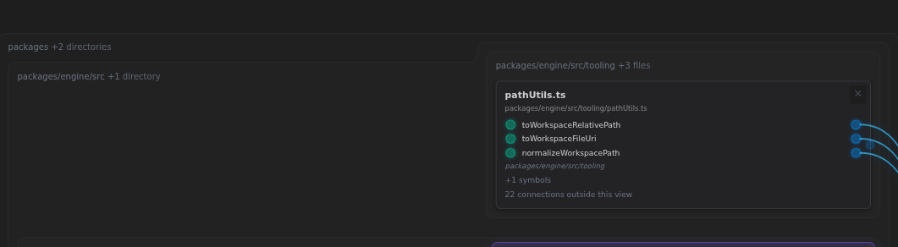
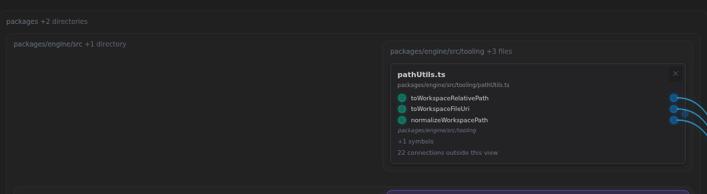

# A small membrane step that the current price cannot distinguish

_Historical visual probe, October 13, 2026. A proposed rule, not a product change or an owner-approved default. Source: [the opening request](../../ChatHistory/2026/10/2026-10-13.1.record.md#turn-1)._

The owner defines the desired aesthetics as less work for the eye and brain while presenting identical information. Their example is the small step along the engine directory's top in a generator-focused Local Map. This probe asks whether unused space can remove such a step while keeping the content fixed.

## What was examined

The current Explorer at commit `1e36b33e`, rebuilt from 624 Live Docs. Fresh browser context, 1600×1000 viewport, default filters, direct URL `?view=local&mode=2d&node=packages/generator/src/generator.ts`. Continuing search is disabled for repeatable captures. The owner's exact retained URL was requested; this is a comparable fresh neighborhood, not a claim of matching their screenshot state exactly.

The existing placement rule in [branch-placement.ts](../../../packages/explorer/src/client/views/localView/branch-placement.ts) prices the sum of absolute differences between adjacent membrane tops and bottoms. Membrane Evenness multiplies that distance. A much smaller cost pulls each segment tight around its contents. Labels need room only in the leftmost segment.

At the default evenness of 1, the engine's top is at 96 in column 0 and 68 in column 1: a 28-pixel step. Its parent, packages, starts at 55 in both columns. Lifting the engine's left top to 68 requires lifting the parent's first two segments to 27 so both labels retain their room. The parent's already-existing step toward column 2 grows by the same 28 pixels that the inner step loses. All coordinates are unscaled layout pixels.

The result has fewer turns while keeping exactly the same total priced step distance. The tight-box preference therefore favors the original. Increasing the existing weight cannot distinguish these two equal-distance outlines.

## Pictures

Both crops come from the actual rendered page at the same camera position. The second is an illustration: two membrane paths are redrawn by the shipped [membranePath](../../../packages/explorer/src/client/views/localView/membrane-outline.ts) function with the proposed segment tops, and their labels move with them. No product source was changed. It is not an implemented general layout pass.

| Current outline | Illustrated alternative |
| --- | --- |
|  |  |

## Checks and limits

- All 18 card geometries and all 71 rendered connection-path records were exactly equal before and after the final illustration. This is a rendering check; path count is not asserted to equal the number of semantic references.
- Total top/bottom step distance across drawn membranes: **1,513 → 1,513** layout pixels. Nonzero top/bottom steps: **7 → 6**. One step corresponds to multiple corners in the drawn polygon.
- No browser errors. The illustration expands outlines into empty space above the engine group; file disclosure, row order, wires and camera remain fixed.
- Existing weight comparison: evenness **1** and **2** both leave the 28-pixel engine step and the wire-placement cost at **21,438**. At **5**, the step remains 28 pixels and the wire-placement cost rises to **21,530**. This is one scope, not a verdict on that setting everywhere.
- The first comparison correctly failed its equality check because camera inertia was still moving the scene. Waiting for zoom and releasing the pan with zero velocity made the final comparison stationary; no equality threshold was relaxed.
- The illustrated path does not update the application's scene model. A production implementation must update all containing boxes, including the invisible root, and retain containment, sibling separation, label clearance and transition correspondence. Those general cases have not been implemented or verified by this probe.

## Proposed next experiment

Give simpler boundaries a preference when a modest expansion can remove an unnecessary turn. First test that with cards and wires fixed, then compare sparse and dense repository views, the Java warehouse and the C# estate. Judge extra empty area, interference with other groups and motion beside the pictures. A rule that makes one screenshot calmer but weakens hierarchy elsewhere is not established by this result.

The mathematical choice remains open: total step distance is a linear objective; counting turns is a different objective and cannot honestly be added by merely increasing its weight. Discuss the desired tradeoff before selecting the general implementation.
