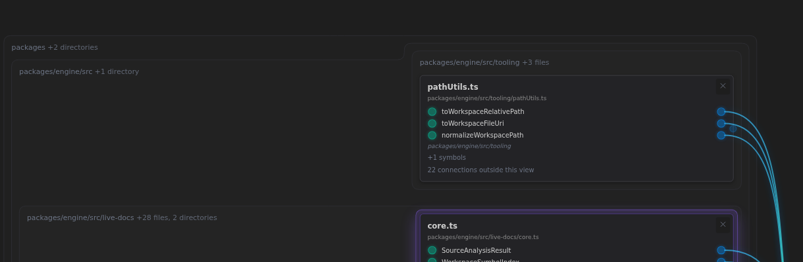
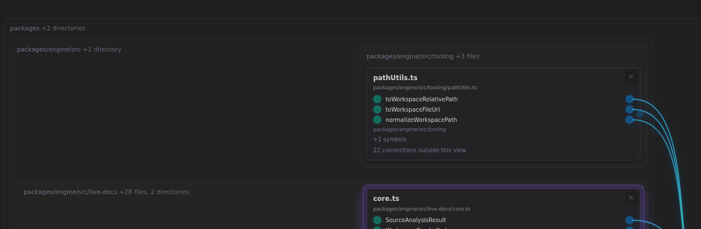

# October 13, 2026 — Simpler Local Map boundaries

Pictures from the final 632-file repository bundle and 35-file estate bundle, after the full verification command passed. They implement [the owner's preference for weighted competition](../../ChatHistory/2026/10/2026-10-13.1.record.md#turn-2--recovered-owner-scope-reply), following the [earlier isolated outline probe](../../Probes/2026-10-13/membrane-steps.md).

The comparisons change only Membrane Simplicity from 0 to the new default 100. Both sides use the new implementation, default evenness 1 and row levelness 0, and let continuing search settle in fresh browser contexts. These are comparisons of preferences, not screenshots of two different releases. Overview viewports are 1600×1000. Each pair preserves exactly the same card/symbol identities and rendered semantic-reference set; no browser errors were observed.

## The original kind of step, close up

Actual production rendering at the same requested zoom and framing, cropped to 1220×400. Unlike the earlier probe, the alternative comes from the model and its complete placement constraints.

| Simplicity off | Default 100 |
| --- | --- |
|  |  |

## Representative views

| Scope | Simplicity off | Default 100 | Steps | Weighted vertical wire cost | Picture size, layout pixels |
| --- | --- | --- | --- | --- | --- |
| Generator neighborhood | [Overview](generator-0.png) | [Overview](generator-100.png) | 7→4 | 21,438→21,438 | 2639×1716, unchanged |
| Warehouse report | [Overview](warehouse-report-0.png) | [Overview](warehouse-report-100.png) | 2→1 | 4,231→4,231 | 4121×617, unchanged |
| Estate five-file scope | [Overview](estate-five-files-0.png) | [Overview](estate-five-files-100.png) | 8→4 | 20,136→21,152 | 3160×1504→3160×1383 |
| Repository five-file scope | [Overview](repository-five-files-0.png) | [Overview](repository-five-files-100.png) | 41→33 | 220,071→220,200 | 3926×3382, unchanged |

The generator opens directly on [generator.ts](../../../packages/generator/src/generator.ts), without adding pins. The warehouse retains [Report.java](../../../tests/integration/programs/java/warehouse/src/main/java/com/acme/warehouse/report/Report.java). The other two use the named retained scopes in [the shared deck definitions](../../../tests/e2e/scopes.ts). Tests are shown. The retained URLs show assets; the generator's fresh direct URL uses its default asset filter.

The four pairs contain 18/7/20/49 cards and 61/26/77/271 distinct rendered reference identities respectively. The wire-cost column is the placement's weighted vertical distance, not the length of every drawn Bézier curve. Aesthetic judgment remains visual: the estate accepts some extra vertical routing for fewer boundary turns and a shorter picture; the generator and warehouse gain simpler grouping without larger picture bounds or increased wire cost.

## Motion and repeated tuning

- [Before the slider change](generator-motion-before.png): simplicity 0 after search settles.
- [During the transition](generator-motion-middle.png): the actual intermediate frame, with the selected generator card held in place.
- [After the transition](generator-motion-after.png): simplicity 100 after re-layout and refinement from the previous picture.

The motion capture uses 1800 ms moves to make intermediate shapes inspectable; the application default remains 450 ms. Its 319 sampled frames include 294 moving frames. All 18 cards remain; the selected card's maximum measured displacement is 0.001555 screen pixels. The browser regression separately checks live intermediate outlines, wrapper identity and the existing 1.5-pixel focus tolerance.

The previous-order start finds a different arrangement from a fresh entry. At simplicity 50, compactness keeps a remaining 28-pixel engine step: aligning it needs 14 extra pixels of overall height, priced at 70. At 100 the join wins with unchanged vertical wire cost. This is the intended competition between preferences, not an unconditional flattening rule. Named Compact/Geometric presets remain a proposal.

## Verification

`npm run safe:commit -- --e2e` passed: 973 unit tests, 52 integration tests and 100 browser tests, plus lint, build, test type-checking, complete 632-file regeneration/lint and all documentation, asset and symbol audits. Final regeneration found every mirror unchanged. Exact browser/headless final geometry is checked for estate and warehouse; the suite also retains directory containment, routing and navigation audits. The [session record](../../ChatHistory/2026/10/2026-10-13.1.record.md) preserves the intermediate failures and their corrected causes.
