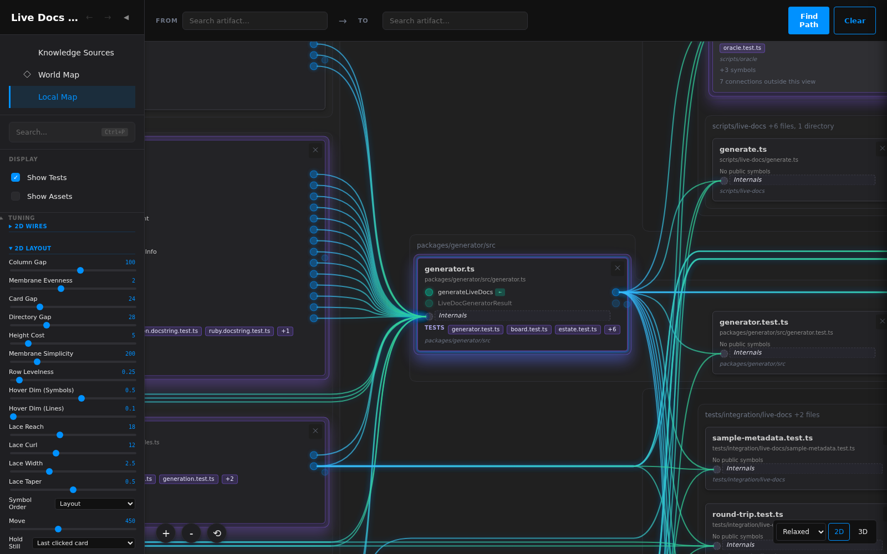
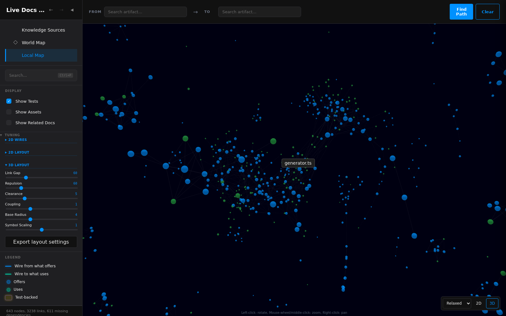
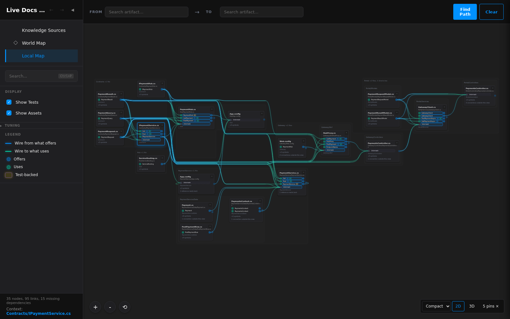
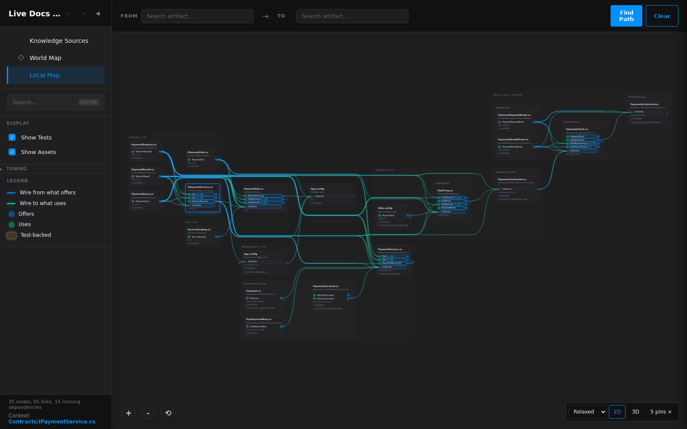
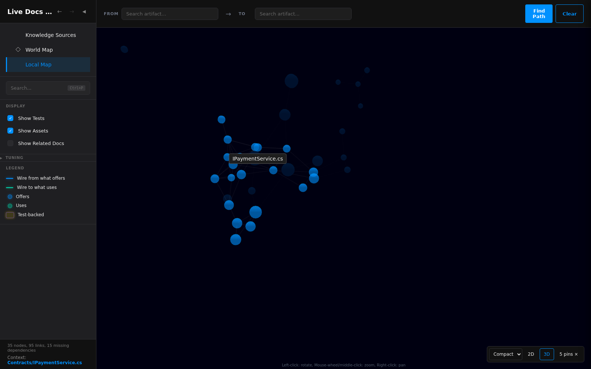
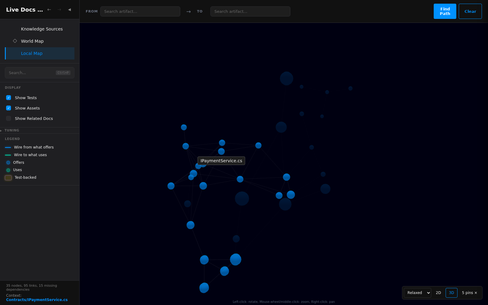

# Compact / Relaxed in both Local Map representations

_Historical implementation evidence, October 13, 2026. Captured from the verified 643-file repository and 35-file estate bundles after the full required check passed. The [owner approved this grammar](../../../ChatHistory/2026/10/2026-10-13.1.record.md#turn-6--shared-presets-and-advanced-tuning-approved-for-implementation)._

The shared selector is beside 2D/3D. Compact favors packing; Relaxed favors clearance and regularity. Tuning exposes the underlying controls, with the active representation’s group open. Changed packing values read Custom; coupling and symbol-size values survive preset selection.

| 2D controls | 3D controls |
| --- | --- |
|  |  |

## Estate comparison

| 2D Compact | 2D Relaxed |
| --- | --- |
|  |  |

| 3D Compact | 3D Relaxed |
| --- | --- |
|  |  |

## All six scopes

Every picture is 1600×1000. The 2D overviews use public zoom and pan gestures after the entry camera settles; they show grouping at overview scale, while the motion pictures below retain reading size. The 3D pictures enter from the corresponding native 2D view and retain its subject anchor, so background context can extend beyond the frame. Apparent sphere sizes also depend on camera depth.

The generator is a fresh direct link with the default asset filter; the warehouse and four named deck scopes retain their files and show assets. Tests are shown throughout. No page errors were observed. Each 2D pair preserves exactly the same file/symbol and rendered semantic-reference identities. The 3D renderer and command share the same counted graph and force parameters; presets leave coupling and symbol scaling unchanged.

The generator subject is [generator.ts](../../../../packages/generator/src/generator.ts). The warehouse retains [Report.java](../../../../tests/integration/programs/java/warehouse/src/main/java/com/acme/warehouse/report/Report.java). The other sets are the repository/estate five-file and chain lists in [the shared deck scopes](../../../../tests/e2e/scopes.ts).

| Scope | 2D Compact | 2D Relaxed | 3D Compact | 3D Relaxed |
| --- | --- | --- | --- | --- |
| Generator neighborhood | [Picture](generator-2d-compact.png) | [Picture](generator-2d-relaxed.png) | [Picture](generator-3d-compact.png) | [Picture](generator-3d-relaxed.png) |
| Warehouse report | [Picture](warehouse-2d-compact.png) | [Picture](warehouse-2d-relaxed.png) | [Picture](warehouse-3d-compact.png) | [Picture](warehouse-3d-relaxed.png) |
| Repository: five files | [Picture](repository-five-files-2d-compact.png) | [Picture](repository-five-files-2d-relaxed.png) | [Picture](repository-five-files-3d-compact.png) | [Picture](repository-five-files-3d-relaxed.png) |
| Repository: chain | [Picture](repository-chain-2d-compact.png) | [Picture](repository-chain-2d-relaxed.png) | [Picture](repository-chain-3d-compact.png) | [Picture](repository-chain-3d-relaxed.png) |
| Estate: five files | [Picture](estate-five-files-2d-compact.png) | [Picture](estate-five-files-2d-relaxed.png) | [Picture](estate-five-files-3d-compact.png) | [Picture](estate-five-files-3d-relaxed.png) |
| Estate: chain | [Picture](estate-chain-2d-compact.png) | [Picture](estate-chain-2d-relaxed.png) | [Picture](estate-chain-3d-compact.png) | [Picture](estate-chain-3d-relaxed.png) |

| Scope | Cards / reference identities | Compact bounds / steps | Relaxed bounds / steps |
| --- | ---: | --- | --- |
| Generator neighborhood | 18 / 61 | 2527×1636 / 4 | 2639×1716 / 4 |
| Warehouse report | 7 / 23 | 3981×617 / 1 | 4121×617 / 1 |
| Repository: five files | 52 / 246 | 3730×3480 / 32 | 3898×3725 / 28 |
| Repository: chain | 52 / 235 | 4349×3847 / 16 | 4545×4000 / 13 |
| Estate: five files | 20 / 58 | 2936×1203 / 5 | 3160×1448 / 3 |
| Estate: chain | 14 / 40 | 2816×777 / 2 | 3040×909 / 1 |

The bounds are unscaled layout pixels. This is a preference comparison on one implementation, not a claim that one preset dominates every measure. The [tuning and headless reports](../../../Probes/2026-10-13/layout-presets/README.md) preserve the candidates, selected settings and space/routing tradeoffs.

## Motion and state

- 2D Relaxed → Compact: [before](2d-before.png), [during](2d-middle.png), [after](2d-after.png).
- The 2D capture sampled 105 frames; maximum selected-card displacement was 0.001036 screen pixels.
- 3D Compact → Relaxed: [before](3d-before.png), [during](3d-middle.png), [after](3d-after.png).
- The 3D capture sampled 196 frames; selected-label anchor displacement was 0 screen pixels.

These use the normal 450 ms 2D move duration and live 3D reheating. The same exercise changed advanced controls by keyboard, exported their settings, restored them in a fresh context from the shared URL, and returned between perspectives. The browser regressions also cover an unfinished initial camera fit, zero-duration wire redraw, related-document filters, and control-label geometry.

## Verification

`npm run safe:commit -- --e2e` passed: 988 unit tests, 52 integration tests, all 104 browser tests, lint, builds, test type-checking, all 643 mirrors unchanged on regeneration, and documentation/asset/symbol audits. No product source changed between that pass and these captures. The [session record](../../../ChatHistory/2026/10/2026-10-13.1.record.md) preserves the failed attempts and corrections.
