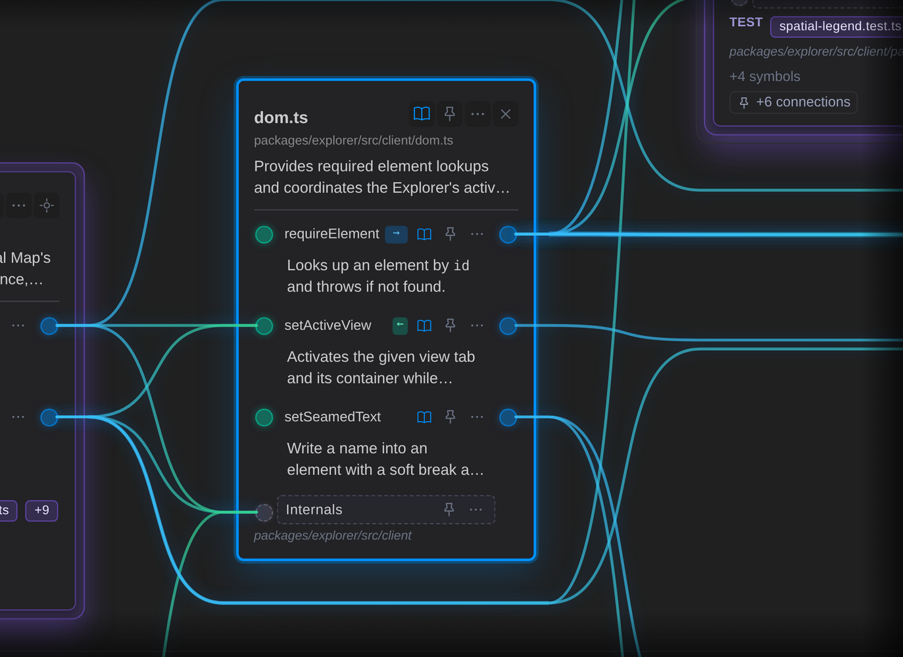

# Live Documentation

**Live Documentation turns a folder of source files into a map you can look at.**

It writes one markdown file for every source file, saying what that file offers to the rest of the code and what it uses. Those markdown files are the product. The Explorer, a static site you can host or hand to a colleague, and the command line both read them and nothing else. It runs offline, calls no model and makes no network request.



A file as the Local Map draws it: what it uses arrives on the left in green, and what it offers leaves on the right in blue.

**[Open the live demo](https://jfjordanfarr.github.io/Live-Documentation/)**, which is this repository mapped by itself.

## Why it exists

Two things its author wanted, in their words:

> We want to be able to look at directories and understand their contents well, especially if those contents have interconnectivity of some kind.

> I just want to be able to show non-software people what I do and they can _see it_ the way I understand it. I don't want to keep drawing bespoke diagrams.

So the map is made from the code, not drawn by hand. It is regenerated when the code changes, and a view of it is a link you can send.

## Map your own repository

Live Documentation is not yet published to npm. Run it from a clone, with Node.js 22 or newer, and point it at your folder:

```bash
git clone https://github.com/jfjordanfarr/Live-Documentation.git
cd Live-Documentation
npm install
npm run build

npm run live-docs:generate -- --workspace <folder>
npm run live-docs:visualize -- --workspace <folder>
npx http-server dist/explorer -a 127.0.0.1 -p 8766 -c-1
```

Then open `http://127.0.0.1:8766/`.

- `generate` writes the markdown into `<folder>/.live-documentation/source/`, one file per source file. Add `--dry-run` to see what it would write first. This repository's thousand files take a few minutes.
- `visualize` builds the Explorer into `dist/explorer/` in this checkout. Copy that folder to any static host to share it.
- The Explorer has to be served, as the last line does. A browser will not let a page opened as a file read the data beside it, and the page says so if you try.
- In a git repository, files that git ignores are left out. Elsewhere, name build output to leave out in the [configuration](#configuration).
- Every command prints its options with `--help`, for example `npm run live-docs:generate -- --help`.

To try it without a repository of your own, leave out `--workspace`: the same three commands map this one.

## What you can ask it

In the Explorer:

- **What does this file offer, and who uses it?** The Local Map draws a file as a card: what it offers on its right edge in blue, what it uses on its left in green, and wires to the files on either side. Pin the files you care about and the picture keeps them.
- **What is in this directory?** Open a directory on the Local Map to see its files side by side, or switch to 3D to see the same files as a graph you can turn.
- **How does this reach that?** Search for a file, then choose **Path to** another, and the map shows the shortest route between them.
- **Which files matter most?** Knowledge Sources lists the most used files, the files that use the most, where the program starts and what nothing reaches.
- **How do our systems talk to each other?** The World Map shows several systems as pieces on a board, with a door wherever one offers or uses an address, and wires between the doors. You describe the board in one markdown file; the doors and wires come from the code.
- **How did it get this way?** Run `npm run live-docs:history` before building, and the 3D map can play the repository's commits as changes to the picture.

Whatever you are looking at is in the address bar. Send the link, and a colleague with the same build sees the same thing.

At the command line, the same questions, here asked of this repository:

```bash
# What depends on this file?
npm run live-docs:inspect -- --from packages/generator/src/generator.ts --direction inbound

# How does one file reach another?
npm run live-docs:inspect -- --from scripts/live-docs/generate.ts --to packages/engine/src/live-docs/core.ts

# Where does the program start, and what does nothing reach?
npm run live-docs:inspect -- --reachable
```

Add `--workspace <folder>` to ask them of your own, and `--json` for output a script can read.

## What it writes

A Live Doc is ordinary markdown. Headings are the file's public symbols and links are its dependencies, so the map can be read, searched, diffed and reviewed like any other file in the repository. Shortened, one looks like this:

```markdown
# packages/explorer/src/client/errors.ts

## Authored
### Purpose
What the Explorer says when it cannot start, or stops.

## Generated
### Public Symbols
#### `reportFatalExplorerError`
- Type: function
- Source: [source](../../../../../../packages/explorer/src/client/errors.ts#L56)

### Dependencies
- [`template.detail-panel`](../shared/template.html.mdmd.md#symbol-detail-panel)
```

The generated sections are rewritten on every run. The authored section is yours: say what the file is for, and the Explorer shows your words on its card. Commit the Live Docs with the code, and a pull request shows what a change did to the shape of the system.

## Languages

- **TypeScript and JavaScript**, resolved by the TypeScript compiler.
- **C#, Python, Java, Go, Rust, C and C++**, parsed with tree-sitter and resolved by each language's own rules for namespaces, packages, modules and includes. The results are measured against each language's compiler.
- **PowerShell**, including modules, dot-sourcing and manifests. No PowerShell installation is needed.
- **Ruby**, for symbols and requires.
- **ASP.NET markup** (`.aspx`, `.ascx`, `.cshtml`, `.razor`), connected to its code-behind.
- **.NET configuration and SQL**: the addresses and connection strings in `web.config` and `app.config`, and the procedures, tables and views in `.sql` files.
- **Project manifests**: `.csproj`, `packages.config`, `package.json`, `Cargo.toml`, `pyproject.toml`, `go.mod`, `pom.xml` and `.psd1`.
- **HTML, CSS and JSON**, for the files they reference.

Support is deeper in some languages than in others; every one of them lands in the same markdown.

## Configuration

None is required. To change where the Live Docs go, what is left out or which board the World Map draws, put a `.live-docs.config.json` at the root of the folder being mapped:

```json
{
  "root": ".live-documentation",
  "baseLayer": "source",
  "extension": ".md",
  "exclude": ["**/obj/**", "**/bin/**"],
  "board": "board.md"
}
```

[Getting started](.mdmd/layer-1/guides/getting-started.mdmd.md) lists every setting.

## Privacy

- The generator, the commands and the Explorer build make no network request and send no telemetry.
- The Explorer page reads only the site that serves it, and its content security policy refuses anything else.
- Nothing runs at install time: there are no `preinstall` or `postinstall` scripts.

[SECURITY.md](SECURITY.md) says how to check each of these yourself.

## How it differs

Google CodeWiki, Windsurf Codemaps and GitLab Knowledge Graph answer related questions from a hosted service or inside an editor. Live Documentation's answer is files in your own repository: they work offline, they are versioned with the code, any tool that reads markdown can read them, and the licence is MIT.

## Guides

- [Getting started](.mdmd/layer-1/guides/getting-started.mdmd.md): installation, configuration and a first session.
- [Tracing impact](.mdmd/layer-1/guides/tracing-impact.mdmd.md): what a change will touch, and how one file reaches another.
- [Visualizing your codebase](.mdmd/layer-1/guides/visualizing-codebase.mdmd.md): the Explorer's views, sharing and hosting.
- [CLI reference](.mdmd/layer-1/guides/cli-reference.mdmd.md): every command and option.

## Where it stands

The map of a single repository is what works today, and it is still changing week to week. The World Map is younger. The 3D view takes a while to settle on a repository of a thousand files. [The vision](.mdmd/layer-1/vision.mdmd.md) says where it is going.

This repository is built by one person working with AI coding agents, and the whole record of that work is kept in [AI-Agent-Workspace](AI-Agent-Workspace/README.md). Contributors run `npm run safe:commit` before committing.

## License

MIT.
